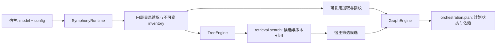

# Symphony Runtime 统一配置与检索编排接口收敛

## 2026-11-09 已确认接入方案

用户在本会话明确要求执行“SymphonyConfig 运行链路接入计划”，据此沿用本设计标识进入开发。配置模型继续以 D-20261031-1614-symphony-config-contract 的分层 Pydantic 契约为基础；本节替代以下旧草案中的检索模型服务、Source 注入和兼容安排。旧章节仅保留决策历史，不再用于开发验收。

- Runtime 仅接收 `model` 与 `config`，复制并固定路径；构造不扫描、不构建、不调用模型、不启动后台任务。新增公共变量使用 capability 命名。
- Runtime 负责扫描、指纹、TreeEngine、GraphEngine、Discovery 会话和默认 Flow 的组装，入口为 `retrieval`、`orchestration`、`flow`。保留 `capture_graph_snapshot()` 和 `submit_evolution()`。
- 首轮只实现 skill 读取器；其他枚举显式报不支持。业务消费者直接使用统一子模型；删除重复配置与 RetrievalModelConfig，不保留旧构造、配置别名、旧 YAML 解析或旧缓存签名兼容。
- 树与图构建入口提供 status/read/build/cancel_build；进度与附属产物回调按 build 调用传入。Discovery 会话的目录、权限、来源、冻结预算和索引版本属于调用上下文，不增加 Source 层。
- 构树通过注入的原生 Model.invoke 执行，保留同步算法调度，在所属事件循环调用模型，处理超时、取消、重试、截断和用量。Runtime 不关闭宿主模型。
- `model=None` 可查询状态、读取产物和进行无模型发现；构树服从回退配置，构图和规划明确拒绝缺少模型。禁用能力可查询状态，执行入口拒绝。
- 指纹并发取构图与提取上限较小值；构图和规划共用 min_edge_confidence。动态观测开关只控制规划是否消费观测。
- Flow 惰性组装，按调用创建受限存储视图；宿主继续负责用户隔离、确认和安装授权。临时规划 Runtime 关闭 Flow。
- 新布局为 artifact_root 下 inventory/cache/tree/graph/flow，带布局与集合身份。不同集合拒绝复用目录；旧产物明确拒绝并要求重建，不自动删除或迁移。签名包含内容、相关构建策略、协议与模型身份；展示、规划与 Flow 阈值不能无故使树失效。
- Swarm 直接构造 Core 配置，负责目录、环境、产品缺省和会话模型解析。检索、编排、Flow 缺省关闭，共同阈值0.5、共识false、Flow成功次数3；模板显式并发4、匹配批量16、提取批量2保留。null由宿主解析为有效bool。构建使用宿主默认模型，在线编排使用会话模型。
- Swarm 工具与 Rail 共用 Discovery 会话，保留全局目录与会话附加目录边界、动态禁用、冻结预算及索引版本。显式上下文容量优先，缺省从会话模型解析。设置面板演进开关同时保存 Flow 与动态观测开关。
- 按 Core 配置/模型消费、Runtime接口、Swarm接入、跨仓验证顺序推进；分别形成 Core/Swarm 提交，Swarm全部Core依赖和锁文件固定到含新接口提交。

验收通过真实入口和模型替身验证配置消费；覆盖构造惰性、模型缺失/类型/路径/快照/关闭，构建增量/并发/超时/取消/回退/原子发布/失败保留，Discovery可见性和冻结，fast/beam与观测，Flow隔离和单次启动，YAML拒绝旧字段、null、面板保存，以及实际固定Core依赖的确定性跨仓流程。仅运行相关行为测试，不运行格式化和静态检查。实际实现、审查修复、验证结果及未完成项归档到 feature，不回填为设计事实。

## 历史草案（2026-10-29 至 2026-10-31）

以下内容只保留当时方案及理由。与上节冲突的配置、接口、读取器范围和兼容安排均已失效；`config.example.yaml` 由本次当前配置示例替换。

## 1. 已确定的方向与当前事实

用户已明确的方向：

- Runtime 构造只接收 `model` 和 `config`，目录放在配置中；宿主不再注入公开的 Source 对象。
- 对象统一称为 capability，公共变量、结果和方法使用通用命名。`skill` 可作为具体格式的枚举值，`SKILL.md` 继续是相应格式的入口文件。
- 对外能力名为 `retrieval`、`orchestration`，内部引擎名为 `TreeEngine`、`GraphEngine`，产物目录为 `tree/`、`graph/`。
- Skill、专家、Connector、MCP 使用同一接口，按类型独立建树、建图；暂不纳入 Tool / MCP Tool 节点。
- 专家支持多专家协作规划；Connector/MCP 表达对象选择与前置依赖。规划结果由宿主交给执行系统。
- 新公共名称直接替换旧名称，不增加兼容别名；旧持久化产物的读取兼容单独处理。

2026-10-31 核对的 Core 现状：

| 当前实现 | 对本设计的约束 |
| --- | --- |
| `runtime.py` 构造接收 provider、artifact root、fingerprint service 等，暴露 `graph_engine`，并有旧服务别名 `orchestration`。 | `SymphonyRuntime(model, config)` 是待实现的替换接口。 |
| `agent/retrieval_toolkit.py` 已有索引构建、树浏览、可见对象过滤；独立自然语言检索在 `retrieval/search/runtime/`。 | 需要把现有能力接入 TreeEngine，并适配同一个 Model；不能把当前 toolkit 直接改名后声称检索已经接入。 |
| `FingerprintSettings` 默认关闭 LLM 提取，关系构图仍依赖模型。 | 默认 `metadata` 提取不代表整个构建无需模型。 |
| `OrchestrationConfig` 同时供构图和规划使用置信度阈值；`top_k` 传给 beam planner。 | 阈值保留一个配置位置，明确 fast 与 beam 的参数适用范围。 |
| Runtime 已有图快照、演进提交及可选 Flow 依赖，根 `__init__.py` 导出多组公共对象。 | 构造替换需要清点这些消费者，不能只修改 Swarm 的构图入口。 |

2026-10-29 曾核实的 Swarm 构图入口负责扫描、指纹、差异、版本附属产物和应用任务状态。本次其本地分支已经切换到 `xiaoyi_0.2.4.beta3`，早先检查的目录布局不能直接作为迁移基线。实施前需固定两个仓库的分支、提交及 Core 依赖版本。

## 2. 配置草案

### 2.1 最小输入

```yaml
capability_root: ./capabilities
capability_type: skill
artifact_root: ./.symphony
```

只要求三个字段。其余使用下表默认值。`retrieval` 和 `orchestration` 默认都启用；启用只表示允许调用，Runtime 创建时不扫描、不构建、不调用模型。只使用检索时可设置 `orchestration.enabled: false`。

每个 Runtime 管理一个对象类型和一套产物目录。其他类型改为 `expert`、`connector` 或 `mcp` 并使用各自的根目录、产物目录；不将多个类型混在同一棵树或同一张图。新增类型时由 Core 增加内部格式读取器，不要求调用方创建 Source。

### 2.2 公共字段与校验

下列默认值是本方案建议值，尚未成为生产契约。配置必须可序列化；未知字段报错，防止拼写错误被静默忽略。

| 字段 | 类型 / 默认值 | 含义与校验 |
| --- | --- | --- |
| `capability_root` | 路径，必填 | 明确的对象定义根目录；非空。首次扫描时必须存在且可读。 |
| `capability_type` | 字符串，必填 | 本期目标值：`skill`、`expert`、`connector`、`mcp`。不能靠目录名猜测类型；尚未实现的读取器明确报不支持。 |
| `artifact_root` | 路径，必填 | Runtime 产物根目录；非空，可由首次构建创建。一个目录只能绑定一个对象集合。 |
| `retrieval.enabled` | 布尔，`true` | 独立控制检索入口。 |
| `retrieval.build.max_depth` | 正整数，`6` | 分类树的最大深度，沿用当前树构建参数语义。 |
| `retrieval.build.branching_factor` | 整数，`128` | 分类节点最大分支数；建议校验 `>= 2`。 |
| `retrieval.build.max_concurrency` | 正整数，`2` | 单次树构建的模型请求并发上限，映射现有 `max_workers`。 |
| `retrieval.build.request_timeout_seconds` | 正有限数，`420.0` | 单次构建模型请求超时，单位秒。整个任务的时限由调用方管理。 |
| `retrieval.search.top_k` | 正整数，`10` | 最多返回的候选对象数。允许单次 `search()` 覆盖。 |
| `retrieval.search.max_parallel_branches` | 正整数，`3` | 单次检索最多并行探索的分支数；`1` 表示串行。 |
| `retrieval.search.request_timeout_seconds` | 正有限数，`120.0` | 单次检索模型请求超时，单位秒。 |
| `orchestration.enabled` | 布尔，`true` | 独立控制编排入口。 |
| `orchestration.min_edge_confidence` | 有限数，`0.7` | `[0, 1]`；构图接纳关系和规划使用关系的共同阈值。 |
| `orchestration.build.extraction_mode` | 枚举，`metadata` | `metadata`：确定性元数据提取；`llm`：追加模型语义提取。二者均保留内容哈希和内部指纹。 |
| `orchestration.build.max_concurrency` | 正整数，`1` | 单次图构建内模型请求的总并发上限，覆盖提取、关系解析各阶段。 |
| `orchestration.build.require_consensus` | 布尔，`true` | 保留当前 Core 关系判定的一致性策略；开启时使用两次判定。 |
| `orchestration.plan.mode` | 枚举，`fast` | `fast` / `beam`。可以在单次 `plan()` 覆盖。 |
| `orchestration.plan.top_k` | 正整数，`3` | beam 搜索保留宽度与最多输出方案数；fast 不使用此字段，生成一个方案。 |
| `orchestration.plan.max_depth` | 正整数，`4` | 规划展开深度，沿用现有规划器语义；不表示树或目录扫描深度。 |
| `orchestration.plan.dynamic_graph_enabled` | 布尔，`false` | 规划是否使用已有图观测结果；不表示自动构图、自动学习或执行。 |

整数拒绝布尔值、浮点值和隐式字符串转换；布尔字段只接收真正的布尔值。超时和置信度拒绝 NaN / Infinity。未提供的块逐层补默认值；显式 `null` 不能代替配置块。启用开关为 false 时仍校验该块，避免下次启用才发现配置错误。

路径在 Runtime 创建时相对进程工作目录解析并固定，不随后续 cwd 变化。若宿主期望相对 YAML 所在目录解析，宿主先转为绝对路径。两者路径不能相同，`artifact_root` 不能是 `capability_root` 的祖先；若产物位于对象根目录内，扫描器必须明确排除该产物子树。不同根目录或不同类型复用已绑定产物目录时直接报错，不能覆盖已有集合。

两组能力都关闭的配置允许创建，用于应用统一管理配置；各能力 `status()` 返回禁用状态，其余入口返回明确的禁用错误。仅关闭编排时，检索不加载图谱或强制生成语义指纹。

### 2.3 默认值来源与有意收敛

- 分类树深度、分支数、构建并发和请求超时沿用 `SkillIndexBuildConfig`。自然语言检索 `top_k` 统一取宿主 toolkit 的 `10`，不同于底层 `ProgressiveRetrieverConfig` 的 `5`；并行分支上限沿用后者的 `3`。这是目标整合选择，需用实际候选质量验证。
- 自然语言检索首期使用生成式分支选择，通过 Core `Model` 适配；不要求模型提供 logit scoring。分支浏览的编码、展开层数等保持为内部策略，不混用不同现有检索器的默认值。
- 图构建并发沿用当前关系解析默认值 `1`。该上限统一约束提取阶段，因此开启 LLM 提取时，其并发默认从独立指纹服务的 `4` 收敛为 `1`。这是控制单次构建负载的有意变化。
- 构图阈值和共识判断沿用 Core 默认值。Swarm 如有不同设置，由迁移适配器显式传入，不能让 SDK 新默认值静默改变宿主行为。
- 两个引擎并行构建时，各自的并发上限独立生效；这不是跨 Runtime、跨模型的全局限流配置。

### 2.4 保留在内部的策略

本期不再公开 `scan`、`fingerprint`、`source` 或任意透传 `graph_config` 配置块。宿主不用选择 scanner、构造服务、计算 fingerprint signature 或准备 snapshot。

扫描使用现有的递归和安全预算：不跟随符号链接、不读敏感文件、限制条目与累计字节数，排除产物目录。对象内容与资源变化共同进入内部 inventory revision；解析错误进入诊断。基础目录不可读、集合身份冲突和无法可靠确认删除的扫描失败须终止发布，不能把失败误判成对象被删除。

提取批量大小、文本裁剪、指纹协议版本、缓存键、关系候选上限和 IO 映射上限由内部实现管理。默认 `metadata` 沿用现有确定性提取；字段不足时返回诊断或 `no_plan`，不能猜造输入输出。需要更完整语义时由调用方显式选择 `llm`。

已有消费者若依赖非默认扫描范围、提取上限或树构建策略，实施阶段先列出差异。只有确认是必须保留的宿主策略，才返回本设计增加有类型的字段；不能无声丢弃配置，也不增加 `extra: dict` 逃逸口。

### 2.5 不进入配置的内容

| 内容 | 放置位置 |
| --- | --- |
| 模型实例、连接、凭证、模型响应计量策略 | `model` 及宿主模型适配器。配置中不再出现第二套 `LLMConfig`。 |
| 查询、候选 ID、语言、会话可见对象、实时就绪检查 | 每次 `search()` / `plan()` 参数。 |
| 强制构建、进度回调、应用产物准备回调 | 每次 `build()` 参数；应用 hook 在原子发布前执行。 |
| 请求 ID、任务 checkpoint、任务整体时限、用户执行确认 | 宿主应用的任务与执行层。 |
| inventory revision、构建模型身份、内容哈希、缓存签名 | Core 生成的版本 manifest 与结果引用。 |

## 3. 配置对象与目标调用方式

使用强类型、不可变配置。建议类型对应为 `SymphonyConfig`、`RetrievalConfig`、`RetrievalBuildConfig`、`RetrievalSearchConfig`、`OrchestrationConfig`、`OrchestrationBuildConfig`、`OrchestrationPlanConfig`；字段结构与 YAML 一致。统一提供 `SymphonyConfig.from_dict()` / `to_dict()`，默认值与校验只维护一份，不维护独立 YAML 默认表作为第二个事实源。

```python
config = SymphonyConfig.from_dict({
    "capability_root": "./capabilities",
    "capability_type": "skill",
    "artifact_root": "./.symphony",
    "orchestration": {
        "build": {"extraction_mode": "llm"},
    },
})

runtime = SymphonyRuntime(model=model, config=config)
try:
    # 首次准备或显式刷新；查询不自动触发构建。
    await runtime.retrieval.build(progress=on_progress)
    await runtime.orchestration.build(progress=on_progress)

    matches = await runtime.retrieval.search(
        query,
        visible_capability_ids=visible_ids,
    )
    # selected_ids 由宿主从 matches.items 中按实际任务筛选。
    plan = await runtime.orchestration.plan(
        query,
        candidate_ids=selected_ids,
        inventory_ref=matches.inventory_ref,
        visible_capability_ids=visible_ids,
    )
finally:
    await runtime.aclose()
```

以上是目标示例。`model`、`query`、`visible_ids`、`selected_ids` 和 `on_progress` 均由宿主提供；不把所有命中项无条件送入编排。Runtime 关闭自身创建的引擎任务及线程资源，不接管调用方注入的模型生命周期。

`model` 在类型上允许为 `None`，便于离线查询状态、读取已有树/图。构建需要模型的阶段、自然语言 `search()` 和 `plan()` 在调用时检查依赖；缺少模型时明确报错。已有树的浏览不强制调用模型。构造只做配置校验、路径固定和服务装配。

对外主要操作统一为：

| 能力 | 主要入口 | 内部实现 |
| --- | --- | --- |
| 检索 | `runtime.retrieval.status/read/build/cancel_build/search`，以及已有树浏览能力的通用适配 | TreeEngine |
| 编排 | `runtime.orchestration.status/read/build/cancel_build/plan` | GraphEngine |

配置字段 `retrieval.build/search`、`orchestration.build/plan` 与动作对应；`tree`、`graph` 用于内部结构与产物。新例子不再出现 `runtime.graph_engine`、`runtime.retrieval_engine` 或服务兼容别名。当前观察提交、Rail 和 Flow 相关契约另列迁移清单，不因上表只列主要入口而删除。

## 4. 内部数据与版本边界



树与图使用同一套内部对象描述和原始内容哈希。检索保留完整描述/正文，不被迫退化成图构建的 IO 指纹。共享缓存按类型、对象身份、原始内容、提取策略和模型身份区分，避免同名对象或模型变化误命中。

同一次引擎构建持有一个不可变 inventory；两个引擎分别构建时，确认目录未变化后可复用该 inventory 和提取缓存。目录有变化则取得新 revision。独立调用 `retrieval.build()` 与 `orchestration.build()` 不承诺跨引擎原子发布；检索到编排的衔接必须校验版本。

建议产物结构：

```text
artifact_root/
  inventory/  # 集合身份、不可变内容清单与描述
  cache/      # 可重建的提取等缓存；不是已发布版本的事实来源
  tree/       # 独立版本与 current 指针
  graph/      # 独立版本与 current 指针
```

`matches.inventory_ref` 至少携带集合标识、对象类型和 inventory revision。将检索结果交给 `plan()` 时同时传引用与筛选后的 `candidate_ids`；GraphEngine 校验所属集合、图版本与对象存在性。版本不一致返回明确错误，提示刷新相关产物，不静默按同名 ID 套用。

候选与可见范围都是单次调用输入：`candidate_ids=None` 表示在本次可见图范围内规划，`[]` 表示没有候选并返回 `no_plan`，不得扩大为全图。`visible_capability_ids=None` 表示宿主没有附加可见性限制，`[]` 表示不可见任何对象；多租户宿主必须每次传入授权范围。不能在共享 Runtime 上保存可变的会话过滤器。

Connector/MCP 目录只存静态定义。实时连接、授权和其他前置条件通过本次规划的 readiness 回调核实；缺少条件映射为 `needs_input` 或明确不可用诊断。`ready` 仅表示计划已满足规划条件，执行前仍由宿主做授权与状态检查。

配置变化的新鲜度规则：

| 变化 | 处理 |
| --- | --- |
| 对象类型、目录集合身份变化 | 新集合；拒绝覆盖不匹配的产物根。 |
| 原始内容、对象集合、解析协议变化 | 相关树/图过期；语义指纹未变也不能掩盖内容变化。 |
| 树深度、分支数、树构建协议/模型身份变化 | 树构建身份变化。 |
| 提取模式、关系阈值、共识策略、图构建协议/模型身份变化 | 图构建身份变化；按依赖决定指纹缓存能否复用。 |
| 并发上限、请求超时变化 | 改变调度策略，不单独使已有产物过期。需从当前部分混合签名中拆开。 |
| 检索参数、规划参数、能力启用开关变化 | 影响后续调用，不重建静态产物。 |

常规 `status()` 使用已发布产物中的构建模型身份比较内容和构建配置，不因当前在线模型变化自动将离线产物标为 stale；纯状态查询不调用模型。显式 `build()` 使用本次注入模型的身份决定复用并记录 manifest，因此更换模型后主动构建可以产生新版本。

`search()` / `plan()` 使用已发布的快照，不在每次查询时全量扫描目录；结果携带版本，需判断磁盘变化时显式调用 `status()`。构建在发布前复核输入身份。图谱、指纹、manifest 和应用附属产物均完成后才条件切换 current；失败、取消、hook 失败或提交冲突保留旧版本。版本指纹必须使用本次构建的不可变返回值，不能重新读取可能被并发覆盖的根缓存文件。

## 5. 实施计划

按配置优先的顺序实施；每步完成后才推进依赖它的工作。

| 阶段 | 交付 | 通过条件 |
| --- | --- | --- |
| P0 配置定稿 | 本文、完整 YAML、当前参数到新配置的映射；清点两个仓库消费者和非默认配置。 | 三个必填项足够装配；默认值、校验与身份影响一致；所有被移除的宿主设置都有去向。 |
| P1 实现配置模型 | 新的强类型配置及 `from_dict/to_dict`；先不改现有运行链路。 | 最小输入补全默认；完整配置可往返；未知项、非法数值、路径冲突与不支持类型有清晰错误。 |
| P2 统一内部 inventory | 目录读取器注册、通用 descriptor、共享内容哈希和提取缓存；先接通现有 Skill 路径。 | 不要求宿主构造 Source/scanner/fingerprint；单次构建输入一致；新增、修改、删除和扫描失败可区分。 |
| P3 装配 Runtime 与两种引擎 | 构造收敛为 `model/config`；TreeEngine 接入现有构建/浏览/搜索，GraphEngine 接管扫描到发布；统一模型适配。 | 独立启停、只读无模型、检索不依赖图、计划不执行、资源关闭及原子发布成立。 |
| P4 对象与消费者迁移 | 增加 expert/connector/mcp 目录适配；专家协作及连接前置依赖；更新 Core 导出、Rail/Flow 消费处及 Swarm 接入。 | 四类对象分离建树建图；会话可见范围与 readiness 独立；Swarm 的任务日志、checkpoint、token 计量和响应语义保持。 |
| P5 契约与回归交接 | 更新 README、例子及当前 spec；公共名称直接替换；记录旧产物迁移和不兼容 API 清单。 | 核对真实 SDK/Swarm 入口；旧数据可读或明确要求重建；目标用例得到证据，记录到开发 F 文档。 |

初期代码影响范围是 `openjiuwen/symphony/{runtime,graph_engine,orchestration,agent,retrieval,shared/fingerprint}` 及其导出和测试。Swarm 的具体文件清单在固定迁移分支后填写，不能沿用另一条发布分支上的路径作修改依据。

现有 runtime 的 `flow_engine` 注入需要在 P0 明确迁移位置：本轮不扩展 Flow 配置，但 P3 替换构造前必须确定其内部装配或独立接入方案，并覆盖 `submit_evolution/capture_graph_snapshot` 的现有消费者。该问题是实施前依赖，不影响先编写这两组配置模型。

## 6. 兼容取舍与验收场景

公共 API 按用户要求直接迁移，不维护 `skill_id/add_skills` 等旧名称别名。SDK 根导出、文档、测试、Swarm pin/锁文件及仓内其他消费者需在同一次发布边界完成切换；声明这是不兼容的 API 变更。独立评估、Flow 等模块的行为不因接口收敛而随意删除。

持久化兼容独立于 API 命名：旧图、旧树能可靠读取时提供只读转换；缺少可验证集合身份或内容清单时报告需要重建，不伪造 fresh，不原地改写旧版本。Swarm `graph_state.json` 若仍有消费者，迁移前明确兼容写入或替换；新权威归 Core manifest。

主要验收场景：

1. 最小配置、完整配置、只检索、只编排、两个能力关闭、缺少模型，以及各类非法字段的结果符合字段表。
2. 四种目录适配得到通用对象；不同类型的同名 ID、不同根目录、不同会话不会相互污染；不支持的格式不会静默按 Skill 读取。
3. 扫描增改删、坏文件、源内容变而语义不变，状态与版本更新正确；扫描失败不能发布错误删除。
4. 模型适配保留当前宿主禁用 thinking、输出长度策略及计量；检索生成式搜索无需额外模型客户端或凭证配置。
5. 构建失败、取消、准备回调失败和并发条件提交冲突保持旧 current；版本内 inventory、fingerprint 与 graph 对齐。
6. 检索独立工作；检索到编排校验集合和 revision；空候选、空可见范围不扩大搜索；只使用筛选后的授权候选。
7. 专家多对象协作计划、Connector/MCP 的前置条件检查得到正确的 `ready/needs_input/no_plan`；生成计划不会触发执行。
8. 真实 Swarm status/build/cancel/resume、UI/API 字段、Rail 观察与既有 Flow 接入在迁移后有对应验证。

设计阶段仅定义验证预期；实施后按变更运行必要测试，不运行仓库禁止的格式化或静态检查。测试证据与实现偏差写入后续 F 文档，不在本稿宣称已通过。

## 7. 修订记录与待确认点

- 2026-10-29：初稿聚焦目录型 Skill 图谱工厂、扫描/指纹内化和 Swarm 构图接入；当时提出保留低层构造及兼容入口，未获整体批准。
- 2026-10-31：依照用户后续明确方向，改为通用 capability、移除公共 Source 层、构造只接收 model/config、接入检索，并统一 retrieval/orchestration 与 tree/graph 命名。保留原稿的内容变化判定、模型身份、版本原子发布、宿主 checkpoint 责任和旧产物读取约束。
- 2026-10-31：按“先把配置项写出来”的要求形成本文配置表与完整 YAML。默认值选择、内部参数收敛和具体类型加载规则仍是本次草案；没有将用户对总体方向的认可记成对尚未展示配置的批准。

实施前需要在 P0 核实：Swarm 的实际迁移分支与非默认参数；expert/connector/mcp 的目录格式样本；旧 `graph_state.json` 消费者；现有 Flow/Rail 装配的迁移位置。当前状态保持 `draft`，先评审配置，再进入 `jw-dev`。
