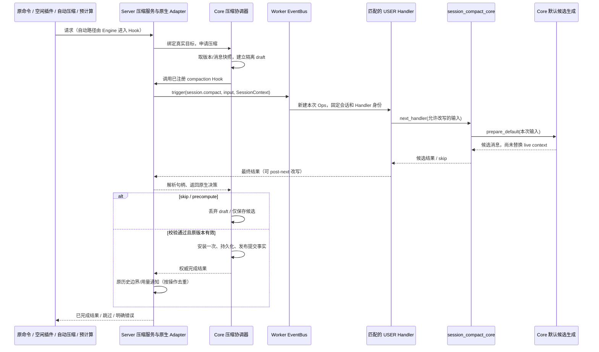
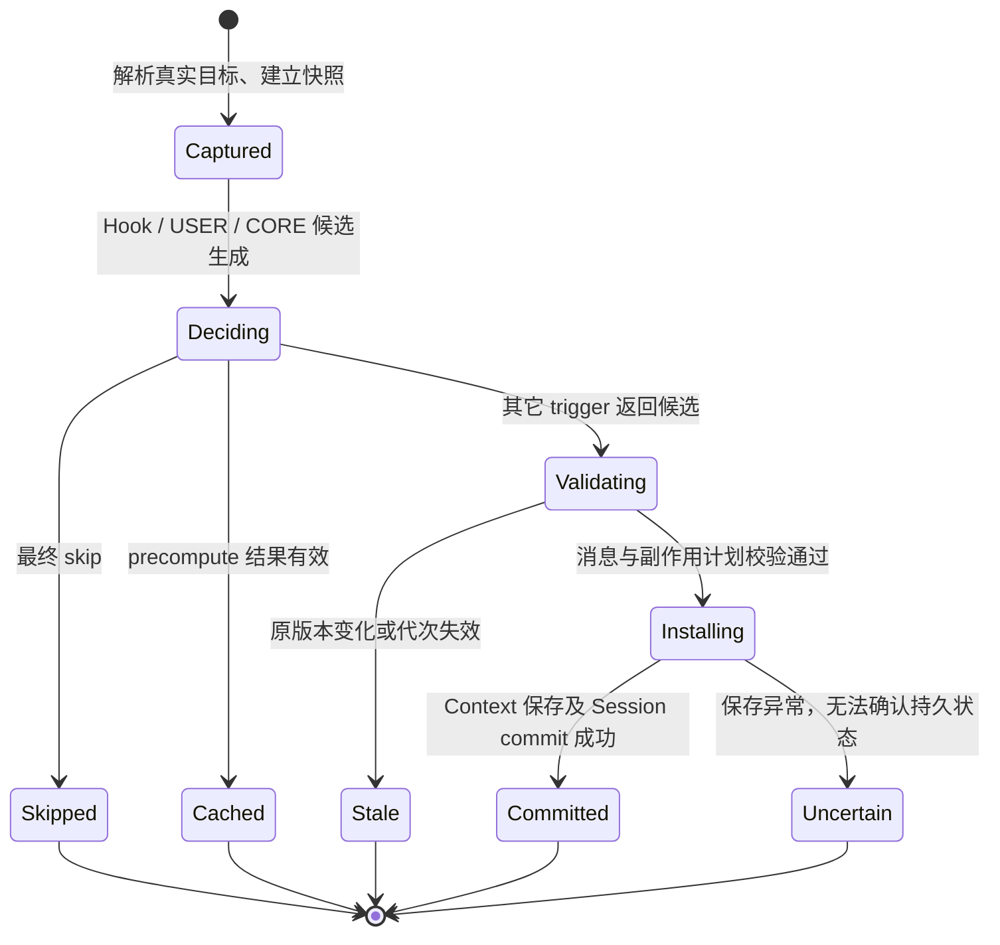

# Core 与 Server 会话压缩扩展方案

**2026-11-03 范围修订（用户确认）：** 本轮仅交付 Ops/Event 接口及独立 Handler 链，真实主流程接入暂缓，已有桥接调用以注释保留。下述完整压缩方案保留为后续目标；本轮默认不绑定生产引擎，也不拦截原手动/自动/溢出流程。具体实施与验证由关联 F 文档记录，恢复主流程时另行确认验收范围。

## 1. 设计定位与阅读说明

本方案已于 2026-11-03 获用户明确确认（“开发吧 验收后给我PR”），进入开发阶段。实现与验证证据另归实施文档。本文件不记录实现通过或上线结论。

目标是让扩展参与一次真实的会话压缩：可以补充摘要要求、选择参与压缩的消息、返回自定义结果，或者用 `skip` 跳过本次压缩。手动压缩、自动压缩、插件调用和预计算共用同一条处理链。Server 的公开字段及用户案例详见本任务的 `jiuwenswarm/extensions_v2/docs/features/F_28_session-compact.md`，采用 session.append 的七节格式。这里维护跨仓职责、Core API 和提交机制，不另建 Server designs/session-compact 文档。

阅读顺序：第 2 节看当前入口和目标；第 4、5 节看候选与生效边界；Server F_28 看逐字段填写和完整调用示例；第 8 节看开发后如何取证。

## 2. 背景、目标与范围

### 2.1 已核实的现状

源码基线为 Core `86990bd16a0aa4ef900c2255fa3a3c828f4c57de`、Server `36e353db753390720744a1505dbc4b2db086251c`，对照时间 2026-11-03。

| 当前入口/机制 | 源码事实 | 对本次设计的影响 |
| --- | --- | --- |
| Server `AgentWebSocketServer._handle_command_compact` | 调用 Adapter 的 `compress_context`，手动白名单是 MessageSummaryOffloader、RoundLevelCompressor；之后处理历史边界、摘要、统计和通知 | 复用命令与原有压缩算法，不把“加事件”变成替换产品压缩策略 |
| Core `ContextEngine.compress_context` | 调用 context 压缩；compressed 时保存上下文并 commit Session | 生效、持久化仍由 Core 承担，不能在 USER 中伪造完成 |
| `SessionModelContext.compress_context`、ADD/GET 自动处理器路径 | 使用处理器锁；处理器可以直接 `set_messages`，修改上下文和内部状态 | 仅在已有方法外包一层 EventBus 不足以支持 post-next skip/改写 |
| `ContextEngine.recover_from_model_exception` | 确认上下文溢出、且流式未发出可见 chunk 时尝试一次压缩恢复 | 对应 auto；保留只恢复一次及不重复已输出前缀的条件 |
| `register_window_mutator` | 在窗口处理器之后修改最终窗口 | 不能充当压缩前 veto，也不能覆盖主动压缩和 pending ADD 消息 |
| Core EventBus / Ops | 原设计基线有 handler_ids；当前上游已撤回该参数，Ops 只有包/会话公共属性 | 保持当前上游接口；调用有效性归 Extension Runtime，不增加 Handler 身份或排除参数 |

现有压缩状态通知及 SDD-0022 的观测方向继续有效。压缩后的观测与本方案的压缩前决策是不同职责，本方案不替代 SDD-0022。

### 2.2 目标场景

| 场景 | 目标行为 |
| --- | --- |
| 用户执行原 `/compact` 对应的 command.compact | trigger=manual；USER 补充“保留任务约束”，默认压缩生成候选，整条链返回后才安装 |
| 原生引擎到达压缩阈值或发生可恢复的上下文溢出 | trigger=auto；进入同一事件链；被 skip 时本次压缩不改写上下文，不绕过插件偷偷再压一次 |
| 插件在两轮之间调用 Ops | trigger=plugin；绑定当前真实会话，正常运行匹配的压缩 Handler；同会话重入和忙碌请求在触发前拒绝 |
| 宿主发起后台预计算 | trigger=precompute；只准备和缓存候选，不安装、不写产品压缩历史；以后前缀仍有效才可能复用 |
| USER 在 next 返回后改写结果或返回 skip | 默认 CORE 尚未替换真实上下文，因此最终结果仍能决定本次是否生效 |

### 2.3 范围与明确差异

本次方案完整覆盖四种 trigger 的**原生主会话**链路，以及现有默认手动处理器、原生自动压缩轨道启用的内置摘要处理器。普通 offload、micro compact 的内部维护不因命名包含 compact 就全部冒充一次会话摘要事件。

Server 首次实现不开放按用户提供的 agent_id 定位子 Agent。字段保留 agent_id=None，主会话不填写；Core 使用真实 context_id 隔离，为后续子循环接入留下接口。Team/外部 Harness/Claude CLI 进程的内部压缩不在首轮承诺内，不能把其调用返回 noop 写成已支持。

不修改前端，不接 ui.render，不把 JSONL 产品历史直接当作正在压缩的模型上下文，不自动压缩所有查询 Ops，也不宣称与 Claude 实际宿主运行时二进制兼容。

## 3. 设计约束、假设与待决问题

1. Claude 对照固定为 anthropics/claude-code 提交 `bf2323b3021c9d3db7a31e1e7d61068c3f704497` 的 Mods 类型声明。它是公开契约依据，不是本项目的已运行证据。
2. 公共字段只携带可复制数据；真实 Session、Core continuation、消息句柄映射、Processor、提交权限留在平台私有调用状态中。
3. `SessionContext` 提供当前会话身份和平台事实；`ops.session_context` 是 Core 绑定的只读属性，不是另一个收集/组装上下文的 Ops。压缩原始消息由绑定身份解析到的活跃 ContextEngine 读取。
4. 不能通过改共享 processor prompt、注册表 monkeypatch 或“先真压缩再恢复”实现插件决策。已有 save_state/load_state 不构成外部文件、记忆库写入的事务回滚。
5. 当前默认轨道含可能写文件/会话记忆的处理器。实现前必须逐个迁移其候选与延迟副作用接口；不支持安全准备的处理器在本能力启用时明确报不支持，不能退回提前修改 live context 的旧路径。
6. 设计确认事项是本文件的 D-01～D-05、Server F_28 契约和第 8 节验收范围。API 名称为本方案的目标签名，尚未加入 SDK；开发中若关键语义变更须返回设计确认。

确认依据：用户于 2026-11-03 明确要求按方案开发并验收交付 PR。处理器适配和真实模型效果仍待开发验证，不是已消除的实施风险。

## 4. 总体方案与设计取舍

### 4.1 总体链路



自动压缩的起点在 Core 真实处理器触发处，由 Hook 回到 Server EventBus；它不需要绕回 Web 请求，也不依赖 notify_context_usage。

### 4.2 关键决策

**D-01：Core 统一拦截真实压缩，Server 只做领域适配。** Core 不导入 Server EventBus、SessionCompactInput 或产品历史服务；Server 注册一个宿主 Hook，将 Core 原生请求变成 session.compact。代价是要修改 Core 的 ADD、GET、主动压缩和溢出恢复入口；收益是自动与主动不会出现两套语义。验证 C-01、C-02、C-12。

**D-02：先准备候选，整条链结束后安装。** 处理器通过隔离 draft 和延迟副作用计划工作；默认 CORE 返回候选，USER 可前置、短路或 post-next 改写。Core 只在最终结果有效时安装。代价是迁移有状态处理器和文件/记忆写入，而不是只加一个 callback。验证 C-03～C-07。

**D-03：消息 handle 是本次调用内的原生消息引用。** 保留 handle 恢复完整消息并忽略其公开文本改写；去掉 handle 则按公开角色/文本/工具块重建。不能把 session.messages 查询结果当成完整 live snapshot。代价是要管理调用内句柄和 ToolMessage 投影，验证 C-04、C-11。

**D-04：保持 EventBus 接口，插件调用限制在有效包 Handler 和空闲会话。** Runtime 包 Handler 包装记录当前 Ops、任务及有效期；Server 通过只读校验判断调用来源。原事件与 compact 事件天然分开，同会话压缩内重入在第二次事件前拒绝，不需要来源排除参数。不能用“处理器锁没占用”代替真实空闲；auto 不套用外部空闲门禁。验证 C-08、C-09。

**D-05：预计算是可失效缓存，提交事实仍只有一处。** 保存原生候选而非公开 handle；安装时重新进入对应 manual/auto/plugin 决策链，默认 continuation 才可复用缓存。候选前缀、策略/模型/包代次变化则失效。代价是缓存和前缀验证；验证 C-10、C-13。

### 4.3 排除方案

| 方案 | 排除理由 | 重新评估条件 |
| --- | --- | --- |
| 只在 Server command.compact 外触发事件 | 漏掉自动 ADD/GET、模型溢出；无法阻止内部提前修改 | 用户另行决定缩到手动-only 范围 |
| 用最终 window mutator 代替 Hook | 已晚于摘要/卸载副作用，也覆盖不到主动入口 | 仅需要临时模型窗口修改时另行设计 |
| CORE 先调用旧 compress，再允许 USER 改写返回 | skip 已无法撤回真实修改，precompute 也会污染 live context | 不作为本契约备选 |
| 按整个包排除 Handler | 同包其它 Handler 也被排除，不符合 Claude 只跳过调用者的含义 | 无 |
| 所有异常都改成 skip 或偷偷默认压缩 | 会掩盖提交失败，或覆盖插件明确 veto | 无 |

## 5. 详细设计

### 5.1 模块责任与不变量

| 模块 | 新增/调整责任 | 继续复用 |
| --- | --- | --- |
| Core context_engine | 压缩前 Hook、draft、原生候选、安装/恢复边界、预计算缓存 | 上下文池、消息校验、真实压缩算法、TokenCounter、Session 保存 |
| Core extension Runtime | 活动 Handler 的 Ops/任务/有效期；只读 is_active_invocation 校验 | EventBus、Ops、Builder、matcher、执行顺序与故障隔离保持上游契约 |
| Server 原生 Adapter/压缩服务 | 从已授权会话解析 engine；注册/注销 Hook；命令/Ops 共用准入和后处理 | 原 Worker、会话实例、目录/模型绑定、压缩历史与用量通知 |
| Server event_types/session_compact.py（拟新增） | dataclass、matcher、输入输出校验、事件注册 | 不放 notify、真实 engine 查找或业务 trigger |
| Server session_compaction/dispatch.py（共享实现） | 私有调用状态、消息 codec、句柄解析、bus.trigger、结果转换 | 与 query/history 调用状态模式一致，但不复用其提前提交语义 |
| Server event_handlers/session_compact.py（拟新增） | 唯一 session_compact_core，校验固定事实、调用默认 prepare | 不直接替换 live context |
| Server handler_ops/session_ops.py | ops.build 登记 compact 代理，调用绑定压缩服务 | 现有七项只读代理及 append 保持现有契约 |

不变量：同一目标同时最多一个安装操作；最终 skip 不安装 draft；precompute 不安装；USER 没有目标切换和提交权限；一次调用最终最多安装一次；返回成功不能早于安装及要求的 Session commit；产品历史不是 live context 的权威数据源。

### 5.2 拟新增 Core API

以下为目标 API 草案；对应新模块拟放在 `openjiuwen/core/context_engine/compaction.py`，并从 context_engine 包公开导出。为避免把 Server 消息协议下沉，全部使用原生 BaseMessage。

```python
CompactionTrigger = Literal["manual", "auto", "plugin", "precompute"]

@dataclass(frozen=True)
class CompactionRequest:
    session_id: str
    context_id: str
    trigger: CompactionTrigger
    messages: tuple[BaseMessage, ...]
    instructions: str | None = None

@dataclass(frozen=True)
class CompactionCandidate:
    messages: tuple[BaseMessage, ...]
    tokens_before: int | None = None
    tokens_after: int | None = None

@dataclass(frozen=True)
class CompactionSkipped:
    skip: str

CompactionDecision = CompactionCandidate | CompactionSkipped
CompactionNext = Callable[[CompactionRequest], Awaitable[CompactionDecision]]
CompactionHook = Callable[[CompactionRequest, CompactionNext], Awaitable[CompactionDecision]]

# Added to ContextEngine; registration applies to existing and future contexts.
def register_compaction_hook(self, hook: CompactionHook) -> Callable[[], None]: ...

async def compact_context(
    self, context_id: str = "default_context_id", session: Session | None = None,
    *, session_id: str | None = None, trigger: CompactionTrigger = "manual",
    instructions: str | None = None, processor_types: list[str] | None = None,
) -> CompactionDecision: ...
```

字段说明：session_id/context_id 由已有 Session 和引擎上下文池解析，不由插件事件改写；messages 是经过快照复制的待压缩原生消息，含自动 ADD 尚未安装的 pending 消息；instructions 是本次调用要求，不改处理器共享配置。返回 tokens 是真实测量时的可选值，缺失不填 0。调用者不能通过修改候选的 Token 数制造计量事实。

Hook 是单宿主入口，重复注册不同 Hook 报错；返回的解除函数幂等，只解除对应注册，不清除别的宿主。解除期间在途操作持有旧注册，等待其结束后释放包资源。无 Hook 时原 compress_context 的旧返回码/原有流程继续可用；新 compact_context 仍执行同样的候选与安装校验。Server 开启该能力前核对 Core 新 API 版本，不对旧 Core 静默降级。

原 `compress_context` 的已有参数/返回保持兼容，接入新协调器后将完成/跳过映射到原 compressed/noop/busy 外层协议；新扩展事件使用明确 skip 联合类型。自动 ADD/GET 共用内部协调入口，不为每个普通处理器重复广播事件。

### 5.3 处理器 draft 与默认压缩

新增内部 `CompactionDraft` / `CompactionPlan`；它们不是用户 Ops。draft 持有独立消息缓冲、待添加消息、处理器状态副本、会话记忆覆盖层和暂存文件目录。Processor 的模型客户端等只读资源可复用，有状态字段使用明确的 fork/prepare 接口，禁止笼统 deepcopy 整个 Engine。

现有压缩算法改为向 draft 生成候选及副作用计划。原非扩展入口也通过适配器安装同一候选，避免维护两套摘要算法。需迁移：手动白名单 MessageSummaryOffloader/RoundLevelCompressor，以及原生轨道中启用的 DialogueCompressor、CurrentRoundCompressor、FullCompactProcessor、SessionMemoryCompressor 和对应 forked 算法。micro/offload 维护保持原触发用途；如果参与本次主动压缩计划，其消息/文件变更也必须暂存，不能在事件决策前修改 live context。

自动 ADD：在原 trigger 判定即将摘要后建立一次计划，source 包含 live+pending；放行后正确拆回 retained/pending 或一起安装，pending 只追加一次；skip 只跳过摘要，原消息仍按正常 ADD 提交。自动 GET：用实际 retained 窗口建立计划，保护独立 system/tool 声明；结果安装后重建同一次模型窗口，不能只替换一个局部 window 副本。

多处理器的一次计划按现有顺序在同一个 draft 上运行；同一 ADD/GET 压缩检查周期只触发一次 session.compact。模型溢出另起一次 auto 尝试，保留原“已经有流式可见输出则不重试”限制。纯 token 计数、普通窗口裁剪不触发该事件。

instructions 作为每次摘要请求的独立附加要求传递到实际模型调用；不能只放日志或事件里。固定系统压缩要求优先，用户 instructions 补充保留重点，不修改共享 `_compressed_prompt`。原来读取已提交 session memory 的优化，只有该记忆满足本次 instructions/输入版本要求时才能复用，否则实际重新生成摘要。

默认 continuation 在一次事件调用内最多执行一次。重复 next 的同内容调用复用候选，不重复模型费用；改变内容后再次 next 明确报 COMPACT_CONTINUATION_REUSED。外层 Handler 可改最终结果，但不能让旧 draft 重复执行安装。

暂存文件按最终保留消息的依赖发布；未引用的文件删除。会话记忆游标、Processor 摘要级别等派生状态按最终消息重算/失效，不能把已被 USER 放弃的默认候选状态一起安装。无法表示为延迟计划的外部写入不能进入可 veto/precompute 的默认准备阶段，必须先完成该处理器适配。

模型摘要请求已经发生的费用和 trace 不回滚；skip 的保证是“不安装本次上下文替换、不发布本次历史边界”，不承诺取消已经发送的模型请求。插件自己执行的额外外部操作也不由压缩框架回滚。

### 5.4 Server 字段映射与句柄

Claude 的 agentId/tokensBefore/tokensAfter 对应 Python dataclass 的 agent_id/tokens_before/tokens_after；嵌套 SessionMessage 沿用现有七查询的 JSON 键 toolUses/toolResults/isError。完整必填、默认值、样例和改写权限由 Server F_28 第 3、4 节维护。

handle 是每次事件的随机不透明标识，只能引用**本次快照或本次默认候选**的消息；不能是消息序号、会话 ID、文件路径或持久化权限凭据。映射持有原生副本，不直接暴露 live BaseMessage。CORE 生成的新摘要也进入本次映射，next 返回后的 Handler 才能保留它而不损失私有元数据。

原生 User/Assistant 投影到同名 role；独立 ToolMessage 投影为 user + toolResults，由 handle 恢复真实 ToolMessage。引擎保护的 system 指令、工具 schema 不作为可删除消息开放；允许压缩的历史系统提示/边界若投影为 user 视图，保留 handle 时仍恢复原生类型。去掉 handle 即显式按公开 user/assistant 构建，不暗中保留原系统权限。

校验未知/跨调用句柄、重复句柄、工具调用配对/次序、非法 role、不可序列化工具参数和未完成工具片段。不自动编造工具结果。保留原消息 handle 时忽略对 text/tool 块的改写，用户若要改必须去掉 handle；工具链不完整的构造返回错误，不强行补齐。无结果和 skip 同时出现、两个分支同时填写、空 skip 均为非法输出。

输入只读保护字段沿用本地 dataclass 契约，replace 时保留 trigger/agent_id，不支持把 dataclass 替换成缺少身份字段的任意字典；这一点不同于 Claude JS rewrite 自动补回 agentId 的语法便利。

### 5.5 当前 Handler 及事件路由

保持上游 EventBus.trigger(event, context)、EventHandlerOps 与 Builder.build 的公共接口和行为，不新增调用级筛选或排除参数。

Core Extension Runtime 的既有 _tracked_handler 包装已维护活动 Ops 和包在途计数；在同一包装内记录当前调用帧（Ops、asyncio Task、active）。新增 Runtime.is_active_invocation(ops) 只读校验：对象、当前嵌套层、任务及有效期必须一致。Handler 返回、异常或取消时关闭调用帧并恢复外层；复制 ContextVar 不延长寿命，子任务不能借父任务的 Ops。原 begin_calls/end_calls 及 store 行为不变。

Server 装配通过回调注入此校验，compact 服务不接受用户传入校验器。只有 Runtime 发布的 USER/BUILTIN 包 Handler 可调用公开 compact Ops；宿主手动和自动入口仍使用已有可信服务。非受管直接注册、手工构造、后台复制和过期 Ops 均失败。

原事件中的 Handler 本来不匹配 session.compact；压缩 Handler 内再次压缩同一会话在触发第二次事件之前拒绝（COMPACT_BUSY 或 COMPACT_REENTRANT）。不排除整个包、函数或任意匹配 Handler，不提供通用精确排除能力。

### 5.6 状态、准入与锁



manual/plugin 先通过 Worker 原执行状态申请目标会话独占操作，阻止新 query 入场，并在取得 Core 处理器锁后复验；不是 Front 的瞬时 busy 字段。处理完成或失败后释放。auto 已在当前执行的 Core 串行处理内部，持有处理器锁完成本次决策，不重复申请会话外部锁。

precompute 在短临界区复制快照，之后不持 live 锁等待模型。每会话/上下文仅一项候选任务；新建 live 操作不等待后台模型，旧候选通过版本校验决定是否缓存。所有路径均固定 `(worker_generation, session_id, context_id)`，卸载/删除/模型重建使缓存与旧身份失效。

Hook 期间默认只做候选计算，不能再调用需要当前同一处理器锁的能力。readonly usage 消费已有快照；不能隐式重入现场 token/window 生成。Handler 的超时与故障隔离沿用 Bus；框架/引擎异常不能被包装成插件 skip。

### 5.7 三条具体执行路径

**手动：** command.compact → 原 Adapter 找到原生会话 → 公共压缩服务取得空闲独占 → Core compact_context(manual) → Hook 收集可信 SessionContext 和活跃消息快照 → Bus USER → 可选 BUILTIN → session_compact_core → Core 默认 prepare → USER 返回最终结果 → 校验/安装/commit → 原命令写一次历史边界并反馈。用户无需改原业务函数。

**插件：** 已绑定空闲会话的用户入口 → USER 调用 ops.session.compact(instructions=...) → ops.build 登记的服务代理 → 校验本次 Ops/包/会话和空闲 → Core compact_context(plugin) → 同一 Hook/普通 Bus 调用，不传筛选/排除参数 → 相同 prepare/最终安装 → 返回权威结果到调用者。没有 SessionContext 时明确报错；不从全局“最近一次会话”猜测。

**自动：** 原生 ADD/GET trigger 判定需要摘要（或可恢复溢出）→ Core 建计划 → 宿主 Hook → session.compact(auto) → USER/CORE 候选 → 最终安装后继续原模型请求。skip 时不修改待压缩会话内容；若原请求仍超窗，按原模型失败/上下文不足语义结束，不能无限触发相同 auto 或绕过 skip。

### 5.8 预计算与复用

Core 新 compact_context(trigger="precompute") 为真实入口。Server 默认不主动增加后台模型调用；拟提供默认关闭的配置 `context_engine.compaction_precompute.enabled=false`，启用时由**真实回合结束并释放运行占用后**的宿主回调申请预计算，窗口利用率达到配置 ratio（默认 0.8，必须在 0～1 内）才执行。不是 notify 的监听 Handler 自动抢锁，也不是每次 token 事件都发起。

缓存存原生候选和来源指纹，不存公开 handle；容量每目标一项，下一次替换/会话结束/删除/worker 退出时释放。只能在原消息仍为当前消息的相同前缀、suffix 是完整追加且工具配对不跨界、模型和处理器配置相同、包发布代次相同、instructions 相同、记忆依赖未失效时复用；安装候选时把合法 suffix 原样接回。任一条件不满足丢弃缓存重新压缩。

安装时仍发起实际 trigger 事件，USER 可以再次 skip 或改写；默认 prepare 才决定缓存命中。precompute 不提供 tokens_after，实际安装前重新计数；其消息 handle 不跨事件复用。预计算失败只清候选并记录错误，不结束原会话；不自动无限重试。

### 5.9 安装、持久化、取消与恢复

安装前校验 context 版本、原生消息、最终文件依赖、处理器状态和固定身份。Core 保留旧缓冲/状态至保存完成，先发布最终必需的暂存文件，再安装内存状态并执行原 save_contexts/Session.commit。文件与 Session 不宣称跨存储原子事务：文件发布后 commit 前崩溃可能留下未引用文件，回收按引用与操作状态清理，不能提前删仍被 durable 状态引用的文件。

安装之前取消：丢弃候选/暂存文件，live 不变，传播 CancelledError。进入安装阶段后在受保护的有界收尾任务中完成保存或记录确定失败；调用方取消不等于回滚成功。保存抛错且 durable 结果不明时返回/抛 COMPACT_COMMIT_UNCERTAIN，暂停该目标继续执行，要求从 Session 权威记录重载后核对；不恢复旧内存后冒充 skip，也不自动再执行模型摘要。操作 ID 保持平台私有，供诊断/去重，不混进 Claude 公开结果。

只有确定 committed 才发布压缩完成和产品历史边界。auto 的原压缩通知与 manual 的原命令后处理统一使用同一 operation_id 去重；precompute/skip/no-change 不写压缩边界。History/通知失败不撤销已完成的上下文替换，应保留提交事实并按原错误边界报告；不能让用户误认为可以安全重复压缩。

压缩改变模型上下文与其 Session 保存，不删除或批量覆盖历史 JSONL。JSONL 继续留存旧对话并追加原有压缩标记；session.messages 仍按既有历史查询契约工作，不等同于压缩后的 live messages。模型的下一次实际请求必须来自已安装的压缩结果。

### 5.10 错误口径

| 条件 | 目标处理 |
| --- | --- |
| USER 明确返回非空 skip / 默认算法无可压缩内容 | 返回 skip；后者使用可理解原因，不伪造缩短 |
| 无绑定会话、无活跃上下文、目标已销毁 | COMPACT_SESSION_UNAVAILABLE |
| manual/plugin 时仍在执行回合或其它独占操作 | COMPACT_BUSY，事件不进入 |
| 不支持的 Harness/处理器 | COMPACT_UNSUPPORTED，不能以 noop 假冒已支持 |
| 伪造调用、直接无宿主状态 trigger | COMPACT_UNBOUND_INVOCATION |
| 句柄/消息/最终联合结果非法 | COMPACT_INVALID_RESULT；隔离插件无效输出时遵守 Bus 当前下游结果恢复规则，绝不安装未校验数据 |
| 同会话嵌套压缩、变更输入后重复 continuation | COMPACT_REENTRANT / COMPACT_CONTINUATION_REUSED |
| 提交前目标/版本改变 | COMPACT_STALE，不安装；宿主至多重新读取后显式重试一次，不在 Handler 中静默循环 |
| 保存后状态不确定 | COMPACT_COMMIT_UNCERTAIN；冻结并重载核对 |
| 模型/文件错误、取消 | 传播明确失败/取消，不统称 skip |

这些是新模块的目标错误符号；具体沿用 JiuwenException/现有状态码的映射在开发中补齐，不为设计虚构已分配数值码。

## 6. 影响面与实施设计

### 6.1 实施顺序与两个仓库的交付

| 顺序 | 仓库/修改点 | 交付前提 |
| --- | --- | --- |
| 1 | Core context_engine 新增 compaction 原生协议、Hook 与候选安装协调器 | 本方案批准；旧 API 消费者回归 |
| 2 | Core Processor draft/延迟副作用，接入主动、ADD、GET、溢出；每次 instructions 真正到达摘要请求 | 所有本期启用内置处理器逐个通过 skip/失败/状态验证 |
| 3 | Core Extension Runtime 调用有效性校验 | 不改 EventBus/Ops/Builder；嵌套、子任务、过期及复制上下文校验 |
| 4 | Server 注入压缩服务；Adapter 注册 Hook；新增事件、唯一 CORE、Ops 代理 | 依赖 Core 新提交，不自行复制 Core 内部实现 |
| 5 | Server 原 command.compact、auto 状态后处理、opt-in 预计算和独立用户 ZIP 案例 | 原命令参数/响应兼容，所有真实入口联合验证 |
| 6 | 两仓 specs/features、Server plan、既有本地 HTML | 补实际测试结果及版本，不能先写通过 |

Core 与 Server 分别提交 PR，Server 标记依赖具体 Core SHA/PR；Core API 合入可用后才宣告 Server 可独立安装。一个 Server PR 同时交付 event 与 Ops，不拆成“事件已开通但无安全提交后端”。不借此调整已有七查询、send/receive 或生命周期字段。

### 6.2 文档同步

Core：本 D 负责目标方案；批准后由 jw-dev 新 F 记录实际实现与证据，当前有效契约落 Core specs/API 文档。索引使用仓库同步工具生成。

Server：F_28 负责事件+Ops、字段、案例和验收；S_15 维护当前契约，plan EXTV2-28 记录依赖/进展。2026-11-04 仅同步当前计划引用：目标分支 EXTV2-26 已用于 State；compact 当前登记为 EXTV2-28，不改变本方案的已确认设计及验收范围。2026-11-03 按用户要求以当前目录连续编号，接续已有 F_01～F_27 / S_01～S_14；原 F30/S17 仅作为历史别名。本次只调整尚未合入的 compact 文档及跨仓引用，已合入文档不重排；合入前再核对并行新增。

本地《会话工作区Ops开发与完整调用链》在实现时增加 compact：启动登记、业务触发、上下文与消息来源、USER/BUILTIN/CORE、最终安装点、字段和具体函数。保留用户已有插件 A/B 等案例。设计阶段不把 HTML 状态标成已开发。

## 7. 兼容与迁移

既有 command.compact 对外 result/stats/state 保留，由新权威结果适配；skip 映射到原无压缩分支并附可理解原因，busy 保持旧忙碌语义，不能改成 compressed。原先没有 instructions 的客户端不必填写；后续允许命令携带要求时仍由平台解析，不让插件伪造 trigger。

Core 未注册 Hook 的消费者继续旧路径；注册 Hook 的宿主必须使用安全准备协议，不支持的第三方 Processor 明确报告并提示适配。关闭新能力可以恢复后续操作原触发行为，但不能回滚已经提交的压缩或恢复已丢弃的 live 消息；历史文件仍可按原恢复路径使用。外部 Harness 保持其原行为，新的扩展 Ops 明确不支持，不伪造其内部可拦截。

## 8. 验证设计与通过条件

以下均为**开发后的计划，尚未执行**。预期不能由测试运行时复制实际输出生成。

| ID | 实际入口/构造条件 | 通过条件及证据 |
| --- | --- | --- |
| C-01 | 原 command.compact，带真实 native context | manual 事件顺序、真实消息变化、旧命令响应及一次历史边界；不进入 ui.render |
| C-02 | 原生 ADD/GET 阈值、模型溢出恢复分别触发 | auto 覆盖各入口；ADD pending 不丢不重复；GET 下一模型窗口用最终结果；可见 stream chunk 后不恢复 |
| C-03 | USER 改 instructions/source 消息，受控摘要模型 | 捕获摘要模型真实请求，证明确实使用改写要求/输入；不是只断言事件对象 |
| C-04 | 输入及 next 结果的 handle；无 handle 重建、多模态/ToolMessage | 保留句柄时原生私有块完整；去句柄才改写；未知/重复/跨会话句柄及断裂工具链失败 |
| C-05 | 前置 skip、post-next skip、USER 自定义结果 | live/持久状态与最终决策一致；skip 无压缩历史；默认模型已被调用不冒充零费用 |
| C-06 | offload/记忆 Processor 准备后 skip/取消 | 无可见记忆游标变化和 live 替换，无未引用暂存残留；不通过“先写后恢复”伪造 |
| C-07 | 故障注入文件发布/Session 保存前后，提交阶段取消 | 只安装一次；确定失败与未知结果分开；未知时阻止后续执行，重载核对真实持久状态 |
| C-08 | 真实空闲 USER 入口调用 Ops，同时另一请求尝试开始 | plugin 事件绑定正确会话；准入互斥；活跃回合内拒绝且不触发事件；并发锁释放 |
| C-09 | 同包多个 Handler、其它包、CORE，以及 compact 内重入 | 匹配链正常执行，CORE 保留；重入在第二次事件前拒绝；Runtime 拒绝过期、跨任务、非当前 Handler 和伪造 Ops |
| C-10 | 真实 precompute 入口后安装，匹配与变化的前缀/模型/配置/包代次 | 预计算不修改 live/历史，tokens_after 缺失；合法 suffix 保留；失效时重算；安装事件仍能 veto |
| C-11 | 无上下文、外部 Harness、直接 bus.trigger、非法字段 | 在预期边界拒绝；没有用缺依赖或初始化异常代替目标拒绝；无任意目标查询 |
| C-12 | Core 无 Hook、旧压缩调用/消息校验/Session，Server 原手动/自动回归 | 原消费者兼容；新注册/注销后无泄漏；七查询、append、send/receive 不被改变 |
| C-13 | 同一独立原生 Worker 与安装 ZIP，至少一轮真实模型摘要 | 从真实入口观测 USER/CORE/安装；捕获压缩后下一模型请求及 Session 重载结果；真实模型与受控模型证据分别记录；清理 Worker/文件 |

定向单测证明字段和分支；真实装配证明登记/代理/Hook/后端互通；真实模型和重载证明实际模型消费与持久化。远端 CI、Claude 宿主、前端不在未运行时标为通过。每个本期默认 Processor 必须分别覆盖 candidate/skip/state，不能只用一个伪处理器代表整条轨道。

## 9. 设计风险与已知限制

主要风险是现有 Processor 有 live mutation、文件和 Session memory 写入，迁移工作明显多于 Server 加 Event。开发必须逐项列出其读写点；若某个本期默认处理器无法安全准备，先返回设计阶段调整范围，不能保留一个吞错误的兼容分支。

另一风险是持久化与文件不是同一事务，设计已将 uncertain 和回收单列；不能以单元测试保存成功声称具有崩溃原子性。预计算会产生可丢弃模型费用，默认关闭。主会话以外的 agent_id 路由、外部 Harness、Claude 经典 PreCompact Hook 的具体集成不在本期；公开 skip 语义对齐，不代表已实现 Claude 的经典 Hook 宿主。

## 10. 按日期记录的评审与设计修订

- 2026-11-03：用户要求尽量保持 EventBus 接口，并明确确认替代方案、要求实施。本修订替代原 D-04 / 5.5 的 Handler 身份和排除集增量，改由 Extension Runtime 校验调用作用域、压缩模块拒绝同会话重入；其它压缩决策和持久化设计继续有效。

2026-11-03：用户先选择完整 Core＋Server 设计，阅读本方案后明确要求“开发吧 验收后给我PR”，据此批准方案并进入开发；不代表运行验收已通过。

## 11. 参考与交接

- Claude 公开契约：[固定 Mods 类型声明](https://github.com/anthropics/claude-code/blob/bf2323b3021c9d3db7a31e1e7d61068c3f704497/mods/types/claude-code.d.ts)，关注 SessionCompactArgs/Input/Result/Trigger、SessionMessage、ToolUseSummary/ToolResultSummary 和 session.compact 方法注释。
- 已有观测职责：[SDD-0022](../../proposals/SDD-0022-trajectory-observability-framework/design.md)，仅作为相关观测设计，不据此宣称新 Hook 已实现。
- Server 对照模板：`jiuwenswarm/extensions_v2/docs/features/F_16_session-append.md`；本方案详细用户契约：`F_28_session-compact.md`；计划：EXTV2-28。
- 交接：按用户确认进入 jw-dev；Core/Server 分别实施并以 C-01～C-13 交付证据。实施与证据由 F_20261103_1515_session-compaction-events 维护；本文保留开发前设计，不回填运行结果。
