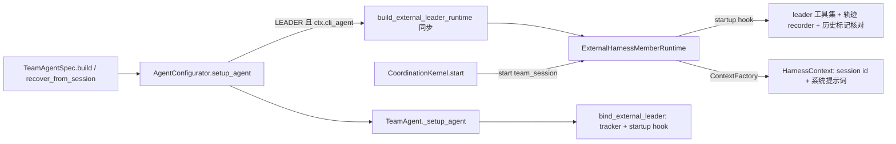

# Leader 三方 Harness 插拔设计方案

## 1. 设计定位与阅读说明

团队成员（teammate）已经可以把"大脑"换成 claude / codex 等三方 Harness，Leader 仍只能跑在
`TeamHarness`（NativeHarness / DeepAgent）上。本文定义 Leader 获得同样插拔能力的方案：数据结构、
装配时机、工具与提示词、生命周期降级和校验。管理字段见 frontmatter；实施结果归档到 features。

## 2. 背景、目标与范围

### 2.1 背景与问题

已核实的事实（基于 `codex/upstream-develop` 当前代码）：

- `MemberRuntime` 接缝是角色无关的：`AgentConfigurator.setup_agent(member_runtime=...)` 接管任意
  runtime，`StreamController` / coordination / `TeamContextTracker` 只认这个表面。
- 团队工具网关 `build_external_team_tool_gateway(role=...)` 与 `build_claude_sdk_mcp_tool_set(role=...)`
  已按 role 参数化，但没有透传 `team_mode` / `bootstrap_mode` / 专家目录 / 额外排除项。
- Leader 的三处硬假设挡住了插拔：
  1. **构建时机**：`build_cli_runtime` 在构建时读 `get_session_id()` 建 join descriptor；Leader 在
     `TeamAgentSpec.build()` / `TeamAgent.recover_from_session` 里 `configure`，此时 session 尚未绑定。
  2. **工具通道**：Leader 工具依赖真实 leader `TeamBackend` 上的回调（成员拉起、模型分配、
     `on_team_built`），进程外 stdio `openjiuwen-team-mcp` 只有最小 backend，接不住。
  3. **NativeHarness 专属能力**：`async_task*` 三个工具与 `swarmflow` 通过 `parent_agent` 访问
     `async_tool_runtime`；fork 通过 `harness.get_deep_agent()` 取快照；`pause` 要求 provider 声明
     `PAUSE_RESUME`（claude / codex 都没有声明）。

### 2.2 目标与关键场景

| 场景 / 触发条件 | 当前行为 | 目标行为 / 可观察变化 |
| --- | --- | --- |
| `leader.cli_agent="claude"`，`build()` 后首轮输入 | 不支持 | Leader 由 Claude Code 驱动，拥有 leader 团队工具集，输出进入团队流 |
| 外部 Leader 调 `build_team` / `spawn_teammate` / `create_task` | 不支持 | 与原生 Leader 相同的工具结果与副作用（建队、成员行、任务行） |
| 同 session 冷恢复 | 不支持 | provider 会话经 Leader 自己的 child AgentSession checkpoint 续接 |
| 冷恢复但 checkpoint 丢失 | 不支持 | 清掉"历史已恢复"标记，`build_team` 仍可调用以重新拿到协同准则 |
| `pause` 一个正在跑的外部 Leader | 抛 `UnsupportedHarnessCapabilityError` | 降级为 graceful abort，会话历史保留，本轮不自动续跑 |
| `leader.cli_agent` 指向适配器 / 三方 provider / 未声明的 kind | 不支持 | `build()` 之前的 spec 校验直接拒绝 |

### 2.3 本次范围与非目标

- 本次包含：`LeaderSpec.cli_agent` 按名引用、Leader runtime 的同步构建与 start 期绑定、leader 工具集
  注入（claude 进程内 MCP / codex Dynamic Tools）、leader 提示词、pause 降级、历史恢复标记收紧、
  spec 校验、单测、spec / feature 文档。
- 本次不包含：外部 Leader 的 fork / checkpoint 工具、团队记忆注入、
  Leader 失败的可靠性上报通道、子进程适配器（gemini / openclaw / hermes）与三方 provider 充当 Leader、
  Leader 自身的工具审批外露（沿用成员默认的自动放行）。

## 3. 设计约束、假设与待决问题

- 已确认约束：`TeamAgent` 单一实现按 role 切换；Spec 只放可序列化装配数据；新增配置一律走
  `TeamAgentSpec`；`agents["leader"]` 仍必填（teammate workspace 兜底与 swarmflow worker 基线读它）。
- 关键假设：
  - claude / codex 的 runtime 构造函数没有真实 `await`，可改为同步（已读代码核实）。
  - Leader 的 child AgentSession 以 leader card id 为 `agent_id`，`external_runtime` 状态键与原生
    `deepagent` 状态互不干扰（实施时用测试核实）。
  - `HarnessIOAdapter` 对 FAILED turn 的输出投影足以让用户在流上看到失败（实施时用测试钉住）。
- 待决问题：无。

## 4. 总体方案与设计取舍

### 4.1 方案概览

Leader 与外部 teammate 共用 `ExternalHarnessMemberRuntime`。差别只有两处：谁持有 TeamAgent 外壳的
生命周期（Runner 对象池 vs spawn handle），以及 session 何时可知。前者不需要改；后者通过"构建期不碰
session、start 期再绑定"解决。

### 4.2 关键决策

#### D-01 Leader 按名引用 `external_cli_agents`

- 选择与依据：`LeaderSpec.cli_agent: str | None`，值必须是 `TeamAgentSpec.external_cli_agents` 中某项的
  `cli_agent`。用户评审时在"内嵌完整配置"与"按名引用"之间选了后者，一份启动配置不写两遍。
- 代价与成立条件：该列表同时是 `spawn_teammate` 外部 CLI 能力的上限，Leader 用的 kind 也会成为
  Leader 可拉起的成员 kind。
- 实现体现：`build()` 把 `leader.cli_agent` 写进 leader 的 `TeamRuntimeContext.cli_agent`，后续装配只看
  `ctx.cli_agent`。
- 确认依据：用户 2026-11-10 评审结论。

#### D-02 外部 Leader 经 `ExternalSwarmflowHost` 持有 swarmflow，不带 fork

- 选择与依据：外部 Leader 的 `swarmflow` 与 `async_task*` 复用上游为外部成员准备的
  `ExternalSwarmflowHost`（每成员一个异步工具运行时，完成结果经 `runtime.send(immediate=False)` 回灌）。
  Leader 的 `setup_agent` 外部分支照常构建团队级 `SwarmflowInfra`；宿主在绑定时建一次、跨 run cycle 复用，
  每次 start 只刷新 session 级后台任务控制器。`ExternalHarnessMemberRuntime` 因此要真正保存控制器
  （原为空操作），并在 `dispose` 时先经控制器停掉自己名下的 run。
- 仍不支持：`enable_fork` 与 `leader.cli_agent` 同开时 spec 校验拒绝，leader 工具集排除 `checkpoint` /
  `list_checkpoints`——它们要对本地 DeepAgent 的对话做快照。未启用 swarmflow 的团队没有宿主，
  `async_task*` 同样排除。
- 代价：worker 模型解析拿不到 Leader 自己的模型（它在 CLI 子进程里），回落到 worker base spec 与 pool
  hint，与外部成员相同。
- 确认依据：用户 2026-11-10 首次评审选择暂不支持；同日在首版落地后要求接上，见第 10 节。

#### D-03 pause 降级为 graceful abort

- 选择与依据：provider 未声明 `PAUSE_RESUME` 时，`ExternalHarnessMemberRuntime.pause()` 改为
  `abort(immediate=False)`。provider 侧会话历史保留，状态落 IDLE，因此不会写 `pending_resume` 标记。
- 代价：被暂停的那一轮不会自动续跑，需要新的输入唤起。对外部 teammate 同样生效（原行为是抛异常）。
- 确认依据：用户 2026-11-10 评审结论。

#### D-04 协同准则披露沿用现有两种 bootstrap

- 选择与依据：`bootstrap_mode="leader"` 时系统提示词只放 leader bootstrap，其余准则经 `build_team`
  返回值披露；`bootstrap_mode="framework"` 时准则作为 `<team-policy>` 块由 `TeamContextTracker` 搭车
  投递。两条都与原生 Leader 同源，不为外部 Leader 另造披露时机。
- 代价：`bootstrap_mode="leader"` 下，外部 CLI 自己压缩上下文时可能丢掉那条 `build_team` 结果，原生
  路径的重注入兜底在这里不存在。
- 确认依据：用户 2026-11-10 评审结论。

#### D-05 只支持有进程内工具通道的 SDK backend

- 选择与依据：Leader 仅支持 `backend_for(name).kind == "sdk"`（claude / codex）。三方 provider 的团队
  工具走 stdio MCP 与 join descriptor，接不住 leader backend 的回调。
- 相关候选：R-02。

#### D-06 构建期不碰 session，start 期绑定

- 选择与依据：runtime 构造改为同步、不注入 `OPENJIUWEN_TEAM_JOIN`，`HarnessContext` 用 runtime 已支持的
  `ContextFactory` 在 `start(team_session)` 时生成；`ExternalHarnessMemberRuntime` 新增
  `add_startup_hook`（与 `add_teardown_hook` 对称），Leader 用它在每次 start 以当前 session 重建工具集
  与轨迹 recorder。
- 代价：teammate 路径维持原有的"spawn 时一次性绑定"，两条路径在绑定时机上不对称。
- 相关候选：R-01。

### 4.3 替代方案与排除理由

| 候选 / 关联决策 | 候选目的与关键差异 | 拒绝或暂缓原因 | 重新评估条件 |
| --- | --- | --- | --- |
| R-01 / D-06 teammate 也改走 startup hook | 两条路径统一成一条 | 改动 teammate 已稳定的 spawn 顺序，回归面大于收益 | teammate 需要跨 session 复用同一 runtime 时 |
| R-02 / D-05 进程内起 HTTP MCP 让三方 provider 当 Leader | 放开 provider 限制 | 为尚不存在的需求引入一个新传输面 | 出现要当 Leader 的三方 provider |
| R-03 / D-01 `LeaderSpec.external_cli` 内嵌配置 | Leader 的 kind 不暴露给 spawn | 用户选择按名引用 | — |
| R-04 / D-04 外部 Leader 把完整准则放进系统提示词 | 不怕 CLI 压缩 | 与原生 Leader 的披露时机分叉 | 实测压缩丢准则成为实际问题 |
| R-05 Leader 统一经 `native_v2` 协议适配器 | 原生与外部同走协议 | 会丢掉原生 Leader 的 rails / 记忆 / 异步工具装配 | — |

## 5. 详细设计

### 5.1 模块责任与关键不变量

- `schema/blueprint.py`：声明与校验；`build()` 把 `leader.cli_agent` 写入 leader ctx，外部 Leader 跳过
  `_validate_leader_model_resolved`。
- `external/cli_agent/spawn.py`：claude / codex runtime 构造不再依赖 descriptor，改收 `join_env` 与
  `context`；新增同步入口供 Leader 使用。
- `spawn/external_leader.py`（新增）：Leader 的 runtime 构建与 start 期绑定。
- `agent/agent_configurator.py`：`setup_agent` 在 LEADER 且 `ctx.cli_agent` 非空时自建 runtime，随后走
  既有外部成员分支。
- `agent/team_agent.py`：configure 之后调用绑定；`build_context` 对无该属性的 runtime 返回 spec 上的值。
- `external/member_runtime.py`：`add_startup_hook`、pause 降级、`has_stored_checkpoint()`。

不变量：

1. 外部 Leader 的团队工具只经进程内通道注入，且由 leader 自己的 `TeamBackend` 构造。
2. 工具集与提示词按同一组模式轴（dispatch / team_mode / bootstrap_mode / lifecycle / teammate_mode）解析。
3. 冷恢复时，只有 Leader 的 child session 里存在本 backend 的 checkpoint，"历史已恢复"标记才保留。
4. `leader.cli_agent` 为空时，所有路径行为不变。

### 5.2 关键函数

| 函数 / 所属模块 | 签名与变更类型 | 职责 |
| --- | --- | --- |
| `spawn.external_leader.build_external_leader_runtime` | `(spec, ctx, *, agent_id: str) -> ExternalHarnessMemberRuntime`；同步；新增 | 解析启动配置、模型、路径，构造 runtime |
| `spawn.external_leader.bind_external_leader` | `(agent, spec, ctx) -> None`；同步；新增 | 绑定 `TeamContextTracker` 与 startup hook |
| `external.cli_agent.spawn.build_sdk_member_runtime` | 同步；新增（抽自 `build_cli_runtime` 的 claude / codex 分支） | 两条路径共用的 SDK runtime 构造 |
| `ExternalHarnessMemberRuntime.add_startup_hook` | `(hook: Callable[[Any], Awaitable[None]]) -> None`；新增 | start 时、建好 member session 之后、生成 host context 之前回调 |
| `ExternalHarnessMemberRuntime.has_stored_checkpoint` | `() -> bool`；新增 | member session 中是否存有本 backend 的 checkpoint |
| `ExternalHarnessMemberRuntime.pause` | 修改 | 无 `PAUSE_RESUME` 时降级为 graceful abort |

### 5.4 配置与能力控制

- `LeaderSpec.cli_agent: str | None = None`。
- `TeamAgentSpec` 校验（`AGENT_TEAM_CONFIG_INVALID` 语义的 `ValueError`，与同层校验一致）：
  名字未在 `external_cli_agents` 声明；backend 不是 SDK kind；与 `enable_fork` 同开。
- 模型优先级沿用成员规则：pool 分配（按 provider 兼容性转换）优先，其次该 kind 的 `external_model_config`。

### 5.8 异常、中断与重试处理

- provider 启动失败：`start` 抛出，由 kernel 上抛到 Runner，与原生 harness 启动失败同路。
- pause：见 D-03。stop / abort 走既有 adapter 路径。
- Leader 的 turn 失败：不绑定可靠性上下文（该通道把失败消息投到 leader 邮箱，Leader 没有上级）；失败经
  输出流到达用户。

### 5.10 持久化与恢复

- checkpoint 写入 Leader 的 child AgentSession 的 `external_runtime` 键；有 checkpoint 时
  `RESUME_IF_AVAILABLE`。
- `leader.cli_agent` 随 `TeamRuntimeContext` 进 session checkpoint，冷恢复后仍走外部分支。
- 新 session 接手已有团队（`NEW_TEAM_IN_SESSION`）：child session 无 checkpoint，provider 开新会话，
  `build_team` 的幂等接管重新披露准则。

## 6. 影响面与实施设计

### 6.1 修改点与实施顺序

| 实施项 | 模块 / 文件或符号 | 修改内容 | 验证 |
| --- | --- | --- | --- |
| I-01 | `schema/blueprint.py` | `LeaderSpec.cli_agent`、校验、`build()` 写 ctx、跳过模型校验 | V-05 |
| I-02 | `external/member_runtime.py` | startup hook、`has_stored_checkpoint`、pause 降级 | V-03 V-04 |
| I-03 | `external/cli_agent/spawn.py` | SDK runtime 构造去 descriptor 依赖并同步化 | 既有成员用例 |
| I-04 | `external/tool_gateway.py`、`external/cli_agent/claude/sdk_mcp.py` | 透传 `team_mode` / `bootstrap_mode` / 排除项 / 专家目录 | V-02 |
| I-05 | `spawn/external_leader.py`、`spawn/external_cli_spawn.py` | Leader 构建与绑定；抽出共用的模型解析 | V-01 V-02 |
| I-06 | `agent/agent_configurator.py`、`agent/team_agent.py` | 接线与 `build_context` 守卫 | V-01 |

旧调用核对：`leader.cli_agent` 默认 `None`，既有 spec、checkpoint 与成员路径不受影响；`pause` 降级改变了
外部 teammate 在 RUNNING 状态被 pause 时的行为（由抛异常变为 graceful abort）。

### 6.2 文档同步

- spec：修订 `S_27_external-harness-member-runtime`（范围扩到 Leader、startup hook、pause 降级）。
- 模块约定：`agent_teams/AGENTS.md` 外部接入段补充 Leader 入口。
- features：实施后新增一份 F 文档。

## 8. 验证设计与通过条件

| 验证 ID | 场景 | 入口 | 通过条件 | 层级 |
| --- | --- | --- | --- | --- |
| V-01 | 外部 Leader 构建 | `TeamAgentSpec.build()`，fake SDK harness | leader 的 `resources.harness` 是 `ExternalHarnessMemberRuntime`，未建 DeepAgent | 单测 |
| V-02 | leader 工具集 | start 后读取绑定的工具 | 含 `build_team` / `spawn_teammate` / `create_task` / `send_message`，不含 `checkpoint`；未启用 swarmflow 时不含 `swarmflow` / `async_task*` | 单测 |
| V-07 | 外部 Leader 的 swarmflow | `enable_swarmflow=True` 构建并 start | 工具集含 `swarmflow` 与 `async_task*`；宿主跨周期为同一实例且持有 Runner 挂接的控制器 | 单测 |
| V-03 | pause 降级 | 无 `PAUSE_RESUME` 的 fake harness 处于 RUNNING 时 `pause()` | 调用了 graceful abort，不抛异常 | 单测 |
| V-04 | 历史标记 | 标记已置、child session 无 checkpoint 时 start | `history_restored()` 变为 False；有 checkpoint 时保持 True | 单测 |
| V-05 | spec 校验 | 各非法组合 | 逐条拒绝并给出原因 | 单测 |
| V-06 | 回归 | 既有外部成员与 blueprint 用例 | 全部通过 | 单测 |

真实 claude / codex CLI 的端到端不在单测范围。

## 9. 设计风险与已知限制

- CLI 侧上下文压缩可能丢失 `build_team` 披露的准则（D-04）。
- 外部 Leader 没有团队记忆注入、fork、失败可靠性通道（见 2.3）。
- 暂停的轮次不会自动续跑（D-03）。

## 10. 按日期记录的评审与设计修订

| 日期 | 评审人 / 确认方 | 主题 | 结论 | 修改与依据 |
| --- | --- | --- | --- | --- |
| 2026-11-10 | alan_cheng | 方案与四个取舍点 | 批准；取舍 1 改为按名引用，其余按推荐 | 会话内评审确认，对应 D-01 至 D-04 |
| 2026-11-10 | — | 基线复核 | 方案按 `codex/upstream-develop` 重新核对 | 上游新增 `bootstrap_mode` 与外部成员 swarmflow 宿主；D-04 覆盖两种 bootstrap，D-05 收紧为仅 SDK backend，D-06 保留 teammate 原绑定时机（R-01） |
| 2026-11-10 | alan_cheng | D-02 修订：接入 swarmflow | 批准 | 首版落地后用户要求接上；改为复用 `ExternalSwarmflowHost`，fork 仍不支持，新增 V-07 |

## 11. 参考与交接

- 关联 spec：`specs/agent_teams/S_27_external-harness-member-runtime.md`、`S_18_harness-interaction-contract.md`。
- 关联实施归档：尚无。
