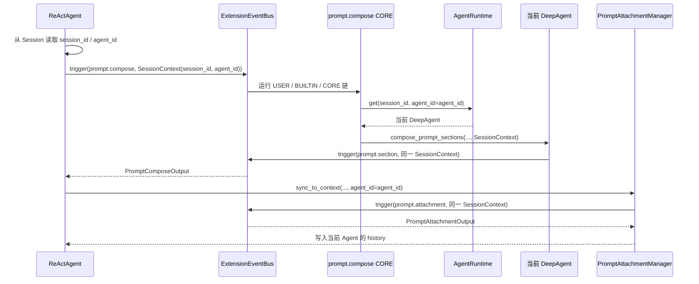

# Team 子 Agent Prompt 事件与复合身份恢复设计方案

## 1. 设计定位与阅读说明

本文解决同一 `session_id` 下存在多个 team Agent 时，Prompt 扩展事件无法进入子 Agent 链路的问题。
阅读顺序建议为：先看第 2 节确认当前旁路和目标行为，再看第 4、5 节理解复合身份传递和事件链，最后按第 8 节核对验收场景。
本文是已确认的开发方案，实际实现、偏差和验证结果由 feature 记录维护。

方案依据已核对的两个基线提交：

- `e182c83ea3e3598c9d8b161fa03bb170b58ca7ff`：Events、Session 与 `AgentRuntime` 已支持 `session_id + agent_id`。
- `31171fb02eb0a03c717b6f558291df274becd1dd`：为规避旧的 session-only 绑定，team 模式临时关闭了 `prompt.compose` 和 `prompt.attachment` 事件。

## 2. 背景、目标与范围

### 2.1 背景与问题

当前基线已经具备复合身份的基础设施：`SessionContext` 可以携带 `agent_id`，`Session` 可以从
`AgentCard` 提供 Agent 身份，`AgentRuntime` 以 `(session_id, agent_id)` 维护绑定，`ExtensionEventBus`
在收到真实 `Session` 时会保留该身份。

但临时规避提交仍在 Agent Loop 中保留两个旁路：

- `ReActAgent._compose_prompt_sections()` 在 `is_team_agent` 时直接返回，不触发 `prompt.compose`。
- `ReActAgent._sync_prompt_attachments()` 在 `is_team_agent` 时调用 `sync_to_context(..., trigger_events=False)`，跳过 `prompt.attachment`。

这使 team 子 Agent 虽然拥有自己的 Prompt Builder，却无法被 Prompt 扩展 Handler 观察、改写或短路；同时，继续使用 session-only 查找又会在同一会话的多个 Agent 之间产生 builder 串用风险。

### 2.2 目标与关键场景

| 场景 / 触发条件 | 当前行为 | 目标行为 / 可观察变化 |
| --- | --- | --- |
| 同一 `session_id` 下运行 leader 与 teammate，二者有不同 `agent_id` | team Agent 跳过 `prompt.compose` | 二者均触发 `prompt.compose`，事件上下文携带各自 `agent_id`，CORE 解析到对应 `DeepAgent` |
| team Agent 的附件发生新增、变更或删除 | team Agent 跳过 `prompt.attachment` | 在写入 history 前沿用现有 attachment 事件链，`PromptAttachmentInput` 和 `SessionContext` 携带当前 `agent_id` |
| `prompt.section` 由 compose CORE 继续触发 | team Agent 不进入 compose，无法触发 | 每个 Agent 只从自己的 builder 生成 section，并在自己的事件上下文中继续触发 |
| standalone 或旧调用没有 `agent_id` | 现有 session-only 兼容路径 | 保留 session-only 回退；有 `agent_id` 时不得回退到另一 Agent |
| 没有 ExtensionEventBus | 原生 builder / 直接附件路径 | 行为保持不变，不新增事件依赖 |

### 2.3 本次范围与非目标

- 本次包含：恢复已有 `prompt.compose` 和 `prompt.attachment` 触发路径；贯通 `agent_id`；按复合身份查找 Agent；删除仅为临时旁路引入的 team Prompt 开关；补充回归测试和契约文档。
- 本次不包含：新增事件类型、修改 `prompt.compose` / `prompt.attachment` 的基本输入输出语义、修改 Team Policy 静态 section 内容、修改真实业务流程中的 trigger 点、修改宿主 UI 或扩展 Package。
- 本次不改变 leader 与 teammate 的 Prompt 内容来源；只恢复事件链，并保证事件处理仍作用于当前 Agent 的 builder 和附件。

### 2.4 术语与上下文

- **复合身份**：`(session_id, agent_id)`，用于在同一 session 中唯一定位 Agent。
- **当前 Agent**：本轮 `AgentCallbackContext.session` 对应的 Agent；其 `Session` 应携带当前 `AgentCard`。
- **session-only 回退**：当事件上下文没有 `agent_id` 时，沿用 `AgentRuntime.get(session_id)` 的兼容行为；这不是 team 多 Agent 场景的身份解析方式。

## 3. 设计约束、假设与待决问题

- 已确认约束：Events 的事件触发必须使用显式 `SessionContext`，不得用 `ContextVar` 或隐式全局 Agent 传递身份。
- 已确认约束：`AgentRuntime` 已以 `(session_id, agent_id)` 精确绑定；给定 `agent_id` 时必须精确查找，不能静默退回同 session 的最后绑定。
- 已确认约束：`PromptAttachmentInput.agent_id` 已存在，本次只补齐生产路径赋值和事件上下文，不新增字段。
- 已确认前提：team 创建子 Agent session 时会携带对应 `AgentCard`，因此真实 team Agent 的 `Session.get_agent_id()` 可提供身份。
- 已确认范围：`is_team_agent` 和 `trigger_events` 是临时规避提交引入的内部控制点；仓内检索未发现生产代码之外的稳定消费者，可随旁路移除。
- 待决问题：无。若实现阶段发现存在未检索到的外部调用依赖，应回到本设计重新评估兼容处理，不以隐式旁路恢复。

## 4. 总体方案与设计取舍

### 4.1 方案概览

恢复统一的 Agent Loop 事件链，并把身份放在事件调用边界传递。`ReActAgent` 从当前 `Session` 读取 `agent_id`；`prompt.compose` 通过 `SessionContext` 交给 CORE，CORE 精确解析对应 `DeepAgent`；附件管理器在每个事件输入中同时写入 `agent_id` 和同身份的 `SessionContext`。



箭头表示一次模型请求准备阶段的调用顺序；事件输出仍由当前请求消费，不能跨 Agent 共享。

### 4.2 关键决策

#### D-01 使用事件调用边界传递复合身份

- 选择与依据：`SessionContext` 已是 Events 的统一调用上下文，`AgentRuntime` 已支持精确 `(session_id, agent_id)` 查找；沿用这条链可以避免新增隐式状态。
- 代价与成立条件：真实 team session 必须携带 `AgentCard`；缺少 `agent_id` 的旧调用只能得到兼容的 session-only 语义，无法承诺同 session 多 Agent 隔离。
- 实现体现：`ReActAgent._compose_prompt_sections`、`PromptAttachmentManager._run_attachment_event`、`prompt_compose._core_handler`。
- 相关候选：R-02 session-only 查找。

#### D-02 所有 Agent 统一走已有 Prompt 事件链

- 选择与依据：team 的 Prompt Builder 已独立，新的复合身份能力已解决旧旁路的根因；统一路径能让扩展 Handler 对 leader、teammate 和 standalone 保持一致观察面。
- 代价与成立条件：移除临时 `is_team_agent` 和 `trigger_events` 控制点，避免任何调用方重新关闭事件。
- 实现体现：`ReActAgent` 不再按 team 分支跳过 compose/attachment；Harness 不再向内层 Agent 注入该旁路标记。
- 相关候选：R-01 保留旁路开关。

#### D-03 附件事件的身份由调用方显式传入，管理器保留无身份兼容

- 选择与依据：管理器可能被单独使用，不能从全局运行时猜测 Agent；由 Agent Loop 传入可验证的 `agent_id`，直接调用管理器时保持 `None`。
- 代价与成立条件：新增 `agent_id` 可选参数并贯穿内部辅助函数；事件输入和上下文的身份必须始终一致。
- 实现体现：`sync_to_context(..., agent_id=None)`、`_run_attachment_events(..., agent_id)`、`_run_attachment_event(..., agent_id)`。

### 4.3 替代方案与排除理由

| 候选 / 关联决策 | 候选目的与关键差异 | 拒绝或暂缓原因 | 重新评估条件 |
| --- | --- | --- | --- |
| R-01 / D-02 保留 `is_team_agent` 与 `trigger_events`，当前只改为传 True | 改动最小，并保留临时兼容入口 | 旁路仍然存在，未来调用方可再次静默绕过扩展；team 与非 team 的事件契约继续分叉 | 发现已发布且必须保留的外部调用者时，改为显式弃用迁移 |
| R-02 / D-01 继续用 `get(session_id)` | 不修改 CORE 查找 | 同一 session 多 Agent 时会取到错误 builder，属于身份串用 | 仅适用于不存在多 Agent session 的旧运行时，不适用于本需求 |
| R-03 新增 team 专属 compose/attachment 事件 | 通过新事件绕过旧兼容问题 | 增加重复事件契约和 Handler 面，且用户需求是恢复已有事件链 | 只有未来确认 team 与普通 Agent 需要完全不同事件语义时才重新评估 |

## 5. 详细设计

### 5.1 模块责任与关键不变量

- `core/session` / `core/events`：提供并传递 `SessionContext(session_id, agent_id)`，不解析业务 Prompt。
- `core/single_agent/agent_runtime.py`：按复合身份维护绑定；本次不改变其数据结构和生命周期。
- `core/single_agent/agents/react_agent.py`：在最终模型请求边界统一触发 compose；把当前 session 身份传给附件管理器。
- `harness/prompts/prompt_attachment_manager.py`：对变更附件统一触发已有事件；只消费显式传入的身份，不自行查找 Agent。
- `core/events/builtins/event_types/prompt_compose.py`：CORE 按事件上下文精确取得 `DeepAgent`，继续使用现有 compose/section 逻辑。
- `agent_teams/harness`：只负责把 team Agent 的真实 Session、Builder 和事件 Bus 接好，不再承担 Prompt 旁路决策。

关键不变量：

1. 有 `agent_id` 的事件只能解析同一 `(session_id, agent_id)` 的 Agent，不能取同 session 的其他 Agent。
2. 同一次 compose 产生的 `prompt.section` 事件沿用同一 `SessionContext`。
3. `prompt.attachment` 的 `PromptAttachmentInput.agent_id` 与事件 `SessionContext.agent_id` 相等。
4. 同一 Agent 的 Prompt Builder、附件 history 和事件输出不与同 session 的其他 Agent 共享。
5. 无 Bus、无 session 或无可解析 composition owner 的旧 standalone 路径继续使用既有 fallback，不因本次改造失败。
6. attachment Handler 的异常、取消和改写语义保持既有行为：异常回退原文，取消继续向调用方传播，`text=None` 省略片段。

### 5.2 关键类与函数设计

| 类 / 函数 | 变更类型与可见范围 | 设计职责 |
| --- | --- | --- |
| `ReActAgent._compose_prompt_sections` | 修改，内部 | 删除 team 早退；从 `ctx.session` 读取 `session_id` 与 `agent_id`，触发 compose；有身份时按复合身份预检绑定。 |
| `ReActAgent._sync_prompt_attachments` | 修改，内部 | 删除 `trigger_events=False` 分支，将当前 `agent_id` 传给管理器。 |
| `PromptAttachmentManager.sync_to_context` | 修改，现有公开管理器方法 | 增加可选 `agent_id`，事件触发不再由调用方关闭；无 Bus 时继续直写。 |
| `PromptAttachmentManager._run_attachment_events` / `_run_attachment_event` | 修改，内部 | 传递 `agent_id`，写入事件输入和 `SessionContext`。 |
| `prompt_compose._core_handler` | 修改，CORE | 使用 `get(session_id, agent_id=session_context.agent_id)`；`agent_id is None` 时由 Runtime 保留旧回退。 |
| `NativeHarness` / `TeamHarness` | 修改，内部 wiring | 移除仅为 Prompt 旁路引入的 `is_team_agent` 参数和转发。 |

不修改 `PromptComposeInput` 和 `PromptAttachmentInput` 的字段定义：前者身份已由调用上下文表达，后者已有可选 `agent_id` 字段。

### 5.3 接口定义与消息契约

| 事件 | 事件输入 | 调用上下文 | 输出与消费 |
| --- | --- | --- | --- |
| `prompt.compose` | 现有 `PromptComposeInput`，不新增身份字段 | `SessionContext(session_id, agent_id)` | 现有 `PromptComposeOutput`；CORE 解析当前 `DeepAgent`，再触发 `prompt.section` |
| `prompt.section` | 现有 section 输入 | 沿用 compose 的 `SessionContext` | 现有 `PromptSectionOutput`，只影响当前 compose snapshot |
| `prompt.attachment` | 现有 `PromptAttachmentInput`，填充 `agent_id` | `SessionContext(session_id, agent_id)` | 现有 `PromptAttachmentOutput`；改写/省略结果只作用于当前 Agent 的 history |

`PromptAttachmentManager.sync_to_context` 的目标签名为：

```python
async def sync_to_context(
    self,
    context: ModelContext,
    session_id: str,
    *,
    agent_id: str | None = None,
) -> UserMessage | None:
```

`agent_id=None` 表示调用方没有提供身份，不由管理器猜测；实际 team Agent 的 Agent Loop 必须传递当前 session 的身份。

### 5.4 身份解析规则

| 事件上下文 | Runtime 查找 | 适用范围 |
| --- | --- | --- |
| `session_id` 非空，`agent_id` 非空 | `get(session_id, agent_id=agent_id)` 精确命中；未命中按既有 CORE 错误语义处理 | team 多 Agent、所有已绑定身份的 Agent |
| `session_id` 非空，`agent_id is None` | `get(session_id)` 走 Runtime 的 legacy last-live fallback | 旧 standalone 调用或未携带卡片的兼容调用 |
| 无 session context | 不触发 compose；沿用原生 builder | standalone / out-of-band 路径 |

不会把 `ReActAgent.card.id` 或 Runtime 最近绑定值写回缺失的 `SessionContext.agent_id`；身份必须来自当前调用 session，避免伪造或错配。

### 5.5 正常执行流程

1. Team Harness 为当前成员创建/取得带 `AgentCard` 的 `Session`，并进入内层 `ReActAgent` callback context。
2. `ReActAgent._build_model_context_window()` 在既有 rail 阶段之后无条件调用 `_compose_prompt_sections()`。
3. `_compose_prompt_sections()` 读取当前 session 身份，触发 `prompt.compose`；CORE 按复合身份取得当前 `DeepAgent`。
4. `DeepAgent.compose_prompt_sections()` 使用当前 Agent 的 builder，并通过同一上下文串行触发 `prompt.section`。
5. ReActAgent 使用返回的 request-local sections 生成最终 system prompt。
6. `_sync_prompt_attachments()` 计算附件 delta，将当前身份传给管理器；管理器对每个变更附件触发 `prompt.attachment`，完成后再写入 history。
7. Handler 对 prompt 的改写只影响该 Agent 当前请求；另一个共享 `session_id` 的 Agent 使用自己的事件上下文和 builder。

### 5.6 异常、取消与兼容

- `prompt.compose` 缺少有效 session：保持现有不触发 compose 的 fallback。
- 有 `agent_id` 但 Runtime 无精确绑定：保持 CORE 的状态错误，不静默使用其他 Agent。
- attachment 事件 Handler 异常：沿用管理器的原文回退和日志语义。
- attachment 事件被取消：沿用当前取消传播语义，history 不提前写入。
- 无 ExtensionEventBus：保持原生 builder 和附件直接渲染路径。
- 移除的 `is_team_agent` / `trigger_events` 只来自临时规避提交；如实现时发现仓外调用，需先停在兼容评估，不添加隐式旁路。

### 5.7 并发与一致性

同 session 的多个 Agent 共享 Runtime 容器但不共享复合绑定键。事件处理过程不新增全局锁；每个 event 的 `SessionContext` 是不可变快照，Handler 不应修改其身份。附件管理器继续使用既有 history lock，身份只作为本次事件归属，不改变附件存储的 session 语义。

## 6. 影响面与实施设计

### 6.1 修改点与实施顺序

| 实施项 | 模块 / 文件或符号 | 修改内容与责任 | 必要前置 / 独立验证产物 |
| --- | --- | --- | --- |
| I-01 | `tests/unit_tests/agent/react_agent/test_prompt_event_integration.py` | 将 team compose 旁路断言改为事件触发；记录两名 Agent 的 `agent_id`，验证输出不串用 | 先运行得到预期失败；对应 V-01、V-02 |
| I-02 | `tests/unit_tests/harness/test_prompt_attachment_event_integration.py` | 将 team attachment 旁路断言改为事件触发，增加输入与上下文身份断言 | 先运行得到预期失败；对应 V-03 |
| I-03 | `openjiuwen/core/single_agent/agents/react_agent.py` | 删除 team 分支；统一 compose 和 attachment 路径，传递当前 `agent_id` | I-01、I-02 |
| I-04 | `openjiuwen/harness/prompts/prompt_attachment_manager.py` | 删除 `trigger_events` 旁路参数，新增可选 `agent_id` 并贯穿事件辅助函数 | I-02；对应 V-03、V-04 |
| I-05 | `openjiuwen/core/events/builtins/event_types/prompt_compose.py` | CORE 按 `SessionContext.agent_id` 精确查找 Runtime Agent | I-01；对应 V-01、V-02 |
| I-06 | `openjiuwen/agent_teams/harness/native_harness.py`、`team_harness.py` 及 harness 测试 fixtures | 移除临时 `is_team_agent` wiring，保留正常 runtime context 和 team builder 组装 | I-01；对应 V-05 |
| I-07 | Events、Harness、Agent Teams 规约与 feature 文档 | 同步身份传递、事件触发和 team 隔离契约，新增实施记录 | 代码和测试验证完成后执行文档同步 |

实现阶段遵循测试先行：I-01/I-02 先改测试并运行红灯，再按 I-03 至 I-06 修改生产代码，最后执行 I-07。

### 6.2 文档同步

- Events spec：更新 `openjiuwen/core/events/docs/specs/S_01_events-contract.md` 中关于 compound identity、`prompt.compose CORE` 以及不再存在 team Prompt 旁路的描述。
- Events feature：同步 `openjiuwen/core/events/docs/features/F_16_prompt-attachment-event.md` 与 `F_18_prompt-compose-event.md` 的身份和 Agent Loop 触发说明。
- Harness spec/feature：更新 `.agents/agent-docs/specs/harness/S_06_prompts-and-l10n.md` 与 `F_26_prompt-attachment-event-agent-loop.md`，说明 team Agent 也走同一事件链。
- Agent Teams：若删除 `is_team_agent` 影响其模块契约，则同步 `S_09_prompts-and-rails.md` 或新增 feature 记录；不改变 Team Policy section 的内容与投递规则。
- 实施归档：开发完成后由 `jw-dev` 新建 F 文档，记录实际文件、偏差、测试命令、结果和遗留风险，并运行 `sync_documents.py`。

## 7. 兼容与迁移

- 运行时数据无需迁移；事件输入结构未新增必填字段，现有无身份调用继续可用。
- `PromptAttachmentManager` 的 `agent_id` 是可选参数，直接调用方不需要改动。
- `is_team_agent` 与 `trigger_events` 属于临时内部旁路；本方案不保留其兼容行为，以避免继续提供关闭事件链的入口。
- 版本混用时，旧代码可能仍跳过 team 事件；本方案只保证升级后同一版本内的 Agent Runtime、Harness、Events 契约一致，不承诺跨版本进程共享内存状态。
- 回退代码可以恢复旧旁路，但会重新引入事件不可见和同 session 多 Agent 风险；回退前必须确认扩展 Handler 对 team Prompt 不生效是可接受的。

## 8. 验证设计与通过条件

| 验证 ID | 场景 / 前置状态与输入 | 操作或验证入口 | 预期结果 / 通过条件 | 验证层级与环境 |
| --- | --- | --- | --- | --- |
| D-20261125-1725-V-01 | 两个 `DeepAgent` 共享 session id、拥有不同 agent id，各自 builder 有独有 section | 通过真实 `Runner.run_agent` 运行两次，注册 `prompt.compose` observer | 两次均触发 compose；observer 看到对应 agent id；leader 输出不含 teammate section，反之亦然 | agent-core 单元/集成测试 |
| D-20261125-1725-V-02 | 同上，compose CORE 与 section handler 均启用 | 修改/重排一个 compose 或 section 输出 | 修改只作用于当前 Agent；`prompt.section` 沿用对应 `SessionContext.agent_id` | Events + Harness 集成测试 |
| D-20261125-1725-V-03 | team Agent 有附件变化，ExtensionEventBus 已绑定 | 运行 `_sync_prompt_attachments`，observer 检查输入和上下文 | team 模式不再跳过事件；`PromptAttachmentInput.agent_id == SessionContext.agent_id`；改写结果写入该 Agent history | Harness 单元测试 |
| D-20261125-1725-V-04 | attachment Handler 返回改写、`None`、抛异常或被取消 | 复用现有 manager 事件测试并覆盖 team identity | 改写、过滤、原文回退、取消传播与现有语义一致；history 写入顺序不变 | Harness 单元测试 |
| D-20261125-1725-V-05 | TeamHarness / NativeHarness 构造进程内成员 | 运行现有 wiring 测试及受影响 harness 测试 | 不再依赖 `is_team_agent`；team builder、bus、runtime context 仍正确接线 | Agent Teams 单元测试 |
| D-20261125-1725-V-06 | standalone 无 agent id、无 bus 或无 composition owner | 运行既有兼容测试 | 仍走原生 builder/附件路径；不因本次恢复产生异常或事件泄漏 | Core/Harness 回归测试 |

计划验证命令（实现阶段按仓库环境调整）：

```text
uv run pytest tests/unit_tests/agent/react_agent/test_prompt_event_integration.py -q
uv run pytest tests/unit_tests/harness/test_prompt_attachment_event_integration.py -q
uv run pytest tests/unit_tests/core/events -q
uv run pytest tests/unit_tests/agent_teams/harness tests/unit_tests/agent_teams/extensions -q
```

## 9. 设计风险与已知限制

### 9.1 设计风险

| 风险 / 触发条件 | 对本次方案的影响 | 已有应对措施 | 核实或验证方式 |
| --- | --- | --- | --- |
| 某条 team Agent Loop 路径构造的 Session 没有 AgentCard | `agent_id` 为空时无法保证同 session 多 Agent 精确隔离 | 复核 Team session 创建入口；对真实 team 双 Agent 做端到端回归 | V-01、V-05 |
| 仓外代码依赖临时 `is_team_agent` 或 `trigger_events` | 删除旁路参数可能造成导入/调用错误 | 实现前以全仓和可见调用点检索；发现真实消费者时回到设计评审 | `rg` 结果与受影响测试 |
| EventBus handler 被注册但仍使用 session-only 业务缓存 | 事件身份正确，但扩展自身可能继续串用 | 本次只保证 Core 事件上下文契约；扩展缓存不在 agent-core 范围 | V-01、V-03；记录为扩展方责任 |

### 9.2 已知设计限制

没有 `agent_id` 的 legacy 调用仍只能使用 session-only fallback，无法在同一 session 的多个 Agent 之间提供强隔离；这是兼容边界，不适用于 team 多 Agent 入口。

## 10. 按日期记录的评审与设计修订

| 日期 | 评审人 / 确认方 | 评审或修订主题 | 结论 | 修改与依据 |
| --- | --- | --- | --- | --- |
| 2026-11-25 | 需求方（当前会话） | 方案 B：统一事件链、复合身份查找、移除临时旁路 | 设计通过 | 需求方复核后确认启动开发 |

## 11. 参考与交接

- 复合身份基础：`e182c83ea3e3598c9d8b161fa03bb170b58ca7ff` 及 `openjiuwen/core/events/docs/specs/S_01_events-contract.md`。
- 临时旁路来源：`31171fb02eb0a03c717b6f558291df274becd1dd`，涉及 `ReActAgent`、`PromptAttachmentManager`、`NativeHarness` 和 `TeamHarness`。
- 相关事件契约：`openjiuwen/core/events/docs/features/F_16_prompt-attachment-event.md`、`F_18_prompt-compose-event.md`、`F_17_prompt-section-event.md`。
- 开发交接：设计确认后进入 `jw-dev`；先修改 V-01 至 V-02、V-03 的失败测试，再实现 I-03 至 I-06，最后同步文档并记录 feature 归档。
- 关联实施归档：尚无。
