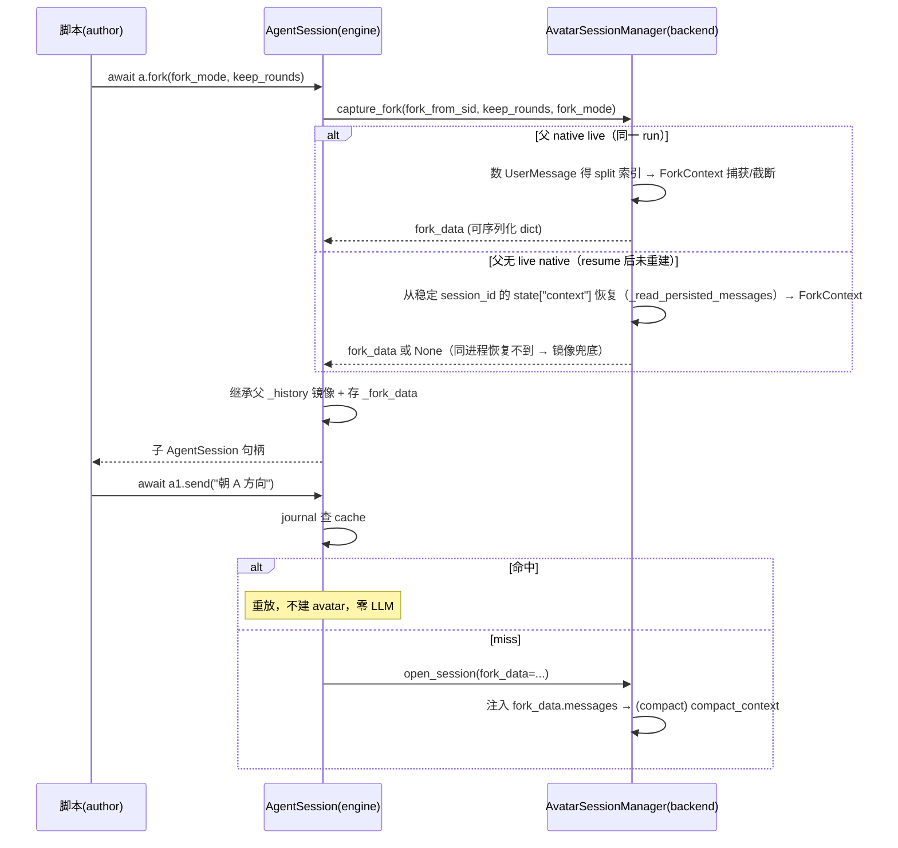

# SwarmFlow 有状态会话 fork（agent_session 上下文继承）

## 1. 背景与问题 (Why)

swarmflow 目前只有一种有状态执行单元：`agent_session` 提供的常驻 avatar（长生命周期 `NativeHarness`，跨轮保留上下文）。会话演进到某个节点后，往往需要"分道扬镳"——同一个 base 认知派生出多个朝不同方向继续演进的执行者（例如一个先理解基类的 `analyst`，fork 出 `分歧-1` / `分歧-2` 各自实现不同派生类）。

现状没有这个能力：`AgentSession`（引擎层 `workflow/engine/primitives.py`）**没有 `fork` 方法**。F_37（`docs/features/F_37_swarmflow-stateful-sessions-and-human.md`）的"已知遗留"明确记录"`fork`：本期不做"——本文即补这一欠账。

团队 fork（`spawn_teammate`）已经演进出一套完整的上下文继承能力——五种 fork 模式（full / before / after / 两种 compact），且基建（`ForkContext.from_agent` 的 `keep` 参数、`compact_direction`、`fork_compact` 双向压缩、`_on_teammate_created` 5 路解析）**已在 agent-core 完整实现**。swarmflow 会话 fork 的目标是**把这五种模式完整迁移**到 `agent_session`，复用同一套 fork 引擎，零重写注入逻辑。

与团队 fork 的本质差别：团队 fork 的 split 点由成员运行时打命名 checkpoint（模型自主调 `checkpoint(name)` 工具）产生；而 swarmflow 脚本是**静态、自包含**的 Python 代码——**split 点由生成脚本的 agent 在写脚本时自主决定的固定值（轮数）写死进脚本**，零模型运行时依赖、天然可重放。

**本次实现 fork 必须解决的一个前置缺口：swarmflow 会话的上下文（含 ToolMessage）当前无法跨 resume 恢复。** 经过代码调研确认，F_37 决策 3 的"avatar `Session` checkpoint 恢复"**机制已在代码里，但从未生效**——因为 avatar 每次随机 uuid session，`pre_run` 恢复时按随机 id 查不到上次记录。让该机制生效（固定 session_id）是部分-hit 续跑（F_37:132 已知遗留）与 fork 捕获完整上下文的共同底座。详见 §1.1。

### 1.1 调研结论：swarmflow 会话上下文当前不可跨 resume 恢复

代码事实（`agent-core` 当前实现）：

1. **avatar 的 child session 每次随机 uuid**：`_start_avatar`（`avatar_session_backend.py:363`）调 `harness.start()` **无参** → `_make_child_session(None)` → `create_agent_session(card=card)` **不传 session_id**（`team_harness.py:235`）→ `core/session/agent.py:42` `uuid.uuid4()`。`create_agent_session` **支持传 session_id**（`agent.py:276`），但 swarmflow 没传。
2. **swarmflow 用默认 `InMemoryCheckpointer`**：`CheckpointerFactory.get_checkpointer()` 在未装配时返回 `default_inmemory_checkpointer`（`checkpointer.py:123-124`）。唯一 `set_default_checkpointer` 装配点在 `core/runner/runner.py:295-296`（通用 Runner，`checkpointer_config` 默认 None 不装配）；swarmflow 宿主 `TeamRunner`（`team_runner.py:603`）只 `release` 零装配；`run_swarmflow`（`workflow/runner.py:214`）直接构造 `TeamWorkerBackend`，不经装配。→ **InMemory，不落盘**（同进程内有效，跨进程/重启丢失）。
3. **上下文内容实际已保存**：`save_contexts`（`context_engine.py:479`）把 `state["context"][context_id]["messages"]`（含 ToolMessage）写进 session state（`context_engine.py:601-612`），每轮被 `react_agent` 调用（`react_agent.py:1677, 2015...`）；run 结束 `TeamHarness.dispose`（`team_harness.py:213`）→ `commit` → InMemory store 保存。
4. **恢复机制存在但定位不到**：`pre_run`（`agent.py:214`）→ `pre_agent_execute`（`inmemory.py:165-188`）→ `AgentStorage.recover`（`inmemory.py:417-423`）按 `(session_id 分桶, agent_id 查)` 定位；新随机 session_id **查不到上次记录** → `recover` 里 `state_blob is None` 直接 return → **恢复到的仍是空 session**。
5. **resume 每次新建 backend**：`resume()` → `_relaunch`（`tool_swarmflow.py:406-429`，唯一显式 resume 路径，pause→resume）→ `run_background` → `run_swarmflow` 每次 new `TeamWorkerBackend`（`runner.py:214`）→ 新 `AvatarSessionManager` 空 `_sessions`。旧 run 的 `_SessionState` 已被 `aclose` dispose harness，非 live 状态。

**推论**：要让 fork（以及部分-hit 续跑）拿到完整上下文（含 ToolMessage），只需让**已在代码里的 F_37 决策 3 机制生效**——给 avatar 绑定稳定唯一 session_id（`{team}/{workflow}/{member}` 派生），使 `pre_run` / `_read_persisted_messages` 能按稳定 id 定位到上次记录。**这是本设计的前置底座，见 §4.4。**

## 2. 目标与非目标

**目标**
- 给 `agent_session` 增加 `a.fork()`，支持团队 fork 的**五种 fork 模式**：
  - `fork_mode="full"`：全量注入
  - `fork_mode="before"`：第 N 轮之前（含）保留
  - `fork_mode="after"`：从第 N 轮起（含）保留
  - `fork_mode="keep_before_compact_after"`：第 N 轮之前保留 + 之后压摘要
  - `fork_mode="keep_after_compact_before"`：从第 N 轮起保留 + 之前压摘要
- **split 点是脚本作者写死的固定值（轮数）**：`a.fork(fork_mode="before", keep_rounds=2)`——生成脚本的 agent 在写脚本时自主决定用哪种模式、保留多少轮，写死进脚本；**不引入 checkpoint 工具、不依赖模型运行时打点**，脚本完全静态自包含。
- **前置底座：让 F_37 决策 3 的 avatar `Session` checkpoint 恢复生效**——给 avatar 绑定稳定唯一 session_id（`{team}/{workflow}/{member}` 派生），使 `pre_run` / `_read_persisted_messages` 能恢复 `state["context"]`（含 ToolMessage），作为 fork 捕获完整上下文与部分-hit 续跑的公共前提（§4.4）。**仅同进程恢复；跨进程/重启的持久化 checkpointer 装配本期不做**（见非目标）。
- **fork 后父可自由演进**：`a.fork()` 调用时刻冻结父上下文（eager 捕获）；此后父随便 `send`，两条线无关。
- 支持**链式 fork**：子会话自己也能再 `fork()`。
- 复用 agent-core 已完成的团队 fork 基建（`ForkContext.from_agent(keep=)` / `compact_context(direction=)` / F_75 / F_76），**零重写注入逻辑**。

**非目标**
- checkpoint 工具机制：`checkpoint(name)` / `list_checkpoints` 工具、命名 checkpoint、`checkpoints.json` 持久化、模型运行时打点——全部**不做**。
- `_history` 镜像手搓 seed 进 context 做恢复——**F_37 已明确拒绝**（`F_37:79-80`："手搓 history seed 进 context 做 resume 重建：与既有 Session checkpoint 机制重复，改为 harness start(session=) 由 session 恢复"）。本设计延续该决策，恢复走 session checkpoint，不重引入镜像 seed。
- **持久化 checkpointer 装配（跨进程/重启落盘）**：本期**不做**。`PersistenceCheckpointer`（`persistence.py:725`）是独立于 F_37 决策 3 的跨进程增强；且 `set_default_checkpointer`（`checkpointer.py:82-84`）是进程级全局，会改变所有 session（含普通 worker / leader）的持久化行为，副作用大。本设计只做同进程恢复（InMemory store + 固定 session_id），跨进程/重启的上下文恢复列为遗留（§12）。
- 真状态快照（存消息本体 + DeepAgentState 序列化）——fork 时从活父现场捕获消息快照；DeepAgentState（task_plan / plan_mode）通常为空或非关键。
- journal 记录 ToolMessage（要保住部分-hit 的 KV 需它，独立特性级改动）。
- `human_session` fork（语义不明，fork 出第二个真人的 avatar？）——明确拒绝并报清晰错误。
- jiuwenswarm swarmskill-creator 校验器 / 模板同步（本次只改 agent-core）。
- fork 前历史的跨会话共享（VCS session 内部机制，非本层职责）。

## 3. 术语与上下文（可选）

| 术语 | 含义 |
|---|---|
| avatar | 每个 `agent_session` 对应的长生命周期 `TeamHarness`（`_SessionState.harness`），跨轮保留上下文 |
| 轮 | 一次 `send()` = 一轮。父上下文里一轮始于一条 `UserMessage`（`_append_history` 每轮 append 一对 `(user, assistant)`，`primitives.py:915-916`） |
| `keep_rounds` | fork 的 split 参数（轮数）：第 N 轮为截断/压缩边界。作者写死，非运行时产物 |
| `_history` 镜像 | 引擎层 `(user, assistant)` 对列表，cache-hit 时也追加，journal 重放会完整重建；**仅用于 resume 签名与 fork 继承镜像，不进 backend 做上下文恢复** |
| journal | swarmflow 内容寻址 resume 账本（`journal.jsonl`），key + sig 命中即重放 |
| `state["context"]` | session 里由 `save_contexts` 写入的上下文（含 ToolMessage）；`_read_persisted_messages` 读取它 |
| checkpointer | session 状态恢复机制：当前用 `InMemoryCheckpointer`（进程内，同进程可恢复；跨进程/重启丢失）。`PersistenceCheckpointer`（落盘）本期不装配（见 §2 非目标） |
| 部分-hit | resume 时部分 turn 命中 cache、部分 miss 的场景（F_37:132 已知遗留） |
| ForkContext | 团队 fork 的可序列化上下文快照（`fork.py:28-45`），`messages` 为 json-native dict 列表 |

前置知识：`docs/features/F_37_swarmflow-stateful-sessions-and-human.md`（有状态会话设计，决策 3 = session checkpoint 恢复）、`docs/specs/S_18_swarmflow-engine-and-worker.md`（引擎/worker/会话契约）、团队 fork 基建（F_75 / F_76 / `ForkContext` / `fork_compact`）、`docs/features/F_43_swarmflow-pause-resume.md`（resume 机制）。

## 4. 方案设计 (What / How)

### 4.1 总体架构

fork 的**引擎**完全复用团队 fork 已建好的能力，只新增一层 swarmflow 适配壳 + 一个前置底座：

```
前置底座（本次新增，让 F_37 决策 3 机制生效）
  avatar 绑定稳定唯一 session_id（{team}/{workflow}/{member} 派生）
  → pre_run / _read_persisted_messages 按稳定 id 恢复 state["context"]（含 ToolMessage）
  （仅同进程；跨进程/重启持久化 checkpointer 本期不做，见 §2 非目标）
        ↓
fork 引擎（共享，不改）
  ForkContext.from_agent(源, checkpoint=idx, keep="before"|"after")  ← 捕获 + 截断
  compact_context(子native, split_at=idx, direction="before"|"after") ← 双向压缩
        ↓ 同一引擎，两套壳
团队壳：spawn_teammate(fork=, fork_mode=) → _on_teammate_created → _named_checkpoints
        （split 点 = 成员运行时打的 checkpoint 名；作用于团队成员：DB 行、跨进程）
swarmflow 壳：a.fork(fork_mode=, keep_rounds=) → open_session(fork_data=)
        （split 点 = 作者写死的轮数；作用于会话 avatar：引擎对象、进程内 backend）
```

分层职责：

- **引擎层** `workflow/engine/primitives.py`：`AgentSession.fork()` 只做"继承镜像 + eager 捕获委托 + 存不透明 fork_data"，不碰任何 `agent_teams` 业务符号（`engine/` 子包铁律 1：不得 import 业务模块）。
- **backend 层** `workflow/backends/avatar_session_backend.py`：唯一 import `ForkContext` 的地方——轮数→消息索引换算、捕获/注入/双向压缩、child session_id 派生全部收敛在此。
- **接口层** `workflow/engine/backends/base.py`：加 `capture_fork`；`open_session` 加可选 `fork_data`，默认行为逐字不变。

### 4.2 数据流与时序

```
a  = agent_session(label="analyst")
await a.send("理解基类，搜索候选实现")      # 轮 1
await a.send("分析每种候选的优劣")          # 轮 2
await a.send("选定方案，输出结论")          # 轮 3

a1 = await a.fork(fork_mode="before", keep_rounds=2, label="分歧-1")
    # fork() 调用时刻 eager 捕获父上下文，按 keep_rounds=2 截断 → 存 fork_data
a2 = await a.fork(fork_mode="full", label="分歧-2")          # live 全量
await a.send("父继续演进")                 # 不影响 a1 / a2
await a1.send("朝 A 方向")                 # 子首轮 miss → open_session(fork_data=...) 注入
a3 = await a1.fork(...)                     # 链式：base = a1 当下上下文
```

* `fork()` 是 **async**：eager 捕获需调 backend 读父 native，且 compact 模式（`keep_*_compact_*`）压缩用模型生成摘要。
* **eager 而非懒捕获**：若懒（子首轮 open 才抓），父在 fork() 与子首轮 send 之间的演进会污染 after/compact 模式的捕获，需做额外处理并且语义不当。



**关键状态**：
- fork 出的子会话在 **`fork()` 调用时刻**冻结父上下文（五种模式按 `keep_rounds` 截断/压缩）；fork 之后父可自由演进，两条线完全无关。
- 父的 `_history` 不被污染。

**五种 fork 模式 → swarmflow 映射**（复用团队 fork 语义，`keep_rounds` 换算成消息索引后逐字对齐 `_on_teammate_created`）：

| fork_mode | 语义（作者视角） | 复用机制 |
|---|---|---|
| `full` | 全量注入 | `ForkContext.from_agent(父)` |
| `before` | 第 N 轮之前（含）保留 | `from_agent(父, checkpoint=idx, keep="before")` |
| `after` | 从第 N 轮起（含）保留 | `from_agent(父, checkpoint=idx, keep="after")` |
| `keep_before_compact_after` | 前保留 + 后压摘要 | 全量捕获 + `compact_context(direction="after")` |
| `keep_after_compact_before` | 后保留 + 前压摘要 | 全量捕获 + `compact_context(direction="before")` |

### 4.3 接口与数据模型

**前置底座——avatar child session_id 派生（backend 层）**：

```python
# avatar_session_backend.py：_start_avatar 构造 child session 时
def _derive_avatar_session_id(self, member_name: str, workflow_name: str) -> str:
    """稳定唯一：{team}/{workflow}/{member} 派生，跨 resume 可定位同一 session。

    member_name 已是每个 avatar 唯一（_next_member_name）；workflow_name 区分同
    session 下不同脚本。agent_id（child card.id = member_name）同样稳定。
    """
    return f"{self._team_name}/{workflow_name}/{member_name}"
```

实现落点：`_start_avatar` 建 harness 前构造一个带固定 session_id 的 team session（或用 `_make_child_session` 传固定 session_id）。**对齐 F_37 决策 3**：`harness.start(session=<该 session>)` 而非无参随机。

**引擎层 `AgentSession`**：

- `__slots__` 增加 `_fork_data: dict | None`；构造函数增加对应默认参。
- 新增 `fork()` 方法（**async**，eager 捕获）：

```python
async def fork(self, *, fork_mode="full", keep_rounds=None,
               label=None, phase=None, instructions=None, options=None) -> AgentSession:
    if self._human:
        raise WorkflowError("fork() is only supported on agent_session")
    rt = _rt.get()
    fork_data = None
    if self._sid is not None:
        fork_data = await rt.backend.capture_fork(
            self._sid, keep_rounds=keep_rounds, fork_mode=fork_mode,
        )
    return AgentSession(
        label=label if label is not None else self._label,
        phase=phase if phase is not None else self._phase,
        instructions=instructions if instructions is not None else self._instructions,
        options={**self._options, **(options or {})},
        _human=False,
        _node_type="agent_session_fork" if self._history else "agent_session",
        _history=[dict(m) for m in self._history],   # 继承父镜像（resume 签名一致性）
        _fork_data=fork_data,
    )
```

- `_ensure_open` 透传：`backend.open_session(..., fork_data=self._fork_data)`。

**接口层 `AgentBackend`**：

```python
async def capture_fork(self, session_id: str, *, keep_rounds: int | None,
                       fork_mode: str) -> dict | None:
    """Eagerly snapshot a session's context per fork_mode / keep_rounds.

    Returns a serializable dict (fork_data) for later injection, or ``None``
    when the session has no captureable context — the caller then falls back
    to the engine history mirror (degraded, no ToolMessage).
    """

async def open_session(self, *, kind, instructions, opts,
                       fork_data: dict | None = None) -> str
```

**backend 层 `_SessionState`**：增加 `context_seeded: bool = False`（防双写标记）+ `session_id: str`（派生，跨 resume 稳定）。**不引入 checkpoints 字段**。

**fork_data 结构**（backend 产出、engine 只透传不解释——铁律 1）：

```python
{
    "messages": [...],                  # ForkContext.messages（json-native dict 列表）
    "compact_split": int | None,        # compact 模式的 split 索引
    "compact_direction": "before" | "after",
}
```

> **Requirement:** 系统 SHALL 在 `a.fork(...)` 时继承父 `_history` 镜像（每层 dict 浅拷贝，append-only 下语义安全），用于子会话 resume 签名一致性。
> **Scenario:** WHEN 子会话首轮 send miss 且 fork_data 非 None THEN backend 以 `open_session(fork_data=...)` 注入 fork 上下文，`context_seeded=True`。
> **Requirement:** 系统 SHALL 在 fork_data 为 None 且 history 非空时，以镜像兜底注入 `(user, assistant)` 对话（**仅降级兜底**，非完整上下文——见 §5.4）。
> **Scenario:** WHEN `turns_executed==0` 且未种子且 history 非空 THEN 注入镜像对话。

### 4.4 前置底座：avatar 上下文可恢复（固定 session_id 让 F_37 决策 3 生效）

这是 fork 能拿到完整上下文（含 ToolMessage）的前提，也是部分-hit 续跑（F_37:132 遗留）的修复。基于 §1.1 调研，F_37 决策 3 的 `pre_run` + checkpoint 恢复机制**已在代码里，唯一缺的是固定 session_id**：

**a) avatar 绑定稳定唯一 session_id（本期做）**

`_start_avatar` 建 child session 时传入派生 id（§4.3），替代当前随机 uuid。这样 `pre_run`（`agent.py:214`）→ `pre_agent_execute`（`inmemory.py:165-188`）→ `AgentStorage.recover`（`inmemory.py:417-423`）能按稳定 `(session_id, agent_id)` 定位到上次记录，恢复 `state["context"]`（含 ToolMessage）。

**b) 范围界定：持久化 checkpointer（跨进程/重启）本期不做**

装配 `PersistenceCheckpointer`（`persistence.py:725`，落盘）能解决跨进程/重启恢复，但它**独立于 F_37 决策 3**，且 `set_default_checkpointer`（`checkpointer.py:82-84`）是**进程级全局**，会改变该进程所有 session（含普通 worker / leader）的持久化行为，副作用大。故本期**只做同进程恢复**（InMemory store 保留 `state["context"]`，固定 session_id 即可恢复）；跨进程/重启的上下文恢复列为遗留（§12）。

**c) 恢复链路（已验证完整，同进程）**

```
上次 run（session_id=S 稳定）
  → 每轮 save_contexts → state["context"] 保存前 N 轮（含 ToolMessage，context_engine.py:601-612）
  → run 结束 TeamHarness.dispose → commit → InMemory store 保存 state（team_harness.py:213）
同进程 resume（session_id=S 稳定）
  → 前 N 轮 cache hit 短路（不建 native）
  → 第 N+1 轮 miss → 建 native → child session_id=S → pre_run 恢复 state["context"]
  → _load_state_from_session（context_engine.py:575-598）重建 messages 到新 native
  → 新 native 上下文完整（前 N 轮 + 当前轮）
```

**d) fork 捕获从此完整**

- 同一 run 内父 live：`ForkContext.from_agent(父native)`（`get_current_context()`，含 ToolMessage）。
- 同进程 resume 后父未重建（无 live native）：用稳定 session_id 走 `ForkContext._read_persisted_messages`（`fork.py:130-158`）从 `state["context"]["default_context_id"]["messages"]` 恢复（含 ToolMessage）。
- 两者都拿不到（同进程也恢复不到）：镜像兜底（降级，缺 ToolMessage）。

**注意**：`_read_persisted_messages` 的 `_normalize_messages`（`fork.py:160-179`）已兼容 `BaseMessage` / dict 两种形态，可跨 checkpointer（pickle / json）稳健恢复。

### 4.5 关键流程

**轮数 → 消息索引换算（backend 层）**：

`ForkContext.from_agent(checkpoint=N)` 与 `compact_context(split_at=N)` 的 N 是**消息索引**（`fork.py:66` 注释明确）。swarmflow 作者只能感知"轮"，所以 backend 捕获时把 `keep_rounds` 换算成消息索引：

```python
def _round_boundary_index(msgs, keep_rounds, keep_after: bool) -> int | None:
    """第 N 轮的边界消息索引；越界返回 None（调用方回退全量）。

    keep_after=False（before 系）：边界 = 第 N 条 UserMessage 之后的索引（含
    该轮 assistant 与闭合 ToolMessage，前 N 轮全部保留）。
    keep_after=True（after 系）：边界 = 第 N 条 UserMessage 的起始索引
    （从第 N 轮起保留）。
    """
    count = 0
    for i, m in enumerate(msgs):
        if isinstance(m, UserMessage):
            count += 1
            if count == keep_rounds:
                if keep_after:
                    return i
                for j in range(i + 1, len(msgs)):
                    if isinstance(msgs[j], UserMessage):
                        return j
                return len(msgs)
    return None
```

- 一轮 = 一条 `UserMessage` 起始（swarmflow 会话每轮 send 注入一条 user 消息）。
- **越界（`keep_rounds` 大于实际轮数）→ 静默回退全量**（对齐团队 fork "wrong name silently falls back to full-context fork"，`fork.py:87` 守卫）。

**冷启动主路径（父 live，`capture_fork`）**：

```python
# backend.capture_fork
src = self._sessions.get(session_id)
if src is None or src.harness is None:
    # 无 live native：从稳定 session_id 恢复完整上下文
    from openjiuwen.agent_teams.fork import ForkContext
    persisted = ForkContext._read_persisted_messages(src) if src else None
    ...  # 用 persisted（含 ToolMessage）或返回 None（镜像兜底）
from openjiuwen.agent_teams.fork import ForkContext
native = src.harness.get_deep_agent()
if fork_mode == "full":
    fork_ctx = ForkContext.from_agent(native)
elif fork_mode in ("before", "after"):
    idx = _round_boundary_index(
        native.get_current_context(), keep_rounds,
        keep_after=(fork_mode == "after"),
    )
    if idx is None:
        fork_ctx = ForkContext.from_agent(native)  # 越界回退全量
    else:
        fork_ctx = ForkContext.from_agent(
            native, checkpoint=idx,
            keep="after" if fork_mode == "after" else "before",
        )
else:  # compact 模式：全量捕获 + 标 split，压缩延后到注入时用子 native
    fork_ctx = ForkContext.from_agent(native)
    fork_ctx.compact_split = _round_boundary_index(
        native.get_current_context(), keep_rounds, keep_after=False,
    ) or len(fork_ctx.messages)
    fork_ctx.compact_direction = (
        "after" if fork_mode == "keep_before_compact_after" else "before"
    )
return {
    "messages": fork_ctx.messages,
    "compact_split": fork_ctx.compact_split,
    "compact_direction": fork_ctx.compact_direction,
}
```

**双向压缩（compact 模式，注入时用子 native）**：`open_session(fork_data=...)` 先把 `fork_data.messages` 注入子 context engine，再 `compact_context(子native, split_at=fork_data["compact_split"], direction=fork_data["compact_direction"])`——复用 `fork_compact.py` 的 `compact_context(direction=)`（已实现双向，`fork_compact.py:36-59`），与团队 fork 的注入路径一致。

**注入时序（需 spike 验证）**：child avatar 的 context 是**首次模型调用**才由 `react_agent._init_context` → `context_engine.create_context` 创建，`harness.start()` 后 `get_context()` 返回 None——因此**不能在 start 后用 `get_context(...).set_messages(...)` 注入**。正确做法：start 之后，用 child 的 bound session id（`native.session_id`，即 `_bound_session_id`）调 `create_new_context_engine(session_id=<bound>, messages=fork_msgs)`——`create_context` 复用路径（`context_engine.py:139-143`）对已存在条目走 `_load_state_from_session`，而 `states is None`（fresh session）时早退不清 messages，child 首次 `_init_context` 能拿到注入的历史。此路径需在实现前写 spike 验证。

**镜像兜底（同进程也恢复不到，fork_data 为 None）**：

```python
async with state.lock:
    if state.turns_executed == 0 and not state.context_seeded and history:
        await self._seed_context_from_history(state, history)
        state.context_seeded = True
```

`_seed_context_from_history` 把 `[{"role": "user", "content": ...}, {"role": "assistant", "content": ...}]` 转成 `UserMessage` / `AssistantMessage`（content 原样，含结构化 dict / None），注入方式同上（child bound `native.session_id` → `create_new_context_engine`）。

**边界情况**：
- 父从未 send 即 fork（`_sid` None **且 `_history` 空**）→ 退化为全新会话（`_node_type="agent_session"`，父确实没有上下文可继承）。
- 父从未 send 但 `_history` 非空（如 resume 后父全命中，从未建 avatar）→ **不是退化**：优先走稳定 session_id 的 `_read_persisted_messages` 恢复完整上下文；同进程恢复不到则镜像兜底。
- 链式 fork → 复用同一 `fork()` 实现，无特殊分支。
- 部分-hit 且父不在内存 → 稳定 session_id 恢复完整上下文（含 ToolMessage）；跨进程/重启（InMemory 丢失）则镜像兜底（缺 ToolMessage，KV miss）。
- 普通会话的"resume 部分-hit 续跑"由前置底座（§4.4）一并修复（冷启动首轮 history 空不触发）。

### 4.6 配置与开关

无新增配置项 / 特性开关。`fork()` 是 `AgentSession` 的普通方法，随会话能力存在；`human_session` fork 在 `fork()` 内 `WorkflowError` 拒绝，无开关。**持久化 checkpointer 装配本期不做**（见 §2 非目标 / §4.4b），故不涉及 `CheckpointerConfig` 或 `set_default_checkpointer` 配置。

## 5. 关键决策与权衡 (ADR)

### 5.1 五种 fork 模式迁移，fork 有参（fork_mode + keep_rounds）
- **决策：** `a.fork(fork_mode=..., keep_rounds=...)` 完整迁移团队 fork 五种模式（full / before / after / keep_before_compact_after / keep_after_compact_before）。
- **背景：** 团队 fork 的这五种模式已完整实现，基建（`ForkContext.from_agent(keep=)` / `compact_context(direction=)`）就绪；swarmflow 会话 fork 应复用而非另起炉灶。
- **备选与理由：** 早期曾设计"无参纯全量"被推翻——五种模式需要表达"从哪截断/压缩"，必须有参数。

### 5.2 split 点是作者写死的固定值（轮数），砍掉 checkpoint 工具机制
- **决策：** 不做 checkpoint 工具 / 命名 checkpoint / `checkpoints.json` 持久化 / 模型运行时打点；`keep_rounds=N` 由生成脚本的 agent 在写脚本时自主决定，写死进脚本。
- **背景：** split 是脚本作者定的固定值。swarmflow 脚本是静态、自包含的代码；若 split 依赖模型运行时打点，脚本不再确定、且打点副作用不在 journal 重放路径上（resume 时无法逐字复现打点位置），引入可重放性缺口。
- **备选与理由：**
  - 模型打点 + checkpoint 持久化（工具挂 avatar + `checkpoints.json`）被否决——引入运行时副作用、持久化负担，且与"脚本静态自包含"的 swarmflow 哲学相悖。
  - 脚本显式 `fork(checkpoint=N)`（消息索引）被否决——作者感知不到底层消息条数，轮数（`send` 次数）才是作者写脚本时的天然单位。
  - 真状态快照（存消息本体 + DeepAgentState）被否决——存轮数截断的快照够用，会话 avatar 的 DeepAgentState 通常为空。

### 5.3 fork 后父自由演进，两条线完全无关（eager 捕获）
- **决策：** `a.fork()` 在调用时刻 eager 捕获父上下文；fork 后父可自由 `send`，完全不影响子。
- **背景：** 若懒捕获（子首轮 open 才抓），父在 fork() 与子首轮 send 之间演进，会污染 after/compact 模式的捕获。
- **备选与理由：** 早期"父不演进契约"（fork 后父不得再 send）+ 懒捕获被否决——限制过强。

### 5.4 前置底座：avatar 上下文可恢复（固定 session_id 让 F_37 决策 3 生效）
- **决策：** 让已在代码里的 F_37 决策 3 生效——avatar 绑定稳定唯一 session_id，使 `pre_run` / `_read_persisted_messages` 能恢复 `state["context"]`（含 ToolMessage）。fork 捕获与部分-hit 续跑共用此底座。**仅同进程恢复；持久化 checkpointer（跨进程/重启）本期不做，列为遗留。**
- **背景：** 调研确认 F_37 决策 3 的 `pre_run` + checkpoint 恢复机制已在代码里，但 avatar 每次随机 uuid session，导致 `pre_run` 按随机 id 查不到上次记录、恢复不到（§1.1）。固定 session_id 是让机制生效的唯一缺环。
- **备选与理由：**
  - `_history` 镜像手搓 seed 进 context（`send_turn(history=...)` 接缝）——**被 F_37 明确拒绝**（`F_37:79-80`，与 session checkpoint 重复且丢状态/ToolMessage）。本设计遵循 F_37，不重引入。
  - 装配 `PersistenceCheckpointer`（跨进程/重启）——**本期不做**：独立于 F_37 决策 3，且 `set_default_checkpointer` 进程级全局、会改变所有 session 的持久化行为，副作用大。列为遗留（§12）。

### 5.5 双源种子：live ForkContext + session 恢复兜底
- **决策：** 父 avatar live → eager `ForkContext` 捕获（含 ToolMessage）；父不在（同进程 resume 后未重建）→ 稳定 session_id 从 `state["context"]` 恢复（含 ToolMessage）；恢复不到 → 镜像兜底（缺 ToolMessage，KV miss）。**三条路径在 eager 语义下 base 等价：都是父上下文，区别在是否含 ToolMessage。**
- **背景：** `_history` 镜像（`primitives.py:788`）cache-hit 时也追加，journal 重放完整重建，是最后兜底。
- **备选与理由：** 只做镜像兜底：被否决——冷启动也丢 ToolMessage 和 KV 前缀收益，违背 fork 的核心价值。

### 5.6 被否决的备选与取舍理由

- **checkpoint 工具机制（模型打点 + 持久化）**：见 5.2，被否决——脚本静态自包含原则。
- **`_history` 镜像手搓 seed 做上下文恢复**：见 5.4，被 F_37 拒绝（与 session checkpoint 重复）。
- **脚本显式 `fork(checkpoint=N)`（消息索引）**：见 5.2，被否决——作者感知不到消息条数。
- **无参纯全量**：见 5.1，被否决——五种模式需要参数表达截断/压缩。
- **父不演进契约 + 懒捕获**：见 5.3，被否决——限制过严且与"无关"冲突。
- **真状态快照**：见 5.2，被否决。
- **统一镜像方案（方案 Y）**：见 5.5，被否决。
- **fork_data 缺失时报错 vs 降级**：fork_data 为 None 时镜像兜底降级保内容，不报错。

## 6. 影响面与兼容性

- **引擎层** `primitives.py`：`AgentSession` 加 `fork()` + `__slots__`/构造加 `_fork_data`。向后兼容（新增方法，不改既有行为）。
- **接口层** `backends/base.py`：加 `capture_fork`（带默认实现返回 None）；`open_session` 加可选 `fork_data`。旧 backend 零改动（默认行为逐字不变）。
- **backend 层** `avatar_session_backend.py`：`_SessionState` 加 `context_seeded` / `session_id`；实现 `capture_fork`；`open_session` / `send_turn` 逻辑增强；`_start_avatar` 改 child session_id 派生。**这是对现有行为的改动**：avatar 从"随机 uuid session"变为"稳定派生 session"——这是修复（使上下文可恢复），非 BREAKING；对齐 F_37 决策 3。
- **Mock 层** `mock.py`：`capture_fork` 返回 None（fork 走镜像兜底，确定性保持）；`open_session` 接受并忽略 `fork_data`。
- **代理层** `team_worker_backend.py`：透传 `fork_data`。
- **持久化 checkpointer（跨进程/重启）**：**本期不做**（§2 非目标 / §4.4b）。不装配 `set_default_checkpointer`，故**不涉及**全局 checkpointer 单例改动，对普通 worker / leader 的 checkpointer 行为零影响。
- **提示词** `tools/locales/descs/{cn,en}/swarmflow.md`：补 fork 原语说明（`a.fork(fork_mode=, keep_rounds=)` + 五种模式语义 + 轮数单位 + 越界回退全量）。仅文档/指引，无行为开关。
- **观察点**：fork turn 的 `node_type="agent_session_fork"`，4 层结果 / 前端可区分 fork 分支。
- **无 BREAKING 变更**：除 avatar session_id 稳定化（修复）外，所有改动向后兼容；不加配置项、不加开关。

## 7. 测试与验证

单元测试优先 fake harness / recording backend，不依赖真实 LLM：

**前置底座**（`test_avatar_session_backend.py`）：
- `_derive_avatar_session_id`：稳定（同成员同 workflow 同 id）、唯一（不同成员/workflow 不同）、跨 resume 定位。
- **部分-hit 续跑**：上一 run 跑 N 轮存 `state["context"]` → 同进程 resume 前 N 轮 cache hit + 第 N+1 轮 miss → 新 native 上下文含前 N 轮（含 ToolMessage）。
- session_id 固定后 `pre_run` 恢复（同进程 InMemory store）。

**引擎层**（`test_session_primitives.py`）：
- `fork()` 浅拷贝 history（每层 dict）、子独立不污染父。
- `fork(fork_mode=..., keep_rounds=...)` 透传正确；`fork()` 默认 full。
- fork 子首轮 `send_turn(history=继承镜像)`。
- 链式 fork：`a.fork()` 后子再 `fork()`，base = 子当下上下文。
- 父从未 send 且 `_history` 空即 fork → 退化为全新会话（`_node_type="agent_session"`）。
- 父从未 send 但 `_history` 非空（resume 全命中）→ 走 session 恢复 / 镜像兜底，非退化。
- fork 后 journal resume 全命中重放（不建 avatar、零 backend 调用）。
- 改子 prompt 后级联重跑（父不重跑）。
- human fork 抛 `WorkflowError`。
- fork turn 的 `node_type="agent_session_fork"`。

**backend 层**（`test_avatar_session_backend.py`）：
- `_round_boundary_index`：before/after 边界正确；越界返回 None。
- `capture_fork`：五种模式各产出正确 fork_data（before/after 截断、两 compact 带 compact_split/direction）；`keep_rounds` 越界回退全量。
- `capture_fork` 父无 live native → 从稳定 session_id 恢复完整上下文（含 ToolMessage）；同进程恢复不到 → 返回 None（镜像兜底）。
- `open_session(fork_data=...)`：注入消息正确；compact 模式注入后 `compact_context` 双向压缩，断言 `context_seeded=True`。
- `send_turn` 首轮 history 重建：turns_executed==0 触发 / 已种子跳过 / 冷启动空 history 不触发。
- **注入时序 spike**：fake native（带 stub context_engine）断言 `create_new_context_engine(session_id=child bound)` 后首次 `_init_context` 保留注入消息。

**兼容性**：Mock / recording backend 签名兼容（`capture_fork` 默认 None、`open_session` 接受 `fork_data`）。

**系统测试**（真实环境）：多轮会话 → fork 两个分支（不同 fork_mode / keep_rounds）→ 各自 send 得到分歧结果 → 分支再 fork（链式）→ persistent 场景 pause→resume 后父上下文恢复（含 ToolMessage）、fork 分支能捕获完整上下文。

## 8. 可观测性

- fork turn 以 `node_type="agent_session_fork"` 进入 4 层 `WorkflowRun`（Phase ▸ AgentActivity），前端可区分分支。
- `team_logger` 记录 fork 注入（eager 捕获 / session 恢复 / 镜像兜底 / 退化），沿用现有 `[fork]` 前缀风格。
- avatar session_id 派生、`pre_run` 恢复、`_read_persisted_messages` 命中与否记录日志（含 ToolMessage 恢复的完整/降级状态）。
- resume 时 `journal.hits` 反映 fork 分支的 cache 命中情况。

## 9. 风险与回滚

1. **前置底座（session_id 稳定化）是本设计成败关键**：若 avatar 上下文无法在同进程 resume 时恢复，fork 在"父未重建"场景只能镜像兜底（缺 ToolMessage、KV miss）。机制已在（F_37 决策 3），固定 session_id 即可生效；风险在于改动 `_start_avatar` 的 session 绑定，需回归验证普通会话行为。
2. **跨进程/重启恢复失效（本期已知限制）**：仅固定 session_id（InMemory），跨进程/重启时 InMemory store 丢失，fork 退化为镜像兜底（缺 ToolMessage、KV miss）。这是本期接受的范围界定（持久化 checkpointer 不做），列为遗留（§12）；不引入 `set_default_checkpointer`，故对普通 worker / leader 零全局副作用。
3. **轮数 vs 消息索引的对齐**：`_round_boundary_index` 以 `UserMessage` 计数；若会话上下文混入框架注入的额外 user 消息，轮数可能偏移。实现时确认 swarmflow 会话上下文只含 send 的 user 消息（当前 `_agent_turn` 只注入 send prompt）。
4. **注入时序（评审修正）**：child avatar 的 context 是首次模型调用才 `_init_context` → `create_context` 创建，`harness.start()` 后 `get_context()` 返回 None——**不能在 start 后用 `get_context(...).set_messages(...)` 注入**。正确做法：start 后以 child bound `native.session_id` 调 `create_new_context_engine(session_id=<bound>, messages=fork_msgs)`（复用路径 + `states=None` 早退保留 messages）。此路径需 spike 验证。
5. **`context_seeded` 双写防重**：`ForkContext` 种子与镜像重建共用同一个标记，避免二次覆盖。
6. **cache-hit 轮次不重新 `save_contexts`**：resume 时前 N 轮 cache hit 不建 native、不调 `save_contexts`，恢复靠上次 run 已保存的 `state["context"]` 快照。若上次 run 中断在 N 轮中途且未 `commit`，快照可能不完整——但 miss 的轮次本就要重跑，语义一致。
7. **eager 捕获依赖父上下文可达**：`fork()` 调用时父须有可捕获上下文（live native 或稳定 session 的 `state["context"]`）。父从未 send 且同进程也恢复不到时退化为镜像兜底（缺 ToolMessage、KV miss）。这是结构性约束，非缺陷。
8. **subprocess spawn 的 fork**：swarmflow 会话 avatar 与 worker 同在 leader 进程内（inprocess），`capture_fork` 的 sid 是进程内 backend sid；跨进程语义不在本次范围（与 F_75/F_76 的 subprocess fork 遗留同源）。

回滚：本特性是纯增量、向后兼容；前置底座（session_id 稳定化）是修复，可独立回滚（恢复随机 uuid）；回滚 = 移除 `fork()` 方法、`capture_fork` 及 backend 逻辑。持久化 checkpointer 本期未装配，无相关回滚面。

## 10. 开放问题 (Open Questions)

- [ ] 注入时序（§4.5 / §9 risk 4）需实现前 spike 验证：`create_new_context_engine(session_id=child bound)` 后首次 `_init_context` 是否保留注入的消息。
- [ ] 轮数换算中"框架注入的额外 user 消息"是否会出现（当前 `_agent_turn` 只注入 send prompt，但需在实现时确认）。
- [ ] 前置底座（session_id 稳定化）是否纳入本次 fork 一并实现，还是作为独立前置提交先落（建议独立前置，fork 依赖它）。

（已定：fork 原语说明进 `tools/locales/descs/{cn,en}/swarmflow.md`，见 §4.2 / §6。）

## 11. 评审记录 (Iteration Log)

| 轮次 | 日期 | 版本 | 评审人 | 结论 | 主要修改/讨论 |
|---|---|---|---|---|---|
| 1 | 2026-08-17 | 1 | @sodawlh | draft | 初稿：技术方案映射入 SDD 模板 |
| 2 | 2026-08-18 | 2 | @sodawlh | changes-requested | 方向级修订：迁移团队 fork 五种模式（fork 有参 fork_mode + keep_rounds）；**砍掉 checkpoint 工具机制**（模型打点 / checkpoints.json / 持久化全部不做），split 点 = 生成脚本的 agent 写死的固定值（轮数）；fork 后父自由演进两条线无关 → eager 捕获（fork() 为 async）；keep_rounds 越界静默回退全量。**调研确认前置底座**：F_37 决策 3 的 `pre_run` + checkpoint 恢复机制已在代码里，但 avatar 每次随机 uuid session 导致恢复不到；本版引入"avatar 绑定稳定唯一 session_id"让该机制生效（同进程恢复 `state["context"]` 含 ToolMessage），作为 fork 与部分-hit 续跑的公共底座；**持久化 checkpointer 装配（跨进程/重启）本期不做，列为遗留**；删除与 F_37 冲突的"`_history` 镜像手搓 seed"路径 |
| 3 | 2026-08-19 | 2 | @sodawlh | changes-requested | **keep_rounds 两档语义（评审修正）**：`fork_mode != "full"` 时 `keep_rounds` 必填——缺省（`None`）在引擎层 `fork()` 抛 `WorkflowError`（四种非 full 模式全靠 split 点，缺省与 full 无异，静默降级掩盖作者意图错误，与引擎 fail-fast 一致）；**越界**不报错，backend 告警 + 静默回退全量（脚本静态、轮数可能演化变化，"传了但超出"是有意健壮性降级，对齐团队 fork "wrong name silently falls back to full"）。同步代码、测试、提示词与本文档 |
| 4 | 2026-08-21 | 2 | @sodawlh | approved | 方案在 agent-core 已实现并验证（F_81 归档 + workflow 187 用例全绿）；代码落地过程中补充/修正：`_member_name` + `ensure_member_name`（cache-hit 首轮也命名，保证 fully-hit resume 下 fork 能定位父）、`capture_fork` 双来源（live native / checkpointer 恢复）、`_persisted_messages` 带 team 前缀 card.id、**resume fork 注入双写修复**（写回 session state 覆盖 pre_run 恢复的旧 base 上下文）。推进至 in-development。 |

## 12. 实现记录与偏差

### 实际实现

agent-core 已实现（对应 `F_81_swarmflow-session-fork.md`），落点：

- **引擎层** `workflow/engine/primitives.py`：`AgentSession.fork()`（五种模式、eager 捕获、镜像浅拷贝继承、`_node_type="agent_session_fork"`、human 拒绝、非 full 缺省 `keep_rounds` 抛 `WorkflowError`）；`_member_name` 字段 + `_ensure_member_name`（cache-hit/miss 首轮都命名，不建 avatar/不调 LLM/不计 spawn）；`_ensure_open` 复用已命名 member_name + 透传 `fork_data`/`member_name`。
- **接口层** `workflow/engine/backends/base.py`：`capture_fork`、`ensure_member_name`；`open_session` 加 `fork_data`/`member_name`。mock 相应实现。
- **backend 层** `workflow/backends/avatar_session_backend.py`：`_derive_avatar_session_id`（`{team}/{workflow}/{member}`）、`ensure_member_name`、`capture_fork` 双来源（live native → `ForkContext.from_agent`；无 live → `_persisted_messages` 从 checkpointer 恢复）、`_start_avatar` 固定 session_id + `_seed_fork_context`（注入 + compact + **写回 session state**）、`_seed_mirror_fallback`（fork_data 缺失降级）、`_round_boundary_index`、`_SessionState.session_id`/`context_seeded`。
- **代理层/工具**：`team_worker_backend.py` 透传 `workflow_name`/`fork_data`/`member_name` + 委托；`runner.py` `_workflow_name`。
- **提示词**：`tools/locales/descs/{cn,en}/workflow/swarmflow.md` 补 fork 原语 + 链式 fork 约束。

### 与设计的偏差

1. **`_member_name` + `ensure_member_name`（新增，设计未提）**：设计只提"稳定 session_id 前置底座"，但代码落地发现 fully-hit resume 时父从不建 avatar、`_sid` 保持 None，fork 无从定位父。新增 `_member_name`（首次 send 无论 cache-hit/miss 命名）解决——`fork()` 用 `_member_name` 而非 `_sid` 定位父。顺带修复 counter 漂移（cache-hit/miss 都命名，member_name 跨 resume 稳定）。
2. **`capture_fork` 无 live 恢复路径（设计写 `_read_persisted_messages`，实现改自建 `_persisted_messages`）**：设计 §D6 声称父未重建时走 `fork.py:_read_persisted_messages`，但该函数需要 `agent.loop_session`（live avatar 属性），fully-hit resume 时无 live avatar 可读。改为自建 `_persisted_messages`：构造独立 Session（`create_agent_session(session_id=固定id, card=AgentCard(id=f"{team}_{member}"))`）+ `pre_run` 从 checkpointer 恢复 `state["context"]`。
3. **`_persisted_messages` 的 card.id 必须带 team 前缀（bug 修复）**：真实 avatar 的 agent_id = `{team_name}_{member_name}`（`derive_member_spec`），恢复 card 不带前缀则 `pre_agent_execute` 查不到 `AgentStorage`、静默返回 None。测试原先 save/recover 用同一 card 掩盖了此问题，已修正为带 team 前缀 + 测试用真实前缀。
4. **resume fork 注入必须双写（bug 修复，评审发现）**：仅注入 context engine 不够——resume 时 `harness.start()` 的 `child.pre_run()` 已从 checkpointer 恢复旧 `state["context"]`（含旧 base 上下文），child 首次 `_init_context` 命中 pool → `_load_state_from_session` 用旧 context 覆盖注入的 fork messages。故 `_seed_fork_context` 还把注入后的最终 messages 写回 `child.update_state({"context": {...}})`，使 fork 子继承新 base 上下文（base 未变时 fork 子首轮 cache-hit，此路径不触发，零影响）。
5. **`ForkContext._normalize_messages` 由私有改公共**：`_persisted_messages` 复用它，改名 `normalize_messages`。
6. **`keep_rounds` 越界降级从"静默"改为"告警 + 静默回退"**：设计写静默回退；实现加 `team_logger.warning`（`_warn_out_of_range`）。
7. **持久化 checkpointer（跨进程/重启）仍未做**：同进程 InMemory 恢复已生效；跨进程/重启 fork 仍镜像兜底（缺 ToolMessage），符合设计非目标。

### 链接

- agent-core：`F_81_swarmflow-session-fork.md`、`S_18_swarmflow-engine-and-worker.md`（会话契约 §11/§12）、`workflow/AGENTS.md`
- 测试：`tests/unit_tests/agent_teams/workflow/test_avatar_session_backend.py`（25）、`test_session_primitives.py`（22）

### 遗留与后续
- **跨进程/重启的上下文恢复（`PersistenceCheckpointer` 装配）**：本期仅固定 session_id（同进程 InMemory 恢复）；跨进程/重启时 InMemory store 丢失，fork 退化为镜像兜底（缺 ToolMessage）。后续需装配 `PersistenceCheckpointer`（`persistence.py:725`），须先评估 `set_default_checkpointer` 进程级全局对普通 worker / leader 的影响。
- journal 记录 ToolMessage（保住部分-hit 的 KV）——独立特性级改动。
- 真状态快照（存消息本体 + DeepAgentState 序列化）——见 §5 被否决备选，后续若需再议。
- human_session fork——语义待定，v1 拒绝。
- fork 前历史的跨会话共享（VCS session 内部机制）——非本层职责。

## 13. 参考与关联设计

- SDD-0002（swarmflow-stateful-sessions-and-human）：有状态会话设计，`agent_session` 与 fork 的直接前身；F_37 决策 3（session checkpoint 恢复）与已知遗留（部分-hit 续跑 / fork）是本设计的直接依据。
- SDD-0003（swarmflow-interruption-recovery-and-durable-state）：resume / 持久化相关。
- F_43（swarmflow-pause-resume）：resume 机制（`_relaunch` 唯一显式 resume 路径）。
- 团队 fork 基建：`docs/features/F_75_fork-context-inheritance.md` / `F_76_fork-checkpoint-persistence.md`（`ForkContext` / 命名 checkpoint / session 持久化）。
- `docs/specs/S_18_swarmflow-engine-and-worker.md`：引擎 / worker / 会话契约。
