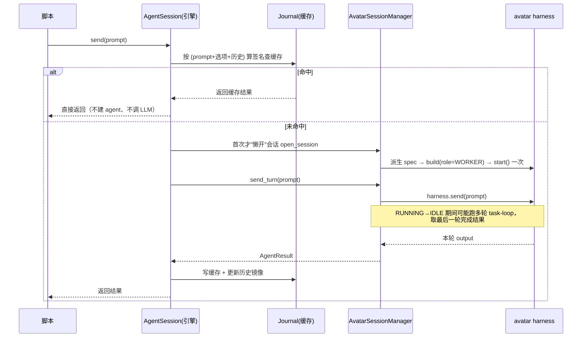
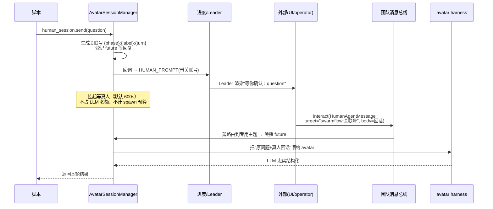

# SwarmFlow 有状态会话与人机交互编排

## 1. 背景与问题 (Why)

SwarmFlow 是团队 Leader 可调起的多 agent 工作流引擎：Leader 写一段（或引用一段）Python
脚本，脚本里用 `agent()`、`parallel()`、`pipeline()` 等原语把任务扇出给一批临时 agent，引擎
负责调度、缓存和汇总。

在本特性之前，脚本里能用的"干活单位"只有一种——**单轮 worker**。一次 `agent("分析这份日志")`
会临时拉起一个 agent、把这一个 prompt 跑完、然后立刻销毁。它没有记忆：你没法对同一个 agent
接着说"那第二点再展开"，因为上一轮的它已经不存在了。

这在两类场景下不够用：

**场景一：需要一个能连续对话的 agent。** 例如"先让一个 agent 读完整个代码库形成理解，再分多轮
就不同模块向它提问"。若每轮都新拉一个 worker，它每次都要从零重读，既慢又丢掉上一轮积累的判断
（task-plan、中间结论、工具状态）。

> 这里有一条设计红线：**有状态不能用"重放历史"假装**。一种偷懒做法是编排层自己存对话历史、
> 每轮把全部历史拼进 prompt 重喂给一个无状态 worker。但这只是"看起来记得"，agent 内部的规划
> 状态、工具状态每轮都被重置。我们要的是真正活着的 agent。

**场景二：流程中需要问真人。** 例如派对筹备工作流，拟好菜单后要"请主办人签字确认"。这需要：
把问题推给真人 → 挂起等待 → 真人回话 → 把真人那句大白话**结构化**成流程下一步能用的数据
（如 `{approved: true, note: "甜点换水果"}`）。最后这步"结构化"本身就需要一个 LLM，所以"问真人"
在实现上也是一个 agent——只是它的输入来自真人，而不是上一轮的模型输出。

本特性给 SwarmFlow 脚本补齐这两类能力，并保证它们能与已有的 resume（断点续跑）机制共存。

## 2. 目标与非目标

**目标**

- 给脚本作者四个语义对称的原语：`agent()`（无状态单轮，已有）、`agent_session()`（有状态多轮）、
  `human()`（问一次真人）、`human_session()`（多轮人机对话）。
- 有状态会话由**真正保活的 agent**承载，跨轮保留内部状态，而非重放历史。
- 人机交互闭环：推问题 → 等真人 → 由 agent 把回话结构化 → 返回脚本。
- 不破坏无状态 `agent()`：其 resume 行为逐字节不变（零回归）。
- 人机交互点的标识在"等真人时中断、稍后恢复"后保持稳定，使真人之前的回复仍能对号。

**非目标**

- 不把"真人"做成正式团队成员（不建成员档案、不认领任务、不走完整 HITT）。它只是流程里一个
  临时问答点。
- 不实现会话 `fork`、不实现会话内部再嵌套人机交互（遇到直接报错）。
- **不实现"部分命中续跑"**：本期 resume 只保证"冷启动重新跑完整多轮"和"全命中纯重放"，不保证
  "恢复到会话某轮中间状态接着跑"（见 §6 与 §12 的诚实说明）。

## 3. 术语与上下文

| 术语 | 含义 |
|---|---|
| worker | `agent()` 对应的单轮、用完即弃的临时 agent；不进团队协作循环 |
| avatar | 有状态会话背后那个**保活**的 agent；技术上是一个长期不销毁的 harness |
| 会话句柄 | `agent_session()` / `human_session()` 返回的对象，脚本拿它反复 `send()` |
| 会合 (rendezvous) | "推出问题后挂起、真人回话后唤醒"这个同步点 |
| 关联号 (correlation id) | 标识某次人机问答的字符串，用来把真人回复路由回正确的等待点 |

## 4. 方案设计 (What / How)

### 4.1 总体架构

先看脚本作者眼里这四个原语长什么样（取自单测里的真实写法）：

```python
from swarmflow import agent_session, human_session, human

# 有状态 agent：同一个 agent 连续聊三轮，第三轮还记得前两轮
s = agent_session(label="chat", instructions="保持简洁")
a = await s.send("先读这份需求")
b = await s.send("第二点再展开")      # 它仍记得"这份需求"是什么
c = await s.send("给个结论")

# 多轮人机对话：每个 send 都推给真人、等真人答
h = human_session(label="主办人")
ok = await h.send("这份菜单可以吗？")   # 真人回"可以但把甜点换水果"，结果被结构化

# 一次性问真人：开一个临时人机会话、问一次、关掉
approval = await human("确认举办吗？", schema=APPROVAL, label="签核")
```

四者的差异只有两点：**是否保活**（session 系列保活、`agent()`/`human()` 用完即关），以及**输入
从哪来**（agent 系列输入来自脚本给的 prompt、human 系列输入来自真人）。

整套实现分三层。脚本只看见 DSL 原语；引擎层（`workflow/engine/`，与团队业务解耦）持有一个轻量
句柄、通过统一后端接口转发；业务层把请求落到真实 agent 上。无状态 worker 与有状态会话走两条不同
的后端路径，但共用同一套成员派生逻辑。

```
┌─ 脚本 DSL（用户代码）─────────────────────────────────────────────────┐
│   agent()        agent_session() / human_session()        human()      │
└──────┬───────────────────────┬───────────────────────────────┬────────┘
       └───────────────────────┼───────────────────────────────┘
                               ▼
┌─ 引擎层 workflow/engine（业务无关）───────────────────────────────────┐
│   AgentSession 句柄（轻量：标签 / 历史镜像 / 会话id）                   │
│         │                                                              │
│         ▼                                                              │
│   AgentBackend 接口： run / open_session / send_turn / close / aclose   │
└────┬─────────────────────────────────────────────┬───────────────────┘
     │ run()（无状态）                               │ open/send/close（有状态）
     ▼                                               ▼
┌─ 业务层 workflow/backends ────────────────────────────────────────────┐
│   TeamWorkerBackend ───────────懒建──────────► AvatarSessionManager     │
│        │                                       （每会话一行：harness    │
│        │                                        +轮次+锁+收口 future）   │
└────────┼───────────────────────────────────────────────┬─────────────┘
         ▼                                                 ▼
   单轮 worker harness                            avatar harness（role=WORKER）
   run_once 跑完即销毁                             start 一次·多轮复用·关闭才 dispose
```

**核心思路：把"团队成员"复用成一个保活的化身。** 有状态会话最关键的设计决定，是**不发明新的
agent 类型，而是把团队已有的成员能力（teammate）派生成一个长期保活的"化身"（avatar）**。具体说，
一个有状态会话底层就是一个普通的团队 harness，但有三点特殊：

1. 它从团队的 teammate 配置派生而来（人机会话则从 `human_agent` 配置派生，缺省回退 teammate），
   因此天然继承 teammate 的模型、工具、技能、工作区；
2. 它以 `WORKER` 角色构建——这个角色的含义是"有 teammate 的能力，但不进团队协作循环"（不订阅
   消息总线、不认领任务），所以和单轮 worker 处在同一隔离级别，符合"编排层与协作层分离"的约束；
3. 与单轮 worker 唯一的区别：它只 **`start()` 一次**、之后多轮复用，直到会话关闭才 `dispose()`；
   单轮 worker 则是 `run_once()` 跑完即销毁。

这套机制落在 `AvatarSessionManager`（`workflow/backends/avatar_session_backend.py`），它为每个会话
维护一行状态（那个 harness、轮次计数、本轮收口 future、一把保证同会话串行的锁）。

**接口是"扩展"而不是"新类"。** 引擎层不碰具体实现，它通过统一的后端接口 `AgentBackend` 调用上面
四个动作。原来单轮 backend 只有一个 `run()`；本特性给接口加了 `open_session / send_turn /
close_session / aclose` 四个方法，**且都带默认实现**（前三个抛"不支持"、`aclose` 是空操作）。这样
单轮 backend 一行不用改，运行时仍只持一个 backend，无状态 `agent()` 路径零影响。

### 4.2 数据流与时序

**(a) 一轮 `agent_session().send()` 到底发生了什么。** 先查缓存：按 `(prompt + 选项 + 历史)` 算个
签名，如果这轮之前跑过、签名命中，就**直接返回缓存结果，根本不建 agent、不调 LLM**——这正是
resume 全命中时的纯重放。只有未命中时，才在"第一次真要干活"的那一刻**懒开**会话（建 avatar
harness 并 `start`），然后起一轮、挂起等它从 RUNNING 回到 IDLE。注意一次 `send` 可能驱动 agent
内部跑好几轮 task-loop，我们取**最后一轮完成**的结果。



这里"历史镜像"只是引擎留的一份 `(你说, 它答)` 列表，**仅用于算缓存签名**，不进持久化日志、也
不靠它重建 agent——agent 的真实状态在那个保活的 harness 里。

**(b) 人机交互：问题怎么出去、回复怎么回来。** 人机会话的 `send` 不直接驱动 LLM，而走"推—等—
格式化"三步：

- **推问题**：生成一个关联号、登记一个 `future` 等回复，再通过回调把问题发出去。这个回调最终变成
  一个进度事件 `HUMAN_PROMPT`（带关联号），Leader 收到后渲染成人类可读的提示广播给 UI（"流程在等
  你确认：这份菜单可以吗？"）。
- **等真人**：协程挂在那个 `future` 上（默认超时 600 秒，可按轮覆盖）。**等真人期间不占 LLM 并发
  名额、也不计 spawn 预算**——人慢慢想不该挤占算力配额。
- **真人回话从哪进来**：外部（UI / operator）通过团队已有入口
  `interact_agent_team(HumanAgentMessage(target="swarmflow:<关联号>", body="可以但换水果"))` 送回来。
  团队运行时在分发前先认出"这是发给 swarmflow 人机点的回复"（target 以 `swarmflow:` 开头），把它
  **薄路由**到一个专用消息主题——不经给 Leader 的正常消息门、也不触发 Leader 轮次。会话管理器在
  第一次开人机会话时订阅了这个主题，收到后唤醒上一步的 `future`。最后把"原问题 + 真人原话"一起喂
  给那个 avatar agent，由 LLM 忠实地把大白话渲染成本轮需要的形状（带 schema 时产出结构化结果）。



> **为什么关联号要确定性生成、而不是随机 uuid。** 关联号是 `{phase}:{label}:{turn}` 算出来的
> （turn 是本会话第几轮）。原因是中断恢复：如果用随机 uuid，"等真人时整个流程被暂停、稍后恢复
> 重跑到这一点"时号会变，而 UI 上早就显示了旧号、真人也可能已按旧号回了话——号一变，这条回复就
> 匹配不上、被丢弃。脚本流程是确定的，所以用结构化、可重算的号，恢复后同一个交互点必然算出同一
> 个号。

### 4.3 接口与数据模型

**四个原语（真实签名，`workflow/engine/primitives.py`）**

```python
async def agent(prompt, *, label=None, phase=None, schema=None, options=None) -> Any
def agent_session(*, label=None, phase=None, instructions=None, options=None) -> AgentSession
def human_session(*, label=None, phase=None, instructions=None, options=None) -> AgentSession   # AgentSession(_human=True)
async def human(prompt, *, schema=None, label=None, phase=None, options=None) -> Any              # 临时会话的语法糖
```

> **Requirement:** 系统 SHALL 对同一 `AgentSession` 的连续 `send` 复用同一个保活 agent。
> **Scenario:** WHEN 脚本对一个 `agent_session()` 连续 `send` 三次 THEN 底层只 `open_session`
> 一次、avatar 跨三轮保留上下文（单测 `test_session_primitives.py` 断言 `opened==1`、历史轮次
> `[0,2,4]`）。

**后端接口（`workflow/engine/backends/base.py`）。** 单轮 backend 不实现会话四方法也能跑，因为它们
都有默认实现：

```python
class AgentBackend(abc.ABC):
    KNOWN_OPTIONS: frozenset[str] = frozenset()          # backend 自声明的额外 options 白名单
    @abstractmethod
    async def run(self, prompt, opts, schema_json) -> AgentResult: ...     # 单轮，唯一抽象方法
    async def open_session(self, *, kind, instructions, opts) -> str: ...  # 默认 raise NotImplementedError
    async def send_turn(self, session_id, prompt, opts, schema_json, *, history=(), correlation_id=None) -> AgentResult: ...
    async def close_session(self, session_id) -> None: ...
    async def aclose(self) -> None: return None          # 默认 no-op

@dataclass
class AgentResult:
    text: str | None = None
    structured: Any = None
    tokens: int = 0
    skipped: bool = False        # backend 无法回答 / 人机超时 → send 返回 None
```

**会话状态分两层。** 引擎句柄 `AgentSession`（`__slots__`）持 `_label / _phase / _instructions /
_options / _human / _history / _sid / _in_flight`——`_history` 是上文说的"仅供算签名"的镜像，`_sid`
懒开（首个未命中的 `send` 才真正建会话）。业务行 `_SessionState` 持 `harness / turns_executed /
lock`（同会话串行）+ 本轮收口三件套（`turn_future / last_finished / failed`）。

**缓存签名（`call_signature`，`workflow/engine/journal.py`）的兼容设计。** 它只把 `prompt`、`opts`
里的 `label/phase/model`、`schema_json` 折进 SHA256；**仅当历史非空时才追加历史**。正因如此，无状态
`agent()`（历史恒空）的签名算法逐字节不变 → 老的 resume 行为零回归；而会话每轮都带历史，上游某轮
改了，下游各轮签名连锁变化 → 级联重跑——这正是我们要的失效语义。

### 4.4 关键流程

- **冷启动多轮**：首个未命中的 `send` 才 `open_session`，派生唯一 card + 多轮 persona →
  `TeamHarness.build(role=WORKER)` → `start()` 一次 → 之后每轮 `harness.send` 起一轮、监听状态机在
  `RUNNING→IDLE` 时 resolve 本轮 future，取最后一轮完成的 output。
- **全命中纯重放**：resume 时若每轮签名都命中，引擎层全程短路——不建 harness、不调 LLM，逐轮返回
  缓存结果，同时推进历史镜像（保证后续轮的签名 / 关联号一致）。
- **人机关联号稳定性**：`{phase}:{label}:{turn}`，`turn = len(历史)//2`，命中和未命中都推进。故"等
  真人时整个流程被暂停、稍后恢复重跑到此点"后同一交互点必算出同一个号，真人按旧号发的回复仍能
  匹配。引擎层若没给关联号（backend 被直接调用），有 `{member}:{turn}` 兜底。
- **异常与边界**：avatar 内部要求再做人机交互（result_type=="interrupt"）→ 抛错 + 日志，不返回半截
  结果；人机等待超时 → `AgentResult(skipped=True)` → `send` 返回 `None`；run 结束 finally 统一
  `aclose()`——关掉本次开过的所有会话、取消所有未决人机 future。

### 4.5 配置与开关

| 配置 | 默认 / 取值 | 说明 |
|---|---|---|
| 人机 avatar 配置来源 | `human_agent` spec，缺省回退 teammate spec | 装配时算出，经 handle 链注入会话管理器 |
| 人机等待超时 | 600 秒 | 可经 `send(options={"timeout": ...})` 按轮覆盖 |
| 会话 options 白名单 | 引擎 7 键 + backend `KNOWN_OPTIONS` | 未知键 fail-fast 报错 |
| `agent()` 调优参数 | 显式 kwargs | 与会话的 `options` 字典并存 |

## 5. 关键决策与权衡 (ADR)

### 5.1 有状态 = 复用 teammate 的保活化身，不发明新类型
- **选择：** 从 teammate/human spec 派生一个 `WORKER` 角色 harness，start 一次、多轮复用。
- **为什么：** 既拿到 teammate 全部能力，又因 WORKER 角色天然不进协作循环；和单轮 worker 共用
  派生逻辑，只是生命周期更长，避免再造一个 agent 体系。

### 5.2 后端接口"扩展 + 默认实现"，不拆新接口
- **选择：** 在 `AgentBackend` 上加四个带默认实现的会话方法。
- **为什么：** 单轮 backend 一行不改、无状态路径零影响；运行时仍只持一个 backend，不引入分叉。

### 5.3 关联号确定性生成（否决随机 uuid）
- **选择：** `{phase}:{label}:{turn}`。
- **为什么：** 中断恢复后号必须稳定，否则 UI 上旧号失效、真人回复对不上号。这是人机交互可重放
  的前提。

### 5.4 被否决的备选与取舍理由
- **编排层存历史 + 无状态 backend 每轮重放**：明确否决。只是"看起来有记忆"，agent 内部规划/工具
  状态每轮都丢，不满足"对接真正的 teammate 能力"。
- **进程级全局人机注册表单例**：否决。生命周期不清、测试难隔离，且与团队消息总线职责重叠。改用
  会话管理器实例字段 + 现有总线完成会合。
- **给真人回复新开公共 API**：否决。复用已有 `interact_agent_team` + 一段薄路由即可，不扩公共
  表面。
- **把真人做成完整团队成员**：对一个瞬时问答点过度设计。

## 6. 影响面与兼容性

- **新增**：`avatar_session_backend.py`（会话管理器）、worker 与会话共享的成员派生 helper；事件层
  人机回复主题与事件类型；进度事件 `HUMAN_PROMPT`/`HUMAN_REPLIED`（带关联号）。
- **改动**：单轮 worker backend（抽出共享派生逻辑）、团队运行时 interact 薄路由、装配链（人机
  avatar 配置注入）。
- **零回归保证**：无状态 `agent()` 的签名算法与 resume 行为逐字节不变。无 BREAKING。
- **诚实边界（与 F_37 文档的偏差）**：F_37 称 resume 靠"avatar session checkpoint，`start(session=)`
  恢复中途状态"。**代码实际并未传 `session=`**（`avatar_session_backend.py` 是无参
  `await harness.start()`）。故当前真实能力是"冷启动多轮 + 全命中纯重放"，**没有**"恢复到会话
  某轮中间状态接着跑"。评审请以此为准。

## 7. 测试与验证

全部为离线确定性单测（MockBackend / fake harness，零网络零真实 LLM）：

- 引擎层（`test_session_primitives.py`，10 例）：多轮历史累积（只开一个 avatar、历史每轮 +2）、
  options 白名单 fail-fast、resume 全命中纯重放、上游改动级联重跑、`agent()` 签名不变、人机关联号
  确定性（`phase("review")`+`human_session(label="lead")` → `review:lead:0` / `review:lead:1`）。
- 会话管理器（`test_avatar_session_backend.py`，9 例）：单 harness 跨轮复用、schema 工具每轮挂摘、
  人机"推-等-格式化"全链路（含经总线送回复 + 关闭退订）、超时 skipped、缺人机配置清晰报错。
- 薄路由（`test_swarmflow_human_routing.py`，4 例）：`target="swarmflow:<corr>"` 识别与路由。
- 落地时全套 `tests/unit_tests/agent_teams/` 通过、无回归。

## 8. 可观测性

- 出向进度事件 `HUMAN_PROMPT` / `HUMAN_REPLIED` 带关联号，Leader 据此渲染"等你确认"提示。只在
  真正等真人时发出，不进缓存日志（全命中重放不重复出现）。
- 值得监控：人机等待超时率、会话平均轮数、avatar harness 开启/释放是否配平（防泄漏）。

## 9. 风险与回滚

- **会话泄漏**：每个会话持一个保活 harness，run 结束统一 `aclose()` 关掉本次所有会话、取消未决
  人机 future。
- **并发串扰**：同一会话被并发 `send` 会乱序——管理器对每会话加锁串行化，引擎层另有并发告警。
- **回滚**：新原语与无状态路径解耦，禁用有状态会话只影响用到它的脚本，`agent()` 不受影响。

## 10. 开放问题 (Open Questions)

- [x] 有状态要不要用"重放历史"实现？→ 否，用保活的真实 agent。
- [x] 人机关联号随机还是确定性？→ 确定性 `{phase}:{label}:{turn}`。
- [ ] 部分命中续跑（恢复到会话中途接着跑）何时做？当前未实现。
- [ ] 会话 `fork` 与会话内嵌套人机交互，留作后续。

## 11. 评审记录 (Iteration Log)

| 轮次 | 日期 | 版本 | 评审人 | 结论 | 主要修改/讨论 |
|---|---|---|---|---|---|
| 1 | 2026-06-24 | 1 | @arch-team | approved | 回溯归档；内容以当前 HEAD 代码为准，并据代码修正了 F_37 关于 resume 的过时表述 |

## 12. 实现记录与偏差

### 实际实现
四原语 `agent / agent_session / human / human_session` 已落地。有状态会话由 `AvatarSessionManager`
承载：从 teammate/human spec 派生 `WORKER` 角色 harness，`start()` 一次后多轮复用，会话关闭才
释放。人机交互用会话管理器实例字段做会合、复用团队消息总线把真人回复薄路由进来；关联号
`{phase}:{label}:{turn}` 确定性生成、跨恢复稳定。后端接口以"四方法 + 默认实现"扩展，无状态 worker
路径零改动。

### 与设计的偏差
- **resume 能力低于 F_37 文档宣称**：文档说靠 avatar session checkpoint 恢复中途状态，代码实际
  `harness.start()` 未传 session，部分命中续跑未实现；当前为冷启动多轮 + 全命中纯重放。
- 落地中补了两个 fix（`5af27ac9` / `0b8e4f54`）：native harness 多轮模式 per-round invoke 生命周期、
  task-loop 错误路径补发 `after_task_iteration`。
- 代码中文档未提的细节：人机超时可按轮覆盖、会话用独立锁强串行、会话级 finish rail 与 per-turn
  schema 工具分开处理、关联号在 backend 被直接调用时有 `{member}:{turn}` 兜底。

### 链接
- 原始特性记录：`agent-core` 仓 `docs/features/F_37_swarmflow-stateful-sessions-and-human.md`、规约
  `docs/specs/S_18_swarmflow-engine-and-worker.md`「有状态会话契约」段。
- 关键代码：`workflow/engine/primitives.py`（四原语、`AgentSession`、`call_signature`）、
  `workflow/backends/avatar_session_backend.py`（会话管理器）、`runtime/manager.py`（人机回复薄路由）。
- commits 见 frontmatter `implementation.commits`。

### 遗留与后续
- 部分命中续跑未实现（依赖 avatar 会话状态持久化）。
- 人机全链路真实 LLM 系统测试（跨进程 + avatar 结构化）需 model endpoint，手动跑。
- 交互式 CLI 的 `$swarmflow:<corr> <answer>` 回复语法解析待验证。
- 会话 `fork`、会话内嵌套人机交互，本期不做。

## 13. 参考与关联设计

- SDD-0003（中断恢复与崩溃可恢复状态持久化）：会话与缓存/续跑的协同；本设计的"全命中重放"建立
  在其 journal 之上。
- SDD-0004（嵌套工作流与执行加固）：`human()` 的 label/phase 补齐、结构化输出"调一次即停"的 rail
  在彼处落地。
- SDD-0005（脚本定义增强与 Claude Code 工具对齐）：会话 options 白名单的演进。
- SDD-0007（Worker 去团队成员化）：worker 与会话共享成员派生逻辑、二者都不写团队 DB。
- 原始特性记录：`agent-core` 仓 `F_37` / `S_18`。
