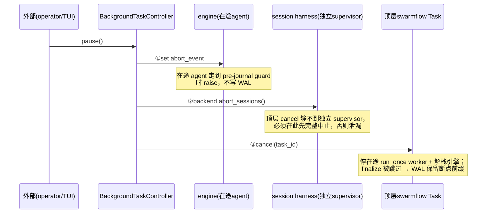
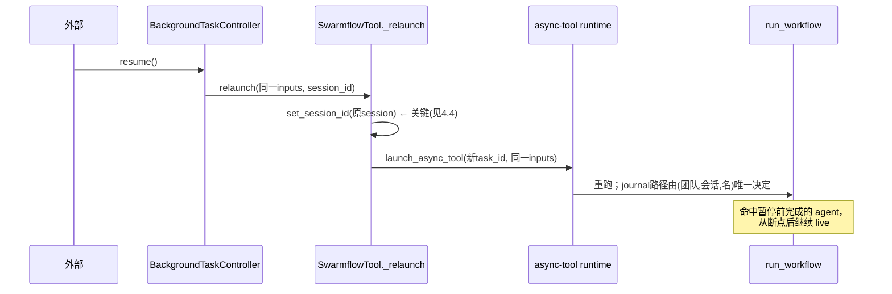

# SwarmFlow 中断恢复与崩溃可恢复状态持久化

## 1. 背景与问题 (Why)

SwarmFlow 工作流里每个 `agent()` 调用往往是一次昂贵的 LLM 调用。一个有十几个 agent、跑几分钟的
工作流，如果中途出事就得从头再跑一遍，既慢又烧钱。所以引擎很早就有一套**内容寻址缓存**
（journal）的雏形：给每次 agent 调用算一个"位置 + 内容"的指纹，跑完把结果按指纹存下来，再跑同
一个工作流时，指纹没变的调用直接复用缓存、跳过 LLM。

但这套基座在真实使用中暴露了三层缺口，本特性把它们一次补齐，构成"可中断、可恢复、崩溃可续"
的完整能力：

1. **缓存根本没接到生产链路上（缺持久化）。** 引擎暴露了 `resume`（读旧缓存）和 `journal_path`
   （写新缓存）两个入参，但 Leader 调起 swarmflow 的那条链路一路都没传它们。结果：每次都冷启动、
   零命中；跑完不落盘；缓存只是内存里活一次的对象。Leader 跑的 swarmflow 完全不可重放。

2. **就算落盘了也不耐崩溃、不可读、还卡事件循环。** 旧落盘按字符串字典序排，文件里调用顺序和
   脚本执行顺序对不上、没法读；只在跑完一次性写盘，进程中途崩溃则已经算出来的（昂贵）结果全丢；
   写文件不是原子的（崩在写一半会留下半截文件，下次解析半行就抛异常）；而且是同步磁盘 I/O，会
   卡住与其他团队协程共享的事件循环。

3. **没有真正的"暂停/恢复"入口。** 缓存重放能力有了，但外部（operator / TUI）没法在 swarmflow
   跑到一半时喊停（停下、但保住已完成 agent 的成果），也没法之后从断点续跑。

参照 Claude Code 的工作流中断模型——**暂停 = 中止 + 进程级停止，恢复靠缓存重放，被中断的那个
agent 不进缓存、恢复时重跑**——本特性把三层缺口补成一个连贯的故事。

## 2. 目标与非目标

**目标**

- 把缓存接到生产链路：同一 `(团队, 会话, 工作流名)` 再次运行时命中缓存、跳过没变的 agent。
- 缓存按**脚本执行顺序**落盘——既逐行可读如执行流，又字节稳定可 diff。
- 引入 **WAL（预写日志）**：进程中途崩溃也能从 WAL 恢复已完成的调用。
- 落盘**原子**（写临时文件再原子改名）、**异步**（不卡事件循环）。
- 提供真正的 **暂停 / 恢复**：通过一个控制器对象注入，可中断在途 swarmflow 并从断点续跑。

**非目标**

- 不做 `fsync`（防断电 / OS 崩溃）——本期只防进程崩溃。
- 不做缓存的跨 run GC / 保留策略（随删除团队整树清理）。
- 不把单轮 `agent()` worker 改成"可中止"的形态。
- 不在 Runner 上堆 `pause_swarmflow` / `resume_swarmflow` 方法。

## 3. 术语与上下文

| 术语 | 含义 |
|---|---|
| journal | 内容寻址的 agent 调用缓存（JSONL），不是时间日志 |
| call-path 键 | 一条缓存记录的"位置"，编码它在脚本结构里的坐标 |
| 签名 (sig) | 一条记录的"内容指纹"，prompt+选项+schema(+历史) 的 SHA256 |
| WAL | journal 的 sidecar `<journal>.wal`，对新算出的记录即时追加，崩溃恢复用 |
| program order | 由脚本结构（而非完成时序）决定的落盘顺序 |
| abort_event | 引擎层的暂停信号，置位后挡住新 agent、并让在途结果不落盘 |
| finalize | 工作流正常跑完后才执行的"写 journal + 校验后删 WAL"收尾 |

## 4. 方案设计 (What / How)

### 4.1 总体架构

三层职责严格分离，引擎保持业务无关（不懂团队目录、不依赖团队模块）：

```
控制面 runtime
  BackgroundTaskController
    pause() 三步 / resume() relaunch
        │ pause / resume
        ▼
业务层 workflow/runner.py
  run_swarmflow
    ├─► _resolve_journal_path（算路径 / 建目录）
    │       └─► load_workflow_meta（纯 AST 取 name，不 import 脚本）
    │
    │  resume = journal_path = 同一文件
    ▼
引擎层 workflow/engine（业务无关）
  run_workflow（注入 abort_event / journal_path）
    ├─► Journal：program-order 落盘 + WAL + 原子 / 异步 I/O
    └─► agent() / send 两个 abort checkpoint（入口 gate / pre-journal guard）
```

- **缓存接线在业务层，不污染引擎**：`run_swarmflow` 用 `_resolve_journal_path` 算出路径，把
  `resume` 和 `journal_path` 指向**同一文件**传给引擎；引擎签名零改动。
- **暂停/恢复经一个控制器对象**，attach 到 Leader harness，swarmflow 启动时自注册句柄——不在
  Runner 上堆方法。

### 4.2 数据流与时序

**(a) program order 落盘 + 字节稳定。** 每条记录的键编码它在脚本结构里的坐标，`_program_order`
把键里的整数坐标拍平成一个数值元组（丢掉 `call/par/pipe/wf` 这类种类字符串、跳过 `wf` 段里的
工作流名），按它排序就是 depth-first 的脚本执行序。由于坐标由程序结构决定、与并发完成时序无关，
同一脚本两次跑得到**逐字节相同**的文件，可 diff。

```
键                                    _program_order      落盘行号
[["call",0]]                          [0]                 1
[["pipe",1,0,0],["call",0]]           [1,0,0,0]           2
[["par",4,1],["call",0]]              [4,1,0]             3
[["wf",6,"invite"],["call",0]]        [6,0]  ("invite"跳) 4
```

**(b) 暂停三步（顺序是正确性关键，`BackgroundTaskController.pause`）：**



**(c) 恢复（`resume` → `_relaunch`，绕过 LLM 决策）：**



**(d) 崩溃恢复（`Journal.load` 合并 journal + WAL）：** 先读 journal，再用 WAL 覆盖/补全（WAL
较新，last-wins），解析时**容忍尾部半行**（崩在写一半）。所以进程中途崩溃（没机会 finalize）
仍能从 WAL 恢复；journal 缺失/不完整时纯靠 WAL 恢复。

### 4.3 接口与数据模型

**一条 journal 记录（JSONL 每行一条，`workflow/engine/journal.py`）**

```json
{"key":"[[\"call\",0]]","sig":"<sha256>","label":"A","phase":null,
 "kind":"str","result":"...","raw_text":"..."}
```

- `key`：JSON 化的 call-path 元组，编码结构坐标，四种段：`["call",k]` / `["par",k,i]` /
  `["pipe",k,i,s]` / `["wf",k,name]`。
- `sig`：`call_signature` 的指纹——`prompt` + `opts` 里 `label/phase/model` + `schema_json`
  （+ 历史非空时追加历史）的 SHA256。无状态 `agent()` 历史恒空，签名与旧版兼容。

**引擎中断契约**

> **Requirement:** `Runtime.abort_event: asyncio.Event | None`（默认 `None` = 不可暂停，老用法
> 行为完全不变）。`agent()` 与 `AgentSession.send()` 各有两个 checkpoint：**入口 gate**（缓存命中
> 检查后、起 backend 前）挡新调用；**pre-journal guard**（backend 成功返回后、写缓存前）确保在途
> 调用不进 WAL。
> **Requirement:** checkpoint 命中 SHALL raise `WorkflowAborted`，它继承 **`BaseException`**（不是
> `Exception`），从而穿透 `parallel()` / `pipeline()` 分支体里的 `except Exception`，不被吞成
> `None` 再缓存成空结果。

**WAL 写/删分离（不变量）**

| 方法 | 写 journal | 触碰 WAL | 调用时机 |
|---|---|---|---|
| `save(path)` | 原子写（临时文件 + `os.replace`） | 不动 | 可重复调（为未来 mid-run checkpoint 预留） |
| `finalize(path)` | 先 `save` | **校验后删** | 仅工作流正常跑完时（`run_workflow` 在正常返回之后调，异常/取消都跳过） |

> 删 WAL 的校验条件是 `used ⊆ 已落盘 journal`（按 key+sig），**不是** `WAL ⊆ journal`——这样
> 脚本改动后 WAL 里的陈旧条目不会阻塞清理，只要本次 run 实际用到的记录都落盘就删；不一致则保留
> WAL 兜底。

**暂停/恢复控制器（`runtime/background_task_controller.py`）**

```python
async def pause(self) -> bool      # 对所有 active 句柄执行三步，移入 _paused
async def resume(self) -> bool     # 对所有 _paused 句柄调 relaunch
def register(handle) / deregister(task_id)   # swarmflow 启动/收尾时自注册
```

引擎与控制器的解耦点是一个回调 `on_backend_ready`：backend 构造完成、引擎启动前同步回调，控制器
据此拿到 backend 引用注册句柄——引擎完全不知道控制器存在。

### 4.4 关键流程

- **缓存落盘路径（单一真相源 `paths.py`）**：
  `~/.openjiuwen/.agent_teams/{团队}/sessions/{会话}/workflows/{工作流名}/journal.jsonl`，WAL 为
  同名 `.wal`。路径段经 `_safe_segment` 净化（非 `[A-Za-z0-9_.-]` 折成 `_`、strip 首尾、截断 96
  字符）防目录穿越（`../../etc/passwd` → `etc_passwd`）；会话为空回退 `default`。
- **工作流名必填且轻量获取**：名取自脚本 `META["name"]`，经 `load_workflow_meta` **纯 AST 解析**
  拿到——不 `importlib` 导入脚本、不执行脚本顶层、不留 `sys.modules` 条目；缺名直接报配置错误。
- **恢复必须重置 session_id 上下文**（一个真实踩过的坑）：恢复由控制器协程驱动，它不在 Leader 的
  会话上下文里。而 `launch_async_tool` 内部 `create_task` 会在建 Task 时**拷贝当前上下文**。所以
  `_relaunch` 必须在 `launch_async_tool` **之前** `set_session_id(原会话)`，新 Task 才继承到正确的
  会话；之后 `finally` 立刻复位（只影响控制器协程自身）。漏了这步，恢复会解析到空会话 → 用错
  缓存路径（全部重跑）+ 进度事件发到错主题（外部收不到、人机永等到超时）。**此 bug 由真实 LLM
  逐特性点 e2e 抓出**，确定性单测因 stub 了 relaunch 覆盖不到。
- **WAL append 的判定是对象身份**：`use(ks, record)` 里 `if self.prior.get(ks) is not record` 才
  追加 WAL——缓存命中时返回的是 `prior` 里同一个对象（`is` 为真，不重写），未命中才是新对象。
- **暂停信号转取消**：`SwarmflowTool` 把引擎抛的 `WorkflowAborted` 转成 `CancelledError`，让
  async-tool runtime 当作静默取消（不注入"完成"消息），与三步里的顶层 cancel 行为一致；`finally`
  里 `deregister` 始终执行。

### 4.5 配置与开关

| 配置 | 默认 / 取值 | 说明 |
|---|---|---|
| `abort_event` | `None` | 不传即"不可暂停"，与改动前行为完全一致 |
| `background_task_controller` | 不传 | 仅外部传入时才可暂停/恢复 |
| WAL append 锁 | `asyncio.Lock` | 串行化并发分支的 WAL 追加，防字节交错 |
| `os.replace`/`unlink` | 同步 | 元数据 syscall（µs 级），aiofiles 不封装、不用 to_thread |
| 预演（MockBackend 预览） | 不落 journal、不传 abort_event | 预演不污染真实缓存、不可被中止 |

## 5. 关键决策与权衡 (ADR)

### 5.1 缓存接线在业务层，引擎签名零改动
- **选择：** `_resolve_journal_path` 在 `run_swarmflow` 算路径；`load_workflow_meta` 纯 AST 取名。
- **为什么：** 引擎不懂团队目录（业务无关铁律）；AST-only 避免为取个名字而把脚本顶层执行两遍。

### 5.2 program order 落盘（否决按完成顺序 append）
- **选择：** 按结构坐标排序写出。
- **为什么：** 并发完成时序随机 → 同脚本两次跑行序不同、无法 diff，违背"resume 确定、不读
  wall-clock"。时间序由带时间戳的 console 日志承担，journal 是内容缓存。

### 5.3 WAL + 写/删分离 + 终态删 WAL
- **选择：** 新算出的记录即时 append WAL；`save` 纯写不删；`finalize` 校验后才删。
- **为什么：** 崩溃可能丢掉刚算出、还没落盘的记录——正是 WAL 要保护的，所以 append 必须 await 到
  落盘；拆出 `finalize` 防未来 mid-run checkpoint 复用 `save` 时误删 WAL。

### 5.4 暂停三步固定顺序 + `WorkflowAborted` 是 `BaseException`
- **选择：** `set abort_event → abort sessions → cancel task`；中止异常继承 `BaseException`。
- **为什么：** session supervisor 是独立 Task，顶层 cancel 够不到，必须先在控制器协程里完整中止
  否则泄漏；`BaseException` 才能穿透 parallel/pipeline 的 `except Exception`，否则在途 agent 被
  缓存成空结果、恢复时不重跑。

### 5.5 被否决的备选与取舍理由
- **在 Runner 上堆 `pause_swarmflow`/`resume_swarmflow`**：随控制操作增多接口爆炸；用户明确要一个
  统一控制器对象。
- **streaming 回调 / interact 控制消息**：改公共 API 风险大 / 把控制命令混进"给 LLM 的数据消息"
  通道，语义不纯。
- **纯 cancel 顶层 task（不加 abort_event）**：session turn 的 future 可能在 cancel 落地前被解析
  成空结果，引擎写空 turn（竞态）。pre-journal guard 消除竞态。
- **把 worker 改成 supervisor 让它可 abort**：改动大、违反"worker 单轮用完即弃"；run_once worker
  靠顶层 cancel 停止即可（finally 清理干净）。
- **WAL fire-and-forget（后台 flush）**：崩溃可能丢掉刚算出还没落盘的记录，自相矛盾。
- **`asyncio.to_thread` 做异步写 / 非原子 `write_text` + 删 WAL**：前者 owner 否决（aiofiles 更
  地道）；后者崩在写一半留半截 journal，解析半行会崩，反而更脆。

## 6. 影响面与兼容性

- **新增**：`runtime/background_task_controller.py`；`paths.py` 的 sessions/workflows 路径函数链 +
  `_safe_segment`；`engine/loader.py` 的 `load_workflow_meta`；`engine/errors.py` 的
  `WorkflowAborted`。
- **改动**：`engine/{journal,runner,primitives,runtime}.py`、`workflow/{runner,tool_swarmflow}.py`、
  `workflow/backends/*`、`harness/{native_harness,team_harness}.py`、`agent/*`、`core/runner/
  team_runner.py`。
- **兼容性**：引擎 `run_workflow` 签名零改动；`abort_event=None` / 不传控制器时行为与改动前一致。
- **文档修正**：`workflow/AGENTS.md` / `S_18` 旧表述"engine 仅依赖 stdlib"修正为"engine 不耦合
  agent_teams 业务模块，可用通用三方库（如 aiofiles）"——'仅 stdlib' 是对 swarmflow 脚本（用户
  代码）的约束，不是引擎的。

## 7. 测试与验证

- `test_journal.py`（11 例）：program-order 序、字节稳定（乱序插入同样产物）、WAL 崩溃残留、仅靠
  WAL 恢复、WAL 覆盖 journal、命中不重写 WAL、`finalize` 删 WAL、`save` 保留 WAL、原子写无残留
  `.tmp`、半行容错、不一致保留 WAL。
- `test_pause_resume.py`（3 例，引擎级）：abort_event 预设挡所有 agent；A 完成后置位、B 在
  pre-journal guard raise、WAL 仅含 A；resume 命中前缀只重跑 B/C。
- `test_background_task_controller.py`：pause 三步顺序、resume relaunch、空集 no-op。
- `test_runner.py` / `test_paths.py`：`_resolve_journal_path` 三场景、`_safe_segment` 防穿越、
  `load_workflow_meta` 不留 `sys.modules` 条目。
- 真实 LLM e2e（手动）：party_planner 全原语，**每个 phase 边界都暂停+恢复一次**，结果
  `pauses=6 resumes=6 phases=6 human_replies=7 PASSED`——并抓出修复了 §4.4 的 session 上下文 bug。

## 8. 可观测性

- journal 文件逐行即执行顺序、字节稳定可 diff，便于人工排查与版本比对。
- **WAL 终态删除是不变量**：`finalize` 后 WAL 应不存在；若存在，说明该 run 未正常完成（可作告警）。
- 暂停/恢复经进度事件可观测（`pauses`/`resumes` 计数）；恢复后会话上下文必须正确，否则进度发到
  错主题（外部 drain 卡死即症状）。

## 9. 风险与回滚

- **`os.replace`/`unlink` 仍同步**：极端慢 FS 上微阻塞——元数据 syscall 通常 µs 级，可接受。
- **WAL 只增不自清**：靠 `finalize` 删 + 删除团队整树清理兜底；从不优雅完成的 session 其 WAL 会
  累积。
- **回滚**：不传控制器即退回"不可中断"；不传 journal_path 即退回"每次冷启动"。两者均向后兼容。

## 10. 开放问题 (Open Questions)

- [x] journal 行序按字典序还是执行序？→ 执行序（program order）。
- [x] 崩溃 durability 用 WAL 还是每步 save？→ WAL（增量 append，命中不重写）。
- [x] 暂停三步顺序？→ set event → abort sessions → cancel task。
- [ ] 是否需要 `fsync` 防断电 / OS 崩溃？（本期不做）
- [ ] `WorkflowAborted`（pre-journal guard）与 `CancelledError`（顶层 cancel）两条路是否合并为一？

## 11. 评审记录 (Iteration Log)

| 轮次 | 日期 | 版本 | 评审人 | 结论 | 主要修改/讨论 |
|---|---|---|---|---|---|
| 1 | 2026-06-24 | 1 | @arch-team | approved | 回溯归档；合并 F_38/F_40/F_43 为一份完整的中断恢复设计，内容以当前 HEAD 代码为准 |

## 12. 实现记录与偏差

### 实际实现
- **落盘接线（F_38）**：`run_swarmflow` 经 `_resolve_journal_path` 把 resume / journal_path 指向同一
  文件；`load_workflow_meta` 纯 AST 取名；路径段 `_safe_segment` 防穿越。
- **WAL + program order + 原子/异步 I/O（F_40）**：`journal.py` 按结构坐标排序落盘，sidecar WAL
  即时 append（对象身份判定），临时文件 + `os.replace` 原子写，`aiofiles` 异步、`asyncio.Lock`
  串行化 WAL append；`finalize` 校验 `used ⊆ saved` 后删 WAL。
- **暂停/恢复（F_43）**：`BackgroundTaskController` 三步 pause + relaunch resume，引擎 `abort_event`
  两 checkpoint，`WorkflowAborted(BaseException)` 穿透分支异常吞噬，恢复重置 session_id 上下文。

### 与设计的偏差
- F_38 接线时发现有状态会话路径仍消费重构前的旧返回结构（F_37 重构遗漏），补独立 fix
  （`98933714`）对齐。
- F_43 真实 e2e 抓出恢复未重置 `session_id` 上下文的 bug，补 `89255dc3` 修复。
- 文档未提的代码细节：WAL append 用对象身份（`is`）而非值相等判定是否新鲜；`abort_event=None`
  时两 checkpoint 完全 no-op；解耦点是 `on_backend_ready` 回调；预演不传 abort_event。

### 链接
- 原始特性记录：`agent-core` 仓 `F_38` / `F_40` / `F_43`，规约 `S_18`「Resume Journal 持久化」与
  「pause/resume 中断恢复」段。
- 关键代码：`workflow/engine/journal.py`、`workflow/engine/primitives.py`（两 checkpoint）、
  `runtime/background_task_controller.py`、`workflow/tool_swarmflow.py`（`_relaunch`）、`paths.py`。
- commits 见 frontmatter `implementation.commits`。

### 遗留与后续
- `fsync` 未做（防进程崩溃够用，防断电 / OS 崩溃待评估）。
- WAL / journal 跨 run GC 与保留策略未做（随删除团队清理）。
- 多并发 swarmflow run 的暂停（控制器已遍历所有句柄支持）只覆盖单 run e2e。
- 暂停窗口内真人用同关联号提交的回复在恢复后的稳定匹配，逻辑已设计、未做专门 e2e。

## 13. 参考与关联设计

- SDD-0002（有状态会话与人机交互）：会话的"全命中重放"建立在本设计的 journal 之上；暂停时会话
  harness 的中止与本设计的三步衔接。
- SDD-0004（嵌套工作流与执行加固）：`WorkflowAborted` 穿透 parallel/pipeline 分支异常，与并发健壮
  性同源。
- SDD-0005（脚本定义增强）：`META["name"]` 必填、`resume_id` 续跑入口的执行层落点。
- 原始特性记录：`agent-core` 仓 `F_38` / `F_40` / `F_43` / `S_18`。
