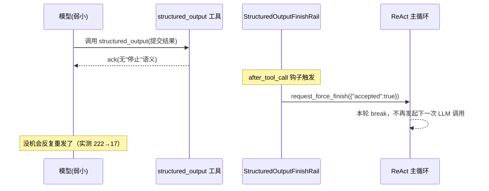

# SwarmFlow 嵌套工作流调用与执行加固

## 1. 背景与问题 (Why)

为了从 **团队真实入口**（Leader 调起 swarmflow 工具）端到端验证 SwarmFlow 的全部能力，我们写了
一个覆盖所有原语的真实 LLM 系统测试 `party_planner.py`（无状态 `agent`、有状态 `agent_session`、
一次性 `human`、多轮 `human_session`、`pipeline`、`parallel`、以及嵌套 `workflow`）。这次"用真实
小模型 + 真实关停时序"拉通，暴露了四个之前用 MockBackend / 单测发现不了的问题：

1. **一次性 `human()` 不接受 `label`。** demo 里写了 `human(..., label="主办人签核")`，但旧签名没有
   这个参数，"审批"阶段直接抛 `TypeError`，整个工作流失败。

2. **结构化输出工具被反复调用。** 弱模型每轮调 `structured_output` 提交结果后，收不到"停下"信号，
   会一直重发——实测全程调了 222 次。

3. **嵌套调用的"防递归"误杀了"同层并发"。** 这是本特性最核心的问题：`workflow()` 既要禁止真正的
   递归（子工作流里再调 `workflow()` 无限套娃），又要放行 `parallel([workflow, workflow, workflow])`
   这种同层并发的多个子工作流。旧实现用一个**共享计数器**记嵌套深度，结果三个并发分支里第一个把
   计数器加到 1，后两个一看"已经到上限了"就被静默跳过（返回 `None`），并发子工作流白白丢失。

4. **关停时崩溃。** 停止 harness 时取消了在途的"异步工具完成注入"任务，而那个任务正阻塞在等一个
   ack；随后 supervisor 又去给这个已被取消的 future 设结果，抛 `InvalidStateError` 崩掉。

本特性以这次 E2E 为驱动，把四个问题一次加固，并建立从团队入口的真实 LLM E2E 基线（单 / 并发
两套）。

## 2. 目标与非目标

**目标**

- 让 `workflow()` 的嵌套深度守卫**禁递归、放行同层并发**。
- 一次性 `human()` 补 `label` / `phase`，与 `agent()` / `*_session()` 对称。
- 从机制上根治结构化输出反复调用，不靠提示词劝模型"调一次就停"。
- 消除关停竞态导致的 supervisor 崩溃。
- 建立单 / 并发两套真实 LLM E2E。

**非目标**

- 不在 `workflow()` 入口加锁/信号量限并发（那是限并发，不是防递归，且会把子工作流串行化）。
- 不把 worker 改成可中止形态（关停靠顶层 cancel + 框架守卫）。
- 不追求 E2E 完成判定的精确信号（用 stream 静默近似，够用但非确定性）。

## 3. 术语与上下文

| 术语 | 含义 |
|---|---|
| 嵌套深度 (nesting depth) | 当前**执行路径**上 `workflow()` 的层数——应 per-path |
| 并发数 (concurrency) | 同一时刻在跑的 workflow 总数——是另一回事 |
| contextvar 按值拷贝 | `asyncio` 创建 Task 时会拷贝当前上下文，天然实现 per-task 隔离 |
| force-finish | rail 在工具调用后请求"本轮就此打住"，不再发起下一次 LLM 调用 |

## 4. 方案设计 (What / How)

### 4.1 总体架构

四项加固分布在引擎、backend、harness 三层，互相独立：

```
引擎层 primitives.py
  ① 嵌套深度守卫： _wf_depth: ContextVar(默认 0)，_MAX_WORKFLOW_DEPTH=1
  ② human() 补 label/phase（facade / seam / provider / primitives 四层）

backend 层
  ③ StructuredOutputFinishRail： after_tool_call → request_force_finish

harness 层
  ④ NativeHarness._ack 守卫：仅当 future 未完成才 set_result
     TeamHarness.add_rail 委派 → native
```

旧实现把嵌套深度记在一个所有并发分支共享的计数器上；新实现改成 `ContextVar`，并删掉了 `Runtime`
上那个旧字段。

### 4.2 数据流与时序

**(a) 嵌套深度守卫为什么 contextvar 能同时"禁递归 + 放行并发"。** 关键在于 `parallel()` /
`pipeline()` 内部是用 `asyncio.gather` 把每个分支包成**独立 Task** 执行的，而 Task 创建时会**按值
拷贝**当前上下文——于是每个分支拿到自己那份 `_wf_depth` 副本，互不影响；而真正的递归发生在
**同一个 Task** 内，看到的是已经自增过的值。

```
父工作流  _wf_depth = 0
    │
    └─ parallel([wf C1, wf C2, wf C3])   asyncio.gather → 3 个独立 Task
         │（每个 Task 创建时按值拷贝 _wf_depth=0）
         ├─ 分支A Task：继承 0 → 0≥1? 否 → 放行 → 进入后自增到 1
         │      └─ 子工作流 run() 里再调 workflow()（同一 Task）
         │             → 看到 1 → 1≥1? 是 → 返回 None（递归被封顶）
         ├─ 分支B Task：继承 0 → 0≥1? 否 → 放行   ← 同层并发互不影响
         └─ 分支C Task：继承 0 → 0≥1? 否 → 放行
```

`finally` 里把 `_wf_depth` 回滚，所以顺序调用 `workflow(A); workflow(B)` 时，B 进入前深度已回到
0，B 也能执行——守卫封顶的是"同一执行路径的嵌套层数"，不是"本次 run 里 workflow 总调用次数"。

**(b) 结构化输出"调一次即停"。** `StructuredOutputFinishRail` 挂在 `after_tool_call` 钩子上，一旦
发现刚调的工具是 `structured_output`，就请求 force-finish 本轮：



force-finish 的 payload 不重要——backend 仍从工具捕获到的内容里读结构化结果。

### 4.3 接口与数据模型

**嵌套深度守卫（`workflow/engine/primitives.py`）**

```python
_wf_depth: ContextVar[int] = ContextVar("wf_depth", default=0)
_MAX_WORKFLOW_DEPTH = 1
async def workflow(name_or_path: str, args: Any = None) -> Any
```

> **Requirement:** `workflow()` 的递归封顶 SHALL 用 per-task `ContextVar`，不是共享 `Runtime` 字段。
> **Scenario:** WHEN `parallel([workflow×3])` THEN 三个子工作流全部放行、各产独立产物；WHEN 子工作
> 流 `run()` 内再调 `workflow()` THEN 返回 `None` + 日志（递归仍封顶）。单测 `test_engine.py`
> 两条用例分别断言"全部非 None"与"递归返回 None"。

**结构化输出 finish rail（`workflow/backends/structured_output_tool.py`）**

```python
class StructuredOutputFinishRail(AgentRail):
    priority = 900
    async def after_tool_call(self, ctx):
        if isinstance(ctx.inputs, ToolCallInputs) and ctx.inputs.tool_name == "structured_output":
            ctx.request_force_finish({"accepted": True})
```

挂载位置不同：
- worker（单轮）：仅在有 schema 时挂（`team_worker_backend.py`，build 后、run_once 前）。
- avatar session（多轮）：无论是否有 schema 都挂（`avatar_session_backend.py`，build 后、start 前），
  因为会话任意一轮都可能带 schema。注意：rail 是**会话级长挂**，而 `structured_output` 工具实例是
  **per-turn 挂摘**——两者处理策略不同。
- `TeamHarness.add_rail` 是本特性新增方法，委派给底层 `NativeHarness.add_rail`（对称于既有
  `add_tool`）。

**`human()` 补 label/phase（四层一致签名）**

```python
async def human(prompt, *, schema=None, label=None, phase=None, options=None) -> Any
```

`label`/`phase` 转发给临时 `AgentSession(_human=True)`，使一次性 human turn 也带确定性关联号
`{phase}:{label}:{turn}`（若外层已 `phase("signoff")`，运行时 phase 优先于构造时传入）。单测断言
`phase("signoff")` + `human(label="host")` → 关联号 `signoff:host:0`。

**关停守卫（`harness/native_harness.py`）**

```python
@staticmethod
def _ack(fut, value):
    if fut is not None and not fut.done():   # 调用方已放弃则跳过，不崩
        fut.set_result(value)
```

supervisor 内所有 ack 解析（共 9 处）统一走它；`set_result` 全代码只此一处。

### 4.4 关键流程

- **结构化输出残留兜底**：force-finish 只在工具**被调用之后**生效，管不了模型首轮"完全没调工具"
  的情况——那由引擎的 `retries`（默认 2 次）兜底重试。实测残留约 17 次即少数轮各 1 次。
- **关停竞态双层防御**：
  - 框架层（根治）：`stop()` 先 `cancel_all()` 取消在途异步工具注入任务，这些任务的 ack future
    随之 done；supervisor 后续消费已入队命令时，`_ack` 的 `not fut.done()` 检查跳过 `set_result`，
    不崩。兜住任意外部早停（用户 stop team 恰在结果注入在途时）。
  - E2E 层（让正常路径更干净）：`workflow_completed` 后不立即 stop，等 Leader stream 静默一段时间
    再收尾，让 Leader 真正消费异步工具结果注入并播报。
- **E2E 三项防"假绿/假卡死"约定**：每次跑用**唯一 session_id**（缓存按 `(团队, session, 工作流名)`
  寻址，固定 id 重跑会静默命中缓存替身、掩盖回归）；**chdir 到 gitignore 的 scratch 目录 + 短相对
  脚本路径**（长绝对路径会被小模型篡改）；**启动看门狗**（工具失败/没启动时快速失败而非干等超时）。

### 4.5 配置与开关

| 配置 | 值 | 说明 |
|---|---|---|
| `_MAX_WORKFLOW_DEPTH` | 1 | 嵌套上限；超出返回 `None` + 写日志 |
| 引擎 retries | 2 | 模型首轮没调工具时的兜底重试 |
| `_NARRATION_QUIESCE_S` | 6s | E2E 判定"Leader 播报结束"的 stream 静默窗口 |
| `StructuredOutputFinishRail.priority` | 900 | rail 优先级 |

## 5. 关键决策与权衡 (ADR)

### 5.1 嵌套深度守卫改 per-task contextvar
- **选择：** `primitives._wf_depth`（ContextVar）取代 `Runtime.wf_depth`（共享 int），并删旧字段。
- **背景：** 共享 int 把"当前路径嵌套层数"（应 per-path）和"全局并发数"（它实际测的）混为一谈。
- **为什么：** ContextVar 在 Task 创建时按值拷贝——并发分支各推进自己的副本（放行），真正递归在
  同一 Task 内看到已自增的值（拦截）。一招同时满足"禁递归 + 放行并发"。

### 5.2 结构化输出从机制断循环（否决改提示词）
- **选择：** `StructuredOutputFinishRail` 捕获即 force-finish 本轮。
- **为什么：** 改提示词对小模型非确定性，仍可能循环；force-finish 与模型无关，从机制根治（222→17）。

### 5.3 关停双层防御
- **选择：** 框架守卫（`_ack` 检查 `not fut.done()`）+ E2E 等播报。
- **为什么：** 框架守卫是根治（兜住任意早停），E2E 等播报让正常路径更干净；只靠后者无法兜住 E2E
  之外的早停。

### 5.4 被否决的备选与取舍理由
- **`human()` 把 label 塞进 `options`**：破坏与 `agent()`/session 的对称；一次性 human 不显式开
  session，label 进不了临时会话的成员命名/关联号。显式 kwarg 才一致。
- **只改提示词治结构化输出循环**：对小模型非确定性，仍可能循环。
- **在 `workflow()` 入口加锁/信号量限并发**：那是限并发不是防递归，且会把子工作流串行化。
- **关停只靠 E2E 等播报、不加框架守卫**：任意 E2E 之外的早停仍会崩。
- **E2E 传绝对脚本路径 + 提示词强调"别改"**：小模型照样篡改，chdir + 短相对路径才稳。

## 6. 影响面与兼容性

- **改动**：`workflow/engine/{facade,provider,seam,primitives,runtime}.py`（嵌套守卫改 contextvar +
  删 `wf_depth` 字段 + `human()` 补 label/phase）、`workflow/backends/{structured_output_tool,
  team_worker_backend,avatar_session_backend}.py`（finish rail）、`harness/team_harness.py`
  （`add_rail` 委派）、`harness/native_harness.py`（`_ack` 守卫）。
- **新增**：`tests/system_tests/agent_swarm/` 下单/并发两套 swarmflow E2E + resources。
- **兼容性**：`human()` 补参是恢复 API 一致性（非新增表面），`label`/`phase` 不入缓存签名 → worker
  resume 零回归；嵌套守卫改 contextvar 对脚本透明。无 BREAKING。

## 7. 测试与验证

- 单测（`workflow/` + `harness/` + 集成 123 passed）：`test_structured_output_tool.py`（structured_
  output 触发 force_finish、其它工具不触发、非工具输入不崩）、`test_session_primitives.py`
  （`human(label=,phase=)` → 关联号 `signoff:host:0`）、`test_engine.py`（`parallel([workflow×3])`
  全部非 None；子工作流再调 `workflow()` 返回 None 即递归封顶）；fake harness 补 `add_rail`。
- 真实 LLM E2E（qwen flash）：party_planner `E2E PASSED`——6 阶段齐全、7 次 human 往返全自动应答、
  structured_output 222→17、`workflow_completed`；concurrent `CONCURRENCY E2E PASSED`——3 个并发
  子工作流各产独立邀请函、`nested depth > 1` 命中 0 次。两者 `supervisor crashed`/`InvalidStateError`
  均 0，出现 `leader narration settled` 收尾。

## 8. 可观测性

- `nested workflow depth > 1` 命中计数（E2E 断言为 0）。
- `supervisor crashed` / `InvalidStateError` 计数（应为 0）。
- `structured_output` 调用次数（加固后从 222 降到 17）。
- `leader narration settled` 作为收尾信号。

## 9. 风险与回滚

- **结构化输出仍偶有 1 次引擎 retry**：force-finish 管不了"首轮完全没调工具"，由 retries 兜底。
- **E2E 完成判定是启发式**（stream 静默近似），非精确完成信号；够用但非确定性。
- **回滚**：四项加固独立可退；contextvar 改动是纯内部实现，对脚本透明。

## 10. 开放问题 (Open Questions)

- [x] 嵌套深度守卫用共享计数器还是 per-task？→ per-task ContextVar。
- [x] 结构化输出循环靠提示词还是机制？→ 机制（force-finish rail）。
- [ ] E2E 完成判定能否由 harness 暴露"异步工具注入已消费"的确定信号替代？

## 11. 评审记录 (Iteration Log)

| 轮次 | 日期 | 版本 | 评审人 | 结论 | 主要修改/讨论 |
|---|---|---|---|---|---|
| 1 | 2026-06-24 | 1 | @arch-team | approved | 回溯归档；F_39 端到端验证驱动的四项加固，内容以当前 HEAD 代码为准 |

## 12. 实现记录与偏差

### 实际实现
嵌套深度守卫改 `primitives._wf_depth`（ContextVar）、删 `Runtime.wf_depth` 旧字段，并发子工作流
全放行、递归仍封顶；`human()` 补 `label`/`phase` 四层一致；`StructuredOutputFinishRail` 捕获即
force-finish（worker 有 schema 时挂、avatar session 总挂，经 `TeamHarness.add_rail` 委派）；
`NativeHarness._ack` 加 `not fut.done()` 守卫消除关停竞态（9 处统一）。新增单/并发两套真实 LLM
E2E。

### 与设计的偏差
- 无方向性偏差；四项加固均按设计落地并经真实 LLM E2E 验证。
- 文档未充分展开的代码细节：avatar session 的 finish rail 是会话级长挂，而 `structured_output`
  工具实例是 per-turn 挂摘；`_ack` 推广了错误路径早已有的 `not ack.done()` 守卫。

### 链接
- 原始特性记录：`agent-core` 仓 `F_39_swarmflow-e2e-hardening.md`，规约 `S_18`（嵌套守卫、结构化
  输出协议段）。
- 关键代码：`workflow/engine/primitives.py`（`_wf_depth`、`human()`）、`workflow/backends/
  structured_output_tool.py`（finish rail）、`harness/native_harness.py`（`_ack`）。
- commits 见 frontmatter `implementation.commits`。

### 遗留与后续
- observability 依赖未进锁（`uv.lock` 未随提交，需单独走依赖管理提交）。
- 结构化输出首轮"完全没调工具"仍靠引擎 retry 兜底（少数轮 1 次重试）。
- E2E 播报完成判定是启发式，未来可由 harness 暴露确定信号替代。

## 13. 参考与关联设计

- SDD-0002（有状态会话与人机交互）：`human()` label/phase 补齐、结构化输出多轮注入与本设计衔接。
- SDD-0003（中断恢复）：`WorkflowAborted` 同样需穿透 parallel/pipeline 分支异常吞噬，与并发健壮性
  同源。
- SDD-0005（脚本定义增强）：`parallel`/`pipeline` 单次 fan-out 上限、嵌套 `workflow()` 的脚本面。
- 原始特性记录：`agent-core` 仓 `F_39` / `S_18`。
