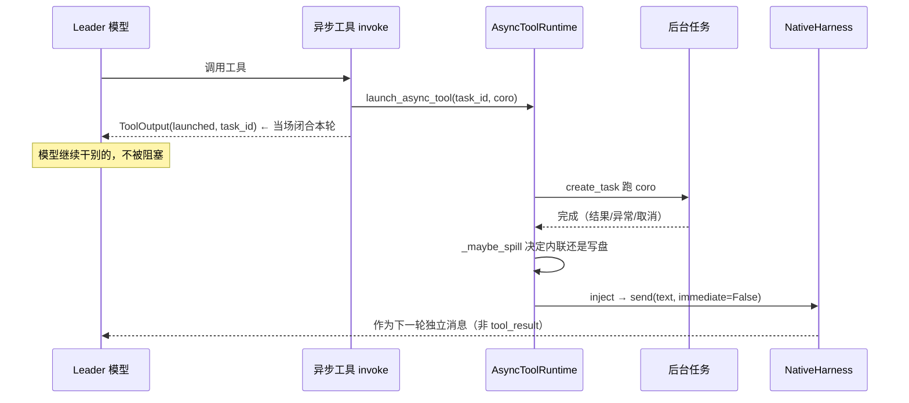

# 原生 Harness 异步工具管控框架与磁盘溢写

## 1. 背景与问题 (Why)

SwarmFlow 这类工具有个特殊性：它一跑可能要好几分钟。但 LLM 的工具调用协议是**强配对**的——
模型发一个 `tool_call`，就必须紧跟一个 `tool_result`，工具不能"挂起"一个半成品的结果让模型先去
干别的。如果让 swarmflow 同步跑完再返回，整个 Leader 就被这一个工具卡住几分钟。

所以早先做了一个**两段式异步工具**框架：`invoke` 立刻返回"已启动 (task_id)"把这一轮闭合，真正
的结果等后台任务跑完后**绕过工具协议**、作为下一轮的一条独立消息注入回来。这个雏形能跑，但缺了
三块，本特性（异步工具框架"路线一"）把它们补齐：

1. **task_id 看不出是什么任务（统一 ID）。** 各处用 `uuid.uuid4().hex` 散生成，没有前缀。日志里、
   取回工具里，光看一个 id 没法一眼分辨"这是 swarmflow 还是别的后台任务"。

2. **LLM 没法管控后台任务（管控工具）。** 运行时其实存着每个任务的状态/结果/错误，但模型够不着
   ——没法主动列清单、按需取回某个任务的完整输出、或取消一个跑飞的任务。

3. **大输出撑爆上下文（磁盘溢写）。** 结果默认全量进内存、全量注入 LLM。一份长报告、一个大 JSON
   就能把上下文 token 撑爆。

整个过程有三条"两段式不变量"必须守住：① `invoke` 立即返回 launched、当场闭合 tool_use；② 完成
结果绕过工具协议、经注入式消息进下一轮，**绝不回原 tool_use_id**；③ 框架零 `TeamAgent` 依赖，
只认 NativeHarness 的公共表面。

## 2. 目标与非目标

**目标**

- **统一 ID**：`generate_id(kind)` 带前缀（swarmflow→`w` 等），从 id 一眼识别任务类型。
- **管控工具**：三个工具让 LLM 能列清单、取回完整输出、取消任务。
- **磁盘溢写**：超阈值（默认 32KB）的结果写盘，只注入"摘要 + 路径 + 取回提示"。
- `tasks` 从无标识的 set 改成 `id→Task` 的 dict + per-task 事件，支持按 id 取消 / 等待。

**非目标**

- 不做作用域通知队列 / 多任务完成合并 / subagent 嵌套作用域隔离（路线一不含）。
- 不把框架下沉到通用 `openjiuwen/harness/` 层让普通 DeepAgent 复用（留作后续）。
- 不做流式溢写（当前是任务完成后一次性写盘）。
- 不迁移其它模块（session_spawn / worker backend）的 id 生成。
- 不把 `id_generator` 放 `core/common`（前缀表全是 team-scoped kind）。

## 3. 术语与上下文

| 术语 | 含义 |
|---|---|
| 两段式 | 启动段（invoke 立即返回 launched）+ 完成段（结果绕协议注入下一轮） |
| 管控工具 | 普通同步工具（非异步），立即返回，用来查/取/取消后台任务 |
| 溢写 (spill) | 超阈值的结果写盘、只注入摘要 + 路径，避免撑爆上下文 |
| resolver 闭包 | 把团队上下文（team/session）隔离在 rail 侧，运行时只认一个回调 |

## 4. 方案设计 (What / How)

### 4.1 总体架构

三块能力围绕一个挂在 NativeHarness 上的 `AsyncToolRuntime` 展开。启动工具（如 swarmflow）和三个
管控工具**共享同一个 runtime 实例**，所以管控工具能查到启动工具起的任务。

```
Leader（一轮 LLM）
  启动工具 invoke ─ 立即返回 launched(task_id)      管控工具 list / output / cancel
        │ launch_async_tool                                │ 读 / 取消
        ▼                                                  ▼
  AsyncToolRuntime（挂 NativeHarness，启动工具与管控工具共享同一实例）
    registry: 全量历史记录        _tasks: 仅运行中 (id→Task)
    _events: per-task 完成信号    _maybe_spill: 超 32KB 写盘
        │ 后台任务完成 → _maybe_spill
        ▼
  完成段： inject → send(immediate=False)
    作为下一轮独立消息（绝不回原 tool_use_id）
```

`id_generator.generate_id` 给每个任务生成带前缀的不透明 id（`generate_id("swarmflow")`→`w` 前缀），
日志和取回工具据前缀识别任务类型。

### 4.2 数据流与时序

**(a) 两段式的一生。** 启动段 `invoke` 只做三件事：生成 task_id、`launch_async_tool`、立即返回
`launched`。后台任务在 `AsyncToolRuntime._run` 里跑，跑完把结果（可能先溢写）经 `inject` 回调送进
下一轮——这个回调最终是 `NativeHarness.send(text, immediate=False)`：IDLE 就立刻起一轮，RUNNING 就
排进 follow-up 队列、本轮结束后再起。**完成文本是一条全新消息，不绑定任何 tool_use_id。**



**(b) 完成的三种终态。** 成功 → 记 `completed` + 溢写决策 + 注入"完成"文本；异常 → 记 `error` +
注入"失败"文本（后台失败不上抛主循环）；取消（`CancelledError`，`cancel_all` 走这条）→ 记
`error="cancelled"` + **不注入任何文本**，直接重抛。三种终态都会 `_signal` 唤醒在 `wait` 上阻塞的
管控工具。

**(c) 溢写决策（`_maybe_spill`）。** 结果先经 `render_result_text` 渲染成字符串（不截断），再判断：

```
完成结果 → render_result_text（不截断）
  │
  ├─ len ≤ 32KB?  或  无 resolver? ──是──► 完整内联注入（守住"完整回灌"）
  │      否
  └─ resolver() 返回目录?
         ├─ None ──► 完整内联注入
         └─ 有目录 ──► asyncio.to_thread 写 {task_id}.output
                        注入：前 1024 字摘要 + 路径 + 取回提示
                        （写盘失败 ┄┄► 降级完整内联，不丢数据）
```

### 4.3 接口与数据模型

**统一 ID（`id_generator.py`）**

```python
def generate_id(kind: str, *, length: int = 8) -> str   # 返回 {prefix}{base36*length}
# 前缀表：async_tool→x, swarmflow→w, session_spawn→s；未知 kind → 默认 t
# body 用 secrets.choice 的 base36（密码学强随机）；AsyncTool.invoke 用 generate_id(self.card.name)
```

> id 是**不透明字符串**，无下游解析依赖；前缀只为人 / LLM 识别。`SwarmflowTool.card.name=="swarmflow"`
> → 自然拿 `w` 前缀；未注册工具名 → `t`。

**运行时与记录（`harness/async_tools.py`）**

```python
@dataclass
class AsyncToolRecord:
    task_id: str; tool_name: str; description: str
    status: str = "running"          # running | completed | error
    result: Any = None; error: str = ""
    output_file: str | None = None   # 溢写成功时为磁盘路径（字符串）

class AsyncToolRuntime:              # 挂在 NativeHarness 上
    inject; registry: dict[task_id, AsyncToolRecord]      # registry = 全量历史
    output_dir_resolver: Callable[[], Path|None] | None   # 溢写目录惰性解析；None=不溢写
    spill_threshold: int = 32768                          # 32KB（dataclass 默认值）
    _tasks: dict[task_id, asyncio.Task]                   # 仅运行中（完成即 pop）
    _events: dict[task_id, asyncio.Event]                 # per-task 完成信号
```

> **重要区别**：`registry` 是全量历史，`_tasks` 只装运行中的任务（done callback 完成即 pop）。这
> 直接决定了 `has_running` 查 `registry`、而 `cancel` 查 `_tasks`。

**三个管控工具（`tools/tool_async.py`，均 leader-only、始终注入、不 gate）**

| 工具 | 入参 | 行为与返回 |
|---|---|---|
| `async_tasks_list` | 无 | `list_all()` 投影每行 `{task_id, tool, status, description}`；空时返回 "No async tasks." |
| `async_task_output` | `task_id`；`block`(bool)；`timeout`(ms，默认 30000，封顶 600000) | `block=false` 取当前记录；`block=true` `wait(task_id, min(timeout,600000)/1000)`；有 `output_file` 则读盘、否则取内存 result。返回 `{task_id, status, result, error}` |
| `async_task_cancel` | `task_id` | `cancel(task_id)`；未运行中（已完成或未知）返 False → not-found |

> **诚实边界（与文档/docstring 的偏差）**：`cancel()` 的 docstring 说"对已完成任务幂等返回 True"，
> 但**代码实际**：已完成任务已从 `_tasks` pop，`cancel` 查不到 → 返回 `False`。docstring 描述与代码
> 不符，以代码为准。

### 4.4 关键流程

- **per-task 事件唤醒**：终态统一 `_signal(task_id)` set 对应 `asyncio.Event`；`wait` 用
  `asyncio.wait_for(event.wait(), timeout)` 阻塞，超时被吞掉、返回当前（可能仍 running）记录而**不
  raise**。比轮询 status 更省更准。
- **溢写目录靠 resolver 闭包注入**：NativeHarness 有 `session_id` 但**没有** `team_name`（后者只在
  装配链可见）。所以 `TeamToolRail._wire_async_spill` 把 `runtime.output_dir_resolver` 设成一个闭包
  ——运行时才取 `agent.session_id` 拼出 `…/sessions/{session_id}/async_tools/`，并在解析成功时
  `register_cleanup_path`（删除团队时 rmtree）。**runtime 自己不持 team_name/session_id**，只认一个
  `Callable[[], Path|None]`，保持通用、为将来下沉通用 harness 层铺路。
- **session_id 惰性**：rail init 时 harness 可能还没 start、session_id 为 None 是正常的；溢写发生在
  任务完成（round 运行中），那时 session 必已 start，闭包能解析出目录。
- **写盘用 `asyncio.to_thread`**（不是 aiofiles）：把同步 `write_text` 丢到线程池，写盘失败吞异常 +
  warning 日志、降级完整内联（不丢数据）。

### 4.5 配置与开关

| 配置 | 值 | 说明 |
|---|---|---|
| `spill_threshold` | 32768（32KB） | dataclass 默认；保守倾向内联，仅真正超大才溢写 |
| `_SPILL_SUMMARY_CHARS` | 1024 | 溢写时注入的摘要长度 |
| `output_dir_resolver` | 默认 None | 非 NativeHarness 宿主 / 未注入时永不溢写（向后兼容） |
| `async_task_output` timeout | 默认 30000ms，封顶 600000ms | 防死等；工具描述明确"不要用它轮询" |
| 溢写文件名 | `{task_id}.output` | task_id 字符安全 |

## 5. 关键决策与权衡 (ADR)

### 5.1 `id_generator` 放 agent_teams 层（否决 core/common）
- **选择：** 放 `agent_teams/id_generator.py`，与 `paths.py` / `i18n.py` 同级。
- **背景：** 初稿误放 `core/common`，按 review 移回。
- **为什么：** 它索引的 kind 都是 team-scoped，core 公共层不该为此扩面。

### 5.2 管控工具是普通同步工具（否决继承 AsyncTool）
- **选择：** list / output / cancel 立即返回、无两段式。
- **为什么：** 它们不是后台任务，强套两段式会让"list"变成"启动一个查询任务"的荒诞结构。

### 5.3 溢写默认开、阈值 32KB（否决关闭 / 8KB）
- **选择：** 默认开 + 32KB。
- **为什么：** 关闭则价值不立即兑现；8KB 太激进会把大量中等结果变成"路径+摘要"，偏离起步版"完整
  回灌"决策过多。32KB 最大程度保留完整内联。

### 5.4 溢写目录靠 resolver 闭包，runtime 不持团队上下文
- **选择：** rail 侧注入闭包，runtime 只认 `Callable[[], Path|None]`。
- **为什么：** 保持 runtime 通用（本应只认注入入口），将来下沉通用 harness 层时不返工。

### 5.5 被否决的备选与取舍理由
- **`tasks` 保留 set**：无法按 task_id 定位 cancel / wait 的目标。
- **`wait` 轮询 status**：per-task 事件完成即唤醒，无轮询延迟 / CPU 浪费。
- **runtime 持 team_name/session_id 字段**：破坏通用性，下沉时返工。
- **加 `paths.async_tool_output_path(...)` 便利函数**：无调用方，加了就是死代码。
- **路线一拆三份独立特性 / 文档**：是一次连贯落地，合并为一份。

## 6. 影响面与兼容性

- **新增**：`id_generator.py`、`tools/tool_async.py`、`descs/{cn,en}/async_task*.md`。
- **改动**：`harness/async_tools.py`、`tools/{tool_factory,tool_permissions}.py`、`tools/locales/
  {cn,en}.py`、`paths.py`、`rails/team_tool_rail.py`、`i18n.py`。
- **兼容性**：三条两段式不变量未破坏；`output_dir_resolver=None` 时永不溢写（非 NativeHarness 宿主
  向后兼容）；swarmflow 全套不受 id 换前缀 / 溢写影响。无 BREAKING。

## 7. 测试与验证

- `test_id_generator.py`（5）：前缀映射（swarmflow→w / async_tool→x / session_spawn→s / 未知→t）、
  长度、base36 字符集、批量唯一性。
- `test_async_tools.py`（12）：get / list_all / cancel（取消后 status=error + "cancelled"）/ wait
  （终态立即返回、超时返回 running 不 raise、完成事件唤醒）；溢写（≤32KB 内联无 output_file、
  >32KB 写盘 + output_file + 注入含路径且 < 全量、resolver=None 不溢写）；`cancel_all` 不注入。
- `test_tool_async.py`（9）：list 渲染 / 空、output 缺 task_id / 未知 / 完成取回 / block 等待 / 读盘
  分支、cancel / 未知。
- 回归：`test_team_tools.py`（装配未因 +3 leader 工具破坏）、`workflow/`（swarmflow 全套）。
- 合计 207 passed, 14 skipped。

## 8. 可观测性

- task_id 前缀（x/w/s/t）让日志直接区分任务类型。
- `async_tasks_list` 给 LLM / 运维提供运行态清单。
- 溢写发生时注入文本含路径 + 取回提示，可观测"哪些结果走了磁盘"。

## 9. 风险与回滚

- **溢写写盘失败** → 降级内联（不丢结果），有 warning 日志。
- **`block=true` 占用调用方当前轮**——工具描述明确"不要用它轮询"，timeout 封顶 600000ms 防死等。
- **回滚**：`output_dir_resolver=None` 即关闭溢写；管控工具无害（registry 空时友好返回），可保留。

## 10. 开放问题 (Open Questions)

- [x] `id_generator` 放哪一层？→ agent_teams 层。
- [x] 溢写默认开还是关、阈值多大？→ 默认开、32KB。
- [ ] 作用域通知队列（多任务完成合并 / 嵌套隔离）何时做？
- [ ] 下沉通用 harness 层（抽象 `AsyncToolHost` Protocol）让普通 DeepAgent 复用，何时做？

## 11. 评审记录 (Iteration Log)

| 轮次 | 日期 | 版本 | 评审人 | 结论 | 主要修改/讨论 |
|---|---|---|---|---|---|
| 1 | 2026-06-24 | 1 | @arch-team | approved | 回溯归档；异步工具框架路线一（统一 ID + 管控工具 + 磁盘溢写），内容以当前 HEAD 代码为准 |

## 12. 实现记录与偏差

### 实际实现
统一 `id_generator.generate_id`（前缀体系、secrets 随机）；`AsyncToolRuntime` 的 tasks set 改
`_tasks` dict（完成即 pop）+ per-task `_events`，支持按 id 取消 / 等待；三个管控工具（普通同步工具、
leader-only 始终注入、不 gate）；磁盘溢写默认开 32KB，写盘走 `asyncio.to_thread`、经
`output_dir_resolver` 闭包注入溢写目录、runtime 不耦合团队上下文。

### 与设计的偏差
- `id_generator` 初稿误放 `core/common`，按 review 移回 `agent_teams/id_generator.py`。
- **代码与 docstring 的偏差**：`cancel()` docstring 称"对已完成任务幂等返回 True"，实际返回 `False`
  （已完成任务已从 `_tasks` pop）——以代码为准，docstring 待修正。
- 文档未提的代码细节：`registry` 是全量历史、`_tasks` 仅运行中（`has_running` 查前者、`cancel` 查
  后者）；写盘用 `to_thread` 而非 aiofiles；`cancel_all` 取消的任务不注入完成文本。

### 链接
- 原始特性记录：`agent-core` 仓 `F_41_async-tool-control-and-spill.md`，规约
  `S_20_native-harness-async-tool-framework.md`。本特性 footer 用 `Refs: #1047`。
- 关键代码：`harness/async_tools.py`（runtime/record/spill）、`id_generator.py`、`tools/tool_async.py`
  （三管控工具）、`rails/team_tool_rail.py`（`_wire_async_spill` 闭包）。
- commits 见 frontmatter `implementation.commits`。

### 遗留与后续
- 作用域通知队列（多任务完成合并、subagent 嵌套隔离）未做。
- 下沉通用 harness 层（抽象 `AsyncToolHost` Protocol）未做（resolver 设计已为此预留）。
- 流式溢写（多 phase 中间产物流式追加）未做。
- session_spawn / worker backend 的 id 未迁移（本次只替换 `AsyncTool.invoke`）。
- `cancel()` docstring 与代码不符，待修正。

## 13. 参考与关联设计

- SDD-0003（中断恢复）：异步工具完成注入与暂停/取消（`cancel_all` 在 teardown）的协同；swarmflow
  作为第一个异步工具实现。
- SDD-0005（脚本定义增强）：`resume_id` / 内联 `script` / 具名 `name` 的工具层执行依赖本异步执行
  框架。
- SDD-0007（Worker 去团队成员化）：溢写目录 `register_cleanup_path` 与 worker 工作区清理的边界划分。
- 原始特性记录：`agent-core` 仓 `F_41` / `S_20`。
