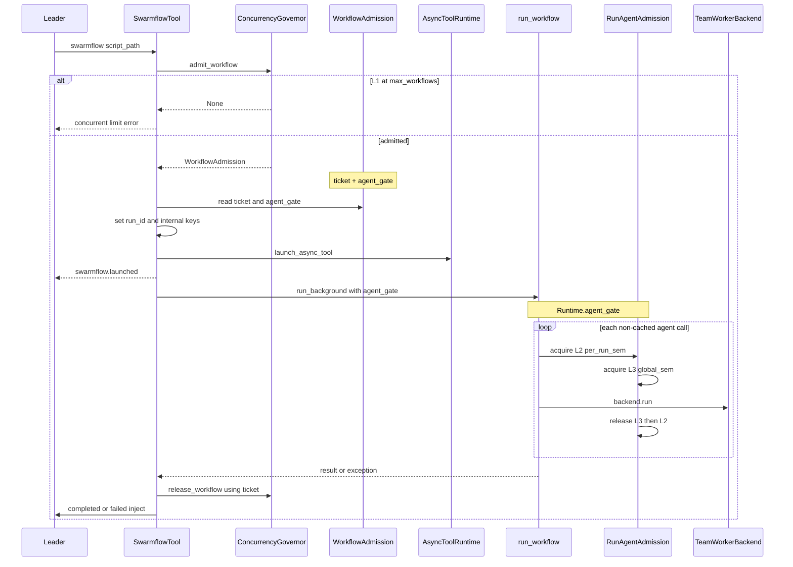
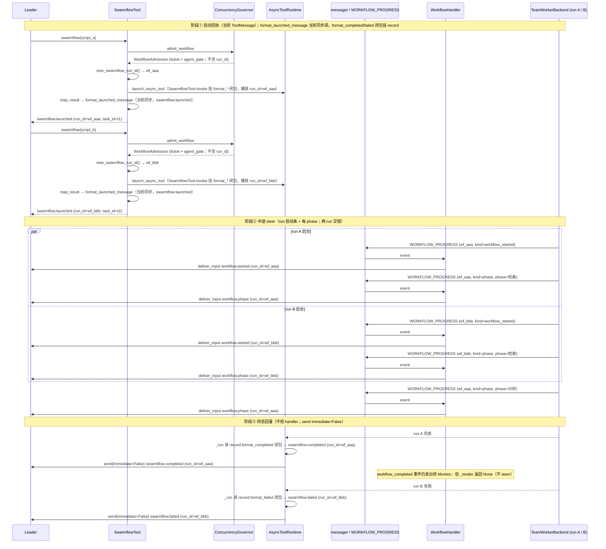

# Swarmflow 并发治理模块（ConcurrencyGovernor）

## 1. 背景与问题 (Why)

Swarmflow 允许 Leader 通过 `swarmflow(script_path)` 在后台运行多 agent 工作流脚本。脚本内通过 `agent()` / `parallel()` / `pipeline()` 编排并发 worker，每局 run 以独立 `run_id` 标识，进度经 `WORKFLOW_PROGRESS` 分桶展示。

放开多 run 并行后，需要同时约束三类资源，且不能与 workflow 编排逻辑耦合：

| 层级 | 约束对象 | 若不约束的后果 |
|------|----------|----------------|
| L1 — Workflow | 同时运行的 swarmflow run 数 | Leader 无节制启动，后台任务与 Monitor/TUI 状态爆炸 |
| L2 — Per-run Agent | 单个 run 内同时执行的 `agent()` 数 | 单脚本 `parallel(N)` 打满 LLM / 进程 |
| L3 — Global Agent | 该 Leader 下所有 run 的 agent 并发总和 | N 个 run × 每 run 默认 16 并发 → 总并发线性膨胀 |

现状三类限制分散或缺失，配置不可统一、策略不可替换、engine 与业务限流纠缠：

- `SwarmflowTool` 在 `invoke` 入口通过 `AsyncToolRuntime.has_running("swarmflow")` 做**布尔门禁**，硬限同时仅 1 个 run；
- engine 用 per-run `Runtime.sem` + `make_cap()` CPU 启发；
- 跨 run 全局 agent 上限不存在。

本设计移除 `SwarmflowTool.invoke` 的 `has_running` 单实例门禁，代之以 per-Leader 的 `ConcurrencyGovernor` 三层并发治理，并配套 `run_id` 全链路身份隔离——两者职责正交但同批交付（互为前提，见 §5.6）：

- **L1（workflow 总数，默认 16）**：`governor.admit_workflow()` 原子计数 + **拒绝**（invoke 入口立即返回结构化错误，不阻塞）；`release_workflow(ticket)` 在 run 结束 / launch 失败时配对归还（§4.4.1 ⑨，互斥不双 release）。
- **L2（per-run agent，默认 `min(16,cpu-2)`）**：`RunAgentAdmission.per_run_sem`，本 run 私有，`async with acquire()` **阻塞**排队。
- **L3（全局 agent，默认 64）**：`RunAgentAdmission.global_sem`，Governor 共享实例，同 L2 机制阻塞。acquire 顺序**先 L2 后 L3**（§5.4），build 期校验 `L2≤L3 ∧ L3≥L1`，不满足抛 `ValueError`（不抬升）。
- **engine 解耦**：engine 仅依赖 `AgentAdmission` 协议，限流策略经 `Runtime.agent_gate` 注入，不 import 业务模块（§5.2）；非 Swarmflow 路径 lazy `SemaphoreAdmission(make_cap())` 等价旧 `Runtime.sem`。
- **身份隔离**：`run_id` 在 `invoke` admit 通过后生成（§5.7），经 `inputs["_run_id"]` 透传至 run_background / 进度事件 / worker 命名前缀 / Leader 文案（§4.6）；`task_id` 独立、仅 async 生命周期，Leader 计并行局数只认 `run_id`。

## 2. 目标与非目标

**目标**

- 在单个 Leader / Team 实例内统一管理 L1/L2/L3 三层并发上限。
- L1 超限：**拒绝**启动（`invoke` 立即返回结构化错误）；L2/L3 超限：**阻塞**排队（`asyncio.Semaphore`）。
- 所有 cap 数字与校验逻辑收敛于 `ConcurrencyGovernor` + `ConcurrencyLimits`；engine 不含业务 import。
- 支持 `TeamAgentSpec.swarmflow_concurrency` 配置与 jiuwenswarm yaml 透传（唯一配置入口）。
- 多 run 能力对齐：多 run 并行隔离（身份与可读性，见 §4.6）；async tool 完成回灌机制不变。

**非目标**

- 跨进程 / 跨 Team 的全局 agent 限制。
- workflow 层 Semaphore 排队（满额自动等空位再 launch）。
- 按 `run_id` 单独 cancel、运行中动态调限额。
- `AsyncToolRuntime` completed 记录 prune。
- Token 预算（沿用现有 `Runtime.budget_total`，独立机制）。

## 3. 术语与上下文

| 术语 | 含义 |
|------|------|
| **run** | 一次成功的 `swarmflow()` invoke 对应的一局 workflow；标识键为 `run_id`（`wf_{12hex}`） |
| **task_id** | AsyncTool 后台任务注册键（32 hex）；与 `run_id` 独立，Leader 计并行局数只认 `run_id` |
| **Leader / harness** | 挂载 `SwarmflowTool` 的 NativeHarness；Governor 作用域与其一致（per-harness） |
| **engine** | `openjiuwen/agent_teams/workflow/engine/`；业务无关，脚本原语实现 |
| **L1 / L2 / L3** | 三层并发上限（§1）：**L1** = 同时运行的 swarmflow run 数（`max_workflows`）；**L2** = 单个 run 内同时执行的 `agent()` 数（`agents_per_run`，即"L2 有效上限"——显式值或 `None` 时由 `resolve_agents_per_run_cap()` 在 build 期解析、经合并校验后固化）；**L3** = 该 Leader 下所有 run 的 agent 并发总和（`max_agents_total`）。build 期校验 `L2≤L3 ∧ L3≥L1`，不满足抛 `ValueError` |
| **admit / release** | L1 准入与归还：`admit_workflow()` 计数 `++` 返回 `WorkflowAdmission`（含 `ticket` + `agent_gate`），满则返回 `None` 拒绝；`release_workflow(ticket)` 计数 `--` 归还名额。L2/L3 不走 admit/release，改用 `agent_gate.acquire()` 上下文自动 acquire/release |
| **run_id_slug** | 将完整 `run_id` 做 slug 化（不截断），供 worker 成员名前缀；例 `wf_a1b2c3d4e5f6` → `wf-a1b2c3d4e5f6` |
| **worker 成员名** | `{run_id_slug}-{label}-{n}`；`label` 来自 `agent(label=...)`，`n` 为 run 内递增序号 |

**前置**：读者应熟悉 Swarmflow 工具模型（`AsyncTool` 启动即闭合 + 完成 inject）、`run_workflow` 入口、以及 engine 铁律（engine 不得 import `agent_teams` 业务模块）。

## 4. 方案设计 (What / How)

### 4.1 总体架构

```
┌─ 配置层 ──────────────────────────────────────────────┐
│  TeamAgentSpec.swarmflow_concurrency  （三层 cap 入口）│
└───────────────────────┬──────────────────────────────┘
                        │ build()
                        ▼
┌─ workflow/ 业务层 ─────────────────────────────────────┐
│  SwarmflowTool ──▶ ConcurrencyGovernor ──▶ WorkflowAdmission
│                     (L1/L2/L3 唯一权威)             ├─ ticket（归还 L1）
│                                                   └─ agent_gate
│                  RunAgentAdmission ──implements──▶ 引擎层 AgentAdmission
│                  （业务层注入 · 每次 admit 新建）
└────────────────────────────────┬───────────────────────┘
                                 │ run_workflow(agent_gate=…)
                                 ▼
┌─ workflow/engine/ 引擎层 ─────────────────────────────┐
│  Runtime.agent_gate ──▶ primitives.agent()          │
│                               │                      │
│                               ▼                      │
│                         AgentAdmission               │
│                          (Protocol · engine 唯一依赖) │
│                               △                     │
│                  Swarmflow ┄┄► RunAgentAdmission     │
│                  其他     ──► SemaphoreAdmission      │
└──────────────────────────────────────────────────────┘
```

**核心组件**

| 组件 | 职责 |
|------|------|
| **`TeamAgentSpec`** | Team 构建 spec；字段 `swarmflow_concurrency`（`ConcurrencyLimits`）为三层 cap **唯一配置入口**。`build(enable_swarmflow=True)` 时校验 limits、解析 L2 有效上限，构造 `ConcurrencyGovernor` 并经 `create_team_tools` 注入 `SwarmflowTool`（配置与装配链见 §4.5）。 |
| **`ConcurrencyGovernor`** | per-Leader 单例（`workflow/concurrency.py`）；L1/L2/L3 cap 与 admit/release **唯一权威**。`admit_workflow()` 成功返回 `WorkflowAdmission`（`ticket` + `RunAgentAdmission`）；`release_workflow(ticket)` 在 run 结束归还 L1。 |
| **`SwarmflowTool`** | Leader 可调用的 `swarmflow(script_path)` 异步工具。`invoke` 向 Governor 申请准入（替代现状 `has_running("swarmflow")`）、分配 `run_id` 并立即回执；`run_background` 将 `agent_gate` 传入 `run_swarmflow`，`finally` 释放 L1 ticket。 |

**Admission 对象**

L1（整局 workflow）与 L2/L3（局内 `agent()`）各有一套准入对象，**勿混用**：

| 名称 | 层级 | 类型 | 位置 | 职责 | 占用 / 释放 |
|------|------|------|------|------|-------------|
| **`WorkflowAdmission`** | L1 | `@dataclass` 返回值 | `concurrency.py` | `admit_workflow()` 成功时返回；字段 **`ticket`**（L1 凭证）+ **`agent_gate: RunAgentAdmission`**（本 run 注入 engine 的闸门） | L1：admit 时 Governor 计数 `++`；run 结束 `release_workflow(ticket)` 计数 `--`。**不**在此释放 agent 槽位 |
| **`AgentAdmission`** | L2/L3 | `Protocol` | `engine/admission.py` | `acquire()` 异步上下文管理器；`Runtime.agent_gate` 的静态类型；engine **只依赖此抽象** | 由实现类定义 acquire 语义 |
| **`RunAgentAdmission`** | L2/L3 | `AgentAdmission` 实现 | `concurrency.py` | Swarmflow 专用；**per-run sem**（L2，本 run 私有，容量 = build 期固化的 `l2`）+ **global sem**（L3，引用 Governor 共享实例） | `agent()` 内 `async with agent_gate.acquire()`：**先 L2 后 L3**，满额**阻塞**；退出上下文逆序释放。每次 admit **新建**一个实例 |
| **`SemaphoreAdmission`** | L2 | `AgentAdmission` 实现 | `engine/admission.py` | 默认单层 sem，`cap = rt.make_cap()` | 非 Swarmflow 或未注入 `agent_gate` 时 fallback；仅 L2，**无 L3** |

### 4.2 数据流与时序

**一次 swarmflow invoke（成功路径）**



**Leader 提示时机（三阶段，两 run 并行）**

下图描述 Leader 在「启动回执 → 中途 phase steer → 终态回灌」三阶段的提示到达时机。关键点：①中途 milestone 由 `WorkflowHandler` steer（run 启动条 `workflow.started` + 每 phase 一条 `workflow.phase`），两 run 交错到达；②终态**不经 handler**，只由 AsyncTool 完成段 `send(immediate=False)` 回灌；③`workflow_completed` / `workflow_failed` 事件仍发出（供 Monitor/TUI），但 handler 不叙述。



- **阶段①**：`invoke` 准入通过后调 `new_swarmflow_run_id()` 生成 `run_id`，当轮 `map_result` 调 `format_launched_message`（**同步**，不挂 record）生成 `swarmflow.launched`（含 `run_id` + `task_id`）；L1 拒绝时不进入此阶段（无 `run_id`）。`SwarmflowTool.invoke` 调 `_launch` 时将 `format_*` 闭包写入 `AsyncToolRecord`（机制见 §4.6.3 **怎么做**；**`AsyncTool` 基类不含 `run_id`**）。
- **阶段②**：后台 run 发出进度事件，`WorkflowHandler` 据 `kind` steer——run 启动时 `workflow_started` → 一条 `workflow.started`（"编排已启动"），每进入一个 phase 的 `phase` 事件 → 一条 `workflow.phase`（含 `run_id`）；两 run 的事件交错到达，靠 `run_id` 区分。
- **阶段③**：run 结束时 `AsyncToolRuntime._run` 读 `AsyncToolRecord.format_completed` / `format_failed`（§4.6.3）；Swarmflow 闭包产出 `swarmflow.completed` / `swarmflow.failed`（含 `run_id`）；无回调则回退 `async_tool.*`（不含 `run_id`）。经 `send(immediate=False)` 回灌；`workflow_completed` / `workflow_failed` 事件虽发出但 handler 不叙述，Leader 终态只来自回灌。

### 4.3 接口与数据模型

#### 4.3.1 配置

```python
@dataclass(frozen=True)
class ConcurrencyLimits:
    max_workflows: int = 16          # L1
    agents_per_run: int | None = None  # L2；None → min(16, cpu_count - 2)
    max_agents_total: int = 64       # L3
```

**TeamAgentSpec 字段**

```python
swarmflow_concurrency: ConcurrencyLimits = Field(default_factory=ConcurrencyLimits)
```

> **Requirement:** 系统 SHALL 在 `TeamAgentSpec.build()`（`enable_swarmflow=True`）校验下列全部条件，任一不满足即抛出 `ValueError`（拒绝而非抬升，以暴露配置错误）：
> - `max_workflows >= 1`（L1）
> - `max_agents_total >= 1`（L3）
> - 若 `agents_per_run` 非空则 `agents_per_run >= 1`（L2）
> - `resolve_agents_per_run_cap(limits.agents_per_run) <= max_agents_total`（L2 ≤ L3；含 `agents_per_run=None` 时按 build 期解析后的 `l2` 校验；防单 run 占满 L3 自身死锁）
> - `max_agents_total >= max_workflows`（L3 ≥ L1；防 L1 admit 过多 run 占满 ticket，而 L3 全局 agent 槽长期不足——run 不死锁但 L1 被「空转 run」占满，cap 内无法再 launch）
>
> **Scenario:** WHEN `max_workflows=0` THEN `build()` 抛出 `ValueError`。
> **Scenario:** WHEN `agents_per_run=32` 且 `max_agents_total=16` THEN `build()` 抛出 `ValueError`（L2 ≤ L3 不满足）。
> **Scenario:** WHEN `max_workflows=16` 且 `max_agents_total=8` THEN `build()` 抛出 `ValueError`（L3 ≥ L1 不满足）。

##### 补充：L2 有效上限解析时机（build 期固化）

Swarmflow 的 L2 在 `TeamAgentSpec.build()` 时**只算一次**，结果写入 `RunAgentAdmission` 的 per-run sem，运行期不再重算。算法统一为 `resolve_agents_per_run_cap()`（规划 `workflow/engine/cap.py`）；`Runtime.make_cap()` 委托同函数，供非 Swarmflow fallback 与单测 override。

1. **怎么算**：`agents_per_run` 有值则直接用；为 `None` 则 `min(16, cpu_count − 2)`，钳制 ≥ 1（与现 `Runtime.make_cap()` 同源）。
2. **何时算**：`enable_swarmflow=True` 时 build 路径：`l2 = resolve_agents_per_run_cap(limits.agents_per_run)` → 用 `l2` 做 §4.3.1 合并校验 → 构造 `ConcurrencyGovernor`（Governor 内 L2 视为已解析 `int`）。
3. **谁在用**：Swarmflow 注入 `RunAgentAdmission`，L2 取 build 固化值，**不**再调 `make_cap()`。未注入 `agent_gate` 的路径（直接 `run_workflow`、单测等）仍 lazy `SemaphoreAdmission(rt.make_cap())`；`cap_override` / `run_workflow(cap=N)` 走运行期 override。

```python
def resolve_agents_per_run_cap(
    agents_per_run: int | None,
    *,
    cap_override: int | None = None,
) -> int:
    """显式值或 min(16, cpu_count - 2)，钳制 >= 1。"""
```

> **Requirement:** 系统 SHALL 保证 Governor 使用的 L2 cap 与 build 期 `resolve_agents_per_run_cap` 输出一致，Swarmflow 运行期不得对 `RunAgentAdmission` 重新套用另一套启发式。
> **Scenario:** WHEN `agents_per_run=None` 且 build 期返回 `14` THEN per-run sem 容量为 `14`，与无 override 的 `Runtime.make_cap()` 相同。

#### 4.3.2 AgentAdmission（engine 协议）

engine 只依赖 **`AgentAdmission` 协议**；`primitives.agent()` 统一 `async with agent_gate.acquire()`。具体限流策略由 workflow 顶层注入 `Runtime.agent_gate`（静态类型 `AgentAdmission | None`）。

**协议**

```python
class AgentAdmission(Protocol):
    @asynccontextmanager
    async def acquire(self) -> AsyncIterator[None]: ...
```

**实现（两类，均满足协议）**

```python
# engine/admission.py — 默认 fallback，等价于旧 Runtime.sem
class SemaphoreAdmission:
    def __init__(self, cap: int) -> None: ...
    @asynccontextmanager
    async def acquire(self) -> AsyncIterator[None]:
        async with self._sem:
            yield

# workflow/concurrency.py — Swarmflow 专用
class RunAgentAdmission:
    def __init__(self, *, per_run_sem: asyncio.Semaphore, global_sem: asyncio.Semaphore) -> None: ...
    @asynccontextmanager
    async def acquire(self) -> AsyncIterator[None]:
        async with self._per_run_sem:      # L2，本 run 私有
            async with self._global_sem:  # L3，Governor 共享
                yield
```

- **`SemaphoreAdmission`**：单层 sem，`cap = rt.make_cap()`（§4.3.1）；仅 L2，无 L3；非 Swarmflow / 单测路径。
- **`RunAgentAdmission`**：双层 sem，L2 容量 = build 固化 `l2`，L3 引用 Governor 全局 sem；每次 admit **新建**实例；acquire **先 L2 后 L3**，退出逆序释放（顺序见 §5.4）。

> **Requirement:** 每次非缓存的 `agent()` 调用 SHALL 在 `backend.run()` 外包一层 `async with agent_gate.acquire()`。
> **Scenario:** WHEN journal 缓存命中 THEN 不 acquire、不调用 backend。
> **Scenario:** WHEN `Runtime.agent_gate is None` THEN lazy 构造 `SemaphoreAdmission(rt.make_cap())`。
> **Scenario:** WHEN Swarmflow 注入 `RunAgentAdmission` THEN `agent()` acquire 须同时占用 L2 与 L3 槽位，满额阻塞不拒绝。

#### 4.3.3 ConcurrencyGovernor

```python
@dataclass(frozen=True)
class WorkflowAdmission:
    ticket: int
    agent_gate: RunAgentAdmission

@dataclass(frozen=True)
class ConcurrencySnapshot:
    active_workflows: int
    max_workflows: int
    max_agents_total: int
    agents_per_run: int | None
    global_slots_available: int

class ConcurrencyGovernor:
    def __init__(self, limits: ConcurrencyLimits) -> None: ...

    async def admit_workflow(self) -> WorkflowAdmission | None:
        """L1：count < max_workflows 则 count++ 并返回 ticket + RunAgentAdmission；否则 None。"""

    async def release_workflow(self, ticket: int) -> None:
        """L1：run 结束 finally 中 count--；未知 ticket 忽略。"""

    def snapshot(self) -> ConcurrencySnapshot:
        """只读观测；TUI 不依赖此接口。"""
```

> **Requirement:** 系统 SHALL 在 L1 超限时拒绝新的 `swarmflow()` invoke，错误文案为 `Swarmflow concurrent limit reached ({active}/{max})`。
> **Scenario:** WHEN `max_workflows=16` 且已有 16 个未 release 的 run THEN 第 17 次 invoke 返回 `ToolOutput(success=False)` 且不含 `run_id`。

> **Requirement:** 系统 SHALL 保证每次成功 admit 的 ticket 在 `release_workflow` 后 L1 计数下降，且 cap 内可再次 admit。
> **Scenario:** WHEN run 因异常在 `run_background` 中失败 THEN `finally` 仍 release ticket。
> **Requirement:** 系统 SHALL 在 `admit_workflow()` 成功但 `_launch` / `launch_async_tool` 失败（未进入 `run_background`）时于 **`SwarmflowTool.invoke` 内**立即 `release_workflow(ticket)`，避免 L1 泄漏。
> **Scenario:** WHEN admit 成功且 `_launch(...)` 抛错或返回失败 THEN L1 计数恢复，cap 内可再次 admit（见 `test_invoke_release_ticket_when_launch_fails`）。

#### 4.3.4 SwarmflowTool 内部键（不入 tool schema）

| 键 | 类型 | 说明 |
|----|------|------|
| `_run_id` | `str` | workflow run 键；生成与透传见 §4.6.1 |
| `_workflow_ticket` | `int` | L1 admit 凭证 |
| `_agent_gate` | `RunAgentAdmission` | `WorkflowAdmission.agent_gate`；传入 `run_workflow(agent_gate=...)` |

#### 4.3.5 Runtime 变更

| 原字段 | 新字段 |
|--------|--------|
| `sem: asyncio.Semaphore \| None` | `agent_gate: AgentAdmission \| None` |

保留 `make_cap()` / `cap_override` 供 `SemaphoreAdmission` 默认构造；`make_cap()` 实现迁至 `workflow/engine/cap.py` 并由 `Runtime` 委托（§4.3.1 补充）。

### 4.4 关键流程（并发治理）

多 run 并行共享同一 `ConcurrencyGovernor`（L1 计数 + L3 global sem）。run 标识与 Leader 可读性见 §4.6。

#### 4.4.1 SwarmflowTool.invoke

```
SwarmflowTool.invoke(inputs)                            # tool_swarmflow.py
  → ① script_path 校验                                   # 空则 ToolOutput(success=False, error)
  → ② admission = await governor.admit_workflow()        # L1 cap；None → 返回 L1 错误（不分配 run_id）
  → ③ ticket, agent_gate = admission.ticket, admission.agent_gate
  → ④ run_id = new_swarmflow_run_id()                    # workflow/run_id.py（§4.6.1）
  → ⑤ enriched = {**inputs}                                  # inputs 浅拷贝扩展，内部键不污染原 inputs
  → ⑥ enriched["_run_id"], enriched["_workflow_ticket"], enriched["_agent_gate"] = run_id, ticket, agent_gate
                                                             # 内部键（§4.3.4）；enriched 闭包透传至 run_background
  → ⑦ task_id = uuid.uuid4().hex                          # SwarmflowTool.invoke 内生成
  → ⑧ _launch(task_id, enriched, format_* 闭包)            # async_tools._launch；基类无 run_id（§4.6.3）
  → ⑨ 若 launch 失败 → release_workflow(ticket)            # 不进 run_background，避免 L1 泄漏
  → ⑩ output.data["run_id"] = run_id                       # 供 map_result → format_launched_message
  → 当轮返回 swarmflow.launched（含 run_id + task_id）    # 见 §4.2 时序图阶段①
  → （ticket 在 run_background.finally release；与 ⑨ 互斥，禁止双 release）
```

> **现状对照**：当前 `invoke` 用 `has_running("swarmflow")` 布尔门禁（硬限 1 个 run），无 governor/admission、不生成 `run_id`。本设计为**全量替换** L1 门禁与 admit 路径（`run_id` 见 §4.6.1）。

#### 4.4.2 SwarmflowTool.run_background

```
SwarmflowTool.run_background(task_id, enriched)          # tool_swarmflow.py
  → ① run_id, agent_gate, ticket = enriched["_run_id"], enriched["_agent_gate"], enriched["_workflow_ticket"]
                                                         # §4.6.1；只读，不在此生成
  → ② WorkflowProgressTeamEvent(run_id=run_id)            # _publish：workflow_started / phase 等（§4.2 阶段②）
  → ③ run_swarmflow(script, agent_gate=agent_gate, run_id=run_id)  # runner.py → TeamWorkerBackend(run_id=...)（§4.6.2）
  → ④ finally: await governor.release_workflow(ticket)   # 成功 / 失败 / asyncio.CancelledError 取消均执行
                                                         # CancelledError 为 BaseException，不绕过 finally
```

终态 Leader 文案见 §4.6.3（`run_background` 不再拼 `summarize_run` 回灌串）。

> **现状对照**：`run_background` 当前不 release governor ticket（Governor 待实现）；`run_id` 传递链见 §4.6.1 现状。

#### 4.4.3 engine agent()

```
primitives.agent(prompt, ...)                            # engine/primitives.py
  → ① spawn_limit / journal 缓存命中？                   # 不变；命中则不 acquire、不调 backend
  → ② gate = rt.agent_gate or SemaphoreAdmission(rt.make_cap())  # lazy fallback（无注入时）
  → ③ async with gate.acquire():                         # RunAgentAdmission：先 L2 per_run_sem 再 L3 global_sem
        await _call_backend(...) → backend.run(...)      # 满额阻塞；退出逆序释放
```

> **现状对照**：当前 `agent()` 用 `async with rt.sem:` 包住 `_call_backend`（`primitives.py:280`），无 agent_gate/协议抽象。本设计将 `rt.sem` 替换为 `rt.agent_gate`（`AgentAdmission | None`），acquire 语义经协议注入；journal 命中路径不变（不 acquire）。

#### 4.4.4 非 Swarmflow 路径

```
run_workflow(path, ...) 不传 agent_gate                  # engine/runner.py
  → rt.agent_gate = None
  → agent() 内 lazy 构造 SemaphoreAdmission(rt.make_cap())  # 单层 sem，cap = cap_override 或 min(16,cpu-2)
                                                         # 行为等价于旧 Runtime.sem
```

`preprocess_swarmflow`、`run_workflow(cap=N)` 单测等：不传 `agent_gate` 时 runner 构造 `SemaphoreAdmission(make_cap())`，行为等价于旧 `Runtime.sem`。

> **现状对照**：当前非 Swarmflow 路径经 `run_workflow(cap=N)` → `Runtime.cap_override` → `rt.sem = asyncio.Semaphore(make_cap())`。本设计 `cap` 参数移除（§6 BREAKING），改 `agent_gate`；未注入时 lazy `SemaphoreAdmission(make_cap())` 等价旧行为，`make_cap()` 委托 `cap.py` 同源。

### 4.5 配置与开关

**agent-core — TeamAgentSpec**

```yaml
enable_swarmflow: true
swarmflow_concurrency:
  max_workflows: 16
  agents_per_run: 8      # 可选；省略则用 CPU 启发
  max_agents_total: 64
```

**默认值**

| 字段 | 默认 | 说明 |
|------|------|------|
| `max_workflows` | 16 | 代码 / 单测默认；**生产**宜按 LLM 配额与机器资源显式下调（常见 4–8），见 §9 |
| `agents_per_run` | `None` → build 期 `resolve_agents_per_run_cap()`（`min(16, cpu−2)`） | 运行期与 build 期同源 |
| `max_agents_total` | 64 | 跨 run 全局 agent 并发上限 |

**装配链**

```
TeamAgentSpec.swarmflow_concurrency
  → agent_configurator (leader + enable_swarmflow)
  → inject_team_handles(SWARMFLOW_CONCURRENCY_GOVERNOR)
  → TeamToolRail → create_team_tools → SwarmflowTool(concurrency_governor=...)
```

**jiuwenswarm — config.yaml（可选）**

同上 `swarmflow_concurrency` 块；经 `config_loader` 透传至 `TeamAgentSpec`。

**特性开关**：无独立 Feature Flag；由 `enable_swarmflow` 门控整工具与 Governor 注入。

### 4.6 多 run 并行隔离

解决多 run 并行时 worker 撞名、Leader 文案混流、Monitor 无法分桶三大问题。

> **与 Governor 的关系**：本章只管 run 标识与 Leader 可读性，不改动 `ConcurrencyGovernor` 的限流逻辑；但须在 Governor 放开多 run 的**同一批变更**里一并交付，否则并行跑起来仍无法区分各局。L1 计数认 Governor `ticket`；**Leader 计并行局数**只认 `run_id`，不认 `task_id`。

#### 4.6.1 建立 run_id 标识链

- **做什么**：每局 `swarmflow()` 分配唯一 `run_id`，经 invoke → 后台 run → 进度事件 → Backend → Leader/Monitor 全链路透传。

- **怎么做**：L1 准入通过后按下方传递链执行；`run_id` 在 `SwarmflowTool.invoke` 内、admit 通过后由 `workflow/run_id.py` 的 `new_swarmflow_run_id()` 生成（L1 拒绝不分配），经 `_run_id` 全链路透传、不入 tool schema；`task_id`（32 hex）在 `SwarmflowTool.invoke` 内与 `_launch` 一并生成；`AsyncTool` 基类只提供通用 `_launch`，**不含 `run_id` 语义**；内部键见 §4.3.4。

  **run_id 与 task_id**：一次成功 invoke 各生成一个，成对出现但不可互换。`run_id` 标识「这一局 workflow」——进度事件、Monitor/TUI 分桶、Leader 计并行局数、worker 名前缀；`task_id` 标识「这一个后台异步任务」——`AsyncToolRuntime` 注册与完成回灌。Leader 统计并行工作流只认 `run_id`，勿将 `task_id` 当作新的一局；`swarmflow.launched` 同时写出两者以免混淆。

```
SwarmflowTool.invoke                                    # tool_swarmflow.py
  → governor.admit_workflow()                           # L1 cap 通过后才继续（替代 has_running）
  → ① run_id = new_swarmflow_run_id()                   # workflow/run_id.py；invoke 内、admit 通过后
  → ② enriched = {**inputs}                             # inputs 浅拷贝扩展，内部键不污染原 inputs
       enriched["_run_id"] = run_id                     # _RUN_ID_INPUT_KEY，不入 tool schema（ticket/agent_gate 同写入，见 §4.4.1 ⑤⑥）
  → ③ task_id = uuid.uuid4().hex                        # SwarmflowTool.invoke 内；与 run_id 独立
  → ④ _launch(task_id, enriched, format_* 闭包)         # async_tools._launch；format_* 闭包捕获 run_id（文案见 §4.6.3）
  → ⑤ 若 launch 失败 → release_workflow(ticket)         # 不进 run_background，避免 L1 泄漏（§4.4.1 ⑨）
  → ⑥ 当轮回执 swarmflow.launched（含 run_id + task_id）  # 文案细节见 §4.6.3
  → （ticket 在 run_background.finally release；与 ⑤ 互斥，禁止双 release）

SwarmflowTool.run_background(task_id, enriched)         # tool_swarmflow.py
  → run_id = enriched["_run_id"]
  → ⑦ WorkflowProgressTeamEvent(run_id=run_id)          # _publish：workflow_started / phase 等
  → ⑧ run_swarmflow(..., run_id=run_id)                 # runner.py，显式传入 run_id
      → TeamWorkerBackend(run_id=run_id)                # team_worker_backend.py
          → ⑨ _run_id_prefix(run_id) → self._run_prefix
          → _next_member_name() → {run_id_slug}-{label}-{n}  # 例 wf-a1b2c3d4e5f6-compute-0

  → （⑦ 事件经）messager.publish → coordination 循环
      → ⑩ WorkflowHandler._render(payload.run_id)       # handlers/workflow.py；按 kind steer（文案见 §4.6.3）

run_background 结束（成功 / 异常）                      # async_tools.py
  → ⑪ AsyncToolRuntime._run 读 record 回调 → 终态文案含 run_id  # swarmflow.completed / .failed（文案见 §4.6.3）
  → NativeHarness.send(immediate=False)                 # Leader 下一轮 / follow-up 消费
```

- **预期结果**：全链路透传与分桶键统一为 `run_id`；`task_id` 仅限 async 生命周期；L1 与 Leader 并行计数均不认 `task_id`。

> **现状**：`invoke` 用 `has_running` 布尔门禁；`run_id` 在 `run_background` 内联生成（`tool_swarmflow.py` 的 `f"wf_{uuid.uuid4().hex[:12]}"`，过晚，`swarmflow.launched` 无 `run_id`）；`run_swarmflow` / `TeamWorkerBackend` 不传 `run_id`；`_render` 丢弃 `run_id`。上述传递链待实现：删除 `run_background` 内联生成，改由 `invoke` 调 `new_swarmflow_run_id()`。

#### 4.6.2 Worker 成员按 run 去重命名

- **做什么**：并发多 run 时，Team worker 成员名全局唯一、可反查所属 run。
- **怎么做**：

| 项 | 内容 |
|----|------|
| 传参 | `run_swarmflow(..., run_id=)` → `TeamWorkerBackend(run_id=)` |
| `_run_id_prefix` | 完整 `run_id` slug 化（不截断）→ `self._run_prefix` |
| `_next_member_name` | `{run_id_slug}-{label}-{n}`（例 `wf-a1b2c3d4e5f6-compute-0`）；无 `run_id` 时为 `wf-{slug}-{n}` |

- **预期结果**：多 run 并行无成员撞名；Monitor 可按前缀归属 run。

> **现状**：`_next_member_name()` 产出 `wf-{slug}-{n}`，无 `run_id` 前缀 → 多 run 撞名（根因）。待实现。

#### 4.6.3 Leader 文案全链路带 run_id

- **做什么**：Leader 在启动 / 中途 / 终态均用同一 `run_id` 区分并行各局。
- **怎么做**：

  **三阶段**（时序见 §4.2）

  | 阶段 | 通道 | i18n key | 触发 |
  |------|------|----------|------|
  | 启动 | 当轮 `ToolMessage`（`map_result`） | `swarmflow.launched` | `invoke` admit 后同步 |
  | 中途 | `WorkflowHandler` steer | `workflow.started` / `workflow.phase` | 后台 `workflow_started` / `phase` 事件 |
  | 终态 | `send(immediate=False)` 回灌 | `swarmflow.completed` / `swarmflow.failed` | 后台 run 结束 |

  `workflow.*` = 中途里程碑；`swarmflow.*` = 启动回执 + 终态回灌（前缀不合并）。**终态双路径**：Monitor/TUI 仍收 `workflow_completed` / `workflow_failed` 事件；Leader 终态**只**走 `swarmflow.*` 回灌，`WorkflowHandler` 不叙述 completed/failed。

  **`format_*` 挂载与回灌（伪代码）**：`run_id` 仅在 `SwarmflowTool` 层可见，基类/Runtime 只认通用回调签名。

  ```
  （续 §4.6.1 invoke 链 ④ _launch）
    → format_completed=_fmt_completed, format_failed=_fmt_failed
        # 闭包捕获 run_id，随 AsyncToolRecord 绑定；基类/Runtime 只认通用回调签名，不见 run_id
  map_result(output) → format_launched_message(run_id, task_id)       # 启动：swarmflow.launched（同步，不挂 record）

  run_background 结束 → AsyncToolRuntime._run
    → record.format_completed(result) / record.format_failed(error)    # 优先 record 回调
    → SwarmflowTool.format_completed_injection / format_failed_injection(run_id=...)
        # 终态：swarmflow.completed / .failed（含 run_id + render_result_text(result)）
    → 有回调返回非 None → 直接注入；否则 fallback async_tool.*（不含 run_id）

  WorkflowHandler._render(kind, workflow_name, phase, run_id)          # 中途 steer
    → workflow_started → workflow.started；phase → workflow.phase（含 run_id）
    → workflow_completed / workflow_failed → None（不 steer）
  ```

  **终态正文**：`run_background` 只返回脚本原始结果（供 `format_completed_injection(result)` 入参）；`summarize_run` 在 formatter 内按需拼入，避免摘要重复。

- **预期结果**：三阶段文案对齐同一 `run_id`；Leader 计并行局数只认 `run_id`，`task_id` 仅辅助展示；通用 `AsyncTool` 无 `run_id` 时 fallback `async_tool.*`。

## 5. 关键决策与权衡 (ADR)

### 5.1 L1 用计数拒绝，L2/L3 用 Semaphore 阻塞

- **决策：** L1 `admit_workflow()` 原子计数 + 拒绝；L2/L3 `RunAgentAdmission.acquire()` 双层 Semaphore 阻塞。
- **背景：** `invoke` 是 Leader 工具入口，应立刻返回 launched 或明确错误；脚本 `parallel()` 表达「都要跑完」，阻塞比拒绝更自然。
- **备选与理由：** L1 也用 Semaphore 会使 `invoke` 挂起，Leader 无法感知「已满请稍后」；L2/L3 用拒绝会使脚本需改写重试逻辑。

### 5.2 engine 只依赖 AgentAdmission 协议

- **决策：** 新增 `engine/admission.py`；`Runtime.agent_gate` 替换 `Runtime.sem`。
- **背景：** engine 铁律禁止 import 业务模块；Swarmflow 需双层 sem + 跨 run global cap。
- **备选与理由：** 在 engine 内硬编码 global sem 会污染 MockBackend 单测并耦合 Team 生命周期；在 `primitives` 内 if swarmflow 分支破坏编排解耦。

### 5.3 Governor 作用域为 per-Leader（per-harness）

- **决策：** 单个 Leader harness 共享一个 `ConcurrencyGovernor`。
- **背景：** 与 `AsyncToolRuntime`、SwarmflowTool 挂载点一致；多 run 由同一 Leader 发起。
- **备选与理由：** 进程级单例无法隔离多 Team；可配置共享 governor 增加装配复杂度，首版不做。

### 5.4 RunAgentAdmission acquire 顺序：先 per-run，后 global

- **决策：** `async with per_run_sem: async with global_sem: yield`。
- **背景：** 避免跨 run 循环等待；per-run 私有、global 共享。
- **备选与理由：** 先 L3 后 L2 在 **L3 低于 L2 有效上限** 时易死锁；故在 §4.3.1 build 期合并校验保证 **L3 ≥ L2 有效上限** 与 **L3 ≥ L1**（不足则抛 `ValueError`，不抬升、不掩盖配置错误）。

### 5.5 命名：`RunAgentAdmission` + `agent_gate`

- **决策：** Swarmflow 专用 `AgentAdmission` 实现类名为 **`RunAgentAdmission`**（与 `SemaphoreAdmission` 对称）；`WorkflowAdmission` 字段为 **`agent_gate: RunAgentAdmission`**；Tool 内部键 `_agent_gate`。
- **背景：** engine 接缝、Governor 返回值、Tool 透传、Runtime 字段统一使用 **`agent_gate`** 一名，避免 workflow 层字段名与 engine 槽位名不一致。
- **备选与理由：** 仅用 `WorkflowAdmission` 而不拆 `ticket` / `agent_gate` 会使 L1 release 与 L2/L3 注入耦合；`PerRunAdmission` 未体现与 `SemaphoreAdmission` 的并列命名关系。

### 5.6 ConcurrencyGovernor 与多 run 并行隔离：正交但同批交付

- **决策：** 限流（`ConcurrencyGovernor`，§4.3/§4.4）与多 run 并行隔离（run_id 标识链 / worker 命名 / Leader 文案，§4.6）保持两个独立关注点，不合并进同一模块；但须在同一批变更里一并交付。
- **背景：** 放开多 run 后，两类问题同时浮现——①资源约束（多少 run、多少 agent 同时跑，集中式资源管理）②身份与可读性（哪个 run、哪个 worker、文案归谁，贯穿既有文件的标识透传）。`ConcurrencyGovernor` 管槽位（`admit_workflow()` 返回的 `WorkflowAdmission` 不含 run_id，§4.3.3），多 run 隔离管 run_id（无 cap 语义），两者输入输出不耦合，职责正交。但只交付限流则 worker 撞名（§4.6.2）、文案混流（§4.6.3）、Monitor 无法分桶立即暴露；只交付隔离则 `has_running` 单实例门禁仍卡死、隔离无机会生效。二者互为前提，须同批。
- **备选与理由：** 合并进单模块（`concurrency.py` 既管 cap 又管 run_id 链 / worker 命名 / Leader 文案）否决——限流需集中单权威（跨 run 共享 L1 计数 + L3 sem），隔离需分散注入（run_id 进 tool_swarmflow / team_worker_backend / handlers / i18n），合并使 `concurrency.py` 承担标识生成、命名格式、文案渲染三个无关职责（违反单一职责）。

### 5.7 run_id 生成时机：invoke 内 admit 通过后

- **决策：** `run_id` 在 `SwarmflowTool.invoke` 内、`admit_workflow()` 通过后由 `new_swarmflow_run_id()` 生成（`workflow/run_id.py`），经 `inputs["_run_id"]` 透传给 `run_background`；不在 `run_background` 内联生成。
- **背景：** `run_id` 是 Leader 区分并行各局的唯一键，须在「启动回执」(`swarmflow.launched`) 阶段就可见，否则 Leader 当轮无法识别这局。
- **备选与理由：** 在 `run_background` 内联生成（现状，`tool_swarmflow.py` 的 `f"wf_{uuid.uuid4().hex[:12]}"`）否决——生成过晚，`swarmflow.launched` 当轮拿不到 `run_id`，启动回执与中途 steer 无法用同一 `run_id` 关联（§4.6.1 现状）。前移到 `invoke` 使启动回执即带 `run_id`，全链路（launched / started / phase / completed|failed）可对齐同一标识；代价是 `invoke` 承担生成职责 + 经 `inputs` 透传，但 L1 拒绝时不生成（不分配 `run_id`），无浪费。

### 5.8 三个 `format_*` 函数：record 闭包回调 + 启动同步调

- **决策：** Leader 文案三阶段由 `SwarmflowTool` 三个 `format_*` 函数产出：`format_launched_message` 经覆写的 `map_result` **当轮同步**调用（不挂 record）；`format_completed_injection` / `format_failed_injection` 以闭包形式在 `_launch` 时写入 `AsyncToolRecord`，后台 `_run` 结束时读 record 回调产出终态文案。基类 `AsyncTool` / `AsyncToolRuntime` 只认通用回调签名，**不见 `run_id`**；`run_id` 由闭包捕获，仅在 `SwarmflowTool` 层可见。
- **背景：** 现有 `_run` 硬编码 `t("async_tool.completed"|"async_tool.failed")` 通用文案（不含 `run_id`），无法支持 swarmflow 专属文案（含 `run_id` + `summarize_run`）。需让终态文案可定制，且不污染其他 `AsyncTool` 子类（它们继续用通用 `async_tool.*`）。
- **备选与理由：** ① 在 `run_background` 内自己拼 `summarize_run + render_result_text` 返回串否决——与 `_run` 通用文案二次包裹导致摘要重复（§4.6.3 终态正文），且文案格式被钉死在 run_background；② 重写 `_run` 加 `if swarmflow` 分支否决——破坏基类通用性、耦合 Swarmflow 语义；③ 扩展 `map_result` 兼做终态否决——`map_result` 是当轮同步入口（`invoke` 返回时即调），而终态在后台 `_run` 结束时（跨 await、跨时间点），时机不匹配。故选 record 闭包回调：终态文案在正确时机（`_run` 结束）由 record 持有的闭包产出，闭包捕获 `run_id`，基类/Runtime 不感知 `run_id`，其他子类不传闭包则 fallback 通用文案。`format_launched_message` 因是当轮同步，走 `map_result` 覆写即可，不挂 record。

### 5.9 被否决的备选与取舍理由

| 备选 | 否决理由 |
|------|----------|
| `AsyncToolRuntime.has_running` 兼做 L1 门禁 | 现状即 `has_running("swarmflow")` 布尔门禁，仅能表达「有/无」单 run；语义混用且无法配置多 run cap；`registry` 应保留 async tool 生命周期观测，L1 改由 Governor 计数 |
| workflow 层 Semaphore 排队 | invoke 挂起、Leader 不可决策、与 AsyncTool「立即 launch」模型冲突 |
| 全局总数 = max_workflows × agents_per_run 推导 | 无法单独限制 global；运维需独立调 L3 |
| engine 内嵌 ConcurrencyGovernor | 违反 engine 业务无关铁律 |

## 6. 影响面与兼容性

**受影响模块（agent-core）**

| 模块 | 变更 |
|------|------|
| `workflow/engine/admission.py` | 新增 |
| `workflow/engine/cap.py` | 新增 `resolve_agents_per_run_cap`；`Runtime.make_cap()` 委托 |
| `workflow/concurrency.py` | 新增 |
| `workflow/run_id.py` | 新增 `new_swarmflow_run_id()`；`wf_{12hex}` 格式唯一权威 |
| `workflow/engine/runtime.py` | `sem` → `agent_gate`；`make_cap()` → 委托 `cap.py` |
| `workflow/engine/runner.py`（**engine**） | `run_workflow()` 增加 `agent_gate` 参数；与 `openjiuwen/core/runner/runner.py`（**core**，Agent 调度）无关 |
| `workflow/engine/primitives.py` | `gate.acquire()` |
| `workflow/tool_swarmflow.py` | admit/release（launch 失败 invoke 内 release，§4.4.1）；`launched_description` / `format_*` + `map_result`；覆写 `invoke` 调 `_launch`（§4.6.3） |
| `workflow/runner.py`（**workflow 集成**） | `run_swarmflow()`：`run_id`、`agent_gate`；每 run `new TeamWorkerBackend(run_id=...)` |
| `workflow/backends/team_worker_backend.py` | `__init__` 加 `run_id`；新增 `_run_id_prefix`；成员名 `{run_id_slug}-{label}-{n}`（无 `run_id` 回退 `wf-{slug}-{n}`） |
| `harness/async_tools.py` | `AsyncTool._launch` + Runtime `_format_completion` / `_format_failure`；`AsyncToolRecord.format_*`（§4.6.3；**基类无 `run_id`**） |
| `harness/native_harness.py` | `launch_async_tool` 透传 `format_completed` / `format_failed`（§4.6.3） |
| `schema/blueprint.py` | Spec 字段 + build 合并校验（L2≤L3、L3≥L1） |
| `rails/team_context.py` | handle key |
| `agent/agent_configurator.py` | 创建并注入 Governor |
| `tools/tool_factory.py` | 透传 governor |
| `agent/coordination/handlers/workflow.py` | `_render` 传入 `run_id`；仅 `workflow_started` / `phase` |
| `i18n.py` | `workflow.started` / `workflow.phase` 含 `{run_id}`；`swarmflow.launched` / `completed` / `failed`（cn/en） |

**jiuwenswarm**：`config_loader` / `config.yaml` 可选透传。

**配置默认值**

- 未显式配置 `swarmflow_concurrency` 时使用 `ConcurrencyLimits()` 默认（16 / 启发 / 64）。
- 非 Swarmflow 的 `run_workflow` 默认 `SemaphoreAdmission`，cap 行为与旧 `Runtime.sem` 一致。

**BREAKING**

- 对外 Python API：`Runtime.sem` 移除，改用 `Runtime.agent_gate`（engine 内部 / 集成测试需同步）；`run_workflow(cap=...)` 参数由 `agent_gate=...` 替代。
- 行为：`SwarmflowTool.invoke` 的 `has_running("swarmflow")` 单实例门禁移除，L1 改由 `governor.admit_workflow()` 可配置多 run（**intentional breaking**，与多 run 特性一致）；`AsyncToolRuntime.has_running` 方法本身保留（registry 生命周期观测），仅不作 L1 门禁。

## 7. 测试与验证

**单元测试** — `tests/unit_tests/agent_teams/workflow/test_concurrency_governor.py`

| 用例 | 断言 |
|------|------|
| `test_admit_workflow_rejects_at_max` | `max_workflows=2`，第 3 次 `admit` → `None` |
| `test_release_allows_re_admit` | release 后 cap 内可再 admit |
| `test_agent_gate_limits_per_run_parallelism` | `agents_per_run=2`，`parallel(5)` 同时 backend ≤ 2 |
| `test_global_sem_limits_across_runs` | 2×RunAgentAdmission，`max_agents_total=3`，总并发 ≤ 3 |
| `test_build_rejects_l3_below_l2` | `agents_per_run=32`、`max_agents_total=16` → `build()` 抛 `ValueError`（L2 ≤ L3 不满足） |
| `test_build_rejects_l3_below_l1` | `max_workflows=16`、`max_agents_total=8` → `build()` 抛 `ValueError`（L3 ≥ L1 不满足） |
| `test_resolve_agents_per_run_cap_matches_runtime` | 共享纯函数与 `Runtime.make_cap()` 输出一致 |
| `test_release_on_cancelled_error` | 取消 `run_background` 任务后 `finally` 仍 `release_workflow`，L1 可再 admit |
| `test_engine_default_admission_matches_legacy` | 无 gate 时 cap 与旧 sem 一致 |
| `test_swarmflow_invoke_uses_governor` | 满额拒绝；release 后可 launch |
| `test_invoke_release_ticket_when_launch_fails` | admit 成功但 `launch_async_tool` 失败时 invoke 内 release；L1 可再 admit |
| `test_leader_narrates_started_and_phase_with_run_id` | `WorkflowHandler` steer 含 `payload.run_id` |
| `test_leader_narrates_started_and_phase_but_not_completion` | 不 steer `workflow_completed` / `workflow_failed` |
| `test_swarmflow_leader_messages_use_i18n_per_language` | launched / started / phase / completed 四阶段 cn/en 含同一 `run_id` |

**单元测试** — `tests/unit_tests/agent_teams/harness/test_async_tools.py`

| 用例 | 断言 |
|------|------|
| `test_runtime_uses_custom_completion_formatters` | `format_completed` / `format_failed` 回调覆盖通用 `async_tool.*` 文案 |
| `test_runtime_ignores_run_id_without_custom_i18n_keys` | 无 `format_*` 回调时通用回灌不含 `run_id` |
| `test_swarmflow_completion_formatters_include_run_id` | 完成 / 失败回灌正文含 `run_id` |

**单元测试** — `tests/unit_tests/agent_teams/workflow/test_swarmflow_leader.py`（补充）

| 用例 | 断言 |
|------|------|
| `test_swarmflow_tool_refuses_when_concurrent_cap_reached` | `max_workflows=1` 时第二次 invoke 失败（governor admit 返回 None），文案含 `(1/1)` |
| `test_swarmflow_tool_allows_up_to_max_workflows` | `max_workflows=2` 时两次均 launched，各自 `run_id` 不同 |
| `test_swarmflow_launched_message_distinguishes_run_id_from_task_id` | `map_result` 同时含 `run_id` 与 `task_id`，且 Leader 计数只认 `run_id` |

**集成 / 回归**

- 更新 `test_swarmflow_leader.py` 并发相关用例（governor admit/release 替代 `has_running`）。
- `test_worker_backend.py`：不同 `run_id` 的并发 run，成员名均为 `{run_id_slug}-{label}-{n}` 且互不碰撞；长 `run_id` slug 化不截断；无 `run_id` 时回退 `wf-{slug}-{n}`。

**验收标准**

1. `max_workflows=16`：连续 16 次 launch 成功；第 17 次立即拒绝，文案含 `(16/16)`。
2. 单 run `parallel(N)` 同时 backend ≤ L2 cap。
3. 多 run 并行时全局同时 backend ≤ L3 cap。
4. workflow 脚本与 engine primitives 无 concurrency 配置引用。
5. run 结束后 L1 计数下降，cap 内可再启动；admit 后 launch 失败亦释放 ticket（§4.4.1 ⑨）。
6. 并行多 run 时 Leader 文案（launched / started / phase / completed|failed）均含同一 `run_id`；`WorkflowHandler` 不叙述终态。
7. 相关单测全绿。

## 8. 可观测性

| 类型 | 内容 |
|------|------|
| **工具错误** | L1 拒绝：`ToolOutput.error` 英文 `Swarmflow concurrent limit reached ({active}/{max})`（§4.3.3） |
| **Governor.snapshot()** | `active_workflows`、`global_slots_available`（调试 / Monitor 扩展点） |
| **进度** | 仍经 `WORKFLOW_PROGRESS` + `run_id`；TUI「N workflow(s) running」不依赖 snapshot |
| **Leader 中途 steer** | `WorkflowHandler._render` → `workflow.started` / `workflow.phase`（**含 `run_id`**）；不 steer 终态 |
| **Leader 工具回灌** | `swarmflow.launched`（含 `run_id` + `task_id`）/ `swarmflow.completed` / `swarmflow.failed` |
| **Leader 计数** | 并行局数只认 `run_id`，不认 `task_id`（见 `leader_swarmflow.md`） |
| **日志** | L2/L3 阻塞无默认 error 日志；可选 debug 级 global sem 长等待（首版不做） |

**SLI 建议（上线后）**

- L1 拒绝率 = rejected invokes / total invokes。
- 平均 / P99 `RunAgentAdmission.acquire()` 等待时长（若后续加 metrics hook）。

## 9. 风险与回滚

| 风险 | 缓解 |
|------|------|
| L3 低于 L2 有效上限 或 L3 < L1 | §4.3.1 build 期合并校验抛 `ValueError` 拒绝（不抬升、不掩盖配置错误），避免运行期死锁 |
| `release_workflow` 遗漏导致 L1 泄漏 | `run_background` 强制 `finally` release；**admit 后 launch 失败**在 `invoke` 内 release（§4.4.1 ⑨）；单测 `test_release_on_cancelled_error`、`test_invoke_release_ticket_when_launch_fails` |
| build 与运行期 L2 cap 不一致 | `resolve_agents_per_run_cap` 共享纯函数；build 期固化进 Governor / RunAgentAdmission |
| 多 run worker 名碰撞 | 每 run 独立 `TeamWorkerBackend` 实例 ⇒ `_counter` run 内隔离；成员名 `{run_id_slug}-{label}-{n}`（`run_id_slug` = 完整 `run_id` slug 化，不截断） |
| global sem 过小导致吞吐骤降 | 默认 64；yaml 可配；文档说明 L2/L3 关系 |
| `max_workflows=16` 生产默认偏高 | 代码默认保持 16（开发友好）；**部署文档 / yaml 示例**建议按配额设为 4–8，并监控 L1 拒绝率 |
| 多 run Leader 中途 steer 无 `run_id` | §4.6.3：`_render` + `workflow.*` 模板补 `{run_id}` |

**回滚 / 降级**

- 配置 `max_workflows=1` 可恢复近似旧单 run 行为（仍走 Governor，非 `has_running`）。
- 紧急：关闭 `enable_swarmflow` 隐藏工具。
- 代码回滚：恢复 `Runtime.sem` 路径需同步 revert Governor 集成 PR。

## 10. 开放问题 (Open Questions)

- [ ] `snapshot()` 是否暴露给 Gateway Monitor HTTP API（首版仅 Python 调试接口）。
- [ ] L3 等待超过阈值是否打 `log_sink` 诊断（首版不做）。
- [ ] jiuwenswarm 默认 yaml 是否显式写出 `swarmflow_concurrency` 块或依赖代码默认。

## 11. 评审记录 (Iteration Log)

| 轮次 | 日期 | 版本 | 评审人 | 结论 | 主要修改/讨论 |
|---|---|---|---|---|---|
| 1 | 2026-06-22 | 1 | — | draft | 初稿 |

## 12. 实现记录与偏差

### 实际实现

已交付。仓库：`agent-core`；PR [#1770](https://gitcode.com/openJiuwen/agent-core/pull/1770)；commit `d41b38c3269a9407cd8a6c9fa6728a7c9b71a6f2`。

### 与设计的偏差

无。按设计落地。

### 链接

无。

### 遗留与后续

无。

## 13. 参考与关联设计

- agent-core：`openjiuwen/agent_teams/workflow/AGENTS.md`（Swarmflow 编排铁律）
- agent-core：`docs/specs/S_18_swarmflow-engine-and-worker.md`（engine + worker 契约）
- agent-core：`docs/specs/S_20_native-harness-async-tool-framework.md`（AsyncTool 框架）
- agent-core：`docs/features/F_27_swarmflow-workflow-orchestration.md`（Swarmflow 总览）
- 实现仓路径（规划）：`openjiuwen/agent_teams/workflow/concurrency.py`、`workflow/engine/admission.py`、`workflow/engine/cap.py`
