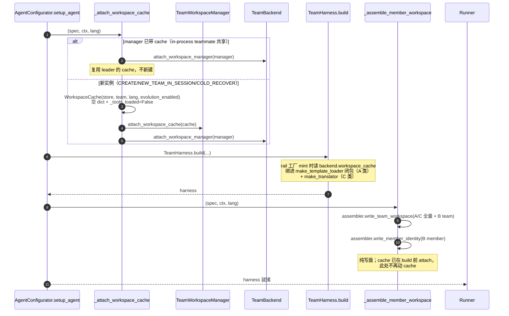
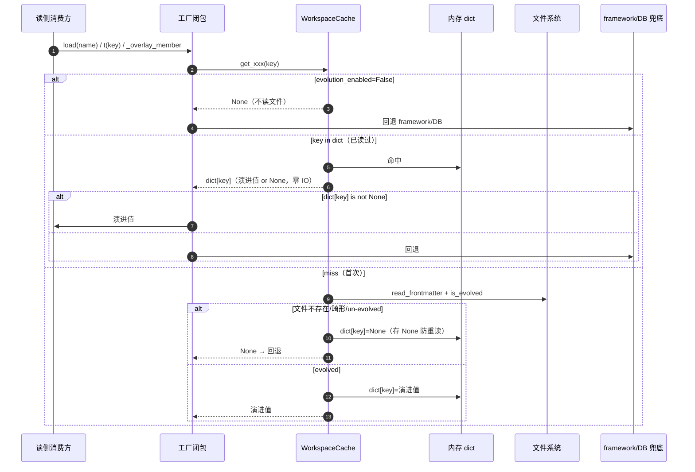
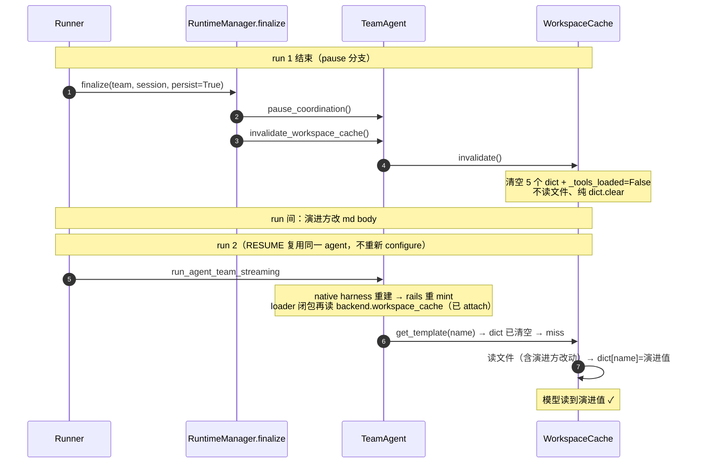
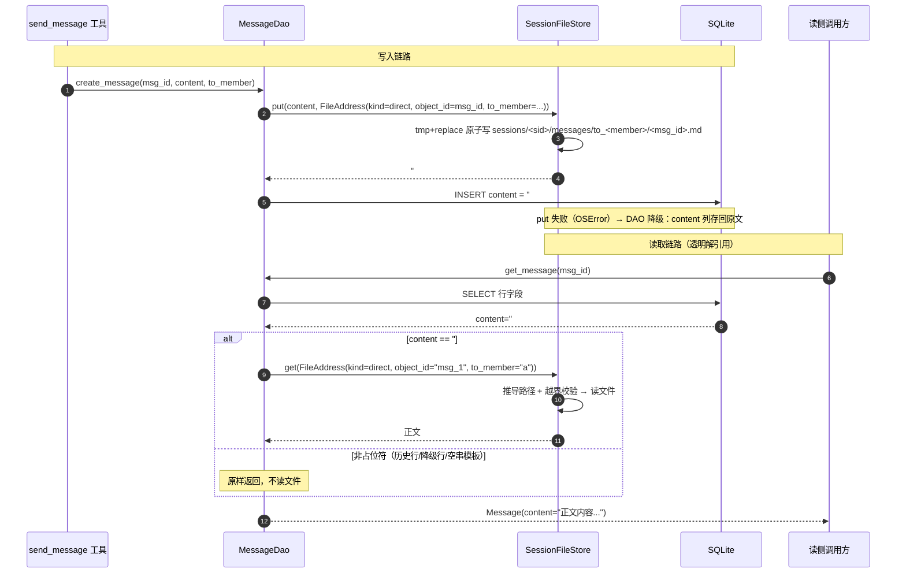
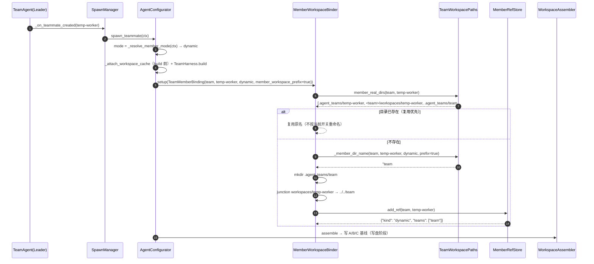
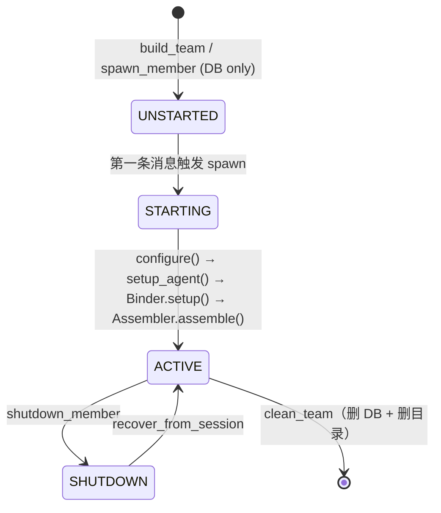
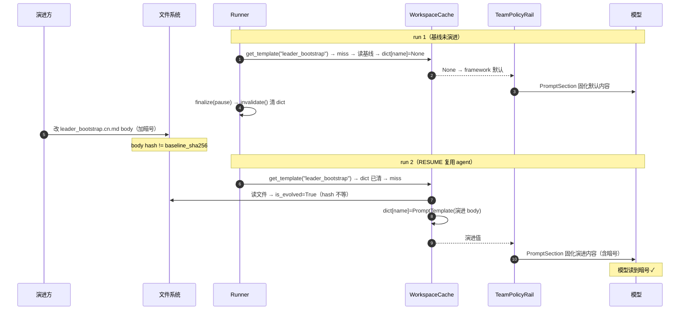

# 可演进 Team 工作区

## 1. 背景与问题 (Why)

Team 模式下，模型可见的长文本与成员工作区状态散落在四处，演进方（人或自演进程序）没有统一入口调整：

| 散落处 | 内容 | 原调整方式 |
|---|---|---|
| **框架提示词 md** | leader 引导词、leader 策略、调度模板、reviewer/plan 子代理 prompt 等 | 硬编码在工程源 `prompts/<lang>/*.md`，改值要改源码、发版 |
| **成员/团队 DB 静态字段** | `team_member.desc` / `prompt`、`team_info.desc` / `prompt` | 存 SQLite 列，改值要走 API / SQL |
| **tool 描述** | tool 级描述（`descs/<lang>/**/*.md`）+ 参数级描述（`STRINGS` dict） | tool 级在 `locales/descs/`、参数级在 `locales/<lang>.py` 的 `STRINGS` 常量 |
| **消息/任务正文** | message/task 的 `content` 长文本 | 存 SQLite 列，长文本撑大 DB、备份/迁移成本高 |
| **成员目录形态** | 成员真实目录深度嵌套在 team 目录下，无统一归属规则 | 目录随 team 嵌套，成员资产难以复用与隔离 |

五类痛点：

1. **演进方不可见**：值分散在源码常量、DB 列、md 文件，没有统一编辑面。
2. **改框架默认即改行为**：框架升级会静默覆盖演进方的定制。
3. **回退无门**：想回到框架默认只能改代码 / 改 DB。
4. **DB 膨胀**：消息/任务长正文内联在 SQLite，DB 体积随会话增长。
5. **成员目录无归属模型**：成员真实目录深嵌 team 下，预配置成员资产无法跨 team 复用，动态同名成员无法隔离。

本设计分**三块**解决（依赖方向 `C → A → B`——C 决定目录在哪，A 和 B 往里面写）：

| 块 | 需求 | 一句话 |
|---|---|---|
| **块 C 成员拓扑** | 成员目录拉平 | 成员按创建方式分三类拉平到 `.agent_teams/`，team 内经 junction 保持既有访问路径无感；动态成员 `#` 前缀隔离 + 引用计数 + 旧布局迁移 |
| **块 A 三类文本演进** | 可演进模型文本 | A 提示词模板 + B DB 值 + C tool 描述统一 `frontmatter + body` 落盘；装配写基线，演进方改文件 body、下次 run 生效（Runner 边界失效 + lazy 重读，运行期不热更新）；删文件回代码默认；body hash 与基线一致（未演进）的文件不认演进；框架默认变了，未演进文件自动升级 |
| **块 B 正文外置** | DB 长文本落盘 | message/task 的 `content` 移入 session 文件，DB 只存占位符 `#file#`，DAO 对上层透明解引用 |

> 注意：**块 A 内部又分 A/B/C 三类文本**（提示词模板 / DB 静态字段 / tool 描述），与顶层「三块」的 A/B/C 是不同维度。下文「三类文本」指块 A 内部分类，「三块」指顶层需求。

## 2. 目标与非目标

**目标**

- **块 C**：成员真实目录脱离 team 目录，按创建方式分三类拉平到 `.agent_teams/`（leader 留 team 内、预配置按名跨 team 共享、动态按 `<team>#<member>` 隔离）；team 内 `workspaces/<member>` 经 junction 指向真实目录，既有代码访问路径无感；引用计数驱动动态成员目录清理；旧布局一次性迁移。
- **块 A**：三类文本统一 `frontmatter + body` 落盘，装配阶段写基线，演进方改文件 body、下次 run 生效；读侧 lazy + 稳态零文件 IO（cache 不主动 build/扫描；`get*` 是 dict 查找，miss 读一次进 dict 后返回，hit 零 IO，无 probe/mtime/stat）；演进判定唯一依据 `body_sha256(body) != baseline_sha256`；已演进文件永不覆盖；未演进文件随框架默认变化自动升级；team 级单例 cache；`make_template_loader(cache=None)` / `make_translator(lang, cache=None)` 零侵入接线。
- **块 B**：message/task 的 `content` 全部写入 session 文件，DB `content` 列只存占位符 `#file#`（**不存路径**——文件路径由行内字段 + session_id 现算推导），DAO 对上层透明解引用，不改 schema、不改调用方签名；短文本也写文件（无阈值）；session 结束整体回收。

**非目标**

- 不做运行期热更新（监听文件变化）——演进靠「改文件 + 重启 run」，稳态每轮零文件 IO。
- 不演进 tool 的 `type` / `required` / `enum` 等 schema 结构（只在 body 里演进文本）。
- 不演进 `display_name`（成员名字是装配期拼装值，演进语义弱，回退 DB 列）。
- 不引入 provenance / 来源追踪（read-trace）机制——演进值来源由 `[workspace]` INFO 日志审计。
- 不改动 `coordination/kernel.py`（演进逻辑不挂任何模型调用前的 rail）。
- 不在 single-agent 路径挂载——以上组件只在 team member 装配路径生效，`team_name` / `member_name` 缺失时静默跳过。
- 不迁移历史 DB 行——旧内联 `content` 原样返回，新写入一律走外置。
- 块 B 不走演进文本缓存——message/task `content` 是运行时动态数据（task 可被 `update_task` 覆盖同名文件），每次读取实时解引用文件，不经 `WorkspaceCache`。
- 块 C 的 WORKER（swarmflow 单次执行成员）不参与拉平/junction/引用计数/迁移——目录留 team 内（§4.3.8）。

## 3. 术语与上下文

| 术语 | 含义 |
|---|---|
| 三块 | 块 C 成员拓扑 / 块 A 三类文本演进 / 块 B 正文外置（依赖 `C → A → B`） |
| 三类文本 | 块 A 内部的 A 提示词模板 / B DB 静态字段 / C tool 描述 |
| 演进 | 文件 body 被（演进方）改过——`body_sha256(body) != baseline_sha256` |
| 基线 baseline | 装配组件写文件时记录的 body sha256，存 frontmatter `baseline_sha256`；演进方不碰 |
| lazy get | `get*` 是 dict 查找；miss 时读一次文件填 dict 后返回，hit 零 IO；同一 run 内同一文件最多读一次（read-once） |
| Runner finally 失效 | `RuntimeManager.finalize` 的 pause 路径每 run 调 `invalidate()` 清 dict（不读文件）；下次 run 第一次 `get*` 重读 |
| 路径单一真相 | workspace **根**字面量只在 `paths.py` 一处；workspace **内**相对路径只在 `WorkspaceLayout` 一处 |
| junction | team 内 `workspaces/<member>` 指向成员真实目录的目录链接（Windows junction / POSIX symlink），链接名**恒为** `member_name`（不含 `#`） |
| 占位符 `#file#` | DB `content` 列只存此常量，表示「正文在 session 文件里」；不含任何路径 |
| `FileAddress` | 正文文件写入目标的结构化身份（team/session/kind/object_id/to_member），调用方禁止手拼目录 |
| 透明解引用 | DAO 对上层返回正文；调用方看不到 `#file#`；SQL 读写路径不变 |

前置阅读：SDD-0002 / SDD-0003（session 与恢复链路——`RESUME_FROM_PAUSE` 复用 agent 是演进生效的关键）。

## 4. 方案设计 (What / How)

### 4.1 总体架构

三块由一套共享组件支撑：**块 C** 的 `TeamWorkspacePaths`（纯路径规则）是所有目录解析的唯一来源，`MemberWorkspaceBinder` / `MemberRefStore` 管成员目录 + junction + 引用计数，`TeamWorkspaceMigrator` 迁移旧布局；**块 A** 写侧 `WorkspaceAssembler`（A/C 全量 + B team 级）+ `WorkspaceStore`（B member 级双写），读侧 `WorkspaceCache`（一个实例承载三类）+ 两个零侵入工厂闭包（`make_template_loader` / `make_translator`），frontmatter 原语（`is_evolved` / `read_frontmatter` 等）是三处演进判定的共同归口；**块 B** `SessionFileStore`（正文外置）复用 session 根。

```text
                 TeamWorkspacePaths（纯路径规则，唯一来源）
                              │
           ┌──────────────────┼──────────────────┐
           ▼                  ▼                  ▼
   MemberWorkspaceBinder   WorkspaceAssembler   SessionFileStore
   (块 C: 目录+junction    (块 A 写侧:          (块 B: 正文外置,
    +引用计数)              A/B/C 三类基线写)    DB 存占位符)
           │                  │                  │
           ▼                  ▼                  ▼
   .agent_teams/<布局>    team-workspace/      sessions/<sid>/
   workspaces/<member>    prompts/{system,      messages/ tasks/
   (junction 无感)         identity,tool}/            │
                              │                     │
                              ▼                     ▼
                       WorkspaceCache（块 A 读侧:   DAO 透明解引用
                        一个实例承载三类演进值,      content == "#file#"
                        lazy get 常驻）              → get(FileAddress)
                              │
                 ┌────────────┼────────────┐
                 ▼            ▼            ▼
           make_template    _overlay     make_translator
           _loader(cache)   _member      (lang,cache)
           (A 类读侧)       (B 类读侧)    (C 类读侧)
```

**组件职责**

| 组件 | 位置 | 职责 |
|---|---|---|
| `TeamWorkspacePaths`（块 C） | `team_workspace/paths.py` | 纯路径规则；`_member_dir_name` 是唯一知道 `#` 公式与开关的地方；`member_real_dir(mode=None)` 探测复用 |
| `MemberWorkspaceBinder`（块 C） | `team_workspace/binder.py` | 按 mode 建成员目录 + junction；复用优先（目录已存在则不按当前开关重命名） |
| `MemberRefStore`（块 C） | `team_workspace/ref_store.py` | 三类成员的 `.refs.json` 引用计数（`teams` 列表），动态归零才删目录 |
| `TeamWorkspaceMigrator`（块 C） | `team_workspace/migrator.py` | 旧布局 → 新布局的文件系统迁移（rename + junction） |
| `paths.py`（块 C） | `agent_teams/paths.py` | `team_home` / `team_workspace_dir` / `team_session_dir` 根，唯一真相 |
| `WorkspaceLayout`（块 C） | `team_workspace/layout.py` | 无状态静态方法，workspace 内相对路径 + framework 源根 |
| frontmatter 原语（块 A） | `team_workspace/frontmatter.py` | `body_sha256` / `is_evolved` / `read_frontmatter` / `write_frontmatter` / `atomic_write` |
| `WorkspaceAssembler`（块 A） | `team_workspace/assembler.py` | A/C 全量基线 + B team 级写盘，幂等，含升级 / 演进保护 / 畸形重建 |
| `WorkspaceStore`（块 A） | `team_workspace/workspace_store.py` | B member/team 值文件读写，`_may_write` 写侧演进守卫 |
| `WorkspaceCache`（块 A） | `team_workspace/workspace_cache.py` | 一个实例承载三类，lazy get + invalidate |
| `make_template_loader` / `make_translator`（块 A） | `prompts/loader.py` / `tools/locales/__init__.py` | 读侧工厂闭包，`cache=None` 与原行为完全等价 |
| B 类 overlay（块 A） | `tools/team.py` `TeamBackend` | `_overlay_member` / `get_team_info` 用 cache 覆盖 DB 裸值 |
| 装配接线（块 A） | `agent/agent_configurator.py` | `_attach_workspace_cache`（build 前）+ `_assemble_member_workspace`（build 后） |
| 失效接线（块 A） | `runtime/manager.py` + `agent/team_agent.py` | `finalize` pause 路径 → `invalidate_workspace_cache` → `cache.invalidate` |
| `SessionFileStore`（块 B） | `team_workspace/session_file_store.py` | 正文原子落盘、按 `FileAddress` 推导路径读取（越界校验）、session 清理 |
| DAO 解引用（块 B） | `tools/database/message_dao.py` / `task_dao.py` | 写路径 `put` 存占位符；读路径仅 `content == "#file#"` 才 `get` |
| schema（块 A / 块 C） | `schema/blueprint.py` + `schema/team.py` | `evolution_enabled: bool = True`；`member_workspace_prefix: bool = True` |

### 4.2 数据流与时序

#### 4.2.1 装配时序：attach 在 build 前，写盘在 build 后（块 A）

`AgentConfigurator.setup_agent` 内，每次 spawn / session 恢复执行，幂等。**关键时序约束**：cache attach 必须在 `TeamHarness.build`（rails mint）**之前**——rail 工厂构造期把 `backend.workspace_cache` 绑进 A 类 loader 闭包，若 mint 时 cache 未 attach（首次 build / COLD_RECOVER 新实例），loader 退化为 framework 只读，演进提示词永远到不了模型。



#### 4.2.2 读侧三类取值路径（同一 cache 实例，块 A）

运行期三类文本经同一个 `WorkspaceCache` 实例（team 级单例，挂 `TeamWorkspaceManager`，`TeamBackend.workspace_cache` property 委托 manager）。演进值优先、None 走 framework/DB 兜底。

```text
A 类 system prompt  →  make_template_loader(cache).load(name, lang)  →  cache.get_template(name)         →  framework md 回退
B 类 member/team 值 →  TeamBackend._overlay_member(member)           →  cache.get_member_field(...)      →  DB 裸值回退
                       TeamBackend.get_team_info()                   →  cache.get_team_field(...)        →  DB 裸值回退
C 类 tool 描述      →  make_translator(lang, cache).t(desc_key, key)  →  cache.get_tool_md(desc_key)      →  framework descs/STRINGS 回退
                                                                或   →  cache.get_tool_param(desc_key, p) →  framework STRINGS 回退
                                            ↑ 同一个 WorkspaceCache 实例（team 级单例）↑
```



#### 4.2.3 失效时序：Runner finally pause 路径（块 A）

每 run 边界执行一次。cache 实例**存活**（pool entry 保留 agent → manager → cache），但 dict 清空，下次 run 第一次 `get*` 重读演进方在 run 间改过的文件。stop 路径对象 GC，无需失效。



> RESUME 路径为何演进生效：RESUME 复用 agent、不重新 configure；native harness 重建重 mint rails 时，cache 已在 manager 上（上次 configure attach），loader 闭包拿到非 None cache → lazy miss 读演进值 → 生效。COLD_RECOVER 新实例每次重新 configure，靠 `_attach_workspace_cache` 提前到 build 前保证首次 mint 也能拿到 cache。

#### 4.2.4 正文外置读写时序（块 B）



**路径推导规则**（DB 里没有指针，所有信息来自行内字段 + ContextVar session_id）：

| kind | 行内字段 | 逻辑路径 |
|---|---|---|
| direct | `to_member_name`、`message_id` | `messages/to_<to_member_name>/<message_id>.md` |
| broadcast | `message_id` | `messages/broadcast/<message_id>.md` |
| task | `task_id` | `tasks/<task_id>.md` |

根 = `paths.team_session_dir(team_name, session_id)`——`team_name` 在行内，`session_id` 来自既有 ContextVar。**DAO 判定**：写路径 `put` 成功存 `#file#`、失败存回原文；读路径仅 `content == "#file#"` 时构造 `FileAddress` 调 `get`，否则原样返回——历史内联行、降级行、模板消息（`content=""` 空串非占位符）天然被排除。

**multicast**：`create_direct_messages` 每收件人一次 `put`（N 行 N 文件，各自独立推导路径）；同一条内容磁盘存 N 份小文本，session 结束随目录回收。**task 更新**：`update_task` 同名覆盖写 `tasks/<task_id>.md`（task_id 不变），DB 占位符恒定、是否 UPDATE 改为比较原文。**session 清理**：`clean_team` 删 DB 动态表后调 `SessionFileStore.remove_session(team_name, session_id)` 整体 rmtree `messages/` + `tasks/`。

#### 4.2.5 成员 spawn 拓扑时序（块 C）

成员 workspace 真实创建时机是 **spawn**（不是 build_team——build_team 只写 DB 行 + B 类值文件）。`Binder.setup` 按 mode 建目录 + junction + 引用计数；恢复链与 spawn 链汇合，重复 setup 幂等。



**成员生命周期状态图**（块 C）



### 4.3 接口与数据模型

#### 4.3.1 统一文件形态（块 A）

三类文本统一 `YAML frontmatter + body`：

```text
---
kind: prompt | tool | tool_params | card | team_card
name: <section 名 / desc_key / 字段名>
language: cn | en                  # A/C 类按语言分文件；B 类单值不分语言，可缺省
baseline_sha256: <sha256>          # 装配组件写基线时记录的 body hash，演进判定唯一驱动量
evolved: false                     # 演进标记：对应「已演进」状态（见下）
---
<body>
```

- `baseline_sha256`：演进判定唯一驱动量，装配组件写基线时记，演进方不碰。
- `evolved`：**演进标记字段，对应「已演进」状态**——语义上 `true` 表示该文件已被演进方改过。装配组件写基线时置 `false`（写时初态）；演进方不手动改。演进判定以 hash 比对为准（`is_evolved`），`evolved` 字段作人读标记。
- **无 `enabled` 字段**：演进判定（hash 比对）与覆盖开关（`evolution_enabled`）分离。

**块 B 正文文件**（message/task content，纯文本**无 frontmatter**——运行时动态数据不经演进方编辑，无「演进」概念；与块 A 资产文件的差异见 §5.6）：

```text
明天下午3点开迭代回顾会，请准备你负责模块的进度总结。
```

#### 4.3.2 目录布局（块 C：目标形态）

```text
~/.jiuwenswarm/.agent_teams/
├── team.db
├── worker-a/                            # 预配置非 leader 真实目录（跨 team 共享）
│   ├── prompts/
│   │   └── identity/                    # B 类 member 级（只两个文件）
│   │       ├── card.md                  # 只承载 desc（frontmatter kind=card，纯文本 body；display_name 不可演进回退 DB）
│   │       └── member_prompt.md         # prompt 落盘（双写：DB 列照存裸值，文件存演进值）
│   ├── memory/  skills/
├── <TeamName>/                          # team 根
│   ├── sessions/<session_id>/           # 块 B：按 session
│   │   ├── messages/{to_<member>,broadcast}/<msg_id>.md
│   │   └── tasks/<task_id>.md
│   ├── team-workspace/                  # team 级共享——该 team 全部可演进文本容器
│   │   ├── .team-meta/team.yaml
│   │   ├── skills/  plans/
│   │   ├── prompts/                     # 统一容器，分 system/、identity/、tool/ 三个子目录
│   │   │   ├── system/                  # A 类（扫描 prompts/<lang>/ 全量落盘，平铺）
│   │   │   │   ├── leader_bootstrap.<lang>.md
│   │   │   │   ├── leader_policy.<lang>.md
│   │   │   │   └── ...（prompts/<lang>/ 全部 md，非硬编码清单）
│   │   │   ├── identity/                # B 类 team 级（DB 值文件，无 lang）
│   │   │   │   └── team_card.md         # 只 desc 纯文本 body
│   │   │   └── tool/                    # C 类（domain 子目录镜像 descs/，参数级平铺）
│   │   │       ├── task/create_task.<lang>.md          # tool 级（按 domain 分目录）
│   │   │       ├── fragments/fork_usage.<lang>.md      # fragments 照常落盘（无害）
│   │   │       └── tool.param.<lang>.md                # 参数级（全工具一个 JSON dict，平铺）
│   └── workspaces/
│       ├── team-leader/                 # leader 真实目录（在 team 内，无 junction）
│       ├── worker-a → ../../worker-a                    # 预配置 junction
│       └── temp-worker → ../../<TeamName>#temp-worker   # 动态 junction
├── <TeamName>#temp-worker/              # 动态 spawn 成员真实目录（按 team 隔离）
└── <OtherTeam>#temp-worker/             # 另一个 team 同名动态成员，不冲突
```

**布局要点**

- **拉平**：成员真实目录脱离 team 目录，统一收敛到 `.agent_teams/`——预配置按名共享（`worker-a/`），动态按 `<team>#<member>` 隔离（`<TeamName>#temp-worker/`）；leader 是 team 的组成部分，留 team 内（`<team>/workspaces/<member>/`）。
- **路径无感**：team 内 `workspaces/<member>` 保持既有访问路径（junction 指向真实目录，链接名恒为 `member_name` 不含 `#`），既有代码不感知拉平。
- **member 目录只留 B 类 member 级两个文件**（`card.md` + `member_prompt.md`，在 `<member_dir>/prompts/identity/`）；A 类提示词模板和 C 类 tool 描述全部在 team-workspace——member 运行时按「我属于哪个 team」加载该 team-workspace 子集。演进方只看 team-workspace 一个目录即可管理该 team 全部可演进文本。
- `card.md` / `team_card.md` body 只 `desc`（纯文本，非 JSON）——`display_name` 不可文件演进，回退 DB 列裸值。
- **块 B 文件绑定 session**：message/task 文件全部在 `sessions/<session_id>/` 下，session 结束 `remove_session` 整体回收。

**路径单一真相**

| 规则 | 定义处 | 说明 |
|---|---|---|
| `"team-workspace"` / `sessions` 根字面量 | `paths.py: team_workspace_dir / team_session_dir` | team 级根，仅此一处 |
| workspace 内相对路径（`prompts/system` / `prompts/tool` / `prompts/identity` / `tool.param.*` / `MEMBER_IDENTITY_REL`） | `layout.py: WorkspaceLayout` | 无状态静态方法，仅此一处 |
| framework 源根（`prompts/<lang>` / `tools/locales/descs/<lang>`） | `layout.py` | 锚点 `_AGENT_TEAMS_PKG_ROOT` |
| 成员真实目录公式（`#` 前缀开关） | `TeamWorkspacePaths._member_dir_name` | **唯一**知道 `#` 公式与 `member_workspace_prefix` 开关的地方 |
| junction 链接位置（恒 `member_name`，不含 `#`） | `TeamWorkspacePaths.member_workspace_link` | 既有代码访问路径无感 |
| message/task 正文逻辑路径（`messages/to_*` / `broadcast` / `tasks`） | `session_file_store.py: _logical_path` | 块 B，仅此一处 |

**扩展性**：新增可演进文本类只需在 `layout.py` 加一行常量 + 一对方法；未来若文件覆盖 DB 扩展到新根，在 `TeamWorkspacePaths` 加对应方法即可，不新增接口层。

#### 4.3.3 frontmatter 原语（`frontmatter.py`）

```python
def body_sha256(body: str) -> str:
    """body 的 sha256 十六进制摘要（基线比对值）。"""

def is_evolved(meta: dict, body: str) -> bool:
    """演进判定唯一归口：body hash != baseline_sha256 → True。
    无 baseline（手写文件无 frontmatter）→ 恒 True（body 总生效，向后兼容手写 md）。
    三处演进判定（assembler/store/cache）全部经此函数，不会漂移。"""

def read_frontmatter(text: str) -> tuple[dict, str]:
    """拆 frontmatter + body。无 frontmatter → ({}, text)（手写 body）。
    畸形（YAML 解析失败 / 非 mapping 根）→ 抛 ValueError（文件无效）。
    body 用 splitlines(keepends=True) 保字节忠实，sha256 可 round-trip。"""

def write_frontmatter(meta: dict, body: str) -> str: ...   # 序列化 frontmatter + body
def atomic_write(path: Path, text: str) -> None: ...       # tmp + replace 原子落盘
```

`is_evolved` 关键逻辑：

```python
def is_evolved(meta: dict, body: str) -> bool:
    baseline = meta.get("baseline_sha256")
    if baseline is None:
        return True                      # 手写文件无基线 → 视为已演进，body 总生效
    return body_sha256(body) != baseline # 与基线不一致 → 已演进
```

#### 4.3.4 写侧（`WorkspaceAssembler` + `WorkspaceStore`）

```python
class WorkspaceAssembler:
    def __init__(self, store: WorkspaceStore | None = None): ...
    def write_team_workspace(self, *, team_name, language="cn",
                             team_desc=None, team_prompt=None) -> None:
        # A 全量扫描 prompts/<lang>/ + C 全量扫描 descs/ + B team 级；幂等
    def write_member_identity(self, *, team_name, member_name,
                              member_desc=None, member_prompt=None) -> None:
        # B member 级（card.md + member_prompt.md），经 member 真实目录（junction 无感）
```

```python
class WorkspaceStore:  # B 类值文件读写
    def write_card(self, team_name, member_name, desc) -> None: ...       # card.md，body 只 desc
    def write_member_prompt(self, team_name, member_name, text) -> None: ...
    def write_team_card(self, team_name, desc) -> None: ...               # team_card.md
    def write_team_prompt(self, team_name, text) -> None: ...
    def read_card(self, team_name, member_name) -> str | None: ...        # 演进值 or None
    def read_member_prompt / read_team_card / read_team_prompt(...) -> str | None: ...
    def team_workspace_root(self, team_name) -> Path: ...                 # = paths.team_workspace_dir
    def _may_write(self, path) -> bool: ...   # 写侧演进守卫
    def _read_body(self, path) -> str | None: ...   # 读侧演进判定
```

**写盘规则（`_write_baseline` 原语，幂等，五分支）**——A 类与 C tool 级共用：

| 文件状态 | 装配行为 | 运行时用谁 |
|---|---|---|
| 不存在 | 写 framework 基线（记 `baseline_sha256`、`evolved:false`），log `missing — baseline seeded` | 代码默认 |
| 已存在，body hash == 旧基线（未演进）且框架默认**变了** | 用新默认覆盖并更新 baseline，log `framework default upgraded — baseline refreshed` | 新默认 |
| 已存在，body hash == 旧基线且框架默认**没变** | 不覆盖，keep | 代码默认 |
| 已存在，body hash != 基线（**已演进**） | **不覆盖**，log `evolved — write skipped (evolution wins)` | 演进值 |
| 已存在，畸形 frontmatter（ValueError） | **重建基线**，log `malformed — baseline rebuilt` | 新默认 |

> 「已演进」状态即 frontmatter `evolved` 字段语义上的 `true`（该文件已被演进方改过）。

**写侧演进守卫 `_may_write`**（B 类）：

```python
def _may_write(self, path: Path) -> bool:
    try:
        text = path.read_text(encoding="utf-8")
    except OSError:
        return True                       # 不存在 → 可写（baseline write）
    try:
        meta, body = read_frontmatter(text)
    except ValueError:
        return True                      # 畸形 → 无效文件，可自由重写
    return not is_evolved(meta, body)     # 已演进 → False（不覆盖）；未演进 → True
```

> 三处演进判定（assembler `_write_baseline`、store `_may_write`/`_read_body`、cache `_read_evolved`）**全部经 `is_evolved`**，单一归口，不会漂移。写失败 degrade（`store._write` 捕 OSError → log「DB value stands」），spawn 不因持久化失败。

#### 4.3.5 读侧（`WorkspaceCache`，team 级单例）

```python
class WorkspaceCache:
    def __init__(self, store: WorkspaceStore, team_name: str, *,
                 language: str = "cn", evolution_enabled: bool = True) -> None:
        # 空 dict：_template_values / _member_values / _team_values /
        #          _tool_md_values / _tool_params，_tools_loaded=False

    # A 类
    def get_template(self, name: str) -> PromptTemplate | None: ...
    # B 类
    def get_member_field(self, member_name: str, field: Literal["desc","prompt"]) -> str | None: ...
    def get_team_field(self, field: Literal["desc","prompt"]) -> str | None: ...
    # C 类
    def get_tool_md(self, desc_key: str) -> str | None: ...        # tool 级，lazy miss 触发 _load_tools
    def get_tool_param(self, desc_key: str, param: str) -> str | None: ...  # 参数级

    def invalidate(self) -> None: ...   # 清 5 dict + _tools_loaded=False；Runner finally 调
```

**lazy get 语义（A 类为例）**

```python
def get_template(self, name: str) -> PromptTemplate | None:
    if not self._enabled:
        return None                       # 开关关 → 不读文件，回退 framework
    if name in self._template_values:     # key in dict → 读过了
        return self._template_values[name]# 演进值 or None，hit 零 IO
    body = self._read_evolved(...)        # miss：读文件，演进判定
    value = PromptTemplate(name=name, content=body) if body is not None else None
    self._template_values[name] = value   # 存进 dict（None 也存，防重读）
    return value
```

> **A/B 类无需标志位**：dict 用 `key in dict` 判「读过」，`dict[key] is None` 表「读过但无演进值」。**C 类需 `_tools_loaded` 标志位**：C 类是**目录扫描**（rglob 整个 `prompts/tool/`），dict key 集合 = 「有演进值的文件集合」≠「扫过的文件集合」，无法从 dict 判定是否扫过；`_tools_loaded` 保证 `_load_tools` 每 run 只跑一次。

**演进判定 `_read_evolved`（四分支 → 统一 None 语义）**

```python
@staticmethod
def _read_evolved(path: Path) -> str | None:
    try:
        text = path.read_text(encoding="utf-8")
    except OSError:
        return None                       # S2 文件不存在 → framework 默认
    try:
        meta, body = read_frontmatter(text)
    except ValueError:
        return None                       # S4 畸形 frontmatter → framework 默认
    if is_evolved(meta, body):
        return body                       # S3 已演进 → 文件值生效
    return None                           # S3' 未演进 → framework 默认
```

None 四来源（开关关 / 文件不存在 / 畸形 / 未演进）**统一语义**：无演进值 → 调用方走 framework/DB 回退。调用方用 `if evolved is not None` 统一处理，无歧义。

#### 4.3.6 读侧工厂（零侵入）

```python
def make_template_loader(ws_cache: WorkspaceCache | None = None) -> TemplateLoader:
    """返回与 load_template 同签名闭包。cache=None → framework 只读 loader 本身。
    cache 非 None：先 cache.get_template(name) → 演进值；None → _load(name) framework md。"""

def make_translator(lang: str = "cn", cache: WorkspaceCache | None = None) -> Translator:
    """cache=None → 与旧 make_translator(lang) 完全等价。
    cache 非 None：tool 级 cache.get_tool_md(desc_key) → 渲染演进 md；
    参数级 cache.get_tool_param(desc_key, param) → 演进文本；None → framework descs/STRINGS。"""
```

`make_template_loader` 闭包：

```python
def make_template_loader(ws_cache=None):
    if ws_cache is None:
        return load_template              # 零侵入：原 loader
    def load(name, language=_DEFAULT_LANGUAGE):
        evolved = ws_cache.get_template(name)
        if evolved is not None:
            return evolved                # 演进值优先
        return _load(name, language)      # framework @cache 回退
    return load
```

> `cache=None` 时返回 `load_template` 本身（不是包装），与原行为完全等价——**11 个 `make_translator` 调用点 + N 个 `load_template` 调用点零改动**。装配点显式传 cache。

**消费约定**：有 `TeamBackend` 对象的一律经 `backend.workspace_cache` 取（rail 工厂 / tool factory / scheduler / tiny agent / external CLI / message handler）；仅两个例外——`TeamWorkerBackend`（仅 build_context、无 backend 对象）与 `ExternalTeamClient`（自建 manager、无 backend 对象）走 manager / extras 直取，代码注释标明。

> **Requirement:** 系统 SHALL 在 team 级单例 `WorkspaceCache` 中承载三类演进值，一个实例、三类 dict 字段；SHALL NOT 提供 `build` / `rebuild` / 主动扫描入口（cache 创建即空，按需 lazy 填充）。
> **Scenario:** WHEN 同一 run 内多次 `get_template(name)` THEN 文件至多读一次（read-once），后续命中零 IO。

> **Requirement:** 系统 SHALL 在 `TeamHarness.build` 之前 attach cache，使 rail 工厂 mint 时 loader 闭包能拿到非 None cache；SHALL NOT 在 build 之后才 attach（否则 COLD_RECOVER 新实例演进值永不生效）。
> **Scenario:** WHEN COLD_RECOVER 新实例首次 build THEN rail mint 的 loader 闭包经 `backend.workspace_cache` 拿到已 attach 的空 cache → lazy miss 读演进值 → 模型读到演进值。

> **Requirement:** 系统 SHALL 在 `RuntimeManager.finalize` 的 pause 路径调 `invalidate()` 清空 dict（不读文件）；SHALL NOT 在 stop 路径失效（对象 GC）。
> **Scenario:** WHEN run 1 结束 pause THEN dict 清空；演进方在 run 间改 md；run 2（RESUME）第一次 `get*` miss 重读 → 读到改动。

#### 4.3.7 正文外置（`SessionFileStore`，块 B）

```python
CONTENT_IN_FILE = "#file#"          # DB content 列只存此常量，不存任何路径

@dataclass(frozen=True)
class FileAddress:
    """写入目标的结构化身份。禁止调用方手拼目录。"""
    team_name: str
    session_id: str
    kind: str          # KIND_DIRECT | KIND_BROADCAST | KIND_TASK
    object_id: str     # message_id 或 task_id
    to_member: str | None = None   # direct 消息的收件人

class SessionFileStore:
    def put(self, text: str, address: FileAddress) -> str:
        """tmp+replace 原子落盘，返回占位符 "#file#"（DAO 存进 content 列）。
        IO 失败抛 OSError——由 DAO 层捕获并决定降级（存回原文）。"""

    def get(self, address: FileAddress) -> str:
        """按 FileAddress 推导逻辑路径并读文件返回正文（不接收 DB 值）。
        路径校验：解析后的绝对路径必须在 team session 根内，越界抛 ValueError。
        文件丢失抛 FileNotFoundError（含 team/session/address 诊断）。"""

    def remove_session(self, *, team_name: str, session_id: str) -> None:
        """删除 session 下的 messages/ 和 tasks/ 目录（整体回收）。"""
```

**DAO 接线**（`message_dao.py` / `task_dao.py`）：

- 写路径：`create_message` / `create_direct_messages`（每收件人一次 put）/ `create_task` / `update_task`（同名覆盖）→ `put` 成功存 `#file#`，失败存回原文。
- 读路径：`get_message` / `get_messages` / `get_broadcast_messages` / `get_team_messages` / `get_task` / `get_team_tasks` / `get_tasks_by_assignee` → 仅 `content == "#file#"` 时构造 `FileAddress` 调 `get`，否则原样返回。
- 清理：`runtime/manager.py` 的 `clean_team` 在 DROP 动态表后调 `remove_session` 回收文件。

> **Requirement:** 系统 SHALL 让 DAO 对上层透明解引用——调用方只拿正文，SHALL NOT 感知 `#file#`；SHALL NOT 改 schema、SHALL NOT 改 DAO 调用方签名。
> **Scenario:** WHEN `get_message(msg_id)` 的 DB 行 content == `"#file#"` THEN 按行内字段推导路径读文件返回正文；WHEN content != `"#file#"`（历史行/降级行/空串模板） THEN 原样返回不读文件。

#### 4.3.8 成员拓扑（块 C：路径与绑定）

**三类成员物理归属**

| 成员类型 | 真实目录 | Workspace junction | 引用计数 |
|---|---|---|---|
| Leader | `<team>/workspaces/<member>/`（team 内，不拉平） | 无（真实目录） | 计，归零不删目录 |
| 预配置非 leader | `.agent_teams/<member_name>/` | `workspaces/<member>` → `../../<member>` | 计，归零不删目录（共享即意图） |
| 动态 spawn | `.agent_teams/<team>#<member>/` | `workspaces/<member>` → `../../<team>#<member>` | 计，**归零才删目录** |
| **WORKER（swarmflow）** | `<team>/workspaces/<member>/`（team 内） | **无**（与 leader 同构） | **不计数**（瞬态，随 team 清理） |

**为什么这样设计**

- **leader 不拉平**：leader 是 team 的组成部分而非可复用资产，目录在 team 生命周期内始终存在，拉平无收益。
- **预配置不带 `#` 前缀**：预配置成员是可复用资产（prompt/skill/memory 基线有意跨 team 共享）。两个 team 声明同名预配置成员 → 复用同一目录是设计意图。带 team 前缀会破坏共享。
- **动态成员 `#` 前缀隔离**：动态成员是 per-team 瞬态工件，不同 team 可能 spawn 同名成员（如 `temp-worker`）。`#` 前缀天然隔离，防止目录冲突。
- **统一引用计数、只有动态归零清理**：成员目录可能被多次引用（同 team 重 spawn、多 team 复用预配置目录）。`.refs.json` 对三类成员都计数并标记 `kind`。差异在归零动作——预配置/leader 归零不删目录（共享即意图），动态归零才删目录（`#` 隔离出独立目录、归属 team 确定）。统一计数模型让「动态 → 预配置提升」只需删 `.refs.json`、无需引入新的目录身份。
- **WORKER 例外**：swarmflow 单次执行成员（`TeamRole.WORKER`，每次 `agent()` mint 一个，用完即弃）是瞬态执行单元而非可复用资产——目录位置就是既有访问路径（`workspaces/<member>`），不参与拉平/junction/引用计数/迁移，随 team 删除整体清理。worker 的 git worktree cwd 隔离走 `git worktree remove`（不能只删目录，否则留 dangling `.git/worktrees/<name>` 元数据），`workspaces/<member>` 目录随 team 删除。

**目录命名规则**

| mode | 真实目录 | 规则 |
|---|---|---|
| leader | `<TeamName>/workspaces/<member>/` | 不拉平，无 junction |
| predefined | `.agent_teams/<member_name>/` | 按成员名，跨 team 共享 |
| dynamic（开关开） | `.agent_teams/<TeamName>#<member_name>/` | `#` 前缀隔离同名动态成员 |
| dynamic（开关关） | `.agent_teams/<member_name>/` | 与预配置同形，按名拉平 |

- `#` 格式：`<team_name>#<member_name>`，只用于动态成员 + 开关开。
- junction 链接名**恒为** `member_name`（不含 `#`）——既有代码访问路径无感。
- 命名公式**只**在 `_member_dir_name(team, member, mode, *, member_workspace_prefix)` 中拼装，禁止手拼 `workspaces`/`sessions`/`#`。
- team 名不应含 `#`（保留分隔符，建 team 时校验）。

**接口**

```python
@dataclass(frozen=True)
class TeamMemberBinding:
    team_name: str
    member_name: str
    mode: Literal["leader", "predefined", "dynamic"]
    member_workspace_prefix: bool = True   # 仅 dynamic 用：true=team#member 隔离，false=member 同形

class TeamWorkspacePaths:
    """纯路径规则——所有目录解析的唯一来源。"""
    def team_root(self, team_name: str) -> Path: ...
    def session_root(self, team_name: str, session_id: str) -> Path: ...
    def member_workspace_link(self, team_name: str, member_name: str) -> Path:
        """Junction 链接位置：<team>/workspaces/<member_name>（恒不含 #）"""
    def member_real_dir(self, team_name: str, member_name: str, mode: str | None = None) -> Path:
        """成员真实目录。mode=None 探测顺序 predefined→leader→dynamic（复用优先）"""
    def member_real_dirs(self, team_name: str, member_name: str) -> list[Path]:
        """探测候选目录列表（predefined → leader → dynamic）"""
    def _member_dir_name(self, team_name, member_name, mode, *, member_workspace_prefix=True) -> str:
        """成员真实目录名——唯一知道 # 公式与开关的地方：
        - leader: 不调用此方法（目录在 team 内）
        - predefined: member_name
        - dynamic(prefix=True): f"{team_name}#{member_name}"
        - dynamic(prefix=False): member_name（与预配置同形）
        """

class MemberWorkspaceBinder:
    def setup(self, binding: TeamMemberBinding) -> None:
        """按 mode 分支：
        - leader: 在 team 内创建 <team>/workspaces/<member>/ + prompts/tools/
        - predefined: 创建 .agent_teams/<member>/ + 子目录 + junction
        - dynamic: 复用优先——探测目录已存在则复用原名；不存在则按 binding.member_workspace_prefix 定名
                   → 建 .agent_teams/<dir_name>/ + 子目录 + junction + ref_store.add_ref
        """
    def unlink(self, team_name: str, member_name: str) -> None:
        """移除 junction（不删真实目录）"""
    def release(self, team_name: str, member_name: str) -> bool:
        """移除 junction + 递减引用计数；归零删目录"""
    def cleanup_team_dynamic_members(self, team_name: str) -> list[str]:
        """批量释放 team 的所有动态成员（按 <team># 前缀扫描）"""

class MemberRefStore:
    def add_ref(self, team_name, member_name) -> int: ...      # 幂等追加 team 名，返回计数
    def remove_ref(self, team_name, member_name) -> int: ...   # 递减；归零只删 .refs.json 不删目录
    def get_ref_count(self, team_name, member_name) -> int: ...
    def get_ref_teams(self, team_name, member_name) -> list[str]: ...  # 诊断/clean_team 用
    def delete_if_zero(self, team_name, member_name) -> bool: ...      # count==0 才 rmtree
    def cleanup_team_dynamic_members(self, team_name) -> list[str]: ...# 扫描 <team># 前缀，fail-soft

class TeamWorkspaceMigrator:
    def migrate(self, team_name) -> bool:
        """旧布局 → 新布局：扫描 <team>/workspaces/ 下真实目录（非 junction、非 dotfile），
        按成员来源（leader 保留原位 / 预配置 rename + junction / 动态 rename + junction）迁移；
        已是 junction 跳过（幂等）；名单外目录（worker 残留、无名目录）跳过并 warn。"""
```

**`.refs.json` 格式与位置**

```text
.agent_teams/<team>#<member>/
└── .refs.json      # {"kind": "dynamic", "teams": ["teamA", "teamB"]}
```

- 位置：成员真实目录内；`kind` 标记成员类别（`dynamic`/`predefined`/`leader`）。
- **`teams` 是引用 team 名列表，计数 = `len(teams)`**——记录「哪些 team 引用了这个目录」，比纯计数可诊断（clean_team 时能回答「谁还在引用」）。
- 只有动态成员目录的 `.refs.json` 参与删除判定；预配置/leader 目录计数但不因归零删除。
- 旧格式 `{"count": n, ...}`（早期实验遗留）读取时归一化为空 teams 列表，下次 `add_ref` 按新格式重写。
- **删除两步分离**：`remove_ref` 归零只删 `.refs.json`（原子、快）；`delete_if_zero` 是显式的「安全窗口」，调用方确认无活跃 writer 后才 rmtree——「计数」与「删除」解耦，ref 归零到目录消失之间允许有时差。
- **读写容错**：写用 tmp+replace 原子 rename；读遇 `JSONDecodeError`/`OSError` 返回 `{}`（`get_ref_count` 返 0）——容错而非阻断，代价是该目录可能被误判为可删。

**mode 判定**（`setup_agent` 内一次性算出，传给 `Binder.setup`）：

```python
def _resolve_member_mode(ctx, spec) -> Literal["leader", "predefined", "dynamic"]:
    if ctx.role == TeamRole.LEADER or ctx.member_name == spec.leader_member_name:
        return "leader"
    if ctx.member_name in {m.member_name for m in spec.predefined_members}:
        return "predefined"
    return "dynamic"
```

**私有性**：`_member_dir_name` 只在 Binder 和 Migrator 内部使用。其余组件只跟 junction（`workspaces/<member_name>`）打交道，不知道真实目录名叫什么、带不带 `#`。

### 4.4 关键流程

> 下文各流程的三类文本取值口径一致：演进值优先、None 走 framework/DB 兜底，由 `is_evolved` 单一归口判定。

#### 流程 A：A 类提示词模板演进生效

1. 首次装配：`write_team_workspace` 扫描 `prompts/<lang>/*.md` 全量，每个写 `team-workspace/prompts/system/<name>.<lang>.md` 基线（`baseline_sha256` = body hash、`evolved:false`）。
2. 演进方改某文件 body（如 `leader_bootstrap.cn.md` 加一段暗号）。
3. 下次 run：`_attach_workspace_cache` 创建空 cache → `TeamHarness.build` mint rails，`build_team_policy_rail` 构造期 `loader=make_template_loader(backend.workspace_cache)` 绑闭包 → rail `_build_static_sections` 调 `loader(name, lang)` → `cache.get_template(name)` miss → `_read_evolved` 读文件，`body_sha256(body) != baseline_sha256` → 已演进 → 返回演进 body → `PromptSection` 固化演进内容 → 模型读到暗号 ✓。
4. 未改的文件：`is_evolved` False → `get_template` 返 None → loader 走 framework `@cache` `_load`。

**演进判定分支（读侧）**

```text
read_frontmatter(text)
  ├─ 无 frontmatter（手写）        → meta={}, body=text → is_evolved: baseline=None → True  → 文件值生效
  ├─ 畸形（ValueError）            → 文件无效 → None → framework 默认
  ├─ body hash == baseline          → 未演进 → None → framework 默认
  └─ body hash != baseline          → 已演进（evolved 字段语义 true）→ 文件值生效
```

#### 流程 B：B 类成员/团队字段演进（DB 读取层 overlay）

1. spawn 时 `write_member_identity` 写 `card.md`（body=`desc`）+ `member_prompt.md`（body=`prompt`），DB 列**照存裸值**（双写）。
2. 演进方改 `card.md` body。
3. 下次 run，任何入口读成员：`TeamBackend.get_member` / `list_members` / `get_team_info` → `_overlay_member(member)`：

```python
def _overlay_member(self, member):
    if member is None or self.workspace_cache is None:
        return member
    desc = self.workspace_cache.get_member_field(member.member_name, "desc")
    if desc is not None:
        member.desc = desc              # 演进值覆盖 DB 裸值
    prompt = self.workspace_cache.get_member_field(member.member_name, "prompt")
    if prompt is not None:
        member.prompt = prompt
    return member                      # display_name 不覆盖，回退 DB 列
```

4. `desc is None`（未演进/无文件）→ 不进 if → `member.desc` 保持 DB 裸值。三个入口都走 overlay → 任何入口读出的实体字段运行时固定（roster / list_members / 成员自读一致）。
5. team 级同构：`get_team_info` 用 `get_team_field("desc"/"prompt")` 覆盖 `team.desc` / `team.prompt`。

> B 类 None 语义：None = 不覆盖 DB 裸值（`if desc is not None`）；非 None = 覆盖。`display_name` 永不演进。

#### 流程 C：C 类 tool 描述演进（构造期 + lazy 扫描）

1. 装配 `write_team_workspace` → `_write_tool_descs`：扫描 `descs/<lang>/**/*.md`，每个写 `tool/<domain>/<key>.<lang>.md`（domain 子目录镜像）；聚合 `STRINGS` dict 写 `tool/tool.param.<lang>.md`（一个 JSON dict，整体一个 baseline hash）。
2. 演进方改某 tool 的 md body 或改 param JSON。
3. 下次 run，tool 构造：`tool_factory.create_team_tools` `t = make_translator(lang, cache=agent_team.workspace_cache)` + `loader = make_template_loader(cache)` → 每个 tool 的 description 经 `t(desc_key, "_desc")` 解析：
   - `cache.get_tool_md(desc_key)` → 首次触发 `_load_tools` 全量扫 `prompts/tool/` 一次（`_tools_loaded=True` 防重扫）→ 命中演进值 → `_render_desc` 渲染 `{{slot}}` → 返回演进 md；
   - None → 回退 framework `descs/<lang>/<domain>/<key>.md` → 再回退 `STRINGS[<key>._desc]`。
4. 参数级：`t(desc_key, param)` → `cache.get_tool_param(desc_key, param)` → `_load_tool_params` 把 `tool.param.<lang>.md` JSON 按第一个 `.` 拆成 `(desc_key, param)` 进 `_tool_params` dict；命中返回演进文本，None 回退 `STRINGS[<desc_key>.<param>]`。

**C 类扫描方式（全量，首次 get 触发）**

```text
get_tool_md(desc_key)
  └─ if not _tools_loaded:
        _load_tools()                          # 全量扫一次
          for path in iter_tool_md_files(...): # rglob *.<lang>.md，排除 tool.param 文件
              body = _read_evolved(path)
              if body is not None: _tool_md_values[key] = body   # 只装演进值
          for path in iter_tool_param_file(...):
              _load_tool_params(path)          # 解 JSON dict 进 _tool_params
        _tools_loaded = True
     return _tool_md_values.get(desc_key)      # .get()：None=无演进值或没扫到，统一回退
```

> C 类用 `.get(desc_key)`（非 `key in dict`）：全量扫描后 dict 只装「有演进值的文件」，`.get() is None` 两种含义（没扫到 / 扫过无演进值）都 = 回退 framework，语义一致；`_tools_loaded` 保证只扫一次。

#### 流程 D：in-process teammate 共享 cache

1. leader 首次 configure：`_attach_workspace_cache` 建 cache + attach 到 manager（1 次读盘的源头）。
2. spawn in-process teammate 前：leader 调 `share_workspace_cache_with(teammate)` 把 `self._configurator.infra.workspace_manager` 按引用注入 teammate 的 `infra.workspace_manager`——**必须在 teammate `configure` 之前**（否则 teammate 已自建 manager）。
3. teammate configure → `_attach_workspace_cache` 发现 `manager.workspace_cache is not None` → 只 `attach_workspace_manager(manager)`，**不新建 cache**（log `reuses team-level cache`）。
4. teammate 自己的 B 类 `card.md` 基线写盘照常（`_assemble_member_workspace` 复用的是读快照不是写基线）。

> in-process N+1 次读盘降为 1 次（leader 那次）。swarmflow worker 路径已跑通跨 agent 复用（从 leader build_context 拿 manager→cache）。

#### 流程 E：演进生效端到端（pause → 改 md → resume）



#### 流程 F：正文外置的写入 / 读取 / 回收（块 B）

1. **写入**：agent 发消息 → `create_message(msg_id, content, to_member)` → DAO 调 `put(content, FileAddress(kind="direct", object_id=msg_id, to_member=...))` → tmp+replace 原子写 `sessions/<sid>/messages/to_<member>/<msg_id>.md` → 返回 `#file#` → DB INSERT content=`#file#`。`put` IO 失败（OSError）→ DAO 降级存回原文（非占位符）。
2. **multicast**：`create_direct_messages` 每收件人一次 `put`，N 行 N 文件各自推导路径。**失败批次的孤儿文件**（文件写成功但 SQL 事务回滚）留在磁盘，session 结束 `remove_session` 整体回收，不泄漏到 teardown 之外。
3. **读取**：`get_message(msg_id)` → DB 行 content=`#file#` → 按行内字段构造 `FileAddress` → `get` 推导路径 + 越界校验（越界抛 ValueError）→ 读文件返回正文；文件丢失抛 `FileNotFoundError`（含 team/session/address 诊断），不静默展示占位符。content 非 `#file#`（历史行/降级行/空串模板）→ 原样返回不读文件。
4. **task 更新**：`update_task(task_id, content=...)` → `put` 同名覆盖 `tasks/<task_id>.md`；DB 占位符恒定，是否 UPDATE 改为比较原文。
5. **session 回收**：`clean_team` → DROP 消息/task 动态表 → `SessionFileStore.remove_session(team_name, session_id)` → rmtree `messages/` + `tasks/`（`ignore_errors`，fail-soft）。

#### 流程 G：成员拓扑的建目录 / 恢复 / 清理 / 迁移（块 C）

**建目录（spawn 时，不是 build_team）**：`build_team` 只写 DB 行 + B 类值文件，不跑 `Binder.setup()`；成员 workspace 真实创建时机是 spawn。`_on_teammate_created` → `spawn_teammate` → `configure` → `setup_agent`（读取三类 cache + `Binder.setup(TeamMemberBinding(...))` 建目录 + junction + `.refs.json` + `Assembler.assemble` 写 A/B/C 基线）。

**复用语义（「已存在则复用，不存在则创建」）**：

1. 先探测真实目录是否存在（`member_real_dir` 探测顺序：predefined → leader → dynamic）。目录已存在（无论当初带不带 `#` 创建）→ **直接复用，不再按当前开关重命名**——避免来回搬动目录。
2. 不存在则创建：按当前 `member_workspace_prefix` 开关决定目录名——开关开 → `team#member`，开关关 → `member`。
3. junction 链接名恒为 `member_name`——开关只影响真实目录名，不影响 junction 路径。

**恢复链路（重启 session）**：`recover_from_session` 同样经过 `setup_agent`，恢复时自动走 Binder（leader `setup_agent` + teammates 经 `restart_teammate` → `configure` → `Binder.setup` 重建真实目录 + junction）。恢复链与 spawn 链汇合，重复 setup 幂等——遇到已有目录跳过，junction 已存在跳过。

**动态成员目录清理（clean_team）**：

```text
clean_team(team_name)
  → 对每个成员 Binder.unlink(team, member)              # 移除 junction（不删真实目录）
  → ref_store.cleanup_team_dynamic_members(team_name)    # 扫描 <team>#* ，每个 remove_ref
      → 返回 count→0 的目录名列表
  → 对返回列表逐个 ref_store.delete_if_zero(team, member)  # 确认无活跃 writer 后 rmtree
  → 预配置目录 .agent_teams/<member>/ 保留               # 共享资产
  → 提升后的动态成员（无 #、无 .refs.json）不在扫描范围    # 已升级为共享资产
```

**迁移（TeamWorkspaceMigrator）**——只做文件系统迁移（rename + junction），不动 DB：

1. 扫描 `<team>/workspaces/` 下的真实目录（非 junction、非 dotfile）。
2. 对每个真实目录 `<member>`，按成员来源确定目标：leader 保留原位；预配置 rename 到 `.agent_teams/<member>/` → 原位置建 junction；动态 rename 到 `.agent_teams/<team>#<member>/` → 原位置建 junction。
3. 跳过已经是 junction 的目录（幂等）。
4. **名单外目录跳过并 warn**（worker 残留、无名目录）——迁移只处理持久成员（leader + predefined + DB roster），worker 是 swarmflow 运行期 mint 的、不进 DB roster 行。正常流程下迁移在 `setup_infra` 阶段（任何 spawn 之前）跑，此时 worker 尚未 mint；该规则是防御性的（崩溃残留 / 手建目录）。

**「动态 → 预配置提升」路径**：开关关时动态成员与预配置目录名同形（都叫 `member_name`）。一个动态成员若演化为稳定资产，只需把它从引用计数管理提升为共享资产（删 `.refs.json`、clean_team 不删、跨 team 复用），**目录名不变，资产原地升级**。带 `#` 的动态成员要提升则需先 rename 去 `#`（Migrator 职责）。

### 4.5 配置与开关

| 开关 | 位置 | 默认 | 语义 |
|---|---|---|---|
| `evolution_enabled` | `TeamAgentSpec` + `TeamRuntimeContext`（来自 `team.yaml`） | `True` | team 级总开关，**只管读侧**：`false` 时文件照常写、cache 所有 `get*` 直接返 None（不读文件）、调用方走代码默认/DB 值；`true` 时各文件按自身演进状态决定 |
| `member_workspace_prefix` | `TeamAgentSpec`（来自 `team.yaml`） | `True` | 块 C 的 `#` 前缀开关：`true` 动态成员目录 `team#member` 隔离；`false` 与预配置同形 `member`，预留提升路径 |

**开关层级**：`evolution_enabled` 是 team 级总开关（放 spec，不是 md 文件里的 per-file 开关）。演进判定（hash 比对）与覆盖开关分离——frontmatter 里没有 `enabled` 字段。开关在 cache `__init__` 时读一次（`self._enabled`），每个 `get*` 首行 `if not self._enabled: return None`。

**`member_workspace_prefix` 传递链**：`agent_configurator` 从 `ctx.team_spec` 取 → `TeamMemberBinding(member_workspace_prefix=...)` → `Binder.setup` → `_member_dir_name`。**建 team 时定**，team 生命周期内不变；换开关需 Migrator 迁移既有动态目录。默认开关开——跨 team spawn 同名动态成员是真实场景（两个 team 都 spawn `temp-worker`），开关关时同名会撞目录，应显式走预配置共享路径。

**块 B 无开关**：正文外置无条件生效（短文本也写文件，无阈值），不走演进缓存。

**无独立 Feature Flag**：字段缺省 / `exclude_none` 即兼容旧客户端；`cache=None` 即等价原行为。

## 5. 关键决策与权衡 (ADR)

### 5.1 读侧 lazy get + Runner finally 失效

- **决策**：cache 无 `build` / `rebuild` / `is_built`；`get*` 是 dict 查找，miss 读一次进 dict；`invalidate()` 在 Runner finally pause 路径清 dict。configure 只建空对象。
- **背景**：装配期主动全员 build 依赖 roster 名单（configure 是 sync 的限制），且 build 时机/attach 顺序曾引发 COLD_RECOVER 演进值不生效的时序缺口。
- **收益**：① 无需 roster——dynamic 成员谁查询谁 lazy 读，configure sync 限制消失；② 稳态零 IO（hit 纯 dict 查找，无 probe/mtime/stat）；③ 失效点单一明确（Runner finally），演进「改文件+重启生效」语义清晰；④ attach 提前到 build 前后，COLD_RECOVER 与 RESUME 路径统一演进生效。
- **代价**：C 类目录扫描需 `_tools_loaded` 标志位（见 §5.3）；run 间演进生效依赖 Runner finally 正确触发（pause 路径）。
- **备选与理由**：
  - A 装配期 `build(team, roster)` 全员常驻：**弃**——依赖 roster、COLD_RECOVER 时序缺口、首 run 读盘面大。
  - B 运行期热更新（监听文件变化）：**弃**——破坏「读侧零 IO + 单例 cache」核心不变量，要处理并发读改写一致性；演进语义明确是 spawn-only。

### 5.2 路径规则拆两层：`paths.py` 根 + `WorkspaceLayout` 内部相对路径 + `TeamWorkspacePaths` 成员目录公式

- **决策**：workspace **根**（`team-workspace/`、`sessions/<sid>/`）收敛到顶层 `paths.py` 函数；workspace **内**相对路径（`prompts/system` 等）收敛到无状态 `WorkspaceLayout` 静态方法；成员**真实目录公式**（`#` 前缀、mode、junction 位置）收敛到 `TeamWorkspacePaths`——`_member_dir_name` 是唯一知道 `#` 公式与 `member_workspace_prefix` 开关的地方。
- **背景**：目录解析有三种正交职责——「根在哪」「根内怎么拼」「成员真实目录叫什么」；混在一个模块里「改一个路径要搜两个模块」。
- **收益**：三者职责正交，各自一处改动即可；`WorkspaceLayout` 无状态（`Path` 进 `Path` 出），写侧与读侧共用同一套规则；`_member_dir_name` 私有性保证其余组件只跟 junction 打交道、不知道真实目录名带不带 `#`。
- **代价**：三层调用（根 → 内部相对路径 / 成员公式），但都是纯函数，无状态。
- **备选与理由**：
  - A 一个路径类全管三类职责：**弃**——职责过载，开关公式耦合进全部路径规则。
  - B `paths.py` 函数承载 A/B/C 落盘路径：**弃**——会让「改一个路径要搜两个模块」。

### 5.3 C 类用 `_tools_loaded` 标志位，A/B 类不用

- **决策**：A/B 类 dict 用 `key in dict` 判「读过」（None 也存，表「读过无演进值」）；C 类用 `_tools_loaded: bool` 标志位 gates `_load_tools` 全量扫描。
- **背景**：C 类是目录扫描（rglob 整个 `prompts/tool/`），dict key 集合 = 「有演进值的文件集合」≠「扫过的文件集合」，无法从 dict 判定是否扫过；A/B 是单文件路径定位，`key in dict` 即「读过」。
- **收益**：A/B 零标志位、零重复读；C 类 `_tools_loaded` 保证每 run 只扫一次目录。
- **代价**：C 类 `.get(desc_key)` 返 None 有两种含义（没扫到 / 扫过无演进值），但两者都 = 回退 framework，语义一致。
- **备选与理由**：
  - A C 类也存「扫过但无演进值」的 key（值 None）以去掉标志位：**弃**——C 类是目录扫描，无法预先知道所有可能的 desc_key（desc_key 来自 framework STRINGS/descs，不在 workspace），「读过」粒度是「目录扫过」非「单 key 读过」。
  - B C 类按 desc_key 逐个 rglob 单文件：**弃**——改变扫描语义（变 tool 级 lazy），须保持全量扫描语义。

### 5.4 演进判定用 body hash 而非 mtime / 探针

- **决策**：`is_evolved` = `body_sha256(body) != baseline_sha256`；cache 无 probe、无 mtime。
- **背景**：需区分「演进方改过」与「框架默认变了」；spawn-only 要求运行期不读文件。
- **收益**：hash 是内容真相，天然支持「框架默认变化 → 未演进文件自动升级」（新基线 hash 不同 → 覆盖），mtime 做不到（mtime 受 touch/copy/迁移动作干扰）；一次读入内存后运行期纯 dict 查找。
- **备选与理由**：
  - A mtime probe：**弃**——无法表达「框架默认变化 → 自动升级」（基线也变了）；探针在稳态读路径引入 IO。
  - B 以 frontmatter `evolved` 布尔字段为判定依据：**弃**——写时初态恒 false，且演进方手动改 `evolved:true` 但 body 没变会造成误判；hash 才是内容真相。`evolved` 字段保留为「已演进」状态的人读标记（§4.3.1），判定本身不依赖它。

### 5.5 无 frontmatter 手写文件视为已演进；畸形 frontmatter 视为无效

- **决策**：无 baseline（手写文件无 frontmatter）→ `is_evolved` 恒 True，body 总生效、永不覆盖；畸形 frontmatter（YAML 解析失败 / 非 mapping 根）→ 文件无效，读侧回退默认、写侧可重建基线。
- **背景**：向后兼容手写 md（演进方可能直接写 body 不带 frontmatter）；同时防止畸形文件污染。
- **收益**：演进方的手写编辑永远不丢；无效文件不配做演进保护，写侧可重建。
- **代价**：手写文件无基线，框架升级时不会被自动升级（演进方需手动删文件回基线）——接受，演进优先于升级。

### 5.6 B 类双写 DB 裸值 + 文件演进值；块 B 正文用占位符

- **决策**：块 A 的 B 类 `desc`/`prompt` 列照存裸值（fallback），文件存演进值；`display_name` 不可文件演进，回退 DB 列。块 B 的 message/task `content` 用占位符 `#file#`——文件是唯一副本，DB 不存内容。
- **背景**：B 类是可演进资产（演进方会改 body，需 frontmatter 提供演进控制元信息，需 DB fallback 保证「文件丢失/clean 后仍可读」）；message/task content 是运行时动态数据（不经演进方编辑、无「演进」概念、task 可被 update_task 覆盖），纯文本即可、session 结束整体回收。
- **收益**：B 类 SQL 读写不变（零迁移脚本），文件写失败降级「只 DB 无文件」，spawn 不因持久化失败；`display_name` 演进语义弱（装配期拼装值），不演进避免名字漂移。块 B 短文本也外置（无阈值），DB 体积与长文本解耦。
- **备选与理由**：
  - A B 类也用占位符：**弃**——B 类文件丢失后 DB 裸值兜底是其正确性根基，占位符会失去这个兜底。
  - B 块 B 正文用双写（DB 照存原文 + 文件存演进值）：**弃**——正文是动态数据无演进语义，双写徒增两份真相；占位符 + 透明解引用是单一真相。
  - C 正文超阈值才外置（分级）：**弃**——阈值引入两类存储路径与迁移复杂度；短文本外置代价可忽略。

### 5.7 成员拓扑三类拉平 + junction 无感 + 引用计数（块 C）

- **决策**：成员真实目录脱离 team 目录，按创建方式分三类拉平到 `.agent_teams/`（leader 留 team 内、预配置按名共享、动态 `<team>#<member>` 隔离）；team 内 `workspaces/<member>` 经 junction 指向真实目录（链接名恒 `member_name`）；`.refs.json` 统一引用计数，动态归零才删目录；旧布局经 Migrator 一次性迁移；WORKER 不参与。
- **背景**：成员目录深嵌 team 下，预配置资产无法跨 team 复用、动态同名成员无法隔离、clean_team 无法判断目录是否还有活跃引用。
- **收益**：① 路径无感——既有代码继续访问 `workspaces/<member>`，不感知拉平；② 预配置跨 team 共享基线资产（prompt/skill/memory）；③ 动态 `#` 隔离防同名冲突；④ `.refs.json` 记录引用 team 名单（比纯计数可诊断）；⑤ 「动态 → 预配置提升」只需删 `.refs.json`，目录名不变。
- **代价**：junction 的跨平台处理（Windows 需 Developer Mode 或 junction fallback）；引用计数删除两步分离的时序约束；旧布局迁移的一次性风险。
- **备选与理由**：
  - A 成员目录全留 team 内（不拉平）：**弃**——预配置资产无法跨 team 共享、动态同名无法隔离，回到旧形态痛点。
  - B 全部成员（含 leader）拉平：**弃**——leader 是 team 的组成部分而非可复用资产，拉平无收益。
  - C 动态成员不做 `#` 隔离（与预配置同形）：**弃**——两个 team spawn 同名 `temp-worker` 会撞目录；隔离是默认安全，同形是显式选择（开关关，预留给提升路径）。
  - D 引用计数用纯数字 count：**弃**——记录「哪些 team 引用」比纯计数可诊断（clean_team 能回答「谁还在引用」）。

### 5.8 被否决的备选与取舍理由

| 否决项 | 原因 |
|---|---|
| A/B/C 三个独立 cache 类 | 演进判定、lazy 时机、attach 生命周期完全相同，拆三类只是重复三份机械代码；一个实例三类 dict 字段、同一 `is_evolved` 归口 |
| 破坏式改造读侧签名（`make_translator` 11 调用点全传 cache） | 放大改动面、牵动 UT 与 external CLI；可选参数 + 默认 `None` 走原逻辑，改动收敛到装配点 |
| 运行期热更新（监听文件变化） | 破坏「读侧零 IO + 单例 cache」核心不变量，要处理并发读改写一致性；演进语义明确是「改文件 + 重启 run」（spawn-only） |
| provenance / read-trace 来源追踪 | 演进值来源由 `[workspace]` INFO 日志（`evolved` / `un-evolved` / `missing` / `malformed` 行）审计即可，引入 SourceRef 机制过度 |
| 正文文件存路径指针（DB 存 `file:` 路径） | 路径可由行内字段 + ContextVar 现算推导，存指针纯属冗余，且指针会随目录结构变化失配 |
| 正文外置做根解析抽象层（SessionRootProvider） | 只有 session 一种根，抽象成独立接口是伪抽象；直接依赖 `paths.team_session_dir` 即可 |
| 以 `evolved` 布尔字段为演进判定依据 | 写时初态恒 false + 演进方可手改造成误判；hash 才是内容真相（`evolved` 字段只作人读标记） |
| WORKER 参与拉平/junction/引用计数/迁移 | worker 是瞬态执行单元（用完即弃、不进 DB roster），目录就是既有访问路径；拉平/junction 对它无意义，迁移按名单跳过即可 |

## 6. 影响面与兼容性

| 仓 / 模块 | 影响 |
|---|---|
| agent-core `team_workspace/`（块 C） | 新增 `TeamWorkspacePaths`（纯路径规则 + `#` 公式）、`MemberWorkspaceBinder`（目录 + junction）、`MemberRefStore`（`.refs.json` 引用计数）、`TeamWorkspaceMigrator`（旧布局迁移）；新增 `paths.py` 根函数、`WorkspaceLayout` 无状态路径 |
| agent-core `team_workspace/`（块 A） | 新增 frontmatter 原语、`WorkspaceAssembler`（A/C 全量 + B team 写盘）、`WorkspaceStore`（B 类双写 + 演进守卫）、`WorkspaceCache`（lazy get + invalidate） |
| agent-core `team_workspace/session_file_store.py`（块 B） | 新增占位符 + FileAddress 推导 + session 清理 |
| agent-core `prompts/loader.py` / `tools/locales/__init__.py` | 读侧工厂加可选 `cache` 参数（零侵入） |
| agent-core `tools/team.py` `TeamBackend` | `_overlay_member` / `get_team_info` B 类 overlay；`workspace_cache` property 委托 manager |
| agent-core `tools/database/message_dao.py` / `task_dao.py` | 块 B 接线：写路径 `put` 存占位符、读路径 `#file#` 才解引用 |
| agent-core `agent/agent_configurator.py` | `_attach_workspace_cache`（build 前）+ `_assemble_member_workspace`（build 后）；`Binder.setup` + `Assembler.assemble` 接入 `setup_agent` |
| agent-core `agent/team_agent.py` | `share_workspace_cache_with` + `invalidate_workspace_cache` |
| agent-core `runtime/manager.py` | `finalize` pause 路径调 `invalidate_workspace_cache`；`clean_team` 调 `remove_session` + `cleanup_team_dynamic_members` |
| agent-core `schema/blueprint.py` + `schema/team.py` | `evolution_enabled` + `member_workspace_prefix` 两个开关 |
| DB | 不改 schema；B 类 `desc`/`prompt` 列双写裸值 fallback；块 B `content` 列存占位符 `#file#` |

**兼容性**

- **非 BREAKING** wire 形状：所有新字段/参数可选，`cache=None` 等价原行为；单 agent 路径不受影响（`team_name`/`member_name` 缺失静默跳过）。
- **块 B 历史行**：旧行 content 非 `#file#` → DAO 原样返回，不迁移历史数据；正文恰好等于 `"#file#"` 时写方仍写文件、读方推导读文件返回正文；历史/降级行无对应文件时读文件抛 `FileNotFoundError`，DAO 捕获返回原文兜底——不会「占位符被当正文展示」或崩溃。
- **块 C 旧布局**：旧成员目录（都在 `<team>/workspaces/<member>/` 真实目录）由 `TeamWorkspaceMigrator` 迁移——leader 保留原位、预配置 rename 到 `.agent_teams/<member>/` + junction、动态 rename 到 `.agent_teams/<team>#<member>/` + junction；已是 junction 跳过（幂等）。**worker 目录不迁移**（team 内瞬态，不在持久成员名单，迁移按「成员名不在名单 → 跳过」处理）。
- **演进语义不变**：仍是 spawn-only，关 `evolution_enabled` 或删文件即回退代码默认/DB 值，无需运行时切换、无需迁移脚本。

## 7. 测试与验证

**验收（可观察）**

- 三类文本演进生效：改 A 类 md 重启 → system prompt 读演进值；改 C 类 tool 级 md 重启 → ToolCard.description 生效；改 tool.param JSON 重启 → 参数级 description 生效；改 B 类 card.md/member_prompt.md 重启 → member desc/prompt 生效。
- 演进守卫：已演进文件 re-assembly 不覆盖；未演进且框架默认变了 → 自动升级并更新 baseline；畸形 frontmatter → 重建基线；无 frontmatter 手写文件 → body 生效不覆盖。
- lazy read-once：同 run 内同文件至多读一次，后续命中零 IO；`invalidate` 后下次 get 重读新值。
- `evolution_enabled=false`：文件照写、所有 `get*` 返 None、读侧全回退。
- in-process teammate 共享：N+1 次读盘降为 1 次（leader 那次）。
- COLD_RECOVER 新实例演进值生效（cache attach 在 build 前）；RESUME 复用实例演进值生效（native 重 mint 时 cache 已 attach）。
- 正文外置：占位符 round-trip（put 返回 `#file#`）；multicast N 行 N 文件各自推导命中；模板消息空 content 不触发 put（DB 存空串非占位符）；update_task 同名覆盖文件后再次 get 读到新内容（实时解引用、不走 cache）；正文等于 `#file#` 时读写正确；路径越界拒绝；文件丢失抛异常（不静默展示占位符）；delete session 后文件目录不存在。
- 成员拓扑：leader 无 junction（team 内真实目录）；预配置 `.agent_teams/<member>/` + junction；动态开关开 `.agent_teams/<team>#<member>/` + junction + `.refs.json`；两个 team 共享预配置复用同一目录；两个 team 动态同名不冲突；动态目录已存在时复用优先于开关；重复 setup 幂等；release 引用归零删 `.refs.json` 不删目录；delete_if_zero 归零才 rmtree；旧布局迁移 rename + junction、已是 junction 跳过、worker 目录跳过；junction 链接名恒不含 `#`。
- `coordination/kernel.py` 全程未改。

**策略**

- `Paths` UT：`_member_dir_name` 四分支（leader 不调用、predefined=member、dynamic 开关开=team#member、关=member）；junction link 路径恒不含 `#`；`member_real_dir` mode 探测顺序（predefined→leader→dynamic）；动态目录已存在时复用优先于开关。
- `Binder` UT：leader→team 内建目录无 junction；预配置→`.agent_teams/<member>/` + junction；动态开关开→`.agent_teams/<team>#<member>/` + junction + `.refs.json`；动态开关关→`.agent_teams/<member>/` + `.refs.json`；两个 team 共享预配置复用同一目录；重复 setup 幂等；unlink 只删 junction 不删真实目录。
- `RefStore` UT：add_ref 首次写 1、重复幂等不递增；remove_ref 递减、归零只删 `.refs.json`、文件不存在返回 0；get_ref_count 无文件返回 0；delete_if_zero count>0 不删、count==0 才 rmtree；cleanup_team_dynamic_members 按 `<team>#` 前缀扫描、fail-soft；`.refs.json` 畸形降级空 dict；原子写 tmp+rename。
- `Migration` ST：旧布局 rename + junction、junction 已存在跳过、崩溃恢复；开关切换迁移动态目录；`workspaces/<worker>` 真实目录不在名单 → 跳过。
- `frontmatter` / `layout` / `workspace_store` / `workspace_cache` / `workspace_assembler` UT：见 §12（已落地）。
- `SessionFileStore` UT + DAO UT：占位符 round-trip、三种 kind 推导、同名覆盖、丢失抛错、路径越界拒绝、direct 缺 to_member 抛错、remove_session 删 messages/tasks、multicast 每行一文件、失败 insert 的孤儿文件被 remove_session 回收、模板消息空 content 不落文件、update_task 覆盖后读到新内容。
- ST：`agent_team_evolvable_session_resume_st.py`（pause→改 md→恢复加载）、`agent_team_evolvable_review_st.py` / `agent_team_evolvable_plan_mode_st.py`（predefined 已有文件覆盖 DB）；delete session 后文件目录不存在；worker swarmflow 提示词读到演进值。

## 8. 可观测性

- **演进状态可见**：frontmatter `baseline_sha256` / `evolved` 是文件级演进元数据，演进方/运维可直接读 frontmatter 判断「哪些文本被改过」。
- **值来源审计**：cache `_read_evolved` 与 store `_read_body` 每次读文件 info-log 一行（经 `team_logger`，前缀 `[workspace]`）：`evolved — workspace value wins` / `un-evolved — framework default stands` / `missing — framework default stands` / `malformed — framework default stands`。写侧同样 log（`baseline seeded` / `write skipped (evolution wins)` / `framework default upgraded` / `malformed — baseline rebuilt`）。
- **读侧一致**：cache 是 team 级单例 + lazy 全员可读，任何入口读出的实体字段运行时固定——消除「哪个消费方 build 了 cache 谁才有演进值」的不一致。
- **引用诊断（块 C）**：`.refs.json` 的 `teams` 列表让 clean_team 时能回答「哪个目录还被谁引用」，比纯计数可诊断。
- **占位符可诊断（块 B）**：`FileNotFoundError` 含 team/session/address 诊断信息，文件丢失不静默展示占位符；DAO 降级路径（put 失败存回原文）在日志可见。
- **无 provenance / read-trace 机制**：演进值来源由上述 INFO 日志审计，不引入 SourceRef 来源追踪。

## 9. 风险与回滚

| 风险 | 缓解 |
|---|---|
| cache attach 时序错（build 之后才 attach）→ COLD_RECOVER 演进值不生效 | `_attach_workspace_cache` 在 `setup_agent` 中硬定位 build 前 |
| Runner finally 未触发（非 pause 终态）→ cache 不失效，下 run 读旧值 | 失效只在 pause 路径（stop 路径对象 GC，新 run 新 agent 新 cache）；RESUME 必经 pause → invalidate |
| C 类 `_tools_loaded` 标志位漏 reset → 跨 run 读旧值 | `invalidate()` 显式置 `_tools_loaded=False`，与 dict 清空同帧 |
| 文件写入成功 + SQL 失败产生孤儿文件（B 类双写 / 块 B 正文） | tmp+replace 原子写保证无半写；孤儿不影响正确性；块 B 孤儿随 `remove_session` 按 session 回收 |
| in-process teammate 注入时序错（configure 之后才注入）→ teammate 自建 cache | `share_workspace_cache_with` 须在 teammate `configure` 前；注释明示 |
| 正文外置后 DB content 失去内联可读性 | 占位符方案正确性依赖 DAO 降级兜底（put 失败存回原文）；历史行原样返回不迁移；文件丢失抛异常不静默 |
| junction 跨平台（Windows 需特权 / Developer Mode） | symlink 失败降级 junction（`mklink /J`），再降级目录拷贝；已有 mount 处理先例 |
| 引用计数漂移（`.refs.json` 丢失/畸形） | 读容错降级空 dict（可能误判可删）；删除两步分离（`remove_ref` 只删 `.refs.json`，`delete_if_zero` 由调用方确认无活跃 writer 后才 rmtree） |
| 旧布局迁移误迁 worker/无名目录 | migrator 按持久成员名单（leader + predefined + DB roster）迁移，名单外跳过并 warn；迁移在 spawn 之前跑，正常流程遇不到 worker |
| `evolved` 字段与判定脱钩（置位未落地）→ 运维读 frontmatter 误判 | 演进判定唯一依据是 hash（`is_evolved`），审计看 `[workspace]` 日志；字段置位列入遗留项（§12） |

**回滚**：演进是 spawn-only——关 `evolution_enabled` 总开关即让读侧全部回退代码默认/DB 值（文件照常写但不生效）；删文件即回退。块 B 占位符方案回退需 DAO 降级（存回原文）。块 C 迁移是幂等的文件系统操作（已是 junction 跳过），回退 = 保留旧布局不再迁移。无需运行时切换、无需迁移脚本。

## 10. 开放问题 (Open Questions)

- [ ] scheduler 等处直接 framework `load_template` 调用绕过 loader 闭包——不读 workspace 演进值，归属 gap 待统一。
- [ ] distributed workspace（`TeamWorkspaceManager` 的 git push/pull + 分布式锁 Phase 3）与本地 lazy cache 的跨节点演进一致性未对齐——本设计假定 LOCAL 模式。
- [ ] C 类 `_tools_loaded` 跨 run 依赖 `invalidate` 重置；若有路径绕过 finalize 直接复用 cache（理论上不存在），需回归。
- [ ] `evolved` 字段置位（判定已演进时写回 `evolved: true`）未落地——字段目前恒 false，仅作写时初态标记。
- [ ] 块 B 孤儿文件后台自动扫描器暂不实现（手动 `remove_session` 入口已提供），后续版本补。
- [ ] 动态成员目录删除（`cleanup_team_dynamic_members` + `delete_if_zero`）调用链待端到端验证。

## 11. 评审记录 (Iteration Log)

| 轮次 | 日期 | 版本 | 评审人 | 结论 | 主要修改/讨论 |
|---|---|---|---|---|---|
| 1 | 2026-08-12 | 1 | @xiajing | approved | 三块需求 + 三类文本 + 目录布局 + cache 单例定稿 |
| 2 | 2026-08-14 | 1 | @xiajing | approved | 读侧重设计收敛：cache 挂 manager + backend 委托、build mode=None 读全员、team 级 cache 共享、门控统一 |
| 3 | 2026-08-19 | 3 | @xiajing | approved | 按当前代码事实重写：lazy cache + Runner finally 失效、路径拆两层、三类文本演进定稿 |
| 4 | 2026-08-20 | 4 | @xiajing | changes-requested | 补齐三块结构（块 C 拓扑 + 块 B 正文外置）；修正「已演进」与 `evolved` 字段对应关系 |
| 5 | 2026-08-20 | 5 | @xiajing | approved | 块 C 重写为完整目标设计（三类拉平 + junction + 引用计数 + 迁移器 + `#` 开关），统一设计文档口径 |

## 12. 实现记录与偏差

### 实际实现

- **块 A（已落地）**：frontmatter 原语（`body_sha256` / `is_evolved` 三处归口 / `read_frontmatter` / `atomic_write`）；`WorkspaceAssembler`（五分支幂等写盘）+ `WorkspaceStore`（B 类双写 + `_may_write` 守卫）；`WorkspaceCache`（lazy get + `invalidate` + `_tools_loaded`）；`make_template_loader` / `make_translator` 零侵入工厂；接线（attach 在 build 前、`_overlay_member`、tool_factory / rails / scheduler / tiny_agent / external 经 `backend.workspace_cache`、Runner finally 失效、`share_workspace_cache_with`）；`evolution_enabled` 开关。
- **块 B（已落地）**：`SessionFileStore` / `FileAddress` / `CONTENT_IN_FILE="#file#"`（put 原子写 + get 推导 + remove_session 回收）；`message_dao` / `task_dao` 透明解引用接线；`clean_team` 调 `remove_session`。
- **块 C（设计已定，落地进行中）**：`TeamWorkspacePaths` 纯路径规则与 `#` 公式、`MemberWorkspaceBinder`（目录 + junction）、`MemberRefStore`（`.refs.json`）、`TeamWorkspaceMigrator`（旧布局迁移）按 §4.3.8 / §4.4 流程 G 落地；`paths.py` 根函数与 `WorkspaceLayout` 内部相对路径已收敛。

### 与设计的偏差

- **`evolved` 字段置位未实现**：frontmatter `evolved` 字段语义上是「已演进」标记（§4.3.1），写盘恒 `false`（写时初态）、判定纯按 hash（`is_evolved` 只读 `baseline_sha256`）。字段与判定的一致性由 `is_evolved` 归口保证，`evolved` 目前只作写时初态标记。§10 已列为开放问题。
- 块 C 的 `member_workspace_prefix` 开关与 `#` 公式当前未接入 spawn 链（待 Binder 落地）；`paths.py` 成员目录函数在 Binder 落地前返回 team 内路径。

### 链接

- 实现位于 agent-core 仓 `openjiuwen/agent_teams/team_workspace/`。
- 关键提交：`b26e3440`（evolvable workspace 核心：assembly/layout/lazy cache/wiring）、`c0be8ef4`（UT）、`799ab3cf`（feature/spec 文档 F_82/S_24）、`4d5372db`（dead prefix switch 清理、team_logger、Any 清理）、`c1291da56`（session file data store feature/spec）、`d35c5321c`（session file store placeholder round-trip UT）、`aa56c3ca8`（bind-time session DDL 写锁）。
- UT 入口：`tests/unit_tests/agent_teams/team_workspace/test_{frontmatter,layout,workspace_store,workspace_cache,workspace_assembler,session_file_store}.py`。
- ST 入口：`tests/system_tests/agent_swarm/agent_team_evolvable_*_st.py`。

### 遗留与后续

- §10 的六项开放问题待收敛（scheduler gap、distributed workspace 一致性、`_tools_loaded` 回归、`evolved` 置位、孤儿扫描器、动态成员删除调用链）。
- 块 C 落地后：junction 跨平台回归（Windows junction / 拷贝 fallback）、迁移 ST、clean_team 端到端验证。

## 13. 参考与关联设计

- **关联**：SDD-0002（swarmflow 有状态 session 与人机）、SDD-0003（swarmflow 中断恢复与持久状态）——`RESUME_FROM_PAUSE` 复用 agent 是演进生效的关键链路。
- **外部**：agent-core `docs/features/F_82_evolvable-workspace.md`、`docs/specs/S_24_evolvable-workspace.md`；analysis `design-v5/` 三块设计（`10-block-c-topology.md`、`20-block-a-prompt-tool.md`、`30-block-b-file-data-store.md`）、`212d-current-state-and-questions.md`。
