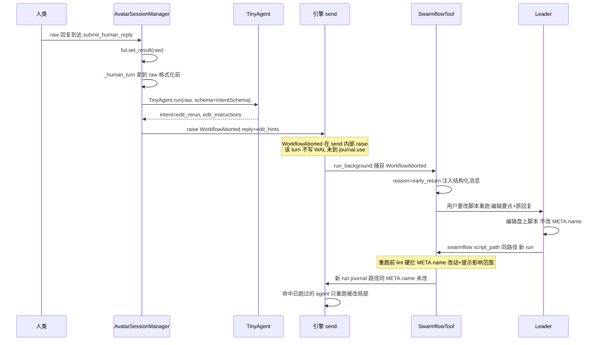
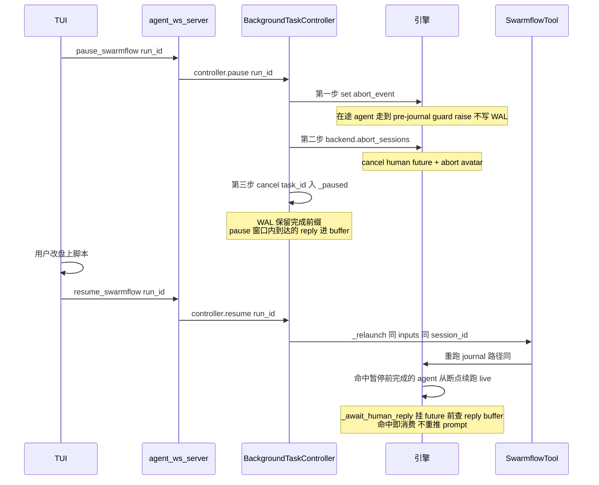
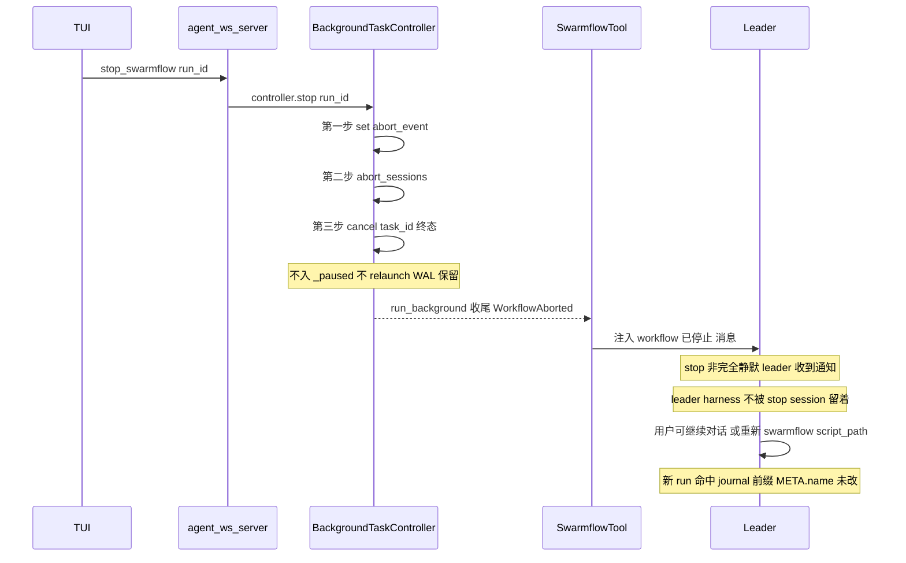

# Swarmflow 运行态控制意图（Early-Return / Pause-Resume / Stop）

## 1. 背景与问题 (Why)

SwarmFlow 工作流在真实使用中需要三类"中途干预"能力：HITL 回复触发提前返回改脚本重跑、
用户中断后改脚本重跑、用户停止 workflow 但不停 session。引擎侧（`agent-core`，SDD-0002~0007
已 shipped）已具备完整的持久化执行脊柱——journal 内容寻址缓存 + WAL + 盘上脚本编辑通路 +
`WorkflowAborted` 中断信号 + `_relaunch` 续跑——但三类控制意图在应用层（`jiuwenswarm`）
几乎无入口，且引擎侧缺三个护栏让控制稳健而非"脚枪"。

基线文档（跨仓过程文档，非本仓归档）`jiuwenswarm/docs/local/swarmflow-cases-capability-analysis.md` 逐子环节审查了三个
Case 的能力清单、缺陷与待设计能力，本设计的依据摘要见下表。

### 三个 Case 简介

| Case | 触发场景 | 完整流程 |
|---|---|---|
| Case 1：HITL→改→重跑 | human 回复要改脚本 | workflow 执行到 `human()` 节点询问 → 人类回复"要改脚本" → workflow 提前返回带回复给 leader → leader 局部改盘上脚本 → 用同 `script_path` 重跑 → 命中已跑 agent，只重跑被改局部 |
| Case 2：中断→改→重跑 | 用户中途暂停 | workflow 跑到一半 → 触发中断 → 保留已完成前缀（不丢已跑 agent） → leader 局部改盘上脚本 → 重新发起 swarmflow → 命中跑过的 agent |
| Case 3：停 workflow 不停 session | 用户要停当前 workflow | workflow 跑到一半 → 触发 stop → workflow 立即终止 → leader harness 与 session 继续存活 → WAL 保留但不 resume → 用户可继续对话、重新发起 workflow |

本设计把三个 Case 收敛到一个统一骨架：它们共享同一条持久化执行脊柱，差别只在**触发源**与**善后**（run_id 是否可续跑）。

### 三个 Case 的差异本质

| 意图 | 触发源 | run_id 命运 | 善后 |
|---|---|---|---|
| early-return (Case 1) | human 回复内容（经 TinyAgent 识别） | 终止本 run_id（不可 resume） | leader 拿回复→改脚本→新 run 命中 journal |
| pause/resume (Case 2) | 按钮 / 自然语言 | **延续本 run_id**（可 resume） | `controller.resume()`→`_relaunch` 命中前缀续跑 |
| stop (Case 3) | 按钮 / 自然语言 | 终止本 run_id（不可 resume） | session 留着，leader 自由，重跑靠新 swarmflow 命中 journal |

**核心收敛判断**：pause 是唯一"可续跑同 run_id"的意图；early-return 与 stop 都"终止本
run_id、靠 journal 在新 run 命中"——两者只差触发源（回复内容 vs 外部 cancel）。三种意图
最终都汇到 `WorkflowAborted + WAL 保留`这条路径。

### 现状缺口

1. **应用层控制面空白（Case 2/3 硬阻塞）**：jiuwenswarm 未接 `BackgroundTaskController`
   （`team_helpers.py` 没传 controller）；WS 层无 `pause/resume/stop_swarmflow` RPC；TUI 无
   pause/stop 按钮；swarmflow run_id 未暴露到前端。Case 2 按钮路径完全跑不起来，Case 3 按钮路径
   缺 workflow 级 stop 入口（现有只有 session 级 stop，粒度太粗）。
2. **early-return 无引擎钩子（Case 1）**：引擎无"回复内容触发提前返回"的协议，只能靠脚本作者
   自写 `if reply.startswith("/edit"): return` 防御代码，每段 human 节点重复写。且当前
   `WorkflowAborted` 是无参异常，`SwarmflowTool` 把它静默转成 `CancelledError`——回复内容被吞掉，
   leader 收不到、没法据此改脚本。
3. **局部改脚本无护栏（Case 1/2）**：改 META.name → journal 路径漂移 → cache 全失效；改结构 →
   key 偏移；改已跑 agent prompt → 级联重跑，用户无感知。
4. **pause 窗口内回复会丢（Case 1/2）**：`submit_human_reply` 在 future 不存在时丢弃回复，
   resume 后需重新输入。

### 为何现在做

引擎持久化脊柱已 shipped（SDD-0003 中断恢复、SDD-0006 异步工具框架），但应用层从未接入控制
面——三类控制意图在 jiuwenswarm 全部跑不通。基线文档已把三个 Case 的子环节、缺陷、待设计
能力拆解清楚，方案经多轮推演收敛，需固化为可评审的跨仓设计。

> **诚实边界（撰写时代码事实）**：本特性描述的 early-return 协议、controller 扩展 stop、
> SwarmflowTool 控制分叉、reply 缓存、脚本 lint **均未实现**。下文「须」均为落地目标，
> 不是现状。承重代码事实已经审计子 Agent 逐条核实（9 条全部 CONFIRMED，见 §12.2）。

## 2. 目标与非目标

**目标**

- Case 1：human 回复经 TinyAgent 识别出"改脚本重跑"intent 时，引擎提前返回，把回复内容与
  编辑要点回传 leader 下一轮；leader 改盘上脚本后用同 `script_path` 重跑命中 journal 前缀。
- Case 2：jiuwenswarm 接入 `BackgroundTaskController`；WS 层一套 `pause/resume/stop_swarmflow`
  RPC（都带 run_id）；TUI pause/stop 按钮；pause 后可 resume 从断点续跑（命中前缀）。
- Case 3：swarmflow run_id 暴露到前端；stop 只停 workflow 不停 session；leader 知道 workflow
  被停了；同 sid 重跑命中 journal 前缀。
- 统一控制面：`BackgroundTaskController` 扩展 `stop` + 按 run_id 寻址；SwarmflowTool.invoke
  接通 `resume_id`+`action` 做自然语言统一控制入口。
- 脚本范围 lint：重跑前硬拦 META.name 改动 + 提示改动影响范围（哪些 agent 重跑/命中）。
- reply 窗口期缓存：pause 窗口内到达的回复不丢，resume 后直接消费不重推 prompt。

**非目标**

- 多轮 human session 中途断点恢复 avatar 内部状态（P3 未来增强，见 §10）。
- `call_signature` 加 `isolation`（SDD-0005 自陈低优先级缺陷）。
- in-flight human future 在 stop 时干净 cancel 的时序边界（低优先级，机制上够用）。
- WS/TUI 层独立子工作流 cancel（单 child cancel）。
- 跨进程 / 分布式 worker 的控制面共享（本轮保持单进程内存 controller）。

## 3. 术语与上下文

| 术语 | 含义 |
|---|---|
| 控制意图 (intent) | 对一个在跑 swarmflow run 的三种干预：early-return / pause / stop |
| early-return | Case 1：human 回复触发提前返回，终止本 run_id，回复内容回传 leader |
| pause/resume | Case 2：暂停 + 可从断点续跑，**延续同一 run_id** |
| stop | Case 3：终止 workflow 但不停 session，终止本 run_id，不可 resume |
| run_id | 一次 swarmflow run 的稳定标识（`wf_xxx`），由 `new_swarmflow_run_id()` 生成 |
| resume_id | SwarmflowTool.invoke 的预留入参，本设计接通为控制动作寻址键（= 目标 run_id） |
| intent 分类 | TinyAgent 对 human raw 回复做一次轻量结构化分类，判定是否"改脚本重跑" |
| reply 窗口期缓存 | pause 窗口内到达的 human reply 暂存到 buffer，resume 后消费 |
| 持久化执行脊柱 | journal + WAL + 盘上脚本编辑 + abort_event checkpoint + WorkflowAborted + _relaunch |

前置阅读：SDD-0002（有状态会话与人机交互）、SDD-0003（中断恢复与 WAL）、SDD-0005（脚本定义
增强）、SDD-0006（异步工具框架）、SDD-0010（嵌套 workflow 与 budget 可观测性）。

## 4. 方案设计 (What / How)

### 4.1 总体架构

三类控制意图共享同一条持久化执行脊柱，经 `BackgroundTaskController` 统一控制面分叉到不同善后。
应用层（WS/TUI）与自然语言路径（SwarmflowTool）都经 controller，不绕过。

```
┌─────────────────────────────────── jiuwenswarm 应用层 ───────────────────────────────────┐
│  TUI (workflows.ts)                  WS (agent_ws_server.py)                              │
│  pause / stop 按钮  ──────┐    pause/resume/stop_swarmflow(run_id) ──┐                    │
│  (run_id 持在前端)         │                                         │                    │
│                           ▼                                         ▼                    │
│                ┌──────────────────────────────────────────────────────────┐               │
│                │ BackgroundTaskController (扩展, 按 run_id 寻址)            │               │
│                │   _active[run_id] / _paused[run_id]                      │               │
│                │   pause  : abort_event + abort_sessions + cancel → _paused│              │
│                │   resume : _relaunch(同 run_id, journal 命中前缀)          │               │
│                │   stop   : abort_event + abort_sessions + cancel → 终态   │               │
│                └──────────────────────────────────────────────────────────┘               │
│                           ▲                  ▲                  ▲                          │
│                           │ pause/resume     │ stop             │ pause/resume/stop       │
│                           │                  │                  │ (action 入参)            │
│                ┌───────────┴──────────────────┴──────────────────┴──────────┐              │
│                │ SwarmflowTool.invoke (接通 resume_id+action 统一控制入口)    │              │
│                │   无 resume_id → 发起新 run (现有路径)                       │              │
│                │   有 resume_id → 查 controller, 按 action 调对应方法        │              │
│                └────────────────────────────────────────────────────────────┘              │
└────────────────────────────────────────────────────────────────────────────────────────────┘
                                           │
                                           ▼ WorkflowAborted(payload?) + WAL 保留
┌─────────────────────────────────── agent-core 引擎层 (已 shipped) ─────────────────────────┐
│  journal 内容寻址缓存 + WAL │ 盘上脚本 (leader file-edit) │ abort_event 两 checkpoint       │
│  WorkflowAborted(BaseException, 本设计加 payload) │ _relaunch(同 sid 续跑)               │
│  async_tool_runtime.cancel(task_id) (终止顶层 task, 保留 WAL)                              │
│                                                                                             │
│  ┌── Case 1 early-return ──┐  ┌── Case 2 pause ──────┐  ┌── Case 3 stop ─────────────────┐ │
│  │ _human_turn 格式化前     │  │ controller.pause 三步  │  │ controller.stop 三步            │ │
│  │ TinyAgent intent 分类    │  │ → _paused 等 resume    │  │ → 终态, 不 relaunch             │ │
│  │ edit_rerun→抛 Workflow-  │  │ → resume: _relaunch   │  │ → session 留着, leader 自由    │ │
│  │   Aborted(reply,hints)   │  │   命中前缀续跑         │  │ → 新 swarmflow 命中 journal    │ │
│  │ → SwarmflowTool 注入    │  │                       │  │                                │ │
│  │   消息给 leader(非静默)  │  │                       │  │                                │ │
│  └──────────────────────────┘  └───────────────────────┘  └────────────────────────────────┘ │
└─────────────────────────────────────────────────────────────────────────────────────────────┘
```

**仓分工**

| 能力 | 主要改动 | 仓 |
|---|---|---|
| early-return 协议（WorkflowAborted payload + SwarmflowTool 非静默分叉） | `errors.py` + `tool_swarmflow.py` | agent-core |
| intent 分类（TinyAgent 挂 _human_turn） | `avatar_session_backend.py` | agent-core |
| controller 扩展 stop + 按 run_id 寻址 | `background_task_controller.py` + `tool_swarmflow.py`（handle 加 run_id） | agent-core |
| SwarmflowTool.invoke 控制分叉（resume_id+action） | `tool_swarmflow.py` | agent-core |
| 脚本范围 lint | `tool_swarmflow.py`（重跑前）+ `loader.py` | agent-core |
| reply 窗口期缓存 | `avatar_session_backend.py` | agent-core |
| jiuwenswarm 接入 controller | `team_helpers.py` | jiuwenswarm |
| WS pause/resume/stop RPC | `agent_ws_server.py` | jiuwenswarm |
| TUI `Shift+P`/`Shift+S` 快捷键 + run_id 持有 + paused/stopped 状态 | `workflows.ts` | jiuwenswarm |
| leader 自然语言 prompt 规则 | leader prompt | jiuwenswarm |

### 4.2 数据流与时序

#### 4.2.1 Case 1：HITL → early-return → 改脚本 → 重跑



**关键不变量**：early-return 的 turn 不写 WAL（`WorkflowAborted` 在 `send()` 的
`_check_abort`/journal.use 之间 raise，未到 `journal.use`），但**之前已完成的 turn 已在 WAL**
（finalize 在异常路径跳过 → WAL 保留）。所以重跑命中前缀，只重跑被改局部——与 Case 1 步骤 6 一致。

#### 4.2.2 Case 2：按钮暂停 → 改脚本 → 恢复



#### 4.2.3 Case 3：按钮停止（不停 session）



### 4.3 接口与数据模型

#### 4.3.1 `WorkflowAborted` 加 payload（agent-core `errors.py`）

```python
class WorkflowAborted(BaseException):
    """Cooperative control signal raised at an abort checkpoint.

    Carries a ``reason`` distinguishing the three control intents, plus an
    optional payload for early-return. ``run_background`` branches on
    ``reason`` to decide silent vs. inject:
      - ``early_return`` (has reply payload): inject edit-hints message.
      - ``stop``: inject "workflow stopped" message.
      - ``pause`` / bare: silent CancelledError (controller relaunches on resume).
    """

    def __init__(
        self,
        *,
        reason: str = "pause",            # "early_return" | "pause" | "stop"
        reply: str | None = None,
        edit_hints: str | None = None,
    ) -> None:
        super().__init__("workflow aborted")
        self.reason = reason
        self.reply = reply
        self.edit_hints = edit_hints

    @property
    def has_payload(self) -> bool:
        return self.reply is not None or self.edit_hints is not None
```

> **要求：** `WorkflowAborted` 须携带 `reason`（`"early_return"` / `"pause"` / `"stop"`）
> 及可选的 `reply`+`edit_hints`；无参 `WorkflowAborted()` 默认 `reason="pause"`（与 controller
> pause 路径向后兼容）。
> **场景：** 当 TinyAgent 判定 intent 为 `edit_rerun`，`_human_turn` 抛
> `WorkflowAborted(reason="early_return", reply=raw, edit_hints=...)`；当 controller.stop 触发时，
> 引擎抛 `WorkflowAborted(reason="stop")`；当 controller.pause 触发时，抛 `WorkflowAborted()`
> （reason 默认 `"pause"`）。

#### 4.3.2 SwarmflowTool.run_background 分叉（agent-core `tool_swarmflow.py`）

```python
except WorkflowAborted as exc:
    if exc.reason == "early_return":
        # Case 1: deliver reply content + edit hints to leader (NOT silent).
        msg = self._format_early_return(exc.reply, exc.edit_hints, run_id=run_id)
        raise BackendError(msg) from exc
    if exc.reason == "stop":
        # Case 3: tell leader the workflow was stopped (NOT silent).
        msg = self._format_stopped(run_id=run_id)
        raise BackendError(msg) from exc
    # Controller pause: silent CancelledError (unchanged).
    raise asyncio.CancelledError() from exc
```

`_format_early_return(reply, edit_hints, run_id)` 产出的注入消息形如：

```
[swarmflow {run_id}] 用户要求修改脚本后重跑。
编辑要点：{edit_hints}
原回复：{reply}
请据此编辑盘上脚本（勿改 META.name），然后用相同 script_path 重新发起 swarmflow。
```

`_format_stopped(run_id)` 产出的注入消息形如：

```
[swarmflow {run_id}] workflow 已停止。
session 仍可用，可继续对话，或用相同 script_path 重新发起 swarmflow（命中已跑 agent 前缀）。
```

> **要求：** SwarmflowTool 不得静默吞掉 `reason="early_return"` 或 `reason="stop"` 的
> `WorkflowAborted`；须把对应消息注入 leader 下一轮；`reason="pause"` 须保持静默
>（controller 在 resume 时 relaunch）。
> **场景：** 当 `_human_turn` 抛 `WorkflowAborted(reason="early_return", ...)` 时，leader 收到
> 回复内容与编辑要点；当 controller.stop 触发 `WorkflowAborted(reason="stop")` 时，leader 收到
> "workflow 已停止"消息；当 controller.pause 触发时，run 保持静默等待 resume。

#### 4.3.3 TinyAgent intent 分类（agent-core `avatar_session_backend.py`）

`AvatarSessionManager._human_turn` 在拿到 raw 回复、格式化前，插入 intent 分类：

```python
async def _human_turn(self, state, prompt, opts, schema_json, correlation_id) -> AgentResult:
    raw = await self._await_human_reply(state, prompt, opts, correlation_id)
    if raw is None:  # timed out / no answer
        return AgentResult(skipped=True)
    # NEW: classify intent before formatting.
    intent = await self._classify_intent(raw, prompt)
    if intent and intent.get("intent") == "edit_rerun":
        raise WorkflowAborted(
            reason="early_return",
            reply=raw,
            edit_hints=intent.get("edit_instructions"),
        )
    format_prompt = ...  # existing formatting path unchanged
    return await self._agent_turn(state, format_prompt, schema_json)
```

`_classify_intent` 用 manager 自己持有的 `model_resolver` 解析 leader 模型，构造一个 ephemeral TinyAgent：

```python
async def _classify_intent(self, raw: str, prompt: str) -> dict | None:
    """One-shot TinyAgent classification: is this reply 'edit & rerun' or 'continue'?

    Reuses the leader's own model (resolved via the manager's model_resolver) —
    same precedent as SwarmflowTool's ``model = self._parent_agent.model``. No
    extra config, no _DEFAULT_INTENT_MODEL constant. Ephemeral: async with
    auto-dispose, no state pollution, no spawn budget. Returns None on any
    failure (degrades to existing formatting path).
    """
    from openjiuwen.agent_teams.tiny_agent import create_tiny_agent
    # The leader model name is threaded in at construction (the parent agent's
    # model); resolve it via the manager's own resolver.
    model_name = self._leader_model_name
    try:
        async with create_tiny_agent(
            system_prompt=_INTENT_CLASSIFY_PROMPT,
            model_name=model_name,
            model_resolver=self._model_resolver,
            default_schema=_INTENT_SCHEMA,
            language=self._language,
            max_iterations=3,
        ) as classifier:
            return await classifier.run(
                f"问题:{prompt}\n\n回复:{raw}",
                schema=_INTENT_SCHEMA,
            )
    except Exception:
        team_logger.debug("[swarmflow] intent classify failed; degrade to continue")
        return None
```

> `self._leader_model_name` 是 `AvatarSessionManager` 构造时从父 agent 拿到的模型名（新增入参，
> 见 §6 影响面）；`_model_resolver` 已是现有字段。两者合力即可复用 leader 模型，无需常量。

```python
_INTENT_SCHEMA = {
    "type": "object",
    "properties": {
        "intent": {"type": "string", "enum": ["continue", "edit_rerun"]},
        "edit_instructions": {"type": ["string", "null"]},
    },
    "required": ["intent"],
}
```

> **要求：** `_human_turn` 须在格式化前用临时 TinyAgent 对 raw 回复做 intent 分类；intent 为
> `edit_rerun` 时须抛 `WorkflowAborted(reply, edit_hints)`；分类失败时须降级到现有格式化路径
>（不破坏）。
> **场景：** 当人回复"把 reviewer 的 prompt 改成…"时，TinyAgent 判定 `edit_rerun`，run 提前返回
> 并把回复内容交付 leader。

#### 4.3.4 BackgroundTaskController 扩展 stop + 按 run_id 寻址（agent-core `background_task_controller.py`）

```python
@dataclass
class SwarmflowRunHandle:
    task_id: str
    run_id: str          # NEW
    abort_event: asyncio.Event
    backend: Any
    native: Any
    relaunch: Callable[[], None]


class BackgroundTaskController:
    def __init__(self) -> None:
        self._active: dict[str, SwarmflowRunHandle] = {}   # keyed by run_id now
        self._paused: dict[str, SwarmflowRunHandle] = {}  # keyed by run_id (was relaunch)
        self._lock = asyncio.Lock()

    async def pause(self, run_id: str | None = None) -> bool:
        """Pause one run (run_id given) or all active (None = legacy full-collection)."""
        targets = self._select(run_id)  # {run_id: handle} or all _active
        for rid, h in targets.items():
            h.abort_event.set()
            await h.backend.abort_sessions()
            await h.native.async_tool_runtime.cancel(h.task_id)
            self._paused[rid] = h
            self._active.pop(rid, None)
        return bool(targets)

    async def resume(self, run_id: str | None = None) -> bool:
        """Resume one paused run (run_id) or all (None)."""
        targets = self._select_paused(run_id)
        for rid, h in targets.items():
            h.relaunch()
            self._paused.pop(rid, None)
        return bool(targets)

    async def stop(self, run_id: str) -> bool:
        """Stop one run: same three steps as pause, but terminal — no _paused, no relaunch."""
        h = self._active.get(run_id)
        if h is None:
            return False
        h.abort_event.set()
        await h.backend.abort_sessions()
        await h.native.async_tool_runtime.cancel(h.task_id)
        self._active.pop(run_id, None)   # NOT into _paused — terminal
        return True
```

> **要求：** `BackgroundTaskController` 须支持按 `run_id` 的 `pause`/`resume`/`stop`；
> `stop` 须为终态（不入 `_paused`、不 relaunch）；`pause(run_id=None)` 须保留全量向后兼容。
> **场景：** 当 `stop(run_id)` 时，run 被取消且不可恢复；当 `pause(run_id)` 时，run 暂停，
> `resume(run_id)` 将其 relaunch。

#### 4.3.5 SwarmflowTool.invoke 控制分叉（agent-core `tool_swarmflow.py`）

接通预留的 `resume_id` 入参 + 新增 `action` 入参：

```python
# input_params 新增 action
"action": {
    "type": "string",
    "enum": ["pause", "resume", "stop"],
    "description": "Control action on an existing run (requires resume_id).",
}

async def invoke(self, inputs, **kwargs) -> ToolOutput:
    resume_id = (inputs.get("resume_id") or "").strip()
    action = (inputs.get("action") or "").strip()
    if resume_id and action:
        # Control path: repurpose the "not supported yet" hook.
        controller = getattr(self._parent_agent, "background_task_controller", None)
        if controller is None:
            return ToolOutput(success=False, error="Runtime controller not configured")
        if action == "pause":
            ok = await controller.pause(resume_id)
        elif action == "resume":
            ok = await controller.resume(resume_id)
        elif action == "stop":
            ok = await controller.stop(resume_id)
        else:
            return ToolOutput(success=False, error=f"unknown action {action!r}")
        return ToolOutput(success=ok, data={"run_id": resume_id, "action": action, "status": "done" if ok else "not_found"})
    if resume_id and not action:
        return ToolOutput(success=False, error="'action' is required with 'resume_id'")
    # ... existing launch path (no resume_id) unchanged ...
```

> **要求：** SwarmflowTool.invoke 须按 `resume_id`+`action` 分叉：有值→调 controller；
> 无值→走现有发起路径不变；有 `resume_id` 无 `action` 为错误。
> **场景：** 当 leader 调 `swarmflow(resume_id=wf_xxx, action='pause')` 时，controller 暂停该 run；
> 当无 `resume_id` 时，发起新 run（现有行为）。

#### 4.3.6 脚本范围 lint（agent-core `tool_swarmflow.py` 重跑前 + `loader.py`）

```python
# In invoke, before launching a re-run from script_path:
old_source = Path(script_path).read_text(encoding="utf-8")
new_source = script if script else old_source  # inline source if given
old_meta = extract_workflow_meta(old_source)
new_meta = extract_workflow_meta(new_source)

# ① Hard block: META.name must not change.
if new_meta.get("name") != old_meta.get("name"):
    return ToolOutput(
        success=False,
        error=(
            f"Cannot change META.name ({old_meta.get('name')!r} → {new_meta.get('name')!r}): "
            "it would orphan the journal and invalidate the entire cache prefix."
        ),
    )

# ② Structural impact preview (progress LOG): which call-path nodes changed.
diff = _compute_structural_diff(old_source, new_source)  # AST structure only
if diff.changed_nodes:
    self._publish_log(
        f"Re-run impact: structural changes at {diff.changed_nodes} "
        f"(these will rerun; prompt-only tweaks are not previewed — "
        f"journal sig mismatch handles them at run time)."
    )
```

`_compute_structural_diff` 只做 **AST 结构对照**：新旧脚本 AST 按同位置 call-path
（`agent`/`human`/`parallel`/`pipeline`/`workflow` 节点）对照，检测节点增减、`parallel`
臂数、`pipeline` stage 数等结构性变更，按变动的 key 列出受影响节点。**不比较 prompt 字面量**——
journal 只存 `sig`（SHA-256 of prompt+opts+schema+history，`journal.py:57-72`）不存 prompt 原文，
prompt 微调无法跑前预知，由重跑时 journal 的 sig 二阶失效机制自然判定（progress 事件可见命中/重跑）。

> **要求：** SwarmflowTool 须硬拦 `META.name` 与盘上原版不同的重跑；须发 progress LOG 预览
> **结构性**变更（节点增删、`parallel` 臂数、`pipeline` stage 数，按 call-path 列出）——
> 不得尝试 prompt 级对比（journal 存 `sig` 不存 prompt 原文）。
> **场景：** 当重跑新增/删除 `agent()` 节点或改变 `parallel` 扇出时，LOG 在 run 前预览受影响
> call-path；当仅微调 prompt 字符串时，不发结构预览，重跑与否由运行时 journal `sig` 失配判定。

#### 4.3.7 reply 窗口期缓存（agent-core `avatar_session_backend.py`）

```python
class AvatarSessionManager:
    def __init__(self, ...):
        ...
        self._pending_reply_buffer: dict[str, str] = {}  # corr → answer (pause-window cache)

    def submit_human_reply(self, correlation_id: str, answer: str) -> bool:
        fut = self._pending_human.get(correlation_id)
        if fut is not None and not fut.done():
            fut.set_result(answer)
            return True
        # No live future: buffer instead of drop (pause window or late reply).
        self._pending_reply_buffer[correlation_id] = answer
        team_logger.info("[swarmflow] buffered reply for pending correlation_id %r", correlation_id)
        return True  # accepted (will be consumed on next _await_human_reply)

    async def _await_human_reply(self, state, prompt, opts, correlation_id) -> str | None:
        corr = correlation_id or ...
        # NEW: consume a buffered reply first (don't re-push the prompt).
        buffered = self._pending_reply_buffer.pop(corr, None)
        if buffered is not None:
            if self._on_human_replied is not None:
                self._on_human_replied(state.member_name, corr, buffered)
            return buffered
        # ... existing future registration + prompt push + await ...
```

清理：`abort_all` 和 `aclose` 末尾 `self._pending_reply_buffer.clear()`（未消费的清掉，防误匹配）。

> **要求：** `submit_human_reply` 在无存活 future 时须缓存（不丢弃）回复；
> `_await_human_reply` 在挂新 future 前须先消费缓存的回复；`abort_all` / `aclose` 须清空缓存。
> **场景：** 当回复在 pause 窗口期内到达时，它被缓存；当 run resume 并以同一
> `correlation_id` 重新等待时，缓存回复被消费，不再重推 prompt。

#### 4.3.8 workflow `paused` / `stopped` 状态发射（agent-core progress + jiuwenswarm Monitor）

controller 的 pause/stop 三步执行后，需让 workflow 卡片 `status` 落到 `paused` / `stopped`，
前端据此决定键提示。状态来源链路：

```
controller.pause(run_id) / stop(run_id)
  → abort_event → engine WorkflowAborted(reason="pause"|"stop")   (§4.3.1)
  → SwarmflowTool.run_background 捕获                              (§4.3.2)
       reason="pause" → 静默 CancelledError（controller 等 resume）
       reason="stop"  → 注入停止消息
  → progress 事件：WORKFLOW_PAUSED / WORKFLOW_STOPPED（或复用 WORKFLOW_FAILED 的非失败变体）
  → jiuwenswarm Monitor 写 WorkflowRunState.status = "paused" / "stopped"
  → workflow.updated delta 推前端
  → TUI 读 status 拼键提示（§4.4 流程 B/C）
```

| 触发 | engine progress | Monitor `status` | TUI 键提示 |
|---|---|---|---|
| controller.pause | `WORKFLOW_PAUSED`（新，或复用 `WORKFLOW_FAILED`+标志） | `paused` | `Shift+P resume` |
| controller.stop | `WORKFLOW_STOPPED`（新，或复用 `WORKFLOW_FAILED`+标志） | `stopped` | 不显 `Shift+P` |
| controller.resume | `WORKFLOW_RESUMED`（复用现有 `WORKFLOW_STARTED`） | `running` | `Shift+P pause · Shift+S stop` |
| early-return | `WORKFLOW_FAILED`（注入编辑要点，非新状态） | `failed` | 不显 `Shift+P` |

> **注**：是否新增 `ProgressKind` 成员（`WORKFLOW_PAUSED`/`STOPPED`）vs 复用
> `WORKFLOW_FAILED` + `reason` 标志，见 §10 开放问题（已部分由第 1 题覆盖：stop 注入消息而非静默）。
> 若复用，则 `WORKFLOW_FAILED` 帧的 `reason` 字段区分 `pause`/`stop`/`early_return`/真失败，
> Monitor 据此设 `paused`/`stopped`/`failed`。

> **要求：** controller 的 pause/stop 须让 Monitor 把 `status` 设为 `paused`（pause）/
> `stopped`（stop）；resume 须重置为 `running`。
> **场景：** 当 controller.pause(run_id) 完成时，workflow 卡片显示 `paused`、TUI 详情页
> 提示行显示 `Shift+P resume`；当 controller.stop(run_id) 完成时，卡片显示 `stopped`、
> 提示行不显示 `Shift+P`。

### 4.4 关键流程

#### 流程 A：Case 1 端到端（HITL → early-return → 改 → 重跑）

1. workflow 跑到 `human()` 节点，`_human_turn` 推 prompt 到 UI，等回复。
2. 用户回复"把 reviewer 的 prompt 改成只关注风险评分"。
3. `_human_turn` 拿到 raw，`_classify_intent` 跑 TinyAgent → `intent="edit_rerun"`,
   `edit_instructions="reviewer prompt 改为只关注风险评分"`。
4. 抛 `WorkflowAborted(reason="early_return", reply=raw, edit_hints="reviewer prompt 改为...")`。
5. `run_background` 捕获，`reason="early_return"` → 注入编辑要点消息给 leader 下一轮（非静默）。
6. leader 据消息编辑盘上脚本（改 reviewer 的 prompt，**不改 META.name**）。
7. leader 调 `swarmflow(script_path=同路径)`，invoke 重跑前 lint：META.name 未改→放行；
   prompt 改了→LOG 提示"reviewer 将重跑，其余命中"。
8. 新 run 命中已跑过的 agent（journal 路径同），只重跑 reviewer 局部。

#### 流程 B：Case 2 端到端（按钮暂停 → 改 → 恢复）

1. workflow 跑到一半，TUI 持有当前活跃 run_id（从 progress 事件拿到），`/swarmflows` 详情页焦点在该 workflow。
2. 用户按 `Shift+P` → WS `pause_swarmflow(run_id)` → controller.pause(run_id) 三步。
3. 正在跑的 agent 显示 `stopped`；workflow 卡片转 `paused`（区别于 `stopped`：可恢复）。
4. 在途 agent 在 pre-journal guard raise（不写 WAL）；human future 被 cancel。
5. WAL 保留完成前缀。
6. 用户在 pause 窗口里发的回复 → `submit_human_reply` → future 不存在 → 进 buffer。
7. 用户改盘上脚本，再按 `Shift+P`（resume） → WS `resume_swarmflow(run_id)` → controller.resume(run_id) →
   `_relaunch(同 inputs, 同 session_id)`。
8. 重跑：`_await_human_reply` 挂 future 前查 buffer，命中 corr → 消费回复，不重推 prompt。
9. journal 命中暂停前完成的 agent，从断点续跑 live。

#### 流程 C：Case 3 端到端（按钮停止，不停 session）

1. workflow 跑到一半，用户在 `/swarmflows` 详情页按 `Shift+S` → WS `stop_swarmflow(run_id)` → controller.stop(run_id) 三步。
2. 正在跑的 agent 显示 `stopped`；workflow 卡片转 `stopped`（不可恢复，提示行不显 `Shift+P`）。
3. 终态：不入 `_paused`，不 relaunch；WAL 保留。
4. `run_background` 捕获 `WorkflowAborted(reason="stop")` → 注入"workflow 已停止"消息给 leader（非静默，§4.3.2）。
5. leader harness 不被 stop（只 cancel 了 swarmflow task，没动 `NativeHarness.stop`）。
6. session 留着，用户可继续对话。
7. 用户重新 `swarmflow(script_path=)` → 新 run 命中 journal 前缀（META.name 未改）。

### 4.5 配置与开关

| 配置 | 位置 | 默认 | 说明 |
|---|---|---|---|
| `background_task_controller` | `team_helpers.py` 注入 leader | 不传 | 本设计要求 jiuwenswarm 实例化并传入 |
| intent 分类模型 | `AvatarSessionManager` | 复用 leader 模型 | 新增 `_leader_model_name` 入参，经 `model_resolver` 解析；分类失败 degrade 到 continue |
| `_DEFAULT_HUMAN_TIMEOUT` | `avatar_session_backend.py` | `600.0` | 不改；reply buffer 不改变超时语义 |
| lint 严格度 | `SwarmflowTool.invoke` | 硬拦 name + 提示影响 | 不可关（META.name 改动是致命漂移） |

无独立 Feature Flag：`abort_event=None` / 不传 controller 时行为与改动前一致（向后兼容）；
intent 分类失败 degrade 到现有路径；reply buffer 在无 pause 场景永不触发（future 总存在）。

## 5. 关键决策与权衡 (ADR)

### 5.1 early-return 触发：TinyAgent 独立 intent 分类

- **决策：** 用 `TinyAgent`（F_45，轻量 ephemeral native harness）对 human raw 回复跑一次独立
  结构化分类，判定是否"改脚本重跑"。
- **背景：** 引擎无"回复内容触发提前返回"的钩子。三种触发信号来源被考虑：UI 结构化按钮、
  回复内容哨兵前缀、Agent 结构化时自动识别。用户要求"Agent 在对 human 回复做结构化时自动识别
  intent"。
- **备选与理由：**
  - (A) UI 结构化信号（TUI 回复框旁加"改脚本重跑"按钮，走带 intent 的 swarmflow_reply）：
    语义最纯但代价大（TUI 按钮 + WS 传 intent + backend 注入 + 引擎检查一整条新管线），且
    用户体验不如自然语言回复。
  - (B) 回复内容哨兵前缀（如 `/edit`）：最轻量但把控制语义混进数据回复通道，前缀易写错、
    不可发现。
  - (C) 复用格式化轮次（把 intent 判断塞进 avatar 格式化 prompt）：零额外 LLM 调用但意图判断与
    回复渲染耦合，格式化 avatar 的 system prompt 是"忠实渲染回复"，塞进"判断是否编辑指令"会
    语义混淆、漏判。
  - (D) schema 字段约定（脚本 author 传含 intent 的 schema）：零额外 LLM 调用但要脚本作者主动
    写 schema，未写则不识别——引擎侧透明能力更可取。
  - **选中（TinyAgent 独立分类）：** `_human_turn` 已有"raw 回复经 avatar 格式化"的天然挂载点
    （格式化前）；`TinyAgent` 是现成的轻量 ephemeral 分类工具（`run()` 单轮无状态、每次新建
    临时 harness 并 dispose、不污染主 run 状态、不占 spawn 预算）；`AvatarSessionManager.__init__`
    已持有构造 TinyAgent 的全部依赖（`model_resolver`/`language`/`_t`）。让 intent 判断独立成一步，
    彻底解耦于回复渲染。
- **代价：** 每次 human 回复多一次轻量 LLM 调用。可接受——human 回复本就是低频、人参与的交互；
  且可配 `max_iterations=3`、便宜模型进一步降本；分类失败 degrade 到 continue（不破坏）。

### 5.2 early-return 回传：WorkflowAborted 携带 payload + SwarmflowTool 非静默分叉

- **决策：** `WorkflowAborted` 从无参升级为携带 `reply`+`edit_hints`；`SwarmflowTool.run_background`
  检测 payload：有→注入结构化消息给 leader（非静默，如 BudgetExhausted 路径）；无→原静默 cancel。
- **背景：** 审计确认 `WorkflowAborted` 是无参 `BaseException`（`errors.py:45-52`）；
  `run_background:394-399` 把它统一转 `CancelledError`；`async_tools._run:236-241` 对
  `CancelledError` 不调 `format_failed`/不注入——pause 对，Case 1 致命（回复内容被吞）。
- **理由：** Case 1 的 early-return 必须把回复内容回传 leader，否则 leader 没法据此改脚本。
  不能复用静默 `CancelledError` 路径。payload 区分两种 WorkflowAborted：有 payload（Case 1，
  需回传）vs 无 payload（controller pause/stop，静默）。
- **备选：** 新造 `WorkflowEarlyReturn` 异常类型——语义直白但增加异常分类面，且
  `run_background` 需多一个 except 分支。加 payload 字段让机判更干净，不破坏"不新增类型"约定
  （与 SDD-0012 的 `BudgetExhausted.scope` 决策同构）。

### 5.3 控制面：统一 controller 扩展 stop + 按 run_id 寻址（方案 A）

- **决策：** `BackgroundTaskController` 扩展 `stop` + 改按 run_id 寻址；WS 一套 RPC
  （`pause`/`resume`/`stop_swarmflow` 都带 run_id）；pause/resume 从全量改 per-run_id。
- **背景：** 审计确认 controller 现只有 `pause`/`resume`（全量、无参）、无 `stop`；
  `SwarmflowRunHandle` 无 `run_id` 字段。但 controller 本就为"统一控制面、新控制扩展对象不扩
  SDK"而设计（模块 docstring 明说），加 stop 是顺水推舟。
- **备选与理由：**
  - (B) 分路径复用现有（pause/resume 走 controller，stop 走 `async_tool_runtime.cancel`）：引擎零
    改动但语义分裂、双寻址键（run_id vs task_id）、双状态源，且 controller 全量 pause 问题终归要解。
  - (C) 先 stop 后 pause（分期）：Case 2 是 P0 致命阻塞，分期与路线冲突；两期割裂可能返工。
  - **选中（A）：** 三个意图在同一个对象里闭环，共享前两步（abort_event + abort_sessions）与差异
    （第三步 cancel 入 paused 集还是终态集）在一处表达；前端只学一套调用模型；按 run_id 寻址
    天然支持"同 session 多并行 workflow 各自独立 pause/stop"（解掉 Case 3 的 run_id 暴露缺陷）。
- **代价：** 改 agent-core controller。但无现存调用方依赖全量语义（jiuwenswarm 未接 controller），
  改动安全；`pause(run_id=None)` 保留全量 back-compat。

### 5.4 leader 自然语言路径：SwarmflowTool.invoke 接通 resume_id+action（不新建工具）

- **决策：** 不新建 `pause_swarmflow` 工具，而是扩展 SwarmflowTool.invoke 为统一控制入口。
  `resume_id` 入参（已声明但返回"not supported yet"的半成品 hook）接通为寻址键，新增 `action`
  入参（`pause`/`resume`/`stop`）。
- **背景：** 审计确认 `resume_id` 是 `tool_swarmflow.py:175-186` 的半成品 hook；`AsyncTaskCancelTool`
  只调 `async_tool_runtime.cancel(task_id)`，不能 resume、不知 controller。
- **理由：** SwarmflowTool 本就是 leader 调起 workflow 的唯一工具，pause/resume/stop 是对"已发起
  workflow"的控制，语义同源——"发起"和"控制"本该是同一工具的不同动作，不该拆成两个工具。
  `resume_id` 预留的 hook 正好接通，改动是"把 'not supported yet' 变成真能调 controller"。
  leader prompt 规则极简："用户说停一下→swarmflow(resume_id,action='pause')"。
- **备选：** 新建 `pause_swarmflow` 专用工具——工具名自描述但多一个工具卡，且与 SwarmflowTool
  语义割裂。教用通用 `async_task_cancel`——零新工具但 pause 走不通（cancel 不能 resume）。

### 5.5 脚本范围 lint：硬拦 name + 提示影响

- **决策：** `SwarmflowTool.invoke` 重跑前解析新旧脚本 AST（复用 `loader.load_workflow_meta`/
  `extract_workflow_meta` 纯 AST 基础设施）：①硬拦改 META.name；②结构/prompt 改动算影响范围发
  progress LOG 提示。
- **背景：** 审计确认 journal 路径由 `META["name"]` 决定（`runner.py:63-71` →
  `paths.workflow_journal_path(team, sid, name)`），改 name=路径漂移=cache 全失效。`load_workflow_meta`
  是纯 AST（`loader.py:77-94`，`ast.literal_eval`，不 import 脚本）。
- **理由：** 改 META.name 是致命漂移，必须硬拦；改 prompt 是合法编辑意图（用户就是要改它），
  不能拦，但需可观测（用户/leader 无感知会困惑）。两类护栏职责分离。
- **备选：** 只硬拦 name（无可观测）——用户不知改动影响范围；不拦只提示——改 META.name 静默
  全失效。

### 5.6 reply 窗口期缓存：buffer + 一用即清

- **决策：** `AvatarSessionManager` 加 `_pending_reply_buffer`；`submit_human_reply` 在 future
  不存在时存而非丢；`_await_human_reply` 挂 future 前查 buffer，命中即 `pop` 消费、不重推 prompt；
  `abort_all`/`aclose` 清 buffer。
- **背景：** 审计确认 `submit_human_reply:299-316` 现丢弃；`abort_all:288-291` cancel+clear；
  `correlation_id` 跨 resume 稳定（`abort_all` docstring `:283` 明说 reply still matches）。
- **理由：** corr 跨 resume 稳定是匹配键，buffer 按 corr 存能在 resume 后命中。一用即清防误匹配；
  abort/run 清防长期留存。
- **备选：** 仅 run 结束清（长期留存有误匹配风险）；TTL 过期（pause 可久，TTL 难调，且 backend
  是普通 Python 可用时间但引入复杂度）。

### 5.7 被否决的备选与取舍理由

| 否决项 | 原因 |
|---|---|
| UI 结构化按钮触发 early-return | 代价大（一整条新管线），UX 不如自然语言回复 |
| 回复内容哨兵前缀 | 控制语义混进数据通道，前缀易写错不可发现 |
| 复用格式化轮次判 intent | 意图与渲染耦合，格式化 prompt 漏判 |
| schema 字段约定判 intent | 要脚本作者参与，未写则不识别 |
| 新造 `WorkflowEarlyReturn` 异常 | 增加异常分类面；payload 字段更干净 |
| 分路径控制面（pause 走 controller，stop 走 cancel） | 语义分裂、双寻址键、双状态源 |
| 先 stop 后 pause 分期 | Case 2 是 P0 致命阻塞，分期与路线冲突 |
| 新建 `pause_swarmflow` 专用工具 | 与 SwarmflowTool 语义割裂，多工具卡 |
| 教用通用 `async_task_cancel` | cancel 不能 resume，Case 2 NL pause 退化成 stop |
| 扩展 `AsyncTaskCancelTool` 加 pause 分支 | 污染通用 cancel 语义（cancel 不该懂 pause） |
| reply buffer 仅 run 结束清 | 长期留存有误匹配风险 |
| reply buffer TTL 过期 | pause 可久 TTL 难调，引入不必要复杂度 |

## 6. 影响面与兼容性

| 仓 | 模块 | 是否需改 | 说明 |
|---|---|---|---|
| agent-core | `engine/errors.py` | 是 | `WorkflowAborted` 加 `reply`/`edit_hints` payload |
| agent-core | `workflow/backends/avatar_session_backend.py` | 是 | `_human_turn` 插 intent 分类 + reply buffer + `submit_human_reply`/`_await_human_reply`/`abort_all`/`aclose` 改 |
| agent-core | `runtime/background_task_controller.py` | 是 | `SwarmflowRunHandle` 加 `run_id`；controller 加 `stop`、改 per-run_id 寻址 |
| agent-core | `workflow/tool_swarmflow.py` | 是 | `run_background` 非静默分叉；`invoke` 控制分叉（resume_id+action）+ 重跑前 lint；`_on_backend_ready` 传 run_id |
| agent-core | `workflow/engine/loader.py` | 否（复用） | `load_workflow_meta`/`extract_workflow_meta` 纯 AST 基础设施现成 |
| agent-core | `tiny_agent.py` | 否（复用） | `create_tiny_agent` + `TinyAgent.run` 现成 |
| jiuwenswarm | `team_helpers.py` | 是 | 实例化 `BackgroundTaskController` 并传给 `run_agent_team_streaming`；session 级持有引用 |
| jiuwenswarm | `agent_ws_server.py` | 是 | 新增 `pause_swarmflow`/`resume_swarmflow`/`stop_swarmflow` method（带 run_id） |
| jiuwenswarm | `workflows.ts` + `wire_truncate.py` + `app-screen.ts` + `keybindings` | 是 | `WorkflowStatus` 加 `paused` 值；`/swarmflows` 详情页 `Shift+P`（pause/resume 切换）/`Shift+S`（stop）快捷键（`defaultBindings` SwarmWorkflows 上下文加绑定——避开已占用的小写 `p: swarm:viewPrompt`，与 `Shift+B` budget 先例一致）；提示行按 `status` 动态显示键（`running`→`Shift+P pause · Shift+S stop`，`paused`→`Shift+P resume`，`stopped`→不显 `Shift+P`），复用 `swarmActionKeyLabel` 反查键名（须把参数类型从单值 `"swarm:budget"` 加宽为 `"swarm:budget"|"swarm:pauseResume"|"swarm:stop"`）；agent 级标 `stopped`；调 WS RPC |
| jiuwenswarm | leader prompt | 是 | 教 leader 识别"用户说停/接着跑/别跑"时调 `swarmflow(resume_id, action)` |

**向后兼容性**

- `WorkflowAborted()` 无参仍合法（controller pause/stop 路径不变）。
- `abort_event=None` / 不传 controller 时行为与改动前一致。
- `pause(run_id=None)` 保留全量 back-compat。
- intent 分类失败 degrade 到 continue（现有路径）。
- reply buffer 在无 pause 场景永不触发（future 总存在）。
- 无 **BREAKING** 变更；未同步某跳会导致静默降级（如 intent 不分类、reply 不 buffer），不报错。

## 7. 测试与验证

**验收标准（可观察）**

- Case 1：human 回复"改 reviewer prompt"→ TinyAgent 分类 `edit_rerun` → leader 收注入消息含
  回复内容 + 编辑要点 → leader 改脚本（不改 META.name）→ 重跑命中前缀只重跑 reviewer。
- Case 1 lint：重跑改 META.name → 被硬拦报错；改 prompt → LOG 提示影响范围后放行。
- Case 2：按钮 pause → WAL 保留前缀；pause 窗口内发回复 → resume 后直接消费不重推 prompt；
  resume → `_relaunch` 命中前缀续跑。
- Case 3：按钮 stop → workflow 终止、session 留着；leader 可继续对话；重新 swarmflow 命中前缀。
- 控制面 per-run_id：同 session 两个并行 workflow，pause 一个不影响另一个。
- 自然语言：leader 识别"停一下"→ `swarmflow(resume_id,action='pause')`；"别跑了"→ `action='stop'`。
- intent 分类失败（TinyAgent 报错）→ degrade 到 continue，不破坏现有 human 回复格式化路径。
- reply buffer 误匹配防护：一用即清；abort/run 清。

**测试策略**

- 单元：`WorkflowAborted` payload；`run_background` 分叉（有/无 payload）；`_human_turn` intent
  分类（edit_rerun/continue/失败 degrade）；controller `pause`/`resume`/`stop` per-run_id；
  `invoke` 控制分叉；lint 硬拦 name + 影响预览；reply buffer 存/消费/清。
- 集成：mock backend 模拟 human 回复→early-return→改→重跑；pause→buffer→resume 消费；
  stop→session 存活→重跑命中。
- E2E：真实 LLM 跑 party_planner，每个 phase 边界 pause+resume；human 节点回复"改脚本"触发
  early-return；按钮 stop 后重跑。

## 8. 可观测性

| 信号 | 用途 |
|---|---|
| early-return 注入消息（含 reply + edit_hints） | leader 据此改脚本；运维可见为何提前返回 |
| intent 分类结果（continue/edit_rerun） | 判断 TinyAgent 是否误判；分类失败 degrade 有日志 |
| controller `_active`/`_paused` 状态 | 哪些 run 在跑/暂停；stop 后移出 `_active` |
| lint LOG（哪些 agent 重跑/命中） | 改动影响预期；用户/leader 不再"无感知" |
| reply buffer 命中日志 | pause 窗口回复被消费而非重推 |
| run_id 暴露到前端 progress 事件 | 前端定位要 pause/stop 哪个 workflow |

## 9. 风险与回滚

| 风险 | 缓解 |
|---|---|
| TinyAgent intent 误判（把正常回复判成 edit_rerun 或反之） | 分类失败 degrade 到 continue；prompt 明确两类边界；可配便宜但可靠模型 |
| TinyAgent 额外 LLM 调用成本 | human 回复低频；`max_iterations=3` + 便宜模型；可配关闭（degrade 到 continue） |
| controller 改 per-run_id 破坏全量语义 | `pause(run_id=None)` 保留全量 back-compat；无现存调用方依赖全量 |
| lint 误拦合法改动 | 只硬拦 META.name（致命）；结构/prompt 改动只提示不拦 |
| reply buffer 误匹配 | 一用即清（pop）；abort/run 清；corr 跨 resume 稳定是设计前提 |
| SwarmflowTool.invoke 控制分叉破坏现有发起路径 | 无 resume_id 时走现有路径不变；resume_id 无 action 报错 |
| WS/TUI 未同步 run_id 暴露 → stop 按钮找不到目标 | progress 事件已含 run_id（SDD-0010），TUI 持有即可 |

**回滚**：每个改动向后兼容——不传 controller / `abort_event=None` 退回不可中断；intent 分类
失败 degrade；reply buffer 不触发；lint 可退回只硬拦 name。无需数据迁移。

## 10. 开放问题 (Open Questions)

- [x] ~~Case 3 stop 路径是否注入"workflow 已停止"消息给 leader，还是完全静默？~~
      **结论：注入。** leader 主动获知 workflow 已停止，不依赖用户转述，避免 leader 误以为
      workflow 还在跑或挂等一个永不返回的结果、上下文变陈旧。实现上 stop 与 pause 都是无 payload
      `WorkflowAborted`，需区分：给 `WorkflowAborted` 加 `reason` 字段（`"early_return"` /
      `"pause"` / `"stop"`），`run_background` 据此分叉——`early_return`（有 reply payload）注入
      编辑要点消息、`stop`（`reason="stop"`）注入"workflow 已停止"消息、`pause`（`reason="pause"`
      或无）仍静默 `CancelledError`。详见 §4.3.1 / §4.3.2。
- [x] ~~intent 分类模型默认选哪个？需确认一个便宜且可靠的模型作为 `_DEFAULT_INTENT_MODEL`。~~
      **结论：复用 leader 自己的模型。** `_classify_intent` 经 `model_resolver` 解析
      `self._parent_agent.model`（与 SwarmflowTool 现有 `model = self._parent_agent.model` 先例
      一致），零额外配置。分类任务简单、token 少，现代模型均能胜任；不再引入 `_DEFAULT_INTENT_MODEL`
      常量。详见 §4.3.3。
- [x] ~~lint 影响预览 `_compute_rerun_scope` 的 AST diff 粒度：是精确到每个 agent 的 prompt
      对比，还是只做结构性变更检测？~~ **结论：只做结构性变更检测。** journal 不存 prompt 原文，
      只存 `sig`（SHA-256 of prompt+opts+schema+history，`journal.py:57-72`），故"精确 prompt 对比"
      不可行（等于重跑才算 sig）。预览只做 AST 结构对照——节点增减 / `parallel` 臂数 / `pipeline`
      stage 数变更 → 按变动的 call-path(key) 列出"这些节点会重跑"。prompt 微调（改措辞/标点）不
      在预览覆盖内，但这类改动改的就是 `sig`，重跑时 journal 二阶失效机制自然判定（用户重跑后
      从 progress 事件可见哪些命中/重跑）。详见 §4.3.6。
- [x] ~~jiuwenswarm 接入 controller 的 session 级持有方式：controller 是 per-leader 还是
      per-session？~~ **结论：per-leader（挂 leader harness）。** 已核实 jiuwenswarm 维度 leader 与
      session 一致（per-session per-leader）：`team_manager.get_swarm_enriched_team_spec(session_id=...)`
      按 session_id 构造 team spec，每 session 一个 spec / 一次 streaming / 一个 leader 实例，不存在
      "一个 leader 跨多 session 共享"。故 controller 挂 leader 还是挂 session 在 jiuwenswarm 效果等价；
      选与引擎现有设计一致的 **per-leader**（`parent_agent.background_task_controller`，
      `tool_swarmflow.py:305` 已从此取）。jiuwenswarm 在构造 team spec / streaming 路径里实例化
      controller 并挂上，无需改引擎取法。详见 §4.3.4 / §6。
- [x] ~~TUI pause/stop 按钮的 UI 状态：pause 时 prompt 标灰显示"已暂停"（需求文档建议），
      具体交互待 TUI 设计确认。~~ **结论：`/swarmflows` 详情页加 `Shift+P`/`Shift+S` 快捷键，按状态动态显示键提示。**
      （推送前代码审计发现：小写 `p` 已被 `swarm:viewPrompt` 占用——`defaultBindings.ts:77` `p: "swarm:viewPrompt"`，
      故改用 `Shift+P`/`Shift+S`，与现有 `Shift+B` budget 先例一致。）
      - **交互**：`Shift+P` pause（再按一次 resume，切换式）；`Shift+S` stop。按下后正在跑的 agent 均显示
        `stopped`（停止动作一致）。
      - **快照区分**：`WorkflowStatus` 枚举新增 `paused` 值。pause 后 workflow 卡片 `status=paused`
        （可恢复）；stop 后 `status=stopped`（不可恢复）。agent 级别两者都 `stopped`。
      - **键提示区分**：详情页提示行（`app-screen.ts:7094-7106`）按 `workflow.status` 动态拼接——
        `running` → 含 `Shift+P pause · Shift+S stop`；`paused` → 含 `Shift+P resume`；`stopped` → 不显示 `Shift+P`。
        用现成的 `swarmActionKeyLabel`（`:5637-5644`，从 SwarmWorkflows 上下文绑定反查实际键名）
        解析实际绑定显示。**注**：`swarmActionKeyLabel` 当前参数类型是单值 `"swarm:budget"` union（`:5637`），
        需加宽为 `"swarm:budget" | "swarm:pauseResume" | "swarm:stop"` 才能复用该函数解析新键。
        `defaultBindings.ts` SwarmWorkflows 上下文加 `"shift+p": "swarm:pauseResume"`、`"shift+s": "swarm:stop"` 绑定；
        `actions.ts` 加对应 action 字符串（复用复数风格，如 `"swarm:pauseResume"`/`"swarm:stop"`）。
      - **快照正确性**：列表行（`buildSwarmWorkflowsListLines`）、详情页
        （`buildSwarmWorkflowDetailLines`）、`workflow.updated` 推送三路径都读 `workflow.status`，
        加了 `paused` 值后三路径一致自表达——无需额外字段。
      详见 §4.4 / §6。

## 11. 评审记录 (Iteration Log)

| 轮次 | 日期 | 版本 | 评审人 | 结论 | 主要修改/讨论 |
|---|---|---|---|---|---|
| — | 2026-08-15 | 1 | @chenchunzhou | draft | 基于基线文档 `swarmflow-cases-capability-analysis.md` 与代码事实（9 条承重事实经审计子 Agent 全部 CONFIRMED）起草首版；六个核心决策经多轮推演收敛 |
| — | 2026-09-18 | 2 | @chenchunzhou | shipped（归档） | 逐项源码复核：12 项设计能力全部实现；三处良性偏差（`has_payload` 未实现且已被 `reason` 判据取代、intent 分类器直构 TinyAgent 跳过名字解析、WS handler 命名风格）记入 §12.3；状态 proposals → archive |

## 12. 实现记录与偏差

### 12.1 总体实现状态

**已实现并落地（2026-09-18 复核）**。全部 12 项核心能力（引擎侧 7 项 + 应用层 5 项）
均已进代码，经子 Agent 逐项核对源码确认。三处实现偏差见 §12.3，均为良性（不影响
契约语义）。

### 12.2 承重代码事实审计

进入定稿前，派审计子 Agent 对六个决策依赖的 9 条承重代码事实做独立核实，全部 CONFIRMED：

| # | 事实 | 审计结论 | 证据 |
|---|---|---|---|
| 1 | `WorkflowAborted` 是无参 `BaseException`，无 payload | CONFIRMED | `errors.py:45-52`，bare class body |
| 2 | `run_background` 把 `WorkflowAborted` 转 `CancelledError`（静默）；`_run` 对 `CancelledError` 不注入 | CONFIRMED | `tool_swarmflow.py:394-399`；`async_tools.py:236-241`（无 `format_failed`/`_inject`，对比 `:242-260`） |
| 3 | `_human_turn` 拿 raw 回复后经 `_agent_turn` 格式化 | CONFIRMED | `avatar_session_backend.py:491-517`，hook 点在 506-509 之间 |
| 4 | `AvatarSessionManager.__init__` 持有 model_resolver/language/_t/build_context | CONFIRMED | `avatar_session_backend.py:142-145` |
| 5 | controller 只有 pause/resume（无 stop）、全量、handle 无 run_id | CONFIRMED | `background_task_controller.py`：handle 字段 `:26-34`、pause `:82-97`、resume `:106-115`，无 stop |
| 6 | run_id 在 run_background 作用域；handle 在 `_on_backend_ready` 构造；`_RUN_ID_INPUT_KEY="_run_id"` | CONFIRMED | `tool_swarmflow.py:38,288,308-320` |
| 7 | `resume_id` 已声明但返回"not supported yet" | CONFIRMED | `tool_swarmflow.py:102,175,181-186` |
| 8 | `submit_human_reply` future 不存在即丢弃；`abort_all` cancel+clear；corr 跨 resume 稳定 | CONFIRMED | `avatar_session_backend.py:299-316,288-291,283-284` |
| 9 | journal 路径由 `META["name"]` 经纯 AST `load_workflow_meta` 决定 | CONFIRMED | `runner.py:63-71`；`loader.py:77-94,133-153` |

**设计含义**：Fact 2 的静默 `CancelledError` 路径意味着 Case 1 early-return 不能复用
`raise asyncio.CancelledError()`，必须走会注入消息的分支——§4.3.2 的设计已预见此点。

**推送前二次审计**（覆盖 TUI/progress/wire 等文档定稿后新增引用，逐条核实，零虚构）：

| # | 事实 | 审计结论 | 证据 |
|---|---|---|---|
| 10 | `WorkflowStatus` 现无 `paused` 值（枚举为 planned/pending/running/completed/failed/stopped/waiting_for_human） | CONFIRMED | `workflows.ts:1-8` |
| 11 | `swarmActionKeyLabel` 参数类型是单值 `"swarm:budget"` union，复用解析新键须加宽 | CONFIRMED | `app-screen.ts:5637` `private swarmActionKeyLabel(action: "swarm:budget"): string` |
| 12 | 小写 `p` 已被 `swarm:viewPrompt` 占用（故本设计改用 `Shift+P`/`Shift+S` 避开冲突） | CONFIRMED | `defaultBindings.ts:77` `p: "swarm:viewPrompt"`；SwarmWorkflows 上下文无 `s` 绑定 |
| 13 | `ProgressKind` 现有 10 成员，无 `WORKFLOW_PAUSED`/`WORKFLOW_STOPPED`（本设计拟新增）；`WORKFLOW_FAILED` 存在 | CONFIRMED | `progress.py:37-49` |
| 14 | `WorkflowProgressEvent` phase-nesting 字段实际名为 `phase_type`/`nested_phase`/`parent_phase`（非设计草稿曾用的 `nested_kind`/`nested_name`） | CONFIRMED | `progress.py:119-121` |
| 15 | jiuwenswarm 未在 streaming 调用里传 controller（`team_helpers.py` 全文无 `background_task_controller`） | CONFIRMED | `team_helpers.py:2282-2288`（kwargs 仅 agent_team/inputs/session/envs/stream_logger） |
| 16 | `WorkflowRunState.status` 现 `"running"/"completed"/"failed"/"stopped"`，无 `paused`；`_on_workflow_failed` 存在 | CONFIRMED | `workflow_state.py:199,1008`；`_TERMINAL_STATUSES`（`:238`）无 `paused` |
| 17 | `agent_ws_server.py` 无 `pause_swarmflow`/`resume_swarmflow`/`stop_swarmflow` method | CONFIRMED | 全文 grep 无匹配 |
| 18 | journal 记录 `raw_text` 是 agent 输出非输入 prompt（故 lint 无法跑前比 prompt，只做结构 diff） | CONFIRMED | `primitives.py:630-647` `_make_record`；`raw_text`=`call_result.raw_text`（LLM 回复） |

二次审计另发现 3 处行号轻微偏移（`abort_all` def 在 `:275` 但循环在 `:288-291`；`pause`/`resume` 的
`~:82-97`/`~:106-115` 指向锁块体非 def 行 `:66`/`:99`），内容均准确，不影响设计。

### 12.3 与设计的偏差

2026-09-18 逐项源码复核（agent-core `openjiuwen/agent_teams` + jiuwenswarm），
12 项设计能力全部实现；下列三处实现与设计文本不一致，均不影响契约语义：

| # | 偏差 | 设计原文 | 实际实现 | 影响 |
|---|---|---|---|---|
| 1 | `WorkflowAborted.has_payload` 属性未实现 | §4.3.1 定义 `has_payload` property（`reply`/`edit_hints` 任一非空） | `errors.py:50-75` 仅 `reason`/`reply`/`edit_hints` 三字段，无该 property | 无——分叉判据用的是 `exc.reason` 字符串（`tool_swarmflow.py:683-719`），`has_payload` 从未被消费 |
| 2 | intent 分类器不经 `create_tiny_agent` 工厂 | §4.3.3 用 `create_tiny_agent(model_name=..., model_resolver=...)`（名字→解析器两跳） | `avatar_session_backend.py:878-919` 直接以 `worker_base_spec.model`（已解析的 `TeamModelConfig`）构造 `DeepAgentSpec` + `TinyAgent`，跳过名字解析 | 良性简化——基 spec 的 model 已是解析产物，两跳变一跳；行为契约（ephemeral、失败 degrade 到 continue）不变 |
| 3 | WS RPC 方法命名 | §4.3.4 称 `pause_swarmflow` / `resume_swarmflow` / `stop_swarmflow` method | `agent_ws_server.py:6436-6446` 实为 `_handle_swarmflow_pause` / `_handle_swarmflow_resume` / `_handle_swarmflow_stop`，经 `ReqMethod.SWARMFLOW_PAUSE/RESUME/STOP`（`:2418-2425`）分发，统一委托 `_run_swarmflow_control`（`:6448`） | 命名风格差异；RPC 面（方法名、run_id 入参）语义与设计一致 |

其余 9 项（`run_background` reason 三分叉、`_pending_reply_buffer` 存/消费/清、
controller per-run_id 三操作 + `pause(None)` 全量兼容 + `set_launcher`、`invoke`
控制分叉（`resume_id`+`action`）、重跑 lint（硬拦 META.name + 结构影响预览
`_compute_structural_diff`）、`WORKFLOW_PAUSED`/`WORKFLOW_STOPPED` 两个 ProgressKind、
jiuwenswarm controller 注入、TUI `paused` 状态 + `Shift+P`/`Shift+S` 绑定 +
`swarm:pauseResume`/`swarm:stop` action、`WorkflowRunState.status` 支持 `paused`
且 `_TERMINAL_STATUSES` 不含 paused）均与设计一致。

### 12.4 链接

实现散布于 agent-core（`workflow/engine/errors.py`、`workflow/tool_swarmflow.py`、
`workflow/backends/avatar_session_backend.py`、`runtime/background_task_controller.py`、
`workflow/engine/progress.py`）与 jiuwenswarm（`server/runtime/agent_adapter/team_helpers.py`、
`server/agent_ws_server.py`、TUI `workflows.ts`/`defaultBindings.ts`/`app-screen.ts`/
`actions.ts`、leader 工具描述 `locales/descs/en/workflow/swarmflow.md`）。按本仓规则，
具体 commit/PR 由代码仓各自规范记录，此处不引用代码仓外路径。

### 12.5 遗留与后续

- `WorkflowAborted.has_payload`：已被 `reason` 判据取代，设计文本 §4.3.1 该 property
  视为已废弃（不再补实现）。
- 多轮 human session 中途断点恢复 avatar 内部状态（P3 未来增强）不在本轮。
- `call_signature` 加 `isolation`（SDD-0005 低优先级缺陷）不在本轮。

## 13. 参考与关联设计

- SDD-0002 — 有状态会话与人机交互：`human()`/`human_session()` 的 reply 通路是本设计 early-return
  的挂载基础。
- SDD-0003 — 中断恢复与 WAL：`WorkflowAborted` + WAL 保留 + `_relaunch` 是本设计三 Case 共享的
  持久化执行脊柱。
- SDD-0005 — 脚本定义增强：`META["name"]` 必填、`resume_id` 预留入参、盘上脚本编辑通路。
- SDD-0006 — 异步工具框架：`async_tool_runtime.cancel` + `AsyncTaskCancelTool` + 完成事件注入。
- SDD-0010 — 嵌套 workflow 与 budget 可观测性：progress 事件已含 `run_id`（TUI 持有的来源）；
  BudgetExhausted 终态补发是本设计 early-return 非静默注入的先例。
- F_45 — Tiny Agent：`TinyAgent`/`create_tiny_agent` 是本设计 intent 分类的现成工具。
- 基线文档：`jiuwenswarm/docs/local/swarmflow-cases-capability-analysis.md`（三 Case 能力审查）。
