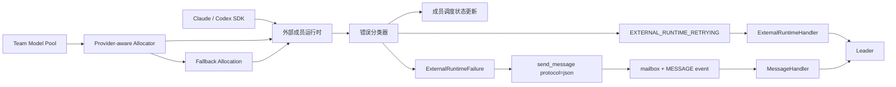
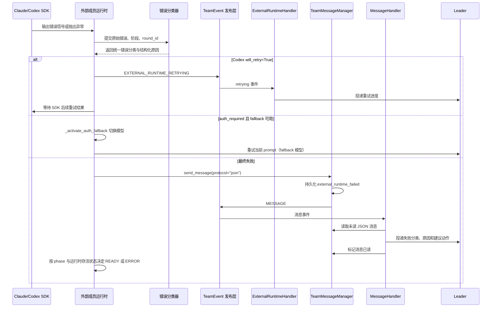

# 三方 Agent 可靠性设计

## 1. 背景与问题 (Why)

三方成员通过外部 SDK 接入 team 后，其运行时可用性不再只取决于内部模型调用链路，还取决于 SDK 会话、账号认证、额度、模型可用性和供应商侧服务状态。

实际运行中已经出现 Claude 未登录、Codex 认证失败、SDK 会话启动失败、模型不可用、额度耗尽等问题。这些问题目前主要停留在日志或 trace 中，leader 只能间接看到成员状态变化，拿不到错误分类、原始依据和处理建议；失败成员随后又可能重新表现为空闲或可调度状态，导致 leader 无法判断成员是临时重试中、最终失败，还是需要用户、运维或开发处理账号、额度、环境或模型可用性问题。

此外，Claude/Codex 成员依赖 CLI 本地登录态或手动 `model_config` 配置才能调用模型，当 CLI 未登录且 pool 里没有匹配 provider 的 entry 时，成员无法正常运行。leader 需要能从 team model pool 自动分配模型给三方成员，并在 CLI 本地认证失败时自动切换到 pool 提供的 fallback 模型，避免成员因认证问题完全不可用。

## 2. 目标与非目标

**适用范围：** 本设计仅覆盖基于 Claude Agent SDK 和 OpenAI Codex SDK 接入的三方成员运行时；其他 CLI adapter 不在本期范围内。

**目标**

- 将 Claude/Codex SDK runtime 的 retrying / failed 状态、错误分类和结构化原因可靠投递给 leader，避免错误只停留在日志或 trace 中。
- 将 Claude/Codex 的结构化错误转换为统一错误分类。
- 区分 turn 级失败与 runtime 不可用，并按对应语义更新成员状态。
- leader 能从 team model pool 自动分配模型给三方成员，按 CLI 类型筛选 provider（Claude 匹配 Anthropic，Codex 匹配 OpenAI 兼容）。
- 当 CLI 本地认证失败（`auth_required`）时，runtime 自动切换到 pool 预分配的 fallback 模型，并将 fallback 持久化为成员的活跃模型。

**非目标**

- 团队工具业务错误、权限拒绝、调用异常和 MCP tool error 均沿用现有 tool result 语义，不纳入本期 `ExternalRuntimeFailure`。
- 传统 stdin CLI / reinvoke CLI 路径保持现状，不纳入本期 `ExternalRuntimeFailure` 状态闭环。
- 自动恢复动作（非 auth fallback）由 leader、用户、运维或开发决策触发，例如额度修复、模型替换、成员替换或任务迁移。

## 3. 术语与上下文

- `三方成员`：本期指通过 Claude Agent SDK 或 OpenAI Codex SDK 接入 team 的成员。它仍是 team member，但模型调用、认证状态和部分运行错误来自外部运行时。
- `外部成员运行时`：系统内负责驱动 Claude/Codex SDK 会话、发送 turn、接收输出、连接团队工具桥接并转换运行状态的适配层。
- `retrying`：SDK / runtime 明确暴露仍在自动重试的中间状态，不结束当前 round，也不改变成员最终状态。
- `failed`：runtime 的 startup 或 turn 已经最终失败，需要 leader 感知并处理。
- `round_id`：成员单轮执行的内部编号，用于关联 failure record、日志和 trace。
- `pending failure`：runtime 在一次 startup 或 round 内暂存的候选失败信息；它可以被后续终态补全，但尚未形成对 leader 的最终上报。
- `failure_id`：最终失败的稳定标识，用于关联结构化失败消息、round result、日志和 trace。
- `结构化失败消息`：通过 `send_message(protocol="json")` 写入 leader mailbox 的持久化系统消息，承载完整 failure payload；`send_message()` 同时发布现有 `MESSAGE` 事件，事件丢失时仍可由后续 mailbox sweep 消费。
- `coordination 事件`：team 内部事件通道。本设计只新增 `EXTERNAL_RUNTIME_RETRYING`，用于传递无需持久化的自动重试进度；最终失败复用 `send_message()` 已有的 `MESSAGE` 事件。
- `auth fallback`：当 CLI 本地认证失败（`auth_required`）时，runtime 自动切换到 pool 预分配的 fallback 模型端点，不依赖 CLI 本地登录态。
- `fallback_model_ref`：成员 DB options 中持久化的 fallback 模型引用（`{model_name, model_index}`），用于在 rehydrate 时恢复 fallback 端点配置。
- `provider_filter`：按 CLI 类型筛选 pool entry 的 provider 谓词。Claude 匹配 Anthropic 兼容协议，Codex 匹配 OpenAI 兼容协议（非 Anthropic）。
- `ReliabilityHandler`：现有 leader 侧 handler，处理 DeepAgent 行为 anomaly 和 team-level ping-pong anomaly，不消费三方成员运行时错误。
- `ExternalRuntimeHandler`：三方成员运行时 coordination handler；本期只消费 `EXTERNAL_RUNTIME_RETRYING`，向 leader 投递非持久化的重试进度。
- `MessageHandler`：现有 mailbox 消息 handler；扩展后识别 `external_runtime_failed` JSON 消息，校验并渲染结构化失败内容，再投递给 leader。
- `suggested_action`：按 `category` 生成的用户可操作建议，投递给 leader 作为处理方向参考。

## 4. 方案设计 (What / How)

### 4.1 总体架构



总体架构由五层组成：

- 外部成员运行时：驱动 Claude/Codex SDK，接收输出、错误和工具调用结果。
- 错误分类器：把 Claude/Codex SDK 返回的失败消息、SDK 异常和 HTTP 状态转换为统一错误分类。
- 模型分配层：从 team model pool 按 CLI 类型筛选 provider，分配主模型和 fallback 模型。
- coordination 层：中间重试发布为 `EXTERNAL_RUNTIME_RETRYING`；最终失败通过 `send_message(protocol="json")` 持久化，并复用其发布的 `MESSAGE` 事件唤醒 leader。
- handler 层：`ExternalRuntimeHandler` 投递重试进度；`MessageHandler` 识别、校验和渲染最终失败消息，并在成功投递后标记已读。

现有 reliability 体系仍负责 DeepAgent 行为 anomaly，三方成员运行时失败不进入该体系。`ReliabilityHandler` 处理 DeepAgent 行为异常，`ExternalRuntimeHandler` 处理三方成员运行时 retrying，最终 failed 则沿用 mailbox 的 `MessageHandler` 投递链路。

### 4.2 数据流与时序



### 4.3 接口与数据模型

#### 4.3.1 需求与场景

> **需求：** 系统必须在三方成员运行时暴露自动重试进度时发布 `EXTERNAL_RUNTIME_RETRYING`。
> **场景：** 当 Codex SDK 返回 `will_retry=True` 时，系统发布 retrying 事件，且不结束当前 round、不改变成员最终状态。

> **需求：** 系统必须在三方成员 runtime 的 startup 或 turn 最终失败时，通过 `send_message(protocol="json")` 向 leader 可靠投递结构化失败消息。
> **场景：** 当最终失败被分类后，JSON 消息包含成员、阶段、分类、结构化原因、摘要和建议动作；`send_message()` 完成消息持久化并发布现有 `MESSAGE` 事件，供 leader 判断是否需要反馈用户或重新规划。

> **需求：** 系统必须按失败阶段和运行时存活状态决定成员状态。
> **场景：** 当 Claude 未登录或 Codex 401 发生在 turn 内且运行时仍可继续接收调度时，系统写入 failed 消息并按普通成员 round 失败语义让成员状态回到 `READY`；当 runtime 在 `startup` 阶段未能成功建立或 runtime task 异常退出时，成员状态进入 `ERROR`。

> **需求：** 系统必须只使用 SDK 结构化错误、异常或 HTTP 状态分类运行时失败。
> **场景：** 当 assistant 普通文本包含错误词汇时，文本仍按普通 `llm_output` 处理，不触发 runtime failed。

> **需求：** leader 必须能从 team model pool 为三方成员分配模型，按 CLI 类型筛选 provider。
> **场景：** leader 调用 `spawn_external_cli` 时传 `model_name` 和 `fallback_model_name`，pool 分配器按 `provider_filter` 筛选匹配的 entry。Claude 只匹配 Anthropic 兼容协议，Codex 只匹配 OpenAI 兼容协议（非 Anthropic）。

> **需求：** 当 CLI 本地认证失败时，runtime 必须自动切换到 pool 预分配的 fallback 模型。
> **场景：** Codex turn 返回 `auth_required` 且 fallback 可用时，runtime 关闭当前 client/thread，用 fallback 配置重建 client/thread，重试当前 prompt，并将 fallback 持久化为成员的活跃模型。

#### 4.3.2 事件类型

```python
TeamEvent.EXTERNAL_RUNTIME_RETRYING = "external_runtime_retrying"
```

最终失败不新增 TeamEvent 类型。`TeamMessageManager.send_message()` 写入结构化失败消息后发布已有的 `TeamEvent.MESSAGE`；即使该事件丢失，未读消息仍可由 mailbox sweep 恢复。

#### 4.3.3 Payload

```python
class ExternalRuntimeFailureReason(BaseModel):
    message: str = ""
    sdk_error_type: str = ""
    sdk_error_code: str = ""
    http_status: int | None = None


class ExternalRuntimeRetryingEvent(BaseEventMessage):
    agent_kind: Literal["claude", "codex"]
    phase: Literal["startup", "turn"]
    category: ExternalRuntimeFailureCategory
    summary: str
    reason: ExternalRuntimeFailureReason
    attempt: int | None = None
    max_attempts: int | None = None
    round_id: int | None = None


class ExternalRuntimeFailure(BaseModel):
    type: Literal["external_runtime_failed"] = "external_runtime_failed"
    failure_id: str
    team_name: str
    member_name: str
    agent_kind: Literal["claude", "codex"]
    phase: Literal["startup", "turn"]
    category: ExternalRuntimeFailureCategory
    user_action_required: bool
    summary: str
    suggested_action: str = ""
    reason: ExternalRuntimeFailureReason
    round_id: int | None = None
```

外部成员运行时将 `ExternalRuntimeFailure.model_dump_json()` 作为 `content`，通过 `send_message(to=leader, protocol="json")` 投递。`message_id` 是 mailbox 消息的传输和已读状态标识。`failure_id` 在首次生成最终失败时创建，并随 failed message、日志、trace 以及适用时的 terminal round result 传递，用于跨链路关联同一次失败。

#### 4.3.4 Phase 与代码落点

| phase | 含义 | 代码落点 | 成员状态责任 |
| --- | --- | --- | --- |
| `startup` | runtime 启动期间创建、连接或恢复 SDK client/thread/transport 失败 | `ClaudeSdkRuntime.start()` / `_connect_client()`、`CodexSdkRuntime.start()` / `_ensure_thread()` | 启动路径显式更新成员状态为 `ERROR` |
| `turn` | 成员已可运行，本轮 SDK 调用最终失败 | Claude `_drive_once()` 消息流、Codex `_run_turn()` notification 消费循环、`CliRuntimeBase._drive_turn()` 兜底 | failed round result 交给 `StreamController._map_round(..., result=...)`，成员状态允许回到 `READY`；runtime task 异常退出时显式更新成员状态为 `ERROR` |

#### 4.3.5 错误分类

| category | 含义 | user_action_required |
| --- | --- | --- |
| `auth_required` | 未登录、401、403、缺 API key/token | true |
| `quota_exceeded` | 额度、账单、usage limit、session budget | true |
| `rate_limited` | 429 或 rate limit | false |
| `server_unavailable` | 500、529、server overloaded | false |
| `network_timeout` | 连接超时、stream 中断、idle timeout | false |
| `process_start_failed` | startup 阶段 CLI 不存在、路径错误、权限不足、启动超时、进程退出或运行环境不满足 CLI 要求 | true |
| `sdk_error` | 未细分 SDK 或协议错误 | false |
| `unknown` | 无法分类 | false |

表格定义的是最终 failed 消息的默认 `user_action_required`。`user_action_required=true` 表示 leader 需要向用户或外部系统说明处理方向，不等价于成员状态 `ERROR`。

#### 4.3.6 `suggested_action`

按 `category` 生成用户可操作的建议，通过 i18n 模板投递给 leader：

| category | suggested_action（中文） |
| --- | --- |
| `auth_required` | 请登录 CLI 或配置有效的 API key |
| `quota_exceeded` | 请检查账户额度或更换 API key |
| `rate_limited` | 请稍后重试 |
| `server_unavailable` | 服务端暂时不可用，请稍后重试 |
| `network_timeout` | 请检查网络连接和 API 地址是否可达 |
| `process_start_failed` | 成员运行时启动失败，请检查配置或重试 |
| `sdk_error` | 运行时异常，请重试或检查日志 |
| `unknown` | 运行时异常，请重试或检查日志 |

`suggested_action` 在 `RuntimeReliabilityContext.finalize_failure` 中根据 `category` 自动生成，调用方传了 `suggested_action` 时覆盖默认值。

### 4.4 关键流程

#### 4.4.1 自动重试进度

1. Codex SDK 返回 `ErrorNotification(will_retry=True)`。
2. 外部成员运行时提取错误信息并分类。
3. 发布 `EXTERNAL_RUNTIME_RETRYING`。
4. `ExternalRuntimeHandler` 将重试进度投递给 leader。
5. 当前 round 保持运行，成员状态不改变，等待 SDK 后续结果。

#### 4.4.2 will_retry 预算

1. 每收到一条 `will_retry=True` 的 error notification，计数器 `_will_retry_count` +1。
2. 超过 `max_will_retry_count`（默认 5）时，主动 interrupt handle 并抛 `_CodexRetryBudgetExceeded`。
3. 该异常进入 `_finalize_turn_failure`，`category` 取最后一次 retrying 的分类。
4. `has_finalized` 后的 `will_retry` 只 interrupt handle 并 return，不再发布 retrying。

#### 4.4.3 最终失败

1. Claude/Codex SDK 在正常消息流中返回失败消息，或外部成员运行时在调用 SDK 时捕获异常。
2. 外部成员运行时在保留结构化对象的位置完成分类。
3. 外部成员运行时在每次 `startup` 或 round 执行中最多维护一份 pending failure。
4. 当 startup 失败、收到明确的 turn 失败终态，或消息流因异常结束时，外部成员运行时固化唯一的 `ExternalRuntimeFailure`，然后调用 `TeamMessageManager.send_message()`，以 `protocol="json"` 写入携带 `type="external_runtime_failed"` 和完整 failure payload 的消息。
5. `send_message()` 先持久化消息，再发布现有 `MESSAGE` 事件，唤醒 leader 的 `MessageHandler`。
6. `MessageHandler` 被唤醒或执行 mailbox sweep，识别并校验 `external_runtime_failed` JSON 消息，渲染为 `<team-event kind="external-runtime-failed">` 后投递给 leader，成功后标记已读。
7. turn 内失败通过 failed round result 继续进入 `StreamController._map_round(..., result=...)`；runtime 建立失败或 runtime task 异常退出时，由对应路径显式更新成员状态。
8. leader 基于结构化错误向用户反馈或重新规划。

#### 4.4.4 模型 pool 分配

1. leader 调用 `spawn_external_cli` 时传 `model_name`（主模型）和 `fallback_model_name`（必选，fallback 模型）。
2. `SpawnExternalCliTool.invoke` 按 `cli_agent` 生成 `provider_filter`（Claude → Anthropic，Codex → 非 Anthropic）。
3. 分配器 `allocate(model_name, provider_filter=...)` 在同名 group 内按 provider 筛选，round-robin 选一条 entry。
4. `fallback_model_name` 同样按 `provider_filter` 分配，作为 `fallback_allocation`。
5. `spawn_member` 将 `allocation.to_db_ref()` 和 `fallback_allocation.to_db_ref()` 持久化到成员 DB options（`model_ref` 和 `fallback_model_ref`）。
6. `build_context_from_db` rehydrate 时，`resolve_member_model` 用 `model_ref` 还原主模型，`fallback_model_ref` 还原 fallback 模型，放入 `TeamRuntimeContext.member_model` 和 `fallback_member_model`。
7. `external_cli_spawn` 将 `member_model` 转换成 `ExternalCliModelConfig`（provider/model/api_base/api_key），fallback 同理。
8. `build_cli_runtime` 传 `external_model_config` 和 `fallback_external_model_config` 给 runtime 构造。

**group_index 映射**：筛选后 `group_index` 映射回原始 group 位置，确保 `resolve_member_model`（不重新应用 filter）在 rehydrate 时取到同一条 entry。

**pool 为空或无匹配**：回退到 `ExternalCliAgentSpec.external_model_config` 静态配置。fallback 为空时不启用 auth fallback。

#### 4.4.5 Auth Fallback

当 CLI 本地认证失败（`auth_required`）时，runtime 自动切换到 pool 预分配的 fallback 模型：

**Codex**：
1. `_run_turn` 的 `thread.turn()` 抛异常，`classify_codex_exception` 判为 `auth_required`。
2. 或 notification 循环中 `ErrorNotification(will_retry=True, category=auth_required)` / `TurnCompletedNotification(turn.status=failed, category=auth_required)`。
3. 调 `_activate_auth_fallback()`：关闭当前 client，用 `fallback_config` 重建 client + thread，调 `promote_fallback_model` 持久化 fallback 为活跃模型。
4. 抛 `_CodexAuthFallbackRequested`，`_drive` 外层 catch，用新 thread 重试当前 prompt（最多 1 次）。
5. fallback 激活失败时恢复原配置，继续走正常失败路径。

**Claude**：
1. `_drive_once` 的消息流中 `AssistantMessage.error` 为 `auth_required`，或 `ResultMessage.is_error=True, category=auth_required`。
2. 调 `_activate_auth_fallback()`：断开当前 client，用 `fallback_options` 重建 client + connect。
3. 抛 `_ClaudeAuthFallbackRequested`，`_drive` 外层 catch，重试当前 prompt（最多 1 次）。
4. fallback 激活失败时恢复原 options，继续走正常失败路径。

**安全条件**：auth fallback 只在 `safe_to_retry`（即 turn 开头、尚未输出任何 chunk）时触发，避免中途切换模型导致重复输出。

#### 4.4.6 成员状态判定

1. turn 内最终失败时，成员状态回 `READY`，与普通成员 round 失败语义一致。
2. Claude/Codex 的结构化认证失败、额度不足和服务不可用发生在 turn 内时，都按本轮失败处理，不直接置 `ERROR`。
3. runtime 在 `startup` 阶段未能成功建立时，由启动失败路径显式更新成员状态为 `ERROR`。
4. runtime task 异常退出时，由异常收尾路径显式更新成员状态为 `ERROR`。
5. `ERROR` 表示成员当前不可调度；后续恢复必须经过重新启动并验证连接，成功后成员状态回到 `READY`。

#### 4.4.7 边界处理

- 所有 assistant `TextBlock` 都不触发失败分类，仍按普通 `llm_output` 处理。
- `auth_required`、`quota_exceeded`、`network_timeout`、`server_unavailable`、`rate_limited` 发生在 turn 内时上报 failed，成员状态按普通成员 round 失败语义回到 `READY`。
- `auth_required` 在 turn 开头且 fallback 可用时，触发 auth fallback 而非写 failed 消息。
- 团队工具业务错误、权限拒绝、调用异常和 MCP tool error 仍作为工具结果返回，不触发 `ExternalRuntimeFailure`。

#### 4.4.8 OTEL/rollout 启动失败

Codex native OTEL receiver 和 rollout trace reader 属于观测增强，不属于运行时可用性前置条件。启动改为 best-effort：

1. 启动成功时，继续向 Codex 配置注入 native OTEL endpoint 和 rollout trace root。
2. 启动失败时，只记录 warning，并禁用对应观测增强。
3. 启动失败不得阻断 `CodexSdkRuntime` 构造，不得阻断 `MemberRuntime.start()`。
4. 启动失败不得进入失败收集与终态生成逻辑，不得写入 `external_runtime_failed` 结构化消息，不得更新成员状态。
5. `rollout_trace.py` 的 `_pid_is_running` 在 Windows 上必须使用 `OpenProcess` + `GetExitCodeProcess` 检查进程存活，不得使用 `os.kill(pid, 0)`——后者在 Windows 上可能意外终止宿主进程。

### 4.5 配置与开关

本设计不新增配置项或 feature flag。`team_observability.enabled` 控制全局 OTel 初始化，影响 Codex OTEL receiver 是否启动，但不影响运行时可靠性逻辑。

## 5. 关键决策与权衡 (ADR)

### 5.1 区分 retrying 进度与最终 failed

- **决策：** 使用 `EXTERNAL_RUNTIME_RETRYING` 表达 SDK/runtime 重试进度，使用 `external_runtime_failed` JSON 消息表达最终失败。
- **理由：** 两类信号的可靠性要求不同：retrying 是瞬时进度，允许只走事件；failed 需要持久化和补偿消费。

### 5.2 最终失败使用结构化 message 持久化

- **理由：** `send_message()` 已有"先持久化、再发布 `MESSAGE`"的唤醒和补偿消费语义。复用现有链路后，即使 `MESSAGE` 事件丢失，未读结构化消息仍可由后续 mailbox sweep 恢复。

### 5.3 每个执行过程只有一个最终失败出口

- **决策：** Claude/Codex SDK runtime 在每次 `startup` 或 round 执行中最多维护一份 pending failure，并最多生成一个 `ExternalRuntimeFailure`；只有首次生成该对象时才写入 failed message。

### 5.4 不使用普通 assistant 文本判定失败

- **理由：** 模型正常输出可能包含"401""not logged in"等文本，文本匹配无法提供稳定的失败边界。

### 5.5 复用 MessageHandler 投递最终失败

- **决策：** 新增 `ExternalRuntimeHandler` 处理 `EXTERNAL_RUNTIME_RETRYING`；最终 failed 复用现有 `MessageHandler`。两类信号都不进入现有 `ReliabilityHandler` 链路。

### 5.6 成员状态 ERROR 语义

- **决策：** turn 内失败沿用普通成员 round 失败语义，成员状态回到 `READY`；运行时不可用场景才进入 `ERROR`。

### 5.7 Provider 筛选与 pool 分配

- **决策：** 分配器 `allocate` 加 `provider_filter` 参数；Claude 只匹配 Anthropic 兼容协议，Codex 只匹配 OpenAI 兼容协议。
- **理由：** pool 里同名 entry 可能走不同协议（如 `deepseek-v4-flash` 同时有 OpenAI 和 Anthropic 的 endpoint），不筛选会把错误协议的 entry 分给 CLI 导致 404 或认证失败。

### 5.8 Auth Fallback

- **决策：** CLI 本地认证失败时，runtime 自动切换到 pool 预分配的 fallback 模型，不依赖 CLI 本地登录态。
- **理由：** CLI 未登录、token 过期、本地配置损坏时，成员仍应能用 pool 提供的 fallback 端点继续工作。
- **安全条件：** fallback 只在 turn 开头（`safe_to_retry`，尚未输出 chunk）时触发，避免中途切换导致重复输出。
- **持久化：** fallback 激活后调 `promote_member_fallback_model` 将 `fallback_model_ref` 提升为 `model_ref`，确保后续 restart 直接使用 fallback 配置。

## 6. 影响面与兼容性

- schema：新增 retrying 事件 payload、结构化 failed 消息、错误分类模型、`suggested_action` 模板。
- external runtime：最终异常携带 failure result，retrying 进度发布事件；接收状态上报接口；auth fallback 在 `auth_required` 时切换模型。
- Claude SDK runtime：消费 `AssistantMessage.error`、`ResultMessage.is_error/errors/api_error_status` 和 SDK transport 异常；auth fallback 通过 `_fallback_options` + `_promote_fallback_model` 实现。
- Codex SDK runtime：消费 `ErrorNotification`、`TurnCompletedNotification.turn.error` 和 SDK 异常；auth fallback 通过 `fallback_config` + `fallback_thread_options` + `promote_fallback_model` 实现。
- model pool 分配：`ModelAllocator.allocate` 加 `provider_filter`；`SpawnExternalCliTool` 加 `model_name` 和 `fallback_model_name` 参数。
- coordination：新增只消费 retrying 事件的 `ExternalRuntimeHandler`；扩展 `MessageHandler` 对 `external_runtime_failed` JSON 消息的识别、校验、渲染和投递。
- i18n：增加 retrying/failed 摘要模板、`suggested_action` 模板。
- DB：`TeamMember.options` JSON 新增 `fallback_model_ref` 字段；`MemberDao` 新增 `promote_member_fallback_model` 方法。

保持不变：

- StreamController：不新增状态映射；turn 内 failed 仍沿用现有执行态失败和成员回 `READY` 的语义。
- 所有 assistant 普通文本仍按原有输出路径进入 `llm_output`。
- 团队工具业务错误、权限拒绝、调用异常和 MCP tool error 仍作为工具结果返回给三方成员。

## 7. 测试与验证

### 7.1 Claude

- `ResultMessage(is_error=True, api_error_status=401)` 触发 `auth_required`。
- `ResultMessage(is_error=True)` 缺少 `AssistantMessage.error` 和 `api_error_status` 时降级为 `sdk_error`。
- `AssistantMessage(error="rate_limit")` 后收到 `ResultMessage(is_error=True)` 的组合序列，只写入一条 failed message，`failure_id` 保持唯一。
- `AssistantMessage.error` 后消息流因 SDK/transport 异常结束时，使用 pending failure 和异常信息写入一条 failed message。
- startup 阶段的 `CLINotFoundError`/`CLIConnectionError`/`ProcessError` 触发 `process_start_failed`。
- 明确的 timeout 异常触发 `network_timeout`。
- 普通 `TextBlock`（含 "Not logged in · Please run /login" 文本）不触发运行时失败分类。
- auth fallback：`AssistantMessage.error=authentication_failed` 在 turn 开头且 fallback 可用时，触发 fallback 切换，不写 failed message，重试当前 prompt。

### 7.2 Codex

- `ErrorNotification(will_retry=True, codex_error_info=unauthorized)` 触发 retrying 事件。
- Codex turn 最终 401 触发 `auth_required` failed 消息，成员状态回到 `READY`。
- `ErrorNotification(will_retry=True, serverOverloaded)` 输出 retrying 事件并继续等待 SDK retry。
- `ErrorNotification(will_retry=False, responseStreamDisconnected)` 记录 `network_timeout` 候选失败；同一错误携带 HTTP 401 时优先分类为 `auth_required`。
- `internalServerError` 分类为 `server_unavailable`，`badRequest` 分类为 `sdk_error`。
- 仅收到 `TurnCompletedNotification(turn.status=failed, turn.error=...)` 时，生成一条最终 failed message。
- 模拟 `ErrorNotification(will_retry=False)` 后收到 `TurnCompletedNotification(turn.status=failed, turn.error=...)` 的组合序列，以 `turn.error` 生成最终失败并丢弃 pending failure，只生成一条最终 failed message。
- `TurnCompletedNotification(turn.status=failed, turn.error=None)` 存在相同 `turn_id` 的 pending failure 时，使用 pending failure 生成最终失败。
- will_retry 预算超过 5 次时抛 `_CodexRetryBudgetExceeded`，category 取最后一次 retrying 的分类。
- auth fallback：`thread.turn()` 抛异常分类为 `auth_required` 且 fallback 可用时，关闭当前 client/thread，用 fallback 重建，重试当前 prompt，持久化 fallback 为活跃模型。
- native OTEL receiver 或 rollout trace reader 启动失败时，Codex runtime 仍构造成功；日志记录 warning，不写入 `external_runtime_failed`，成员状态不进入 `ERROR`。

### 7.3 内部链路

- `_drive_turn()` failed round 的 `result` 包含最终 failure payload；未分类异常由 `_drive_turn()` 兜底为 `sdk_error` / `unknown`。
- runtime task finalizer 区分 abort/stop、意外 `CancelledError` 和普通异常，并保证 terminal round result 与最终 failed message exactly-once。
- retrying/failed payload 的 `phase` 只允许 `startup` 和 `turn`。
- 团队工具业务错误、权限拒绝、调用异常和 MCP tool error 只生成 tool result，不写入 failed message，也不更新成员状态。
- `EXTERNAL_RUNTIME_RETRYING` 发布到 team topic。
- 最终 failed 通过 `send_message(protocol="json")` 写入结构化系统消息，并由该方法发布现有 `MESSAGE` 事件。
- `MessageHandler` 从数据库读取 unread message；当消息为 `protocol="json"` 且 `type="external_runtime_failed"` 时，校验 payload 并渲染为 `<team-event kind="external-runtime-failed">` 后 `deliver_input()`，成功后标记已读。
- `MESSAGE` 事件丢失时，未读结构化消息仍可在后续 mailbox sweep 中被消费。
- `external_runtime_failed` JSON 消息识别成功后不再按普通成员消息渲染。
- turn 内最终 failed 后成员状态回到 `READY`，但 leader 仍能看到 failed 消息。
- runtime 在 `startup` 阶段未能成功建立或 runtime task 异常退出后，对应失败路径显式更新成员状态为 `ERROR`。
- 成员状态 `ERROR` 属 quiescent 状态；最终 `team.completed` 仍由任务全终态、成员全 settled、无未读消息三条件决定。
- pool 分配器按 `provider_filter` 筛选 entry，`group_index` 映射回原始 group 位置。
- `SpawnExternalCliTool` 的 `fallback_model_name` 为必选参数。
- auth fallback 只在 `safe_to_retry`（turn 开头、未输出 chunk）时触发。
- fallback 激活后 `promote_member_fallback_model` 将 `fallback_model_ref` 提升为 `model_ref`。

## 8. 可观测性

- retrying 事件和 failed 消息写入 team 日志，日志包含 `team_name`、`member_name`、`agent_kind`、`phase`、`category`、`round_id`、`failure_id`。
- 生成 `ExternalRuntimeFailure` 时，Claude/Codex span bridge 在当前 turn span 上记录 `failure_id`、`round_id`、`phase`、`category` 和 SDK 错误摘要。
- auth fallback 激活/失败时记录 INFO/WARNING 日志，包含 `member_name`、原 thread_id/session_id、fallback provider/model。
- pool 分配时记录 INFO 日志：`using pool-allocated model: provider={} model={} api_base={}`。
- retrying 事件用于观察 SDK 自动重试进度；failed 消息用于观察最终失败与状态策略。

## 9. 风险与回滚

- **风险：错误分类覆盖不全。** 未覆盖的错误形态会降级为 `sdk_error` / `unknown`，leader 仍能收到 failed 消息，但分类和建议动作可能不够精确。
- **风险：auth fallback 模型不兼容。** 如果 fallback 模型的 API 协议与 CLI 不兼容（如把 OpenAI 协议分给了 Claude），fallback 激活后仍会失败。缓解措施：`provider_filter` 按 CLI 类型筛选，确保只分配兼容协议的 entry。
- **风险：OTEL/rollout 在 Windows 上的进程探测。** `os.kill(pid, 0)` 在 Windows 上可能终止宿主进程。已修复为使用 `OpenProcess` + `GetExitCodeProcess`。
- **回滚：** 回退 retrying 事件、失败消息解析、分类器、handler、模型分配和 auth fallback 变更后，系统恢复旧行为。

## 10. 开放问题 (Open Questions)

无。

## 11. 评审记录 (Iteration Log)

| 轮次 | 日期 | 版本 | 评审人 | 结论 | 主要修改/讨论 |
|---|---|---|---|---|---|
| 1 | 2026-08-21 | 1 | - | draft | 初稿，定义三方成员运行时 retrying/failed 闭环。 |
| 2 | 2026-08-31 | 2 | - | implemented | 更新为实现态：增加模型 pool 分配、auth fallback、will_retry 预算、suggested_action、OTEL best-effort、Windows PID 探测修复。 |

## 12. 实现记录与偏差

### 12.1 已实现

- retrying / failed 闭环：完整实现 Claude 和 Codex 的错误分类、pending failure 合并、exactly-once 投递。
- `EXTERNAL_RUNTIME_RETRYING` 事件 + `ExternalRuntimeHandler` + `MessageHandler` JSON 消息识别。
- `RuntimeReliabilityContext`：pending failure 管理、failure_id 生成、`send_message(protocol="json")` 投递、`mark_member_error`。
- `failure_classifier`（Claude + Codex）：纯函数分类器，Codex 使用 SDK enum `.value` 和 `.alias`。
- `suggested_action`：按 `category` 自动生成，i18n 中英文模板。
- 模型 pool 分配：`SpawnExternalCliTool` 加 `model_name` + `fallback_model_name`；分配器加 `provider_filter`；`external_cli_spawn` 转 `ExternalCliModelConfig`。
- auth fallback：Claude `_ClaudeAuthFallbackRequested` + `_activate_auth_fallback`；Codex `_CodexAuthFallbackRequested` + `_activate_auth_fallback`；`promote_member_fallback_model` 持久化。
- OTEL best-effort：`build_codex_runtime` try/except 包裹 OTEL 启动。
- Windows PID 探测：`_pid_is_running` 使用 `OpenProcess` + `GetExitCodeProcess` 替代 `os.kill`。
- will_retry 预算：`_DEFAULT_MAX_WILL_RETRY_COUNT = 5`，超过后抛 `_CodexRetryBudgetExceeded`。
- `finalize` 后 retrying 不再发布：`has_finalized` 检查 + interrupt handle。

### 12.2 偏差

- 设计文档 §4.3.4 中 Codex 的 `CodexRolloutTraceReader.start` 在 `build_codex_runtime` 阶段同步启动，不是 lazy。实现中保持同步，但 OTEL 整体在 best-effort try/except 内。
- `suggested_action` 在设计文档 §4.3.5 中未单独列出，实现中按 `category` 自动生成并追加到 i18n 模板。

## 13. 参考与关联设计

- Claude Agent SDK 0.2.115：结构化 assistant/result/error/process 失败信号。
- OpenAI Codex SDK 0.144.4：`ErrorNotification`、`TurnCompletedNotification` 和 SDK 异常。
