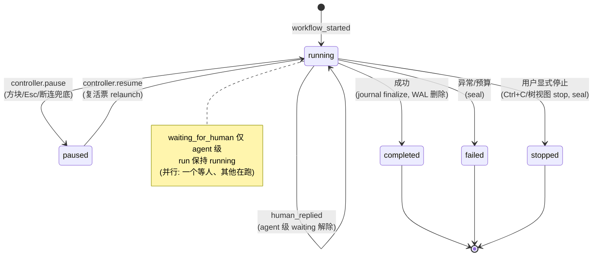
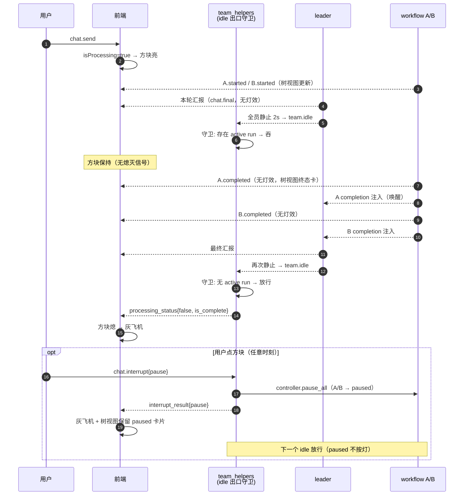
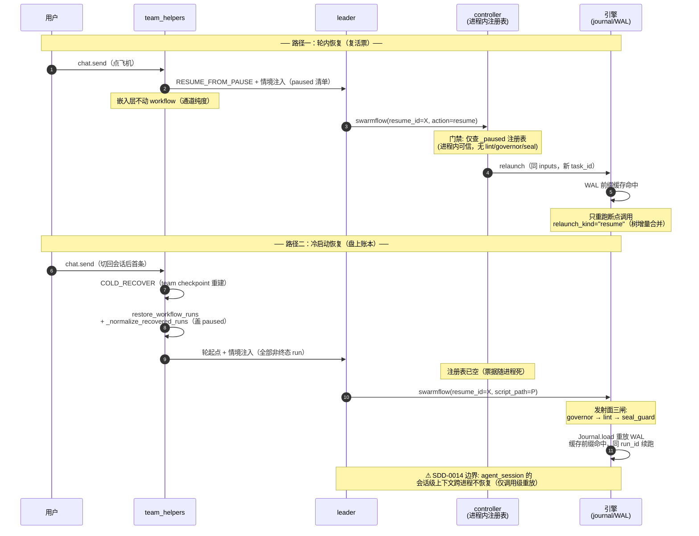

# Swarmflow 启停与 Team 生命周期联动（小飞机控灯 / 恢复裁决 / 冷启动续跑）

## 1. 背景与问题 (Why)

SwarmFlow 工作流（leader 通过 swarmflow 工具发起的后台执行）目前是 team 会话里的"黑盒租户"：
它借用 team 的界面（Web 小飞机/方块、树视图、交互卡）展示进度，却完全不参与 team 的生命周期。
用户在非 swarmflow 场景下习得的每一个操作直觉——点方块暂停、切换会话清后台、TUI 退出回收资源、
暂停后发消息继续——落到 swarmflow 会话上要么失效、要么出错。具体缺陷五类：

1. **生命周期零覆盖**：team 的 `pause_session_runtime` / `cancel_session_runtime` /
   `stop_paused_session_runtime` 对 `BackgroundTaskController` 里的 swarmflow 协程零操作；
   清理路径的 `finalize_pending_runs` 一律盖 "stopped"。暂停团队后 workflow 继续烧 token；
   销毁团队后 controller 注册表里留下指向已销毁对象的悬空句柄。
2. **控灯守卫缺陷**：`team.idle` 出口守卫 `any(not run.is_terminal)` 把 **paused 也算按住**——
   恢复裁决方案下（leader 选择不恢复、纯回答），paused run 会永久按住 idle，方块永久卡死。
3. **信号冗余**：`is_workflow_completed`（会话级布尔，只写不读）、`seen_team_events`（唯一读取方
   是自身写入守卫）、`swarmflow.activated/deactivated` + 前端黏性布尔（一次性标志不复位、任一
   run 终态即在并发下错误踢出树视图）——三者均为已被更可靠机制取代的残留写入端。
4. **交互卡与 run 状态脱节**：run 终态时挂着的 swarmflow 人工交互卡不清除，输入框锁死；
   会话级输入锁在"单个 agent 等人工 + 并行 agent 在跑"场景下误锁，用户失去 supplement 能力。
5. **恢复无入口**：暂停后用户发消息，嵌入层既不知道要不要恢复 workflow、恢复哪个；冷启动
   （会话切换后回来）后树视图能还原，但执行进度如何接续无任何设计。

本设计与 SDD-0013（运行态控制意图）互补：SDD-0013 定义引擎侧三意图与 controller 语义，
本设计定义**嵌入层如何把 team 生命周期事件与 UI 操作映射到这些控制上**，并补齐冷启动与
信号清理。

## 2. 目标与非目标

**目标**

- swarmflow 协程生命周期完全跟随 team runtime（完全绑定），单点注入，无孤儿协程 / 悬空句柄
- 小飞机/方块在 swarmflow 场景行为可预测：公式零改动，workflow 只"按住不熄"且仅作用于
  team.idle 出口；并发 run 交替起落不产生灯抖动
- 暂停后恢复由 leader 裁决（语义通道）+ 树视图按钮（机械通道）双通道，且通道语义纯度成立
- 会话切换 / 新建 / TUI 退出 / 崩溃后，workflow 状态如实落章，冷启动可凭 journal 缓存续跑
- 清理三类冗余信号，树视图入口改由前端数据派生

**非目标**

- 不改 swarmflow 工具的入参协议（resume_id/script/action 四键面不动）
- 不改 agent-core 引擎的 journal/WAL 内容寻址机制（SDD-0003 已定的执行脊柱）
- 不为 TUI 新增树视图 / per-run 按钮（TUI 维持仅语义通道，见 §5.9）
- 不做跨进程的 controller 注册表持久化（复活票随进程死是设计行为，见 §5.4）

## 3. 术语与上下文

| 术语 | 含义 |
|---|---|
| 小飞机/方块 | Web 发送按钮三态：灰飞机（无可执行动作）、亮飞机（可发送）、高亮方块（可停止）。方块无暗态——出现即可点 |
| run | 一次 swarmflow 执行，以 run_id 标识；三账本之一（journal）按 run_id 隔离缓存 |
| controller | `BackgroundTaskController`（agent-core）：进程内 run 注册表 + pause/resume/stop 控制面 |
| 复活票 | controller `_paused` 注册表里的纯数据票据（inputs + session_id）：由当前 cycle 登记的 launcher 同 inputs 重调 run_background；session 级有效，宿主随 cycle 动态取 |
| seal | journal 的终态封条记录：使 resume_id 失效、缓存按 run_id 隔离断根 |
| 三账本 | team checkpoint（管"人"）/ workflow_runs 快照（管"看"）/ journal+WAL（管"续"） |
| 情境注入 | 轮起点把 workflow 状态清单以文本前缀注入 leader 上下文的机制（§4.4） |
| 通道纯度 | 一个用户动作只具有一种语义：按钮=机械控制，发 query=语义输入，不得杂交 |

**两层 pause/stop 语义错位**（本设计必须消解的前提）：

| | team 层 | controller 层 |
|---|---|---|
| pause | 对象原地休眠（teammate 子进程活着，池内 PAUSED） | 杀协程+保账本（三步杀：abort_event → abort_sessions → cancel 协程；WAL+复活票保留） |
| stop | 销毁+移池（checkpoint 保留供冷恢复） | 同样杀法 + seal 封条（缓存断根） |
| resume | 零成本唤醒（state 置 RUNNING） | relaunch 重放（WAL 前缀缓存命中，只重跑断点调用） |

## 4. 方案设计 (What / How)

### 4.1 总体架构

完全绑定：嵌入层单点注入 + 通道纯度 + 灯协议单一来源 + 终局语义最小化（seal 仅发生于用户
显式停止一个 active run）。

```
┌─ 用户动作 ─────────────┬─ team 层（既有）────┬─ workflow 层（本设计注入）─────┐
│ Web 方块 / TUI Esc      │ pause 留池          │ controller.pause_all           │
│ Ctrl+C ×1 (TUI)         │ cancel 移池         │ stop_all: active→seal          │
│                         │                    │            paused→丢票保记录    │
│ 发 query (飞机)         │ RESUME_FROM_PAUSE  │ 不动 workflow，仅情境注入       │
│ 断连兜底(TUI exit/^C×2)  │ cancel 移池         │ pause_all（系统回收，保账本）   │
│ 切换/新建会话           │ stop_paused 避让式  │ stop_all（实际只碰得到 paused） │
│ 树视图 per-run 按钮      │ 仅 team 在跑时可用  │ pause/resume/stop(单 run)      │
│                         │ (睡着/冷启动置灰)   │ 睡着时 RPC 拒绝                │
└─────────────────────────┴────────────────────┴────────────────────────────────┘
     注入点：pause / cancel / stop_paused 三个生命周期方法各自在 Runner.pause/stop **之前**派发
     （v3 修正，见 §5.4）；_cleanup_runtime_locals 只做 handler 落章(finalize_pending_runs
     按 disposition 分流)与停止，不再驱动 controller
```

三账本分工（冷启动基础）：

| 账本 | 位置 | 职责 | 与非 swarmflow 关系 |
|---|---|---|---|
| team checkpoint | AgentTeamSession | leader/members 重建 | 完全复用，零新机制 |
| workflow_runs 快照 | session metadata | 树视图静态还原（展示态） | 新增维度 |
| journal + WAL | 引擎文件 | 执行真相，resume_id 唯一入口 | 新增维度 |

后两账本无事务一致性，靠状态落章语义对齐（§4.4 崩溃恢复），为独立验收点。

### 4.2 数据流与时序

**run 状态机**：



> 终态 = {completed, failed, stopped}，单向不可逆；paused↔running 是唯一可逆对。

**控灯时序**（并发 A/B 两 run，验证"灯无抖动"）：



**恢复时序**（轮内 vs 冷启动，两路门禁差异）：



### 4.3 接口与数据模型

#### 4.3.1 接口契约（Requirement / Scenario）

| # | Requirement（系统 SHALL…） | Scenario（WHEN → THEN） | 与 non-swarmflow 差异 |
|---|---|---|---|
| R1 | 在 team 生命周期方法执行时，同步调用 controller 的对应全量操作，不留悬空句柄 | WHEN 点方块触发 pause THEN team 入池 PAUSED 且所有 active run 写 pause 记录、复活票保留在 `_paused`；WHEN cancel 执行 THEN `stop_all` 先于 `stop_team`（用户终止来源）或以 `pause_all` 替代（断连来源） | — |
| R2 | team.idle 出口的放行判定基于 agent 级析取的活动度 | WHEN 会话存在 paused run 且无 active run THEN team.idle 放行（方块熄灭）；WHEN 存在 agent 级 running 或 waiting_for_human THEN team.idle 被吞 | — |
| R3 | 断连兜底（CLIENT_DISCONNECT）走 pause_all 而非 stop_all | WHEN TUI 用户 `/exit` 或双 Ctrl+C THEN 活跃 run 被杀协程但写 pause 记录，冷启动后 leader 可凭 resume_id 缓存命中续跑 | non-swarmflow 断连仅 `stop_team` 移池、checkpoint 保留（资源回收非终止意图）；swarmflow 对应"杀协程+写 pause 记录"，让 journal 进度同 checkpoint 一样活过断连——若照搬 seal 会作废缓存，次日全额重跑，与对话上下文不对称 |
| R4 | run 退出时的落章反映真实状态而非一刀切 stopped | WHEN 会话切换清理一个 paused run THEN 快照与 journal 均落 paused（树视图显示"暂停待恢复"，冷启动可续） | non-swarmflow 切换只有"stop 移池"一种；swarmflow 须按 run 真实状态落章（paused 可续落 paused / 用户终止的 active 落 stopped），否则一刀切 stopped 在展示层"说死"可续账本 |
| R5 | 轮恢复将非终态 run 清单以文本前缀注入 leader 上下文 | WHEN 冷启动首条消息到达 THEN UserTurn 文本前含全部非终态 run 的 run_id/script_path/进度与恢复模板；WHEN 轮内 follow-up 且存在 paused run THEN 前缀仅含 paused 清单；WHEN 无非终态 run THEN 零注入、UserTurn 原样 | — |
| R6 | 交互卡与输入锁与 run 状态双向同步 | WHEN run 终态且其交互卡在场 THEN 卡片清除、输入解锁；WHEN 单 agent waiting 且并行存在 running agent THEN 输入框开放（可 supplement） | — |

#### 4.3.2 jiuwenswarm 侧接口变更

**注入点**（`team_manager._cleanup_runtime_locals`，现有签名扩展一个分流参数）：

```python
async def _cleanup_runtime_locals(
    self, session_id: str, *,
    finalize_workflows: bool = True,          # 既有:pause 路径传 False
    workflow_disposition: Literal["stop", "pause"] = "stop",   # 新增:cancel_source 分流结果
) -> None:
    # finalize_workflows=False → controller.pause_all()   (Web 方块 / TUI Esc)
    # finalize_workflows=True 且 disposition="stop"  → controller.stop_all()  (Ctrl+C / 切换)
    # finalize_workflows=True 且 disposition="pause" → controller.pause_all() (断连兜底)
```

调用方改造（均为既有方法，只改内部调用）：`_process_team_interrupt` 处理 intent=cancel 时，从
`request.metadata` 读断连来源（key `E2A_INTERNAL_CANCEL_SOURCE_KEY` = `"_jiuwenswarm_cancel_source"`，
值 `"client_disconnect"`）计算 `workflow_disposition`，传入 `cancel_session_runtime`。来源链路：
gateway 断连时把 cancel_source 写入 E2A `channel_context`（`message_handler` 同时从 metadata pop
掉该键），agentserver 反序列化后经 `e2a_to_agent_request` 把 channel_context 整体映射为
`AgentRequest.metadata`——**cancel_source 已在 request.metadata 里，无需跨层透传**，只需在
`_process_team_interrupt` 读取并派生 disposition。`pause_session_runtime` /
`stop_paused_session_runtime` 不变（分流参数在 `_cleanup_runtime_locals` 内部决定）。

**idle 守卫**（team_helpers `_consume_stream_with_query` 的 team.idle 分支内新增判定函数）：

```python
def _run_lamp_active(run: WorkflowRunState) -> bool:
    if run.is_terminal or run.status == "paused":
        return False
    return any(a.status in ("running", "waiting_for_human")
               for phase in run.phases for a in phase.agents)

# 分支逻辑:if any(_run_lamp_active(r) for r in wf_handler.get_run_states().values()):
#               continue  # 吞 idle(现状逻辑保留,仅判定函数替换)
```

**落章分流**（`WorkflowMonitorHandler.finalize_pending_runs` 重构）：

```python
def finalize_pending_runs(self, *, disposition: Literal["stop", "pause"] = "stop") -> None:
    # 逐 run 分流(替代现有 terminal_status 一刀切):
    #   run.status == "paused" → 保持 paused(finalize_if_running 跳过,已非 running)
    #   run 非 terminal 且 disposition=="stop"  → 落 stopped(用户终止)
    #   run 非 terminal 且 disposition=="pause" → 落 paused(断连/崩溃回收)
```

**情境注入**（team_helpers 新增，两处调用：`_start_team_stream_round` 传 `cold_start=True`；
follow-up payload 构造处传 `cold_start=False`）：

```python
def _inject_swarmflow_context(
    turn: UserTurn,
    runs: dict[str, WorkflowRunState],
    *, cold_start: bool,
) -> UserTurn: ...   # 无可注入 run 时原样返回 turn

_ADVISORY_MARK = ("[swarmflow-advisory]", "[/swarmflow-advisory]")   # 历史渲染过滤锚点
# 恢复模板按**票据**分流（v4 修正，非按请求形态）：controller.is_paused(run_id) 为真 →
# swarmflow(resume_id, action="resume")（票在手，进程内续跑）；否则 swarmflow(resume_id, script_path)
# （票已丢，走发射面）。点方块后 handler 随 runtime 被 pop，下一条 chat.send 是"首请求"却仍持票，
# 按请求形态分流会给错模板让 leader 新起 run。run 清单来源 _advisory_runs：handler 在则取其状态，
# 否则读 workflow_runs 快照（pause 后 handler 不在，快照是唯一账本）。
# 每条 run 另附停止调用 swarmflow(resume_id, action="stop")（两路通用，冷启动由工具自行宣告 stopped）。
# 两个模板末尾统一给处理规则：明确指令直接执行；否则 ask_user 先总（全部恢复/全部停止/逐个选择/
# 暂不处理）后分（逐个选择时每 run 一题）（§5.11）。
```

**崩溃恢复钩子**（team_helpers，`restore_workflow_runs` 返回后调用；两处入口：handler start 前，
以及 `command.workflows` 无活 handler 时的 checkpoint 回退读——重启后重进会话先于任何 chat.send
命中的是后者，若不归一化，树视图会把旧进程遗留的 running 当成活的）：

```python
def _normalize_recovered_runs(runs: dict[str, WorkflowRunState] | None,
                              session_id: str) -> dict[str, WorkflowRunState] | None:
    # 所有非终态 run 统一置 paused + recovered=True 并 persist_workflow_runs(写回 session metadata)
```

**信号删除清单**（纯删除，无新接口）：`TeamManager.mark/is/reset_workflow_completed`、
`mark/is/reset_seen_team_events`、`_TEAM_BUILDING_EVENT_TYPES`、
`swarmflow.activated/deactivated` 广播与前端 handler、`sessionStore.swarmflowActive` /
`setSwarmflowViewActive`（注意保留 `enableSwarmflow` 配置字段消费链）。

**前端状态派生**：树视图入口 = `workflowRuns.length > 0`（ViewSwitcher `showWorkflow` 现状
写法，黏性布尔删除后即唯一依据）；交互卡清除 = `workflow.updated` 终态 handler 按
`swarmflow_meta.run_id` 匹配 `pendingQuestion` 丢弃；输入锁 = `pendingQuestion && 无
running agent`（从 workflowRuns 派生 running agent 计数）。per-run 按钮可用条件 =
`isProcessing && !run.recovered`（§5.11），置灰时 tooltip 提示"发送消息后由 Leader 询问是否恢复"。

**RPC 面**：`swarmflow.pause/resume/stop` 三个既有 RPC（`_run_swarmflow_control`）不动，
树视图按钮继续复用；`chat.swarmflow_reply` 不动。无新增 RPC。**team 睡着时**
（`has_stream_task` 为假）三个 RPC 一律返回 `ok=False, error="team is not running"`。
**stop 对 paused run 的语义**
（§5.10）：`_run_swarmflow_control(action="stop")` 在 `controller.stop(run_id)` 丢票之外，
调 `WorkflowMonitorHandler.stop_run(run_id)`——对 `paused` run 合成 `workflow_stopped` 走正常
delta 通道（`workflow.updated` 入队 + 落盘），树视图即时刷新；不写 journal seal。非 paused run
为 no-op（active run 的 stop 由引擎 unwind 时自行宣告，此处再落一次会双重终态）。

#### 4.3.3 agent-core 侧接口变更（按该仓规范实现）

controller 内部两个注册表——`_active`（在跑的 run，协程活着）、`_paused`（已停可续，复活票在手）
——对应 run 的"在跑 / 已停"两个生命周期段。`pause_all` / `stop_all` 就是对这两个注册表的分状态
遍历，语义必须与 journal 落章严格对应（引擎按 `abort_event.reason` 在 unwind 时写 pause 或 seal
记录，controller 本身不直接写 journal）。

**三个操作的注册表语义**：

| 操作 | `_active`（在跑） | `_paused`（已停可续） | 触发场景 |
|---|---|---|---|
| `pause(None)` = pause_all | 三步杀(reason=pause)→ **移入 `_paused`** | 不动（幂等） | Web 方块 / TUI Esc / 断连兜底 |
| `stop(None)` = stop_all | 三步杀(reason=stop)→ **删除**（引擎写 seal） | **丢票**（不 seal） | Ctrl+C / 切换（避让后） |
| `stop(run_id)` 单值 | 三步杀(reason=stop)→ 删除 | 丢票 | 树视图 per-run stop |

```python
# background_task_controller.py
async def pause(self, run_id: str | None = None) -> bool:
    # 已有全量语义，本设计直接复用，无需改。
    # _active: 逐个 _abort_one(h, "pause") → 移入 _paused
    #   引擎 unwind 按 reason=="pause" 写 pause 记录（WAL 保留，复活票在手，可续）

async def stop(self, run_id: str | None = None) -> bool:
    # 从单值扩展全量，语义严格对齐单值版（run_id=None 时遍历两个注册表）。
    async with self._lock:
        if run_id is None:
            active_targets = dict(self._active)
            paused_targets = dict(self._paused)
        else:
            h = self._active.get(run_id)
            active_targets = {run_id: h} if h is not None else {}
            paused_targets = {run_id: self._paused[run_id]} if run_id in self._paused else {}
        # ① _active: 逐个 _abort_one(h, "stop") → self._active.pop
        #     引擎 unwind 按 reason=="stop" 写 seal 记录（终止，缓存按 run_id 隔离断根）
        # ② _paused: 逐个 pop，【不 _abort_one、不补 seal】
        #     这些 run 的 pause 记录早已在 journal；丢票只让复活票失效，
        #     冷启动仍可凭 resume_id 命中缓存前缀续跑

# workflow/engine/progress.py
@dataclass(frozen=True, slots=True)
class WorkflowProgressEvent:
    ...
    script_path: str | None = None   # 新增可选:workflow_started 携带,进快照的单一来源

# workflow/tool_swarmflow.py（v4）
async def _control_run(self, resume_id, action):
    ok = await op(resume_id)
    if not ok and action == "stop":
        ok = await self._announce_stopped(resume_id)   # 冷启动无票据:发 WORKFLOW_STOPPED 落终态,不写 seal
```

**stop_all 对 `_paused` 的处理是"丢票不 seal"——这正是非 swarmflow `stop_paused` 思想在
controller 层的对应物**：非 swarmflow 的 `stop_paused_session_runtime` 只清池内 PAUSED 的 team
（避让在跑的），且不销毁 checkpoint 档案（供冷恢复）。映射到 controller：`_paused` 里的 run 已是
"停好的档案"，清理 = 丢复活票（`_paused.pop`），**不追溯封死**（不补 seal）——pause 记录留在
journal，冷启动仍可续。

**切换清理的"避让在跑的"由 team 层承担，controller 不重复实现**：

```
stop_paused_session_runtime(session_id)          # team 层，既有
  ├─ if has_stream_task(session_id): return False   # ① 避让:stream 活着 → 停手,不碰 controller
  ├─ team_name = _find_paused_runner_team_name()    # ② 只找池内 PAUSED 的 team
  └─ ... → _cleanup_runtime_locals → controller.stop_all()
```

① 与控灯逻辑联动形成闭环：workflow run active 时（本设计 §4.2 控灯）team.idle 被吞、team.completed
不可达 → team 轮不结束 → **team stream 必然活着** → 切换到达 ① 即 return，`_active` 里的 run 继续
后台跑、不被 seal。因此正常路径下 controller.stop_all 收到的 `_active` 为空，实际只做"丢 `_paused`
票"——暂停过的 run 冷启动可续，与 §5.3 结论一致。

异常路径（team 已 error/completed 关流，但 run 仍 active 的孤儿态）：① 不命中（stream 已死），
stop_all 对 `_active` 执行 seal——终止孤儿后台任务（team 都没了，workflow 不该继续烧 token），
语义自洽，无需额外分支。

#### 4.3.4 数据模型变更

**`WorkflowRunState` 新增字段**（workflow_state.py，schema 变更）：

```python
script_path: Optional[str] = None   # 由 workflow_started(progress.script_path) 写入
                                    # model_dump 自动随 workflow_runs 快照持久化到 session metadata
recovered: bool = False             # 冷启动由 _normalize_recovered_runs 置 True；workflow_started 清 False
                                    # 并随 started delta 下发（前端增量合并保留缺省字段，须显式带）
```

**持久化格式**（session metadata，既有键、新增字段，向后兼容）：

```jsonc
// metadata[workflow_runs_state] —— 既有键,内容新增 script_path / recovered
{
  "<run_id>": {
    "status": "paused",            // 冷启动还原后由 _normalize_recovered_runs 保证非终态即 paused
    "script_path": "/abs/path.py", // 新增:advisory 恢复模板的数据来源
    "recovered": true,             // 新增:冷启动标记,前端据此置灰按钮
    "phases": [ ... ],             // 既有
    ...
  }
}
// metadata[session_swarmflow_config] / [session_budget_state] —— 既有,不变
```

**journal 侧新增 args 记录**（§5.12）：`__run__:args:{run_id}` 合成键，payload `{"args": <string>}`，
首跑写入、冷启动读回。pause/seal 记录格式既有（`__run__:pause:{run_id}` / `__run__:seal:{run_id}`
合成键）不变；本设计只改变**何时写哪种记录**（分流），不改既有记录结构。
`agent_session` 上下文的跨进程缺口见 §4.2 边界标注（SDD-0014 范畴）。

### 4.4 关键流程

**A. 恢复裁决（leader + 手动双通道）**：发 query 后嵌入层不动 workflow；leader 拿情境注入
按语义裁决（续哪个 / 只回答 / 改向 stop+relaunch）；用户手动通道为树视图 per-run 按钮（复用
现有 swarmflow.pause/resume/stop RPC）。轮内恢复走 controller 票据（零输入，`_paused` 注册表
互斥防双恢复）；冷启动恢复走发射面（resume_id + script_path）。两路门禁差异是设计依据：
action=resume 只认进程内可信注册表（无 lint/governor/seal 检查），发射面是 LLM 供给输入
（三道闸全过）——校验跟着信任边界走。

**B. 情境注入实现**：载体为 UserTurn 文本前缀；模板含 run_id、script_path、进度摘要、可复制的
恢复调用模板、"无关则忽略"授权；每轮一次，run 转态后自然静默；script_path 由 engine progress
新增字段携带并随快照持久化（WorkflowRunState 增字段，model_dump 自动带上）。

**C. 崩溃恢复**：进程崩溃时无人落章，快照里的 run 停在 running（僵尸）。restore_workflow_runs
恢复后、handler 启动前，将所有非终态 run 统一盖 **paused** 并 persist——崩溃语义="被打断"
（WAL 在、账本可续，盖 stopped 反而说谎），同时救活 idle 守卫 / 树视图真实性 / advisory 正确性。

**D. governor 票据**：pause 释放票据（controller 既有 finally）；轮内 resume 走
launch_async_tool 直发**免重新准入**（已决策：resume 是既有工作延续，占原位）；冷启动恢复走
发射面 invoke 天然过 governor。

**E. 抢占竞态**：cancel 抢占路径（lifecycle lock 被 pause 持有时不等锁裸调 stop）同样先
stop_all；pause_all 被 cancel 抢占时靠 controller 锁串行 + stop 对 paused run 的丢票分支
幂等兜底。专项测试覆盖。

**F. human turn**：下行 waiting agent → 交互卡（swarmflow_human，首见去重，多轮支持）；
上行 chat.swarmflow_reply → HumanAgentMessage（`swarmflow:{run_id}:{corr}`）→ interact 唤醒
future。输入框锁条件从 `hasPendingQuestion` 修正为 `pendingQuestion && 无 running agent`
（仅全员等待时锁；waiting+并行 running 时开放 supplement）。run 终态清除交互卡（按 run_id
匹配丢弃）；断连被杀的 waiting 落 paused，冷启动重发 ask——卡片与 run 状态双向同步。

### 4.5 配置与开关

无新增配置项。swarmflow 会话开关（enable_swarmflow/swarmflow_budget）已随 session metadata
持久化并在冷启动恢复（params > metadata > config.yaml 优先级不变），本设计零配置改动。
信号清理为纯删除，无灰度需求；回滚策略见 §9。

### 4.6 操作 → team / controller 接口总览

一张表对齐"每个用户操作落到 team 层与 controller 层的哪个接口，各自在内存/持久化/恢复上的表现"。

**列含义**：team 层「实例」= TeamAgent 对象是否留在 Runner 池（保留=休眠可唤醒 / 销毁=移池）；
「checkpoint」= AgentTeamSession checkpoint 是否保留（决定能否 COLD_RECOVER）。controller 层
「`_active`/`_paused`」= 两个注册表里 run handle 的去向；「持久化」= journal 落 pause/seal 记录
（agent-core 盘上账本）+ workflow_runs 快照（jiuwenswarm session metadata）;「恢复」= 下次继续
执行走哪条路。

| 操作 | 通道 | team(leader) 接口 | team：实例 / checkpoint / 恢复 | controller 接口 | controller：`_active`/`_paused` / 持久化 / 恢复 |
|---|---|---|---|---|---|
| 点方块 | Web | `pause_session_runtime` | 实例**保留**(池内 PAUSED，teammate 子进程活着) / checkpoint 保留 / 恢复=RESUME_FROM_PAUSE 唤醒 | `pause_all` | `_active`→三步杀后**移入 `_paused`** / journal 写 pause 记录 / 恢复=复活票 relaunch(同 inputs) |
| 发 query 恢复 | Web/TUI | `chat.send`→RESUME_FROM_PAUSE | 实例**复用**(唤醒) / checkpoint 保留 / 恢复=RESUME_FROM_PAUSE | **不动**(通道纯度，leader 经 ask_user 裁决) | `_paused` 保持(复活票在) / 无新落章 / 恢复由 leader 裁决(`action=resume` 走复活票) |
| 关闭浏览器标签 | Web | **无**（仅清 ws 订阅） | 实例**不动**，team 与 run 继续跑；重进会话看到实时状态 | **不动** | 与非 swarmflow Web 行为一致：关标签不是终止/暂停意图 |
| 新建会话 | Web/TUI | `stop_paused_session_runtime` | 实例**销毁**(只清 PAUSED 的，stream 活着跳过) / checkpoint 保留 / 恢复=COLD_RECOVER | `stop_all`(避让后实际只丢 `_paused` 票) | `_paused`→**丢票** / journal pause 记录已存在(不补 seal) / 恢复=冷启动 `resume_id+script_path` |
| 切换会话 | Web/TUI | `stop_paused_session_runtime` | 同新建会话 | `stop_all` | 同新建会话 |
| Ctrl+C ×1 | TUI | `cancel_session_runtime` | 实例**销毁**(移池) / checkpoint 保留 / 恢复=COLD_RECOVER | `stop_all` | `_active`→三步杀+**seal** / `_paused`→丢票 / journal 写 seal(active)+pause 记录已存在(paused) / 恢复=冷启动(active 断根，paused 可续) |
| Esc | TUI | `pause_session_runtime` | 同点方块 | `pause_all` | 同点方块 |
| 两次 Ctrl+C | TUI | `cancel_session_runtime`(断连兜底) | 实例**销毁**(移池) / checkpoint 保留 / 恢复=COLD_RECOVER | `pause_all`(断连分流) | `_active`→移入 `_paused` / journal 写 pause 记录 / 恢复=冷启动 `resume_id+script_path`(缓存命中) |
| /exit | TUI | `cancel_session_runtime`(断连兜底) | 同两次 Ctrl+C | `pause_all`(断连分流) | 同两次 Ctrl+C |
| /clear | TUI | `stop_paused_session_runtime` | 同新建会话 | `stop_all` | 同新建会话 |
| /new | TUI | `stop_paused_session_runtime` | 同新建会话 | `stop_all` | 同新建会话 |
| /resume | TUI | `stop_paused_session_runtime` | 同切换会话 | `stop_all` | 同切换会话 |

**贯穿性结论**（表背后的三条规律）：

1. **team 层只有三种终点**：pause(实例休眠保留)、cancel(实例销毁)、stop_paused(只清已停的)。
   三种都保留 checkpoint，所以 team 永远可 COLD_RECOVER——区别只在"下次是唤醒还是重建"。
2. **controller 层只有两种落章**：pause 记录(可续) vs seal 记录(断根)。`_active`/`_paused`
   注册表是纯内存、进程死即失效，但落章结果进了两处持久化——journal(执行账本) + workflow_runs
   快照(展示态)——所以"进程内复活票"和"跨进程盘上账本"两路恢复的分工，在每一行都成立。
3. **seal 只在用户显式停止 active run 时发生**(Ctrl+C)，断连/切换/暂停全部保账本——终局语义
   最小化的约束，表里可见只有 Ctrl+C 一行 journal 写 seal。

**stop_paused 对 running team / running workflow 的处理**（切换/新建会话，即表中"实例销毁"两行）：

`stop_paused_session_runtime` 的判定依据是 **team stream 是否活着**（`has_stream_task`），不是
workflow run 的状态。而控灯逻辑保证两者联动，于是只有两种实际结果：

| 切换时刻的状态 | team 处理 | workflow 处理 |
|---|---|---|
| team stream 活着（running 或 idle） | **跳过**：`has_stream_task` 命中即 return，不停不碰 | **随 team 一起跳过**：run 继续后台跑，不被 seal |
| team 已 PAUSED（stream 死） | **移池**：停池内 PAUSED 的 team | controller.stop_all 只丢 `_paused` 票（可续） |

**① 正在 running 的 team 怎么处理**：跳过，不停。这是 stop_paused 避让式的核心——本地模式
允许多会话并发，正在跑的 team 不受切换影响，其 stream 与 runtime 原样保留。

**② 正在 running 的 workflow 怎么处理**：也跳过，继续后台跑。依赖链如下——running workflow
必然伴随"stream 活着的 team"，所以 ① 的跳过自动覆盖了 ②：

```
workflow run active（后台协程在跑）
  → team.idle 被吞（§4.2 控灯守卫）且 team.completed 不可达（纯 swarmflow 轮任务板空）
  → team 轮不结束 → team stream 保持打开
  → has_stream_task(session_id) == True
  → stop_paused 在入口即 return → 不碰 team，也不碰 controller
```

因此正常路径下**不存在"team 被清了但 workflow 还在跑"的组合**——workflow 在跑 ⟹ team stream
活着 ⟹ stop_paused 跳过。controller.stop_all 收到的 `_active` 为空，只丢 paused 票。

**③ 唯一例外（孤儿态）**：team 已 error/completed 关流（stream 死）但 run 仍 active——这是唯一
"team 停 + workflow 活"的组合。此时 ① 不命中，stop_paused 停 team，controller.stop_all 对
`_active` seal（终止孤儿后台任务）。语义自洽：team 都没了，workflow 不该继续烧 token。

## 5. 关键决策与权衡 (ADR)

### 5.1 恢复裁决权：leader 裁决 + 手动双通道（否决自动续跑）

- **决策：** 发 query 不触发任何 controller 操作；恢复由 leader 依情境注入裁决，用户可走树视图按钮。
- **背景：** 非 swarmflow 的 pause 语义是"歇气可续"（发消息即恢复，零歧义）；swarmflow 引入
  "是否恢复、恢复哪个（并发）"的裁决空间。
- **备选与理由：** ①自动续跑（chat.send → 无条件 resume_all）被否决——违反通道纯度（发送按钮
  被劫持为恢复按钮，用户无法通过措辞拒绝副作用），且"问话点火"、"改向先复活再纠正"两体验缺陷；
  ②纯保持 paused（无 advisory）被否决——恢复入口隐性，用户困惑"为什么树不动"。leader 裁决方案
  以情境注入消解隐性、以按钮保底确定性，失败模式良性退化（leader 不恢复=保持 paused，正确）。

### 5.2 断连兜底分流：pause_all 而非 stop_all

- **决策：** cancel 按 cancel_source 分流——用户终止（Ctrl+C）→ stop_all；CLIENT_DISCONNECT
  （TUI `/exit` / 双 Ctrl+C）→ pause_all。**Web 关标签不在此列**：Web 通道的 `_on_disconnect` 只清
  ws 订阅，从不发 interrupt（非 swarmflow 亦然，leader 照跑到底），team 与 run 继续运行，重进
  会话即见实时状态。v4 裁定接受现状——关标签不是意图表达，且给 Web 补断连兜底会让刷新/网络
  抖动也触发 pause，属独立的通道特性，另议。
- **背景：** 两者底层杀法相同，唯一差异是 journal 落章（pause 记录 vs seal）。seal 断根意味着
  冷启动后缓存作废、全额重跑。
- **备选与理由：** 一刀切 stop_all 被否决——断连是系统资源回收而非用户终止意图；对话上下文
  靠 checkpoint 活过断连，workflow 进度应对应地靠 journal 活过断连，否则与非 swarmflow 行为
  不一致（用户次日回来 80% 进度作废）。代价：cancel_source 需从 chat.interrupt 透传到注入点。

### 5.3 切换清理 = 丢票保账本（对齐 stop_paused 避让语义）

- **决策：** 会话切换/新建注入 stop_all，但实际只碰得到 paused run（stream 活着会跳过），
  因此天然是"丢复活票 + pause 记录保留"，冷启动可续。
- **背景：** 非 swarmflow 的 stop_paused 是避让式清扫（只清已停的）；journal 的 seal 与否
  恰好映射"取消 vs 清理"。
- **备选与理由：** 切换时主动 seal 全部被否决——切换≠取消，用户没有表达终止意图。

### 5.4 两路恢复的分工：session 级票据（纯数据）vs 盘上账本；宿主 = 当前 cycle 的 launcher

- **决策：** 轮内恢复走 controller 复活票（`action=resume`）；冷启动恢复走发射面
  （`resume_id + script_path`，args 由 journal `__run__:args` 自动回）。不做 controller 注册表
  持久化。**复活票只存纯数据（inputs + session_id）**，relaunch 的执行宿主由每个 run cycle 的
  新 SwarmflowTool 在构造时向 controller 登记（`set_launcher`）动态提供。
- **背景（v3 实测修正）：** leader NativeHarness 是 **run-cycle 级**——每轮 stream 退出即被
  `kernel.finalize_round` 销毁，下轮 `TeamHarness.start` 重建；SwarmflowTool 随 harness 的
  tool rail 一起重建。而 controller 注册表是 **session 级**。票据若捕获 launch 时的工具/harness，
  跨一次 pause 必悬空：resumed 协程挂在死 harness 上，能跑、能发进度（messager 是 team 级），
  但完成回灌 `send()` 命中 TERMINATED 被吞，leader 永远不知完成（不汇报、无 team.idle、方块不熄）。
  初稿「进程内可信」的边界过宽，正确边界是「票据跨 cycle 有效，宿主由当前 cycle 提供」。
- **模板分流依据（v4 实测修正）：** 分流键是 `controller.is_paused(run_id)`，不是"首请求 vs
  follow-up"。点方块 → `_cleanup_runtime_locals` pop 掉 handler → 下一条 chat.send 走首请求分支，
  但票据仍在进程内注册表；按请求形态给发射面模板，leader 会绕过票据新起 run（实测：leader 先试
  `resume_id` 无 action 被拒，再以 `script_path+args` 起了新 run）。同时 run 清单在 handler 不在时
  必须回退读快照，否则 advisory 根本不注入。
- **两处顺序约束（v3 实测修正）：** ① controller.pause_all/stop_all 必须**先于** Runner.pause/stop
  ——Runner 拆 harness 时 async-tool runtime 把 swarmflow 协程当普通 cancel 杀掉（无 abort reason、
  不写 pause/seal 记录，`deregister` 先于 controller 到达）；② controller 三步杀第三步 cancel 后
  须等 task 真正 unwind（`asyncio.wait`）再返回，且终态 progress publish 改为 awaited——否则
  `WORKFLOW_PAUSED` 发到已关闭的总线上、快照停在 running。
- **备选与理由：** ①"可信入参重放"（嵌入层重发 enriched inputs）被否决——丢 `_paused` 互斥、
  `relaunch_kind` 树语义错位、过 LLM 闸门；②票据持久化被否决——票据数据（run_id/script_path/args）
  已分别在快照与 journal 里，注册表只是缓存，无值得 checkpoint 之物；③`resume(run_id, tool=self)`
  由发起方传工具被否决（曾实现后回退）——只修语义通道，按钮路径无工具在手仍落死 harness。
  launcher 登记让按钮/语义两路统一。

### 5.5 控灯：agent 级析取守卫，仅作用于 team.idle

- **决策：** `_run_lamp_active` 按 agent 状态析取（running/waiting_for_human 算活跃）；
  paused 与 terminal 不按灯；守卫只挂 team.idle 出口。
- **背景：** 四熄灯出口中 completed 在纯 swarmflow 轮不可达（任务板为空），
  error/stream 兜底是安全网不该被业务按住；idle 是唯一既可达又有争议的出口。
- **备选与理由：** ①run 级 `not is_terminal` 被否决——paused 按灯导致方块卡死（缺陷②）；
  ②run 级置 waiting_for_human 状态被否决——用户反例：并行场景一个等人其他在跑，run 级
  会丢失"还在跑"的事实；③守卫扩到 completed/兜底出口被否决——纯问答轮结束后方块会因
  后台 run 常亮，灯语义边界收窄为"轮"的概念。
- **被吞 idle 的释放（v4 实测修正）：** `team.idle` 是一次性标记。守卫因 run 活跃吞掉它后，
  若 leader 无后续活动、而树视图 pause/stop 把 run 移出活跃集（或 run 自然终态），没有任何
  成员活动能再次触发 idle，方块永亮。故守卫吞标记时把它（`rid` + `member_count`）寄存在
  TeamManager（`hold_idle`），`_consume_workflow_events` 仅在本次 `workflow.updated` 使 run 变为
  **paused / stopped** 且无 run 按灯时 `pop_held_idle` 并以同样的 `processing_status{false,
  is_complete}` 释放；守卫正常放行时清空寄存；runtime 清理时丢弃。实测：leader 汇报后 idle 被吞
  → 树 Pause → 树 Stop，无 idle 再来，方块常亮。**自然完成 / 失败不释放**：completion 注入必然唤醒
  leader，由其汇报后的 idle 熄灯；若在最后一个 `agent_completed` 释放，会比 `workflow_completed`
  唤醒早 ~12ms，方块熄后立刻复亮（并发 P8 实测）。

### 5.6 树视图入口：前端数据派生（否决后端事件跃迁）

- **决策：** 删除 swarmflow.activated/deactivated 事件与前端黏性布尔；树视图入口由
  `workflowRuns.length > 0` 派生（TaskPlanningPanel ViewSwitcher 现状写法）。
- **背景：** 前端已有全量数据源（workflow.updated 增量合并 + 快照恢复重建）。
- **备选与理由：** 后端广播计数 0↔N 跃迁事件被否决——第二真相源必然漂移；现有黏性布尔的
  全部 bug 根源正是"前端状态由后端事件驱动而非本地数据派生"。派生方案零后端改动。
  注意：删除 swarmflowActive（视图黏性）不得误伤 enableSwarmflow（用户配置）消费链。

### 5.7 信号清理：连同 seen_team_events 一并删除

- **决策：** 删除 is_workflow_completed、seen_team_events/_TEAM_BUILDING_EVENT_TYPES、
  activated/deactivated + 黏性布尔。
- **背景：** 三者均源于 #1879 方块闪烁修复（6d5cdb5d6）后端半边——同 commit 前端已修，
  落地即冗余；后续演化（01d9a37d7 反转 → 349796ad1 删除）只删了读取端，写入端残留。
- **备选与理由：** 保留被否决——cron round_state 的同名 `workflow_completed` 是 cron 自己的
  dict 字段（同名不同物），清理时防误伤即可，不是保留理由。

### 5.8 waiting_for_human 的灯与锁：算活跃 + 条件锁

- **决策：** waiting agent 按住方块（对齐现状）；输入锁条件改为
  `pendingQuestion && 无 running agent`。
- **背景：** 现状等人工时方块亮 + 输入锁（pendingQuestion 机制完整）；但会话级锁在
  waiting+并行 running 下误锁。
- **备选与理由：** ①全员 waiting 视为不活跃（熄灯）被否决——与现状矛盾（方块没了输入框
  还锁着）；②完全解锁被否决——等人工需要结构化应答（绑定 correlation_id），自由文本走
  chat.send 不会被路由到 human-session future，锁是防误导。条件锁兼得。

### 5.9 TUI parity：有意的产品差异

- **决策：** TUI 无树视图按钮（仅语义通道）；Ctrl+C×1（stop+seal）与 Esc（pause）的差异
  大于 Web 的一档 pause，为有意设计；tui.disconnect 走 pause_all 分支。Web 无断连兜底（§5.2）。
- **备选与理由：** 为 TUI 补 per-run 按钮被否决——TUI 交互面有限，语义通道 + advisory
  已覆盖；差异继承自非 swarmflow 的既有不对称（TUI 两档中断 vs Web 一档）。

### 5.10 树视图 stop paused run = 快照标记 stopped（否决补 journal seal）

- **决策：** 树视图对 paused run 点「停止」→ controller 丢复活票（丢票不 seal）**且**
  jiuwenswarm 快照把该 run 标记 `stopped`（终态）。不写 journal seal。
- **背景：** seal 的语义是"永久终止、冷启动不可续"。为 paused run 补 seal 须在 engine 已
  解栈后另开一条直接写 journal 的路径（当前 seal 只在 `_exec_loaded` unwind 时写）。
- **备选与理由（方案 A「补 journal seal」被否决，代价如下）：**
  1. **journal 路径重建正确性**：需从 `backend._team_name/_session_id/_workflow_name` 重建
     路径，与 `_resolve_journal_path` 逐字节一致，否则写错 journal **静默失效**（用户以为
     终止了，冷启动仍能续）。
  2. **controller 锁内异步 IO**：`stop` 持 `_lock` 时 `Journal.load` 会阻塞同 session 的
     pause/resume/stop。
  3. **竞态**：stop(seal) 与 resume(relaunch) 对同一 paused run 并发时 seal 可能落在 relaunch
     写盘之后。
  4. **破坏分层**：`runtime/background_task_controller.py` 现「不碰 journal」，补 seal 引入
     runtime→workflow 耦合，违背 F_43 的控制面/执行面分离。
  5. **`final_spent` 语义**：paused run 无 `rt.workflow_budget.spent`，seal 该字段须占位。
  - 方案 B（快照标记 stopped）零 agent-core 改动：advisory 注入不再列出 stopped run、树视图
    显示终态卡。代价是留一个洞——手动 `swarmflow(resume_id=R1)` 仍能续（journal 无 seal）。
    权衡：正常 UX 流（不出现/不推荐恢复）已满足，手动 resume_id 属边缘场景，选 B。

### 5.11 树视图按钮只在 team 活着时可用：睡着/冷启动置灰，恢复由 leader 经 ask_user 裁决

- **决策：** per-run 按钮的可用条件 = **team 在跑（方块亮，`isProcessing`）且 run 非 `recovered`**。
  灰飞机（点方块 / 断连后）与冷启动（`_normalize_recovered_runs` 打 `recovered`）两态按钮置灰，
  RPC 侧 `_run_swarmflow_control` 对 `has_stream_task` 为假的会话直接拒绝（`team is not running`）。
  用户发 query 唤醒 team 后，advisory 给 leader 的处理规则（轮内与冷启动模板相同）：
  1. 用户本条消息**明确要求**恢复或停止某个（或全部）工作流 → 直接执行，不询问；
  2. 否则先 `ask_user` **单题**「已暂停的工作流如何处理？」选项「全部恢复 / 全部停止 / 逐个选择 /
     暂不处理」；选「逐个选择」再按每个工作流各出一题（恢复 / 停止 / 暂不处理）。「暂不处理」
     保持暂停。先总后分是为了 N 条工作流不撑爆 ask_user 的 2–4 选项盒。
  清单中每条 run 同时给出恢复调用（按路分流，§5.4）与停止调用 `swarmflow(resume_id, action="stop")`。
  `workflow_started` 清 `recovered` 并随 started delta 下发，按钮随之亮起。
- **背景：** 灰飞机态 controller 能 relaunch，但没有 leader harness 宿主协程、没有 handler 收事件——
  任何"按钮可用"方案都必须先唤醒 team。v3 曾以「空 query 唤醒 + runtime_ready 应用」实现
  （零 LLM），实测两次未生效（runtime_ready 早于 tool rail build，launcher 仍是死工具；补 deferred
  后仍未通过验证），且本质是**机械按钮越权驱动 team 生命周期**——通道纯度铁律的边界应是
  "team 活着时机械按钮直连 controller；team 睡着时恢复裁决属于语义通道"，而非让按钮替用户
  发起一轮 team 回合。
- **备选与理由：** ①v3 记标记+唤醒被撤销——如上，两次验证未通过且越权；②置灰但 leader 自行
  裁决（v2 advisory 文案"与当前任务无关请直接忽略"）被否决——按钮置灰后 leader 是唯一控制路径，
  静默忽略等于入口隐性；③每条 run 一题（并列裁决）被否决——>4 条须截断；④按动作分两道多选题
  被否决——单条时要切换形态、同条既勾恢复又勾停止需兜底；⑤灰飞机态 stop 直改快照被撤销——
  按钮已灰，路径无入口。
- **通道纯度复核：** 机械按钮只在 team 活着时开放且全程不过 LLM；team 睡着时按钮不可用，
  控制由用户发 query → leader（明确指令直接执行 / 否则 ask_user）→ leader 调控制接口，是完整
  的语义通道。
- **v3 保留项：** 复活票纯数据 + `set_launcher` 登记（§5.4）保留——轮内语义恢复跨 cycle 仍依赖
  它；controller 的 deferred resume（无活 launcher 时延期）随唤醒路径一并撤销（唯一消费方已删）。
- **树 Pause 后的联动（v4 裁定，接受为既定行为）：** leader 已 idle、仅剩 run 在跑时点树 Pause，
  run 变 paused → §5.5 守卫不再吞 `team.idle` → 方块熄 → `isProcessing=false` → 按钮置灰。此后恢复
  只能发消息经 leader（`action="resume"`）。曾考虑把按钮判据改为 `isPaused`（仅点方块置位）让 idle
  态按钮保持可用，用户裁定不改：一个"团队未在运行"的统一入口比区分 idle/睡着两态更简单，且
  paused run 的恢复本就归语义通道。leader 本轮未结束时点树 Pause 不受影响（方块仍亮，Play 可用）。
- **已解栈 run 的 stop 宣告（agent-core）：** paused run 在 pause 时已 unwind，引擎不会再发
  `WORKFLOW_STOPPED`——持票（controller 丢票返回 True）与冷启动无票（返回 False）两种情况都如此。
  `SwarmflowTool._control_run` 在 stop 前记 `controller.is_paused`，「曾 paused 或未命中」即
  `_announce_stopped(run_id)`：向 team topic 发 `WORKFLOW_STOPPED` 让快照落终态并返回 success；
  active run 不宣告（引擎自己发）。**不写 journal seal**（对齐 §5.10 方案 B，手动
  `resume_id + script_path` 仍可续）。resume 无此兜底——无票据即无 inputs 可重放，只能走发射面。

### 5.12 args 落盘（冷启动命中缺陷修复）

- **决策：** journal 新增 run 级记录 `__run__:args:{run_id}`，首跑 `run_workflow` 时写入 `args`
  字符串，冷启动 resume 时若 `args is None` 且 `run_id` 非空则从 journal 读回再 `run(args)`。
- **背景：** swarmflow 工具暴露 `args`（string 类型），链 `invoke → run_background →
  run_swarmflow → run_workflow → run(args)`。冷启动 advisory 模板只有 `resume_id + script_path`，
  无 args → `run(args=None)` vs 首跑 `run(args=X)`，脚本分支依赖 args 时走错路径（缓存 miss
  退化全量重跑）或 `args['k']` TypeError。缓存命中准确性本身由内容寻址保证（`get_cached(ks,
  sig, run_id)`），args 不进键、而是经「改变 prompt/结构」间接影响 `sig`/`ks`——所以只要 args
  一致即命中，问题只在 args 丢失。
- **备选与理由：** ①args 存 jiuwenswarm 快照被否决——args 是执行真相，应入 journal 账本，
  不该放展示态快照；②靠复活票闭包保留 args 不够——闭包随进程死，只覆盖轮内恢复。journal
  记录是唯一跨进程可靠来源。轮内复活票（闭包）已天然保留 args，本记录仅为冷启动补洞。

## 6. 影响面与兼容性

| 仓 | 模块 | 变更 |
|---|---|---|
| jiuwenswarm | team_manager / team_helpers | 注入点+cancel_source 分流、idle 守卫、按状态落章、崩溃恢复盖 paused+recovered、stop paused 快照标记 stopped、情境注入、信号清理 |
| jiuwenswarm | web 前端 | 交互卡双向同步、输入锁条件、历史 advisory 过滤、树视图派生、删除黏性布尔、睡着/recovered 按钮置灰 |
| agent-core | background_task_controller | stop(None) 全量、双注册表清理、票据纯数据 + launcher 登记 |
| agent-core | tool_swarmflow | stop 未命中时宣告 stopped（冷启动兜底） |
| agent-core | workflow engine | WorkflowProgress.script_path、journal `__run__:args` 记录、waiting future 被 pause 杀的落章验证 |

**兼容性**：无对外协议 BREAKING（chat.send/RPC/事件面仅删两个可选事件 swarmflow.activated/
deactivated——消费方仅前端黏性布尔，同步删除）；journal/快照格式向后兼容（新增可选字段）。
已存在的会话冷启动时经崩溃恢复路径统一盖 paused，旧快照的 running 僵尸被自然修正。

## 7. 测试与验证

BDD 验收标准（OpenSpec specs 的 Given/When/Then 来源）：

- paused run 不按灯：GIVEN 会话仅含 paused run WHEN team.idle 到达 THEN 放行、方块熄灭
- seal 仅显式停止：GIVEN TUI 断连兜底触发 WHEN 冷启动后 leader 携 resume_id THEN seal_guard
  放行同 run_id 且缓存命中
- 崩溃恢复：GIVEN 进程崩溃后快照残留 running WHEN 冷启动 THEN run 被盖 paused 并出现在
  advisory 清单
- 交互卡终态清除：GIVEN run stopped 且交互卡在场 THEN 输入框解锁、卡片消失
- 条件锁：GIVEN 单 agent waiting + 并行 running THEN 输入框开放（可 supplement）
- 并发控灯：GIVEN A 完成 B 在跑 WHEN 任意事件序列 THEN 方块无抖动、无提前熄灭
- 抢占竞态：GIVEN pause_all 进行中 WHEN cancel 到达 THEN 无悬空句柄、无双重操作
- stop paused run：GIVEN run 处于 paused 且 team 在跑 WHEN 树视图点停止 THEN 快照该 run 标记 stopped
  （终态）且 controller 丢票、不写 seal
- 睡着时按钮：GIVEN team PAUSED（灰飞机）或冷启动 recovered THEN 树视图 pause/resume/stop 置灰；
  GIVEN 睡着 WHEN 直接调 swarmflow.* RPC THEN `ok=False, error="team is not running"`，controller 未被触碰
- 唤醒后裁决：GIVEN 有 paused run WHEN 用户发 query 且明确要求恢复/停止某 run THEN leader 直接执行、不问；
  WHEN 用户 query 未提及 THEN leader 先 ask_user 单题（全部恢复 / 全部停止 / 逐个选择 / 暂不处理），
  选逐个选择再每 run 一题；用户选恢复 → `workflow_started` 清 recovered、按钮亮起
- 冷启动停止：GIVEN recovered run（controller 无票据）WHEN leader 调 `action="stop"` THEN 工具发
  WORKFLOW_STOPPED、快照落 stopped、返回 success，journal 无 seal
- 跨 cycle 恢复：GIVEN run 在 cycle N 暂停 WHEN cycle N+1 leader 恢复 THEN 完成回灌到达 leader、team.idle 放行、方块熄
- args 落盘：GIVEN 首跑 args=X WHEN 冷启动 resume（无 args）THEN journal 读回 args=X 且缓存命中（不退化全量重跑）

测试策略：jiuwenswarm 按 Superpowers TDD（Red→Green）；agent-core 按该仓 AGENTS.md
（feat/test/docs(swarm) 三提交）。cron round_state 同名防误伤列入清理验收。

## 8. 可观测性

保留并规范化现有 WF_DBG 日志族：注入点动作（pause_all/stop_all 按 source 分流）、idle 守卫
吞/放决策（附 N_lamp 计数）、advisory 生成（附 run 清单）、落章分流（附 run 状态与去向）、
崩溃恢复盖章。上线健康判据：无 "dangling handle" 告警、方块卡死零反馈、冷启动续跑
journal hits > 0。

## 9. 风险与回滚

| 风险 | 缓解 |
|---|---|
| cancel_source 透传链断裂（分流失效） | 透传为独立验收项；缺省 source 按 stop_all 保守处理 |
| 快照与 journal 落章不一致 | 双处同改为同一 PR 内原子变更 + 专项测试 |
| pause_all 中途异常致票据泄漏 | controller 锁内逐 run finally；泄漏检测日志 |
| advisory 文本进历史污染上下文 | [swarmflow-advisory] 标记 + 双端过滤（渲染层/摘要） |
| 信号清理误伤（反射引用/cron 同名） | 删除前全量 grep 动态引用清单化 |

回滚：信号清理与守卫修正是独立 commit，可单独 revert；注入点分流可经 feature 判断退化为
现状（一刀切 stopped）而不影响灯协议。

## 10. 开放问题 (Open Questions)

- [x] ~~cancel_source 透传链~~ 已核实：经 E2A channel_context（`_jiuwenswarm_cancel_source`）→
      `e2a_to_agent_request` 映射进 `request.metadata`，`_process_team_interrupt` 直接读即可（§4.3.2）
- [x] ~~树视图 stop paused run 的落章~~ 已定：方案 B 快照标记 stopped，否决补 journal seal（§5.10）
- [x] ~~冷启动后按钮可用态~~ 已定：恢复态 run 打 `recovered` + 前端置灰；v3 曾撤销改为唤醒方案，v4 回到置灰并扩展到 team 睡着态，恢复经 leader ask_user（§5.11）
- [x] ~~冷启动 args 命中~~ 已定为缺陷并修复：journal 新增 `__run__:args:{run_id}` 落盘（§5.12）
- [ ] waiting future 被 pause_all 杀时引擎 unwind 是否正确落 pause 记录（agent-core 侧验证）
- [ ] 断连兜底与 Heartbeat retain 的先后竞态（retain 命中的会话不走 cancel，run 继续跑）
- [ ] pause 后被 dispose 的 worker（avatar member）在成员活动表的状态上报——影响 pause 后
      idle 是否立即成立
- [ ] TUI 输入锁条件是否需同步修正（核对后按需）
- [ ] 冷启动续跑的 agent_session 上下文缺口（SDD-0014 遗留）：journal 缓存命中仅覆盖调用级
      重放，avatar 会话记忆跨进程不恢复——advisory 文案是否需向 leader 说明该边界（如
      "长会话节点将丢失历史"），待 SDD-0014 PersistenceCheckpointer 落地后消除
- [ ] 三方 SDK 成员（SDD-0016）与 swarmflow 混跑：`backend.abort_sessions()` 对外部 SDK
      会话的中止语义未验证（当前 swarmflow worker 走 avatar 系，理论不涉及，混合场景需核实）
- [ ] SDD-0017 verify() 若新增独立 ProgressKind（如 VERIFY），`_run_lamp_active` 的 agent
      状态枚举需将其计入活跃

## 11. 评审记录 (Iteration Log)

| 轮次 | 日期 | 版本 | 评审人 | 结论 | 主要修改/讨论 |
|---|---|---|---|---|---|
| 1 | 2026-09-05 | 1 | @chenchunzhou | draft | 初稿：与用户逐项对齐设计（控灯/恢复/切换/冷启动/清理），背景含非 swarmflow 双端实现与启发对照 |
| 2 | 2026-09-07 | 2 | @chenchunzhou | 变更 3 处 | Q1 树视图 stop paused run=快照标记 stopped（否决补 journal seal，§5.10）；Q2 恢复态 run 打 recovered + 前端按钮置灰（§5.11）；Q3 args 落盘缺陷修复（journal `__run__:args`，§5.12） |
| 3 | 2026-09-09 | 3 | @chenchunzhou | 实测偏差回写 | §5.4 复活票边界收紧：NativeHarness 是 cycle 级，票据改纯数据、宿主由 launcher 登记动态取；pause_all/stop_all 先于 Runner.pause/stop；controller 等 unwind + 终态 publish awaited。§5.11 撤销置灰，改为 team 睡着时按钮记标记+唤醒（零 LLM）+ 就绪后应用，按钮四态全可用。advisory 模板按路分流（轮内 action=resume / 冷启动 script_path） |
| 4 | 2026-09-09 | 4 | @chenchunzhou | 用户裁定回退 | §5.11 撤销 v3 唤醒方案（两次验证未通过，且机械按钮越权驱动 team 生命周期）：按钮仅 team 在跑且非 recovered 时可用，睡着/冷启动置灰，RPC 睡着时拒绝；advisory 处理规则：明确指令直接执行，否则 ask_user 先总（全部恢复/全部停止/逐个选择/暂不处理）后分；每 run 附停止调用。删 `pending_swarmflow_resume`/空 query 唤醒/快照直改 stop；agent-core deferred resume 回退，新增 stop 未命中时宣告 stopped（冷启动兜底，不 seal）。复活票纯数据 + launcher 登记保留 |
| 5 | 2026-09-18 | 5 | @chenchunzhou | shipped（归档） | 逐项源码复核：16 项设计能力全部实现（v4 定稿面）；两处偏差（`to_workflow_run_dict` 缺 `script_path` 投影、RPC 睡守卫用 `list_active_teams` 而非 `has_stream_task` 且文案不同）记入 §12 偏差表；状态 proposals → archive |

## 12. 实现记录与偏差

验证阶段（P1 点方块 / P4 语义恢复 / P5 按钮恢复）暴露的设计与实现偏差，均已回写至 §5.4 / §5.11：

| 偏差 | 设计原文 | 实测 | 修正 |
|---|---|---|---|
| pause 顺序 / 注入点 | pause_all **后于** Runner.pause；单点注入 `_cleanup_runtime_locals` | Runner.pause 拆 harness 把协程当普通 cancel 杀掉，controller 到时注册表已空；cleanup 内的派发对 pause/cancel 恒为空转 | 三个生命周期方法各自在 Runner 之前派发；cleanup 只落章 |
| 事件时序 | 未约束 | cancel 只是请求，`WORKFLOW_PAUSED` 晚 390ms 发到已关总线 | controller 等 unwind；终态 publish awaited |
| 复活票边界 | 「进程内可信」 | NativeHarness 是 cycle 级，跨 pause 悬空，完成回灌被吞 | 票据纯数据 + launcher 登记 |
| advisory 模板 | 单一 `resume_id+script_path` | 轮内 leader 照抄绕过复活票新起 run | 按路分流 |
| 按钮睡着时（v3） | 记标记 + 空 query 唤醒 + runtime_ready 应用（零 LLM） | runtime_ready 早于 tool rail build 388ms，launcher 是死工具；补 deferred resume 后用户验证仍未通过 | **v4 撤销**：睡着/冷启动置灰，RPC 拒绝；控制由 leader 裁决（明确指令直接执行 / 否则 ask_user 先总后分）；deferred resume 回退 |
| 冷启动 stop | 未约束 | recovered run 无票据，`action="stop"` 命中不到，ask_user 的「停止」是假的 | 工具 stop 未命中时发 WORKFLOW_STOPPED 落终态（不 seal） |
| advisory 注入时机 | 首请求分支从 handler 取 run 清单 | 点方块 pop 掉 handler，下一条 chat.send 无清单可注入，leader 裸猜 `resume_id` 无 action 被拒后新起 run | `_advisory_runs`：handler 不在读快照 |
| 模板分流键 | 首请求=冷启动模板 / follow-up=轮内模板 | pause 后首请求仍持票，发射面模板让 leader 绕票新起 run | 按 `controller.is_paused(run_id)` 分流 |
| 树视图 stop paused run | 直改 run 状态 + persist | 未入 `workflow.updated` 队列，卡片停在 paused 直到重载 | handler `stop_run` 合成终态 delta |
| 语义 stop paused run | 工具 stop 仅在 controller 未命中时宣告 | 持票 stop 返回 success 但引擎无事件，卡片停在 paused | 工具按「曾 paused 或未命中」宣告 WORKFLOW_STOPPED |
| 树 Pause 后按钮 | 未约束 | 唯一 run 暂停后 team idle，方块熄、按钮灰，恢复只能走对话 | 接受为既定行为（用户裁定），不改按钮判据 |
| 被吞 idle 无人释放 | 守卫吞 idle 后依赖下一次 idle | leader 先 idle（被吞）再树 Pause/Stop，无成员活动，idle 不再来，方块永亮 | 守卫寄存被吞标记，workflow 消费者在 run 变 paused/stopped 且无 run 按灯时释放（§5.5） |
| 重启后重进会话 | 冷启动归一化在 runtime 重建时做 | 重进会话只走 `command.workflows` 回退读，原样返回 running；`recovered` 也未进快照 dict 与 list 投影 | 回退读同样过 `_normalize_recovered_runs`；`to_workflow_run_dict` / list 投影带 `recovered` |
| Web 断连兜底 | 关闭浏览器 → cancel(CLIENT_DISCONNECT) → pause_all | Web `_on_disconnect` 只清订阅、不发 interrupt；run 继续跑到完成 | 接受现状（用户裁定）：Web 关标签不干预后台，与非 swarmflow 一致；分流仅 TUI 触发 |
| 释放过早 | 无 run 按灯即释放 | 自然完成时最后一个 agent_completed 先于 workflow_completed，熄灯比 leader 唤醒早 12ms，方块闪一下复亮 | 仅 paused/stopped 跃迁释放；完成/失败交给 leader 唤醒后的 idle |
| `script_path` 到快照 | 引擎 `WORKFLOW_STARTED` 带 `script_path` 即可 | tool 层 `WorkflowProgressTeamEvent` 无此字段、桥上未拷贝，快照全为 None；冷启动 advisory 无发射面调用，leader 新起 run | agent-core：team event 增字段 + 桥上拷贝；补真实发布链路测试 |
| 看板进度条 | 未约束 | paused phase 无 task 事件，卡停 in_progress，视觉缓动继续爬；映射 blocked 又让条归零、恢复后从 10% 重来 | paused → `team.task.paused`（保持 in_progress）+ `progress_frozen`，前端冻结缓动时钟、保留起始时间；running 解冻 |

### 12.1 最终复核（2026-09-18，归档前逐项源码核对）

v4 定稿面 16 项能力全部实现：

| 面 | 项 | 证据 |
|---|---|---|
| agent-core | `stop(None)` 全量（active seal / paused 丢票不 seal） | `background_task_controller.py:187-212`（`_abort_one` 100-134 仅对 active seal） |
| agent-core | stop 未命中/曾 paused → `_announce_stopped`（WORKFLOW_STOPPED，不写 seal） | `tool_swarmflow.py:384-386, 392-431` |
| agent-core | `WorkflowProgressEvent.script_path` → team event 桥拷贝 | `engine/progress.py:126`、`engine/runner.py:185-190`、`schema/events.py:455`、`tool_swarmflow.py:605` |
| agent-core | journal `__run__:args` 首跑写 / 冷启动读回 | `engine/runner.py:342-349`、`journal.py:213-226` |
| jiuwenswarm | 三生命周期方法先于 Runner 派发 controller；cancel_source 分流 | `team_manager.py:3010/3015`、`:2677/2685`、`:2918-2919`；`interface.py:2713-2719` 读 `E2A_INTERNAL_CANCEL_SOURCE_KEY` |
| jiuwenswarm | `_cleanup_runtime_locals(disposition)` 落章分流 | `team_manager.py:2336-2341, 2392-2394` |
| jiuwenswarm | idle 守卫 `_run_lamp_active` + hold_idle 寄存/释放 | `team_helpers.py:3177-3190, 3445-3466`；`team_manager.py:821-825, 3975-3996` |
| jiuwenswarm | `finalize_pending_runs(disposition)` per-run 分流 | `workflow_monitor_handler.py:197-214` |
| jiuwenswarm | 情境注入（advisory 标记 / 按票分流 / `_advisory_runs` 回退快照 / ask_user 先总后分） | `team_helpers.py:1052-1110, 1038-1049, 2781, 2992` |
| jiuwenswarm | `_normalize_recovered_runs`（handler-start + command.workflows 回退两路） | `team_helpers.py:810-834, 1296, 1307`；`agent_ws_server.py:6216-6218` |
| jiuwenswarm | 信号清理（六类全删，`enableSwarmflow` 链保留） | 全仓 grep 零匹配；`InputArea.tsx:989` 消费链存活 |
| jiuwenswarm | `WorkflowRunState.script_path` + `recovered` 字段 | `workflow_state.py:218, 222, 883` |
| Web 前端 | 树视图派生 / 按钮门控 / 交互卡清除 / 条件锁 | `TaskPlanningPanel.tsx:434,450,475`；`SwarmflowTreeView.tsx:902-903`；`useWebSocket.ts:4591-4605`；`InputArea.tsx:789-794` |
| jiuwenswarm | 看板 paused 冻结 | `team_helpers.py:3718, 3804-3805`；前端 `taskProgress.ts:27-30` |
| agent-core | governor 票据（pause 释放 finally / resume 免重新准入） | `tool_swarmflow.py:741-745, 772` |
| RPC 面 | `swarmflow.pause/resume/stop` 三 RPC + 睡守卫 | `agent_ws_server.py:6436-6446, 2418-2425, 6479-6499` |

### 12.2 最终复核发现的偏差（两处，待决是否修）

| # | 偏差 | 设计原文 | 实际实现 | 影响 |
|---|---|---|---|---|
| 1 | `to_workflow_run_dict` 缺 `script_path` 投影 | §4.3.4：`script_path` 随快照持久化且进投影（`model_dump` 级表述） | `workflow_state.py:1390-1427`：`WorkflowRunState.script_path` 字段在（`:218`）、随 session metadata 持久化、advisory 服务端可用，但 `command.workflows` 的 dict 投影只带 `recovered`（`:1425`）不带 `script_path` | 服务端内环（advisory 恢复模板）不受影响——模板在服务端直接读 state 对象；仅前端 / 外部 RPC 消费者拿不到该字段。当前无消费方需要，属投影缺口非功能缺陷 |
| 2 | RPC 睡守卫的判据与文案 | §4.3.2：`has_stream_task` 为假 → `ok=False, error="team is not running"` | `agent_ws_server.py:6479-6499`：判 `Runner.list_active_teams()` → `RuntimeState.RUNNING`；文案为中文「工作流控制不可用，发送一条消息唤醒团队后即可使用。」 | 功能等价（team 不在跑即拒绝）；判据从 stream 存在性放宽为 runtime 状态机，语义边界略宽——RUNNING 且 stream 已死的窗口期内 RPC 会放行后失败，非阻塞 |

两处均不阻塞归档；如需修偏差 1，在 `to_workflow_run_dict` 补一行 `result["script_path"]` 即可（agent-core 侧零改动）。

### 12.3 链接

实现散布于 agent-core（`runtime/background_task_controller.py`、`workflow/tool_swarmflow.py`、
`workflow/engine/progress.py`、`workflow/engine/runner.py`、`workflow/engine/journal.py`）与
jiuwenswarm（`agents/harness/team/team_manager.py`、`server/runtime/agent_adapter/team_helpers.py`、
`agents/harness/team/handlers/workflow_monitor_handler.py`、`agents/harness/team/handlers/workflow_state.py`、
`server/agent_ws_server.py`、Web 前端 `TaskPlanningPanel.tsx`/`SwarmflowTreeView.tsx`/
`useWebSocket.ts`/`InputArea.tsx`/`taskProgress.ts`）。具体 commit/PR 由代码仓各自规范记录。

### 12.4 遗留与后续

- §12.2 两处偏差待决：`to_workflow_run_dict` 补 `script_path`（低成本）；RPC 睡守卫判据
  是否收紧回 `has_stream_task`（低优先级）。
- §10 未勾选的开放问题维持原状（waiting future 落章验证 / Heartbeat retain 竞态 /
  dispose 后成员活动上报 / TUI 输入锁核对 / agent_session 冷启动上下文缺口（SDD-0014）/
  三方 SDK 混跑中止语义（SDD-0021 已纳入设计）/ verify() ProgressKind 扩枚举）。

## 13. 参考与关联设计

- SDD-0003（中断恢复与崩溃可恢复状态持久化）——journal/WAL 执行脊柱，本设计的"续"账本
- SDD-0008（并发治理模块）——governor 票据语义，本设计复用其 pause 释放/resume 占位决策
- SDD-0013（运行态控制意图）——controller 三意图与 seal/pause 记录语义，本设计为其嵌入层落地
- SDD-0014（有状态会话 fork）——avatar 会话上下文恢复底座与冷启动上下文缺口（其 §12 遗留），
  界定本设计"冷启动可续"的诚实边界（调用级 vs 会话级）
- 基线过程文档：jiuwenswarm/docs/local/swarmflow-cases-capability-analysis.md（同 SDD-0013 引用）
