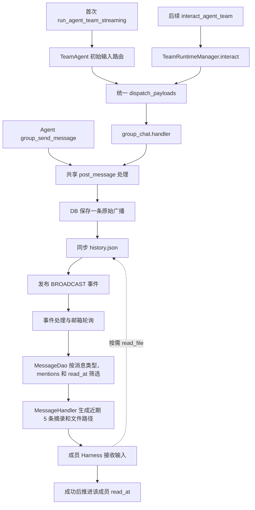

# 群聊设计

最近修订：2026-09-30。本文描述当前 core 实现，以及 jiuwenswarm 接入 core 的消息协议；平台实际接入进度以 jiuwenswarm 代码为准。

## 职责与入口

群聊由消息自身的 `type="group_chat"` 标识，无须开启团队级群聊开关。每条公开群消息都保存为现有数据库中的一条原始广播，同步到团队 workspace 的 `history.json`，再发布既有 BROADCAST 事件。

没有 mentions 时，消息仍保存和广播，但不进入专家模型上下文，也不自行推进成员的消费水位。有 mentions 时，只有被点名的专家接收近期摘录与历史文件路径。普通定向消息和普通广播沿用各自的处理规则。

core 通过现有 Runner 入口接收结构化群聊消息。首次运行使用 `run_agent_team_streaming` 的 `inputs.query`，后续输入使用 `interact_agent_team` 的 payload。两者进入相同的群聊处理函数。

```python
payload = {
    "type": "group_chat",
    "body": "请分析前面的讨论",
    "client_message_id": "msg-001",
    "mentions": ["expert_1"],
    "attachments": [],
}

# 已激活的团队
result = await Runner.interact_agent_team(
    payload, team_name="research", session_id="discussion-1",
)

# 首次启动或恢复时，通过现有运行接口传入同一消息结构
async for chunk in Runner.run_agent_team_streaming(
    agent_team=spec, inputs={"query": payload}, session=session,
):
    ...
```

`GroupChatMessage` 定义在 `interaction/payload.py`，并加入 `InteractPayload`。Python 调用方也可直接构造该类型作为 interact 的输入。team/session 由入口参数与运行时绑定确定；宿主输入的作者为 `user`，Agent 工具的作者由当前成员身份绑定，消息不能指定任意作者。

`mentions` 是明确的 core 成员名称列表。core 不解析正文中的 `@名字`，不把未知 mentions 回退到 Leader。不存在或已离开的成员导致请求失败；`user` 和 `passive_human` 收件人不启动模型。

`DeliverResult.ok` 表示本次消息处理成功，`data` 包含公开消息记录、是否重复、可被通知的成员列表和历史路径。`notified_members` 不代表成功送达、已读或任务完成。首条输入处理成功时，流中输出 `team.group_message.accepted`，失败时输出既有 `team.interact.failed`。

## core 模块与调用链

```text
agent_teams/
  group_chat/
    conversation.py   # history.json 的同步、路径登记和清理
    handler.py        # 校验、去重、广播入库、历史同步和摘录生成
    tools.py          # group_send_message 工具和角色提示入口
  interaction/
    payload.py        # 统一输入类型、type 字段解析、DeliverResult
```



群聊处理函数通过 TeamBackend 获取当前 workspace、会话和邮箱。TeamBackend 保留薄的上下文绑定与转发方法。消息模型、路径和国际化文案使用现有公共模块；配置、工具注册、会话绑定与清理在原来的接入位置调用群聊模块。

| 组件 | 职责 |
|---|---|
| `GroupChatMessage` / Runtime 输入派发 | 识别并路由结构化群聊输入 |
| `group_chat.handler` | 群消息校验、幂等入库、历史同步与摘录生成 |
| `GroupConversationLog` | 文件投影、文件锁、原子写入和清理，不保存成员水位 |
| `TeamMessageManager` | 复用既有广播事件发布和消息消费接口 |
| `MessageDao` | 广播收件人筛选、`read_at`、待启动成员与未读查询 |
| `MessageHandler` | 将筛选后的输入交给 Harness，并在成功后标记消费 |
| `ExternalTeamClient` | 外部成员通过收件箱拉取相同规则筛选的消息与摘录 |

`group_chat_spec` 是 TeamBackend 内部使用的配置引用，提供语言、workspace 和首次建队所需信息，不是群聊开关。群聊没有独立的 ConversationDao 或 GroupConversationManager。

新群尚无数据库名册时，群聊输入处理复用 `build_team` 登记 Leader 和预配置成员，不把公开消息作为 Leader 的模型输入。指定专家必须已登记或来自预配置名册；群聊消息不会让模型自动创建缺失专家。

群聊复用现有广播表和成员消费水位，不给每个被 @ 的专家额外创建定向通知。广播读取根据每条消息的 `meta.type` 分类：

| 消息类型 | 收件人规则 |
|---|---|
| 普通广播 | 沿用原逻辑，发送者以外的成员接收 |
| 群聊广播 | 仅 mentions 包含当前成员时进入消费链路，允许明确 @ 自己 |
| 无 mentions 的群聊广播 | 保存、发布广播事件，但不产生模型输入 |

广播事件用于提示消费者检查数据库，不等于所有专家都要运行模型。事件回调、邮箱轮询和退出前的消息处理复用相同筛选。MessageHandler 对群聊消息生成摘录，对普通消息使用原有渲染方式。

Leader 的既有未读扫描查询被 @ 的 UNSTARTED/ERROR 成员，复用 `auto_start_member` 启动；查询只读取所需元数据，不读取消息正文。团队完成判定同样遵循收件人规则：未消费的 @ 消息阻止完成，无 mentions 的公开讨论不会阻止完成。

## 工具与上下文

摘录条数在群聊模块固定为 5，不暴露 `group_context_tail`；也不存在 `enable_group_chat` 配置。

Agent 使用 `group_send_message(content, client_message_id, mentions=[])` 发表公开回复，与宿主输入复用同一归档和通知逻辑。

工具不依赖团队群聊开关，但遵循角色权限：`human_agent` 当前不注册 `group_send_message`，其他适用角色可使用，显式工具排除配置仍然生效。普通定向消息和内部广播继续使用 `send_message`。群聊提示词复用已有语言解析逻辑，例如将 `zh` 归一化为 `cn`。

每次消费 @ 消息时，从 DB 中取 `(该成员 read_at, 触发消息时间]` 内最近的 5 条公开群消息，包含触发消息。每条摘录正文最多 2,000 字符，并携带截断标记、附件数量和完整历史路径。更多内容由 Agent 使用 `read_file` 自行检索。

原生 Agent 成功接收输入后，才更新原有广播 `read_at`；投递失败时不推进该条水位。批次中存在群聊消息时按时间从早到晚处理，防止较晚的广播先推进水位、跳过前面的 @ 消息。外部 `ExternalTeamClient.fetch_inbox` 使用同样的筛选和摘录，默认成功构造收件箱条目即标记已读；`mark_read=False` 不推进水位，拉取成功不代表模型已处理。

例如专家 A 在时间 T50 被 @，成功投递后水位为 T50；在 T100 再次被 @，就从 `(T50,T100]` 取近期摘录。专家 B 有自己的水位。只内联最近 5 条也会推进整个窗口的水位，`read_at` 不代表专家逐条读完全文。

普通广播和群聊广播共用 `read_at`。混用时普通广播消费也会推进该水位，较早的群聊消息可能不再进入下次增量摘录，但全文仍保存在 `history.json` 中。

## 数据库与历史文件

公开历史按 team/session 隔离：

```text
conversations/<team-scope>/<session-scope>/
  history.json
```

DB 广播行的 `content` 保存原始正文，`meta` 保存 `type="group_chat"`、客户端消息 ID、发送者显示名、mentions 和附件引用。每条群消息只写一条原始广播，不按收件人复制。

`history.json` 是包含当前会话全部公开群消息的 JSON 数组。每条记录包含消息 ID、team/session、客户端消息 ID、发送者及显示名、正文、mentions、附件引用、毫秒时间戳；附件不复制内容。文件不包含普通内部广播，也不保存消费水位。没有独立的 `.notified.json` 或逐消息 JSON 文件。

DB 是消息处理的依据，文件是供 Agent 阅读的历史投影。同步在文件锁内合并记录、原子替换文件；文件丢失后可从 DB 重建。当前发消息及生成摘录时都会同步历史，使用全量读取和重写，尚未实现大规模历史的增量文件同步。

同一团队、会话内的 `client_message_id` 生成稳定消息 ID，用于去重。相同内容复用已有记录；发送者、正文、mentions 或附件冲突则报错。重试会同步历史并重新发布同一广播事件，已经消费的成员通过原有水位过滤。

## jiuwenswarm 到 core

core 对宿主的接入契约如下，不要求平台使用特定的 Web 页面或会话元数据字段：

1. jiuwenswarm 根据用户交互场景识别公开群消息，将正文、稳定的 `client_message_id`、mentions 和附件引用构造成 `type="group_chat"` 的 payload。
2. 宿主完成认证、权限校验和成员名称映射，不能只把正文中的 `@昵称` 原样交给 core 期待自动识别。
3. 首条输入通过 `run_agent_team_streaming` 的 `inputs.query`，后续输入通过 `interact_agent_team`。结构化群聊 payload 直接进入统一输入派发，无须额外配置团队开关。
4. core 广播入库、同步文件并发布事件；被 @ 的专家经现有消费链路接收摘录。
5. 专家公开回复使用 `group_send_message`，继续走同一条广播链路。

无 mentions 时，宿主应以消息接收确认结束当前发送请求，不应等待 Leader 模型回复。重试必须复用原 `client_message_id`。本文说明 core 接口与宿主责任，不将该协议等同于 jiuwenswarm Web 端已经完成群聊接入。

## 生命周期与故障边界

统一 interact 入口要求团队运行时已激活。宿主通过现有 run/恢复流程建立运行时，再投递输入；没有离线直写邮箱的独立 Runner 接口。普通成员定向输入使用现有 `OperatorMessage(body=..., target=...)`。

时间增量复用毫秒时钟，不新增序列号；同毫秒消息和时钟回拨不保证逐条消费。DB 写入、文件同步、事件发布与 Harness 接收不是同一事务：文件同步失败保留 DB 原文，重试可以修复投影；事件丢失由既有轮询读取未消费广播。进程在投递后、标记消费前退出可能导致重复投递，不承诺恰好一次。

暂停或停止团队不删除公开历史。显式删除团队或会话时，沿用数据库清理，并通过 `delete_registered` 清理相应历史和 workspace 位置登记。历史不自动过期，生产者与 Agent 需要访问同一历史文件。
