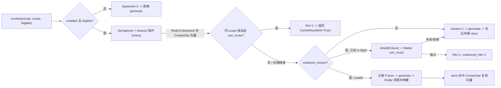

# 可选 RedisVL 语义响应缓存扩展设计方案

## 1. 设计定位与阅读说明

本文定义 `openjiuwen.extensions.semantic_cache` 的系统架构、并发安全契约、关键技术取舍及验证方案，对应外部社区提案 GitHub `#2738` / GitCode `#2316`。管理字段在 frontmatter 唯一维护；实际代码实施、设计偏差与测试证据记录在 `features/F_20261118_0930_semantic_response_cache.md`，不在本文回填。

## 2. 背景、目标与范围

### 2.1 背景与问题

直连托管 LLM 的应用在面对只读、高重复度问答流量时，若缺乏应用侧响应缓存，每次等价改写都会触发完整的后端生成请求，带来额外的首字/整包延迟与 Token 消耗。但将语义缓存直接嵌入 `Model.invoke` 全局拦截存在三类结构性风险：

1. **短路口径不明确**：`Model.invoke` 统筹 `LlmCallScope`、`KVCacheModelHook` 与框架回调链，在未与 Maintainer 约定短路回调语义前，强行拦截易导致伪造 usage 或破坏流式/工具调用状态。
2. **向量相似不等于语义可复用**：否定词、开闭状态、主体实体或角色权限变化可能具有极高向量相似度，不能仅凭距离阈值直接返回缓存答案。
3. **高并发下的缓存击穿与冗余计算**：若未复用 `lookup` 向量，未命中回源 `store` 会重复计算 Embedding；高并发冷热点请求（Cache Stampede）同时未命中会向后端模型发起大量重复生成，并可能打满后端连接池。

### 2.2 目标与关键场景

| 场景 / 触发条件 | 当前行为 | 目标行为 / 可观察变化 |
| --- | --- | --- |
| 默认构造或 `eligible=False` | 原样直连模型 | 不触发任何缓存读写与向量计算，行为与未引入扩展完全一致 |
| 可信分区内的同义命中且 `can_reuse=True` | 每次重新生成 | 跳过生成回调，返回 `CacheResult(text, cache_hit=True)`，不刷新 TTL |
| 相似候选但业务判定不可复用（否定/实体/角色变化） | 无校验或误命中风险 | `can_reuse` 返回 `False` 拒绝复用并回源生成；策略异常直接 fail-closed 传播 |
| 缓存未命中或拒用回源 | 重复调用 `embed` 计算两次 | 同一任务内复用 `lookup` 向量到 `store`，未命中仅计算 1 次 Embedding |
| 高并发相同 `(scope.key, prompt)` 冷未命中（`coalesce_misses=True`） | 并发 N 次同时打穿模型 | 单节点内合并为 1 次 Leader 生成，其余 Waiter 共享结果并仍各自执行 `can_reuse` |
| 缓存后端故障、超时或后端连接饱和 | 可能阻塞主路径或抛错中断 | `lookup`/`store` 超时或异常按降级回源/丢弃处理；超过 `max_concurrent_backend` 时跳过后台写入并记录统计 |

### 2.3 本次范围与非目标

- **本次包含**：Provider 无关的只读问答缓存包装 `SemanticResponseCache`、精确 8 字段分区 `CacheScope`、轻量指标 `CacheStats`、基于 `RedisVL` 的可选后端 `RedisVLBackend`（含同任务 `ContextVar` 向量复用）、`pyproject.toml` 可选依赖 `semantic-cache` 及显式 `Model.invoke` 示例 `examples/semantic_cache/read_only_qa.py`。
- **本次不包含**：`openjiuwen/core` 核心 `Model` 拦截器或全局 hook、流式响应缓存、工具调用（`tool_calls`）、多轮历史状态追踪、多模态、结构化 Schema 输出兼容、跨进程/跨实例分布式 Single-Flight 锁、通用 NLI 否定词检测器以及全局精确/条件缓存淘汰中心。

## 3. 设计约束、假设与待决问题

- **已确认约束与依赖**：
  - 遵循仓库 `AGENTS.md` 与 `S_01_semantic_response_cache`：默认关闭、不自动下载权重、基础包导入不触发 `redisvl` 导入、可选依赖锁定 `redisvl>=0.32.0,<0.33`。
  - 需要调用方提供经过身份鉴权的可信 `CacheScope`、匹配索引配置的异步 `embed` 函数、专用 Redis Search 服务以及业务级 `can_reuse` / `may_store` 策略。
- **关键假设**：异步 `embed`、`generate` 与 `can_reuse` 回调配合 `asyncio` 取消语义，使 `asyncio.timeout` 能够及时收敛等待时间。
- **待决问题**：社区 RFC `#2738` / `#2316` 尚待 Maintainer 正式评审回复，后续是否保留在 `openjiuwen.extensions.semantic_cache` 独立包空间、以及是否引入核心 `Model` hook 需以维护者决议为准。

## 4. 总体方案与设计取舍

### 4.1 方案概览

采用「显式应用层包装 + 可选后端适配器」分层结构：`SemanticResponseCache` 在入口先验证 `enabled` 与 `eligible`，再用 `CacheScope.key`（8 个可信字段的规范化 JSON SHA-256）把检索严格限定在单个隔离分区内。高并发路径通过实例级 `asyncio.Semaphore` 限制后端并发并保护事件循环，通过基于 `(scope.key, prompt)` 的任务内 `asyncio.Future` 合并热点未命中（Waiter 仍独立执行 `can_reuse`），同时 `RedisVLBackend` 通过实例级 `ContextVar` 将 `lookup` 向量直接传递至同任务的 `store`。

### 4.2 关键决策

#### D-01 显式包装与独立返回体 `CacheResult`，不拦截全局 `Model`
- 选择与依据：`SemanticResponseCache.invoke` 显式包裹生成回调并返回 `CacheResult(text, cache_hit)`，不修改 `openjiuwen/core/foundation/llm/model.py` 与全局回调链。
- 代价与成立条件：接入方需在只读问答链路显式调用封装；好处是不会对工具调用、多轮会话或 `AssistantMessage` usage 计量造成隐式副作用。

#### D-02 8 字段精确分区 + 必填应用级 `can_reuse` 校验
- 选择与依据：`CacheScope` 强制校验 8 个非空字符串字段并用规范化 JSON 计算 SHA-256 作为 Redis TAG 过滤键；`can_reuse` 作为无默认值的必填参数。
- 代价与成立条件：即使向量空间极近，只要 `can_reuse` 返回 `False` 即回源；调用方需自行实现与业务实体/否定词/时效匹配的校验逻辑。

#### D-03 `RedisVLBackend` 使用实例级 `ContextVar` 实现未命中单次 Embedding
- 选择与依据：在 `RedisVLBackend` 初始化隔离的 `ContextVar`，`lookup` 入口先清零、算出向量后写入 `(scope_key, prompt, vector)`，`store` 消费即清且校验 `(scope_key, prompt)` 精确一致后复用。
- 代价与成立条件：保持 `CacheBackend` Protocol 接口简洁不变，不跨请求缓存向量，也不引入后台回收任务；若调用方跳过 `lookup` 直接调 `store`，自动回退为正常计算向量。

#### D-04 可选 Single-Flight 合并与有界并发背压（`coalesce_misses` / `max_concurrent_backend`）
- 选择与依据：在 `SemanticResponseCache` 提供默认关闭的 `coalesce_misses=False` 与 `max_concurrent_backend=None`；开启 `coalesce_misses` 时按 `(scope.key, prompt)` 建 `asyncio.Future` 合并瞬时重复冷未命中，并通过 `asyncio.shield` 与 `try/finally` 隔离 Leader/Waiter 取消与异常；配置 `max_concurrent_backend` 时为 `lookup` 与 `store` 分别配置独立的 `asyncio.Semaphore`，避免慢 `lookup` 饥饿阻塞快速 `store` 写入，仅在 `store` 自身信号量饱和时跳过非关键写入（计入 `store_skipped_overload`）。
- 代价与成立条件：Single-Flight 仅在单实例进程内的同 `SemanticResponseCache` 实例生效，且按精确 `(scope.key, prompt)` 键合并，不同改写句式仍分别回源；仅共享已通过 `answer.reusable and answer.text.strip()` 审核的最终文本，Waiter 仍强制经过各自 `can_reuse`。

#### D-05 线上服务稳定性防护：连续故障熔断器、运行时热开关与畸形载荷 Fail-Open
- 选择与依据：提供可选连续错误熔断器（`circuit_breaker_threshold` 与 `circuit_breaker_cooldown`）、可读写的运行时热开关 `enabled` 属性、`CacheCandidate` 与 `RedisVLBackend` 向量合法性校验（拒绝空值、`bool`、`NaN`/`Inf`），以及仅记录 `scope_key` 前缀与异常类型的无用户明文日志。
- 代价与成立条件：连续后端故障触发熔断后进入快速旁路（零 Redis/Embedding 等待，计入 `circuit_open_bypasses`）；冷却到期后仅允许 1 个半开探针进入后端验证恢复（若探针取消则在 `finally` 释放锁状态）；代价是故障窗口期内的命中率为 0，换取主生成链路稳定性不被拖垮。

### 4.3 替代方案与排除理由

| 候选 / 关联决策 | 候选目的与关键差异 | 拒绝或暂缓原因 | 重新评估条件 |
| --- | --- | --- | --- |
| R-01 / D-01 全局 `Model` Hook 拦截 | 透明拦截所有 `Model.invoke` 调用 | 易误拦截工具、状态会话及伪造 `AssistantMessage` 计费字段，且 RFC 尚待 Maintainer 对齐 | RFC `#2738` 明确短路回调生命周期后再另立设计 |
| R-02 / D-03 改写 `CacheBackend` 传向量参数 | 由上层显式把向量透传给 `store` | 会把向量存储细节暴露到 Provider 无关的 `CacheBackend` 抽象层 | 未来出现多个均需复用向量的向量后端时再统一升级 SPI |
| R-03 / D-04 无限制队列等待写入或跨实例锁 | `store` 排队等信号量或引入 Redis 分布式锁 | 高并发下 `store` 排队会拖垮生成响应尾部延迟；分布式锁增加崩溃死锁与依赖复杂度 | 出现强一致单次写入需求时再评估租约式分布式协调 |

## 5. 详细设计

### 5.1 模块责任与关键不变量

- **`SemanticResponseCache`**：负责开关与资格门控、超时与并发信号量保护、`can_reuse` 强制校验、可选同键 Single-Flight 合并、降级回源及 `CacheStats` 计数。关键不变量：
  1. `eligible=False` 或 `enabled=False` 零缓存读写。
  2. 命中、拒用与合并命中均必须经过调用方授权后的 `CacheScope` 与 `can_reuse`。
  3. 无论正常返回、异常或取消，`_in_flight` 字典不得残留已完成或挂死的 `Future`。
- **`RedisVLBackend`**：负责按需导入 RedisVL、TAG 精确分区读写、禁止命中续期（`refresh_ttl=False`）、以及同任务内安全传递一次向量。

### 5.2 关键类与数据定义

| 类名 / 所属模块 | 变更类型与可见范围 | 职责与边界 | 继承 / 组合关系 |
| --- | --- | --- | --- |
| `openjiuwen.extensions.semantic_cache.cache.CacheScope` | 新增；公开 | 8 字段不可变隔离分区，输出规范 JSON SHA-256 `key` | frozen dataclass |
| `openjiuwen.extensions.semantic_cache.cache.CacheStats` | 新增；公开 | 只读统计快照（命中/合并/未命中/旁路/拒用/错误/过载跳过/熔断旁路） | frozen dataclass |
| `openjiuwen.extensions.semantic_cache.cache.CacheBackend` | 新增；公开 | 最小异步 `lookup`/`store` 协议 | `typing.Protocol` |
| `openjiuwen.extensions.semantic_cache.cache.SemanticResponseCache` | 新增；公开 | 门控/热开关、并发控制、熔断器、Single-Flight 与异常隔离调度器 | 组合 `CacheBackend`、独立 `lookup`/`store` `asyncio.Semaphore`、`_in_flight` |
| `openjiuwen.extensions.semantic_cache.redisvl.RedisVLBackend` | 新增；公开 | RedisVL 适配器、`scope_key` TAG 过滤与 `ContextVar` 单次复用 | 实现 `CacheBackend`，组合 `SemanticCache` 与异步 `embed` |

### 5.3 正常与高并发执行流程

1. 入口检查 `prompt` 非空；若 `not (self._enabled and eligible)`，`bypasses += 1` 后直接调用 `generate` 并返回。
2. `lookups += 1`；在 `asyncio.timeout(timeout)`（若配置 `max_concurrent_backend` 则外加 `async with self._lookup_semaphore`）下执行 `backend.lookup(prompt, scope.key)`。
3. 若返回同 `scope.key` 候选且 `can_reuse` 返回 `True`，`hits += 1` 返回缓存结果；若 `can_reuse` 返回 `False`，`validator_rejections += 1` 进入未命中分支。
4. 若未开启 `coalesce_misses`：直接调用 `generate` 并根据 `reusable` 决定是否调用受背压保护的 `_store_best_effort`。
5. 若开启 `coalesce_misses`：
   - **Waiter**：对 `self._in_flight[(scope.key, prompt)]` 执行 `await asyncio.shield(fut)`；若获得 `GeneratedAnswer` 且本地 `can_reuse` 通过，则 `hits += 1`、`coalesced_hits += 1` 并返回；否则降级执行独立 `generate`（不重复登记 `_in_flight`）。
   - **Leader**：创建 `Future` 登记入 `_in_flight`；执行 `generate` 并校验类型，在 `finally` 块中原子摘除 `_in_flight` 条目并向 `Future` 写入可复用答案（失败/取消/不可复用则写入 `None`）；随后执行 `_store_best_effort`。

### 5.4 异常、取消与背压处理

- **后端异常、熔断与畸形载荷 Fail-Open**：`lookup` 超时、抛出 `Exception`、返回畸形 `CacheCandidate` 或嵌入服务返回空/`NaN`/`Inf` 向量均记为 `backend_errors += 1` 并降级回源；开启 `circuit_breaker_threshold` 时连续错误达到阈值即打开熔断器，直接旁路为 `circuit_open_bypasses += 1` 并跳过 `store`；`store` 超时、抛出 `Exception` 或信号量满载（`_store_semaphore.locked()`）记为 `store_errors` / `store_skipped_overload`，绝不丢弃已经生成成功的模型答案。Warning 日志仅输出截断的 `scope_key` 前缀与异常类型，严禁打印用户输入或响应正文。
- **策略异常与取消**：`can_reuse` 超时或异常（如 `PermissionError`）直接传播并阻止回源；`asyncio.CancelledError` 不被 `except Exception` 吞掉，Waiter 取消通过 `asyncio.shield` 不波及 Leader，Leader 取消通过 `finally` 写入 `None` 唤醒全部 Waiter 走独立回源，半开探针取消则在 `finally` 释放 `_circuit_probe_in_flight` 防止熔断卡死。

### 5.5 特性开启与线上运维切换开关

1. **三道安全门控齐备才生效**：安装可选依赖 `pip install 'openjiuwen[semantic-cache]'` 并准备 Redis Search 与非阻塞异步 Embedding -> 实例开启 `SemanticResponseCache(..., enabled=True)` -> 请求侧按鉴权后单轮只读问答显式传 `eligible=True` -> 传入业务校验 `can_reuse` 与 `GeneratedAnswer(..., reusable=True)`。
2. **线上热降级与版本失效**：运行时将 `cache.enabled = False` 可立即零延迟切回直连生成，无须重启服务；策略或知识库修订时更新对应 `CacheScope` 版本字段即可秒级隔离旧缓存；服务停机前先置 `cache.enabled = False` 并等待在途请求完成后再断开 RedisVL。

## 6. 影响面与实施设计

| 实施项 | 模块 / 文件或符号 | 修改内容与责任 | 必要前置 / 独立验证产物 |
| --- | --- | --- | --- |
| I-01 | `openjiuwen/extensions/semantic_cache/{__init__,cache,redisvl}.py` | 核心封装、`CacheStats`、Single-Flight、信号量背压与 RedisVL 单次复用适配器 | 单元测试与真实 Redis 集成测试 |
| I-02 | `pyproject.toml` | 新增可选依赖组 `semantic-cache = ["redisvl>=0.32.0,<0.33"]` | 无核心依赖冲突 |
| I-03 | `examples/semantic_cache/read_only_qa.py` | 显式接入 `Model.invoke` 的参考桥接示例 | 示例单元测试 |
| I-04 | `tests/{unit,system}_tests/extensions/semantic_cache/` | 单测、并发/取消/背压单测与真实 Redis 集成测试 | 隔离容器全通过 |
| I-05 | `docs/en/Extensions/semantic_response_cache.md`、`.agents/agent-docs/` | 公开使用文档、契约 S、实施 F 与导航索引同步 | `sync_documents.py` 一致 |

- **兼容性核对**：全部为新增扩展与可选依赖，未改动 `openjiuwen/core/`、现有存储/消息队列/A2A 扩展或默认依赖，对存量业务零破坏性变更。

## 7. 验证设计与通过条件

| 验证 ID | 场景 / 前置状态与输入 | 操作或验证入口 | 预期结果 / 通过条件 | 验证层级与环境 |
| --- | --- | --- | --- | --- |
| F-SC-V-01 | 默认关闭、`eligible=False`、8 字段隔离、故障回源、策略/取消传播 | `tests/unit_tests/extensions/semantic_cache/test_cache.py` | 全部基础与异常不变量断言通过 | 纯单测（mock backend） |
| F-SC-V-02 | `ContextVar` 单次未命中复用、并发不串用、多实例与错配隔离 | `tests/unit_tests/extensions/semantic_cache/test_redisvl_backend.py` | 未命中与拒用均仅调用 1 次 `embed`，并发零串用 | 纯单测（stub `Tag`） |
| F-SC-V-03 | `coalesce_misses` 32 并发击穿、取消隔离、失败唤醒、信号量限流与 `CacheStats` | `tests/unit_tests/extensions/semantic_cache/test_cache.py` | 32 并发仅 1 次 `generate`，`_in_flight` 归零，统计精确 | 纯单测 |
| F-SC-V-04 | 真实 Redis 命中、多租户隔离、TTL 不续期、单次 `embed` 与 32 并发击穿 | `tests/system_tests/extensions/semantic_cache/test_redisvl.py` | Redis Search 检索、跨租户隔离与 4 租户 32 并发各 1 次生成通过 | 真实 Redis 8.2.3 集成测 |
| F-SC-V-05 | 高并发（16/32/64/128）压测、随机取消/超时混沌及真实 LLM+Embedding 并发端到端 | 独立压测脚本与隔离 CPU + Redis 环境 | 零死锁、零跨租户泄漏、零未处理异常，实际记录 QPS/尾延/Token 收益及限制 | 独立受控联调 |

## 8. 设计风险与已知限制

| 风险 / 触发条件 | 对本次方案的影响 | 已有应对措施 | 核实或验证方式 |
| --- | --- | --- | --- |
| 多实例横向扩展时热点冷请求落到不同副本 | Single-Flight 仅在单实例内合并，跨副本仍可能各自首次回源 | 单副本内通过 `_in_flight` 消峰，后续写入 Redis 后所有副本均可命中 | 明确写入文档与契约边界 |
| 非合作式同步 CPU Embedding 阻塞事件循环 | `asyncio.timeout` 无法硬中断同步 Python 字节码，并发时易造成事件循环卡顿 | 在文档与 `RedisVLBackend` 注释要求通过 `asyncio.to_thread` 或异步服务实现 `embed`，并配合 `max_concurrent_backend` | 并发压测实测观察 |
| Redis 连接池默认或配置过小 | 高并发超出连接池时 `acheck`/`astore` 超时或降级 | 文档补充连接池（`connection_kwargs={"max_connections": ...}`）与信号量配合建议 | 64/128 并发 Redis 压测核对 |

- **已知设计限制**：不支持流式/工具调用/多轮对话；不包含通用 NLI/否定词检测器；`RedisVL` 与 Embedding 服务生命周期由宿主管理。

## 9. 按日期记录的评审与设计修订

| 日期 | 评审人 / 确认方 | 评审或修订主题 | 结论 | 修改与依据 |
| --- | --- | --- | --- | --- |
| 2026-11-20 | 尚待 Maintainer 评审 | 初版设计草案整理（含高并发 Single-Flight、背压信号量与单次 `ContextVar` 复用） | `draft`（待 RFC `#2738` 与设计评审） | 根据用户并发与系统设计要求，由实施初版补齐正式设计资产 |

## 10. 参考与交接

- 关联规约与实施归档：`specs/extensions/S_01_semantic_response_cache.md`、`features/F_20261118_0930_semantic_response_cache.md`、`docs/en/Extensions/semantic_response_cache.md`。
- 开发交接：按 `S_01` 契约维护 `SemanticResponseCache` 与 `RedisVLBackend`，实际并发测试、全仓测试/CI 缺口及实测限制统一归档在 `F_20261118_0930_semantic_response_cache.md`。
