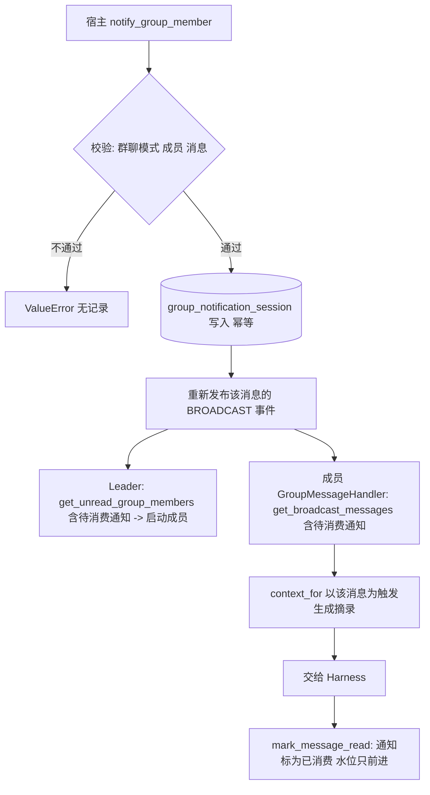

# 群聊成员通知入口设计方案

## 1. 设计定位与阅读说明

本文为 jiuwenclaw 的 `D-20261120-1701-swarmchat-auto-reply`（SwarmChat 群成员自动判断是否回复）提供 core 侧能力：
宿主用一个无状态模型判断某条未 @ 的用户消息该由谁响应，然后请 core 唤起对应的专家或专家团代理。
先读 2.1 的问题与 4.1 的主链路；4.3 说明为什么不用更省事的做法。本文是开发前方案，尚未评审。

## 2. 背景、目标与范围

### 2.1 背景与问题

已核实的当前行为（`S_28_group-conversation-and-delegation` 与代码）：

- 群聊公开消息以广播行保存，`meta.mentions` 是成员接收模型输入的唯一依据，写入后不可修改；同一 `client_message_id` 重试时 `_same_message` 会比较 `mentions`。
- “消息是否寻址到某成员”由 `tools/database/message_dao.py` 的三处决定：
  - `get_unread_group_members`：Leader 据此启动 UNSTARTED / ERROR 的成员。
  - `get_broadcast_messages`：成员读取寻址到自己的广播，`unread_only` 时按 `timestamp > read_at` 过滤。
  - `_broadcast_unread_recipients`：团队是否还有未消费输入。
- 已读状态是每（团队, 成员）一行的时间戳水位 `read_at`（`message_read_status_<session>`），消费一条广播即把水位推到该消息时间。

宿主的新需求是“消息已经写入、`mentions` 为空，之后才决定请某成员响应”，并且要求不改写 `mentions`（公开历史只记录用户真正 @ 的人）。当前 core 没有这样的入口。

水位机制对这个需求有一个直接障碍：通知晚于消息产生，成员此时可能已经消费过更晚的消息，被通知的消息时间早于 `read_at`，按现有规则会被视为已读。

### 2.2 目标与关键场景

| 场景 / 触发条件 | 当前行为 | 目标行为 / 可观察变化 |
| --- | --- | --- |
| 宿主对一条已持久化、未 @ 的群消息通知成员 M | 无此能力 | M 像被 @ 一样收到以该消息为触发的群聊输入；未运行或出错的 M 被 Leader 启动 |
| 被通知的消息时间早于 M 的 `read_at` | 不适用 | M 仍然收到，通知不被水位吞掉 |
| 同一通知标识重复提交 | 不适用 | 无操作，M 只收到一次 |
| 通知未被消费时进程重启 | 不适用 | 重启后 M 仍收到 |
| 通知的对象是真人成员、宿主管理成员、未知或已离开成员 | 不适用 | 明确拒绝，不产生记录 |
| 任意场景下的公开历史 | 不适用 | 消息行、`meta.mentions`、`history.jsonl` 均不变化 |
| 没有通知的群聊与普通团队 | 现有行为 | 不变 |

### 2.3 本次范围与非目标

- 本次包含：通知的持久化与逐条消费状态；三处寻址查询与已读标记对通知的认可；`TeamBackend` 的通知入口；唤醒事件。不提供撤回入口（2026-11-23 删除，见第 10 章）。
- 本次不包含：
  - 由谁被通知的判断（宿主负责）。
  - 宿主管理成员（HOST_MANAGED）的通知。宿主自行执行这类成员，不需要经过 core。
  - 修改 `mentions` 语义、`group_send_message` 工具或普通团队广播。
  - 普通团队模式下的通知。
  - 修改摘录生成（`context_for`）。被通知的消息早于 `read_at` 时摘录只含触发消息本身，见 D-04。

### 2.4 术语

- 通知：一条“请成员 M 响应群消息 X”的持久记录，独立于消息的 `mentions`。
- 待消费通知：尚未成功交给成员 Harness 的通知。

## 3. 设计约束、假设与待决问题

- 已确认约束：
  - 不修改已写入消息的内容与 `meta`。
  - 群聊消费顺序、`GroupMessageHandler` 每轮只取最早一条、成功投递后才标记的现有语义保持不变。
  - 事件丢失由既有轮询兜底；投递后、标记前退出可能重复投递，不承诺恰好一次（S_28）。
- 已核实的前提（2026-11-21，读码确认，未运行）：
  - A-01 成立。每会话动态表由 `engine._ensure_session_tables` 以 `create(checkfirst=True)` 创建，入口 `create_cur_session_tables` 有两个调用点：运行时激活（`runtime/manager.py`，CREATE 与 COLD_RECOVER）和成员绑定会话（`agent/session_manager.py`）。升级需要重启进程，旧会话重启后必经冷恢复，新表会被补建；把新模型加入 `_ensure_session_tables` 的模型列表即可。
  - A-02 部分不适用。`fork.py` 只复制智能体的对话上下文，不涉及数据库表，无需处理。清理有三处需要纳入新表：`drop_cur_session_tables` 的显式模型列表；`models.TEAM_DYNAMIC_TABLE_PREFIXES`（`drop_session_tables_by_id` 与 `cleanup_all_runtime_state` 按前缀匹配）；`models._clear_session_model_cache` 的动态模型缓存。表名前缀取 `group_notification_`，不以 `team_task_` 或 `team_message_` 开头，避免被既有的按前缀迁移误判。
  - A-03 现有流程不对未消费的 @ 做特殊处理。core 只在成功交给 Harness 之后标记已读；宿主的群取消（jiuwenclaw `agent_ws_server._handle_cancel`）取消进行中的轮次，没有推进已读水位的步骤。因此撤回通知没有既有做法可对齐，由宿主在群取消流程中追加调用，方式与其中已有的“AI 同事停止”相同：附加执行、失败只记录、不阻断原有取消。未逐行核对 core 的暂停与停止路径，结论基于标记已读的调用点全部位于投递成功之后。
- 待决问题：无。撤回入口与摘录窗口已于 2026-11-21 确认，见第 10 章。

## 4. 总体方案与设计取舍

### 4.1 方案概览

新增一张每会话动态表保存通知及其消费状态。三处寻址查询把“存在待消费通知”与“在 `mentions` 中且高于水位”并列为寻址条件；已读标记在消费消息时把对应通知标为已消费。宿主通过 `TeamBackend.notify_group_member` 写入通知，随后复用对同一消息重新发布 BROADCAST 事件来触发启动与消费。

箭头表示调用顺序。事件只是触发，数据库记录是事实来源。

### 4.2 关键决策

#### D-01 通知单独存表，带逐条消费状态

- 选择与依据：时间戳水位无法表达“早于水位但仍需处理”的消息，通知必须有自己的消费状态；独立表不触碰消息行，公开历史保持不变。
- 代价：多一张动态表，创建、清理、分叉都要纳入（A-01、A-02）。
- 相关候选：R-01、R-02。

#### D-02 寻址条件扩展为“被 @ 或有待消费通知”，在 DAO 内完成

- 选择与依据：三处查询是全部消费方（事件回调、轮询、退出前 drain、外部收件箱、团队完成判定）共用的唯一筛选，改在这里则上层处理器、外部客户端无需各自理解通知。
- 代价：DAO 查询多一次对通知表的读取。
- 实现体现：5.2、I-02。

#### D-03 用重新发布同一消息的 BROADCAST 事件作为触发

- 选择与依据：S_28 已约定同一消息可重复发布，已有消费由水位或通知状态挡住；不需要新事件类型与新的处理器分支。
- 代价：事件会到达所有成员，各自查询后发现与己无关即结束，与现有无 @ 广播的开销相同。Leader 侧对宿主管理成员的回调通知有进程内近期去重，且只针对 `mentions`，不会因此重复回调。

#### D-04 被通知的消息早于水位时，摘录只含触发消息，不改 `context_for`

- 选择与依据：该情形只在“未 @ 的消息尚在判断中，用户紧接着 @ 了同一成员且成员先处理完后者”时出现，较少见。S_28 约定水位之前的内容视为已提供给成员，且每次输入都带 `history.jsonl` 路径，成员可按需读取。`context_for` 是全部群聊输入共用的函数，不为少见情形增加分支。
- 代价：这种情形下成员的内联上文只有触发消息本身。
- 确认依据：需求方 2026-11-21 确认。重新评估条件：上线后出现成员因缺少上文而答非所问的实例。

#### D-05 宿主管理成员、真人成员不可被通知

- 选择与依据：两者都没有 core 内的智能体运行时。宿主管理成员由宿主直接执行；对它写通知会产生永远无人消费的记录并阻碍团队完成判定。

### 4.3 替代方案与排除理由

| 候选 / 关联决策 | 候选目的与关键差异 | 拒绝或暂缓原因 | 重新评估条件 |
| --- | --- | --- | --- |
| R-01 / D-01 把被通知成员追加进消息 `meta` | 不新增表 | 修改已写入的消息；`_same_message` 与历史投影都读取 `meta`；仍然解决不了水位吞掉通知的问题 | 无 |
| R-02 / D-01 写入一条隐藏的广播行，`mentions` 指向被通知成员，正文引用原消息 | 新行时间晚于水位，三处查询与已读逻辑都不用改 | 消息表出现非公开内容，`sync_history`、宿主的公开消息读取、搜索都要学会过滤它；触发消息标识变成隐藏行而非用户消息，宿主的群轮次校验要额外映射 | 独立表在动态表迁移上受阻时 |
| R-03 / D-02 点对点私信给成员 | 复用 `send_message` | 私信进入成员私有上下文而非群聊输入，成员是否公开回复依赖提示词；宿主无法把它与用户消息对应起来 | 无 |
| R-04 / D-03 新增专用事件类型 | 只唤醒目标成员 | 需要新的事件、订阅与处理器分支；现有轮询兜底不认识它 | 大群中广播事件的开销成为问题时 |

## 5. 详细设计

### 5.1 模块责任与关键不变量

- `tools/models.py`、`tools/database/engine.py`：通知的动态模型、建表、清理。
- `tools/database/message_dao.py`：通知的写入；三处寻址查询与已读标记认可通知。
- `tools/team.py`（`TeamBackend`）：对宿主的入口与校验。
- `group_chat/handler.py`、`group_chat/message_handler.py`、`agent/coordination/handlers/message.py`、`external/client.py`：不改，经 DAO 获得新行为。

不变量：

- INV-1 通知不改变任何消息行与 `history.jsonl`。
- INV-2 一条通知至多被成功消费一次；重复提交同一通知标识不产生第二条记录。
- INV-3 待消费通知不受 `read_at` 影响；消费通知不使 `read_at` 后退。
- INV-4 没有通知记录时，所有查询结果与改动前一致。
- INV-5 通知对象只能是群聊运行时中未离开的、角色不是 `passive_human` / `host_managed` 的成员，且不是该消息的发送者。

### 5.2 关键类与函数

| 符号 / 所属模块 | 签名与变更类型 | 职责 | 约束 |
| --- | --- | --- | --- |
| `GroupNotificationBase` / `tools/models.py` | 新增动态模型，表名 `group_notification_<session>` | 见 5.5 | 与现有动态模型同样按会话生成 |
| `MessageDao.create_group_notification` | `async (notification_id: str, team_name: str, member_name: str, message_id: str) -> bool`，新增 | 写入通知 | 主键冲突返回 False，不抛出 |
| `MessageDao.get_unread_group_members` | 修改 | 结果并入“有待消费通知且状态为 UNSTARTED / ERROR”的成员 | 仍排除 `passive_human`、`host_managed` |
| `MessageDao.get_broadcast_messages` | 修改 | 群聊行的寻址：在 `mentions` 中，或存在对（成员, 消息）的通知；`unread_only`：前者按水位，后者按通知是否待消费 | 普通广播分支不变 |
| `MessageDao._broadcast_unread_recipients` | 修改 | 并入有待消费通知的成员 | 沿用现有豁免状态 |
| `MessageDao._mark_read_in_session` | 修改 | 广播行被成员标记已读时，把该（成员, 消息）的待消费通知标为已消费；水位规则不变（只在消息时间更大时前进） | 同一事务 |
| `TeamBackend.notify_group_member` | `async (member_name: str, message_id: str, *, notification_id: str) -> GroupNotificationResult`，新增，公开 | 校验、写入、发布事件 | 见 5.3 |

### 5.3 接口定义与消息契约

| 入口 | 调用方 | 输入与成功结果 | 失败语义 |
| --- | --- | --- | --- |
| `TeamBackend.notify_group_member` | 宿主 | `member_name`、已持久化群消息的 `message_id`、宿主生成的稳定 `notification_id`（不超过 255 字符）。返回 `GroupNotificationResult(created: bool, duplicate: bool)`。成功仅表示通知已持久化并已尝试发布事件，不表示成员已读或已回复 | 非群聊运行时、成员不存在或已离开、角色为 `passive_human` / `host_managed`、成员即消息发送者、消息不存在或不是群聊广播：`ValueError`，无记录。存储失败抛出原存储异常 |

- 幂等：同一 `notification_id` 再次提交返回 `duplicate=True`，仍会重新发布事件（用于事件丢失后的重试），已消费的通知不会因此再次投递。
- 调用前置：运行时已激活（会话动态表存在）；调用在该会话的上下文内完成，与 `append_group_message` 相同。
- 事件发布失败只记录日志，由成员与 Leader 的既有轮询读取待消费通知。

### 5.5 数据模型与事实归属

| 数据 | 语义与隔离范围 | 权威位置 | 创建、更新与释放 |
| --- | --- | --- | --- |
| `notification_id`（主键） | 宿主提供的幂等键 | `group_notification_<session>` | 宿主生成 |
| `team_name`、`member_name`、`message_id` | 通知对象；按会话、团队隔离 | 同上 | 写入后不变；`(team_name, member_name, message_id)` 建索引 |
| `created_at` | 毫秒时间戳 | 同上 | 写入时 |
| `consumed_at` | 为空表示待消费；非空表示已消费 | 同上 | `_mark_read_in_session` 写入 |

表随会话动态表一同创建与删除；不设过期。

### 5.6 状态机

| 当前状态 | 输入与主体 | 下一状态 | 非法或重复操作 |
| --- | --- | --- | --- |
| 不存在 | `notify_group_member`（宿主） | 待消费 | 校验失败则保持不存在 |
| 待消费 | 成员成功接收后 `mark_message_read`（core） | 已消费 | 重复标记无操作 |
| 已消费 | 任意 | 不变 | 再次通知同一标识返回 `duplicate` |

### 5.7 正常执行流程

1. 宿主在会话上下文内调用 `notify_group_member`。
2. core 校验运行时模式、成员与消息，写入通知。
3. core 对该消息调用既有的 `publish_broadcast`。
4. Leader 的 `GroupMessageHandler.start_mentioned_members` 经 `get_unread_group_members` 发现 M 有待消费通知，M 未运行或出错时启动它。
5. M 的 `GroupMessageHandler` 经 `get_broadcast_messages(unread_only=True)` 取得该消息，与其他未读一起按时间取最早一条。
6. `context_for` 按现有规则生成摘录并交给 Harness（触发消息早于水位时摘录只含它本身）；成功后 `mark_message_read` 在同一事务内把通知标为已消费，并按现有规则处理水位。
7. M 通过 `group_send_message` 公开回复（现有行为）。

### 5.8 异常、中断与重试处理

- 写入前校验失败：无副作用。
- 写入成功、事件发布失败：记录保留，轮询兜底；宿主可用同一标识重试以再次发布。
- Harness 投递失败：通知保持待消费，下次轮询重试（与现有群聊消息一致）。
- 投递成功、标记前进程退出：重启后可能重复投递一次，沿用 S_28 的边界。
- 成员在通知待消费期间离开或被关闭：通知留存但不再计入未读接收者（沿用现有豁免状态）；成员重新启动后仍会收到。
- 团队暂停或停止：core 不清除待消费通知，与未消费的 @ 消息的现有处理一致（A-03）；成员下次运行时仍会处理。

### 5.9 并发与一致性

- 通知写入依靠主键唯一性去重，并发提交同一标识只有一条成功。
- 标记已读与通知消费在同一写事务中，沿用 `retry_on_locked`。
- 同一成员对同一消息既被 @ 又被通知时（宿主约定不会这样做，core 仍需定义）：视为一次寻址，消费时两种状态一并更新。

### 5.10 持久化与恢复

- 通知与消费状态落库，重启后由轮询继续处理，不依赖进程内状态。
- 已有会话的建表见 A-01；清理见 A-02。

## 6. 影响面与实施设计

### 6.1 修改点与实施顺序

| 实施项 | 模块 / 文件或符号 | 修改内容 | 前置 / 验证 |
| --- | --- | --- | --- |
| I-01 | `tools/models.py`、`tools/database/engine.py` | 动态模型与缓存清理（`_clear_session_model_cache`）；`TEAM_DYNAMIC_TABLE_PREFIXES` 增加 `group_notification_`；`_ensure_session_tables` 与 `drop_cur_session_tables` 的模型列表纳入新表 | V-08 |
| I-02 | `tools/database/message_dao.py` | 写入；三处查询与已读标记 | I-01；V-01 至 V-06 |
| I-03 | `tools/team.py` | `notify_group_member` 与校验、事件发布 | I-02；V-01、V-05 |
| I-05 | `schema/conversation.py` 或相邻位置 | `GroupNotificationResult` | — |
| I-06 | 测试、`S_28`、`docs/` | 见 6.2 与第 8 章 | — |

其他读取广播的调用点（`coordination/handlers/message.py`、`external/client.py`、`tools/message_manager.py`）经 DAO 获得新行为，本次不改；开发时逐一确认没有绕过 DAO 自行按 `mentions` 过滤的位置。已检索到的此类位置只有 Leader 对宿主管理成员的回调（`team.py` 的 `notify_host_managed_inbound`），它不在本次范围内。

没有通知记录时行为不变（INV-4），旧会话只需补建空表，因此不设兼容与迁移章节。

### 6.2 文档同步

- spec：修订 `S_28_group-conversation-and-delegation`，补充通知入口、寻址条件、消费状态，以及被通知消息早于水位时摘录只含触发消息。
- 模块约定：`openjiuwen/agent_teams/tools/AGENTS.md` 如列出 `TeamBackend` 对宿主的入口，则同步。
- 实施记录：开发时新建 F 文档并关联本设计。

## 8. 验证设计与通过条件

| 验证 ID | 场景 | 操作或入口 | 通过条件 | 层级 |
| --- | --- | --- | --- | --- |
| V-01 | 对未 @ 的群消息通知已运行的专家 | `notify_group_member` 后读取该成员未读广播 | 返回该消息；交给 Harness 的输入以它为触发；消息行与 `history.jsonl` 字节不变 | 真实 SQLite 单测 |
| V-02 | 专家先消费较晚的 @ 消息（水位已越过），再被通知较早的消息 | 同上 | 仍返回较早的消息；摘录只含该触发消息并带历史路径；消费后 `read_at` 未后退 | 真实 SQLite 单测 |
| V-03 | 专家状态为 UNSTARTED / ERROR | 通知后调用 `get_unread_group_members` | 结果包含该专家 | 真实 SQLite 单测 |
| V-04 | 同一 `notification_id` 提交两次；消费后再次提交 | `notify_group_member` | 第二次 `duplicate=True`；成员只收到一次 | 真实 SQLite 单测 |
| V-05 | 通知对象为宿主管理成员、真人成员、未知成员、已离开成员、消息发送者；消息不存在或是普通广播；普通团队模式 | `notify_group_member` | 均抛 `ValueError`，通知表无新增 | 单测 |
| V-06 | 存在待消费通知时的团队完成判定；消费之后 | 未读接收者查询 | 前者包含该成员，后者不包含 | 真实 SQLite 单测 |
| V-08 | 升级前创建的会话；会话清理 | 激活旧会话后通知；分别经 `drop_cur_session_tables`、`drop_session_tables_by_id`、`cleanup_all_runtime_state` 清理 | 新表被补建且通知可用；三种清理后表均不存在 | 真实 SQLite 单测 |
| V-09 | 回归 | 既有群聊、人类协作、宿主管理成员、数据库与协调生命周期测试 | 全部通过 | 既有测试 |

## 9. 设计风险与已知限制

### 9.1 设计风险

| 风险 / 触发条件 | 影响 | 应对 | 核实方式 |
| --- | --- | --- | --- |
| 存在绕过 DAO 自行按 `mentions` 判断的消费方 | 被通知的成员在该路径上不被视为收件人 | 开发时检索并逐一确认 | V-09 与新增用例 |
| 宿主在 core 之外也按 `mentions` 校验触发消息 | 成员被唤醒但宿主侧拒绝该轮 | 属宿主改动，已在 jiuwenclaw 设计中列出（`agents/swarm/group_turn.py`） | 宿主侧联调 |

### 9.2 已知设计限制

- 被通知的消息早于成员水位时，摘录不含上文，成员需要时自行读取 `history.jsonl`。
- 通知不设过期；长期未运行的成员在下次启动时仍会收到很早的通知；没有撤回入口。
- 重新发布的事件到达所有成员，没有只唤醒目标成员的机制。
- 不承诺恰好一次投递，边界与现有群聊消息相同。
- 不覆盖普通团队模式与宿主管理成员。

## 10. 按日期记录的评审与设计修订

| 日期 | 评审人 / 确认方 | 评审或修订主题 | 结论 | 修改与依据 |
| --- | --- | --- | --- | --- |
| 2026-11-21 | 尚未评审 | 初稿 | 待确认 Q-01、Q-02；待核实 A-01、A-02（均已在后续行处理） | 现状依据为读码与 `S_28`，未运行验证 |
| 2026-11-21 | weichenhao（需求方确认设计方建议） | 撤回入口与摘录窗口 | 提供撤回入口并简化：单一入口、去掉 `cancelled` 列；摘录窗口不改，`context_for` 不动 | 关闭 Q-01、Q-02；D-04 改为不改摘录；删除 I-04；新增 A-03；9.2 补充两条限制 |
| 2026-11-21 | 设计方读码核实，非评审 | A-01、A-02、A-03 | 建表路径成立；分叉不涉及数据库，清理需改三处；停止时没有既有的未读处理，撤回由宿主在群取消中追加调用 | 第 3 章改为已核实；I-01 列出具体改动点；V-08 覆盖三种清理；删除对应风险 |

| 2026-11-23 | weichenhao（需求方确认） | 撤回入口 | 删除 `cancel_group_notifications`：宿主唯一的调用方是整群取消，而群聊页面已无整群停止入口 | 2.3、5.1、5.2、5.3、5.5、5.6、5.8、6.1、6.2、第 8、9 章；替代 2026-11-21“提供撤回入口”的确认 |

## 11. 参考与交接

- 关联设计：jiuwenclaw 仓库 `.agents/agent-docs/designs/proposals/D-20261120-1701-swarmchat-auto-reply/design.md`（宿主侧的判断、通知记录与界面）。
- 关联 spec：`.agents/agent-docs/specs/agent_teams/S_28_group-conversation-and-delegation.md`。
- 开发交接：方案确认后交 `jw-dev`；前提 A-01 至 A-03 已读码核实，未运行验证。交付后需发布 core，宿主更新固定版本。
- 关联实施归档：尚无。
