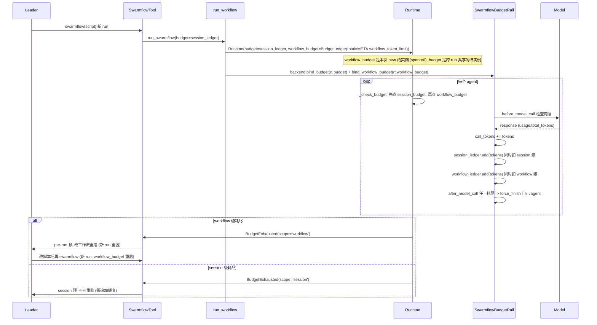

# Swarmflow 双层 Budget（workflow 级 + session 级）撞顶逻辑

## 1. 背景与问题 (Why)

### 现象

在一个 team 会话下连续运行多个 swarmflow 工作流时，所有工作流共用同一个 token 预算账本（session 级 / leader 级 `BudgetLedger`，跨 run 累计、不重置）。运行到后面某个工作流触发撞顶（`BudgetExhausted`）后：

- Leader 即使修改该工作流脚本，本次会话内仍无法运行成功——因为会话级预算池已被前面的工作流累计耗尽，与"被修改的这个工作流本身花多少"无关。
- 某次运行日志实证（`team.log` 2026-08-12 16:19–16:23）：第一个工作流撞顶 `spent=84175/50000` 后，leader 重新规划调第二次 swarmflow，传同一个已耗尽的 ledger，入口 gate `_check_budget` 立即抛 `BudgetExhausted`（`spent` 未变），新工作流**根本起不来**。

### 现状根因（一句话）

当前只存在一层 leader 级（会话共享）`BudgetLedger`，所有工作流按引用共享同一个实例并累计扣减；**缺少 workflow 级独立额度**。

代码事实：
- `agent_configurator.py` 在 leader 生命周期内只 `new` 一个 `BudgetLedger(total=spec.swarmflow_budget)`，经 `extras → create_team_tools → SwarmflowTool(budget=)` 存为 `self._budget`；每次 `run_background` 把同一个 `self._budget` 传给 `run_workflow → rt.budget → backend.bind_budget`。
- F_66 设计文档已显式预留该缺口："swarmflow_budget 只有 leader 级……需要时再加 run 级 override。" 本设计即补这个 run 级 override。

### 为何现在做

单层 session 预算无法满足"单个工作流的成败不被会话级累计用量直接卡死"的诉求——这是双层 budget 的核心动机。会话级预算回答"整会话花多少"，但无法回答"单个工作流该花多少、是否该被单独截断"。补 workflow 级额度让两层各司其职：session 级控总量、workflow 级控单 run，互不绑架。

## 2. 目标与非目标

**目标**
- 引入 workflow 级 Budget（绑定 `run_id`，新 run 重置 `spent=0`、resume 不重置继续累计），与 session 级 Budget 区分。
- workflow 级撞顶时，Leader **可修改工作流后重跑**（新 run 的 workflow 级额度重置）。
- session 级撞顶时，明确告知 Leader **不可重跑**（共享池耗尽），引导其追加额度并新开会话。
- 前端展示两层 budget（`spent/total/percent`），格式对称。
- 嵌套一层子 workflow 复用父 workflow 的 `workflow_budget` 实例（不新建）。

**非目标**
- 不做 session 级额度的"运行时重置/追加"命令（§10 问题 2 已确认不允许热更新，追加额度需新开会话）。
- 不处理跨进程 / 分布式 worker 的预算共享（本轮保持内存 ledger）。
- 不重构 `BudgetLedger` dataclass（复用现有结构，用两个实例）。
- 撞顶 agent 的重试空转问题随"保留 BudgetExhausted 原样向上抛"（意见 ④）一并消除，不单列。

## 3. 术语与上下文

- **session 级 ledger**：`Runtime.budget`，per-leader，跨所有 run 共享，`spent` 单调递增不重置。对应前端"Team budget"。
- **workflow 级 ledger**：`Runtime.workflow_budget`（本设计新增），绑定 `run_id`，每次 `swarmflow` 调用（新 run）新建 `spent=0`；resume 复用同一实例继续累计（§4.4.5）。嵌套子 workflow 复用父实例（§4.4.4）。对应前端"Run tokens"。
- **`BudgetLedger`**：业务无关的"counter + ceiling"结构（`total/spent/add/remaining/exhausted`），按引用共享。本设计复用，不新增类型。
- **嵌套双计（决策点 1 选 B）**：每次 token 消耗**同时扣两层**——workflow 级是 session 级的子额度视图，两层 ledger 是两个独立对象实例。
- **force_finish**：rail 在 `before/after_model_call` 检测 ledger 耗尽时，调用 `ctx.request_force_finish` 让当前 agent 正常收尾（非抛异常），保住已完成工作。
- **run budget 命名**：workflow 级 ledger 实际是"**顶层 run 的预算**"（嵌套子 workflow 不拥有独立账本，复用父实例，见 §4.4.4）。对外协议中 "workflow budget" 与 "run budget" 同义，指同一个 per-run 账本；避免被理解为"每个嵌套 workflow 各有一个额度"。
- **scope 迁移**：`budget` 快照的 `scope` 字段从历史值 `"leader"` 迁移到 `"session"`（语义不变，命名对齐双层术语）。迁移按 §4.6.8 灰度顺序执行，旧 `"leader"` 保留兼容期。
- 相关设计：SDD-0010（nested workflow and budget observability）。

## 4. 方案设计 (What / How)

### 4.1 总体架构

复用 `BudgetLedger`，双层并列：session 级（现有，不动）+ workflow 级（新增 per-run 实例）。同一 rail 持两个 ledger 引用，同一次消耗同时 `add` 进两个对象；入口 gate 顺序敏感地查两层；SwarmflowTool 按 `scope` 产不同 leader 消息。

```
                         ┌──────────────────────────────────────────┐
                         │           openjiuwen 引擎                 │
  每个 swarmflow run ────▶│  Runtime {                               │
                         │    budget:         BudgetLedger          │  ← session 级(per-leader, 现有, 跨 run 不重置)
                         │    workflow_budget: BudgetLedger          │  ← workflow 级(per-run, 新 run 重置 spent=0)
                         │  }                                       │
                         │  agent() 入口 _check_budget(session 优先):  │
                         │    if session_budget.exhausted:             │  → BudgetExhausted(scope="session") 不可重跑
                         │    if workflow_budget.exhausted:           │  → BudgetExhausted(scope="workflow") 可重跑
  每个 worker rail ─────▶│  SwarmflowBudgetRail(持两个 ledger 引用):  │
                         │    after_model_call: 同时 add 两层(嵌套双计) │
                         │    _stop_if_exhausted: 任一耗尽 → force_finish 自己的 agent
                         └──────────────────────────────────────────┘
                                          │ BudgetExhausted(scope=...)
                         ┌──────────────────────────────────────────┐
                         │      SwarmflowTool.run_background         │
                         │  scope="workflow" → "改工作流后可重跑"      │
                         │  scope="session"  → "不可重跑,需追加额度"   │
                         └──────────────────────────────────────────┘
```

### 4.2 数据流与时序



### 4.3 接口与数据模型

#### 4.3.1 `BudgetExhausted` 增加 `scope` 字段

```python
class BudgetExhausted(BaseException):
    def __init__(self, message, *, scope="session", spent=None, total=None,
                 top_phases=None, workflow_spent=None, workflow_total=None):
        super().__init__(message)
        self.scope = scope           # "workflow" | "session"
        self.spent = spent           # 触发层 ledger 的 spent
        self.total = total           # 触发层 ledger 的 total
        self.top_phases = top_phases # 消耗最高的 top-3 phase: list[tuple[str, int]]（§4.4.3）
        self.workflow_spent = workflow_spent   # 撞顶时 workflow 级 spent（session 撞顶时供对照）
        self.workflow_total = workflow_total   # 撞顶时 workflow 级 total
```

> **Requirement:** 系统 SHALL 在撞顶时通过 `BudgetExhausted.scope` 区分是 workflow 级还是 session 级耗尽。
> **Scenario:** WHEN workflow 级 ledger 耗尽且 session 级未耗尽 THEN `scope="workflow"`；WHEN session 级耗尽 THEN `scope="session"`。

#### 4.3.2 `Runtime` 增加 `workflow_budget`

```python
@dataclass
class Runtime:
    budget: BudgetLedger              # session 级(现有)
    workflow_budget: BudgetLedger    # workflow 级(新增, 绑定 run_id; 新 run 新建, resume 复用不重置)
```

#### 4.3.3 progress 事件 budget 字段：双层 snapshot + 结构化撞顶原因

`_budget_snapshot` 的 `scope` 从固定 `"leader"` 扩展为 `"session"`/`"workflow"`；payload 同时带两层 snapshot（并发下声明为 point-in-time 观测）：

```python
def _budget_snapshot(ledger, scope="session") -> dict:
    return {"total": ledger.total, "spent": ledger.spent,
            "remaining": ledger.remaining(), "scope": scope, "exhausted": ledger.exhausted}

# _emit_agent_* 同时带:
budget=_budget_snapshot(rt.budget, scope="session"),
workflow_budget=_budget_snapshot(rt.workflow_budget, scope="workflow") if rt.workflow_budget.total is not None else None,
```

`WorkflowProgress` / `WorkflowRunState` 增加 `workflow_budget: Optional[dict]`，`_bump_completion` 透传。

**结构化撞顶原因**（前端不解析自然语言错误文案）：

- 新增 `budget_exhausted_scope: "session" | "workflow" | null` 字段，随 `workflow_failed` 终态事件、`workflow.updated`、`command.workflows list/get` 透传。
- 前端不得用字符串匹配（`/budget exhausted/i`）判断撞顶层；必须用 `budget_exhausted_scope`。
- 区分两个概念：`budget.exhausted` / `workflow_budget.exhausted`（某层快照是否到顶）≠ `budget_exhausted_scope`（本次 workflow 失败真正由哪层触发）。两层可能同时 exhausted；成功完成的 workflow 也可能在最后一次调用后 `exhausted=true`。

**两层同时耗尽优先级：session 优先**。入口 gate **先查 session 再查 workflow**（§4.4.1）：两层都耗尽时异常 `scope` 报告 `"session"`（session 耗尽后新建 run 仍无法继续，报 workflow 会让前端误提示"改工作流可重跑"）。入口 gate、rail 日志、异常 scope、终态事件、leader 消息五处统一用同一优先级。

**字段缺失 vs null 语义**：delta 事件必须区分——字段缺失（本次 delta 未更新，前端保留旧值）≠ `null`（明确无该层限制/清空）≠ 对象（新的完整快照）。Pydantic 序列化用 `exclude_none` 保留缺失语义，`workflow_budget: null` 显式表示"未配置 run 上限"。

### 4.4 关键流程

#### 4.4.1 入口 gate（session 优先）

```python
def _check_budget(rt):
    # session 先查：session 耗尽后新建 run 仍无法继续，报 session 避免前端
    # 误提示"改工作流可重跑"。session 未耗尽时再查 workflow 级。
    if rt.budget.exhausted:
        raise BudgetExhausted(f"session token budget exhausted: {rt.budget.spent}/{rt.budget.total}",
                               scope="session", spent=rt.budget.spent, total=rt.budget.total)
    if rt.workflow_budget.exhausted:
        raise BudgetExhausted(f"workflow token budget exhausted: {rt.workflow_budget.spent}/{rt.workflow_budget.total}",
                               scope="workflow", spent=rt.workflow_budget.spent, total=rt.workflow_budget.total)
```

agent() 入口与 session send() 入口各调一次（沿用现有调用点）。

> 顺序语义：两层都耗尽时**报 session**（session 优先）。单个撞顶报对应层。gate 是"撞了就 raise"而非"没撞就 return"，session 先查不会误放行 workflow 已耗尽的情况。

#### 4.4.2 Rail 双层扣减 + 双层观测

```python
class SwarmflowBudgetRail(AgentRail):
    def __init__(self, budget, workflow_budget=None):
        self._budget = budget               # session 级(共享)
        self._wf_budget = workflow_budget   # workflow 级(per-run)
        self.call_tokens = 0

    async def after_model_call(self, ctx):
        tokens = _usage_tokens(inputs.response)
        if tokens > 0:
            self.call_tokens += tokens
            self._budget.add(tokens)            # session 级(嵌套双计)
            if self._wf_budget is not None:
                self._wf_budget.add(tokens)     # workflow 级(同时扣)
        self._stop_if_exhausted(ctx, "after")

    def _stop_if_exhausted(self, ctx, when):
        # 任一耗尽即 force_finish 自己的 agent(只作用于自己 ctx)
        if self._budget.exhausted:
            ctx.request_force_finish({"reason": "session budget exhausted", "exhausted_ledger": "session", ...})
            return
        if self._wf_budget is not None and self._wf_budget.exhausted:
            ctx.request_force_finish({"reason": "workflow budget exhausted", "exhausted_ledger": "workflow", ...})
```

**正确性红线**：每个 rail 实例只 force_finish 自己绑定的 agent。A 的 workflow_budget 耗尽不能触发 B 的 agent force_finish——B 的 rail 只观测自己的 workflow_budget + 共享的 session_budget。

#### 4.4.3 SwarmflowTool 双消息分叉

```python
except BudgetExhausted as exc:
    # 保留 BudgetExhausted 原样向上抛（BaseException，穿透 except Exception），
    # 不转 BackendError。消息生成职责归异步工具框架（见下方"消息职责"），
    # SwarmflowTool 只负责把结构化信息补进异常字段后原样上抛。
    raise
```

**消息职责**：`BudgetExhausted` 原样向上抛（不转 `BackendError`）。上层异步工具框架捕获后，据 `exc.scope` 生成 Leader 面向消息（两条分支）：

| scope | Leader 消息 | 附带的定位信息（均来自异常字段） |
|---|---|---|
| `workflow` | "本次工作流 token 额度已达上限（与会话总额独立）。该上限由用户设定不可改，必须重新设计工作流降消耗；新 run 额度重置。" | `exc.spent`/`exc.total`（run 级）、`exc.top_phases`（top-3）、`exc.workflow_spent`/`exc.workflow_total` |
| `session` | "当前会话 token 预算已耗尽且无法运行时追加，修改工作流重跑仍会立即撞顶。请追加会话额度并新开会话。" | `exc.spent`/`exc.total`（session 级）、`exc.workflow_spent`/`exc.workflow_total`（当前 run 对照） |

消息的**唯一数据源是 `BudgetExhausted` 的字段**，不依赖自然语言拼接，也不在 SwarmflowTool 内构造丢弃的 `msg`。

**撞顶消息补充信息（避免盲改脚本陷入死循环）**：

| 信息 | 异常字段 | 来源 | 用途 |
|------|------|------|------|
| 消耗最高的 top-3 phase | `top_phases` | 引擎 emit 钩子按 phase 累计到 `workflow_budget.phase_tokens` | 定位烧 token 的 phase，针对性优化 |
| run 级 spent/total | `spent`/`total`（workflow 撞顶时）或 `workflow_spent`/`workflow_total`（session 撞顶时） | `rt.workflow_budget` | 区分是 run 级还是 session 级顶 |
| session 级 spent/total | `spent`/`total`（session 撞顶时） | `rt.budget` | 团队总预算对照 |

引擎的 `_emit_agent_completed` / `_emit_agent_failed` 在每次 agent 边界调用 `rt.workflow_budget.add_phase(phase, tokens)`，按 agent 所属 phase 累计 token 到 `workflow_budget.phase_tokens`；`_check_budget` 撞顶时经 `_top_phases(rt)` 取 top-3 填入 `BudgetExhausted.top_phases`。**不在 rail 的 `after_model_call` 累计**——rail 的 `AgentCallbackContext` 没有 phase 字段，phase 是引擎侧的 `_current_phase` ContextVar，worker harness 观测不到，所以累计只能落在引擎 emit 钩子（能读 ContextVar 的那一层）。

#### 4.4.4 嵌套 workflow 复用父 workflow_budget

嵌套一层的子 workflow（`workflow()` 算子内联调用子脚本）**复用父 workflow 的 `workflow_budget` 实例**，不新建。

- 子 workflow 是父 run 的一部分，不是新 run——它共享父 Runtime（含 `budget` 与 `workflow_budget` 两个 ledger）。
- 子 workflow 内每个 `agent()` 的 token 消耗经 rail **同时扣父 workflow_budget 与 session_budget**（与父脚本内 agent 完全一致）。
- 因此 `workflow_token_limit` 语义为"整个 run（含嵌套子 workflow）的累计额度"，不是"单个脚本文件"的额度。

> **Requirement:** 系统 SHALL 让嵌套子 workflow 复用父 workflow 的 `workflow_budget` 实例，子 workflow 不新建、不重置 workflow 级 ledger。
> **Scenario:** WHEN 父脚本 META 声明 `workflow_token_limit=50000` 且内联调用子脚本 THEN 父+子所有 agent 累计扣同一个 `workflow_budget`，撞顶时整个 run 终止。

#### 4.4.5 workflow_budget 绑定 run_id，resume 不重置

`workflow_budget` 的 `spent` 绑定 `run_id`：**pause 后 resume 恢复时不视为新 run，不重置，继续累计**。

- 每次 `swarmflow` 调用生成新 `run_id` → 新建 `workflow_budget`（`spent=0`）。
- resume 复用同一 `run_id` → 恢复同一 `workflow_budget` 的累计值（经 journal 持久化 / 恢复）。
- 只有**重新调用 `swarmflow`（新 run_id）**才重置 workflow 级 `spent`；resume 不清零。

实现要点：`workflow_budget` 的 `spent` 经独立的 **`<journal>.budget` 伴随文件**持久化（与 journal 同 stem、同目录，不塞进 journal 的 JSONL 记录——journal 是 content-addressed 的 agent 结果缓存，budget 是状态快照，两种数据模型）。引擎 emit 钩子（`_emit_agent_completed` / `_emit_agent_failed`）在 agent 边界同步覆盖写该伴随文件（temp + `os.replace` 原子提交，与 `Journal.save` 同一 crash 模式；文件 ~100 字节，阻塞可忽略）；resume 时 `run_workflow` 经 `_read_budget_snapshot` 读回 `spent` / `phase_tokens`，传给 `_resolve_workflow_budget(resume_spent=...)` 恢复累计值，而非按 `META.workflow_token_limit` 新建零值实例。**budget.py 不碰 I/O**（保持 business-agnostic），读写全在引擎层（runner.py），持久化回调挂在 `Runtime.persist_workflow_budget`，与 `progress_sink` / `log_sink` 同模式。crash 语义与 journal 对齐：agent 边界写，中途 crash 丢当前 agent 内部几个 call 的计数（软天花板接受 overshoot，§4.6.3）。

> **Requirement:** 系统 SHALL 让 `workflow_budget` 的 `spent` 随 `run_id` 绑定，resume 恢复累计值而非重置。
> **Scenario:** WHEN run 在 `spent=30000/50000` 处 pause 后 resume THEN `workflow_budget.spent` 仍为 30000 继续累计；WHEN 重新调用 swarmflow（新 run_id）THEN 新建 `spent=0`。

### 4.5 配置与开关

#### 4.5.1 workflow 级上限配置入口：脚本 META 字段（决策点 5 选 a），值由人指定

```python
META = {
    "name": "deep-read-swarm",
    # 可选：仅当人在对话中明确指定"该工作流消耗多少 token"时才写；
    # 人未指定则不写，引擎视为 unbounded（无 workflow 级撞顶）。
    "workflow_token_limit": 50000,
    "phases": [...],
}
```

`_resolve_workflow_budget(loaded)`：`limit = meta.get("workflow_token_limit")`；正整数 → `BudgetLedger(total=limit)`，否则 `BudgetLedger()`（unbounded）。

**取值原则：值由人给，不是 AI 估**——
- **人在对话中指定**（如"token 上限 5 万"）→ leader 生成脚本时写进 META。
- **人未指定** → 不写 `workflow_token_limit`，引擎默认 unbounded（无 workflow 级撞顶，等价单层 session 级行为）。
- **禁止 AI 自行估值**：AI 不估算、不默认填一个值，避免估不准。

**配置校验：`workflow_token_limit` 不能大于 `swarmflow_budget`**——

`_resolve_workflow_budget` 在读取 `META.workflow_token_limit` 时校验与 session 级 `swarmflow_budget` 的关系：

- **`workflow_token_limit > swarmflow_budget`** → **直接报错**（`WorkflowError` / `MetaError`），不静默接受。理由：workflow 级是 session 级的子额度视图（嵌套双计），单 run 上限不可能超过团队总额；若允许，则 workflow 级额度形同虚设（session 先撞顶），且让人误以为设了独立上限实际没生效。
- **`workflow_token_limit <= swarmflow_budget`** → 正常创建 `BudgetLedger(total=limit)`。
- **`swarmflow_budget` 未配置（session 级 unbounded）** → 校验跳过（无 session 上限可比），workflow 级按声明生效。
- **`workflow_token_limit` 未声明** → 跳过校验，unbounded（现有行为）。

```python
def _resolve_workflow_budget(loaded, session_budget: BudgetLedger | None = None,
                             *, resume_spent: int = 0,
                             resume_phase_tokens: dict[str, int] | None = None) -> BudgetLedger:
    meta = loaded.meta if isinstance(loaded.meta, dict) else {}
    limit = meta.get("workflow_token_limit")
    if not (isinstance(limit, int) and limit > 0):
        # 未声明上限：unbounded。resume 的累计 spent 无意义（无上限），仍返回 unbounded。
        return BudgetLedger()
    if session_budget is not None and session_budget.total is not None:
        if limit > session_budget.total:
            raise MetaError(
                f"META.workflow_token_limit ({limit}) exceeds session swarmflow_budget "
                f"({session_budget.total}); a per-run ceiling cannot exceed the team ceiling"
            )
    # resume 时 resume_spent / resume_phase_tokens 从 <journal>.budget 伴随文件恢复累计值
    # （§4.4.5）；新 run 传 0 / None → spent=0、phase_tokens 空。
    return BudgetLedger(total=limit, spent=resume_spent,
                        phase_tokens=dict(resume_phase_tokens or {}))
```

#### 4.5.2 特性开关

无独立 Feature Flag。未声明 `workflow_token_limit` 的脚本天然回退单层行为（向后兼容即开关）。

### 4.6 前端接入协议

> 本节整合前端接入双层 Budget 的协议要求（《双层Budget前端接入-后端设计补充确认清单》），作为 §4.3.3 / §4.4.4 / §4.4.5 之外的对外数据契约补充。前端据此实现，不依赖自然语言错误文案。

#### 4.6.1 字段与 JSON Schema

对外（`WorkflowRun`、`workflow.updated`、`command.workflows list/get`）稳定字段：

```ts
type BudgetScope = "leader" | "session" | "workflow";  // "leader" 为历史值，迁移期兼容

interface BudgetSnapshot {
  total: number | null;        // null = 无上限
  spent: number;               // 真实消耗，允许最后一次在途调用 overshoot 超 total
  remaining: number | null;    // 无上限为 null；有上限时钳制为 0（max(0, total-spent)），不返回负数
  scope: BudgetScope;
  exhausted: boolean;          // 判定统一为 total != null && spent >= total
}

interface WorkflowRun {
  budget?: BudgetSnapshot | null;              // session 级（Team budget）
  workflow_budget?: BudgetSnapshot | null;     // run 级（Run tokens）；未配置上限时为 null
  budget_exhausted_scope?: "session" | "workflow" | null;  // 终态失败真正由哪层触发
  token_count?: number | null;                 // 无 workflow_budget 时前端兜底展示
}
```

**明确决策**：

- `budget.scope` 正式迁移为 `"session"`（见 §3 术语 scope 迁移），历史 `"leader"` 保留兼容期（§4.6.8）。
- 未配置 `workflow_token_limit` → `workflow_budget` 为 **`null`**（不是 `{total: null, ...}`）。
- `spent` 可能 > `total`（overshoot 合法，见 §4.6.3）。
- `remaining` 钳制为 `>= 0`，不返回负数（`BudgetLedger.remaining()` 已 `max(0, total - spent)`）。
- 所有 token 数为非负整数，位于 JS 安全整数范围内。
- `exhausted` 判定统一 `total != null && spent >= total`。

#### 4.6.2 字段缺失 / null / 对象的三种语义

增量 `workflow.updated` 事件必须区分：

| 线上值 | 语义 | 前端处理 |
|---|---|---|
| 字段缺失 | 本次 delta 未更新该字段 | 保留本地旧值 |
| 字段为 `null` | 明确无该层限制 / 清空旧值 | 写入 null |
| 字段为对象 | 新的完整快照 | 整体替换旧快照 |

Pydantic 序列化用 `exclude_none` 保留"缺失"语义；`workflow_budget: null` 显式表示"未配置 run 上限"。wire truncate 不得破坏该区别。

#### 4.6.3 overshoot 与百分比语义

- overshoot 是**合法预期状态**：记账发生在 model call 返回后，最后一次在途调用可能把 `spent` 推过 `total`。
- 前端百分比显示**实际值**（如 128%），不钳制到 100%。
- `remaining` 始终钳制为 0（不为负）。
- 不额外输出 `overshoot` 字段，由 `spent - total` 推导。
- 预算语义为"**软天花板 / 尽力限制**"（允许最后一次 overshoot），非硬上限，需在用户文案明确。

#### 4.6.4 token_count 与 workflow_budget.spent 的权威关系

- **`workflow_budget.spent` 是当前 run 的权威预算消耗**。
- 前端显示优先级：有 `workflow_budget` 对象 → 用 `spent/total`；`workflow_budget` 为 null → 回退 `Run tokens <token_count>`。
- `token_count` = 各 agent 的 `call_tokens` 之和（含成功/失败/retry 的真实消耗）；journal cache hit 不计入本次 run 消耗。
- 两者可能不一致的合法原因：失败 agent 若 tokens 未上报，`token_count` 可能略低于 `workflow_budget.spent`；权威以 `workflow_budget.spent` 为准。

#### 4.6.5 事件字段矩阵

| 事件/接口 | budget | workflow_budget | budget_exhausted_scope | 说明 |
|---|---:|---:|---:|---|
| `workflow_started` | 必须 | 必须或 null | null | 第一个 agent 完成前显示总额与 0 用量 |
| `agent_completed` | 必须 | 必须或 null | 通常 null | agent 边界更新 |
| `agent_failed` | 必须 | 必须或 null | null | 保留失败调用的真实用量。预算撞顶**不产** `agent_failed`（force_finish 让 agent 正常收尾，下一个 `agent()` 入口 gate 抛 `BudgetExhausted` → `workflow_failed`） |
| `workflow_completed` | 必须（终值） | 必须或 null（终值） | null | 零 agent / 最后一次调用也能得终值 |
| `workflow_failed` | 必须（终值） | 必须或 null（终值） | 预算失败时必须 | 前端终态判断依据 |
| `workflow.updated` | 必须透传 | 必须透传 | 必须透传 | Monitor→TUI 增量通道 |
| `command.workflows list` | 必须保留 | 必须保留 | 必须保留 | 列表重拉不丢状态 |
| `command.workflows get` | 必须保留 | 必须保留 | 必须保留 | 详情重拉不丢状态 |
| wire truncate/collapse | 必须保留 | 必须保留 | 必须保留 | 大工作流裁剪后仍可展示 |

**后端明确**：

- 首次预算快照在 `workflow_started` 发送。
- 成功/失败终态**一定**发送最终快照（含零 agent 场景）。
- 最后一次 agent 撞顶但脚本直接 return → 终态为 `completed`（撞顶非异常，force_finish 正常收尾），`budget_exhausted_scope` 为 null。
- **预算撞顶不产 `agent_failed`**：rail force_finish 让当前 agent 正常收尾（发 `agent_completed`），真正的 `BudgetExhausted` 在下一个 `agent()` 入口 gate 抛出 → 升为 `workflow_failed`。所以 `budget_exhausted_scope` 只随 `workflow_failed` 终态事件出现，`agent_failed` 永远为 null。
- 事件乱序：预算快照用 `(session.spent, workflow.spent)` 单调不减约束拒绝旧快照（spent 只增不减）；无额外序列号。

#### 4.6.6 生命周期矩阵

| 场景 | session spent | workflow spent | run_id |
|---|---|---|---|
| 用户新发起一次 workflow | 保留累计 | 重置为 0 | 新 run_id |
| 修改脚本后重新运行 | 保留累计 | 重置为 0 | 新 run_id |
| backend 内部 retry | 保留继续累计 | 保留继续累计 | 不变 |
| pause/resume | 保留继续累计 | 保留继续累计 | 不变 |
| 新建 Team 会话 `/new` | 按 Team 生命周期重建 | 新 run 时创建 | 新会话 |

**预算错误 non-retryable**：`BudgetExhausted` 是 `BaseException`，穿透 `_attempt_calls` 的 `except Exception`，不进入普通 backend retry，避免空转重试。

#### 4.6.7 并发共享关系

- 同一 run 内所有 worker / agent_session / human_session：**共享同一个 workflow ledger** + **共享同一个 session ledger**。
- 两个不同 run：workflow ledger 相互独立；session ledger 共享。
- "一个 rail 只 force_finish 自己绑定的 agent" ≠ "每个 agent 有独立 workflow ledger"——同一 run 内某 agent 把 workflow ledger 消耗到顶后，其他 agent 在下一次 model call 前也观察到该 ledger 已耗尽（共享引用）。
- 并发同名 workflow：**不支持**，启动入口按 run_id 隔离；同名脚本并发运行各自有独立 run_id 与 workflow ledger，但 journal/WAL 隔离不在本设计范围（§6 影响面标注）。

#### 4.6.8 向后兼容与灰度顺序

- 旧事件只有 `budget`（无 `workflow_budget`）：前端按旧模式运行（`Run tokens <token_count>`）。
- `budget.scope` 从 `"leader"` → `"session"` 是协议变更，迁移期两者都接受。
- 新后端 + 旧前端：旧前端忽略新字段，正常显示 Team budget。
- 旧后端 + 新前端：新前端读到 `workflow_budget` 缺失 → 回退旧模式。

**灰度顺序**：

```
后端新增可选字段并完成透传
→ Monitor/wire 保留新字段
→ 前端兼容读取并展示
→ 最后废弃 scope="leader"
```

#### 4.6.9 session 撞顶后的恢复动作

- **本期不提供** session 级额度的运行时热追加（§10 问题 2 已确认）。
- 用户唯一可执行的恢复动作：修改 `swarmflow_budget` 配置后 `/new` 新开会话。
- 前端恢复类型固定为：

```ts
type BudgetRecovery = "start_new_session";  // session 撞顶的唯一恢复路径
```

- leader 与前端文案不得写成"追加后即可在当前会话继续"，必须写"追加会话额度并新开会话"。

#### 4.6.10 WorkflowRun 终态示例

**workflow 预算耗尽**（session 有余额）：

```json
{
  "id": "wf_run_001",
  "status": "failed",
  "token_count": 51240,
  "budget": {"scope": "session", "total": 200000, "spent": 79500, "remaining": 120500, "exhausted": false},
  "workflow_budget": {"scope": "workflow", "total": 50000, "spent": 51240, "remaining": 0, "exhausted": true},
  "budget_exhausted_scope": "workflow",
  "error": "Workflow token budget exhausted"
}
```

**session 预算耗尽**（workflow 有余额）：

```json
{
  "id": "wf_run_002",
  "status": "failed",
  "token_count": 18000,
  "budget": {"scope": "session", "total": 200000, "spent": 201300, "remaining": 0, "exhausted": true},
  "workflow_budget": {"scope": "workflow", "total": 50000, "spent": 18000, "remaining": 32000, "exhausted": false},
  "budget_exhausted_scope": "session",
  "error": "Session token budget exhausted"
}
```

**未配置 workflow 上限**：

```json
{
  "id": "wf_run_003",
  "status": "running",
  "token_count": 12700,
  "budget": {"scope": "session", "total": 200000, "spent": 100300, "remaining": 99700, "exhausted": false},
  "workflow_budget": null,
  "budget_exhausted_scope": null
}
```

## 5. 关键决策与权衡 (ADR)

### 5.1 交互模型：嵌套双计（B）

- **决策**：交互模型选 (B) 嵌套双计——workflow 级是 session 级子额度，每次消耗同时扣两层。
- **背景**：背景文档 §8 决策点 1 列了三候选：(A) 独立双账本各算各；(B) 嵌套双计；(C) session 级预分配给各 workflow。
- **备选与理由**：
  - (A) 独立：两层独立计数，任一耗尽即停。但会导致 session 总量失去控制（session spent 不再等于各 workflow spent 之和），破坏"会话总量可控"目标。
  - (C) 切分：session 级预分配给各 workflow。需复杂的额度分配/回收，且并发同名 workflow 不好处理。
  - **(B) 选中**：同时扣两层保证 session 总量仍可控（session spent 是各 workflow 累计的真实成本），又给单 workflow 独立天花板。

### 5.2 不新增异常类型，用 `scope` 字段区分

- **决策**：给 `BudgetExhausted` 加 `scope` 字段（`"workflow"`/`"session"`），不新造 `RunTokensExhausted`。
- **背景**：背景 §11 红线"不新增 ProgressKind 成员"为约定惯例；异常类型同理尽量复用。
- **备选与理由**：新造 `RunTokensExhausted` 语义更直白，但增加异常分类面，且 SwarmflowTool 需多一个 except 分支。加 `scope` 字段让机判更干净，不破坏"不新增类型"约定。

### 5.3 workflow 级上限配置入口：脚本 META 字段（a），值由人指定

- **决策**：配置入口选 (a) 脚本 META 字段，排除 (b) tool 参数 / (c) TeamAgentSpec 字段 / (d) 按 session 级比例派生。**上限值由人指定，不是 AI 估**——人在对话中明确了该 workflow 消耗多少 token 才写进 META，否则不写（unbounded）。
- **背景**：背景 §8 决策点 5 列四候选未定；单层 session 预算无法回答"单个工作流该花多少"。且 AI 估算 token 不可靠，值应由人决定。
- **备选与理由**：
  - (b) tool 参数：每次调用得传，易遗漏；resume 时要保证传同一参数，易不一致。
  - (c) TeamAgentSpec 字段：一个 team 跑多个不同复杂度 workflow，统一配一个值无意义。
  - (d) 按比例派生：复杂度差异巨大时比例派生无依据，本质还是"拿总的上限来用"，违背 workflow 级独立额度的设计意图。
  - **(a) 选中**：per-script 独立额度只能落在脚本文件里；resume 读同一脚本拿同一上限最稳定可预测。值由人给，避免 AI 估值不准；未指定则 unbounded，向后兼容。

### 5.4 被否决的备选与取舍理由

- **独立双账本（A）**：见 5.1，会导致 session 总量失控。
- **新造 `RunTokensExhausted` 异常**：见 5.2，增加分类面。
- **跨进程锁 / asyncio.Lock**：被红线否决（破坏 rail 同步语义、引入死锁风险）。本轮单 loop 内 asyncio 原子性足够。
- **分布式计数器（Redis INCR）**：被红线否决（分布式 worker 是未来事项，本轮保持内存 ledger）。
- **session 级 spent resume 回滚**：被红线否决（已消耗 token 是真实成本，重跑不退）。

## 6. 影响面与兼容性

| 仓 | 模块 | 是否需改 | 说明 |
|---|---|---|---|
| agent-core | `engine/errors.py` | 是 | `BudgetExhausted` 加 `scope`/`spent`/`total`/`top_phases`/`workflow_spent`/`workflow_total` 字段 |
| agent-core | `engine/runtime.py` | 是 | Runtime 加 `workflow_budget` 字段 + `persist_workflow_budget` 持久化回调 |
| agent-core | `engine/primitives.py` | 是 | `_check_budget` 双层化（session 优先）；`_budget_snapshot` 支持 scope；emit 钩子按 phase 累计 `workflow_budget.phase_tokens` + 同步写伴随文件 |
| agent-core | `engine/runner.py` | 是 | `run_workflow` 接收/创建 `workflow_budget`，`_resolve_workflow_budget`（含 `workflow_token_limit <= swarmflow_budget` 校验 + `resume_spent`/`resume_phase_tokens`），`_read_budget_snapshot`/`_write_budget_snapshot`/`_persist_budget_final` 伴随文件读写，绑定 backend |
| agent-core | `engine/budget.py` | 是 | `BudgetLedger` 加 `phase_tokens` 字段 + `add_phase` 方法 |
| agent-core | `backends/budget_rail.py` | 是 | Rail 接收 `workflow_budget`，双层 add，双观测；session 优先 force_finish |
| agent-core | `engine/backends/base.py` | 是 | AgentBackend 加 `bind_workflow_budget` + `workflow_budget` 属性 |
| agent-core | `backends/team_worker_backend.py` | 是 | run() 把 workflow_budget 传给 rail |
| agent-core | `backends/avatar_session_backend.py` | 是 | session 路径同样传 workflow_budget |
| agent-core | `tool_swarmflow.py` | 是 | run_background except 保留 BudgetExhausted 原样上抛（不转 BackendError）；`format_failed_injection` 从异常字段生成富消息 + `_budget_exhausted_fields` helper |
| agent-core | `harness/async_tools.py` | 是 | `_run` 加 `except BudgetExhausted` 分支（接住 BaseException，标记 record + 注入 leader，否则任务静默死亡） |
| agent-core | `i18n.py` | 是 | 加 `swarmflow.budget_exhausted` + workflow/session guidance 中英 i18n key |
| agent-core | `engine/progress.py` | 是 | `WorkflowProgressEvent` 加 `budget_exhausted_scope` 字段 |
| agent-core | `schema/events.py` | 是 | `WorkflowProgressTeamEvent` 加 `budget_exhausted_scope` 字段 |
| agent-core | `agent/agent_configurator.py` | 否 | session 级 ledger 创建保持（不破坏单层配置） |
| jiuwenswarm | `wire_truncate.py` | 是 | KEEP_KEYS 加 `workflow_budget` + `budget_exhausted_scope` |
| jiuwenswarm | `workflow_state.py` | 是 | WorkflowProgress/RunState 加 `workflow_budget` + `budget_exhausted_scope` 字段，透传 |
| jiuwenswarm | `workflow_monitor_handler.py` | 是 | getattr 回退路径补 `budget_exhausted_scope` |
| jiuwenswarm | 前端 | 是 | `workflows.ts` 加 `budget_exhausted_scope`，撞顶判断改用结构化字段（保留文案兜底）；`app-screen.ts` Run tokens spent/total/percent 对称展示 |
| jiuwenswarm | `team_helpers.py`（可选） | 可选 | 终态映射区分两种撞顶 |
| swarmskill-creator | `template`/`SKILL.md`/`validate` | 是 | 提示"人指定才写 `workflow_token_limit`，未指定不写"，不强制 |

**向后兼容**：现有单层 `swarmflow_budget` 配置不破坏；未声明 `workflow_token_limit` 时 workflow 级 ledger unbounded，行为等价现状。无 **BREAKING** 变更。

## 7. 测试与验证

### 验收标准
- workflow 级撞顶：`workflow_token_limit=50000`，run 烧到 50000 → `BudgetExhausted(scope="workflow")` → leader 收"改工作流可重跑"消息（含当前 phase + top-3 phase + 两层 spent/total）→ 改脚本再跑，新 run `workflow_budget.spent=0`，成功。
- session 级撞顶：`swarmflow_budget=200000`，累计到顶 → `BudgetExhausted(scope="session")` → leader 收"不可重跑，追加会话额度并新开会话"消息 → 改工作流再跑，新 run 立刻 session 级撞顶（spent 未重置）。
- 未声明 `workflow_token_limit`：workflow 级 ledger unbounded，无 workflow 级撞顶，等价现状。
- workflow 级撞顶但 session 级有余额：`workflow_budget` 到顶，`session_budget` 未到 → workflow 级撞顶 → leader 改工作流重试，新 run 用 session 余额跑成功。
- 前端显示：`Run tokens 23085/50000 (46%) · Team budget 51327/200000 (25%)`，格式对称。
- 配置校验：`META.workflow_token_limit > swarmflow_budget` → 直接报错；`<=` → 正常创建。
- 嵌套子 workflow：父 META 声明 `workflow_token_limit` 且内联调子脚本 → 父子 agent 累计扣同一 workflow_budget，撞顶整个 run 终止。
- resume 不重置：run 在 `spent=30000/50000` pause 后 resume → `workflow_budget.spent` 仍 30000 继续累计；重新 swarmflow（新 run_id）→ `spent=0`。

### 测试策略
- 单元：`_resolve_workflow_budget`（声明/未声明/非法值/超 session 上限报错）；`_check_budget` 双层顺序；rail 双层 add + force_finish 不跨 agent；rail 按 phase 累计 top-3。
- 集成：mock backend 模拟撞顶，验证 scope 与 leader 消息分叉。
- 并发：两并发 run 共享 session ledger，各自独立 workflow ledger，验证 A 的 workflow 级顶不触 B。

### 前端联调 fixture 清单

固定 JSON 已在 §14 提供（从 agent-core progress 到 `workflow.updated` / `command.workflows` 的最终形态），供前端单元测试：

- [x] 正常运行中，两层均有余额（§14.1）
- [x] workflow 预算低余量（remaining/total ≤ 20%）（§14.2）
- [x] session 预算低余量（§14.3）
- [x] 仅 workflow 预算耗尽（scope="workflow"）（§14.4）
- [x] 仅 session 预算耗尽（scope="session"）（§14.5）
- [x] 两层同时耗尽，终态 scope 为 session（session 优先）（§14.6）
- [x] 未配置 workflow 上限（workflow_budget=null）（§14.7）
- [x] workflow 最后一个 agent 撞顶后直接 return（终态 completed，scope=null）（§14.8）
- [x] pause/resume 前后 workflow spent 连续（不重置）（§14.9）
- [ ] backend retry 前后两层 spent 连续，预算错误不重试（`BudgetExhausted` 是 `BaseException`，穿透 `_attempt_calls` 的 `except Exception`，不进 retry——见 §4.6.6；此场景需运行时集成测试，fixture 略）
- [ ] 同一 run 两个并发 agent 共享 workflow ledger（需运行时并发集成测试，fixture 略）
- [ ] 两个并发 run 的 workflow ledger 独立、session ledger 共享（需运行时并发集成测试，fixture 略）
- [x] `command.workflows list` / `get` 返回形态（§14.10 / §14.11）
- [x] wire truncate/collapse 后仍保留双层 budget 与撞顶 scope（§14.12）
- [x] 旧后端不返回新字段时的兼容形态（回退 token_count）（§14.13）

## 8. 可观测性

- 撞顶日志：rail 的 `_stop_if_exhausted` 已 `team_logger.warning` 标注哪层耗尽（`exhausted_ledger`）。
- 终态事件：`workflow_failed` 可据 `BudgetExhausted.scope` 区分两种终态文案（可选）。
- session 级 overshoot 放大：接受 N 并发 workflow 的 overshoot 放大（背景 §7.2，决策点 9 选 c），在终态事件标注实际超支量供观测，不作为 bug。
- 前端：两层 budget snapshot 实时显示，并发下声明 point-in-time 观测（不强求 `spent_workflow + spent_other = spent_session`）。

## 9. 风险与回滚

| 风险 | 缓解 |
|---|---|
| session 级 overshoot 在并发下被放大（N × last_call_tokens） | 接受放大 + 终态标注超支量（决策点 9 选 c）；未来可加 safety margin |
| 双层 gate 顺序写反导致误放行 | 单测覆盖顺序敏感性；workflow 级先查 |
| rail force_finish 误触兄弟 agent | rail 只作用于自己 ctx；单测验证 A 的 workflow_budget 耗尽不触 B |
| 旧脚本未声明 `workflow_token_limit` | 引擎宽松回退 unbounded，等价现状（这是合法状态：人未指定即不设限） |

**回滚**：workflow 级 ledger 是新增字段，未声明时 unbounded 不生效；回滚只需还原引擎层 9 个文件改动，session 级行为完全不变。

## 10. 开放问题 (Open Questions)

> 以下三点来自背景文档 §9，进入实现前**必须与设计者/用户确认**，否则可能返工。

- [x] **问题 1（最关键）**：运行现象"修改工作流后本次会话内仍无法运行成功"指的是哪种撞顶？——**确认为 (b) session 级顶**。session 级顶无法靠 workflow 级 Budget 解决，只能靠明确提示（TUI 文案）+ 追加额度并新开会话。
- [x] **问题 2**：session 级 ledger 是否允许运行时重置/追加？——**不允许热更新**。会话额度只能"追加会话额度并新开会话"生效，运行中无法改上限。TUI 提示文案固定为"当前会话 token 预算已耗尽且无法运行时追加，修改工作流重跑仍会立即撞顶。请追加会话额度并新开会话"。
- [x] **问题 3**：并发同名 workflow 是否共享同一个 workflow 级额度池？——**per-run 实例**（每个 workflow 独立额度）；resume 复用同一 `run_id` 的实例（§4.4.5），不新建。

> 结论（三点已确认）：workflow 级 Budget 按 `run_id` 隔离（新 run 重置、resume 不重置）+ 嵌套子 workflow 复用父实例（§4.4.4）+ session 级耗尽后整会话终止且不可热更新，仅提示追加额度并新开会话。

## 11. 评审记录 (Iteration Log)

| 轮次 | 日期 | 版本 | 评审人 | 结论 | 主要修改/讨论 |
|---|---|---|---|---|---|
| 1 | 2026-08-14 | 1 | @wangcan103 | draft | 初稿，基于《双层Budget问题背景与设计要点》与代码事实整合 |
| 2 | 2026-08-17 | 1 | 评审意见 | changes-requested | 评审意见 ①–⑥，均已落实：① 嵌套子 workflow 复用父 workflow_budget（§4.4.4）；② workflow_budget 绑定 run_id、resume 不重置（§4.4.5）；③ session 级不可热更新、TUI 文案固定（§4.4.3/§10 问题 2）；④ BudgetExhausted 原样上抛、不转 BackendError（§4.4.3）；⑤ 撞顶消息补充 phase/top-3/两层额度（§4.4.3）；⑥ workflow_token_limit > swarmflow_budget 报错（§4.5.1）。§10 三问全部确认。 |
| 3 | 2026-08-17 | 1 | 前端 | changes-requested | 新增 §4.6 前端接入协议：字段 schema、缺失/null/对象三态、overshoot 语义、token_count 权威关系、事件字段矩阵、生命周期矩阵、并发共享、scope 迁移灰度、session 撞顶恢复动作（BudgetRecovery="start_new_session"）、WorkflowRun 终态示例；§7 追加前端联调 fixture 清单（16 项）。 |
| 4 | 2026-08-17 | 1 | @wangcan103 | draft | 一致性修正：① gate 顺序统一为 session 优先（§4.1/§4.2/§4.3.3/§4.4.1）；② 补 BudgetExhausted 字段定义（top_phases/workflow_spent/workflow_total，§4.3.1）；③ _resolve_workflow_budget 签名加 resume_spent 支持 resume 恢复（§4.5.1）；④ 撞顶消息职责归异步工具框架，消除 SwarmflowTool 内 msg 悬空（§4.4.3）；⑤ 更新 §12 实现记录（第 1 轮已实现、评审意见待实现、5 条偏差清单）；⑥ 统一 remaining 钳制措辞。 |
| 5 | 2026-08-18 | 1 | @wangcan103 | draft | 实现同步后的文档对齐：① §4.4.3 top-3 phase 累计机制改为引擎 emit 钩子（rail `AgentCallbackContext` 无 phase 字段）；② §4.6.5 `agent_failed` 行澄清预算撞顶不产 agent_failed（走 force_finish → workflow_failed）；③ §4.5.1 代码块签名补 `resume_phase_tokens`、改 `<journal>.budget` 伴随文件；④ §4.4.5 实现要点补伴随文件 + agent 边界同步写 + crash 语义；⑤ §12 实现记录更新为"均已落地"对照表、删链接小节、补 session 级 ledger 持久化未做、top-3 机制偏差已修订。 |
| 6 | 2026-08-18 | 1 | @wangcan103 | draft | 补前端接入协议回复表（§13，响应确认清单 §7 的 13 项决策）与前端联调 fixture（§14，13 组固定 JSON：正常运行/低余量/双层耗尽/未配置/撞顶后 return/resume 连续/list/get/wire collapse/旧后端兼容）；§7 fixture 清单逐项勾连 §14。 |

## 12. 实现记录与偏差

### 实际实现
第 1 轮设计已合入 agent-core `develop`，覆盖基础双层 budget：`BudgetExhausted.scope`、`Runtime.workflow_budget`、`_check_budget` 双层化、rail 双层记账、`bind_workflow_budget`、progress 事件透传 `workflow_budget`。

第 2 轮评审意见（①–⑥）、前端接入协议（§4.6）、resume 持久化在 jiuwenswarm 运行环境（`.venv` openjiuwen）已落地实现，对照各条如下：

| 评审意见 / 章节 | 状态 | 落地点 |
|---|---|---|
| ① 嵌套子 workflow 复用父 workflow_budget（§4.4.4） | 已实现 | `workflow()` 算子复用父 `rt`，自然共享 `workflow_budget`（primitives.py） |
| ② resume 不重置、按 run_id 恢复（§4.4.5/§4.5.1） | 已实现 | `<journal>.budget` 伴随文件 + `_read_budget_snapshot` + `resume_spent`/`resume_phase_tokens` 参数（runner.py） |
| ③ session 级不可热更新（§10 问题 2） | 设计即不实现 | session 级额度只支持"追加并新开会话"，本期不做运行时热追加 |
| ④ BudgetExhausted 原样上抛、不转 BackendError（§4.4.3） | 已实现 | `tool_swarmflow.py` `except BudgetExhausted: raise`；`async_tools.py` 加 `except BudgetExhausted` 分支，消息从异常字段生成 |
| ⑤ 撞顶消息补 phase/top-3/两层额度（§4.4.3） | 已实现 | `BudgetExhausted` 加 `top_phases`/`workflow_spent`/`workflow_total`；`_budget_exhausted_fields` + i18n `swarmflow.budget_exhausted` 模板（tool_swarmflow.py / i18n.py） |
| ⑥ `workflow_token_limit > swarmflow_budget` 报错（§4.5.1） | 已实现 | `_resolve_workflow_budget` 校验，超限抛 `MetaError`（runner.py） |
| §4.6 前端接入协议 | 已实现 | `budget_exhausted_scope` 透传链路（progress.py / events.py / tool_swarmflow.py / workflow_state.py / wire_truncate.py）；前端 `workflows.ts` 用 `budget_exhausted_scope` 判断撞顶层 |
| gate session 优先（§4.4.1） | 已实现 | `_check_budget` 先查 session 再查 workflow（primitives.py） |

### 偏差（第 1 轮实现 vs 文档，第 2 轮修订后均已同步代码）

1. **gate 顺序**：第 1 轮为 workflow 先查 → **已改 session 优先**（§4.4.1）。
2. **BudgetExhausted 字段**：第 1 轮仅 `scope/spent/total` → **已补** `top_phases/workflow_spent/workflow_total`（§4.3.1）。
3. **resume 恢复**：第 1 轮每次新建 spent=0 → **已实现** `<journal>.budget` 伴随文件恢复（§4.4.5/§4.5.1）。
4. **撞顶消息注入**：第 1 轮转 `BackendError` 携带消息 → **已改**原样上抛 `BudgetExhausted`，消息归异步工具框架生成（§4.4.3）。
5. **嵌套复用 / 配置校验 / top-3**：第 1 轮未实现 → **均已实现**（§4.4.4 / §4.5.1 / §4.4.3）。

### 遗留与后续
- 前端联调 fixture（§7）已在 §14 提供固定 JSON（13 组，覆盖正常运行/低余量/双层耗尽/未配置/撞顶后 return/resume 连续/list/get/wire collapse/旧后端兼容）。
- §10 三问已确认：问题 1 为 (b) session 级顶，结论为"不追加 session 级额度管理命令，仅靠 TUI 提示追加额度并新开会话"。
- 撞顶 agent 的重试空转问题：保留 `BudgetExhausted` 原样向上抛（`BaseException`，穿透 `_attempt_calls` 的 `except Exception`），不再经 `BackendError` 触发重试，随意见 ④ 一并消除。
- **session 级 ledger 持久化未做**：本期只持久化 workflow 级（`<journal>.budget`）。session 级 `budget.spent` 的锚点是 leader 生命周期（跨 run），不是 run_id，落点不同，留待后续。
- top-3 phase 累计机制与文档原描述的偏差：文档原写"rail 按 phase 累计"，实际在引擎 emit 钩子累计（rail 的 `AgentCallbackContext` 无 phase 字段），已在 §4.4.3 修订。
- 前端接入协议回复表见 §13（响应确认清单 §7）。

**已知边界（本设计明确不覆盖，留待后续决策）**：

- **leader 自身 token 消耗不计入两层 budget**。session 级与 workflow 级 ledger 的记账者只有 `SwarmflowBudgetRail`，该 rail 仅挂在 worker 后端（`agent()`）与 avatar 后端（`agent_session`/`human_session`）上；leader 自己的 harness（规划、协调、调非 swarmflow 工具、与用户对话）不挂该 rail，其 token 消耗不 `add` 进任一 ledger。因此 budget 的语义是"**swarmflow 编排内 worker/avatar 的 token 开销**"，不含 leader 本体。
- 若未来要求 leader 消耗也计入 session 级，需重新定义语义边界（leader 哪些调用该计入？leader 读预算、决策时烧的 token 是否反过来耗尽自己的额度？）并新增 leader 侧记账 rail，属独立议题，不在本设计范围。

## 13. 前端接入协议回复表

> 响应《双层 Budget 前端接入：后端设计补充确认清单》§7「后端评审回复表」。每项决策的完整论证见对应章节，此处为前端可对照实现的汇总。

| 待确认项 | 后端最终决策 | 设计章节 |
|---|---|---|
| session scope 使用 `leader` 还是 `session` | 正式迁移为 `"session"`；旧 `"leader"` 保留兼容期，灰度最后废弃 | §3 术语 scope 迁移 / §4.6.1 / §4.6.8 |
| 无 run 上限时 `workflow_budget` 的形态 | 显式 `null`（不是 `{total: null, ...}`） | §4.6.1 / §4.6.2 |
| 结构化撞顶字段及 schema | `budget_exhausted_scope: "session" \| "workflow" \| null`，随 `workflow_failed` 终态事件、`workflow.updated`、`command.workflows list/get` 透传；不采用 `failure.code` 形式 | §4.3.3 / §4.6.1 / §4.6.5 |
| 两层同时耗尽的优先级 | session 优先（入口 gate、rail、异常 scope、终态事件、leader 消息五处统一） | §4.3.3 / §4.4.1 |
| started/agent/terminal 事件字段矩阵 | 见 §4.6.5 矩阵；`agent_failed` 在预算场景不产生（force_finish → `workflow_failed`），故 `budget_exhausted_scope` 只随 `workflow_failed` 出现 | §4.6.5 |
| delta 缺失与 null 的语义 | 三态：字段缺失=保留旧值、`null`=无该层限制、对象=新快照整体替换；Pydantic `exclude_none` 保留缺失语义，wire truncate 不破坏 | §4.6.2 |
| token_count 与 workflow spent 的关系 | `workflow_budget.spent` 为权威预算消耗；`token_count` = 各 agent `call_tokens` 之和（成功/失败/retry 真实消耗，cache hit 不计）；`workflow_budget` 为 null 时回退 `token_count` | §4.6.4 |
| overshoot 与百分比展示规则 | overshoot 合法（软天花板）；百分比显示实际值（可 >100%）；`remaining` 钳制为 0；无额外 `overshoot` 字段 | §4.6.3 |
| pause/resume 与新 run 的账本生命周期 | 新 run（新 `run_id`）→ workflow `spent=0`；pause/resume（同 `run_id`）→ 经 `<journal>.budget` 伴随文件恢复累计值，不重置；session spent 跨 run 累计 | §4.4.5 / §4.6.6 |
| 同一 run/不同 run 的并发共享关系 | 同 run 共享 workflow ledger + session ledger；不同 run 的 workflow ledger 互相独立、session ledger 共享；rail 只 force_finish 自己的 agent ≠ 每 agent 独立 ledger | §4.6.7 |
| 同名并发 workflow 是否支持 | per-run 实例隔离（各自独立 `run_id` 与 workflow ledger）；journal/WAL 隔离不在本设计范围 | §4.6.7 / §6 |
| session 撞顶后的实际恢复动作 | `BudgetRecovery = "start_new_session"`（唯一路径：修改 `swarmflow_budget` 配置后 `/new` 新开会话）；本期不做运行时热追加 | §4.6.9 / §10 问题 2 |
| 旧客户端兼容和发布顺序 | 灰度：后端新增可选字段 → Monitor/wire 保留 → 前端兼容读取 → 最后废弃 `scope="leader"`；无协议版本字段，靠字段缺失回退 | §4.6.8 |

## 14. 前端联调 Fixture

> 响应确认清单 §5。以下固定 JSON 为 agent-core progress → `workflow.updated` / `command.workflows` 的最终形态，供前端单元测试直接使用。字段语义见 §4.6.1；所有示例的 `spent` 允许 overshoot（§4.6.3）。

### 14.1 正常运行中（两层均有余额）

`workflow.updated` delta（`agent_completed` 后）：

```json
{
  "event_type": "workflow.updated",
  "session_id": "sess_001",
  "workflow": {
    "id": "wf_run_001",
    "name": "deep-read-swarm",
    "status": "running",
    "agent_count": 3,
    "completed_agent_count": 2,
    "started_at": "2026-08-18T10:00:00+08:00",
    "token_count": 23085,
    "budget": {"scope": "session", "total": 200000, "spent": 51327, "remaining": 148673, "exhausted": false},
    "workflow_budget": {"scope": "workflow", "total": 50000, "spent": 23085, "remaining": 26915, "exhausted": false},
    "budget_exhausted_scope": null,
    "phases": [{"id": "search-1", "name": "Search", "status": "running", "agent_count": 2, "completed_agent_count": 2, "agents": []}]
  }
}
```

### 14.2 workflow 预算低余量（remaining/total ≤ 20%）

```json
{
  "workflow": {
    "id": "wf_run_001", "name": "deep-read-swarm", "status": "running",
    "token_count": 42000,
    "budget": {"scope": "session", "total": 200000, "spent": 70327, "remaining": 129673, "exhausted": false},
    "workflow_budget": {"scope": "workflow", "total": 50000, "spent": 42000, "remaining": 8000, "exhausted": false},
    "budget_exhausted_scope": null
  }
}
```

### 14.3 session 预算低余量

```json
{
  "workflow": {
    "id": "wf_run_001", "name": "deep-read-swarm", "status": "running",
    "token_count": 30000,
    "budget": {"scope": "session", "total": 200000, "spent": 185000, "remaining": 15000, "exhausted": false},
    "workflow_budget": {"scope": "workflow", "total": 50000, "spent": 30000, "remaining": 20000, "exhausted": false},
    "budget_exhausted_scope": null
  }
}
```

### 14.4 仅 workflow 预算耗尽（session 有余额）

终态 `workflow.updated`（`workflow_failed`）：

```json
{
  "workflow": {
    "id": "wf_run_001", "name": "deep-read-swarm", "status": "failed",
    "agent_count": 4, "completed_agent_count": 4,
    "started_at": "2026-08-18T10:00:00+08:00", "completed_at": "2026-08-18T10:05:00+08:00", "duration_ms": 300000,
    "token_count": 51240,
    "budget": {"scope": "session", "total": 200000, "spent": 79500, "remaining": 120500, "exhausted": false},
    "workflow_budget": {"scope": "workflow", "total": 50000, "spent": 51240, "remaining": 0, "exhausted": true},
    "budget_exhausted_scope": "workflow",
    "error": "Workflow failed, exception: workflow token budget exhausted: 51240/50000"
  }
}
```

### 14.5 仅 session 预算耗尽（workflow 有余额）

```json
{
  "workflow": {
    "id": "wf_run_002", "name": "deep-read-swarm", "status": "failed",
    "token_count": 18000,
    "budget": {"scope": "session", "total": 200000, "spent": 201300, "remaining": 0, "exhausted": true},
    "workflow_budget": {"scope": "workflow", "total": 50000, "spent": 18000, "remaining": 32000, "exhausted": false},
    "budget_exhausted_scope": "session",
    "error": "Workflow failed, exception: session token budget exhausted: 201300/200000"
  }
}
```

### 14.6 两层同时耗尽（终态 scope 为 session，session 优先）

```json
{
  "workflow": {
    "id": "wf_run_003", "name": "deep-read-swarm", "status": "failed",
    "token_count": 51240,
    "budget": {"scope": "session", "total": 200000, "spent": 200500, "remaining": 0, "exhausted": true},
    "workflow_budget": {"scope": "workflow", "total": 50000, "spent": 51240, "remaining": 0, "exhausted": true},
    "budget_exhausted_scope": "session",
    "error": "Workflow failed, exception: session token budget exhausted: 200500/200000"
  }
}
```

### 14.7 未配置 workflow 上限（workflow_budget=null）

```json
{
  "workflow": {
    "id": "wf_run_004", "name": "deep-read-swarm", "status": "running",
    "token_count": 12700,
    "budget": {"scope": "session", "total": 200000, "spent": 100300, "remaining": 99700, "exhausted": false},
    "workflow_budget": null,
    "budget_exhausted_scope": null
  }
}
```

### 14.8 最后一个 agent 撞顶后脚本直接 return（终态 completed，scope=null）

> rail force_finish 让 agent 正常收尾，脚本 return → 终态 `completed`；撞顶非异常，`budget_exhausted_scope` 为 null，`workflow_budget.exhausted` 可为 true（最后一次调用后到顶）。

```json
{
  "workflow": {
    "id": "wf_run_005", "name": "deep-read-swarm", "status": "completed",
    "token_count": 50100,
    "budget": {"scope": "session", "total": 200000, "spent": 100500, "remaining": 99500, "exhausted": false},
    "workflow_budget": {"scope": "workflow", "total": 50000, "spent": 50100, "remaining": 0, "exhausted": true},
    "budget_exhausted_scope": null,
    "result": "ok"
  }
}
```

### 14.9 pause/resume 前后 workflow spent 连续（不重置）

> resume 后第一个 `workflow.updated` 的 `workflow_budget.spent` = pause 前终值，继续累计。

pause 前（`workflow_budget.spent=30000`）：

```json
{"workflow": {"id": "wf_run_006", "status": "stopped",
  "token_count": 30000,
  "budget": {"scope": "session", "total": 200000, "spent": 90000, "remaining": 110000, "exhausted": false},
  "workflow_budget": {"scope": "workflow", "total": 50000, "spent": 30000, "remaining": 20000, "exhausted": false},
  "budget_exhausted_scope": null}}
```

resume 后第一个 delta（`spent` 从 30000 继续累计，未归零）：

```json
{"workflow": {"id": "wf_run_006", "status": "running",
  "token_count": 32000,
  "budget": {"scope": "session", "total": 200000, "spent": 92000, "remaining": 108000, "exhausted": false},
  "workflow_budget": {"scope": "workflow", "total": 50000, "spent": 32000, "remaining": 18000, "exhausted": false},
  "budget_exhausted_scope": null}}
```

### 14.10 `command.workflows list` 形态（summary row）

```json
{
  "type": "workflow_run_snapshot", "action": "list", "session_id": "sess_001",
  "workflows": [
    {"id": "wf_run_001", "name": "deep-read-swarm", "status": "running",
     "agent_count": 3, "completed_agent_count": 2,
     "started_at": "2026-08-18T10:00:00+08:00",
     "token_count": 23085,
     "budget": {"scope": "session", "total": 200000, "spent": 51327, "remaining": 148673, "exhausted": false},
     "workflow_budget": {"scope": "workflow", "total": 50000, "spent": 23085, "remaining": 26915, "exhausted": false},
     "budget_exhausted_scope": null,
     "detail_pending": true,
     "phases": [{"id": "search-1", "name": "Search", "status": "running", "agent_count": 2, "completed_agent_count": 2, "agents": []}]}
  ],
  "total": 1, "truncated": false
}
```

### 14.11 `command.workflows get` 形态（detail）

```json
{
  "type": "workflow_run_detail", "action": "get", "session_id": "sess_001",
  "workflow": {
    "id": "wf_run_001", "name": "deep-read-swarm", "status": "failed",
    "agent_count": 4, "completed_agent_count": 4,
    "started_at": "2026-08-18T10:00:00+08:00", "completed_at": "2026-08-18T10:05:00+08:00", "duration_ms": 300000,
    "token_count": 51240,
    "budget": {"scope": "session", "total": 200000, "spent": 79500, "remaining": 120500, "exhausted": false},
    "workflow_budget": {"scope": "workflow", "total": 50000, "spent": 51240, "remaining": 0, "exhausted": true},
    "budget_exhausted_scope": "workflow",
    "error": "Workflow failed, exception: workflow token budget exhausted: 51240/50000",
    "phases": [{"id": "search-1", "name": "Search", "status": "completed", "agent_count": 4, "completed_agent_count": 4,
      "agents": [{"id": "search-1", "name": "search", "status": "completed", "kind": "agent", "token_count": 51240}]}]
  },
  "truncated": false
}
```

### 14.12 wire truncate/collapse 后保留双层 budget 与撞顶 scope

> collapse 路径（`_collapse_oversized_workflow_snapshot_item`）保留 `budget` / `workflow_budget` / `budget_exhausted_scope`（在 `_WORKFLOW_SNAPSHOT_KEEP_KEYS` 内），仅裁剪 phases/agents 文本。

```json
{
  "workflow": {
    "id": "wf_run_001", "name": "deep-read-swarm", "status": "failed",
    "token_count": 51240,
    "budget": {"scope": "session", "total": 200000, "spent": 79500, "remaining": 120500, "exhausted": false},
    "workflow_budget": {"scope": "workflow", "total": 50000, "spent": 51240, "remaining": 0, "exhausted": true},
    "budget_exhausted_scope": "workflow",
    "phases": [{"id": "search-1", "name": "Search", "status": "completed", "agent_count": 4, "completed_agent_count": 4,
      "agents": [{"id": "search-1", "name": "search", "status": "completed", "kind": "agent", "token_count": 51240}]}],
    "truncated": true
  }
}
```

### 14.13 旧后端不返回新字段（兼容形态）

> 旧后端无 `workflow_budget` / `budget_exhausted_scope`，`budget.scope="leader"`。前端回退：`Run tokens <token_count>`，撞顶判断走 error 文案兜底。

```json
{
  "workflow": {
    "id": "wf_run_legacy", "name": "deep-read-swarm", "status": "failed",
    "token_count": 60000,
    "budget": {"scope": "leader", "total": 200000, "spent": 200500, "remaining": 0, "exhausted": true},
    "error": "Workflow failed, exception: session token budget exhausted: 200500/200000"
  }
}
```

## 15. 参考与关联设计

- 关联：SDD-0010（nested workflow and budget observability）——本设计在其 budget observability 基础上加 enforcement。
- 上游：F_66_swarmflow-real-token-budget-enforcement.md（已预留"run 级 override"缺口）。
- 输入：《双层Budget问题背景与设计要点》（问题背景与并发竞态分析）。
- 代码事实基线：`BudgetLedger`（`engine/budget.py`）、`agent_configurator.py` 唯一共享点、`SwarmflowBudgetRail`、`_check_budget`、`budget.*` DSL、`_budget_snapshot`。
