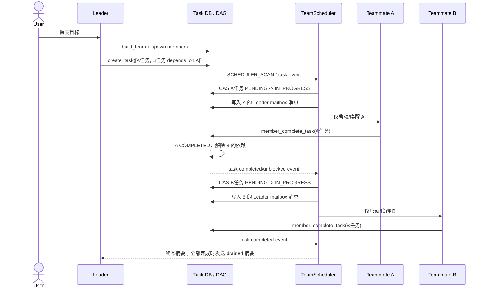
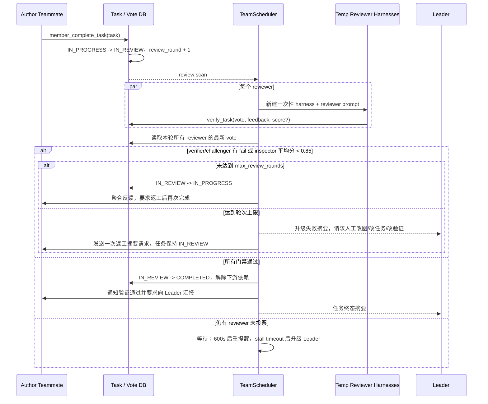
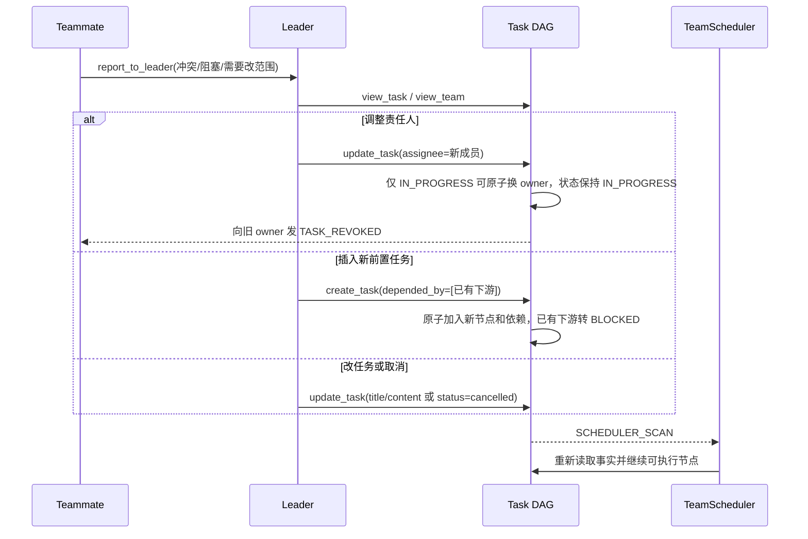

# AgentTeam 调度模式：任务图驱动的低通信协同与验证闭环

## 1. 背景与问题 (Why)

AgentTeam 既要支持开放问题中的自组织协作，也要高效执行责任人和步骤大体已知的标准流程。后者的典型场景是：
Leader 已经能把工作拆成“检索 → 实现 → 验证 → 汇总”的依赖链，成员职责也明确；只要前置任务正常完成，后续任务就应直接交给指定成员。此时继续让每个 Teammate 观察公共看板、自主认领，让 Leader 跟踪每个状态变化并发送协调消息，增加的是协议成本，而不是任务质量。

当前 AgentTeam 的自主模式在这类场景中有三类调度冗余：

1. **承接任务有额外模型循环。** 公共任务通常先进入可认领池，成员需先 `view_task` 再 `claim_task`，协议上至少多出两个工具循环步骤，之后才进入实际工作。
2. **新任务按“全员机会”传播。** `TASK_CREATED` 会唤醒可见该认领池的在线成员；Leader 的自主模式策略还要求在发布一批任务后向 `"*"` 广播，而广播会启动尚未运行的全体成员。对已知责任人的任务，这些唤醒多数不会转化为有效工作。
3. **Leader 位于稳定流程的热路径。** 自主模式的 TaskBoard handler 会把任务变化和看板概览交给 Leader，Leader 再做进展判断、协调和催办。规划稳定时，这部分模型唤醒和通信并非必要。

Swarmflow 已采用“规划前置、代码执行”的近似思路，但处在约束的另一端：规划由普通 Python 脚本承载，Worker 是一次性调用，没有 AgentTeam 的任务看板、成员通信和持续执行上下文。运行恢复依赖 journal 的内容寻址缓存；一次调用只有在结构调用路径与调用签名同时匹配时才命中。脚本中插入、删除或移动调用会改变结构路径，修改 prompt、label、phase、model 或 schema 会改变签名，并可能通过上游输出变化让下游级联失配。因此，运行中修改规划不仅要求模型写对新脚本，还要保护已完成部分的结构和内容身份，否则会产生冗余执行。这个约束仍在持续优化。

调度模式选择两者之间的中间点：

- 保留长期存活的 AgentTeam、任务数据库和 Teammate 在单个任务内的自主能力；
- 把 Leader 的分工与依赖规划前置为持久化任务图；
- 由确定性调度代码完成任务启动、依赖解锁、定向唤醒和验证门禁；
- 乐观假设规划在大多数时间稳定，Leader 退出稳态调度热路径；
- 仅在成员报告冲突、计划审批、验证停滞/超轮或需要改变任务图时重新介入。

所以，“调度模式”不是让 Leader 更频繁地派活，而是把 Leader 的稳定规划能力从每轮协调中抽取出来，变成一次前置规划加少量异常调整。

调度模式的另一个核心价值是**验证可编排性**。验证者集合、返工轮次和通过门槛由代码控制，可以稳定收集多验证者反馈、执行多轮返工并计算门禁。自主模式没有原生 reviewer 调度运行时，通常需要显式创建验证成员和验证任务；Swarmflow 则要在脚本中手写验证调用、聚合和分支控制。

本设计基于 `openjiuwen/agent_teams` 在提交 `5055ed2ac3f7a7ed7b1b020a823814bd14ba5e05` 的实现逆向整理。它记录“当前代码实际做了什么”，并明确标出提示词、旧规格和实现之间的偏差；不是把已有 feature/spec 文档重新转述一遍。

## 2. 目标与非目标

**目标**

- 给出调度模式的可独立评审定义，并明确它与自主模式、Swarmflow 的能力边界和适用条件。
- 记录 Leader 前置生成任务图、调度器接管稳态执行、Leader 异常介入的完整控制流。
- 以代码事实描述任务状态机、依赖图、单成员串行约束、定向投递、恢复扫描和验证门禁。
- 把“减少非必要模型循环、全员唤醒和 Leader 进展通信”转化为可验证的验收指标。
- 诚实记录已实现能力、接口占位/提示词漂移和已知正确性风险，为后续修正提供基线。

**非目标**

- 不在本设计中修改 `openjiuwen` 源码；本文是当前实现的追溯设计和后续收敛依据。
- 不用调度模式替代自主模式。开放探索、动态分工和需要成员横向协商的任务仍适合自主模式。
- 不用调度模式替代 Swarmflow。条件分支、循环、流式 pipeline 和高度确定的程序化控制流仍适合脚本。
- 不提供运行中的 `autonomous ↔ scheduled` 热切换；`dispatch_mode` 是构建期静态选择。
- 不承诺调度器理解任务语义或自动重规划。它只对持久化任务状态和依赖关系做机械协调。
- 不提供任意任务图重写。目前工具可新建子图、改内容、改责任人、取消任务和增加依赖，但不能删除依赖边、重开终态任务或直接把任务写回 `pending`。
- 不把验证者写成常驻 TeamAgent。当前 scheduled reviewer 是临时 `TeamHarness`。

## 3. 术语与上下文

| 术语 | 本文含义 |
|---|---|
| Leader | AgentTeam 的控制面 Agent；负责建队、前置拆解、异常决策和任务图调整 |
| Teammate | 长期存活的执行成员；在自己的任务内自主工作，但在调度模式下不参与任务认领 |
| 调度模式 | `dispatch_mode="scheduled"`；任务创建时必须指定 assignee，由 `TeamScheduler` 按任务图定向启动 |
| 自主模式 | `dispatch_mode="autonomous"`；任务可无 assignee，成员从公共看板观察并认领 |
| 任务图 | 持久化任务节点与依赖边组成的 DAG，是调度模式的规划载体 |
| 稳态路径 | 规划未变化、依赖正常推进、验证未异常时，由代码完成的派发与流转路径 |
| 异常路径 | 冲突、计划审批、验证停滞/超轮、责任人变化或新增依赖等需要 Leader 判断的路径 |
| 验证门禁 | 任务完成后进入 `IN_REVIEW`，由多个临时 reviewer 投票并由代码计算 pass/fail 的流程 |
| Swarmflow | 以 Python `META + async def run(args)` 脚本承载控制流、以一次性 Worker 执行节点的编排模式 |

三个容易混淆的配置轴彼此正交：

- `dispatch_mode` 决定任务如何到达成员：自主认领或代码调度。
- `team_mode` 决定协作/思辨等团队形态，不等同于 dispatch mode。
- 成员的 `plan_mode` 决定任务启动后是否先进入 `PLANNING` 等待 Leader 审批，不改变任务由谁分配。

验证能力也不是 dispatch mode 的同义词。只有 scheduled Leader 会构造 reviewer 调度运行时；`enable_task_verification` 还要同时在蓝图上打开，并且不能被本次 `build_team` 的运行参数关闭。

## 4. 方案设计 (What / How)

### 4.1 总体架构

调度模式把协作拆为“模型规划面”和“确定性执行面”：

```text
                         模型规划面（低频）
  用户 ───────────────> Leader
                          │ 1. build/spawn
                          │ 2. create_task(整批 DAG，逐项 assignee)
                          │ 3. 异常时 update/create/cancel/reassign
                          v
  ┌──────────────────────────────────────────────────────────────────┐
  │                       持久化 Team 数据层                         │
  │ Task / Dependency DAG / Review Round / Review Vote / Mailbox     │
  └───────────────────────┬──────────────────────────────────────────┘
                          │ board event + 周期扫描 + self scan
                          v
  ┌──────────────────────────────────────────────────────────────────┐
  │                  TeamScheduler（Leader 内核）                    │
  │ 依赖就绪与单成员串行 │ CAS 启动 │ 定向投递/按需启动 │ 验证门禁    │
  └───────────────┬───────────────────────────────┬──────────────────┘
                  │                               │
          定向 mailbox + lazy start              │ 临时 reviewer harness
                  v                               v
       ┌──────────────────────┐        ┌────────────────────────────┐
       │ 长期存活 Teammate     │        │ verifier / inspector /     │
       │ 任务内自主执行        │        │ challenger，一次性验证      │
       │ 只完成自己的任务      │        │ 写入本轮 vote               │
       └──────────┬───────────┘        └─────────────┬──────────────┘
                  │ complete / report                │ vote
                  └──────────────────┬────────────────┘
                                     v
                          通过 / 返工 / Leader 升级
```

实现边界如下：

- `CoordinationKernel` 为所有角色建立事件分发和协调处理器，但只为 `scheduled` Leader 构造休眠的 `TeamScheduler`。
- 新团队在 `build_team` 成功回调后激活 scheduler；已有团队在数据库恢复后激活。暂停或停止会停用扫描。
- scheduler 与 coordination 并列消费内核事件：coordination 负责把需要模型知道的输入交给 Agent，scheduler 负责根据任务板决定“下一步应启动谁”。
- Leader 自己通过工具改动任务板时，内核把 self event 转为 `SCHEDULER_SCAN`，避免把同一条任务事件再次送回 Leader 模型，但仍能推动调度。
- scheduler 不按事件类型维护一套脆弱的流程状态机。事件只是“板可能变了”的提示，真正决策来自数据库全量重对账。

三种协作方式不是强弱排序，而是三个不同控制点：

| 维度 | 自主模式 | 调度模式 | Swarmflow |
|---|---|---|---|
| 规划载体 | 公共任务板上的可认领任务 | 带 assignee/reviewer 的持久化任务 DAG | Python 脚本控制流 |
| 谁决定责任人 | Teammate 观察后 `claim_task`；Leader 也可预分配 | Leader 前置指定，scheduler 机械执行 | 脚本在每个 `agent()` 调用处指定 |
| Worker 生命周期 | 长期 TeamAgent | 长期 TeamAgent | 一次性 TeamHarness Worker |
| 成员横向通信 | 支持 peer/broadcast | 普通 Teammate 只能报告 `leader` 或 `user` | Worker 无 TeamAgent 通信和 team tools |
| Leader 是否在稳态热路径 | 是；接收看板进展并协调 | 否；只接收终态摘要、升级及成员主动报告 | 否；通常是脚本运行的旁观者 |
| 规划变更 | 发布/更新任务，让成员重新观察和协商 | 修改持久化任务图，后续扫描重对账 | 修改脚本并重跑，依赖 journal 保住未变节点 |
| 恢复依据 | 数据库任务/消息状态 | 数据库任务/消息状态 + 重扫描 | journal 的结构路径和调用签名 |
| 自由度 | 最高，分工可涌现 | 中等，分工固定但任务内仍自主 | 最低，执行结构由脚本约束 |
| 适用任务 | 需求不确定、探索、成员需协商 | 步骤和责任人基本稳定、可能局部调整 | 控制流确定、需循环/条件/pipeline 的流程 |

调度模式的“中间态”体现在：它比自主模式少了分工自由和 peer 通信，但没有把 Teammate 降为一次性函数调用；它比 Swarmflow 更容易局部修改任务、保留成员上下文和处理开放式执行，但不能表达任意 Python 控制流。

### 4.2 数据流与时序

#### 4.2.1 正常任务链：Leader 只做一次前置规划



关键性质：

- `create_task` 的整批任务图通过一次原子图变更落库；批内 `depends_on` 可前向引用，环、缺失端点、重复 ID 等错误使整批回滚。
- 无依赖且已指定 assignee 的任务先落为 `PENDING`；有未满足依赖的任务落为 `BLOCKED`，但仍保留 assignee。
- 每轮扫描按成员分组，对每个成员只挑最早更新、再按 `task_id` 排序的一个 `PENDING` 任务。
- 若该成员已有 `PLANNING`、`IN_PROGRESS` 或 `IN_REVIEW` 任务，新的任务继续排队。
- `start_task` 使用数据库 CAS 把状态改为 `PLANNING`（plan-mode 成员）或 `IN_PROGRESS`；只有成功取得状态所有权后才投递。
- 投递顺序是“先写持久 mailbox，再尝试启动目标成员”。即使目标离线，任务指令仍可在恢复后读取；启动失败不会丢消息。
- scheduler 的扫描是最多 4 pass 的有界不动点循环，一轮中因完成/评审产生的新动作可继续推进，但不会无限占用事件循环。

#### 4.2.2 验证与返工：代码收集反馈并计算门禁



当前门禁并不是旧规格中常见的“2/3 多数通过”：

- `verifier` 与 `challenger` 组成二元池。代码等待池内全部投票后判定；任意一票 `fail` 都使本池失败。
- `inspector` 池也等待全部投票，以非空 score 的平均值判断，阈值是 `>= 0.85`。
- 混合 reviewer 要求两个池都通过。
- 同一 reviewer 在同一轮可重复投票，tally 取最新一票；上一 review round 的票不会污染下一轮。
- scheduler 只有在“当前轮所需票全部齐备”后才结算，因此“一票否决”是最终数学性质，不是收到首个 fail 就提前短路。

#### 4.2.3 冲突与规划变更：Leader 回到控制面



Leader 的介入触发不是一个完整的自动语义检测系统。当前明确存在的入口包括：Teammate 主动向 Leader 报告、plan-mode 提交计划等待审批、review stall/超轮升级、用户输入，以及 Leader 自己查看后修改任务图。scheduler 不会理解“两份结果语义冲突”，也不会自动生成替代计划。

### 4.3 接口与数据模型

#### 4.3.1 模式选择与工具面

蓝图静态字段：

```python
dispatch_mode: Literal["autonomous", "scheduled"] = "autonomous"
```

该值在 Agent 构建时写入 `TeamSpec`，随后决定 prompt policy、coordination handler 和工具变体。`build_team` 的 capability override 不包含 dispatch mode，不能在一次运行中临时改模式。

调度模式工具差异：

| 角色 | 自主模式 | 调度模式 |
|---|---|---|
| Leader `create_task` | `assignee` 可选，不暴露 reviewer | `assignee` 必填，可配置结构化 reviewer 与轮次上限 |
| Teammate 接活 | `view_task` + `claim_task` | 无 `claim_task`；只接收 scheduler 指令 |
| Teammate 完成 | 通用完成/验证路径 | `member_complete_task`，只能完成自己名下任务 |
| Teammate 消息 | 可发 peer、Leader、user | `ReportToLeaderTool`，recipient 只允许 `leader` 或 `user` |
| Leader 更新 | reviewer 字段被隐藏并在 invoke 层拒绝 | 可改 reviewer、轮次上限、assignee、内容、依赖或取消 |

未知 `dispatch_mode` 不会静默回退，而是在工具工厂按变体取值时失败。

#### 4.3.2 任务图输入

`ScheduledTaskCreateTool` 接收一个 `tasks` 数组，每项的有效逻辑结构为：

```text
TaskGraphSpec
├── task_id?: string                 # 可显式给定，批内引用使用
├── title: string
├── content: string
├── assignee: string                 # scheduled 必填；必须是已存在且非 Leader 的成员
├── depends_on?: [task_id]           # 依赖已有或同批任务，允许前向引用
├── depended_by?: [existing_task_id] # 只用于把新任务插入已有依赖链
├── reviewer?: [
│     { type: verifier|inspector|challenger,
│       reviewer_id?: string,
│       instruction?: string }
│   ]
└── max_review_rounds?: int >= 1     # 只有配置 reviewer 时有意义
```

reviewer 的代码事实需要特别说明：

- 新格式输入通常只给 `type + instruction`；代码按类型在每个任务内生成 `verifier_1`、`inspector_1`、`challenger_1` 等 ID。
- 兼容旧字符串格式，旧值按 verifier ID 读入。
- reviewer **不再要求是团队 roster 中的真实成员**；唯一硬约束是 reviewer ID 不能等于 assignee。
- 旧注释/旧 specs 中“reviewer 必须是真实成员”的描述已经过期；运行时实际为临时 harness。

> **Requirement:** scheduled create_task SHALL 要求每个任务带一个已存在且非 Leader 的 assignee。
> **Scenario:** WHEN Leader 创建缺少 assignee、指向未知成员或指向自己的任务 THEN 整次调用失败，不产生悬空任务。

> **Requirement:** 批量建图 SHALL 是一次原子变更并拒绝有环图。
> **Scenario:** WHEN 同批某条边引用不存在的端点、重复 task ID 或形成环 THEN 全批不落库；WHEN 合法 THEN 节点、assignee 和边一起可见。

> **Requirement:** 同批依赖 SHALL 只用下游节点的 `depends_on` 表达。
> **Scenario:** WHEN `depended_by` 指向本批新节点 THEN 工具在图层之前拒绝；WHEN 指向已有节点 THEN 可把新任务楔入已有链路。

#### 4.3.3 任务状态机

```text
                           plan-mode
                 ┌────────────────────────┐
                 v                        │
PENDING ─────> PLANNING ─────> IN_PROGRESS ─────> COMPLETED
   │                │                │  │              ▲
   │                │                │  └──> IN_REVIEW ┘ pass
   │                │                │          │
   │                │                │          └── fail -> IN_PROGRESS
   │                │                │
   ├────> BLOCKED <─┴────────────────┘
   │          │
   │          └── dependencies resolved -> PENDING
   └────────────────────────────────────────────> CANCELLED

COMPLETED / CANCELLED 为终态，不可重开。
```

完整合法状态边以 `schema/status.py` 的 transition map 为准。与调度相关的核心不变量是：

- 单成员最多一个 active task；active 集合是 `PLANNING`、`IN_PROGRESS`、`IN_REVIEW`。
- blocked 任务保留 assignee；依赖解除后回到 `PENDING`，不需要 Leader 重新分配。
- 有 reviewer 的任务完成时进入 `IN_REVIEW` 并原子增加 `review_round`；无 reviewer 的任务直接完成。
- 任务处于 `IN_REVIEW` 时禁止修改 title/content，避免验证对象在投票中途变化。
- 当前 reassign 只接受 `IN_PROGRESS`，以单条 CAS 原子更换 assignee，状态始终保持 `IN_PROGRESS`；旧 owner 收到定向 revoke，新 owner 收到 targeted claimed。`PENDING`、`PLANNING`、`IN_REVIEW` 改派目前失败。

#### 4.3.4 Review vote

review vote 按 team session 持久化并包含：

```text
(task_id, review_round, reviewer, verdict, feedback, score, created_at)
```

票据采用 append-only 写入。tally 只读取当前 `review_round`，并按 reviewer 选择最新记录。结算用任务状态 CAS 保证 pass/fail 不会被并发扫描重复应用；依赖解锁与 task 状态变更由 task manager/DAO 完成。

> **Requirement:** scheduled reviewer SHALL 只为自己被配置为 reviewer、且当前处于 `IN_REVIEW` 的任务投票。
> **Scenario:** WHEN reviewer ID、task status 或 review round 不匹配 THEN `verify_task` 拒绝写入或结算。

> **Requirement:** 二元 reviewer 池 SHALL 实现全票收齐后的任一 fail 否决，inspector 池 SHALL 以平均分 `>= 0.85` 通过。
> **Scenario:** WHEN verifier/challenger 全部通过且 inspector 平均分为 0.85 THEN 任务通过；WHEN 任一二元票失败或平均分低于 0.85 THEN 进入返工/升级路径。

#### 4.3.5 Scheduler host 契约

`TeamScheduler` 依赖 kernel 提供的 host 能力，而不直接控制 Agent 生命周期：

- 读取 task manager 与 team backend；
- `auto_start_member(name)` 只启动指定成员；
- `deliver_input(content, use_steer=False)` 仅在摘要/升级时注入 Leader；
- 读取 Leader/Teammate spec，为临时 reviewer 构建 harness；
- 通过消息 DAO 以 Leader 身份写入定向 mailbox。

投递消息正文在数据库中存为空字符串，真正可读内容位于 message meta，由模板在交付时结合任务的最新 title/content/round 渲染。这样，离线成员恢复时看到的是当前任务事实，而不是创建消息时冻结的旧副本。

### 4.4 关键流程

#### 4.4.1 构建、激活与恢复

1. Leader kernel 初始化时，如果 role 是 Leader 且 `dispatch_mode=scheduled`，构造 dormant scheduler。
2. 新 team 完成 `build_team` 后，kernel 先激活 scheduler，再允许成员创建和任务发布路径继续运行。
3. 恢复已有 team 时，先从数据库恢复 backend/member 状态和事件总线，再激活 scheduler。
4. 激活立即执行一次 scan；无需等待一条新事件，数据库中遗留的 `PENDING`/`IN_REVIEW` 也会被对账。
5. pause/stop 调用 deactivate；后续 event 被忽略，恢复后重新扫描。

这种“恢复后重扫事实”的设计把数据库状态作为真相。内存去重集合只减少同进程重复消息，不能作为正确性来源。

#### 4.4.2 开工扫描与定向唤醒

`_reconcile_starts` 的顺序是：

1. 读取全部 `PENDING` 任务并忽略无 assignee 的异常记录。
2. 每个成员只选一个最早任务。
3. 检查成员是否已有其他 active task。
4. `start_task` 以状态 CAS 获取开工权。
5. 重新读取任务当前值。
6. 以 Leader 身份写定向 mailbox。
7. best-effort 启动目标成员；失败只记录日志，持久消息留待恢复。

这条路径与自主模式形成直接对照：

```text
自主：发布 -> 全员看到机会 -> view -> claim -> 开工
调度：发布(已含 owner) -> CAS -> 只唤醒 owner -> 开工
```

因此，代码能确定消除的是调度协议中的 `view_task + claim_task` 和非 owner 唤醒；实际 token/时延收益仍需基准测量，不能仅凭设计宣称固定百分比。

#### 4.4.3 Teammate 执行与通信边界

调度模式没有取消 Teammate 的任务内自主性。Teammate 仍可使用自己的工具、工作区和上下文解决任务；plan-mode Teammate 仍可先提交执行计划。但其团队协同能力被收窄：

- 不能 `claim_task`，也不应轮询公共任务池；
- 只能用 `member_complete_task` 完成自己名下任务；
- 普通 `send_message` 被替换为 report-to-leader 变体，不能给 peer 或 `"*"` 广播；
- 冲突、阻塞和范围变化通过 Leader 汇总，避免成员间形成第二套隐式调度图。

Leader 自己仍保留完整消息能力，但 scheduled policy 明确要求不要为正常 handoff 广播。scheduler 的 `_send_as_leader` 直接走定向 mailbox 和 `auto_start_member(target)`，不会调用会启动全体成员的 Leader `send_message` 工具。

#### 4.4.4 验证者生命周期与结算

当前 reviewer 执行不是“唤醒一名 TeamAgent”，而是：

1. 从 reviewer 配置读取 type、ID、instruction。
2. 使用 Teammate spec（缺失时回退 Leader spec）构造一个新的 `TeamHarness`。
3. 为该 harness 绑定 reviewer 身份的 `TeamTaskManager`，在团队 base agent spec 的原有工具上额外挂 `verify_task` 与 `view_task`。
4. 按 verifier/inspector/challenger 生成不同 system prompt，再渲染包含任务信息的验证 prompt。
5. 单次运行后 dispose harness；若文本结果含特定瞬态错误码 `181001`，最多新建 harness 重试 3 次。
6. reviewer 通过 `verify_task` 把票写入数据库，scheduler 在后续 scan 中统一 tally。

这样做的优点是 reviewer 不占 roster、不需要长期唤醒、不会参与普通协同；验证集合可以直接按任务声明。代价是它绕开了常驻成员的 mailbox 和生命周期管理，产生了 §9 中列出的后台任务、重提醒和无票重试问题。

结算流程：

- **pass：** task 完成并解锁依赖；通知 author 验证通过并要求汇报；Leader 收到终态摘要。
- **fail 且未到上限：** 聚合所有失败反馈和 inspector 平均分，task 回到 `IN_PROGRESS`；author 被定向唤醒返工。下一次完成会进入新 round。
- **fail 且达到上限：** task 保持 `IN_REVIEW`，Leader 收到升级；author 收到一次返工摘要请求，等待 Leader 修改任务、责任人、验证策略或取消。
- **票未齐：** 600 秒后按窗口给缺席 reviewer 重提醒；达到 `review_stall_timeout` 后向 Leader 升级，task 仍保持 `IN_REVIEW`。
- **无 reviewer 的 IN_REVIEW：** 仅记录 warning，没有自动恢复路径。

失败反馈还可异步送入 `TeamSkillEvolutionRail`，任务级 callback 不阻塞调度；全任务 drained 时才等待相关反馈任务结束并做 team 级 finalize。这是旁路能力，不参与 pass/fail 正确性。

#### 4.4.5 Leader 调整规划

当前“修改任务图”是几类受限操作的组合，而不是一次任意 DAG patch：

- 批量 `create_task` 新建子图；
- 用新任务的 `depended_by` 把它插到已有任务之前；
- `update_task(assignee=...)` 可给无 owner 的 pending 任务分配成员，或对 `IN_PROGRESS` 任务原子改派；后者不 requeue，保持执行态；
- `update_task(title/content=...)` 修改非 review 中的任务内容；
- `update_task(add_blocked_by=[...])` 增加前置依赖；
- `update_task(status="cancelled")` 取消单个或全部任务；
- 修改/清空 reviewer，或调整 `max_review_rounds`。

当前不支持删除依赖边、直接设置 `status="pending"`、用 `action="reassign"`、改派 pending/planning/review 任务、标记完成或重开终态任务。Leader 若需要大幅改图，通常应取消旧节点并创建新节点。人类成员持有且仍在 team 中的 active task 对 Leader 是锁定的，不能编辑、取消或改派，只能联系该人完成/释放。

#### 4.4.6 与 Swarmflow 的规划调整差异

调度模式的任务节点具有稳定 task ID，已完成节点是数据库终态。给后续节点改 assignee、增加依赖或新建子图，不会让既有 completed task 因“代码位置变化”重新运行。

Swarmflow 的 `agent()` cache key 则由结构路径组成，例如 `("call", ordinal)`、`("par", block, branch)`、`("pipe", block, item, stage)`；signature 是 prompt 与身份选项、schema（有状态 session 还含 history）的 SHA-256。只有 key 和 signature 都相同才跳过 backend。由此得到：

- 在已完成调用之前插入同级结构节点，可能改变后续 ordinal，使其 miss；
- 改已完成调用的 prompt/model/schema 会直接 signature miss；
- 上游重新执行产生不同结果，若嵌入下游 prompt，会使下游级联 miss；
- 使用裸 `asyncio.gather/create_task` 绕开 DSL 会竞争结构计数器，代码只发 warning，可能破坏 resume key；
- 脚本必须保持纯确定性，loader 会对 time/random/datetime/uuid 等风险发 lint warning。

因此，Swarmflow 的计划调整是“修改可执行程序，同时维持 journal 身份”；调度模式的计划调整是“修改持久化业务图，由状态机保护已完成节点”。前者表达力更高，后者对局部动态调整更稳健。

### 4.5 配置与开关

| 配置 | 默认值 | 生效范围 | 当前语义 |
|---|---:|---|---|
| `dispatch_mode` | `autonomous` | Blueprint / build-time | `scheduled` 才构造 TeamScheduler 和 scheduled 工具/prompt；无运行时切换 |
| `enable_task_verification` | `false` | Blueprint ceiling + build override | 蓝图允许且本次 build 未关闭时，scheduled create/update 才保留 reviewer |
| `default_max_review_rounds` | `3` | Team | 任务未配置专属上限时的 review fail 返工轮数上限；必须 `>= 1` |
| `review_stall_timeout` | `1800s` | Team | 本轮长期票不齐时升级 Leader；必须 `> 0` |
| `_REVIEW_RENUDGE_SECONDS` | `600s` | 代码常量 | 未投票 reviewer 的重提醒窗口，不是公开配置 |
| `_MAX_SCAN_PASSES` | `4` | 代码常量 | 单次 scan 的有界不动点迭代次数 |
| `stale_claim_idle_timeout` | `600s` | 主要为 autonomous | 调度模式当前未使用 autonomous 的单调 idle-clock 实现，见 §9 |
| `stale_pending_idle_timeout` | `600s` | autonomous Leader | 调度模式不依赖 Leader 对公共 pending 池做 stale 扫描 |

验证开关有两层约束：蓝图 `false` 时，运行参数不能凭空开启能力；蓝图 `true` 时，本次 `build_team` 可关闭。即使 scheduled create schema展示 reviewer，invoke 时若 verification 实际关闭，create 会把 reviewer 清空；update 的当前实现也会把 reviewer 条目清空。后者是静默行为，与同文件“应明确拒绝而非静默”的注释目标不完全一致，列为实现偏差。

回退策略不是热切换现有团队，而是：新建/重新构建蓝图为 `dispatch_mode="autonomous"`；若只需停用门禁，则关闭 `enable_task_verification`。已有 scheduled 团队暂停后仍按其原 `TeamSpec` 恢复。

## 5. 关键决策与权衡 (ADR)

### 5.1 用持久化任务图承载前置规划

- **决策：** Leader 在执行前为任务声明依赖和 assignee，任务图成为调度真相。
- **背景：** 标准流程的责任人和主要依赖通常稳定，继续用模型发现“下一步谁做”会重复消耗 loop。
- **备选与理由：** 继续用公共任务池可保留最大自由度，但无法消除观察/认领和全员唤醒；改用 Swarmflow 脚本可表达更强控制流，但动态改写和 journal 身份保护更难。任务图在两者之间提供稳定 ID、局部变更和持久状态。
- **影响：** Leader 必须先建立成员再建图；粗拆分质量成为吞吐关键，漏配 owner 的任务不会运行。

### 5.2 Leader 退出稳态调度热路径

- **决策：** 依赖解锁、开工、定向唤醒和验证结算由代码完成；Leader 只处理异常和规划变化。
- **背景：** 每个正常状态变化都唤醒 Leader，会把规划能力退化成重复的状态搬运。
- **备选与理由：** 让 Leader 在每条边完成后发下一条指令，语义灵活但成本和延迟随任务数线性增加；scheduler 扫描无法理解语义，却能可靠处理机械状态转换。
- **影响：** scheduler 必须提供终态摘要和明确升级，否则 Leader 会在低通信设计下失去必要信息。

### 5.3 用“事件提示 + 全板重对账”而非事件状态机

- **决策：** 任意相关 task/member event 只触发 scan，scan 从数据库事实重建下一动作。
- **背景：** 事件可能重复、延迟或在暂停期间错过；恢复时也可能没有新事件。
- **备选与理由：** 为每种事件编码精确增量转移效率略高，但恢复和乱序处理复杂，容易让内存状态偏离任务板。数据库 CAS + 重扫更容易保证最终推进。
- **影响：** 每次 scan 有列表查询成本；通过最多 4 pass、按成员单任务和内存去重控制放大。

### 5.4 先持久消息，再按需启动单个成员

- **决策：** handoff 先写 mailbox，再调用 `auto_start_member(target)`。
- **背景：** 目标成员可能离线、正在启动或启动失败；消息不能依赖一次即时进程调用。
- **备选与理由：** 直接 steer 在线 Agent 延迟低，但离线时丢失；Leader 广播可靠覆盖所有人但造成全员成本。持久定向消息兼顾可靠性和最小唤醒。
- **影响：** 投递以至少一次为现实语义；恢复时可能重复提示，但 task CAS 防止重复取得执行权。

### 5.5 一个成员同一时间只持有一个 active task

- **决策：** `PLANNING`、`IN_PROGRESS`、`IN_REVIEW` 共用一个 active slot。
- **背景：** 长期 Agent 的上下文和工具循环需要清晰当前任务；同时推进多个任务会混合完成语义和 review 归属。
- **备选与理由：** 每成员多任务并行可提高资源利用率，但要求多上下文/多 harness 调度，不符合当前 TeamAgent 生命周期。需要并行时应多建成员或用 Swarmflow fan-out。
- **影响：** 一个长时间 review 会阻塞该 author 的后续任务，review stall 的处理直接影响吞吐。

### 5.6 验证者用临时 harness，门禁用确定性代码

- **决策：** reviewer 不占常驻 roster；每轮由 scheduler 创建临时 harness，票据持久化后由代码结算。
- **背景：** 验证是任务级弹性容量，常驻验证成员会增加空闲生命周期和自主协调任务。
- **备选与理由：** 常驻 TeamAgent 可复用上下文和 mailbox，但要占 team member、处理认领/唤醒；让 Leader 汇总自由文本则无法稳定实现多轮门禁。临时 harness + 结构化 vote 更易验证。
- **影响：** reviewer 生命周期与常驻成员不同，需要单独处理取消、重试和无票；当前实现尚未完全收敛这些边界。

### 5.7 dispatch mode 采用构建期静态选择

- **决策：** `dispatch_mode` 固化在 blueprint/TeamSpec，不作为 build capability 动态覆盖。
- **背景：** 两种模式暴露不同工具、提示词和事件语义；热切换会让已存在的无 assignee 任务、peer 消息和 reviewer 状态失去解释。
- **备选与理由：** 运行时切换更灵活，但需要任务迁移协议、tool card 重建和成员提示更新，当前没有安全实现。
- **影响：** 回退必须通过新 team/新蓝图完成，不能把正在运行的 scheduled team 原地改为 autonomous。

### 5.8 被否决的备选与取舍理由

- **所有任务都使用自主认领：** 保留最大自由度，但标准流程仍付出无效观察、认领和广播成本。
- **所有流程都生成 Swarmflow：** 控制最强，但把局部计划调整转化为脚本改写和 journal 身份维护，对模型与提示信息要求过高；还会失去长期成员协作语义。
- **Leader 逐步发送每一次 handoff：** 简单直观，却把 Leader 永久留在热路径，无法达到低通信目标。
- **任务事件直接携带并执行下一动作：** 减少查询，但对重复/乱序/恢复不稳，不如任务板重对账。
- **Reviewer 必须是常驻真实成员：** 生命周期统一，但浪费 roster 和唤醒；对每任务不同验证角色也不灵活。
- **用多数票统一所有 reviewer：** 简单但弱化了 verifier/challenger 的一票否决和 inspector 的连续评分含义。当前实现选择按角色分池；门槛仍应产品化而非永久硬编码。

## 6. 影响面与兼容性

### 6.1 代码影响面

| 模块 | 当前职责/变化 |
|---|---|
| `schema/blueprint.py` | 声明静态 `dispatch_mode`、verification ceiling、review round/stall 配置并写入 TeamSpec |
| `agent/coordination/kernel.py` | 只为 scheduled Leader 构造/激活 scheduler，组合协调事件与调度 scan，提供定向启动和 Leader 注入 |
| `agent/scheduling/scheduler.py` | 开工重对账、定向 handoff、临时 reviewer、门禁结算、返工/升级、终态 digest |
| `agent/coordination/dispatcher.py`、`handlers/task_board.py`、`handlers/stale_task.py` | 选择模式 handler；autonomous 把公共任务变化交给成员/Leader，scheduled 抑制普通 board 唤醒并保留定向控制 |
| `tools/tool_factory.py` | 按 dispatch mode 选择 task/message/completion 工具变体 |
| `tools/tool_task.py` | scheduled create 必填 owner，reviewer 结构，图变更和 Leader update 契约 |
| `tools/task_manager.py` / `tools/database/*` | 原子 DAG、CAS 状态转换、依赖解锁、review round/vote 和最新票 tally |
| `prompts/*` / `tools/locales/*` | 向 Leader/Teammate 解释前置规划、无认领、无广播和异常介入策略 |
| `workflow/*` | 不被 scheduled runtime 调用；只作为 Swarmflow 对比边界 |

### 6.2 兼容性

- 默认仍是 `autonomous` 且 verification 默认关闭，现有蓝图不会因新增 scheduled 语义自动改变。
- 数据层继续允许无 assignee 任务以服务 autonomous；scheduled 工具在边界层收紧为必填。
- 旧 reviewer 字符串可读并升级为 verifier，减少历史数据迁移需求。
- review 表按 team session 隔离，恢复时保留轮次和票；scheduler 内存去重不持久化，恢复可能重发但不应重复结算。
- autonomous update schema 隐藏 reviewer，并在直接 invoke 时明确拒绝该参数；正常 autonomous 路径没有 reviewer 调度器。

### 6.3 已确认的代码/文档偏差

| 偏差 | 当前代码事实 | 影响 |
|---|---|---|
| 旧规格称 reviewer 必须是真实 team member | `_validate_reviewers` 只做 self-review 检查，scheduler 创建临时 harness | 评审与测试应按临时 reviewer 模型，不应依赖 roster |
| 旧规格/文档描述 2/3 阈值 | 当前是 binary pool 任一 fail 否决，inspector 平均分 `>=0.85` | 产品语义与历史文档不一致，必须以代码为准 |
| prompt 示例使用 `update_task(action="reassign")` 或 `status="pending"` | schema 无 `action`，status enum 只有 `cancelled`；改派应传 `assignee` | Leader 可能按提示调用不存在的接口，导致规划恢复失败 |
| `UpdateTaskTool` 注释称改派会 reset 到 pending | 实际 `TeamTaskManager.reassign` / DAO 只接受 `IN_PROGRESS`，原子换 owner 且状态不变 | 代码内契约自相矛盾；pending/planning/review 改派当前不可用 |
| prompt 声称更新内容会撤销 claim 并回到 pending | 当前内容更新保留状态/assignee；`IN_REVIEW` 直接禁止内容修改 | Leader 对运行中变更的预期可能错误 |
| verification 关闭时 update 注释主张明确拒绝 | scheduled update 实际把 reviewer entries 静默清空 | Leader 可能误以为门禁已配置 |
| 调度模式旧 stale sweep 仍按 DB `updated_at` | autonomous 已改用恢复后重置的单调 idle clock，scheduled 未同步且把 `IN_REVIEW` 算 active | 长 pause/resume 后可能产生误判提醒；review 也可能被错误当作执行停滞 |

这些偏差不是文字润色问题，其中 prompt/tool schema 漂移会直接影响模型能否正确调整规划，应优先修复。

## 7. 测试与验证

### 7.1 当前代码验证结果

在代码基线 `5055ed2a`、Python 3.11.14 下执行：

```text
tests/unit_tests/agent_teams/agent/test_team_scheduler.py
tests/unit_tests/agent_teams/test_review_voting.py
tests/unit_tests/agent_teams/agent/test_review_feedback_evolution.py
结果：36 passed

tests/unit_tests/agent_teams/agent/test_mode_handlers.py
tests/unit_tests/agent_teams/test_dispatch_choice.py
tests/unit_tests/agent_teams/test_verify_gate.py
tests/unit_tests/agent_teams/tools/test_member_complete_task.py
tests/unit_tests/agent_teams/tools/test_tool_variants.py
tests/unit_tests/agent_teams/test_team_tools.py
tests/unit_tests/agent_teams/test_database.py
结果：349 passed, 14 skipped
```

合计 399 项：385 passed、14 skipped。调度器测试覆盖 assigned pending 开工、无正文 meta handoff、单成员串行、plan mode、依赖解锁、inactive 忽略、review pass/fail/超轮/stall/重提醒、终态 digest、门禁边界和反馈演进。

第一组测试另产生 14 条 `scheduler.py:231` 的 `AsyncMock` coroutine 未 await warning，原因是测试替身把同步 `task_verification_enabled()` 模拟成 async；不等同于生产逻辑失败，但应修正 fixture，避免 warning 淹没真实异步泄漏。

### 7.2 验收标准

1. **定向启动：** 创建 N 个分配给不同成员的就绪任务时，只启动有就绪任务的目标成员；不调用全员 startup/broadcast。
2. **无认领：** scheduled Teammate 工具集中不存在 `claim_task`；一次正常 handoff 不要求 `view_task` 后再认领。
3. **单成员串行：** 同一成员的第二个任务在第一个处于 planning/progress/review 时保持 pending。
4. **依赖正确：** blocked 节点只有在所有前置 completed 后变 pending；取消/失败结算不得误解锁。
5. **恢复推进：** scheduler 重启后只依赖数据库即可继续 pending/review；重复 scan 不重复状态结算。
6. **验证收齐：** 每轮按 reviewer ID 收集最新票，旧轮票不参与；binary/inspector/mixed 的边界值与 §4.2 一致。
7. **返工与升级：** fail 未超轮回到 progress 并给 author 聚合反馈；超轮/stall 保持 review 并只向 Leader 升级一次（单进程内）。
8. **图调整：** `IN_PROGRESS` reassign 保持状态并定向切换 owner；插入前置、取消和增加依赖后按新图继续，不重跑 completed 节点；其他状态的改派应明确失败。
9. **提示词契约：** 所有 Leader 示例参数均必须通过当前 ToolCard schema；不得再出现 `action=reassign`、`status=pending` 等幽灵接口。

### 7.3 效率验证方案

当前仓库没有证明调度模式节省固定 token 百分比的 benchmark。上线评估应对同一批稳定 DAG 做 A/B：

| 指标 | 预期方向 |
|---|---|
| 每个任务进入实际工作前的模型轮数 | scheduled 低于 autonomous，目标去掉 view/claim 两个工具步骤 |
| 每批新任务唤醒的非 owner 成员数 | scheduled 为 0 |
| Leader 因纯进展变化被唤醒次数 | scheduled 接近终态任务数 + 异常数，而非所有状态变化数 |
| 成员间消息数 | scheduled 无 peer/broadcast；只统计 author→Leader 报告和 scheduler 定向指令 |
| 从依赖解锁到下游开工的 p50/p95 | scheduled 应只含 DB/event/目标 startup 延迟 |
| 重复执行率 | task completed 不重跑；与修改 Swarmflow 脚本后的 cache miss 率对照 |
| review 收齐率/平均轮次/超时率 | 验证闭环的健康度和门禁成本 |

## 8. 可观测性

### 8.1 当前能力

当前 scheduler 主要依赖结构化/半结构化日志：激活、扫描失败、成员开工、临时 reviewer 创建、review pass/fail、重提醒、stall/超轮升级、feedback rail 异常和全部完成摘要。进展与任务状态还可从持久化 Task/Message/ReviewVote 表还原。临时 reviewer 的 spawn 日志当前还存在格式占位符缺失（传了参数但消息中没有 `%s`）的问题，可能产生 logging error，应修复后再依赖该日志做统计。

但当前没有一套完整的 scheduler 指标、scan trace 或“为什么跳过某任务”的可查询决策记录。内存集合 `_review_dispatched`、`_review_renudged_at`、`_review_escalated`、`_completion_notified`、`_drained_notified` 也没有持久观测面。

### 8.2 建议指标

- `agent_team_scheduler_scan_total{trigger,result}` 与 `scan_passes` histogram。
- `task_dispatch_latency_seconds`：pending/unblocked 到 CAS start。
- `member_target_start_total{result}` 与非目标成员 wake count。
- `task_dispatch_skip_total{reason=member_busy|no_assignee|cas_lost}`。
- `review_round_duration_seconds{result=pass|fail|stall}`。
- `review_vote_pending{type}`、`review_temp_harness_total{result,retry}`。
- `review_escalation_total{reason=stall|max_rounds|no_reviewer}`。
- `leader_scheduler_injection_total{kind=completion|drained|review_escalation}`。
- `scheduler_duplicate_delivery_total`，用于识别恢复后的至少一次重发。
- `task_graph_mutation_total{operation,result}` 与 cycle/missing endpoint 拒绝原因。

每个日志/trace 至少携带 `team_name`、`session_id`、`task_id`、`review_round`、`member/reviewer` 和 scan trigger；不得把完整任务 content 或 reviewer feedback 默认打到高基数指标标签。

## 9. 风险与回滚

| 风险 | 代码事实与后果 | 缓解/回滚 |
|---|---|---|
| 前置规划错误或过粗 | scheduler 不理解语义，只会忠实执行错误 assignee/依赖 | 由 Leader 查看并通过 create/update/cancel/reassign 局部改图；大改时取消旧图重建 |
| Leader 信息不足 | scheduled 抑制普通 board wake；若成员不报告语义冲突，Leader 不会自动发现 | 明确 Teammate report 契约；对 stall/超轮和终态保留 digest；增加异常指标 |
| 内存去重不持久 | scheduler 重启后可能重发 handoff、review dispatch、digest 或 escalation | task/review settle 用 DB CAS 保证状态正确；后续把必要 delivery ledger 持久化 |
| reviewer background task 未纳管 | `_dispatch_to_reviewer` 用裸 `asyncio.create_task`，scheduler 不保存/取消该 task；pause/stop 后 reviewer 仍可能写票 | 把 reviewer task 纳入 scheduler task registry，deactivate 时取消/等待；修复前可关闭 verification |
| reviewer 正常返回但未投票 | dispatch key 已标记，只有抛异常或特定瞬态码才清除；普通“无 vote”不会自动重建 harness | 运行后核对 vote；无票应清 key 并有界重试，最终升级 Leader |
| review dispatch 去重粒度过粗 | `_review_dispatched` 以 `(task_id, round)` 为整轮键；任一 reviewer 异常会清整轮键，下一 scan 可能连已投票 reviewer 一起重新执行 | 改为 `(task_id, round, reviewer)`，spawn 前先读取本轮最新票；保留 latest-vote 语义作为最后防线 |
| 临时 reviewer 的重提醒通道不匹配 | 600s re-nudge 走常驻成员 mailbox，但自动 reviewer ID 通常不在 roster；`send_message` 不校验收件人存在，仍会写一条 unread direct message。若任务后来结算为终态，这条无人消费的消息会被 `is_team_completed()` 的“任意 unread 阻塞完成”条件命中 | 临时 reviewer 应重新 spawn harness，而非写 member mailbox；清理/ack 已产生的 synthetic reviewer 孤儿消息 |
| stale 误判 | scheduled stale handler 用 DB wall-clock `updated_at`，长 pause 后恢复可能立刻被判 stale，并包含 `IN_REVIEW` | 对齐 autonomous 的 monotonic idle baseline，并把 review stall 只交给 scheduler |
| prompt/tool 漂移 | Leader 被提示调用不存在的 action/status，异常时恰好无法修图 | 用 ToolCard schema 生成示例/契约测试；修复 §6.3 所列 prompt |
| 固定门禁不适合所有任务 | 0.85 和角色池规则硬编码，无法按任务定制阈值/策略 | 先保证当前规则可见；未来将 policy 版本化并写入任务，避免静默改语义 |
| active slot 被 review 阻塞 | author 的任务停在 IN_REVIEW 时不能接下一项 | 提高 reviewer 可靠性、缩短可配置 stall；必要时 Leader 清 reviewer/取消/改图 |
| scan pass 上限导致一轮未完全推进 | 超过 4 层即时动作时本轮停止 | 后续 task/event/poll 会再次触发；监控 pass=4 的频率 |

**降级顺序：**

1. 验证异常时关闭 `enable_task_verification`，保留 scheduled 定向分配。
2. scheduler 异常时暂停 team，人工检查任务板；修复后恢复会重扫。
3. 新建 autonomous 蓝图和团队迁移未完成工作。不能原地热切换现有 team。
4. 对高度确定且任务图不适合表达的剩余流程，可另行转为 Swarmflow；这不是自动回滚路径。

## 10. 开放问题 (Open Questions)

- [ ] reviewer harness 运行结束但未写 vote 时，是否应立即有界重试，还是直接升级 Leader？需要定义“无票”与模型业务性拒绝的区别。
- [ ] 是否把 review dispatch/renudge/escalation/digest 的幂等键持久化，提供跨重启的 exactly-once 用户体验？
- [ ] 临时 reviewer 是否彻底禁止 mailbox 重提醒、统一为重新 spawn；对已经落库的 synthetic reviewer unread 采用删除、自动 ack 还是迁移，需要确定兼容策略。
- [ ] 是否将 binary/inspector 门禁阈值做成带版本的 task-level policy，而不是硬编码 `0.85`？
- [ ] 是否支持删除依赖边、显式 requeue 和 reopen，还是继续要求“取消旧节点 + 新建节点”以保护状态机简单性？
- [ ] 如何定义可接受的前置规划稳定度，并用任务重派率/改图率自动建议 autonomous、scheduled 或 Swarmflow？
- [ ] scheduled stale detection 何时与 autonomous 的 monotonic idle clock 对齐，并排除 `IN_REVIEW`？
- [ ] 修复 prompt/schema 漂移后，是否加入从中文/英文 prompt 抽取示例并自动过 ToolCard JSON Schema 的 CI 测试？
- [ ] `enable_task_verification=false` 时 scheduled update 应明确报错还是允许显式清空 reviewer？当前静默清空需要定案。
- [ ] 调度模式的效率目标应以 token、模型轮数、唤醒数还是端到端时间作为主 SLI？建议优先“非 owner 唤醒数=0”和“开工前工具步数”。

## 11. 评审记录 (Iteration Log)

| 轮次 | 日期 | 版本 | 评审人 | 结论 | 主要修改/讨论 |
|---|---|---|---|---|---|
| — | 2026-08-20 | 1 | @alan_cheng | draft | 基于 `openjiuwen/agent_teams@5055ed2a` 逆向当前实现；补齐自主模式与 Swarmflow 对比、任务图调度、临时 reviewer 门禁、代码测试和已知偏差 |

## 12. 实现记录与偏差

### 12.1 实际实现

调度模式代码已经存在，本 SDD 是补录的追溯设计；文档本身仍处于 proposals/draft，不表示实现已经按本设计完成正式评审。

核心实现演进：

| commit | 日期 | 代码事实 |
|---|---|---|
| `fd5c5c33e` | 2026-07-10 | 引入 scheduled dispatch runtime 与 review voting |
| `6262ffc4b` | 2026-07-14 | handoff 改为交付时模板渲染 |
| `1208ed1d6` | 2026-08-01 | scheduled reviewer 改为临时 harness |
| `9229d8762` | 2026-08-07 | review fail 返工/重规划与 reviewer 角色 |
| `5aad9c9c8` / `7e48843c2` | 2026-08-10 | reviewer feedback 接入 skill evolution rail 并下沉编排 |
| `5055ed2a` | 2026-08-17 | 本文审计基线 |

主要落点：

- `openjiuwen/agent_teams/agent/scheduling/scheduler.py`
- `openjiuwen/agent_teams/agent/coordination/kernel.py`
- `openjiuwen/agent_teams/agent/coordination/dispatcher.py`
- `openjiuwen/agent_teams/agent/coordination/handlers/task_board.py`
- `openjiuwen/agent_teams/agent/coordination/handlers/stale_task.py`
- `openjiuwen/agent_teams/schema/blueprint.py`
- `openjiuwen/agent_teams/schema/task.py`
- `openjiuwen/agent_teams/schema/status.py`
- `openjiuwen/agent_teams/tools/tool_factory.py`
- `openjiuwen/agent_teams/tools/tool_task.py`
- `openjiuwen/agent_teams/tools/task_manager.py`
- `openjiuwen/agent_teams/tools/database/task_dao.py`
- `openjiuwen/agent_teams/prompts/`
- `openjiuwen/agent_teams/workflow/engine/journal.py`（Swarmflow 对比）

### 12.2 与设计意图的偏差

相对于“Leader 只在必要时介入、验证流程由代码稳定控制”的目标，当前实现有以下未闭环点：

1. 临时 reviewer 的 task 没有纳入 scheduler lifecycle，pause/stop 不会取消它。
2. reviewer 正常结束但不投票时，dispatch 去重不会自动释放，重提醒又错误复用了 member mailbox 语义。
3. review/digest/escalation 去重只在内存中，恢复后可能重复通知。
4. scheduled stale sweep 与新的 autonomous idle-clock 机制不一致。
5. Leader prompt 中仍有 `action=reassign`、`status=pending` 和“内容更新自动 requeue”等与工具不一致的表述；`UpdateTaskTool` 自身注释也把真实的“IN_PROGRESS 原地换 owner”误写成 reset pending。
6. 门禁算法已从历史“2/3”演变为角色分池，但旧说明未统一更新。
7. “任务图可调整”目前只支持增加依赖，不能删除边或重开终态，能力小于任意图编辑的概念表述。
8. scheduler 有日志但缺少系统性指标，尚不能直接证明低通信收益。

### 12.3 链接

- 实现仓库：`openjiuwen-develop-re`
- 审计基线：`openjiuwen-develop-re@5055ed2ac3f7a7ed7b1b020a823814bd14ba5e05`
- 本地代码范围：`/Users/alan/Developer/PycharmProjects/openjiuwen-develop-re/openjiuwen/agent_teams`
- 未提供可公开访问的 PR URL；上表以 repo@commit 记录可追溯实现。

### 12.4 遗留与后续

优先级建议：

1. **正确性/契约：** 修复 prompt 与 ToolCard 漂移；reviewer 无票检测；临时 harness 生命周期；验证关闭时的明确行为。
2. **恢复与完成性：** 持久化必要幂等键；确认/修复 synthetic reviewer unread；scheduled stale clock 对齐。
3. **可观测性：** 增加定向唤醒、Leader 注入、dispatch latency 和 review stall 指标。
4. **产品化：** 门禁 policy 配置化、任务图删除边/requeue 能力、基于任务稳定度的模式选择建议。

## 13. 参考与关联设计

- SDD-0005（swarmflow-script-enhancement-and-cc-alignment）：Swarmflow 脚本形态与 Agent Team 对齐，是本文比较“任务图 vs. 脚本”规划载体的关联设计。
- `openjiuwen/agent_teams/agent/scheduling/AGENTS.md`：scheduler 与 coordination 的实现边界和不变量。
- `openjiuwen/agent_teams/workflow/AGENTS.md`：Swarmflow journal、脚本物化和 resume 约束。
- `openjiuwen/agent_teams/tools/AGENTS.md`：任务图、工具变体和消息投递规则；其中 reviewer 必须是真实成员的旧描述已被当前代码取代，本文按代码记录偏差。
- `tests/unit_tests/agent_teams/agent/test_team_scheduler.py`：调度和门禁主流程测试。
- `tests/unit_tests/agent_teams/test_review_voting.py`：review round、最新票和结算测试。
- `tests/unit_tests/agent_teams/test_dispatch_choice.py`、`test_verify_gate.py`、`tools/test_tool_variants.py`：模式与工具面测试。
