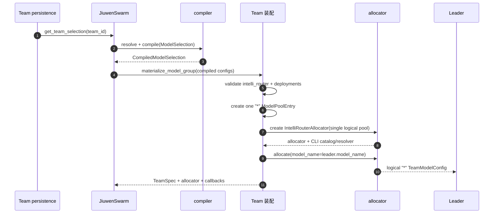
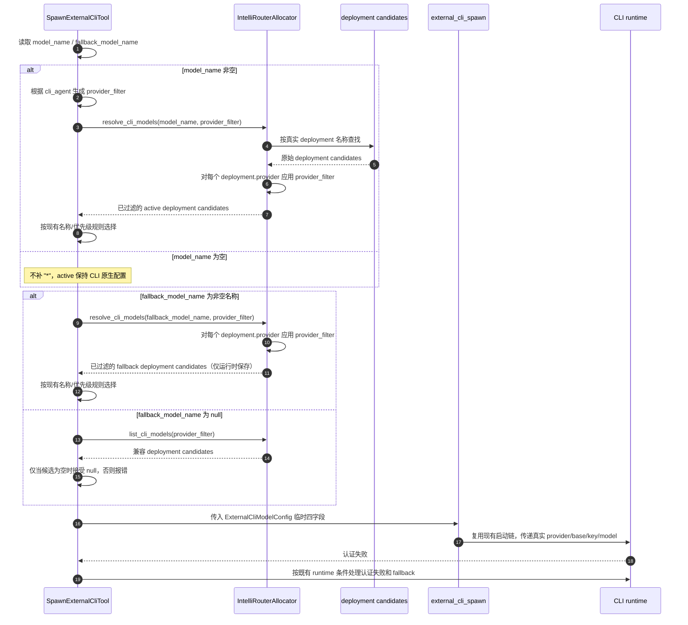

# Team 模式模型组接入与成员模型分配

## 1. 背景与问题 (Why)

模型组把“选择哪个业务模型”与“本次请求由哪个部署承载”拆成了两层：上游选择层保存稳定的模型或模型组 ID，compiler 把已经过权限检查、密钥解析和参数合并的结果编译为 Foundation 配置，IntelliRouter 在请求级完成 route、重试、fallback 和健康检查。Team 目前只有面向单模型池的装配路径，不能直接消费这份结构化产物。

### 1.1 当前链路

当前 Team 启动链路如下：

```text
JiuwenSwarm TeamManager
    -> get_effective_team_model_entries()
    -> ModelPoolEntry(model_name, api_key, api_base_url, api_provider)
    -> TeamAgentSpec.model_pool / TeamSpec.model_pool
    -> build_model_allocator()
    -> Leader / teammate / bridge / external CLI
```

主要实现位置：

| 能力 | 当前代码 |
|---|---|
| Team 普通模型池装配 | `jiuwenswarm/agents/harness/team/team_manager.py::_load_team_spec` |
| Team 池条目 | `agent_teams/models/pool.py::ModelPoolEntry` |
| Team allocator | `agent_teams/models/allocator.py::build_model_allocator` |
| TeamSpec 构建与 Leader 预分配 | `agent_teams/schema/blueprint.py::TeamAgentSpec.build` |
| 成员和 external CLI 工具 | `agent_teams/tools/team.py`、`agent_teams/tools/tool_member.py` |
| 成员恢复 | `agent_teams/agent/spawn_manager.py::build_context_from_db` |
| allocator checkpoint | `agent_teams/agent/recovery_manager.py` |

现有路径将每个具名模型作为一个池条目，默认策略通常是 `by_model_name`。它没有模型组业务 ID，也没有结构化 `intelli_router` 配置的 Team 装配入口。

### 1.2 上游已交付的能力

上游 Foundation/compiler 已交付以下模型组能力：

- `ResolvedModel`、`ResolvedRoute`、`ResolvedModelGroup`、`ModelSelection` 和 `CompiledModelSelection` DTO；
- `compile_model_selection()`，输出 `CompiledModelSelection`（包含 `ModelClientConfig` 与 `ModelRequestConfig`）；`ModelRequestConfig` 定义 `model`、`temperature`、`top_p`、`max_tokens`、`stop`、`context_window`、`reasoning` 及扩展请求字段。模型组的组级、模型级和路由级请求参数已合并到各 deployment 的 `request_defaults`，因此当前 compiler 返回的顶层 `ModelRequestConfig` 各字段均为缺省值；
- `IntelliRouterConfig` 和 `IntelliRouterDeploymentConfig` 结构化 schema；
- `IntelliRouterModelClient` 对 IntelliRouter deployment 列表、route metadata、部署级 request defaults、endpoint profile 和 custom headers 的消费；模型组 ID 随结构化 IntelliRouter 配置传递，用于 Router 事件/观测关联，但不作为 CLI 模型名或 Team 成员坐标。
- `request_succeeded`、`stream_route_selected`、`all_deployments_exhausted` 到 Core callback 的路由事件桥接。

compiler 产物的最小形态为：

```python
CompiledModelSelection(
    model_client_config=ModelClientConfig(
        client_provider="intelli_router",
        intelli_router=IntelliRouterConfig(
            model_group_id="mg_general",
            strategy="ordered-failover",
            num_retries=1,
            deployments=[
                IntelliRouterDeploymentConfig(
                    route_id="route_primary",
                    model_id="model_a",
                    model_name="provider-model-a",
                    provider="openai",
                    api_base="https://api.example.com",
                    api_key="<resolved-secret>",
                    request_defaults={"temperature": 0.2},
                ),
            ],
        ),
    ),
    model_request_config=ModelRequestConfig(
        model="",
        temperature=None,
        top_p=None,
        max_tokens=None,
        stop=None,
        context_window=None,
        reasoning=None,
    ),
    selected_type="model_group",
    selected_id="mg_general",
)
```

这些能力已经属于上游或 Foundation 的职责；Team 不重新读取 catalog、解析密钥、执行权限检查，也不复制 Router 算法。`api_base`、`endpoint_profile`、`custom_headers` 等 deployment 字段必须完整保留在快照中；Team 不解释地址、认证方式或自定义 header。普通成员由 IntelliRouter client 将这些字段交给对应 deployment/provider adapter，CLI 投影只提取 `model/provider/api_base/api_key` 四个字段。

### 1.3 Team 当前的三个断点

1. **输入形态不匹配**：TeamManager 只接受普通模型条目，没有把 compiler 的结构化配置转换为 `ModelPoolEntry.metadata`。
2. **两级路由边界不清**：IntelliRouter 的 physical deployment 不能被误当作 Team allocator 的多个成员 endpoint，否则 allocator 和 Router 会重复承担故障转移和限流职责。
3. **external CLI 不兼容星号入口**：CLI 子进程需要真实的 `model_name`、`provider`、`api_base` 和 `api_key`，而模型组 Team entry 的逻辑名是 `"*"`，顶层 provider 是 `intelli_router`，凭证位于 deployment 内部。CLI 的候选目录必须从 deployment 快照生成，不能把星号 entry 当成 CLI 模型。

### 1.4 方案边界

Team 模型组入口采用现有 `intelli_router` strategy，由模型组专用的 `IntelliRouterAllocator` 承载成员分配和 deployment 查询，由 `IntelliRouterModelClient` 承载请求级路由。Team 装配层消费 compiler 输出的结构化 `intelli_router` 配置；external CLI 场景通过同一份 deployment 快照取得四字段运行时配置。CLI 的 provider 兼容规则由调用方根据 `cli_agent` 生成 `provider_filter`，模型组 allocator 负责将其应用到真实 deployment；fallback 和认证失败处理仍由 CLI runtime 的既有处理链执行。

## 2. 目标与非目标

**目标**

- Team 能接收已编译的 `CompiledModelSelection`，并物化为可恢复的模型组主池；
- compiler-driven 模型组在 Team 主池中默认只有一个 `model_name="*"` entry，完整 deployments 保存在结构化 metadata 中；
- Leader、teammate 和 bridge 使用模型组的固定逻辑分配器，Team 只分配逻辑入口，IntelliRouter 客户端负责请求级 route、retry、fallback、健康检查和流量策略；
- external CLI 在模型组路径读取同一份 IntelliRouter deployment 快照，只接收 `model/provider/api_base/api_key` 四字段临时配置；CLI 子进程独立于 IntelliRouter 请求级路由运行；
- external CLI 的 active/fallback 输入和校验沿用现有语义。`fallback_model_name` 字段在工具协议中必填，但值可以是非空模型名或 `null`。当按 `cli_agent` 过滤后 Team 模型池存在兼容模型时，`fallback_model_name` 不得为 `null`，必须填写来自 Team 模型池且 provider 与 `cli_agent` 兼容的模型名；如果当前模型存在于 Team 模型池且兼容，则必须优先填写当前模型；当前模型不在池中或不兼容时，才允许选择其他兼容模型。当过滤后不存在任何兼容 Team 模型时，`fallback_model_name` 必须为 `null`，表示使用 CLI 原生模型且不启用 Team fallback。错误或不兼容的非空模型名直接失败，不转换为 `null`，也不创建成员。`model_name` 缺省时不调用 Team allocator，使用 CLI 原生配置；active/fallback 四字段只在本次启动期间使用。模型组成员记录中的 `model_ref.model_name` 表示当前生效模型；认证失败 promote 后按现有 runtime 更新该名称。fallback 的启用和认证失败处理仍由现有 external CLI runtime 决定；Team 不增加新的 promote 条件；
- Team 级业务持久化保存稳定的 `ModelSelection(type, id)`；agent-core checkpoint 中的 `TeamSpec.model_pool` 仍是运行时快照，可能包含已解析凭证，必须按现有 checkpoint 访问控制保护，不能作为业务配置或跨 Team 共享存储；成员引用以名称作为语义坐标，普通多 endpoint 池仍按现有名称/位置语义运行；
- 普通单模型池、`round_robin`、`by_model_name`、`router`、旧 TeamSpec 和旧 checkpoint 均可继续读取和运行；
- pool update、冷恢复、CLI 恢复都从当前有效选择重新编译；CLI 投影视图只存在于启动请求生命周期，一次成员/CLI 启动使用创建时的 allocator 快照。

**非目标**

- 模型目录、权限、`compile_model_selection()` 和前端模型组选择器由上游模块负责；
- Router 的策略、权重、重试、fallback、健康检查和限流由 IntelliRouter/Foundation 负责；
- Team 主池以单一逻辑 entry 表达模型组，physical deployment 保留在 Router 配置中；
- external CLI 通过独立子进程使用 deployment 四字段，不进入 IntelliRouter 请求级 route、retry 和指标链路；
- external CLI 子进程协议、Claude/Codex SDK 行为和普通单模型 CLI 语义由既有 CLI runtime 负责；
- CLI 真实模型名来自调用方显式传入的 deployment 名称，Team 逻辑名 `"*"` 仅用于普通成员；
- Team persistence 保存业务 `ModelSelection(type, id)`，agent-core runtime 使用编译快照。

## 3. 术语与上下文

| 术语 | 含义 |
|---|---|
| 业务选择 | `ModelSelection(type, id)`，例如 `{"type":"model_group","id":"mg_general"}` |
| 编译产物 | 上游 compiler 返回的 `CompiledModelSelection`，其中包含 `model_client_config` 与 `model_request_config` |
| 主池 | `TeamSpec.model_pool`；模型组场景为 compiler-driven 的单一逻辑 entry |
| 星号 entry | `model_name="*"`、`api_provider="intelli_router"` 的 Team 逻辑入口 |
| deployment | 模型组中的真实模型、provider、地址、凭证和部署级参数 |
| 普通分配 | allocator 向 Leader、teammate 或 bridge 返回逻辑 `ModelPoolEntry` |
| CLI 投影 | 将匹配的真实 deployment 转为 CLI 所需的 `model/provider/api_base/api_key` 临时配置 |
| active 名称 | `spawn_external_cli` 显式传入的 `model_name` |
| fallback 名称 | `spawn_external_cli` 传入的 `fallback_model_name`；无兼容模型时允许为 `null` |
| 成员坐标 | 模型组普通成员使用逻辑名 `"*"`，模型组 CLI 使用最终生效的模型名；普通多 endpoint 池仍按名称加位置工作 |
| 旧坐标 | 已有 checkpoint 中的 `{model_name, model_index}`，仅用于兼容读取 |

### 3.1 两级路由的职责边界

| 层 | 负责 | 不负责 |
|---|---|---|
| Team persistence / JiuwenSwarm | 保存稳定选择 ID、恢复选择、触发编译 | 解析密钥、实现 Router |
| compiler | 校验选择、合并参数、编译 deployments 顺序 | Team 成员分配、CLI 协议 |
| Team 装配 | 将 `CompiledModelSelection` 变成主池 entry，选择 allocator strategy，传递 callbacks | route、retry、fallback、健康检查 |
| Team allocator | 使用模型组专用 `IntelliRouterAllocator` 管理 Team 逻辑模型入口，并按调用方提供的 `provider_filter` 查询 deployment | 请求级 physical route、provider 规则定义、认证 fallback |
| IntelliRouter client | 选择 deployment，执行重试、fallback、健康检查和事件上报 | Team 成员持久化 |
| external CLI runtime | 使用四字段配置启动独立子进程；不依赖 `*` 逻辑名 | IntelliRouter 请求级路由 |

### 3.2 上下游交接条件

Team 装配入口接收：

```python
compiled: CompiledModelSelection
selection: ModelSelection  # 由 Team persistence 保存，runtime 可不保存
```

模型组输入必须满足：`selection.type == compiled.selected_type == "model_group"`、`selection.id == compiled.selected_id`、`compiled.model_client_config.client_provider == "intelli_router"`、结构化 `intelli_router` 存在且 `deployments` 非空。compiler 对模型组应始终输出 `client_provider="intelli_router"`；若 Team 收到其他 provider，按模型组输入契约错误拒绝，不将该结果降级为普通模型。Team 不排序、去重、补默认值或重新解析 deployments。写入 TeamSpec 前必须转换为 JSON-compatible dict，并省略 `None`。

## 4. 方案设计 (What / How)

### 4.1 总体架构

```text
Team persistence: ModelSelection(type, id)
                 |
                 v
JiuwenSwarm resolver/compiler
                 |
                 v  CompiledModelSelection
           Team 模型装配
             ├─ 普通模型：具名 ModelPoolEntry + 原 strategy
             └─ 模型组：单一 "*" IntelliRouter entry
                          |
                          v
                    IntelliRouterAllocator（模型组专用，含 deployment 查询）
                     ├─ Leader / teammate / bridge -> 逻辑 TeamModelConfig
                     └─ external CLI -> catalog/resolver -> 四字段 CLI 配置
                          |
                ┌─────────┴─────────┐
                v                   v
       IntelliRouter client       CLI 子进程
       请求级 route/retry/...     不进入 Router
```

核心不变量：

1. Team allocator 只决定成员使用的逻辑名称；physical deployment 只由 IntelliRouter 请求级选择。
2. compiler-driven 模型组的主池只保留一个 `"*"` entry；模型组路径只接受本设计规定的结构化 compiler 产物。
3. 模型组普通成员始终使用 `IntelliRouterAllocator` 的逻辑分配接口；仅当 `external_cli_agents` 非空时，才为 `SpawnExternalCliTool` 接入 deployment 查询，并生成临时具名视图，而不是把 `TeamModelConfig(model="*")` 直接交给 CLI。`external_cli_agents` 为空时不创建或使用该投影视图。
4. CLI active、fallback 和 Leader 模型名称分别表达不同语义；`model_name` 缺省时使用 CLI 原生模型。模型组的逻辑模型名 `"*"` 不作为 CLI 的 current model；只有 deployment 目录中存在与现有 current-model 记录匹配的真实名称时，才由工具沿用 current-model 优先规则。
5. Team 维护一个主池和一个 allocator；deployment 列表属于当前编译快照，CLI 查询直接使用该快照。

### 4.2 数据流与时序

#### 4.2.1 Team 启动：选择模型组并包含 external CLI



external CLI 的静态能力声明来自 `TeamAgentSpec.external_cli_agents`。只有该字段非空时才接线 `spawn_external_cli` 工具；工具根据 `cli_agent` 生成 `provider_filter`，通过模型组 allocator 查询、筛选并生成 CLI 配置。字段为空时不进入这条特殊路径。

#### 4.2.2 普通成员请求

普通成员将逻辑 hint（模型组通常为 `"*"`）交给 allocator，得到带完整 `intelli_router` 配置的 `TeamModelConfig`。调用 Foundation client 时，模型名作为请求参数进入 IntelliRouter；Team 不读取 deployment 列表来做二次选择。

```text
member model_name="*"
    -> IntelliRouterAllocator.allocate("*")
    -> ModelPoolEntry.to_team_model_config()
    -> IntelliRouterModelClient.invoke(model="*")
    -> ReliableRouter 选择真实 deployment
```

#### 4.2.3 external CLI spawn



模型组 resolver 按真实 deployment 名称查找，并应用调用方传入的 `provider_filter`，返回过滤后的四字段候选集合。`provider_filter` 由 `SpawnExternalCliTool` 根据 `cli_agent` 复用现有 provider predicate 生成；allocator 不定义规则，只负责一致地执行过滤。名称不存在或过滤后为空时，沿用 active/fallback 的既有错误语义；选出的四字段再交给 CLI runtime 处理协议、认证及认证失败 fallback。星号 entry 不作为 CLI 模型名下发。

#### 4.2.4 冷启动恢复与主池更新

冷启动先读取 Team 级 `ModelSelection` 并重新编译当前配置，再构造 Team 主池和 allocator。模型组普通成员使用逻辑名称 `"*"` 恢复；仅在 `external_cli_agents` 非空时，模型组 CLI 读取成员 `model_ref.model_name` 保存的最终生效名称，由 `SpawnExternalCliTool` 根据 `cli_agent` 生成 `provider_filter`，传给 allocator 从当前 deployment 集合查找并筛选配置；普通多 endpoint Team 继续按现有 `model_name` / `model_index` 规则恢复。主池更新采用“先构建、后提交”：先在锁外完成编译、entry 校验和新 allocator 构造，再在 Team runtime owner 的互斥区内一次性替换 `TeamSpec.model_pool`、`model_pool_strategy` 和 `model_allocator`。构造失败时保留当前运行态。已经物化出 `TeamModelConfig` / `ExternalCliModelConfig` 的活动启动或请求继续使用创建时快照，新启动读取新 allocator；首期不强制排空活动请求。

### 4.3 接口与数据模型

#### 4.3.1 接口契约（Requirement / Scenario）

| # | Requirement（系统 SHALL…） | Scenario（WHEN → THEN） | 与旧路径的差异 |
|---|---|---|---|
| R1 | Team SHALL 接收结构化 compiler 产物并使用模型组 `IntelliRouterAllocator` | WHEN selection 与 compiler 输出一致、provider 正确且 deployments 非空 THEN 将唯一 `"*"` entry 交给模型组 allocator | 普通模型仍生成具名 entry |
| R2 | 模型组逻辑 allocator SHALL 只做逻辑名称分配 | WHEN 普通成员请求 `"*"` THEN 返回共享 Router 配置，不选择 physical deployment | route 由 Foundation 完成 |
| R3 | CLI SHALL 使用真实且兼容的 deployment 四字段 | WHEN active 名称显式提供 THEN allocator 按名称查找并对真实 provider 应用 `provider_filter`，工具只从兼容候选中选择 | 不允许把星号 entry 直接交给 CLI |
| R4 | active 缺省 SHALL 保持 CLI 原生配置 | WHEN `model_name` 为空 THEN 不调用 allocator 生成默认模型 | 不从 Leader 或 `"*"` 推导 |
| R5 | fallback SHALL 独立校验并延迟启用 | WHEN 工具提供 `fallback_model_name` THEN 按 `cli_agent` 过滤 Team 模型池：存在兼容模型时该字段必须为来自池中的兼容模型名，当前模型存在且兼容时优先使用当前模型；不存在兼容模型时该字段必须为 `null`，表示使用 CLI 原生模型且不启用 Team fallback；错误或不兼容的非空名称直接失败且不创建成员 | Team 不新增 promote 条件 |
| R6 | 模型组成员 SHALL 以名称作为新坐标 | WHEN 写入普通成员 THEN 保存 `model_ref.model_name="*"`；WHEN 写入模型组 CLI THEN 按现有 CLI 语义保存最终生效的模型名 | 普通多 endpoint 池仍沿用现有名称与位置规则 |
| R7 | Team SHALL 保存业务稳定选择 | WHEN 冷启动 THEN 先按 `ModelSelection.id` 重新解析 | runtime snapshot 不能替代业务 ID |
| R8 | pool update SHALL 原子替换 | WHEN 新池无效 THEN 旧运行态继续服务 | 不允许半更新 |
| R9 | CLI SHALL 不进入 Router 统计 | WHEN CLI 发起请求 THEN 不产生 IntelliRouter route/retry 事件 | 普通成员仍产生 Router 事件 |

#### 4.3.2 compiler 产物到 Team 主池的映射

```python
def to_model_group_pool_entry(
    selection: ModelSelection,
    compiled: CompiledModelSelection,
    team_request_overrides: Mapping[str, Any] | None = None,
) -> ModelPoolEntry:
    compiled_client = compiled.model_client_config
    router = compiled_client.intelli_router
    if (selection.type, selection.id) != (compiled.selected_type, compiled.selected_id):
        raise ValueError("selection and compiled result do not match")
    if compiled.selected_type != "model_group":
        raise ValueError("selection is not a model group")
    provider = getattr(compiled_client.client_provider, "value", compiled_client.client_provider)
    if provider != "intelli_router":
        raise ValueError("model group requires intelli_router")
    if router is None or not router.deployments:
        raise ValueError("model group requires non-empty deployments")

    router_snapshot = router.model_dump(mode="json", exclude_none=True)
    # Keep one canonical, structured IntelliRouter snapshot.  Allocator,
    # Foundation client and CLI resolver all read from this same value.
    router_client = {
        "intelli_router": router_snapshot,
        # Router-level TLS setting is a ModelClientConfig field, not a
        # deployment field. Preserve the compiler value when present.
        "verify_ssl": getattr(compiled_client, "verify_ssl", True),
    }
    router_client = {key: value for key, value in router_client.items() if value is not None}
    request_snapshot = compiled.model_request_config.model_dump(
        mode="json", by_alias=True, exclude_unset=True, exclude_none=True,
    )
    request_snapshot.pop("model", None)
    request_snapshot.pop("model_name", None)
    # Team-level overrides are an explicit patch and are applied after the
    # compiler snapshot. They must not contain model/client transport fields.
    for key, value in (team_request_overrides or {}).items():
        if key not in {"model", "model_name", "api_key", "api_base", "client_provider", "deployment", "messages", "provider", "stream"}:
            request_snapshot[key] = value
    return ModelPoolEntry(
        model_name="*",
        api_key="",
        api_base_url="",
        api_provider="intelli_router",
        metadata={
            "client": router_client,
            "request": request_snapshot,
        },
    )
```

JiuwenSwarm 将返回值作为唯一 `TeamSpec.model_pool` entry，并设置 `model_pool_strategy="intelli_router"`。`metadata.client.intelli_router` 是唯一的规范化 IntelliRouter snapshot；allocator、Foundation client 和 CLI resolver 都从该 snapshot 读取，不能再分别维护扁平字段或第二份 snapshot。该 snapshot 随既有 Team checkpoint 保存时可能包含已解析凭证，必须遵循 checkpoint 的访问控制和加密策略，不得写入日志或业务选择表。`metadata.request` 只保留 compiler 顶层请求配置中**显式设置**且非 model 的字段。当前模型组 compiler 返回的 `ModelRequestConfig()` 没有显式字段，因而该字典通常为空；deployment 的静态请求参数已经由 compiler 合并到各自的 `request_defaults`，Team 不重复合并。序列化使用 `exclude_unset=True`，确保只有调用方显式提供的请求参数进入 `metadata.request`。

该路径不读取或生成其他 IntelliRouter 池格式。entry metadata 必须能通过 `json.dumps()`，不得包含 Pydantic 对象、secret resolver、client instance 或回调。`ModelPoolEntry.to_team_model_config()` 保持通用实现：显式 `model_name="*"` 覆盖 request snapshot 中的 model，structured `intelli_router` 原样进入 Foundation `ModelClientConfig`。

#### 4.3.3 allocator 接口

```python
from collections.abc import Callable

@dataclass(frozen=True, slots=True)
class CliModelAllocation:
    model_name: str
    provider: str
    api_base: str
    api_key: str | None


class ModelAllocator(Protocol):
    def allocate(
        self,
        model_name: str | None = None,
        *,
        provider_filter: Callable[[str], bool] | None = None,
    ) -> Allocation | None: ...
    def state_dict(self) -> dict: ...
    def load_state_dict(self, state: dict) -> None: ...


class IntelliRouterAllocator:
    def allocate(
        self,
        model_name: str | None = None,
        *,
        provider_filter: Callable[[str], bool] | None = None,
    ) -> Allocation | None: ...

    def list_cli_models(
        self,
        *,
        provider_filter: Callable[[str], bool] | None = None,
    ) -> list[CliModelAllocation]: ...

    def resolve_cli_models(
        self,
        model_name: str,
        *,
        provider_filter: Callable[[str], bool] | None = None,
    ) -> list[CliModelAllocation]: ...
```

`IntelliRouterAllocator` 仅在“compiler 模型组单星号池”场景使用，提供逻辑分配和 deployment 查询两类接口。普通模型池继续沿用原有 allocator/装配路径，不进入本设计的模型组专用 allocator：

- compiler 模型组普通成员：`allocate(None | "" | "*")` 返回唯一主池 entry；
- 普通模型池：沿用既有 allocator 语义，本设计不改变其逻辑名称、默认项和名称查找；
- external CLI：`list_cli_models(provider_filter=...)` 返回经过过滤的真实 deployment 四字段候选目录；`resolve_cli_models(name, provider_filter=...)` 返回同名且通过过滤的候选四字段。`provider_filter` 由 `SpawnExternalCliTool` 根据 `cli_agent` 生成，allocator 不定义兼容规则，只负责应用过滤；结果为空表示名称不存在或没有兼容 deployment，由工具按既有错误语义处理。认证和认证失败后的 fallback 属于 CLI runtime 阶段。普通 allocator 不实现这些接口，现有单模型 CLI 继续使用原 `allocate()` 回调和主池目录。

`IntelliRouterAllocator` 是模型组专用 allocator。模型组装配时向它提供唯一的 `"*"` entry 及其 deployment 快照；它负责逻辑 `"*"` 分配、CLI 候选目录，以及按真实 deployment 模型名查询和四字段投影。模型组装配阶段校验顶层 `api_provider == "intelli_router"`、deployment 快照完整且非空。CLI 查询接口和 `ByModelNameAllocator.allocate(..., provider_filter=...)` 一样接收可选的 `Callable[[str], bool]`：`SpawnExternalCliTool` 根据 `cli_agent` 生成谓词，allocator 在查询 deployment 时对每个真实 `provider` 执行该谓词。provider 的兼容规则由调用方提供，allocator 负责在候选查询过程中执行过滤。它不实现请求级 retry、fallback 或认证处理。查询不到名称或过滤后没有候选时返回空结果，由调用方按 active/fallback 的既有错误语义处理。

`allocate()` 面向 Team 普通成员，只返回逻辑 `"*"` entry，因此不把顶层 `api_provider="intelli_router"` 当作 CLI 协议进行过滤；`provider_filter` 仅在 `list_cli_models()` / `resolve_cli_models()` 查询 deployment 时生效。

CLI 投影产生独立的 `CliModelAllocation`，只包含 CLI 所需的四字段；主池仍保留逻辑星号 entry。如果多个 deployment 具有相同模型名，allocator 按 compiler 声明顺序返回全部、且已通过 `provider_filter` 的候选，工具再按原规则选择可用候选。Team allocator 不定义新的 provider 兼容规则、不改写 provider。

allocator 从已经物化的模型组 entry 构造，始终具备基于 deployment 快照的查询能力；`external_cli_agents` 不属于 allocator 构造参数。Team 装配只有在 `external_cli_agents` 非空时才把 CLI catalog/resolver 接给 `SpawnExternalCliTool`，因此没有 external CLI 能力声明时不会生成或使用 CLI 投影视图。allocator 不再次查询 JiuwenSwarm catalog，也不执行请求级 retry/fallback：

```python
from collections.abc import Mapping, Sequence
from copy import deepcopy
from typing import Any, Callable

class IntelliRouterAllocator:
    def __init__(self, pool: Sequence[ModelPoolEntry]):
        pool = list(pool)
        if len(pool) != 1:
            raise ValueError("IntelliRouterAllocator requires exactly one logical '*' entry")
        entry = pool[0]
        if entry.model_name != "*" or entry.api_provider != "intelli_router":
            raise ValueError("IntelliRouterAllocator requires a single '*' entry with api_provider='intelli_router'")
        self._deployments = ()
        client = entry.metadata.get("client") or {}
        router = client.get("intelli_router") or {}
        deployments = tuple(deepcopy(router.get("deployments") or ()))
        if not deployments:
            raise ValueError("IntelliRouterAllocator requires non-empty intelli_router.deployments")
        invalid = [
            i for i, deployment in enumerate(deployments)
            if not deployment.get("model_name") or not deployment.get("provider")
        ]
        if invalid:
            raise ValueError(
                "IntelliRouterAllocator deployments require non-empty model_name and provider; "
                f"invalid indexes: {invalid}"
            )
        self._entry = entry
        self._deployments = deployments
        self._pool_digest = _pool_digest(pool)

    def allocate(
        self,
        model_name: str | None = None,
        *,
        provider_filter: Callable[[str], bool] | None = None,
    ) -> Allocation | None:
        # Ordinary Team members receive the logical "*" entry. Do not apply
        # a CLI provider filter to the top-level "intelli_router" provider;
        # CLI compatibility is checked against each deployment below.
        if model_name not in (None, "", "*"):
            return None
        return Allocation(entry=self._entry, group_index=0)

    def list_cli_models(
        self,
        *,
        provider_filter: Callable[[str], bool] | None = None,
    ) -> list[CliModelAllocation]:
        if not self._deployments:
            return []
        result = []
        for d in self._deployments:
            name = d.get("model_name")
            provider = d["provider"]
            if not name:
                continue
            if provider_filter is not None and not provider_filter(provider):
                continue
            result.append(CliModelAllocation(
                model_name=name,
                provider=provider,
                api_base=d.get("api_base") or "",
                api_key=d.get("api_key") or None,
            ))
        return result

    def resolve_cli_models(
        self,
        model_name: str,
        *,
        provider_filter: Callable[[str], bool] | None = None,
    ) -> list[CliModelAllocation]:
        if not self._deployments:
            return []
        if not model_name or model_name == "*":
            return []
        result = []
        for deployment in self._deployments:
            if deployment.get("model_name") != model_name:
                continue
            provider = deployment["provider"]
            if provider_filter is not None and not provider_filter(provider):
                continue
            result.append(CliModelAllocation(
                model_name=model_name,
                provider=provider,
                api_base=deployment.get("api_base") or "",
                api_key=deployment.get("api_key") or None,
            ))
        return result

    def state_dict(self) -> dict:
        return {"pool_digest": self._pool_digest}

    def load_state_dict(self, state: Mapping[str, Any]) -> None:
        # There is no rotation cursor. A digest mismatch is diagnostic only;
        # the allocator is rebuilt from the current TeamSpec snapshot.
        return None
```

`resolve_cli_models()` 返回经过调用方 `provider_filter` 筛选后的同名 deployment 四字段候选集合。名称不存在或过滤后没有候选时返回空列表，由现有 CLI 工具在成员创建前按 active/fallback 语义报错；认证规则由 CLI runtime 在启动后处理。deployment 的其他字段（例如 `endpoint_profile`、`custom_headers`、`request_defaults`）只用于普通 IntelliRouter 请求，不进入 CLI 四字段投影。

external CLI 的 provider 兼容筛选由调用方提供 `provider_filter`，模型组 resolver 负责应用过滤并按名称返回四字段；工具负责将空结果转换为 active/fallback 的错误，协议和凭证完整性继续由现有 CLI 校验处理。认证失败后的 fallback 由 CLI runtime 处理。普通 `RouterAllocator` / `ByModelNameAllocator` 沿用各自的分配接口。

#### 4.3.3.1 CLI 临时配置的生命周期

当前 `SpawnExternalCliTool` 同时负责模型目录生成和 active/fallback 校验。模型组的单星号主池通过 deployment catalog 提供真实 CLI 候选，因此目录、校验和 spawn 三处使用同一 resolver：

1. 工具目录：仅在模型组且 `external_cli_agents` 非空时，调用 `list_cli_models(provider_filter=provider_filter)`；普通池扫描 `get_model_pool()`。目录用于现有工具的名称和 fallback 校验，模型组目录不把逻辑 `"*"` 或顶层 `intelli_router` 当作 CLI 候选；
2. active/fallback 校验：模型组调用 `resolve_cli_models(name, provider_filter=provider_filter)` 取得已按 `cli_agent` 过滤的四字段候选，并继续执行现有名称和优先级选择；普通池沿用原 allocator 调用；
3. 模型组路径由 `SpawnExternalCliTool` 按 `cli_agent` 生成 `provider_filter`，allocator 应用该过滤到真实 deployment 的 `provider`；只有真实名称匹配时才沿用现有 preferred-current 规则。不得把 Team runtime 的 current_model_name="*" 或 current_model_provider="intelli_router" 当作 CLI 当前模型，也不得要求 fallback_model_name="*"。模型组不新增 provider 兼容规则，只复用现有 predicate。
4. spawn 与恢复：模型组保存 CLI 名称引用，由 `spawn_manager` 使用当前 allocator 再解析为 runtime 配置。

工具侧只增加“模型组 allocator 的分支接线”，不改动普通池的 provider filter、fallback 校验或认证处理。分支仅在 `external_cli_agents` 非空且当前 allocator 为 `IntelliRouterAllocator` 时启用，不依据顶层 `api_provider="intelli_router"` 猜测 CLI 能力：

```python
if external_cli_agents and isinstance(allocator, IntelliRouterAllocator):
    candidates = allocator.list_cli_models(provider_filter=provider_filter)
    active_cli_candidates = (
        allocator.resolve_cli_models(model_name, provider_filter=provider_filter)
        if model_name else []
    )
    active_cli = existing_cli_select(active_cli_candidates, cli_agent)
else:
    # Existing single-model / ordinary-pool path, unchanged.
    candidates = existing_pool_candidates(cli_agent)
    active_cli = existing_allocate(model_name, provider_filter=provider_filter)
```

其中 `existing_cli_select` 表示现有 CLI 工具已经拥有的候选选择流程，不是新增 Team API 或新的兼容性策略；该流程最终把选中的四个字段复制到既有 `ExternalCliModelConfig`。

模型组分支的 `candidates` 只用于现有工具的目录、current-model 优先和 fallback 名称校验；最终认证失败 promote、CLI 启动和 SDK 行为仍进入原有 runtime。

模型组分支不能继续直接调用普通池的 `_compatible_pool_entries()`（该函数只检查 `TeamSpec.model_pool` 顶层 entry，而模型组顶层只有 `api_provider="intelli_router"` 的星号 entry）。当 `external_cli_agents` 非空时，工具将 `list_cli_models()` 返回的真实 deployment 候选转换成现有工具所需的候选结构，并把根据 `cli_agent` 生成的 `provider_filter` 传给 allocator；allocator 针对每个 deployment 的真实 `provider` 应用该谓词，返回兼容候选，工具再复用名称校验、current-model 优先和 fallback 校验。普通池仍调用原 `_compatible_pool_entries()`。顶层 `intelli_router` 只表示 Team 的逻辑客户端，不参与 Claude/Codex 兼容判断。

其中 `list_cli_models()` / `resolve_cli_models()` 返回的 provider 来自 deployment 原值；`provider_filter` 由 `SpawnExternalCliTool` 根据 `cli_agent` 传入，allocator 仅负责应用谓词，不改写 provider。这样同一套现有 CLI provider predicate 可以直接复用，且只执行一次。

`SpawnExternalCliTool` 生成目录时，将 `CliModelAllocation` 映射为现有目录所需的名称和协议展示字段；该映射只用于提示和名称校验，不改变传给 CLI 的四字段。

`TeamBackend.spawn_external_cli_agent()` 的注册接口仍接收普通池的 `Allocation`，并增加仅供本次启动使用的 `external_model_config` / `fallback_external_model_config` 参数；模型组 CLI 的四字段配置通过启动上下文传递给 `external_cli_spawn.py`。仅在模型组且 `external_cli_agents` 非空时，`SpawnExternalCliTool` 将根据 `cli_agent` 生成 `provider_filter`，传给模型组 allocator 的 resolver，选出 active/fallback 后填入现有 `ExternalCliModelConfig`，随后继续走既有 external CLI 协议、认证 fallback 和 SDK 启动链；普通单模型 CLI 路径继续使用原有转换逻辑。

```python
async def spawn_external_cli_agent(
    *,
    ...,
    allocation: Allocation | None = None,                 # 普通模型池路径
    fallback_allocation: Allocation | None = None,
    external_model_config: ExternalCliModelConfig | None = None,  # 仅本次启动
    fallback_external_model_config: ExternalCliModelConfig | None = None,
) -> MemberOpResult: ...
```

- backend 从普通 `allocation` 或模型组临时配置中的 `model` 字段生成现有名称引用；`api_key`、`api_base`、provider 通过运行时配置传递。模型组 CLI 的 active/fallback 四字段由上述临时参数写入 `TeamRuntimeContext`（或等价的 spawn payload），并标记为运行时字段；成员名称引用沿用现有 CLI 持久化语义，fallback 在本次启动期间使用。
- 模型组普通成员保存 `model_ref.model_name="*"`；模型组 CLI 使用现有 `model_ref` 字段保存当前生效的模型名。成员的 `cli_agent` 标识决定恢复时采用逻辑模型解析还是 CLI 模型解析。
- `spawn_manager.build_context_from_db()` 识别 external CLI + IntelliRouter allocator 后，按 `model_ref.model_name` 查找当前模型组候选；由 `SpawnExternalCliTool` 根据成员 `cli_agent` 生成 `provider_filter` 并传给 allocator，allocator 过滤真实 deployment 后再生成 CLI 所需四字段。解析出的四字段通过 spawn payload 的**非持久化**字段传给 `external_cli_spawn.py`。缺省 active 时仍使用 `ExternalCliAgentSpec.external_model_config`。
- 模型组 CLI 的 active/fallback 四字段必须在 `spawn_external_cli` 调用期间校验完整，不能等到 `spawn_manager.resolve_member_model()` 把 `*` 物化后再判断。
- `SpawnExternalCliTool` 调用 `TeamBackend.spawn_external_cli_agent()` 时，将根据 `cli_agent` 生成的 `provider_filter` 传给模型组 resolver，由 resolver 返回已过滤的 active/fallback 四字段，再作为临时参数传入；普通池调用仍只传 `Allocation`。启动成功后只持久化最终生效的 active `model_name`。
- 四字段投影随 spawn payload 进入目标成员进程，成员名称引用仍按现有业务持久化格式保存。当前 `TeamSpec.model_pool` 本身仍包含 compiler 的运行时密钥快照，遵循既有模型池 checkpoint 边界。
- 认证失败时的 promote 和四字段的使用时机均沿用现有 external CLI runtime；成员当前模型引用按既有 runtime 流程更新。Team 只提供本次 spawn 的临时配置，不增加额外 promote 条件。

恢复时的分支必须保持与 spawn 时一致：

```python
if external_cli_agents and cli_agent and isinstance(model_allocator, IntelliRouterAllocator):
    active_candidates = (
        model_allocator.resolve_cli_models(
            model_ref.model_name,
            provider_filter=provider_filter_for(cli_agent),
        )
        if model_ref else []
    )
    external_model_config = existing_cli_select(active_candidates, cli_agent)
    fallback_external_model_config = None  # fallback is supplied only by the current spawn request
elif model_ref is not None:
    member_model = resolve_member_model(team_spec, model_name=model_ref.model_name,
                                         model_index=model_ref.model_index)
```

恢复模型组 CLI 时，Team 读取成员持久化的最终 `model_ref.model_name`，由 `SpawnExternalCliTool` 根据 `cli_agent` 生成 `provider_filter` 并传给当前 allocator 的 deployment resolver；从当前池中选出兼容 deployment 后生成 CLI 配置。名称不存在或过滤后没有候选时，恢复应显式失败并要求重新选择；没有 `model_ref` 的 CLI 原生 active 仍使用静态 `ExternalCliAgentSpec.external_model_config`。任何情况下都不能把 `*` 物化成 CLI 的 `model`，也不能静默退回 Team 默认 deployment。fallback 不从成员持久化数据恢复，由下一次 spawn 请求重新提供。

#### 4.3.4 Team persistence 与成员数据

Team 级接口：

```python
def get_team_selection(team_id: str) -> ModelSelection | None: ...
def set_team_selection(team_id: str, selection: ModelSelection) -> None: ...
```

新数据：

```json
{
  "type": "model_group",
  "id": "mg_general"
}
```

普通成员的新模型池引用：

```json
{
  "model_ref": {"model_name": "*"}
}
```

模型组 external CLI 使用现有成员名称引用；由于 `cli_agent` 已标识成员类型，恢复时按 CLI 语义解析名称：

```json
{
  "model_ref": {"model_name": "claude-3-7-sonnet"},
  "cli_agent": "claude"
}
```

模型组 CLI 成员记录沿用现有 CLI 的模型名称引用形式，`model_ref.model_name` 表示当前成员使用的模型名称；API key、URL 和 deployment 内容不进入成员 options。模型组路径显式构造名称引用，并由 `cli_agent` 确定恢复时传入 allocator 的 `provider_filter`。`model_name` 缺省时使用 `ExternalCliAgentSpec.external_model_config`。冷恢复 external CLI 时，Team 先按 `ModelSelection.id` 重建当前 allocator，再按成员名称调用 resolver 并传入该过滤器，生成 CLI 配置。未使用模型池的 CLI 继续使用原有配置。

模型组 CLI 的 fallback 沿用现有 spawn 请求和 runtime 语义：由请求提供 fallback 名称，认证失败时按既有流程 promote；promote 后成员记录中的当前模型名称随 runtime 更新，后续恢复按该名称重新查找兼容配置：

```json
{
  "model_ref": {"model_name": "gpt-4.1"},
  "cli_agent": "codex"
}
```

四字段凭证和地址始终从当前 allocator 快照重新解析。

旧数据兼容规则：

1. 新 `ModelSelection` 存在且有效时，以稳定 ID 为准；
2. 新字段缺失时，普通旧 Team 只读旧名称/位置并执行唯一匹配；
3. 普通旧池的名称/位置按现有 `resolve_member_model()` 语义解析，不把本次模型组的“按名称恢复”规则反向施加到旧记录；
4. 旧 checkpoint 继续按原 Team 兼容规则读取；模型组新记录使用现有 `model_ref` 保存当前模型名称，历史记录中的旧坐标按兼容规则处理；
5. 读取迁移不得删除、重排或覆盖原字段。

#### 4.3.5 callback 与生命周期

长期对象不得保存 `allocator.allocate` 这种 bound method。Team backend、rail 和工具保存稳定代理，每次调用动态读取当前 configurator；代理同时暴露普通成员分配、CLI 目录和 CLI deployment 查询：

```python
def allocate_team_model(name=None):
    allocator = configurator.model_allocator
    return allocator.allocate(name) if allocator is not None else None

def list_team_cli_models(*, provider_filter=None):
    allocator = configurator.model_allocator
    if not isinstance(allocator, IntelliRouterAllocator):
        return None
    return allocator.list_cli_models(provider_filter=provider_filter)

def resolve_team_cli_models(name, *, provider_filter=None):
    allocator = configurator.model_allocator
    if not isinstance(allocator, IntelliRouterAllocator):
        return None
    return allocator.resolve_cli_models(name, provider_filter=provider_filter)
```

`TeamBackend` 和普通成员工具接收 `allocate_team_model`；只有 `external_cli_agents` 非空时，`SpawnExternalCliTool` 才接收 CLI catalog/resolver 以及现有普通模型回调。这样 pool update 替换 allocator 后，已启用的 CLI 与成员下一次调用都会读取新索引；单模型 Team 或未声明 external CLI 的模型组完全不需要 deployment 查询能力，继续走原有路径。

pool update 先创建新 allocator，再替换 configurator 中的引用；工具和 backend 下一次调用自然看到新配置。

### 4.4 关键流程

#### 4.4.1 正常路径：模型组 + 普通成员 + external CLI

1. Team persistence 返回 `ModelSelection(model_group, id)`；
2. JiuwenSwarm 解析并调用 compiler，得到一个 `CompiledModelSelection`；
3. Team 装配校验结构化 `IntelliRouterConfig`，创建单一星号 entry；
4. `build_model_allocator()` 根据 `model_pool_strategy="intelli_router"` 创建 `IntelliRouterAllocator`，并预分配 Leader；
5. Leader、teammate、bridge 使用 `model="*"` 进入 IntelliRouter；
6. Leader 需要 CLI 时，工具传入真实 active 名称（如有）和按现有工具规则确定的 fallback 名称；无兼容模型时 fallback 为 `null`；
7. `SpawnExternalCliTool` 根据 `cli_agent` 生成 `provider_filter`，allocator 的 `resolve_cli_models(..., provider_filter=...)` 按 deployment 声明顺序过滤并投影 CLI 四字段候选；CLI runtime 随后执行既有协议、凭证和认证校验；
8. CLI 子进程独立运行；fallback 的启用与认证失败处理完全沿用既有 external CLI runtime 条件，Team 不增加额外 promote；
9. Team checkpoint 保存主池快照、普通 allocator state 和成员名称引用；模型组 CLI 的运行配置在恢复时根据名称和当前池重新生成。

#### 4.4.2 边界情况

| 情况 | 处理 |
|---|---|
| deployments 为空 | 装配失败，Team 不启动 |
| 模型组 compiler 结果的 `client_provider` 不是 `intelli_router` | 正常 compiler 不会产生此结果；若异常结果到达 Team，视为输入契约违反，拒绝物化模型组主池，不把它改判为普通模型。若当前 Team 已有运行态，保留旧 pool、旧 allocator 和旧 callback；只有 `selected_type="model"` 的独立选择才走普通模型路径 |
| `model_name="*"` 传给 CLI | 拒绝 active allocation；CLI 必须使用真实 deployment 名称 |
| active 名称为空 | 不分配 active，使用 CLI 原生配置 |
| fallback 名称为 `null` | 仅当对当前 `cli_agent` 而言整个模型池没有任何兼容候选时允许，CLI 运行在原生模式；若仍有兼容候选则报错且不创建成员 |
| fallback 名称不存在或不兼容 | 工具返回校验错误，不调用 `TeamBackend.spawn_external_cli_agent()`，不创建 external CLI 成员；不得把该错误解释为“没有兼容模型”并自动改用 `null` |
| Router 路由失败 | 由 Foundation/IntelliRouter 处理，不触发 CLI fallback |
| Team 选择 ID 失效 | 返回 Team persistence 的选择不可恢复错误，要求显式重新选择 |
| pool update 失败 | 保留旧 pool、旧 allocator 和旧 callback |
| 旧 Team 无新选择字段 | 走普通旧路径，不能被判定为模型组 |

### 4.5 配置与开关

首期不增加新的全局开关。是否进入模型组路径由以下条件共同决定：

```text
Team persistence selection.type == "model_group"
    + compiler output.client_provider == "intelli_router"
    + structured intelli_router.deployments 非空
    -> single "*" entry + strategy="intelli_router"
```

在 JiuwenSwarm 用户配置层，compiler-driven `ModelSelection` 与显式普通模型池来源互斥；进入 agent-core 后，模型组被物化为只含一个 `ModelPoolEntry(model_name="*", api_provider="intelli_router")` 的 `TeamAgentSpec.model_pool`，并设置 `model_pool_strategy="intelli_router"`。`model_intelli_router` convenience 字段继续用于原有显式 IntelliRouter 配置。诊断记录池形态和字段校验结果，不记录密钥。

#### 4.5.1 Team 模式矩阵与 external CLI 门控

`external_cli_agents` 是三方 CLI 能力声明，不是模型池本身。模型组编译成功后，`model_pool` 必然物化为一个唯一的 `"*"` IntelliRouter 条目，不存在模型组 `model_pool = None/空` 的合法运行态。只有同时满足“选择类型为模型组”和“`external_cli_agents` 非空”时，才启用模型组的 CLI 特殊处理（deployment catalog、真实名称 resolver、provider 过滤和四字段投影）。`external_cli_model_pool` 在下表中表示一个**非持久化的 CLI 投影视图**，不是第二个 `TeamSpec.model_pool`、独立 allocator 或 checkpoint state。

| 选择类型 | `external_cli_agents` | Team 主池（`model_pool`） | `external_cli_model_pool` / CLI 处理 |
|---|---|---|---|
| 单模型 | 空 / `None` | 普通具名模型池 | 不创建 / 空；沿用普通模型池和 CLI 原生路径 |
| 单模型 | 非空 | 普通具名模型池，所有成员共用 | 不创建 / 空；不进入模型组 CLI 特殊处理 |
| 模型组 | 空 / `None` | 仅一个 `"*"` IntelliRouter 条目 | 不创建 / 空；只有普通成员 Router 路径 |
| 模型组 | 非空 | 仅一个 `"*"` IntelliRouter 条目 | 由当前 deployment 快照生成具名可执行模型条目；启用模型组 CLI 特殊处理 |

模型组的 `model_pool` 始终是单一 `"*"` 条目；`external_cli_agents` 是否为空决定是否额外生成和使用 `external_cli_model_pool`。该投影视图通过 `IntelliRouterAllocator.list_cli_models/resolve_cli_models` 生成：调用方按 `cli_agent` 传入 `provider_filter`，allocator 对 deployment 的真实 `provider` 过滤并返回候选。单模型场景即使声明了 `external_cli_agents`，也不创建 `external_cli_model_pool`，不进入本设计的模型组 CLI 分支。

### 4.6 选择 → 池 → 消费者总览

| 输入 | Team 主池 | allocator | 普通成员 | external CLI |
|---|---|---|---|---|
| 普通模型 | 具名 entry | 原 strategy | 具名 model config | 具名四字段 |
| compiler 模型组 | 单一 `*` entry，完整结构化 deployments | `IntelliRouterAllocator` | 共享 Router | `external_cli_agents` 非空时，按显式真实名称及 `provider_filter` 投影四字段；为空时不启用 CLI 特殊处理 |

## 5. 关键决策与权衡 (ADR)

### 5.1 ADR-1：compiler 模型组压成一个主池 entry

physical deployments 属于请求级 Router，不属于 Team 成员池。展开为多个 Team entry 会产生双重分配、重复限流和不一致的健康状态。CLI 使用单一星号池时，需要通过 deployment 投影取得实际模型配置。

### 5.2 ADR-2：模型组使用 IntelliRouterAllocator

`IntelliRouterAllocator` 读取 `metadata.client.intelli_router` 中的规范化 snapshot，提供 deployment 目录与四字段 resolver。`allocate()` 返回 Team 成员使用的逻辑 `Allocation`，CLI 查询返回独立的 `CliModelAllocation`。构造时校验单一星号 entry 的顶层 provider 和非空 deployment 快照。CLI 调用方根据 `cli_agent` 生成 `provider_filter`，allocator 将其应用于 deployment 的真实 `provider` 并返回兼容候选；顶层 `intelli_router` 不参与 CLI 兼容判断。

### 5.3 ADR-3：active/fallback 名称显式传递

`"*"` 是 Team 坐标，不是 provider 模型名；Leader allocation 也不代表 Router 实际选择的 deployment。因此 active 缺省保持 CLI 原生配置，不从 `"*"` 或 deployments 首项推导 active。`fallback_model_name` 字段在工具协议中必填，但值可以是非空模型名或 `null`：按 `cli_agent` 过滤后存在兼容 Team 模型时，不得为 `null`，必须填写来自 Team 模型池且 provider 兼容的模型名；当前模型存在且兼容时必须优先使用当前模型，否则才选择其他兼容模型；过滤后不存在兼容 Team 模型时必须为 `null`，表示使用 CLI 原生模型且不启用 Team fallback。错误或不兼容的非空名称必须直接失败，不能转换为 `null`，也不能创建成员。

### 5.4 ADR-4：请求级可靠性只由 Foundation 负责

Team 不实现 retry、fallback、健康检查、权重或流量算法。CLI 也不调用 IntelliRouter；否则一个请求可能同时经过 Team allocator、Router 和 CLI runtime 三套失败转移，错误归因和额度统计都会失真。

### 5.5 ADR-5：业务 ID 与 runtime snapshot 分离

`ModelSelection.id` 是业务持久化的稳定 ID，`TeamSpec.model_pool` 是受 checkpoint 保护的当前编译快照，成员 `model_ref.model_name` 是运行时坐标。三者分别承担业务选择、运行时配置和成员定位职责：星号不编码模型组 ID，旧池快照不覆盖当前有效选择。

### 5.6 ADR-6：新模型池成员按名称恢复，旧成员按兼容路径恢复

模型组只有一个逻辑 entry，成员恢复以模型名称为准。仅在 `external_cli_agents` 非空时，模型组 CLI 恢复才根据 `cli_agent` 生成 `provider_filter`，通过 allocator 从当前 deployment 目录重新查找兼容配置；普通旧 Team 继续沿用原有坐标恢复规则。

### 5.7 ADR-7：结构化 compiler 产物是唯一新写入格式

Team 装配只接受 `CompiledModelSelection` 的结构化 `model_client_config.intelli_router`；TeamSpec 中的 `metadata.client` 是该结构到现有 pool 扩展字段的运行时映射，不是新的业务输入格式。模型组 allocator 不增加其他非结构化输入分支，避免 schema 错误被静默吞掉。

### 5.8 ADR-8：先构建后提交

主池更新、冷恢复和 allocator 替换都先完成 schema 校验、池构造和 callback 准备，再一次性提交。失败时保持旧运行态，避免工具持有一半新配置、一半旧配置。

## 6. 影响面与兼容性

### 6.1 agent-core 影响面

| 模块 | 变更 |
|---|---|
| `agent_teams/models/pool.py` | 增加 compiler 结构化配置到单一逻辑 entry 的物化；保留现有普通池读取 |
| `agent_teams/models/allocator.py` | 修改 `IntelliRouterAllocator` 的模型组功能：实现逻辑 `"*"` 分配、CLI catalog、按真实名称查询和 `provider_filter` 执行；普通模型池 allocator 路径保持不变 |
| `agent_teams/schema/blueprint.py` | 模型组物化为唯一星号池并使用既有 `model_pool_strategy="intelli_router"`；保留 Leader 预分配 |
| `agent_teams/schema/team.py` | 使用 `intelli_router` strategy；在 `TeamRuntimeContext` 增加 external CLI 临时配置字段，标记为不参与序列化 |
| `agent_teams/tools/tool_member.py` | 仅在模型组且 `external_cli_agents` 非空时，生成 `provider_filter` 并接入 allocator 的 CLI 目录、active/fallback 解析；普通路径沿用现有流程 |
| `agent_teams/tools/team.py` | 动态代理 allocator；模型组 CLI 复用现有名称引用并保留普通 `Allocation` 路径 |
| `agent_teams/tools/member_options.py` | 普通池继续使用现有模型引用；模型组 CLI 使用当前模型名称引用，并保留旧引用读取 |
| `agent_teams/agent/spawn_manager.py` | 仅对已声明 external CLI 的模型组，按现有名称引用经当前 allocator 恢复到 runtime context；普通成员按现有 resolver 恢复 |
| `agent_teams/spawn/external_cli_spawn.py` | 接收模型组投影的临时四字段；认证失败判定和 promote 触发沿用既有 CLI runtime，模型组 promote 回调只更新最终 `model_ref` |
| `agent_teams/agent/recovery_manager.py` | 保存主池 allocator state；CLI 投影使用 allocator 的 deployment 快照 |

### 6.2 JiuwenSwarm 影响面

| 模块 | 变更 |
|---|---|
| Team persistence | 增加 Team 级 `ModelSelection` 读写接口 |
| TeamManager | 按稳定选择解析并调用 compiler；区分普通模型和模型组装配 |
| Team 装配入口 | 将结构化编译产物物化为单一星号逻辑 entry 和既有 `intelli_router` strategy |
| Team 恢复入口 | 新选择按 ID 重新编译；普通成员按 `model_ref` 恢复，模型组 CLI 按 `cli_agent` 分支使用现有名称字段经 resolver 恢复；旧记录只读迁移，不静默换模型 |
| pool update 入口 | 采用先构建后提交，更新后动态 callback 读取新 allocator |

### 6.3 向后兼容

- 非模型组的历史 Team 若没有 `model_pool`，继续使用成员自己的 `model` 配置；模型组运行态不允许空池；
- `round_robin`、`by_model_name` 和 `router` 等普通 Team 池行为不变；
- 旧 TeamSpec、旧 checkpoint 和旧成员 options 可读取；
- 新字段缺失不等于数据损坏，普通旧 Team 继续按原恢复路径运行；
- 新的模型组普通成员记录以 `model_ref.model_name="*"` 为有效坐标；模型组 CLI 的 `model_ref.model_name` 表示当前生效模型，fallback 按本次 spawn 请求处理；active 使用 CLI 原生配置时相应引用字段省略；
- external CLI 的静态能力声明、CLI 协议和认证失败 promote 继续采用既有语义；
- `ModelSelection` 失效只影响需要该稳定选择的恢复，不把 Team 静默切换到默认模型。

### 6.4 不兼容输入与错误语义

以下输入在装配或 allocator 构造阶段失败：selection 与 compiler 结果不一致、结构化配置缺失、deployments 为空、deployment 缺少必要字段、`intelli_router` strategy 与非唯一星号池组合。以下输入在 CLI 工具边界失败：显式 active 名称不存在或不满足现有 CLI 校验、非空 fallback 名称不存在或不满足现有 provider 过滤。上述校验失败时不调用 `TeamBackend.spawn_external_cli_agent()`，不创建 external CLI 成员；错误的非空名称不能被转换为 `null`。只有对当前 `cli_agent` 而言整个模型池不存在任何兼容模型时才允许传 `null`，进入 CLI 原生模式。错误应复用现有 Team 配置错误体系；选择失效应返回 Team persistence 已定义的“选择不可恢复”业务错误，本设计不预设具体错误码名称。

## 7. 测试与验证

### 7.1 验收标准

| ID | 验收条件 |
|---|---|
| AC-1 | compiler 模型组可物化为单一 `"*"` entry，metadata 可 JSON 序列化 |
| AC-2 | deployment 顺序、route 参数和 request defaults 与 compiler 产物一致 |
| AC-3 | 普通成员首次分配使用 Team allocator，physical route 由 IntelliRouter 完成；冷恢复按逻辑名称读取当前池 entry |
| AC-4 | CLI 显式 active 名称得到真实 provider/base/key/model 四字段 |
| AC-5 | CLI 不把 `"*"` 或顶层 `intelli_router` 直接作为 CLI 模型/provider；连接字段是否完整按现有 CLI 配置校验 |
| AC-6 | active 缺省保持 CLI 原生配置；fallback 的启用与认证失败处理沿用既有 external CLI runtime 条件 |
| AC-7 | 模型组 CLI 投影得到真实四字段，并继续通过现有 provider/协议校验 |
| AC-8 | 普通模型组成员只保存逻辑名称，模型组 CLI 只保存最终生效的名称并在恢复时按 `cli_agent` provider filter 重新查找；无独立 CLI pool、CLI allocator 或 CLI state |
| AC-9 | 冷恢复先按 `ModelSelection.id` 重编译，再按成员名称恢复 |
| AC-10 | 旧 Team、旧 checkpoint、旧 strategy 和单模型 CLI 无回归 |
| AC-11 | pool update 失败时旧运行态继续可用，成功后普通成员 callback 和模型组 CLI resolver 读取新 allocator |
| AC-12 | 普通成员请求产生 Router 事件，CLI 请求不产生 Router route 事件 |
| AC-13 | 只有模型组且 `external_cli_agents` 非空时启用 CLI deployment 查询与四字段投影；其余三种组合均不进入该特殊分支 |

### 7.2 单元测试

**编译产物与 Team 装配**

- `compile_model_selection()` 的模型组产物能被 Team 装配入口接收；
- `client_provider`、structured `intelli_router`、deployments 缺失时返回配置错误；
- `None` 字段被省略，Pydantic 对象和 secret resolver 不会进入 TeamSpec；
- request defaults 保留部署级、组级和 route 级合并后的结果；
- 模型组装配只接受结构化 `CompiledModelSelection.model_client_config.intelli_router`，格式错误时显式失败；
- `metadata.request` 使用 `exclude_unset=True`，不会把 `ModelRequestConfig` 类默认值写回并覆盖 deployment defaults。

**allocator 与 CLI**

- `IntelliRouterAllocator.allocate("*")` 返回逻辑 Team entry，具名真实 deployment 不从该接口返回；
- 模型组 allocator 的 `list_cli_models(provider_filter=...)` 与 `resolve_cli_models(real_model_name, provider_filter=...)` 按同一 deployment 顺序，对真实 `deployment.provider` 应用调用方传入的谓词并返回兼容候选；工具再按现有名称/优先级规则选择，最后沿 CLI spawn 链路传入 `ExternalCliModelConfig`；
- provider 兼容规则由 `SpawnExternalCliTool` 根据 `cli_agent` 生成，allocator 只执行 `provider_filter`，不硬编码或改写规则；认证和 SDK 行为由 CLI runtime 的既有链路完成；
- 未知 active/fallback 名称和星号 CLI 输入均被拒绝；provider/协议不兼容也在创建前拒绝；任何此类失败都不调用成员创建接口；临时四字段不会写入 TeamMember.options；
- active 缺省时 allocator 不被调用；
- 模型组 CLI 只恢复持久化的最终 `model_name`；恢复时按 `cli_agent` 生成 `provider_filter`，传给 allocator 重新查找兼容 deployment。fallback 仅在 spawn 请求中临时解析，是否启用及认证失败后的 promote 沿用现有 runtime 条件；
- fallback 名称不存在或经 provider filter 后没有候选时，工具返回失败且成员记录不存在；仅在兼容候选集合为空时接受 `null`；
- pool 更新后普通成员 callback 和 CLI resolver 不再使用旧 allocator。
- 覆盖“单模型/模型组 × `external_cli_agents` 空/非空”四种组合，只有模型组且非空时调用 `list_cli_models()` / `resolve_cli_models()`；模型组且为空时仍正常构造单一 `"*"` 主池并服务普通成员。

### 7.3 持久化与恢复测试

- `ModelSelection(type, id)` 新字段读写和不存在、禁用、无权限、歧义场景；
- 旧 Team 缺少新字段时按旧名称/位置只读迁移；
- 选择失效时返回 Team persistence 定义的不可恢复错误，不静默使用默认模型；
- 普通模型组成员以 `model_ref.model_name="*"` 定位；模型组 CLI 复用现有 `model_ref` 保存当前模型名称，恢复时按 `cli_agent` 的 provider filter 重新查找；普通多 endpoint 池的现有坐标格式不在本次改变范围内；
- 普通旧 Team 的既有模型引用可兼容读取；模型组 CLI 的认证 fallback promote 后按现有 runtime 更新当前模型引用。
- 冷恢复按当前 compiler 产物重新建立凭证、地址和 Router 配置；
- 主池更新成功和失败两条原子替换路径。

### 7.4 集成 / E2E

- 模型组 + 普通 Leader/teammate/bridge 的真实请求；
- 模型组 + Claude/Codex external CLI 的显式 active、原生 active、当前模型优先 fallback 和认证 fallback；
- 混合 deployment 的 ordered-failover、健康检查和 route event（由 Foundation 验证，Team 只验收接线）；
- 重启后 Team 选择、成员名称和当前凭证恢复；
- Router 请求指标与 CLI 子进程指标边界；
- 单模型 Team 和 compiler-driven 模型组 Team 回归。

### 7.5 不属于 Team 的测试

- `ordered-failover`、`tag-filtered` 等 Router 算法正确性；
- provider adapter 的 URL、认证、流式协议和 SDK 行为；
- catalog 权限、密钥托管和前端选择页面；
- CLI 子进程内部命令执行与订阅协议。

## 8. 可观测性

### 8.1 日志

| 时机 | 级别 | 字段 |
|---|---|---|
| 选择绑定 | INFO | `selection_type`、`selection_id_hash`、`pool_shape`、`strategy` |
| 模型组装配失败 | ERROR | `failure_code`、缺失字段、deployment 数量 |
| 普通成员分配 | DEBUG | `member_role`、`logical_model_name`、`pool=main` |
| CLI 投影 | DEBUG | `cli_agent`、`requested_model_hash`、`provider`、`result` |
| provider 不兼容 | WARN | `cli_agent`、`requested_model_hash`、`protocol` |
| 成员恢复 | INFO/WARN | `member_role`、`model_name_hash`、`result` |
| pool update | INFO | `old_digest`、`new_digest`、`commit_result` |

不得记录 API key、完整私有 URL、prompt、完整 deployment payload、selection 原始 ID 或 CLI 环境变量。

### 8.2 指标

| 指标 | 维度 |
|---|---|
| `team_model_group_assembly_total` | `input_type=model/model_group`、`result` |
| `team_model_allocate_total` | `consumer=member/cli`、`result`、`strategy` |
| `team_model_restore_total` | `coordinate=logical_name/legacy_index`、`result` |
| `team_model_update_total` | `result`、`digest_changed` |
| `team_cli_projection_total` | `cli_agent`、`active_or_fallback`、`result` |

IntelliRouter route、retry、health-check 指标由 Foundation 产生；external CLI 不计入这些指标。

## 9. 风险与回滚

### 9.1 风险清单

| # | 风险 | 影响 | 缓解 |
|---|---|---|---|
| R1 | 星号 entry 被直接传给 CLI | 子进程使用错误模型或空凭证 | CLI 必须经过真实名称投影和四字段校验 |
| R2 | compiler 产物被错误扁平化或与普通 pool 混用 | 配置被静默忽略或重复合并 | 装配入口只接受结构化 `CompiledModelSelection`，校验失败即拒绝 |
| R3 | Team allocator 参与 physical route | 双重 retry/fallback、额度重复计算 | allocator 只返回逻辑 entry，Router 独占请求级策略 |
| R4 | 模型组投影绕过现有 CLI 校验 | 三方 CLI 行为与普通路径不一致 | 模型组只提供四字段，继续走现有 provider/协议/认证校验 |
| R5 | active 缺省被隐式补为 `"*"` | CLI 原生认证被破坏 | 缺省 active 不调用 allocator |
| R6 | 按 index 恢复模型组成员 | pool 更新后恢复到错误配置 | 模型组记录只保存逻辑名称，普通池保留现有坐标 |
| R7 | 业务 ID 与 runtime snapshot 混淆 | 选择变更或重编译后恢复错误 | Team persistence 保存 ModelSelection，runtime 只保存快照 |
| R8 | callback 捕获旧 allocator | 更新后仍使用旧凭证 | 保存稳定代理，调用时动态读取 configurator |
| R9 | 主池更新半提交 | 工具和成员看到不同配置 | 先构建后提交，失败保留旧运行态 |
| R10 | CLI fallback 触发范围扩大 | 非认证错误被错误 promote | 复用现有 runtime 的认证失败分类和 fallback 条件 |
| R11 | 回滚时已有成员、任务或事件仍引用新 allocator | 新旧运行态混用，成员恢复或后续请求失败 | 已物化的活动配置继续使用创建时 snapshot；回滚只影响新启动、恢复和后续分配 |
| R12 | 回滚期间 task/event/poll 再次触发 | 旧版本重复消费或重复创建成员 | 回滚过程保持事件幂等；后续触发重新读取当前生效配置，失败时返回不可恢复错误，不静默降级 |
| R13 | 回滚后异常未被及时发现 | 模型组 Team 持续处于部分不可用状态 | 监控恢复失败率、成员启动/恢复失败率、事件处理错误和 poll 重试/耗时，设置回滚观察窗口 |

### 9.2 回滚方案

| 级别 | 操作 | 结果 |
|---|---|---|
| 1 | 回滚 JiuwenSwarm / agent-core 版本 | 按上一稳定版本运行；若旧版本不支持模型组，则对相关 Team 返回明确的不可恢复错误，不静默降级为普通模型池 |
| 2 | 入口层拒绝新建模型组 Team | 仅阻止新的 `selection.type=model_group` 请求，普通模型 Team 不受影响；不把模型组选择改写为普通模型 |
| 3 | 保留已运行 Team 的当前 snapshot | 已运行实例继续使用创建时的模型组运行时快照；不强制切换、不展开 deployment、不删除新选择字段 |
| 4 | 回滚 CLI 投影改动 | 单模型 CLI 恢复原路径；模型组普通成员仍保留 IntelliRouter 路径，不将星号 entry 直接传给 CLI |

回滚不得把 deployments 展开成普通成员池，也不得把星号 entry 直接写入 CLI runtime。

## 10. 开放问题 (Open Questions)

- [x] **OQ-1** `ModelSelection` 由 JiuwenSwarm 的 Team persistence / TeamManager 负责按 Team 维度读写；agent-core 只消费编译结果，不保存业务选择。
- [x] **OQ-2** 当前 CLI 协议以 `model_name` 选择 deployment；同名 deployment 按 compiler 声明顺序取首个候选，随后继续进入既有 CLI provider、协议和认证校验。精确 route 选择需另行扩展 CLI 协议。
- [x] **OQ-3** `api_base` 原样从 compiler 传递到 deployment；Team 不追加或删除 `/v1`，最终 URL 由 IntelliRouter provider adapter 解释，避免多层拼接。CLI 投影同样原样传递 `api_base`，不在 Team 层改写。
- [x] **OQ-4** Team 提供原子 `update_model_pool()`（先构建、后提交）；配置变更入口触发更新，并在 Team runtime 引用上设置互斥提交边界。活动请求继续使用创建时的旧配置，不做强制排空。
- [x] **OQ-5** 选择失效时恢复失败并返回“需要重新选择”状态；恢复流程不切换默认模型。前端具体文案属于 UI 实现。

已确定的首期边界：模型组主池默认单一星号 entry、external CLI 不进入 Router、active 缺省不隐式补全、fallback 仅显式提供且由既有 external CLI runtime 决定启用条件、模型组成员按逻辑名称恢复、无第二个 CLI pool/state。

## 11. 评审记录 (Iteration Log)

| 轮次 | 日期 | 版本 | 评审人 | 结论 | 主要修改/讨论 |
|---|---|---:|---|---|---|
| 1 | 2026-09-12 | 1 | - | 待评审 | 基于上下游代码现状设计 Team 模型组装配，区分 compiler 产物、普通 Team 路径和本次待实现内容 |

## 12. 实现记录与偏差

### 12.1 已存在的上下游能力

- `ebc2b0fe` 已提供 `compile_model_selection()`、模型组 DTO 和结构化 Foundation schema；
- `IntelliRouterModelClient` 已消费 `model_group_id`、部署字段和路由事件；
- Agent Team 的 `a6d98757` 提供 `ModelPoolEntry`、普通模型池 allocator 和 `IntelliRouterAllocator`；模型组路径修改 `IntelliRouterAllocator` 以支持 structured deployment 查询和 CLI 投影；
- `SpawnExternalCliTool` 已有 active/fallback 参数、provider predicate 生成和认证失败 promote 链路；模型组路径需接入独立 allocator catalog/resolver，并由 allocator 应用该 predicate。

### 12.2 本文对应的 Team 待实现项

- JiuwenSwarm Team persistence 的稳定 `ModelSelection` 读写；
- compiler 产物到单一结构化星号 entry 的装配；
- 模型组专用 `IntelliRouterAllocator` 对 structured deployments 的 CLI catalog、名称查询、provider 过滤和四字段投影；
- 模型组成员名称坐标、普通 checkpoint 兼容读取和冷恢复；
- 动态 allocator callback、pool update 原子替换；
- TeamManager 的普通模型/模型组双路径装配；
- 本文第 7 节的单元、集成、恢复和兼容性测试。

### 12.3 不计入 Team 实现

- catalog、权限、密钥解析和 compiler；
- Foundation IntelliRouter client、Router 算法和 route event 语义；
- external CLI SDK、子进程协议和认证错误分类；
- 前端模型组编辑、选择和业务 ID 生成。
