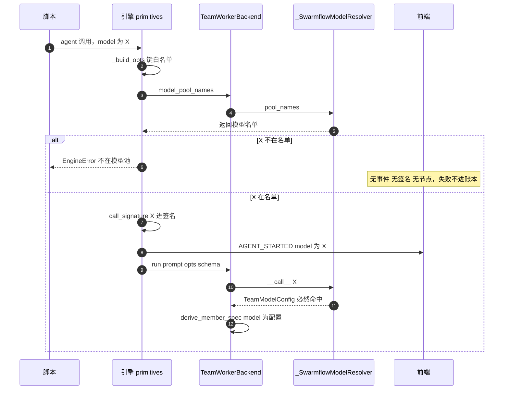

# Swarmflow 算子 options 参数治理（model 前置校验 + timeout 可观测性）

## 1. 背景与问题 (Why)

Swarmflow 脚本里，leader 生成的编排代码通过 options 袋为单次调用传递调优参数：
`agent(prompt, options={"model": "...", "timeout": 30, "isolation": "worktree"})`（以及
会话形态 `agent_session(...)` / `send(options={...})`）。引擎对 options 的**键**已经有
fail-fast 白名单校验（`_build_opts`：未知键直接 `EngineError`），但对**值**没有任何
治理——值的合法性、值的可见性、值的生效语义，各自存在缺陷。

本设计覆盖 options 袋中两个已查实缺陷的参数，按其问题性质分两条治理路线：

### 1.1 model：正确性缺陷（静默失败）→ 前置校验路线

```
脚本 agent(model="X")
  → 引擎 _build_opts（键白名单校验，值不校验）
  → call_signature（声明值 "X" 进缓存签名）
  → AGENT_STARTED 事件（model 字段 = 声明值 "X"）
  → backend.run → resolver 查模型池
       命中   → worker 用池条目
       未命中 → 静默返回 None → worker 继承 teammate 模型
```

解析失败路径全部是合法返回值（None），没有任何诊断出口。对脚本作者（LLM）而言，
"没写 model"与"写了一个查不到的名字"在结果上完全同形：都继承默认模型、日志无告警、UI
显示的仍是脚本里写的名字。已实测确认：配置一个不存在的 `deepseek-v4-flash`，前端树视图
照常显示该名字，实际跑的是 teammate 模型。

具体缺陷四类：

1. **静默回退**：模型名不在池中（拼错 / 未配置 / 池空）时参数被无声丢弃，日志无 WARNING、
   UI 无提示。model 名来自 LLM 生成的脚本（不可信输入），却没有值级校验反馈路径。
2. **键严值宽不一致**：引擎对 options 的键已 fail-fast，对值完全不校验——同一参数两个
   维度两套标准。
3. **UI 主动展示假值**：`AGENT_STARTED` 事件先于解析发出，model 字段只能填声明值；解析
   结果从不回传事件流，前端把"点错的菜"当"实际吃的菜"展示。
4. **会话第二回合起参数失效**：avatar 会话的模型在**首个 cache-miss 回合**开 avatar 时
   解析一次并固化进 harness（`_start_avatar` → `derive_member_spec` 的 `model or
   base_spec.model` 兜底），此后每回合透传到 backend 的 opts **没有任何代码读 model
   字段**（引擎 `_turn` 已把 opts 传给 `backend.send_turn`，但
   `AvatarSessionManager.send_turn` 不消费 model——蒸发点在 backend 层）。第二回合
   换模型被静默忽略，但
   `call_signature` 仍把新名字折进签名 → 缓存 MISS → 用旧模型重跑一遍——一个不生效的
   参数改动白付真实 token。

### 1.2 timeout：可观测性缺陷（行为正确但不可见）→ 透传补丁路线

```
脚本 agent(prompt, options={"timeout": 30})
  → _build_opts        "timeout" 在白名单里，放行
  → call_signature     （不进签名——正确：只影响等多久，不影响输出内容）
  → AGENT_STARTED 事件 （无 timeout 字段——事件 dataclass 根本没有这个字段）
  → backend.run → _attempt_calls（primitives.py）
      async with asyncio.timeout(30):   # ← 唯一真实消费点
```

timeout 的**控制流是正确的**：agent 路径超时视为单次尝试失败并自动重试（默认再试 2 次），
全部失败后 agent 级失败、脚本继续；human 路径超时视为"未回答"跳过该轮（不重试）。但三个
可观测性断点让用户对它"无感"：

1. **前端零可见**：`WorkflowProgressEvent` → 团队事件（`WorkflowProgressTeamEvent`）→
   前端 state（`WorkflowAgentState`）三层字段面都没有 timeout，节点详情无从展示"这个
   worker 带 30s 超时"。
2. **失败原因不可辨**：超时后作为普通 Exception 进重试循环，`AGENT_FAILED` 的 message 里
   TimeoutError 与其他失败无法区分（py3.11 `asyncio.timeout` 抛的裸 TimeoutError 文本
   无上下文）——排查"这个 agent 为什么失败"只能靠猜。
3. **工具描述未区分双语义**：agent 路径超时=失败重试，human 路径超时=放弃跳过，描述只有
   一句"本次 worker 调用的超时秒数"。

### 1.3 两条路线的分界原则

| | model | timeout |
|---|---|---|
| 值有没有"对错" | **有**（名字必须在池中，存在客观真值集） | **没有**（30 秒就是 30 秒，写多少都合法） |
| 声明值 vs 生效值 | 可能背离（声明 "X" 实际跑 teammate 模型） | 恒等（声明即生效，无解析环节） |
| 缺陷性质 | 正确性（静默失败 + 缓存白烧） | 可观测性（失败原因不可辨，行为本身正确） |
| 治理手段 | **前置校验**（fail-fast，无效值在签名/事件之前拦截） | **既有管道注入**（超时秒数写进失败消息，沿 error_detail 管道直达前端） |

model 缺"对错判定"，所以要造一个判定点；timeout 不缺判定、缺的是失败时的表达，所以只需
往现成管道注入内容。分界原则：**有真值集的参数走校验，无真值集的参数走可观测，且可观测
优先复用既有管道**。

**为何现在做**：模型池自 `3f2e90aff`（2026-09-03，"include selected model in team pool"）起
覆盖"配置模型 + 页面选中模型"且单模型部署也建池，"池必然不存在"的大面积失效已消除；剩余
失效面收窄为"名字不在池"与"会话中途换名"两类，恰好都是可以用一个前置校验点完全关闭的。
配套调查文档：jiuwenswarm `docs/Swarmflow-model参数-已知问题.md` / `-完整调用链路.md` /
`-修复方案.md`（本 SDD 的输入）。

### 1.4 范围外已查实的同族问题（记录不展开）

- `phases[].model`（脚本 META 阶段计划里按阶段指定模型）在引擎 `_normalize_meta_phases`
  中只读 title/description，`model` 键被直接丢弃——工具描述宣称的功能从未实现（随本设计
  删宣称，见 §4.3.3）。
- `agent_type` 是引擎白名单键但无任何消费方（单发/会话 backend 均不读）——前向兼容占位，
  无行为影响，不处理。
- `TeamWorkerBackend(model=...)` 构造参数存而不读（docstring 自标 Legacy）——清理属
  breaking change，另提 agent-core 议题。

## 2. 目标与非目标

**目标**

*model 路线：*

- model 名不在池中时，脚本**立即报错失败**，错误消息列出当前池内全部可用模型名（leader
  拿到报错即可修正脚本，无需翻配置文件）
- 校验点位于缓存签名计算与 `AGENT_STARTED` 事件**之前**——签名与 UI 看到的 model 值必然
  可解析，"声明值 == 实际执行值"成为不变量
- 会话第二回合传不同 model 时明确报错并引导 `fork()`，消除"静默忽略 + 缓存白烧"组合

*timeout 路线：*

- 超时失败的 AGENT_FAILED message 自解释（"timed out after Ns"），与其它失败可区分——
  失败消息沿既有 error_detail → AGENT_FAILED.message → 前端 `agent.error` 管道直达节点
  详情，**agent-core 3 行，其余零改动**
- 工具描述写明 agent / human 两路径的超时语义差异

*共同：*

- backend 无池概念时（MockBackend、测试 stub）校验行为与现状完全一致，零回归
- 工具描述与实际行为一致（model / timeout / agent_session 条目 + 删除未实现的
  `phases[].model` 宣称）

**非目标**

- 不改 `resolve_member_model` 纯查找函数本身的语义（三家共用：swarmflow / tiny agent /
  spawn_manager 队友恢复，None 对后两者是正常业务语义）
- 不实现会话中途热切换模型（per-turn 换模型不是合理用法；`fork()` 已提供正规路径，本设计
  只把静默行为变成显式报错）
- 不改 timeout 的控制流（重试语义、agent 级失败、human skip 语义全部保留——只让失败消息
  自解释；超时直接抛 EngineError 的方案被否决，见 §5.7）
- **不做 timeout 声明值的事件透传 / 前端展示**（开工时展示"超时：Ns"被否决——用户只在
  超时真的发生时才在乎它，而那时失败消息已带秒数；声明值展示属"看起来完整、实际没人看"，
  见 §5.6）
- 不让 timeout 进缓存签名（只影响"等多久"不影响输出内容，不进签名是正确现状，保持）
- 不动 journal 签名算法（签名用声明值本身是缓存正确性的必要设计；校验前置后无效值到不了
  签名，无需重构）
- 不做 `phases[].model` 的实现（直接删宣称；若未来要做阶段级默认模型，另立 SDD）
- 不动 `TeamWorkerBackend(model=...)` 既有死参数（另提 agent-core 议题）

## 3. 术语与上下文

| 术语 | 含义 |
|---|---|
| options 袋 | 脚本算子的调优参数字典，键经 `_ENGINE_OPTIONS \| backend.KNOWN_OPTIONS` 白名单校验，值不校验 |
| 模型池 (model_pool) | team spec 上的 `list[ModelPoolEntry]`，每个 entry 携带 model_name / api_key / api_base_url / api_provider / metadata。构建于 jiuwenswarm `team_manager._load_team_spec`，内容 = config.yaml `models.defaults` 全部合法配置 + 页面选中模型（含 Zen 内存免费模型），指纹去重 |
| resolver | leader 构建时在 agent_configurator 创建的闭包（本设计升级为可调用类）：`model_name → TeamModelConfig \| None`，经 inject_team_handles → team rails → tool_factory → run_swarmflow → TeamWorkerBackend 五站接力注入 |
| 声明值 / 解析值 | 脚本里写的参数原始值 / backend 消费后的真实生效值。model 两者可能背离；timeout 恒等 |
| avatar | 会话路径的长驻 worker harness，模型在 `_start_avatar` 解析一次后固化 |
| `ks` / agent_id | 引擎为每次调用生成的确定性、resume 稳定的节点 id（journal cache key） |
| cache-miss 回合 | 会话中第一个未命中 journal 缓存的回合——avatar 在该回合开启（正常运行时为首回合） |
| 事件链 | 引擎 `WorkflowProgressEvent` → 工具层 `WorkflowProgressTeamEvent`（messager）→ jiuwenswarm `WorkflowAgentState`（快照/树视图），三层字段透传 |

**三个关键代码事实**（设计依据，br_0.1.18 基线初次核实；v4 已在 release/v0.1.19 @
`2dd2d8bf` 复核——事实 3 的机制描述按现行代码改写，结论不变）：

1. **引擎不认识模型池**：resolver 是 TeamWorkerBackend 的私有构造参数，引擎 `rt.backend`
   只暴露 `run` / `open_session` / `send_turn` 等执行方法——校验能力必须由 backend 声明、
   引擎调用，不能让引擎 import 团队层概念。
2. **事件时序天然颠倒**：`_emit_agent_started`（primitives）先于 `backend.run`（解析在其
   中）执行——"让 model 事件带真值"无法原地实现，只能前置校验让声明值变成真值。
3. **会话 model 无 per-turn 消费方（蒸发点在 backend 层）**：引擎层已把 opts 透传到
   `backend.send_turn(sid, prompt, opts, ...)`（`_turn` 不再丢弃），但 backend 侧
   `AvatarSessionManager.send_turn` 不读 model——唯一解析点仍是 `_start_avatar`
   （首轮 `open_session` 时解析一次并固化进 harness）。第二回合起 model 依旧无任何
   消费方（timeout 同理，但 timeout 本就不需要 per-turn 消费——见 §5.7 的
   语义分岔表）。
4. **失败消息管道现成**：`_attempt_calls` 既有 `str(last_err)` → `error_detail` →
   `agent()` 拼进 `AGENT_FAILED.message` → 工具层转发（message→text）→ jiuwenswarm
   `_on_agent_failed`（text→error）→ 前端 `WorkflowAgent.error` 展示——全程既有代码。
   timeout 路线的全部工作只是往这条管道注入内容（py3.11 裸 TimeoutError 的 str() 为空，
   管道通着但流进来的是空白）。

## 4. 方案设计 (What / How)

### 4.1 总体架构

两条独立子方案，改动无交集，可分 commit 落地：

```
┌────────────────── 引擎层（engine/primitives.py）──────────────────────────┐
│ agent(prompt, options={"model": "X", "timeout": 30})                      │
│   → _build_opts            键白名单（既有，fail-fast）                     │
│   → _validate_model_hint   ★model 路线：X ∉ backend.model_pool_names()    │
│                             → EngineError + 池内容列表                   │
│   → call_signature         签名（X 必然可解析；timeout 不进——既有正确）    │
│   → _emit_agent_started    事件 model = X = 真值（timeout 不加字段）       │
│   → backend.run → _attempt_calls                                           │
│       ★timeout 路线：TimeoutError 重打消息（"timed out after Ns"）         │
│         → 既有 error_detail 管道 → AGENT_FAILED.message → 前端 error       │
│                                                                            │
│ session.send(prompt, options={...})                                        │
│   → _build_opts + _validate_model_hint   ★model 路线（同上）                │
│   → 会话模型固定检查  ★model 路线：已开 session 且 X ≠ 首轮                 │
│                             → EngineError + fork() 引导                   │
│   → call_signature → 事件 → backend.send_turn（失败路径同上注入消息）       │
└────────────────────────────────────────────────────────────────────────────┘
            ▲ model_pool_names()
┌───────────┴── backend 层（engine/backends/base.py + team_worker_backend.py）─┐
│ AgentBackend.model_pool_names() → list[str] | None（默认 None = 不校验）     │
│ TeamWorkerBackend.model_pool_names() → 从 resolver.pool_names() 取名单       │
│   MockBackend / 测试 stub 不 override → None → 校验行为与现状完全一致         │
└─────────────────────────────────────────────────────────────────────────────┘
            ▲ pool_names()
┌───────────┴── 团队层（agent_teams/agent/agent_configurator.py）──────────────┐
│ _SwarmflowModelResolver（闭包升级为可调用类）                                 │
│   __call__(name) → TeamModelConfig | None   （五站接力零改动，契约不变）      │
│   pool_names() → list[str]                   （新增：读 team_spec.model_pool）│
└─────────────────────────────────────────────────────────────────────────────┘
```

timeout 路线不再有自己的架构块——它是引擎层里的一行注入，搭 model 路线的图即可。

model 校验点同时关闭 §1.1 四类缺陷：

| 缺陷 | 关闭机制 |
|---|---|
| 静默回退 | 无效名字在解析前被拦截，静默路径不存在 |
| 键严值宽 | 值校验与键校验对称，同用 `EngineError` fail-fast |
| UI 假值 | 事件里的 model 必然可解析 → 声明值即真值，无需事件回传 |
| 缓存白烧 | 无效值到不了 `call_signature` → "改了不生效的名字"不可能发生 |
| 会话二回合 | 专门的固定模型检查显式报错 + fork() 引导 |

timeout 路线关闭 §1.2 三个断点中的两个：失败消息带秒数（原因可辨——既有管道注入内容）、
描述写明双语义（预期正确）。第三个断点（前端可见声明值）接受为现状——用户只在超时发生时
才在乎它，届时失败消息已覆盖（§5.6）。

### 4.2 数据流与时序

**校验时序（单发 agent()，model 路线）**：



**会话路径时序（含固定模型检查，model 路线）**：

```
send("t1", options={"model": "A"})
  → _validate_model_hint: A ∈ pool → 过
  → _ensure_open: _sid is None → open_session → _start_avatar 解析 A、固化进 harness
  → _opened_model = "A"（★新增记账）
  → call_signature / AGENT_STARTED / send_turn → 正常执行

send("t2", options={"model": "B"})
  → _validate_model_hint: B ∈ pool → 过（名字本身合法）
  → 固定模型检查: _sid 非空 且 B ≠ _opened_model   ★新增
      → EngineError("model is fixed at the first turn (A); fork() a new session")
  → （不再走到签名 / 事件 / send_turn——无效回合零成本拦下）

send("t3")                              → 无 model → 两道检查都跳过 → 正常
send("t4", options={"model": "A"})      → B==A → 固定检查放行 → 正常
fork(options={"model": "B"})            → 子会话全新 AgentSession，_sid=None → 不触发 → 正常
```

**timeout 失败消息时序（timeout 路线，全程既有管道）**：

```
agent(prompt, options={"timeout": 30})，worker 卡 30s:
  TimeoutError（裸异常，str() 为空——现状的断点）
    → ★重打: last_err = TimeoutError("timed out after 30s")
    → 重试（默认再 2 次，每次重新包 30s）——控制流不变
    → 全部失败 → detail = str(last_err)                    （既有，primitives.py:730）
    → _BackendCallResult(error_detail="timed out after 30s")  （既有，:713）
    → msg = "agent 'x' failed after 3 attempts: timed out after 30s"  （既有，:613）
    → AGENT_FAILED(message=msg) → 工具层 text → jiuwenswarm agent.error  （既有）
    → 前端节点详情 error 字段 + [wf] attempt 日志行，皆自带秒数
```

### 4.3 接口与数据模型

#### 4.3.1 接口契约（Requirement / Scenario）

| # | Requirement（系统 SHALL…） | Scenario（WHEN → THEN） |
|---|---|---|
| R1 | 在 options 键校验之后、缓存签名计算之前，对非空 `model` 值执行池成员校验 | WHEN `agent()` / `send()` 带非空 model 且名字不在 backend 名单 THEN 抛 `EngineError`，消息含可用模型排序列表；WHEN 名单为空列表 THEN 消息含 "(empty — no model pool configured)"；WHEN 名单为 None（backend 无池概念）THEN 不校验、放行 |
| R2 | model 校验失败不产生任何副作用 | WHEN 校验抛错 THEN 无 journal 记录写入、无 AGENT_STARTED 事件发出、无 backend 调用发生 |
| R3 | 会话模型在首个 cache-miss 回合后固定 | WHEN session 已开（`_sid` 非空）且本回合 model 非空且 ≠ 首轮 model THEN 抛 `EngineError`，消息含首轮模型名与 fork() 引导；WHEN model 省略或等于首轮 THEN 放行 |
| R4 | backend 协议扩展向后兼容 | WHEN backend 未 override `model_pool_names()` THEN 返回 None、引擎不校验（MockBackend / 既有测试 stub 零改动） |
| R5 | resolver 升级保持调用契约 | WHEN 任何既有代码以 `Callable[[str], Any]` 持有 resolver THEN 可调用类实例直接可用（五站接力注入点零改动）；防御日志仅在"校验后池变更致解析落空"时输出且同名去重 |
| R6 | 超时失败消息自解释 | WHEN 调用因 asyncio 超时失败且带 timeout THEN AGENT_FAILED 的 message 含 "timed out after Ns"（沿既有 error_detail 管道直达前端节点 error 字段，单发与会话路径同构）；重试次数与控制流与现状一致（仍重试、仍 agent 级失败） |
| R7 | 工具描述与实际行为一致 | WHEN 脚本作者（LLM）阅读 swarmflow 工具描述 THEN model 条目写明生效前提与 fail-fast 行为；agent_session 条目写明 model 仅首轮生效；timeout 条目写明 agent/human 双路径语义；不存在未实现的 `phases[].model` 宣称 |

#### 4.3.2 agent-core 侧接口变更

**协议方法（`workflow/engine/backends/base.py`，AgentBackend 基类）**：

```python
def model_pool_names(self) -> list[str] | None:
    """Names this backend accepts for the ``model`` option hint.

    ``None`` (default) means the backend has no model-pool concept and hints
    pass unvalidated (MockBackend, test stubs). A list means the engine fails
    fast on a hint not in it.
    """
    return None
```

**override（`workflow/backends/team_worker_backend.py`）**：

```python
def model_pool_names(self) -> list[str] | None:
    """Accepted ``model`` hint names, for the engine's fail-fast check."""
    if self._model_resolver is None:
        return None
    pool_names = getattr(self._model_resolver, "pool_names", None)
    return list(pool_names()) if callable(pool_names) else None
```

`getattr` + `callable` 探测使旧式闭包 resolver（外部 host 自定义注入、旧测试）自动退化为
"不校验"，渐进兼容。会话路径（AvatarSessionManager）无需单独实现——引擎调的是
`rt.backend`（TeamWorkerBackend），一个方法覆盖单发 + 会话两条路径。

**resolver 类（`agent_teams/agent/agent_configurator.py`，替换现有闭包）**：

```python
class _SwarmflowModelResolver:
    """Resolves ``agent(model=...)`` hints against the live team pool.

    Callable (same contract as the historical closure) so it flows unchanged
    through inject_team_handles → rails → tool_factory → runner → backend.
    ``pool_names`` exposes accepted names so the engine can fail fast on an
    unknown hint before the start event is emitted.
    """

    def __init__(self, team_spec: Any) -> None:
        self._spec = team_spec
        self._warned: set[str] = set()

    def __call__(self, model_name: str) -> Any:
        from openjiuwen.agent_teams.models.allocator import resolve_member_model

        resolved = resolve_member_model(self._spec, model_name=model_name, model_index=None)
        if resolved is None and model_name and model_name not in self._warned:
            # Defense-in-depth: the engine fails fast on unknown hints, so this
            # only fires if the pool shrank between validation and resolution.
            self._warned.add(model_name)
            team_logger.warning(
                "[swarmflow] agent(model=%r) left the pool after validation; "
                "worker inherits base spec model (pool now: %s)",
                model_name, self.pool_names(),
            )
        return resolved

    def pool_names(self) -> list[str]:
        if self._spec is None:
            return []
        return [e.model_name for e in (self._spec.model_pool or [])]
```

**引擎侧 model 校验（`workflow/engine/primitives.py`）**：

```python
def _validate_model_hint(rt, opts: dict) -> None:
    """Fail fast on a ``model`` hint the backend cannot honor.

    Symmetric with ``_build_opts``' unknown-KEY fail-fast: an untrusted
    script's option VALUE gets the same treatment. Runs before the signature
    and the start event, so the journal and the UI never see a call that
    would silently fall back.
    """
    name = opts.get("model")
    if name is None:
        return
    names = rt.backend.model_pool_names()
    if names is None or name in names:
        return
    raise EngineError(
        f"agent(options={{'model': {name!r}}}) is not in the model pool; "
        f"available: {sorted(names) or '(empty — no model pool configured)'}"
    )
```

`agent()` 接入（isolation 检查之后、`resolve_schema` 之前）；`send()` 接入（`_build_opts`
之后、签名之前）追加固定模型检查；`AgentSession.__init__` 增加 `self._opened_model: str |
None = None`，`_ensure_open` 开 session 后写入 `opts.get("model")`。

**引擎侧 timeout 失败消息注入（`workflow/engine/primitives.py` `_attempt_calls`，全部改动）**：

```python
        except Exception as e:
            last_err = e
            if isinstance(e, TimeoutError) and timeout is not None:
                # py3.11 bare TimeoutError str() is empty; inject the budget so
                # the existing error_detail pipeline carries it to AGENT_FAILED.
                last_err = TimeoutError(f"timed out after {timeout}s")
```

下游全部既有（§3 事实 4 的管道）：`str(last_err)` → `error_detail` → agent() 拼进
`AGENT_FAILED.message` → 前端节点 error 字段。不新增任何字段、事件、转发。

#### 4.3.3 工具描述变更（agent-core locales）

`agent_teams/tools/locales/descs/{cn,en}/workflow/swarmflow.md` 四处：

1. `model` 条目：写明"名字必须是当前团队模型池中的模型名（config.yaml models.defaults 配置
   或当前页面选中的模型），否则脚本运行立即报错并列出可用模型"；
2. `agent_session` 条目：补"model 仅在会话首轮生效；中途传不同 model 会直接报错，需要不同
   模型请 `fork()` 派生新会话"；
3. `timeout` 条目：写明双路径语义——"agent 路径：超时视为本次尝试失败并自动重试（默认再试
   2 次），全部失败后该 agent 以失败收场、脚本继续；human 路径：等待真人回复的时限，超时
   视为'未回答'跳过该轮（不重试）。省略则不限时"；
4. `phases[].model` 宣称整句删除（`{"title": ..., "model": ...}` 形态从未被引擎消费）。

#### 4.3.4 数据模型变更

无。两条路线均不新增持久化字段、不改快照格式、不动事件 schema——model 路线校验失败发生在
任何账本写入之前（"校验点在签名之前"的直接收益：旧 run 的缓存与新校验完全兼容，resume 不受
影响）；timeout 路线只是往既有 message 字段注入内容。

### 4.4 关键流程

**A. 无效名字（model，单发）**：`agent(model="typo-name")` → `_build_opts` 过（键合法）→
`_validate_model_hint` 抛错（消息含池列表）→ `EngineError` 沿 `run()` 脚本异常路径向上
→ leader 收到工具报错 → 修正脚本（journal 里已完成的调用全部缓存命中）→ 重跑只补差异部分。
**run 整体失败而非单 agent 失败**是刻意选择（§5.3）。

**B. 会话换模型（model）**：第二回合 `send(options={"model": "B"})` → 名字合法（在池）→
固定模型检查发现 `_sid` 非空且 B ≠ A → 报错引导 fork()。脚本作者改用
`s.fork(options={"model": "B"})` 派生子会话——子会话是全新 AgentSession
（`_opened_model=None`、`_sid=None`），首轮用自己的 opts 开新 avatar，父会话上下文经
fork_data 继承。

**C. 超时失败（timeout）**：`agent(prompt, options={"timeout": 30})`，worker 卡 30 秒 →
TimeoutError → 重打 "timed out after 30s" → 重试 2 次（每次重新包 30s）→ 全部失败 →
AGENT_FAILED（message 含秒数）→ agent() 返回 None → **脚本继续**（可自行决定降级/跳过/
raise）。human 路径（`_await_human_reply` 已有带秒数的 WARNING + skip 短路）不动。

**D. resume / 冷启动**：model 校验只影响"发起调用"的路径；journal 重放（cache HIT）不经过
`_validate_model_hint`（HIT 分支在 `_attempt_calls` 之前返回）。旧 run 的既有记录（含历史
上静默回退过的调用）照常重放，升级不触发旧数据重跑。timeout 消息注入只影响失败路径的
文本，缓存命中路径无失败无消息，互不干扰。

**E. 离线预览（preprocess_swarmflow）**：MockBackend 不 override `model_pool_names()` →
返回 None → 不校验。预览树照常生成（预览时模型池语义本就不适用），假名不阻塞预览。

**F. 防御残余路径（model）**：校验（发事件前）与解析（backend 内）之间存在理论上的池变更
窗口（`update_model_pool` 运行时刷新）。resolver `__call__` 内的 WARNING 兜住该窗口：同名
去重、消息带当前池内容；worker 仍走继承兜底（行为与现状一致，不中断 run）。

### 4.5 配置与开关

无新增配置项、无特性开关。model 校验行为由 backend 能力派生（`model_pool_names()` 返回
None 即退化为现状），MockBackend / 无 resolver 的 backend 天然豁免——这本身就是回退机制
（§9）。timeout 路线为纯消息注入，无开关需求。enable_swarmflow 开关链路不动。

## 5. 关键决策与权衡 (ADR)

| 备选 | 否决原因 |
|---|---|
| AgentResult 返回解析后模型 + 补发 AGENT_MODEL_RESOLVED 事件（model v1 方案） | 四层改动、事件晚到需前端配对、journal 需加字段；前置校验让"事件值==真值"天然成立，整个方案不再需要 |
| 签名改用解析后模型标识（model v1 方案） | 时序倒挂（签名先于解析），根治需把 resolver 提升为引擎可见或延迟签名计算，架构级改动；校验前置后无效值到不了签名，问题消失 |
| model 校验失败仅单 agent 失败 | 见 §5.3 |
| 大小写归一 / 模糊匹配 / 空 entry 跳过等"宽恕式"校验进 `resolve_member_model` | 三家共用的纯查找函数，任何静默修正都重蹈"静默兜底"覆辙，方向相反的同一种病 |
| 同名多端点（`model_index`）相关的 group 顺序稳定化 | 已知限制而非本设计缺陷：swarmflow 恒传 index=None 取第 0 件，跨重建的顺序稳定性属池构建（config_loader 合并处）职责，记入 §10 开放问题 |
| timeout 前置校验（如"必须为正数"） | 无真值集可校验；负值在 `asyncio.timeout` 自然报错，校验属冗余防御 |
| timeout 超时直接抛 EngineError 终止 run | 见 §5.7：瞬时故障 ≠ 配置错误；重试是超时的正确搭档；决策权留给脚本 |
| timeout 进缓存签名 | 只影响"等多久"不影响输出内容，进签名会让等时策略变化触发无意义重跑 |
| timeout 声明值事件透传 + 前端展示（v2 初稿的 R6/R7） | 见 §5.6：用户只在超时发生时在乎它，届时失败消息已带秒数；声明值展示"看起来完整、实际没人看"，五处改动归零后砍掉 |

## 6. 影响面与兼容性

| 仓 | 模块 | 变更 | 路线 |
|---|---|---|---|
| agent-core | `agent_teams/agent/agent_configurator.py` | resolver 闭包 → `_SwarmflowModelResolver` 类（~30 行） | model |
| agent-core | `workflow/engine/backends/base.py` | `model_pool_names()` 默认实现（~8 行） | model |
| agent-core | `workflow/backends/team_worker_backend.py` | `model_pool_names()` override（~7 行） | model |
| agent-core | `workflow/engine/primitives.py` | `_validate_model_hint` + agent()/send() 接入 + `AgentSession._opened_model`（~40 行） | model |
| agent-core | `workflow/engine/primitives.py` | `_attempt_calls` 超时消息注入（~3 行） | timeout |
| agent-core | `agent_teams/tools/locales/descs/{cn,en}/workflow/swarmflow.md` | 四处文案 | 两者 |
| jiuwenswarm | 无代码改动 | 前端 / gateway / server 全部不动 | — |

**行为变更声明**（对旧版非兼容的语义变化，需评审确认；全部来自 model 路线，timeout 路线
纯增量无行为变化）：

| 场景 | 旧行为 | 新行为 |
|---|---|---|
| agent() 传不在池中的模型名 | 静默继承 teammate 模型，UI 显示假名 | EngineError，run 失败，报错列可用模型 |
| 会话第二回合传不同 model | 静默忽略（仍跑首轮模型），签名变化致缓存重跑 | EngineError，提示 fork() |
| 会话第二回合传相同 model | 无害 | 无害（`==` 放行） |
| backend 无池概念 | — | 不校验，与现状逐字节一致 |

**兼容性分析**：存量脚本若依赖"传假名也能跑"，升级后暴露为报错——影响面预计极小（单测
大多走 MockBackend / 无 resolver backend，落 None 分支）；journal / RPC 协议 / 事件 schema /
快照格式零变更，旧 run resume 不受影响（HIT 路径不经过校验）。落地前全量回归 swarmflow
单测确认无夹具依赖旧的静默行为。

## 7. 测试与验证

**单测（agent-core 侧新增，10 例）**——model 路线 8 例：

1. 无效名字 raise：backend 提供 `model_pool_names=["deepseek-v4"]`，`agent(model="nope")`
   → `EngineError`，match "not in the model pool"；
2. 报错消息含可用模型列表（match "available.*deepseek-v4"）；
3. 有效名字照常执行（池内名字 → backend.run 被调，无异常）；
4. backend 未 override `model_pool_names` → 任意名字不校验（旧式 backend 兼容）；
5. 会话二回合换模型 raise（match "fixed at the first turn"）；
6. 会话二回合传相同 model 不 raise；
7. fork 子会话可用不同 model（fork(options={"model": "B"}) → 子会话首轮正常）；
8. resolver 防御日志：校验通过后池移除条目 → `__call__` 返回 None 且 logger 出一条
   WARNING（同名去重只一条）。

timeout 路线 2 例：

9. 超时失败的 AGENT_FAILED message 含 "timed out after 30s"（单发路径；会话路径同构走
   同一 `_attempt_calls`）；
10. 超时后重试行为不变（3 次尝试后 agent 级失败，`_BackendCallResult.succeeded=False`，
    控制流与现状一致）。

**回归**：jiuwenswarm 侧 `test_ws_swarmflow_control.py` / `test_team_helpers.py` 全量（确认
无夹具依赖静默回退行为）。

**端到端手工验收**：

- 起 team（models.defaults ≥1 模型）→ swarmflow 脚本写不存在模型名 → leader 收到报错且消息
  含可用模型列表；前端树视图**不出现**该节点（事件未发）；
- 同脚本改为池内名字 → 正常执行，树视图节点 model 与实际执行模型一致；
- `agent_session` 首轮 model A、二轮 model B → 报错提示 fork()；`fork()` 后子会话用 B 正常；
- 脚本带 `timeout=5` + 一个慢 worker → 点开失败节点详情，error 为 "...failed after 3
  attempts: timed out after 5s"；human 会话带 timeout → 等待超时后跳过（行为与现状一致，
  日志已带秒数）；
- 离线预览带假模型名 → MockBackend 不校验，预览照常。

**成功指标**：升级后 team.log 中不再出现 model"静默继承"类排查工单（防御 WARNING 出现率为
0——出现即说明池变更窗口被命中，需评估）；超时失败的排查不再需要复现（message 自带秒数）。

## 8. 可观测性

- model 路线新增唯一日志点：resolver `__call__` 的防御 WARNING（mid-run 池变更兜底），带
  model_name 与当前池内容，同名去重；
- timeout 路线：超时失败 message 带 "timed out after Ns"——经既有 error 管道同时到达
  前端节点详情（`agent.error`）与 `[wf] agent ... attempt N/M failed` 日志行，双出口共享
  同一文本，零新增观测设施；
- 既有 `[wf] agent ... CACHE_HIT/CACHE_MISS` 日志族不变——model 校验失败发生在其之前，
  失败调用不产生日志行（可通过"缺行"交叉验证校验生效）；
- 健康判据：swarmflow run 的模型相关失败全部表现为带池列表的 EngineError（可搜索
  "not in the model pool" 计数）；超时失败可搜索 "timed out after" 计数。

## 9. 风险与回滚

| 风险 | 缓解 |
|---|---|
| 存量脚本依赖静默回退，升级后报错 | 落地前全量回归 + 报错消息自带修复路径（池列表）；影响面预计限于测试夹具 |
| 校验与解析之间的池变更窗口（update_model_pool 运行时刷新） | resolver 防御 WARNING 兜底，worker 仍走继承兜底不中断 run |
| 校验名单快照与池实际内容短暂不一致 | `model_pool_names()` 每次调用现取（闭包持 team_spec 引用，池刷新原地可见）；返回 list 拷贝防外部持有引用 |
| 同名多端点时 idx=0 的跨重建顺序不稳定（既有已知限制，非本设计引入） | swarmflow 恒取第 0 件，行为与现状一致；稳定化属池构建职责，见 §10 |
| 页面选中模型在 run 中途被切换 | 池由页面选中模型参与构建（get_effective_team_model_entries），run 开始后 team_spec 已固化，不受影响；防御 WARNING 覆盖残余窗口 |
| TimeoutError 消息重打影响既有错误匹配逻辑 | 全代码库无对 TimeoutError 文本的匹配依赖（已 grep 核实）；消息变长只影响人读 |

**回滚**：两条路线各自独立 commit，可分别 revert。model 路线单 revert 即恢复旧行为（纯前置
检查，无持久化 / 协议变更；`model_pool_names()` 协议方法保留无害）。timeout 路线 3 行注入
revert 后失败消息回到空白，无状态迁移。

## 10. 开放问题 (Open Questions)

- [ ] 校验失败错误消息的本地化（当前设计为英文单语；是否需要随 language 切换 cn/en 文案）
- [ ] `human_session` / `human()` 路径是否同样接入固定模型检查（当前设计覆盖 agent_session；
  human avatar 模型同样首轮固化，理论上应同构处理，待确认 human 路径带 model 的实际频率）
- [ ] 同名多端点（finger-print 去重后同名不同地址共存）时 `resolve_member_model` 取 idx=0
  的跨重建顺序稳定性——是否在 config_loader `_merge_effective_model_entries` 补稳定排序
  （独立于本设计，触发条件：实际部署出现同名多端点）
- [ ] `TeamWorkerBackend(model=...)` 死参数清理（Legacy 构造兼容参数，删除属 breaking
  change，走 agent-core 独立议题）
- [ ] verify() 原语（SDD-0017）内部的 reviewer agent() 调用是否需要暴露 model 透传（当前
  reviewer options 已透传，校验自动覆盖，无需改动——待 SDD-0017 落地时复核）
- [ ] 会话路径的 timeout 是否需要 per-turn 生效确认（当前 `_attempt_calls` 对每个
  cache-miss turn 的 `send_turn` 各自包 timeout——语义为"每回合独立计时"，是否与用户
  预期"整个会话限时"有偏差，待用户反馈）
- [ ] options 袋其余键的治理排期：`isolation`（值已校验，仅 "worktree" 合法）、`agent_type`
  （白名单键但零消费方）——本设计确立"有真值集走校验 / 无真值集走可观测"的分界原则后，
  后续参数按此原则逐个评估，不混入本 SDD

## 11. 评审记录 (Iteration Log)

| 轮次 | 日期 | 版本 | 评审人 | 结论 | 主要修改/讨论 |
|---|---|---|---|---|---|
| 1 | 2026-09-14 | 1 | @wangcan103 | draft | 初稿：基于 jiuwenswarm docs 三篇调查文档（已知问题 / 完整调用链路 / 修复方案 v2）整理；model 走前置校验路线（v1 可观测性方案在调查中被否决） |
| 2 | 2026-09-15 | 2 | @wangcan103 | 范围扩展 | timeout 缺陷（失败原因不可辨 / 双语义未述）并入，SDD 从"model 单参数校验"扩为"options 参数治理"：确立"有真值集走校验 / 无真值集走可观测"分界原则；新增 timeout 契约与 §5.6/§5.7 决策；§1.4 记录范围外同族问题（phases[].model 虚假宣称并入文案删除、agent_type 零消费、Legacy 死参数） |
| 3 | 2026-09-15 | 3 | @wangcan103 | timeout 路线收缩 | 砍掉声明值事件透传 + 前端展示（原 R6/R7、`timeout_s` 字段、"超时：Ns"展示）：核实失败消息经既有 error_detail → AGENT_FAILED.message → `agent.error` 管道直达前端节点详情，用户只在超时发生时在乎该参数，届时失败消息已带秒数——声明值展示"看起来完整、实际没人看"。timeout 路线收缩为 `_attempt_calls` 3 行消息注入 + 文案；R6/R7 删并，单测 12→10 例，jiuwenswarm 回到零代码改动 |
| 4 | 2026-09-28 | 4 | @wangcan103 | 基线复核 | 按 release/v0.1.19（`2dd2d8bf`）复核全部代码事实：① 引擎异常已于 `dcbfef35`（09-03）改名 `WorkflowError`→`EngineError`（避开 core 层同名类），全文 17 处同步替换——键值校验对称性论点不变；② §1.1 缺陷 4 与 §3 事实 3 机制描述改写：引擎 `_turn` 现已把 opts 透传给 `backend.send_turn`，model 无消费方的蒸发点移至 backend 层（`AvatarSessionManager.send_turn` 不读 model，唯一解析点仍为 `_start_avatar`），"会话二回合静默忽略 + 缓存白烧"结论不变；③ timeout 时序行号刷新（:680/:682/:577 → :730/:713/:613，`f1d7fd69` 挪动）。方案架构、分界原则与插入点经最新代码复核全部成立，无方向性修改；改动仍未实现（§12 待填） |

## 12. 实现记录与偏差

（开发中 / 后填写。归档前本节必须有实质内容。）

### 实际实现
（待填）

### 与设计的偏差
（待填）

### 链接
（待填）

### 遗留与后续
（待填）

## 13. 参考与关联设计

- SDD-0002（有状态会话与人工参与）——agent_session / avatar 机制的奠基设计，本设计的会话
  固定模型检查与 per-turn timeout 语义作用于其定义的 send 机制
- SDD-0007（worker 与 team DB 解耦）——worker base spec 派生路径（derive_member_spec）的
  来源，本设计不改其兜底语义
- SDD-0014（有状态会话 fork）——fork() 是本设计引导的"换模型开分支"正规路径
- SDD-0019（Team 模式模型组接入）——模型池形态的演进方向（IntelliRouter / 编译产物），
  本设计的 `pool_names()` 查询面与其 `model_name="*"` 入口形态的交互待其落地时复核
