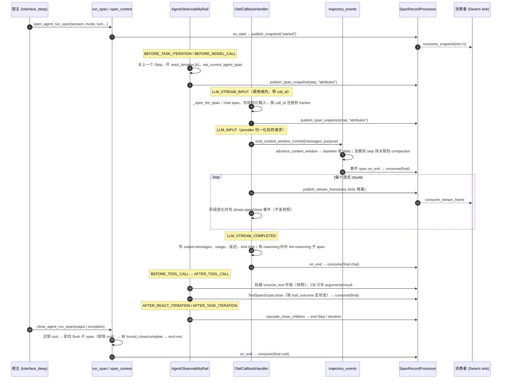

# 轨迹观测框架：基于 OTel GenAI 语义约定的 Harness 与 Team 轨迹采集和处理

> **本文是轨迹观测特性组的伞文档**，定义采集层（产生什么 span、怎么产生）与处理器层（span 结束后如何分发给多个消费者）。
> 下游四篇分别负责：
> - 标准数据向三方平台导出（SDD-0023）
> - 投影给自演进与在线 AgentRL（SDD-0024）
> - JiuwenSwarm 会话存储与服务（SDD-0025）
> - 前端轨迹 UI（SDD-0026）
>
> 本文由当前代码逆向整理：agent-core `dev/swarm/room-mode@7e98a60f9`、jiuwenswarm `dev/swarm/room@43e796e1d`，两者均已在 `upstream/develop` 上。

## 1. 背景与问题 (Why)

### 1.1 一个具体场景

用户在 JiuwenSwarm 里对一个 DeepAgent 发起一次请求，一个"回合"（turn）内会依次发生这些事：

1. 多轮 ReAct 迭代。每一步模型都要重新看一遍完整上下文：system prompt、历史消息、工具定义。
2. 流式模型调用：先吐出几千字 reasoning，再给出答案或一组工具调用。
3. 工具执行。部分工具会失败：有的抛异常，更多的是返回 `success=False`。
4. 其中一个工具是 `task_tool`，它派发了一个 sub-agent。sub-agent 有自己独立的会话，也在跑自己的 ReAct 循环。
5. 上下文快满时触发一次上下文压缩（compaction）。压缩本身也是一次模型调用，可能因限流重试多次。
6. 模型调用 `ask_user` 中断，等待用户回复后在同一回合内恢复。

Team 模式下同时还有 leader、若干成员和 swarmflow worker 在并发执行，Team 事件（任务、消息、成员状态）穿插其中。部分成员甚至不是 openjiuwen agent，而是外部 Claude Code / Codex CLI 进程。

对这样一次执行，有四类人或系统需要看到"发生了什么"：

| 消费方 | 要什么 | 时效 |
|---|---|---|
| 开发 / 运维，在 Langfuse 等三方平台排查 | 标准结构的 trace：每次调用的输入、输出、token、错误 | 事后 |
| 终端用户，在 JiuwenSwarm Web 的"轨迹"页 | 模型每一步看到的上下文和说的话、工具结果、sub-agent 与成员的轨迹 | **实时**（回合进行中） |
| 自演进（skill evolution / context evolve） | 可重建的对话消息序列 | 回合结束时 |
| 在线 AgentRL / SFT | 逐次推理的 prompt、completion、token id、logprob | 回合结束时 |

### 1.2 痛点

在本框架收敛之前（2026-05 到 2026-08 的 Team OTel 子系统、`tracer_otel` 遗留栈、旧的 step 形轨迹模型），暴露出五类问题。

**(1) 数据形状多套并存，消费者只能写 fallback 链。**

同一个事实有多个载体：
- 会话 ID 同时写 `gen_ai.conversation.id` 和 `openjiuwen.session_id`；
- prompt 既有标准的 `gen_ai.input.messages`，也有已弃用的索引式 `gen_ai.prompt.{i}.*`；
- 采集层还直接写 `langfuse.*`。

读取方（前端、演进、RL）每读一个事实都要按优先级尝试多个键。更隐蔽的是，OTel SDK 的 `SpanLimits` 用 FIFO 淘汰属性：镜像键和 Langfuse 键挤占配额后，最先写入的 `gen_ai.operation.name`、`gen_ai.request.model` 会被悄悄丢掉。

**(2) span 结构不可信。**
- sub-agent 的 span 挂在错误位置，或者和父 agent 串到同一个会话。
- 并发的 LLM 请求靠"最近打开的 span"猜归属：一个成员的流式 chunk 会写到另一个成员的 span 上。
- 回调没触发时留下孤儿 span。
- root span 结束后才清理子 span，导致子 span 的结束时间晚于父 span。

**(3) 看不到进行中的执行。**

OTel 只在 span 结束时导出。一个几分钟的回合，UI 在结束前什么都看不到。早期把流式 chunk 记成 span event 来补实时性，但 SDK 的 per-span event 上限淘汰的是**最早**的事件，长回答的开头因此被静默丢失。

**(4) 存储成本随会话长度平方增长。**

GenAI 约定要求每次模型调用完整复述输入，这对协议是对的，对存储是浪费。代码注释里记录了真实会话的实测数据：

- 803 次调用只有 3 份不同的工具定义；57,550 个消息槽里只有 1,991 条不同的消息（`content_addressing.py`）。
- 一个流式回合的 173 次上下文窗口提交，搬运了 121.7 MB 的窗口数据，实际变化只有 0.5 MB（`trajectory_events.py`）。

**(5) 多个消费者抢同一个 TracerProvider。**

OTel 一个进程只允许一个全局 `TracerProvider`。单 agent 运行时、Team 运行时、在线 RL 采集器都可能初始化它：谁先初始化谁生效，其余复用。任何一方关闭时，都可能拆掉另一方仍在用的 provider。

### 1.3 为何现在做

多个下游已经到了必须共享同一份 span 的阶段：

- JiuwenSwarm Web 轨迹页（SDD-0025/0025）需要实时、完整、可重放的数据；
- 自演进与在线 RL（SDD-0024）要求不再维护第二套采集；
- Langfuse 适配（SDD-0023）要求采集层不再夹带后端专属字段。

只有先把采集层和处理器层定稿为"唯一事实来源"，下游才能各自演进而不互相牵制。

## 2. 目标与非目标

**目标**

- G1 **单一规范形状**。标准 GenAI 语义约定能表达的事实只写标准键；标准缺失的事实才用 `openjiuwen.*`、`agentteam.*`、`deepagent.*` 扩展。每个事实只有一个载体，读取方不需要 fallback。
- G2 **覆盖 harness 运行全流程**，每类执行单元都有稳定的 span 形状：
  - 单 agent 的回合（Turn）、ReAct Step、推理（Inference）、reasoning、工具；
  - sub-agent 派发；
  - Team 的 leader、成员、任务、消息、事件；
  - 外部 CLI 成员（Claude Code、Codex）。
- G3 **结构可信**：
  - LLM span 按请求身份关联，工具失败两种形态统一记录；
  - sub-agent 挂在派发它的工具调用之下，但归属独立的执行主体；
  - 兜底关闭的 span 带显式标记，不伪装成功。
- G4 **实时**。span 进行中即可发布快照；流式增量走独立的帧通道，不受 span event 上限约束，也不放大快照。
- G5 **多消费者无干扰**。同一个 provider 上挂导出器、轨迹投影处理器、记录分发处理器；任一消费者失败或变慢，不影响业务线程和其他消费者。
- G6 **存储友好**。上下文窗口"基线加增量"只陈述一次；复述型 GenAI 属性在存储路径上按内容寻址。协议线上的 span 仍完整陈述。
- G7 **provider 生命周期可共享**。agent 与 team 两个运行时按需求计数共享 provider，最后一个需求释放时才关闭，且只关闭自己创建的 provider。

**非目标**

- 不定义后端专属映射（Langfuse 字段投影、文件格式、Collector 部署），见 SDD-0023。
- 不定义演进与 RL 的数据结构和消费逻辑，见 SDD-0024。
- 不定义持久化、读取 API、UI 投影，见 SDD-0025/0025。
- 不做 OTel metrics 和 logs 信号。只用 traces；流式帧沿用 LogRecord 的字段形状，但走进程内通道，见 §5.5。
- 不做跨进程或分布式 Team 的轨迹聚合（分布式 teammate 进程的 span 不回流 leader），见 §9、§10。
- 不改造遗留的 `openjiuwen/extensions/tracer_otel`：它是独立的平行栈，没有被本框架引用，见 §6.4。

## 3. 术语与上下文

| 术语 | 含义 |
|---|---|
| **Canonical span（规范 span）** | 采集层产出的、只含标准 GenAI 键和项目扩展键的 span。后端专属字段一律不在其中 |
| **Turn / 回合** | 一次用户请求的执行。单 agent 下是 run root span `agent.{mode}.{session_id}`（`record.kind=turn`）。HITL 恢复、steer 进行中的回合时沿用同一个 `openjiuwen.turn.id`，可以跨多条 trace |
| **Step** | 一次 ReAct 迭代 `agent.{name}.react_iteration.{k}`（`record.kind=step`），包含一次推理和它引出的工具调用 |
| **Inference / Request** | 一次模型调用 `chat {model}`（`record.kind=inference`）。`openjiuwen.request.id` 是 `Model` 调用域绑定的 call id；`openjiuwen.inference.id` 是该 span 的 span_id |
| **Execution Subject（执行主体）** | 轨迹的"谁"，取值 `main_agent`、`subagent`、`team_leader`、`team_member`，由 `openjiuwen.execution.subject.*` 表达。它决定一条记录归入哪条轨迹链，与 OTel 的父子结构正交 |
| **Authoritative tool span（权威工具 span）** | 单 agent 下由 rail 在 AbilityManager 执行外层打开的 `execute_tool` span（`openjiuwen.tool.authoritative=true`）。底层工具回调发现它存在时只补字段、不另开 span |
| **Trajectory v2 事件** | 不可变的"事件型 span"或 span event（`openjiuwen.trajectory.schema_version=2`），表达普通 span 结构承载不了的轨迹事实：`context.window.commit`、`compaction.completed`、`ask_user.requested/resolved`。按 `(epoch, subject_sequence)` 在主体内全序 |
| **Epoch** | 进程级随机 ID。进程重启或状态重置时轮换，一个主体的序号在同一 epoch 内连续 |
| **Snapshot / Final record** | 进行中 span 的完整快照（可多版本，按 `record_revision` 递增），以及结束 span 的最终记录（唯一权威） |
| **Stream frame（流式帧）** | 一次模型流式输出的一个增量（text、reasoning、tool-call 参数、usage），带每 span 内序号，沿独立通道发布 |
| **Addressed sequence（寻址序列）** | 复述型数组属性在存储路径上的哈希链表示，属性值替换为 `@oj-seq:1:<hash>:<depth>` 引用 |
| **Demand（需求）** | 某个运行时（`agent` / `team`）对共享 provider 的持有声明 |

**"投影"在本特性组中有三种含义，务必区分：**

| 叫法 | 位置 | 做什么 | 文档 |
|---|---|---|---|
| Langfuse 投影 | agent-core `exporters/langfuse.py` | 导出时由规范 span 派生出 `langfuse.*` 字段的副本 | SDD-0023 |
| 轨迹投影 | agent-core `agent_evolving/trajectory` | 由规范 span 派生出演进消息、RL rollout、SFT 样本 | SDD-0024 |
| 前端投影器 | jiuwenswarm `features/trajectory/projector` | 在浏览器里把 span 记录投影为回合、行和时间线的 UI 模型 | SDD-0026 |

## 4. 方案设计 (What / How)

### 4.1 总体架构

框架分三层：**采集层**把运行时事件变成规范 span；**Provider** 统一采样、限额和处理器顺序；**处理器层**在 span 开始、流式、结束三个时刻分发给不同消费者。

```
┌──────────────────────────────── 采集层 (Collection) ─────────────────────────────────┐
│                                                                                      │
│  宿主 (JiuwenSwarm)                   Runner.callback_framework (同步注册)            │
│   open/close_agent_run_span ─┐        LLM_*/TOOL_*/AGENT_*/CONTEXT_COMPRESSION_STATE │
│   team_runner: team.{name}   │               │                                       │
│                              ▼               ▼                                       │
│  Rails (agent 生命周期钩子)          OtelCallbackHandler          ContextCompression   │
│   AgentObservabilityRail (prio 10)    chat / execute_tool /        ObservabilityBridge │
│    ├ invoke / task_iteration          llm.reasoning span,          compaction 事件与   │
│    ├ react_iteration (Step)           结构化输入输出、usage、       请求打标            │
│    └ 权威 execute_tool                 流式帧与阶段标记                                 │
│   TeamObservabilityRail (prio 12)                                                    │
│    └ 只贡献 agentteam.* decoration   OtelTeamMonitorHandler (TeamEvent → task/msg/    │
│                                       member/event span)                             │
│  外部 CLI 桥：ClaudeSpanBridge / CodexSpanBridge ← SharedOtlpReceiver / rollout trace │
│                                                                                      │
│  span_context：root 注册表 · agent/tool ContextVar · ActiveSpanTracker · 主体序号     │
│  trajectory_events：v2 事件（context.window.commit / compaction / ask_user）          │
│  semconv.py = gen_ai_semconv.py（生成）+ openjiuwen.* / agentteam.* / deepagent.*     │
│  redaction · error_reporting · tool_outcome：一处定义脱敏、错误原因、工具失败          │
└──────────────────────────────────────────┬───────────────────────────────────────────┘
                                           │ start_span / set_attribute / end
┌──────────────── Provider (ObservabilityRuntime + demand 协调) ────────────────────────┐
│ TracerProvider(Resource{service.name}, ParentBased(TraceIdRatioBased), SpanLimits)    │
│ 处理器按注册顺序执行：                                                                │
│   1. ActiveSpanTracker          追踪活跃 span、按 call id 索引 LLM span、兜底关闭     │
│   2. Batch/SimpleSpanProcessor(exporter)                          ──► SDD-0023        │
│   3. SafeSpanProcessor(TrajectorySpanProcessor)   进程级单例      ──► SDD-0024        │
│   4. SafeSpanProcessor(SpanRecordProcessor)       进程级单例                          │
└──────────────────────────────────────────┬───────────────────────────────────────────┘
                                           │
┌──────────────── 处理器层：SpanRecordProcessor 的三条通道 ─────────────────────────────┐
│  on_start / publish_span_snapshot ─► consume_snapshot(OtlpSpanSnapshotRecord)         │
│  publish_stream_frame             ─► consume_stream_frame(StreamFrameRecord)          │
│  on_end                           ─► consume(OtlpSpanRecord)                          │
│  载荷惰性编码为单 span OTLP JSON；复述型 GenAI 属性替换为寻址引用                      │
└──────────────────────────────────────────┬───────────────────────────────────────────┘
                                           ▼
                    JiuwenSwarm TrajectorySessionSinkRouter ──► SDD-0025 ──► SDD-0026
```

**模块职责（agent-core）**

| 模块 | 职责 |
|---|---|
| `extensions/observability/config.py` | `ObservabilityConfig`：开关、导出器、采样、脱敏、限额、Langfuse 参数、文件目录 |
| `extensions/observability/runtime.py` · `setup.py` | `ObservabilityRuntime`：创建 provider、注册处理器与回调、失败回滚、关闭时先 flush 再 shutdown；`setup.py` 是进程级门面 |
| `extensions/observability/demand.py` | provider 需求协调；进程级 `TrajectorySpanProcessor` / `SpanRecordProcessor` 单例；`publish_span_snapshot` / `publish_stream_frame` |
| `extensions/observability/callback_handler.py` | `OtelCallbackHandler`：LLM span 与工具 span（Team 路径）的生命周期、结构化消息、usage、流式帧、会话关联属性传播 |
| `extensions/observability/span_context.py` | root span（ContextVar + session 注册表 + ambient 兜底）；当前 agent span 与工具 span 栈；`ActiveSpanTracker`；主体请求序号、v2 序号、上下文窗口状态、compaction 编号与关联队列 |
| `extensions/observability/trajectory_events.py` | v2 事件发射：`emit_native_trajectory_event`、`record_native_trajectory_log_event`、`emit_context_window_commit` |
| `extensions/observability/context_compression_handler.py` | compaction 请求打标与 `compaction.completed` 事件 |
| `extensions/observability/span_record_processor.py` · `otlp_codec.py` · `content_addressing.py` | 记录、快照、帧三通道分发；单 span OTLP JSON 编码；寻址序列 |
| `extensions/observability/semconv.py` · `gen_ai_semconv.py` | 属性键唯一定义处；标准键文件由生成器整体替换 |
| `extensions/observability/redaction.py` · `error_reporting.py` · `tool_outcome.py` | 脱敏与截断、错误原因优先级链、工具失败判定 |
| `harness/observability/{setup,run_span,span_context,rail,subagent}.py` | 单 agent 需求与开关、run root、session 维度 root 兜底、`AgentObservabilityRail`、sub-agent rail 挂载钩子 |
| `agent_teams/observability/{setup,span_context,rail,monitor_handler}.py` | Team 需求与 monitor 生命周期、`team.{name}` root、`TeamObservabilityRail`、TeamEvent 转 span |
| `agent_teams/observability/{shared_otlp,claude/bridge,codex/*}.py` | 外部 CLI 原生 OTel 的回环接收与转换 |

**宿主职责（jiuwenswarm）**

- `agents/harness/agent_observability.py`、`team/team_manager.py`：把 `config.yaml` 映射成 `ObservabilityConfig` 并获取需求。
- `server/runtime/agent_adapter/interface_deep.py`、`server/agent_ws_server.py`（`/compact`）：每回合调用 `open_agent_run_span` / `close_agent_run_span`。
- `server/app_agentserver.py`：进程启动时调用 `install_subagent_observability_hook()`。

**agent-core 内没有 `open_agent_run_span` 的生产调用方**，单 agent 可观测完全依赖宿主正确调用这组 API。

### 4.2 数据流与时序

#### 4.2.1 单 agent 回合的 span 树

```
agent.{mode}.{session_id}                          SERVER   run_span.py（宿主开关）
│  openjiuwen.trace.root=true · trace.schema_version="1" · gen_ai.operation.name=invoke_agent
│  record.kind=turn · openjiuwen.agent.mode · gen_ai.conversation.id
│  execution.subject.{id="main",kind="main_agent",display_name,session_id} · request/run/turn.{id,number}
│  关闭时：openjiuwen.span.input/output · openjiuwen.trace.complete=true · [openjiuwen.trace.forced_close] · status
├── agent.{name}.invoke                             INTERNAL（仅非 task-loop 模式）
│   └── agent.{name}.task_iteration.{n}             INTERNAL  deepagent.task.{iteration,is_follow_up,loop_event}
├── agent.{name}.react_iteration.{k}                INTERNAL  Step：record.kind=step · step.id · step.number
│   │   （结构父节点是 root 的直接子节点时，Step 重挂到 root 下：语义上 Step 属于 Turn）
│   ├── chat {model}                                CLIENT   record.kind=inference · request.{id,number,purpose}
│   │   │  inference.id · gen_ai.{provider.name,request.model,request.stream,tool.definitions}
│   │   │  gen_ai.{system_instructions,input.messages,output.messages} · gen_ai.usage.* · finish_reasons
│   │   │  time_to_first_chunk(s) · openjiuwen.gen_ai.response.{total_latency_ms,tpot_ms,…}
│   │   │  span events：openjiuwen.stream.open / phase.open / phase.close / close（只记阶段）
│   │   ├── context.window.commit                  INTERNAL  v2 事件 span（已结束）
│   │   └── llm.reasoning                           INTERNAL  record.kind=reasoning（有 reasoning 时）
│   ├── execute_tool {tool}                         INTERNAL  权威 span：gen_ai.tool.{name,call.id,call.arguments,call.result}
│   │                                                        openjiuwen.tool.{authoritative,resource_id,protocol} · [error.type]
│   └── compaction.completed                        INTERNAL  v2 事件 span
└── （ask_user.requested / ask_user.resolved：挂在当前 agent span 或 root 上的 span event）
```

#### 4.2.2 sub-agent 派发

```
agent.{parent}.react_iteration.{k}
└── execute_tool task_tool                         （父 agent 的权威工具 span）
    └── agent.{subagent_type}.invoke               sub-agent 自己的 rail（fork_for_agent 或钩子挂上）
        │  OTel 父节点 = 派发它的 tool span（与父 agent 同一条 trace）
        │  execution.subject.{id="subagent:<uuid>",kind="subagent",parent_id=<父主体>,session_id=<子会话>}
        │  gen_ai.conversation.id = 父 root 的会话（轨迹归属父会话分区）
        └── agent.{subagent_type}.react_iteration.{k}
            ├── chat {model}
            └── execute_tool {tool}
```

两个维度的归属刻意分离：

- **OTel 父子结构**表达"谁调用了谁"：sub-agent 挂在工具调用下。
- **执行主体**表达"这是谁的轨迹"：sub-agent 有独立的主体链。
- **`gen_ai.conversation.id`** 始终是 owner 会话，记录不会被分到子会话的存储分区。子会话身份只写在 `execution.subject.session_id`。

#### 4.2.3 Team（进程内）

```
team.{team_name}                                   SERVER   agentteam.team.{name,id(=team_name)} · openjiuwen.agent.mode=team
│                                                           （无 openjiuwen.trace.root）
├── agent.{member}.task_iteration.{n}              agent rail 开 span + team rail 的 decoration：
│   │                                               agentteam.{agent.id,member.name,agent.role,team.id}
│   │                                               execution.subject.{id="team-member:{sid}:{team}:{member}",kind=team_leader|team_member}
│   └── agent.{member}.react_iteration.{k}         （不重挂：team root 不带 trace.root）
│       ├── chat {model}                           + agentteam.member.name（由当前 agent span 下沉）
│       └── execute_tool {tool}                    Team 路径由 OtelCallbackHandler 打开（非权威）
├── task.{task_id}                                 agentteam.task.{id,status,assignee} · 子事件 task.{id}.created|claimed|…
├── member.{name}.{spawned|restarted|status_changed|shutdown|…}
├── msg.{from}->{to} · msg.broadcast.{from}
└── plan.approved|rejected · team.completed|cleaned · event.{etype}
```

一次 `run_agent_team[_streaming]` 对应一条 trace。成员通过 `contextvars.copy_context()` 继承 root。代码没有使用 span links，跨回合的连续性只靠 `gen_ai.conversation.id`。

#### 4.2.4 外部 CLI 成员（Claude Code / Codex）

外部进程自己产生原生 OTel 数据，不能直接接入本进程的 provider。框架的做法是在本进程起一个回环 OTLP 接收器（`SharedOtlpReceiver`，HTTP `/v1/traces` 与 `/v1/logs` 加 gRPC），把原生数据**转换**成规范形状后，挂到本成员的 turn span 下。原生 span 从不直接导出。

```
team.{team}
├── agent.{member}.claude_turn.{n}                 gen_ai.operation.name=invoke_agent · record.kind=agent · agentteam.backend=claude
│   ├── llm.call          ← 原生 claude_code.llm_request（按 trace_id、source.id、开始时间过滤）
│   ├── execute_tool {name} ← SDK chunk
│   └── llm.reasoning     ← 整个 turn 的 reasoning 聚合
└── agent.{member}.codex_turn.{n}
    ├── chat {model}      ← rollout trace 的 inference_started/completed 精确配对（主数据源）
    │   └── llm.reasoning
    ├── chat {model}      ← 原生 run_sampling_request（兜底：rollout 为 0 时，无内容）
    └── execute_tool {display}  （是 turn 的子节点，因果关系用 codex.tool.parent_inference_call_id 表达）
```

CLI 进程的环境里注入以下内容：

- `TRACEPARENT`：指向 team span；
- `OTEL_RESOURCE_ATTRIBUTES`：追加 `openjiuwen.agent_teams.source.id=<uuid>`，用于区分成员；
- 各 CLI 的遥测开关。

Claude 需要 `CLAUDE_CODE_ENABLE_TELEMETRY=1`、`OTEL_LOG_RAW_API_BODIES=1` 等，Codex 需要 `CODEX_ROLLOUT_TRACE_ROOT`、`otel.trace_exporter` 覆盖等。

#### 4.2.5 单 agent 回合时序



#### 4.2.6 三条通道的语义差异

| 通道 | 触发 | 可合并性 | 编码时机 | 设计意图 |
|---|---|---|---|---|
| **Snapshot**（`OtlpSpanSnapshotRecord`） | `on_start`（`started`）；采集层在属性变化点主动发布（`attributes` / `output`） | **可合并**：消费者按 `(trace, span)` 保留最新 `record_revision` | 采集线程只做浅拷贝冻结（`snapshot_readable_span`），读载荷时才编码 | 进行中可见；同一 span 的多版本快照允许被下游丢弃 |
| **Final**（`OtlpSpanRecord`） | `on_end` | **唯一权威**：final 到达后，任何快照都不能覆盖 | 已结束的 `ReadableSpan` 不可变，无需拷贝，读时编码 | 完整、不可变的最终事实 |
| **Frame**（`StreamFrameRecord`） | 每个流式 chunk | **不可合并、不可丢**：丢一帧就永久丢一段增量 | 不涉及 span 编码，只携带本增量 | 实时逐字输出，不放大快照，不受 event 上限影响 |

有两处刻意"只陈述一次"：

- 流式回答在 root 上的 `openjiuwen.span.output` 只写属性、不发快照，结束时随 final 一次陈述（`7d75e7d24`）；
- span 的 input/output 在一个 span 生命周期内只陈述一次（`1d3ebcef6`）。

### 4.3 接口与数据模型

#### 4.3.1 属性命名空间与"单一载体"规则

| 命名空间 | 来源 | 用途 |
|---|---|---|
| `gen_ai.*` | `gen_ai_semconv.py`，由 `open-telemetry/semantic-conventions-genai@fee465db…` 生成，72 个属性，schema `gen-ai-dev/1.42.0-dev`，core `1.44.0` | 标准事实：operation、provider、request/response、messages、tool、usage、conversation、agent |
| `openjiuwen.*` | `semconv.py` 手写 | 标准没有的事实：轨迹关联（turn/step/request/inference/run）、执行主体、v2 事件、流式阶段、工具权威性、span I/O、成本、TPOT 与延迟（ms）、logprobs 与 token id、provider 元数据 |
| `agentteam.*` | `semconv.py` 手写 | Team 协作：team、agent、member、message、task、plan |
| `deepagent.*` | `semconv.py` 手写 | DeepAgent task-loop 迭代信息 |
| `error.type` | OTel core | 错误分类（异常类名或 `ToolReportedFailure`） |
| `langfuse.*`、`session.id` | **只在** `exporters/langfuse.py` | 后端投影，采集层禁止写入，见 SDD-0023 |

> **Requirement:** 采集层 SHALL 仅在标准无对应键时定义项目键；若标准已有同义键，SHALL 只写标准键、不写镜像。
> **Scenario:** WHEN 记录会话身份 THEN 只写 `gen_ai.conversation.id`，不再写 `openjiuwen.session_id`。
> **Scenario:** WHEN 某个项目键后来有了同义标准键 THEN 删除项目键，而不是两者都写（见 `semconv.py` 时长属性的注释）。

**时长单位是有意为之的例外。** 标准时长单位是秒：`gen_ai.response.time_to_first_chunk` 按秒写入。项目的 `openjiuwen.gen_ai.response.total_latency_ms`、`tpot_ms`、`reasoning.duration_ms` 保留毫秒，`_ms` 后缀是唯一的单位提示，不得去掉。

**标准键文件是生成物。** jiuwenswarm 的 `scripts/genai_semconv/generate.py`（OTel Weaver v0.26.1，版本固定在 `versions.json`）一次运行同时写出：

- agent-core 的 `gen_ai_semconv.py`；
- 前端的 `semconv/gen-ai-semconv.generated.ts`。

升级标准时两个文件必须作为一个单元整体替换，项目扩展不得写进生成文件。

#### 4.3.2 记录类型（record kind）与操作名

| span | `gen_ai.operation.name` | `openjiuwen.trajectory.record.kind` | `openjiuwen.trace.schema_version` |
|---|---|---|---|
| 单 agent run root `agent.{mode}.{sid}` | `invoke_agent` | `turn` | `1` |
| ReAct Step `agent.{name}.react_iteration.{k}` | — | `step` | — |
| `chat {model}` | `chat` | `inference` | `1` |
| `llm.reasoning` | `chat` | `reasoning` | `1` |
| `execute_tool {tool}` | `execute_tool` | `tool` | `1` |
| CLI turn `agent.{m}.claude_turn.{n}` / `codex_turn.{n}` | `invoke_agent` | `agent` | —（缺失，见 §9） |
| v2 事件 span `context.window.commit` / `compaction.completed` | — | `event` | `2`（另有 `openjiuwen.trajectory.schema_version=2`） |
| Team root、task、msg、member、event | — | — | — |

#### 4.3.3 关联属性（向子 span 传播）

`OtelCallbackHandler._propagate_session_context` 把 root 与当前 agent span 上的关联键复制到新开的 LLM 和工具 span 上。`_copy_correlation_attributes` 在 reasoning 子 span 上做同样的事。

| 键 | 语义 | 写入方 |
|---|---|---|
| `gen_ai.conversation.id` | **轨迹 owner 会话**（存储分区键）。sub-agent 也写父会话 | run root / team root，向下传播 |
| `openjiuwen.request.id` | LLM span 上是 `Model` 调用域的 call id；run root 上是宿主的 Web/RPC 请求 ID | callback handler / 宿主 |
| `openjiuwen.run.id` · `turn.id` · `turn.number` | 运行与回合身份；回合可跨 trace | 宿主（jiuwenswarm `SessionTurnTracker`） |
| `openjiuwen.step.id` · `step.number` | Step 身份；`step.id` 取 Step span 的 span_id。HITL 恢复时的 step 身份保存在 session state 的 `_observability_open_step` 中 | agent rail |
| `openjiuwen.inference.id` | 本次推理 span 的 span_id（16 hex） | callback handler |
| `openjiuwen.request.number` | 同一个 run（root）内的请求序号；没有 root 时按会话计数（LRU 256） | callback handler |
| `openjiuwen.execution.subject.{id,display_name,kind,parent_id,session_id}` | 执行主体 | run root / agent rail / team rail |
| `openjiuwen.execution.subject.request.number` | 主体内的请求序号 | callback handler |
| `openjiuwen.request.purpose` | `assistant` \| `compaction` | callback handler / compaction bridge |
| `agentteam.member.name` | 从当前 agent span 下沉到 LLM、reasoning、工具 span | callback handler |

#### 4.3.4 结构化消息

输入拆成两个标准属性（`_record_standard_structured_input`）：

- `gen_ai.system_instructions`：随请求单独提供的稳定 system prompt，形状为 part 列表 `[{type:"text",content}]`，**不截断**（见 §5.11）。
- `gen_ai.input.messages`：对话历史 `[{role, parts:[…], name?, openjiuwen?}]`。其中运行中注入的 system 轮（prompt-attachment 快照或增量）保留为 `system` 条目，并带 `openjiuwen:{kind:"prompt_attachment_history", mode:"snapshot"|"delta"}`，不并入 instructions。

part 类型如下：

```jsonc
{"type":"text","content":"…"}                         // 以及 input_text / output_text，额外字段放 metadata
{"type":"reasoning","content":"…"}
{"type":"tool_call","id":"call_1","name":"grep","arguments":{…}}      // 兼容 OpenAI 的 function 嵌套形状
{"type":"tool_call_response","id":"call_1","name":"grep","response":{…}}  // role=tool 的消息
{"type":"<provider 原样类型>","content":"<脱敏后的 JSON>","id?":…,"modality?":…,"file_id?":…,"uri?":…}  // 多模态
```

输出写入 `gen_ai.output.messages=[{role:"assistant", parts:[…]}]`，一次调用一条。

`openjiuwen.gen_ai.input.message_provenance` 记录请求级 prompt attachment 的来源条目，字段包括 `request_message_index`、`input_message_index` 和 items 的 `id/section/kind/source/priority`。

#### 4.3.5 Trajectory v2 事件

所有 v2 事件共享以下属性，按 `(epoch, subject_sequence)` 在主体内**稠密**全序：

- `openjiuwen.trajectory.{schema_version="2", event_id, event_kind, subject_id, sequence_epoch, subject_sequence, recorded_at_unix_nano, payload(JSON)}`；
- 从父 span 复制的 turn/step/request/run/mode 与执行主体键。

| event_kind | 载体 | payload |
|---|---|---|
| `context.window.commit` | 已结束的子 span（父 = chat span），每次 LLM 请求至多一次 | `window_id`、`base_window_id`、`complete:true`、`delta:[…]`、`request_purpose`。基线额外带 `messages` 全量、`transition_kind:"epoch_baseline"`、`baseline_reason:"runtime_epoch_start"`。压缩后第一窗额外带 `caused_by_operation_id`、`input_window_id`、`output_window_id`，以及 `transition_kind:"compaction"`（基线时改用 `correlation_kind`） |
| `compaction.completed` | 已结束的子 span（父 = 当前 OTel span、agent span 或 root） | `ContextCompressionState.model_dump()`，加 `context_id`、`context_session_id`、`model_requests:[{request_id,inference_id}]` |
| `ask_user.requested` / `ask_user.resolved` | 当前 agent span 或 root 上的 **span event** | 中断请求 / 用户答复 |

`delta` 以消息的 `message_id`（出现身份）为键计算，**绝不按内容相等来连接**：

```jsonc
{"op":"insert","message_id":"m7","index":6,"message":{…}}
{"op":"remove","message_id":"m3","index":2}
{"op":"move","message_id":"m5","from_index":4,"index":3}
{"op":"replace","message_id":"m6","index":5,"message":{…}}
```

出现身份的取值优先级：`metadata.context_message_id` > `message_id`/`id` > `metadata.message_id`/`openjiuwen.message_id`。system 消息没有 ID 时用 `openjiuwen:request-system-slot:{n}`。同一 ID 重复出现时追加 `#occurrence:{k}`。以上都没有时用随机 UUID。

每条 trajectory 消息还带 `origin`（`external_user` \| `harness_internal`）和可选的 `source_kind`。它们只取自消息 metadata 中的显式事实，不检查消息内容。

#### 4.3.6 处理器层接口

```python
# extensions/observability/span_record_processor.py
@dataclass(frozen=True, slots=True)
class OtlpSpanRecord:                     # 结束 span
    payload: _LazyOtlpPayload             # raw_json / sequences / logical_size_bytes（惰性编码，不参与相等比较）
    trace_id: str; span_id: str; parent_span_id: str | None
    start_time_unix_nano: int; end_time_unix_nano: int
    session_id: str | None                # gen_ai.conversation.id
    request_id: str | None; run_id: str | None
    agent_mode: str | None                # openjiuwen.agent.mode，或由 agentteam.team.* 推断为 "team"
    schema_version: str = "1"; record_revision: int = 1; observed_time_unix_nano: int = 0
    lifecycle: str = "final"
    execution_subject_id / _display_name / _kind / _parent_id / _session_id: str | None

@dataclass(frozen=True, slots=True)
class OtlpSpanSnapshotRecord:             # 进行中 span 的快照
    …同上路由字段…; name: str; update_kind: str; record_revision: int; lifecycle: str = "running"

@dataclass(frozen=True, slots=True)
class StreamFrameRecord:                  # 字段名对齐 OTel LogRecord，便于将来切换 logs pipeline
    event_name: str                       # "openjiuwen.stream.chunk"
    timestamp_unix_nano: int; observed_timestamp_unix_nano: int
    trace_id: str; span_id: str; sequence: int
    kind: str                             # text-delta | reasoning-delta | tool-call-delta | usage
    session_id, execution_subject_id, execution_subject_session_id: str | None
    text, tool_call_id, tool_name, arguments_delta, request_id, run_id, agent_mode: str | None
    schema_version: str = "1"

class OtlpSpanRecordConsumer(Protocol):   def consume(self, record: OtlpSpanRecord) -> None: ...
class OtlpSpanSnapshotConsumer(Protocol): def consume_snapshot(self, record: OtlpSpanSnapshotRecord) -> None: ...
class StreamFrameConsumer(Protocol):      def consume_stream_frame(self, record: StreamFrameRecord) -> None: ...

class SpanRecordProcessor(SpanProcessor):
    def add_consumer(self, consumer) -> None                                  # 按对象身份去重
    def remove_consumer(self, consumer, timeout_millis: int = 30000) -> None  # 屏障：等待已持有租约的回调退出
    def publish_snapshot(self, span, update_kind: str) -> None
    def publish_stream_frame(self, record: StreamFrameRecord) -> None
    def force_flush(...) -> True; def shutdown(self) -> None                  # 不拥有消费者生命周期
```

> **Requirement:** 消费者的 `consume*` SHALL 快速返回（通常是有界的 `put_nowait`），持久化、重试和队列归宿主所有。
> **Scenario:** WHEN 消费者抛出 `Exception` THEN 记录 warning，继续投递给后续消费者，业务线程不受影响。
> **Scenario:** WHEN 没有任何消费者 THEN `on_end` 不编码载荷。

```python
# extensions/observability/demand.py
def acquire_observability_demand(runtime: Literal["agent","team"], *, observability_config, initializer) -> bool  # 返回 provider 是否已存在
def release_observability_demand(runtime, *, finalizer=None) -> None
def get_trajectory_span_processor() -> TrajectorySpanProcessor   # 进程级单例，见 SDD-0024
def get_span_record_processor() -> SpanRecordProcessor           # 进程级单例
def publish_span_snapshot(span, update_kind: str) -> None        # 处理器不存在时为 no-op，异常不外泄
def publish_stream_frame(record: StreamFrameRecord) -> None

# extensions/observability/setup.py
def init_observability(config, *, span_exporter_override=None, additional_span_processors=()) -> None
def shutdown_observability() -> None; def force_flush_provider(timeout_millis=5000) -> None
def get_tracer(name) -> Tracer; def get_config() -> ObservabilityConfig | None; def is_initialized() -> bool

# harness/observability
def acquire_observability(config) -> bool; def release_observability() -> None; def is_tracing_enabled() -> bool
def open_agent_run_span(*, session_id="", mode="", request_id="", run_id="", turn_id="", turn_number=None,
                        execution_subject: ExecutionSubject | None = None) -> handle | None
def close_agent_run_span(handle, *, session_id="", output=_UNSET, exception=None, error_type="", error_message="") -> None
def install_subagent_observability_hook() -> None
class AgentObservabilityRail(DeepAgentRail): priority = 10; def fork_for_agent(self) -> "AgentObservabilityRail"

# agent_teams/observability
def acquire_observability(config) -> bool; def release_observability() -> None
def finalize_team_trace(team_name: str) -> None; def attach_to_team_agent(team_agent) -> None
class TeamObservabilityRail: priority = 12      # 只贡献 AgentSpanDecoration，不开 span
```

#### 4.3.7 寻址序列（存储路径）

```
seq(0) = SHA256(""        ‖ 0x00 ‖ SHA256(element0))
seq(i) = SHA256(seq(i-1)  ‖ 0x00 ‖ SHA256(element_i))
引用值 = "@oj-seq:1:<seq_hash>:<depth>"
```

- **寻址范围**：`gen_ai.input.messages`、`gen_ai.output.messages`、`gen_ai.system_instructions`、`gen_ai.tool.definitions`，且**仅当属性值是 JSON 数组时**。元素按紧凑 JSON（`,` 和 `:` 两侧不留空白）序列化后取哈希。
- **两个性质**，读取方依赖它们：
  - `seq_hash` 相等意味着所有元素依序相等，不必取任何内容；
  - 共享前缀会生成相同的链节点，两个版本的分叉点就是 diff 的起点。
- **无状态**：链只取决于内容，与编码顺序、编码线程无关。去重由存储层插入已存在的节点来完成。
- `AddressedSequence{key, seq_hash, depth, logical_bytes, nodes, blobs}` 随记录一起交给消费者。`logical_size_bytes` 按**引用还原后的大小**计算，读路径据此做分页预算。

> **Requirement:** 导出器路径 SHALL 始终收到完整陈述的 span；寻址 SHALL 只发生在 `SpanRecordProcessor` 的存储编码中。
> **Scenario:** WHEN 同一个 span 同时经过 Langfuse 导出器和 Swarm sink THEN Langfuse 收到完整的 `gen_ai.input.messages`，sink 收到引用加 blobs。

### 4.4 关键流程

#### 4.4.1 Provider 初始化与需求协调

```
runtime A (agent) acquire ─┐                        ┌─ runtime B (team) acquire
                           ▼                        ▼
      acquire_observability_demand(runtime, config, initializer)
        ├ runtime ∉ {"agent","team"} → ValueError（闭集：拼错的 key 会永久钉住 provider）
        ├ 已持有且 provider 存在 → 返回 True
        ├ initializer(config, (TrajectorySpanProcessor, SpanRecordProcessor))
        │    └ ObservabilityRuntime.initialize
        │        ├ enabled=False → 直接返回 → acquire 抛 RuntimeError("did not create a provider")
        │        ├ provider 已存在（例如在线 RL 先初始化）→ 追加 exporter override（Simple）+ 按身份去重追加处理器
        │        └ 新建：tracker → exporter → Safe(处理器…) → 注册回调 → set_tracer_provider
        │             任何一步失败：注销回调、shutdown provider、清空状态后抛出
        ├ provider 由本次创建 → _PROVIDER_OWNED = True
        └ _ACTIVE_RUNTIMES.add(runtime)

release_observability_demand(runtime, finalizer)
  └ 移除 runtime；仍有其他需求，或 provider 不是本协调器创建的 → 不关闭
    否则 finalizer() / shutdown_observability()：注销回调 → tracker.flush_all_spans → force_flush → shutdown
```

两种边界情况：

- **第一个调用方的配置生效**。后到的调用方如果是"provider 已存在"，其 exporter 设置不会生效，返回值 `True` 就是在告知这一点。只有 `span_exporter_override` 会被追加。
- **在线 RL 的 `rail_factory` 可能先于宿主初始化 provider**（JiuwenSwarm 通过无参插件 API 创建在线 rail）。此时协调器不拥有这个 provider，永远不会关闭它。

#### 4.4.2 LLM span 的父节点与请求归属

**父上下文选择**（`_get_parent_context_for_llm_tool`）：

1. 单 agent trace（root 带 `trace.root`）中，如果有正在执行的工具 span，而当前 agent span 并不在该工具 span 之下，就选工具 span。这对应"工具执行期间由工具内部发起的模型调用"。
2. 否则选当前 agent span（iteration 或 Step）。
3. 否则选 root。
4. 以上都没有时**跳过创建**，不挂到空上下文，以免生成游离在 trace 外的孤儿 span。

**请求归属**：`Model.invoke/stream` 在调用帧里绑定 `call_id`（`core/foundation/llm/call_scope.py`），之后的 chunk、usage、completion、error 回调都在继承了该上下文的 task 中执行。`ActiveSpanTracker` 按 `call_id` 索引 LLM span：

- 有 `call_id`：精确命中，并发成员、后台探测请求互不串线。
- 无 `call_id`（绕过 `Model` 的包装或测试）：退化为按父节点匹配，**仅当恰好有一个候选时才采用**。多个候选时宁可丢弃也不猜，因为把补全写到别人的 span 上比丢失更糟。
- 内部探测请求（例如图片模态探测）在 `LlmObservationSuppression` 域内完全不建 span。

**终止事件**：经 `Model` 的调用有统一生命周期，`LLM_INVOKE_OUTPUT` 终止 invoke，`LLM_STREAM_COMPLETED` 终止自然结束的流。遗留集成手动以 `LLM_*_INPUT` 打开 span、以 `LLM_OUTPUT` 终止，两者通过 `expects_unified_llm_completion()` 区分。

#### 4.4.3 工具调用：权威 span 与两种失败

- **单 agent**：`AgentObservabilityRail.before_tool_call` 在 AbilityManager 外层打开 `execute_tool`（带 `authoritative=true`）并压入工具栈。底层的 `TOOL_CALL_STARTED/FINISHED` 回调发现当前工具 span 是权威 span 时，按工具名匹配（MCP 工具可按 resource id 匹配），只补 `call.arguments` 和 `call.result`。
- **Team**：`before_tool_call` 发现 root 不带 `trace.root` 就直接返回，由 callback handler 打开工具 span。这是有意保留的阶段性分叉，见 §5.10。
- **失败判定集中在 `tool_outcome.py`，两条路径共用**：
  - 工具**抛异常**：AbilityManager 仍会把异常转成 `ToolMessage` 交给模型。span 记录与之相同的结果文本（优先用异常自带的 `tool_message.content`），并通过 `record_span_error` 记下异常。
  - 工具**返回** `success=False`（内置 bash、grep、read_file 等的常见形态）：什么都不抛。span 置 `error.type=ToolReportedFailure`，状态 ERROR，原因来自 `error` 字段。没有 `success` 字段的结果不做推测。

#### 4.4.4 流式：帧通道与阶段标记

每个 chunk 解析为一帧，按以下优先级判定类型：

1. 有 reasoning 增量 → `reasoning-delta`；
2. 有 tool_calls → `tool-call-delta`，取第一个调用的 id、name、参数增量；
3. 仅 usage、无文本 → `usage`；
4. 其余 → `text-delta`。

帧通过 `publish_stream_frame` 发出，帧内文本经 `redact_completion` 处理。span 本身只记**阶段标记**：

```
openjiuwen.stream.open        {event.sequence}                          首个非 usage 帧
openjiuwen.stream.phase.open  {stream.kind, phase.first_sequence, [tool.call.id, tool.name]}
openjiuwen.stream.phase.close {stream.kind, phase.last_sequence, [tool.call.id]}   下一阶段打开或流结束时补写
openjiuwen.stream.close       {stream.frame_count}
```

- 阶段按 `(kind, tool_call_id)` 划分：连续两个工具调用虽然类型相同，也是两个阶段。
- 标记数量随阶段数增长，而不是随回答长度增长，因此 span 始终在 event 上限之内。
- 首个 chunk 到达时写 `gen_ai.response.time_to_first_chunk`（秒）。
- 结束时，如果有两个以上输出 token，计算 `tpot_ms = (last_chunk − first_chunk) / (output_tokens − 1)`。

reasoning 子 span `llm.reasoning` 在主 chat span **安全结束之后**才尽力创建：

- 有流式计时：起点取首个 reasoning chunk 的墙钟时间，时长取 chunk 间的单调时钟差，写 `reasoning.duration_ms`。
- 没有计时（非流式调用）：span 锚定在 chat span 的起点，零时长，并写 `openjiuwen.gen_ai.reasoning.timing="unmeasured: non-streaming call"`。不写 0，因为零本身就是一次测量。

#### 4.4.5 上下文窗口与 compaction 关联

```
LLM_INPUT(messages) ──► emit_context_window_commit(llm_span, trajectory_messages, purpose)
    ├ purpose == "compaction" → 返回，不推进链（压缩的 prompt 描述的是上下文，不属于上下文；
    │                            推进会破坏链，并让下一回合的 delta 变成近乎全量）
    ├ advance_context_window(session, subject, window_id, messages)   ← 原子更新主体的规范窗口状态
    │    首次（本 epoch 内该主体无状态）→ is_epoch_baseline：payload 带全量 messages
    │    否则 → 按 message_id 计算 insert/remove/move/replace
    ├ consume_context_window_compaction(session, subject, step_id)   ← 取出同一 step 最早待关联的压缩
    │    命中 → payload 标 caused_by_operation_id / input_window_id / output_window_id
    └ emit_native_trajectory_event("context.window.commit", subject_sequence, epoch)

ContextCompressionState(status=completed) ──► compaction.completed 事件
    └ queue_context_window_compaction(session, subject, step_id, operation_id)   ← 等下一窗认领
LLM_*_INPUT(request_purpose="compaction", context_operation_id) ──► chat span 标
    openjiuwen.request.purpose=compaction · openjiuwen.context.operation.id · openjiuwen.compaction.number
```

- `compaction.number` 按**操作**计数，不按模型调用计数：被限流而重试的同一次压缩，每次尝试都带相同编号。
- 关联键是 `(session, subject, step)`，不含请求 ID，见 §5.9。

#### 4.4.6 兜底关闭与"不伪装成功"

| 兜底点 | 触发 | 处理 |
|---|---|---|
| `cascade_close_children()` | 关闭 agent span 或 Step 前 | 结束当前 agent 名下仍在记录的工具 span 与 LLM span |
| `flush_child_spans(trace_id)` | `close_agent_run_span` 中，**先于 root 结束** | 定向到本 trace，按 span_id 排除 root |
| `flush_all_spans` | provider 关闭 | 全部活跃 span |

三者共同的规则：

- 被兜底关闭的 span 保持 UNSET 状态，写 `openjiuwen.span.forced_close=true` 和 `forced_close.reason`（`missing_llm_terminal_callback`、`missing_tool_terminal_callback`、`trace_safety_flush`、`provider_shutdown_flush`），并**立即**在仍在记录的 root 上写 `openjiuwen.trace.forced_close=true`，防止之后的 flush 先把它移出 tracker 而抹掉这一事实。
- 不会为泄漏的 LLM span 伪造"stream_finalized"之类的输出。
- 只记 ORPHAN warning 日志。
- 已移除旧的"root ContextVar 为空时 `flush_all_spans`"回退：它会偷走其他仍在运行的 trace 的 span。

#### 4.4.7 错误原因与脱敏

`record_span_error` 是所有错误写入的唯一入口。原因的优先级链：

1. 调用方提供的 `error_message`（非空）；
2. `str(exception)`（非空）；
3. 异常类名，例如裸 `TimeoutError()` 字符串为空，此时写类名；
4. 调用方给的通用兜底文本。

写入时：
- 状态描述：掩码凭据形态片段、折叠为单行、截断到 `min(attribute_value_max_length, 4096)`；
- `record_exception` 保留原始 traceback，但显式覆盖 `exception.message` / `exception.stacktrace` 为掩码版本，避免原始字符串泄露凭据。

脱敏策略（`redaction.py`）：

| 函数 | 默认行为 | 开启对应开关后 |
|---|---|---|
| `redact_prompt` / `redact_completion` | 按 `attribute_value_max_length` 截断，追加 `...<OTel attribute truncated: N chars omitted>` | `redact_prompts` / `redact_completions` 为 True 时替换为 `sha256:<16hex>` |
| `redact_system_prompt` | **不截断** | 仅在 `redact_prompts` 时哈希 |
| `redact_error_summary` | 只掩码 `authorization`、`api_key`、`password`、`bearer …` 等，不哈希 | — |

#### 4.4.8 sub-agent 根隔离与 HITL 恢复

- **sub-agent 的 rail 来源**：`DeepAgent.create_subagent` 对 spec 中的每个 rail 调用 `fork_for_agent()`，每个实例得到干净状态。宿主安装的 `install_subagent_observability_hook` 给没有 rail 的 sub-agent 补挂一个。Team 的 sub-agent 只挂 agent rail。
- **根隔离**（`79032696d`）：
  - sub-agent 回调里的会话是子会话。`task_tool` 在派发前把父 root 以子 session_id 注册为别名，`SubagentInstance._run_one_turn` 也会注册，因此 `_root_span_for(ctx)` 能找到父 root。
  - 对"给了具体 session_id 但未注册"的查询，`resolve_run_root_span` **返回 None**，而不是回退到"唯一存活的 root"，防止晚到的回调串到其他会话。
- **HITL 恢复**：被中断的 Step 身份写入 session state `_observability_open_step`，恢复后作为明确事实沿用（`46b288b5f`）。宿主侧的 `SessionTurnTracker` 让恢复沿用同一个 `turn.id`。

### 4.5 配置与开关

**`ObservabilityConfig`（agent-core）**

| 字段 | 默认 | 说明 |
|---|---|---|
| `enabled` | `True` | 为 False 时 `initialize` 为 no-op。注意：经 `acquire_observability` 传入 False 会抛 `RuntimeError` |
| `service_name` | `"openjiuwen-agent-teams"` | `service.name` 资源属性（单 agent 也用这个默认值；jiuwenswarm 传 `jiuwenswarm` / `jiuwenswarm-agent`） |
| `exporter` | `"otlp_grpc"` | `otlp_grpc` / `otlp_http` / `langfuse` / `console` / `file`，见 SDD-0023 |
| `endpoint` | `"http://localhost:4317"` | |
| `sample_rate` | `1.0` | `ParentBased(TraceIdRatioBased)`。**同样作用于 sink 与轨迹投影**：采样掉的 trace 对所有消费者不可见 |
| `redact_prompts` / `redact_completions` | `False` / `False` | 开启后内容变为哈希，Web UI 与演进同样只能看到哈希 |
| `attribute_value_max_length` | `40960` | 一般字符串截断上限；system instructions 例外（jiuwenswarm 映射默认 10240） |
| `max_attributes` | `200` | `SpanLimits`，含约 30 个非 prompt 属性的预留 |
| `backend` | `None` | **已弃用**，只在初始化时翻译为 `exporter="langfuse"`，见 SDD-0023 |
| `langfuse_*`、`export_timeout_ms`、`traces_dir`、`file_retention_days` | 见 SDD-0023 | |

**开关分层**

1. **依赖**：`pip install openjiuwen[observability]`。manifest 元素 `core.observability` 用 `find_spec("opentelemetry.sdk")` 探测。
2. **Provider 需求**：`agent` 和 `team` 两个运行时各自获取和释放。
3. **单 agent 追踪开关**：`harness.setup._tracing_enabled` 只由 `acquire_observability` 置位。`open_agent_run_span` 同时检查 provider 已初始化且本开关为真。只有 provider 存在（例如 RL 采集器初始化的）不会自动开启单 agent 追踪。
4. **Team 没有独立开关**：只要 provider 已初始化，`team_runner` 就会创建 team root 并挂 monitor，见 §9 风险 R5。
5. **rail 门禁**：`maybe_agent_observability_rail()` / `maybe_team_observability_rail()` 在**构建 agent 时**检查一次 `is_initialized()`。观测在 agent 构建之后才初始化时，该 agent 没有 rail。
6. **外部 CLI 桥**：`is_initialized()` 为假时不构建桥。
7. **观测层自身没有环境变量开关**。环境变量只用于注入 CLI 子进程，以及在线 RL 的 `ONLINE_RL_OBSERVABILITY_*`。

**宿主（jiuwenswarm `config.yaml`）**：`agent_observability`、`team_observability`、`trajectory_ui` 三段。映射与默认值见 SDD-0023 §4.5（导出）和 SDD-0025 §4.5（存储）。`trajectory_ui.enabled` 也是一个 provider 需求：只开 Web 轨迹同样会拉起 provider 与导出器。

**关闭时的开销**：rail 返回 None 不挂载，回调不注册，接近零开销。残留的只是 `create_subagent` 包装里一次 `is_initialized` 检查，以及每次 team 运行一次导入与检查。

## 5. 关键决策与权衡 (ADR)

### 5.1 以标准 GenAI 语义约定为唯一载体，项目扩展只补缺失

- **决策**：
  - 标准能表达的事实只写标准键；
  - 标准键常量由官方仓库按固定 revision 生成，整文件替换；
  - 项目键集中在 `semconv.py`，并附"为何标准不够"的注释。
- **背景**：`544ea2838`（refactor!）之前，同一事实存在 2 到 3 个载体，读取方都要写 fallback 链。
- **否决的备选**：
  - *镜像写入（标准键加项目键并存，兼容旧读取方）*：读取方永远不知道该信哪个，属性配额也被翻倍占用。
  - *沿用索引式 `gen_ai.prompt.{i}.*`*：已被标准弃用，而且把一条消息拆成 N 个属性，遇到 FIFO 淘汰时尤其脆弱。仅在 Langfuse 适配器内按需生成，见 SDD-0023。
- **影响**：BREAKING。已存储的旧轨迹丢失会话与 team 路由键，只能通过 `agent_evolving/trajectory/legacy.py` 只读升级。

### 5.2 后端专属字段下沉到导出适配器

- **决策**：采集层零 Langfuse 引用，由 `test_collection_modules_contain_no_langfuse_references` 守护。`langfuse.*` 在导出时由 `TransformingSpanExporter` 派生出副本（`0c3f90947`）。
- **理由**：派生字段不占采集时的 `SpanLimits` 配额，不改变原 span，也不影响其他处理器（sink、轨迹投影）看到的形状。详见 SDD-0023 §5.1。

### 5.3 一个 provider 加需求计数，而不是各运行时各管各的

- **决策**：`demand.py` 用闭集 runtime key 做引用计数，只关闭本协调器创建的 provider。两个共享处理器以进程级单例的方式挂上。
- **否决的备选**：
  - *各运行时各自 `init_observability` / `shutdown_observability`*：OTel 全局只允许一个 provider，Team 关闭时会拆掉单 agent 仍在用的 provider。
  - *谁先初始化谁拥有并负责关闭*：外部入口（在线 RL）先初始化时，宿主就无法安全关闭。
  - *每个运行时挂自己的轨迹处理器*：同一 span 会被重复投影，轨迹重复。
- **遗留**：`agent_teams/observability.init_observability` 仍是不走需求协调的公开入口，与 `acquire` 混用会破坏协调，见 §9 风险 R7。

### 5.4 SpanRecordProcessor：冻结在采集线程，编码在消费线程

- **决策**：
  - `on_end` 只把已结束、不可变的 `ReadableSpan` 包进 `_LazyOtlpPayload`；
  - 快照只做浅拷贝冻结，编码推迟到消费者首次读取 `raw_json`；
  - 没有消费者时不编码；
  - 处理器不带队列、不持久化，`force_flush`/`shutdown` 不清理注册，消费者生命周期归宿主。
- **背景**：`SpanProcessor` 回调运行在开始或结束 span 的线程上，异步运行时里通常就是事件循环。代码注释记录的量级是：编码比冻结贵约两个数量级，而被下游合并掉的快照根本不需要编码（`b84617fee`）。
- **否决的备选**：
  - *在 `on_end` 同步编码*：阻塞事件循环。
  - *处理器内置队列与写盘*：把宿主的持久化策略耦合进 SDK，也无法做到"一个 provider 被重建后，仍在运行的 Swarm 队列不被悄悄断开"。
  - *`shutdown` 时清空消费者*：同一个原因，provider 在所有需求释放后可能重建，而宿主的队列仍然存活。
- **租约屏障**：`remove_consumer` 会等待已持有租约的回调退出，允许消费者在自身回调里注销自己。这保证了宿主"先注销、再关闭 sink"时不会与在途回调竞态。

### 5.5 流式增量走独立帧通道

- **决策**：每个 chunk 是一个 `StreamFrameRecord`，经 `publish_stream_frame` 直达消费者，不经过 span；span 只保留有界的阶段标记（`1e9f8cb70`）。
- **否决的备选**：
  - *把 chunk 记成 span event*：SDK 的 per-span event 上限淘汰最早事件，长回答的开头会静默丢失；而且每帧都会触发一次整 span 快照。
  - *每个 chunk 更新 span 属性并发快照*：快照大小随回答长度增长，总流量接近平方增长。
  - *现在就用 OTel logs pipeline*：Python logs API 仍是实验状态。字段名已经对齐 `LogRecord`，将来可以原样替换传输而不改变帧的含义。
- **代价**：帧不进导出器，Langfuse 与文件里没有逐帧数据，只有最终输出，这符合事后分析的需要。帧的持久化由 sink 负责（SDD-0025）。

### 5.6 上下文窗口：epoch 基线加 delta 链，按出现身份比较

- **决策**：每个主体在一个 epoch 内只有第一次 commit 携带完整窗口，之后只携带相对上一窗的 delta（`04b3410b6`）；delta 以 `message_id` 为键，不按内容相等来连接消息。
- **背景**：实测一个流式回合 173 次 commit 搬运 121.7 MB 窗口，真实变化只有 0.5 MB。
- **否决的备选**：
  - *每次 commit 全量*：存储随回合长度平方增长。
  - *按内容哈希连接消息*：两条内容相同但语义上不同的消息（例如重复的"继续"）会被错误合并。
  - *由读取方自己对相邻两次 `gen_ai.input.messages` 做 diff*：前端遗留路径确实这样做（LCS），但它无法区分 move 和 replace，也无法表达压缩造成的窗口替换。
- **代价**：读取方必须从基线顺序重放，缺一窗就要报 `v2.missing_base_window` 等诊断（SDD-0026）。epoch 轮换（进程重启）后第一次 commit 自动成为新基线。

### 5.7 内容寻址只在存储路径，只寻址数组

- **决策**：协议线（导出器）保持完整陈述，存储编码时把四个复述型属性替换为哈希链引用（`7e7871199`）；只有 JSON 数组才寻址（`2a2864bbf`）。
- **否决的备选**：
  - *线上也发引用*：破坏标准兼容性，三方平台读不懂。
  - *把标量或对象当作单元素序列*：与单元素数组无法区分，两条还原路径都得猜。最常见的单条 assistant 回复恰恰就是猜错的场景。
  - *引入有状态的去重字典（进程内缓存已发送内容）*：依赖编码顺序与线程，重启后失效。哈希链无状态，同一内容总是生成同一节点。

### 5.8 LLM span 按请求 call id 关联

- **决策**：`call_id` 在 `Model` 调用帧中绑定（在第一次 `__anext__` 之前），tracker 按它索引 span；没有 call id 时，只在父节点下恰好有一个候选才采用（`4b4809343`）。
- **背景**：`Model.stream` 用 `asyncio.wait_for` 驱动生成器，每个 `__anext__` 都在新 task 里执行，在 chunk 回调里设置的 ContextVar 会随 task 结束丢失。
- **否决的备选**：
  - *按"最近打开的 LLM span"猜*：并发成员与后台探测请求会串线。
  - *在回调里绑定 ContextVar*：丢失，原因见上。

### 5.9 compaction 按 step 关联，不按请求

- **决策**：压缩完成时以 `(session, subject, step_id)` 入队，下一个同 step 的上下文窗口认领它（`5d7ba67bc`）。
- **否决的备选**：*按请求 ID 关联*。压缩发生在两次模型调用之间，那个将要陈述压缩结果的调用此时还不存在，没有 ID 可以匹配，结果所有压缩都无人认领。代码注释明确记录了这一缺陷。

### 5.10 权威工具 span 暂只用于单 agent

- **决策**：单 agent 由 rail 在 AbilityManager 外层打开权威工具 span，覆盖参数校验、权限、执行、结果转换的完整时长；Team 仍走 callback handler。
- **理由**：rail 能拿到 `tool_call.id`、描述、MCP 协议等回调拿不到的上下文，并且与 Step 的父子关系确定。Team 路径还依赖 callback 行为（成员名下沉、CLI 桥的 `tool_execution_context`），代码注释标明留待"later Team trajectory phase"。
- **代价**：两种模式的工具 span 字段不完全一致（Team 缺 `gen_ai.tool.call.id`、description），前端需要做兼容，见 §10 Q2。

### 5.11 system prompt 不截断

- **决策**：`gen_ai.system_instructions` 不受 `attribute_value_max_length` 限制，只在显式开启 `redact_prompts` 时哈希（`c6482ec28`）。
- **否决的备选**：*统一截断*。截断后缀会成为 system prompt 身份的一部分，前端和演进的 prompt 对比会产生虚假 diff。
- **代价**：极长 system prompt 可能挤占 `SpanLimits` 与导出包大小；Collector 侧另有 16384 字符的截断，见 SDD-0023。

### 5.12 被否决的整体备选

- **复用 `extensions/tracer_otel`（session tracer SPI）作为采集入口**：它依赖 `core.session.tracer` 的触发事件，粒度到不了 ReAct Step、流式帧与工具权威性；使用私有 provider，不参与全局协调；默认哈希脱敏，与 UI 需要的明文相冲突。结论是它作为遗留平行栈保留，本框架不引用它。
- **各消费者各自埋点**（演进、RL、UI 各一套）：历史上的 step 形轨迹就是这样做的。结果是同一事实三份实现，彼此漂移，也无法与 Langfuse 对照排查。
- **在 OTel Collector 侧做轨迹组装**（采集层只发标准 span，由 Collector processor 重建窗口与主体）：实时性差（batch 延迟），离线或文件模式无法使用，而且窗口 delta 需要进程内的出现身份与步骤上下文，Collector 拿不到。

## 6. 影响面与兼容性

### 6.1 BREAKING 变更（均已合入）

| commit | 变更 | 迁移 |
|---|---|---|
| `544ea2838` | 冗余 semconv 键收敛到标准键，删除镜像 | 旧存储经 `legacy.py` 只读升级；前端保留少量 DSH 回退读取（SDD-0026 §6） |
| `0c3f90947` | Langfuse 投影移入导出适配器 | 直接消费采集层 `langfuse.*` 的代码需改为消费规范键 |
| `04b3410b6` | 上下文窗口只在链首陈述一次 | 读取方必须重放 delta 链 |
| `1e9f8cb70` | 流式帧离开快照路径 | 消费者实现 `consume_stream_frame` |
| `1d3ebcef6` · `7d75e7d24` | span I/O、流式答案只陈述一次 | 实时读取以帧为准，最终值以 final 为准 |

### 6.2 受影响模块

- **agent-core**：`core/foundation/llm/call_scope.py`（调用域）、`core/runner/callback`（事件）、`harness/deep_agent.py`（`create_subagent` fork rail）、`harness/tools/subagent/task_tool.py` 与 `subagent_runtime/instance.py`（root 别名）、`harness/rails/interrupt/interrupt_base.py`（ask_user 事件）、`core/context_engine`（`CONTEXT_COMPRESSION_STATE`）、`agent_teams/agent/agent_configurator.py`（成对挂 rail）、`agent_teams/external/*`（CLI 桥接线）。
- **jiuwenswarm**：`agents/harness/agent_observability.py`、`team/team_manager.py`、`server/runtime/agent_adapter/interface_deep.py`、`server/agent_ws_server.py`、`server/app_agentserver.py`、`observability/*`（SDD-0025）。

### 6.3 向后兼容

- `ObservabilityConfig.backend` 保留，仅作弃用翻译。
- `agent_teams.observability.span_context` 保留历史 API 名（`get_team_span` 等），作为通用实现的门面。
- 遗留 `LLM_OUTPUT` 终止语义通过 `expects_unified_llm_completion()` 保留。

### 6.4 与 `extensions/tracer_otel` 的关系

- 两个栈共存且互不引用：`openjiuwen/` 内没有任何代码导入 `tracer_otel`，唯一共享的是从 `semconv` 重导出的 6 个 GenAI 常量。
- 如果同一次运行两者都开启，会产生两条 trace_id 不同、互不关联的 trace。
- `tracer_otel` 的文档写 `pip install openjiuwen[tracer-otel]`，但 `pyproject.toml` 里没有这个 extra。
- 建议另开议题决定废弃或合并，见 §10 Q6。

### 6.5 部署

- 分布式 Team（leader 与 teammate 分进程）：teammate 进程的 span 不回流 leader，也没有同步调用路径。本框架**不覆盖**这一场景，见 SDD-0025 §9。
- 通过 SSH 运行的 Claude 成员禁用原生 OTel。

## 7. 测试与验证

**agent-core 单测**：`tests/unit_tests/extensions/observability/`，共 17 个文件。

| 测试 | 固化的不变量 |
|---|---|
| `test_import_boundary.py` | 导入 semconv、config 并初始化 provider **不会加载** `openjiuwen.agent_teams` |
| `test_gen_ai_semconv.py` | 生成的标准键完整、唯一 |
| `test_runtime.py` | 导出器先于附加处理器运行；已有 provider 时追加 override；处理器按身份去重；处理器失败不阻断导出与后续处理器；初始化失败时清空状态 |
| `test_demand.py` | 第二个运行时复用 provider；其他需求仍在时 release 不关闭；非本协调器创建的 provider 永不关闭；未知 runtime 两侧都拒绝；共享处理器只创建一次；快照发布在处理器不存在时为 no-op |
| `test_span_record_processor.py` | 字节与文件导出器一致；消费者身份去重与注销；失败消费者不阻断后续；无消费者跳过编码；provider shutdown 不管消费者生命周期；快照带修订号且 final 权威；只接收 final 的消费者收不到快照；编码推迟到读取；快照在捕获时冻结；注销等待租约；消费者可注销自己；注销超时后可重试 |
| `test_content_addressing.py` | 同内容得到同链；共享前缀共享节点；早期元素变化导致分叉；只寻址数组；单元素数组还原为数组；引用往返；逻辑大小按还原后计算 |
| `test_trajectory_events.py` | ask_user 请求与解决事件跨已关闭 span；规范请求与 v2 事件在属性压力下保留；出现 ID 与 system 槽在 provider 归一化后保留；delta 使用出现身份；compaction 请求不进入链；epoch 轮换后首窗是基线；主体序号跨 trace 稠密；并发主体状态独立 |
| `test_context_window_compaction_correlation.py` | 压缩被下一窗消费一次；按 session、subject、step 隔离；无请求 ID 也能入队；同一操作的多次尝试编号相同 |
| `test_callback_handler.py`、`test_callback_runtime.py`、`test_system_prompt_preservation.py`、`test_context_message_origin.py`、`test_redaction.py`、`test_span_context.py`、`test_context_compression_handler.py` | LLM 与工具生命周期、system prompt 完整性、消息来源、脱敏与截断、root 解析、压缩桥 |

**集成层单测**：
- `tests/unit_tests/harness/observability/test_rail.py`：Step 的父节点是 root，chat 的父节点是 Step；sub-agent 挂在派发它的工具 span 下；并发会话中同名 agent 不被误判为孤儿。
- `tests/unit_tests/agent_teams/observability/`，含 `claude/` 与 `codex/`。

**验收标准**：
1. 单 agent 含 sub-agent、流式、工具失败、压缩、ask_user 的回合，span 树与 §4.2 一致。
2. 同一回合经 Langfuse 导出器与 sink 同时消费，Langfuse 侧属性完整，sink 侧为引用加 blobs。
3. 注入消费者异常或慢消费者，业务延迟无显著变化。
4. `trajectory_ui` 与 `team_observability` 交替开关，不出现 provider 被误拆。

## 8. 可观测性

框架自身的健康信号：

| 信号 | 位置 | 含义 |
|---|---|---|
| `ORPHAN LLM span …` / `ORPHAN tool span …` / `ORPHAN non-LLM span at flush` 日志 | `span_context.py` | 终止回调未触发，是真实缺陷，应排查 |
| `openjiuwen.span.forced_close` / `openjiuwen.trace.forced_close` 属性 | span / root | 被兜底关闭的数据存在；UI 与 Langfuse 可以按此筛选 |
| `WRITE_ON_ENDED_SPAN` 日志 | callback handler | 向已结束 span 写入，说明时序错误 |
| `otel: additional span processor … failed` | `SafeSpanProcessor` | 某个附加处理器异常（已被隔离） |
| `span_record_processor: consumer … failed` | 处理器层 | 某个消费者异常（已被隔离） |
| `ActiveSpanTracker state: traces= total_spans=`（debug，每 50 次 start 输出一次） | tracker | 活跃 span 是否累积 |
| 宿主 `TraceSinkStats`（accepted / dropped / dropped_final / evicted_provisional / failed） | jiuwenswarm sink | 见 SDD-0025 §8 |

**SLI 建议**：
- 每回合的 `trace.forced_close=true` 比例，期望接近 0；
- sink `dropped_final` 期望为 0；
- 帧 `sequence` 的缺口数（前端 `v2.sequence_gap` 诊断）。

## 9. 风险与回滚

| # | 风险 | 性质 | 缓解 / 状态 |
|---|---|---|---|
| R1 | 单 agent 可观测完全依赖宿主调用 `open/close_agent_run_span` 与 `install_subagent_observability_hook`；harness 自带的 explore/plan/browser 等 sub-agent 元素不挂 rail | 接线缺口 | 在宿主集成测试中覆盖；§10 Q1 |
| R2 | Team root 只绑 ContextVar（`set_root_span(span)` 不带 session），SDK 内没有 `set_ambient_team_span` 调用方。成员或监听 task 如果存活跨越多次 `run_agent_team`（warm team、多轮对话），拿到的是已结束的旧 team span，agent span 与 monitor span 被跳过；反之，宿主若设置了 ambient，多 team 并发会串线 | 推断，未实测 | §10 Q3 |
| R3 | Claude 桥：CLI 导出间隔 1000 ms，而 `wait_for_native_observations` 只等 0.2 s，最后一批原生 span 可能丢失；`TRACEPARENT` 在 spawn 时固定，CLI 跨多次运行存活时，新 trace_id 过滤会丢掉全部原生 `llm.call`（依赖 CLI 实际行为，需验证）；gRPC 回调在线程池中无锁修改桥状态，与事件循环上的 `finish_turn` 存在竞态 | 已知缺陷 / 需验证 | §10 Q4 |
| R4 | Codex 桥：原生兜底路径不按 source 过滤，多个 Codex 成员时可能收到别人的 `run_sampling_request`；旧版 Codex 不写 rollout 时每个 turn 额外等待 1 s；team span 结束后回落到构造时抓取的旧 runtime | 已知缺陷 | §10 Q4 |
| R5 | Team 没有独立追踪开关：任何子系统（例如在线 RL 的文件导出器）初始化了 provider，就会自动创建 team root 与 monitor span | 设计缺口 | §10 Q5 |
| R6 | CLI 成员的 turn/chat/tool span 没有 `openjiuwen.execution.subject.*` 与 `trace.schema_version`；Claude 桥仍用 `llm.call`、`gen_ai.system="claude"`、`provider.name="Anthropic"`（大写），未完成 F_110 规范化 | 规范缺口 | 前端按主体分泳道时看不到 CLI 成员；§10 Q4 |
| R7 | `agent_teams.observability.init_observability` 与 `harness.acquire_observability` 混用：`_PROVIDER_OWNED` 为 False，harness release 永不关闭 provider，而 team `shutdown_observability()` 会拆掉 agent 仍在用的 provider | API 陷阱 | 文档与 quickstart 改为 `acquire`；§10 Q7 |
| R8 | Team monitor handler 在"team 先释放、agent 后释放、team 再获取"的顺序下不会重建，持有旧 provider 的 tracer，导出被静默丢弃 | 推断 | §10 Q7 |
| R9 | rail 实例单槽状态：spec 本身是 DeepAgent 实例时 `create_subagent` 直接复用、不 fork，并发派发会互相覆盖；`otel_context.attach` 没有配对 detach；`AgentSpanScope.close` 提前返回时不恢复父 agent span | 已知缺陷 | |
| R10 | Team 与单 agent 收尾顺序不一致：Team 的 `finalize_trace` 先结束 root 再 flush，被兜底关闭的子 span 结束时间晚于父 span | 已知不一致 | |
| R11 | `agentteam.agent.role` 解析失败时回落为成员名 | 数据质量 | |
| R12 | `max_attributes=200` FIFO 淘汰：极端长 prompt 场景下关键键仍可能被淘汰。`_stamp_llm_semantic_identity` 在打开与关闭时重写身份键作为补救 | 已缓解 | |

**回滚 / 降级**：
- **关闭**：宿主关闭 `agent_observability.enabled`、`team_observability.enabled`、`trajectory_ui.enabled`，进程不创建 provider，rail 不挂载。
- **只关 Web 轨迹、保留导出**：关闭 `trajectory_ui.enabled`，sink 注销，导出器保留。
- **紧急降级处理器**：处理器都包在 `SafeSpanProcessor` 中，异常不会影响导出。

## 10. 开放问题 (Open Questions)

- [ ] Q1 是否在 SDK 内提供默认的 run root 管理（例如 `Runner.run_agent` 可选开启），减少单 agent 可观测对宿主的依赖？harness 内置 sub-agent 元素是否默认挂 rail？
- [ ] Q2 Team 路径何时切换到权威工具 span（统一 `gen_ai.tool.call.id` 等字段）？前提是 CLI 桥的 `tool_execution_context` 与成员名下沉在 rail 路径下有等价实现。
- [ ] Q3 Team root 是否应像单 agent 一样按 `session_id` 注册并使用会话级兜底，而不是依赖 ContextVar 与进程级 ambient？
- [ ] Q4 外部 CLI 桥的规范化收尾：补执行主体、按 source 过滤原生兜底、按实际导出间隔等待、加锁或切回事件循环、`TRACEPARENT` 随运行更新。
- [ ] Q5 Team 是否需要与单 agent 对称的 `_tracing_enabled` 开关，避免被其他子系统的 provider 意外激活？
- [ ] Q6 `extensions/tracer_otel` 废弃还是合并？
- [ ] Q7 移除或内部化 `agent_teams.observability.init_observability/shutdown_observability`，统一走 demand？monitor handler 是否应在每次 team acquire 时按 provider 身份重建？
- [ ] Q8 分布式 Team 的轨迹是否要做跨进程汇聚（teammate 进程 → leader 的 sink）？这需要 SDD-0025 配合。
- [ ] Q9 `openjiuwen.trace.schema_version`（`1`/`2`）与 `openjiuwen.trajectory.schema_version`（v2 事件的 `2`，以及 SDD-0024 投影资源属性的 `0.2`）语义重叠，是否需要重新命名？

## 11. 评审记录 (Iteration Log)

| 轮次 | 日期 | 版本 | 评审人 | 结论 | 主要修改/讨论 |
|---|---|---|---|---|---|
| 1 | 2026-09-15 | 1 | @alan_cheng | draft | 初稿：以 agent-core `7e98a60f9` 与 jiuwenswarm `43e796e1d` 为准逆向整理；将特性拆为本伞文档加 SDD-0023 至 0025 四篇 |

## 12. 实现记录与偏差

### 实际实现

采集层与处理器层已在 agent-core `upstream/develop` 上落地，JiuwenSwarm 已作为宿主接入。演进时间线：

| 时间 | 阶段 | 代表 commit |
|---|---|---|
| 2026-05 至 06 | Team OTel 子系统首版，重做 span 层级 | `4c8951d1e`、`8b2a384ee`、`5ccb1ac85` |
| 2026-07 下旬至 08 初 | Codex/Claude OTel 桥 | `5a21aa953`、`f6d38283f` |
| 2026-08-05/06 | root span 脱离 ContextVar 解析；sub-agent 挂到派发工具下；LLM span 按请求 ID 关联 | `dff399b7b`、`cb26cd08e`、`e3048c644`、`4b4809343` |
| 2026-08-11/12 | 通用观测迁到 `extensions/observability`；注册轨迹 span 处理器 | `37ed41059`、`8016d7ce1` |
| 2026-08-17 | harness 单 agent 观测子系统；需求协调迁到 extensions；agent 层 rail 从 team rail 拆出（F_83） | `f59b8c4dd`、`80d1c4566` |
| 2026-08-21 | 实时单 agent 轨迹 span（Step、权威工具、快照、先 flush 再结束 root） | `b0134c30d` |
| 2026-08-25/26 | sub-agent 实时轨迹；sub-agent root 隔离；规范上下文事件 | `0377afe21`、`79032696d`、`01611cc50` |
| 2026-08-29 | epoch 作用域事件；两条路径都记录工具失败；只用标准形状记录 LLM 消息 | `4afaaaf31`、`013879dcc`、`36c0e9de6`、`e076d1a3e` |
| 2026-09-01 | ask_user 生命周期；Team 执行主体 | `ac87152d1`、`f1be55437` |
| 2026-09-03/04 | 对齐 GenAI semconv（F_110）；收敛冗余键；隔离 Langfuse 投影；真实错误原因 | `e305880af`、`544ea2838`、`0c3f90947`、`73696ff8a` |
| 2026-09-09 | 窗口只陈述一次；帧离开快照路径；span I/O 只陈述一次；消费线程编码；compaction 按 step 关联与编号 | `04b3410b6`、`1e9f8cb70`、`1d3ebcef6`、`b84617fee`、`26726e22d`、`5d7ba67bc`、`72325b2c2` |
| 2026-09-11 | 内容寻址；流式答案只陈述一次；只寻址数组 | `7e7871199`、`7d75e7d24`、`2a2864bbf` |
| 2026-09-12 | Claude 原生 OTel span 经 gRPC 导出到桥接收器 | `dae074d19` |

### 与设计的偏差

代码与既有 feature 文档或注释不一致之处（均以代码为准）：

1. **`agent_teams/docs/features/F_37_observability-otel-trace.md`**（开头已声明 GenAI 部分被 F_110 取代，但以下仍不符）：
   - span 名：`llm.call`/GENERATION 实为 `chat {model}`/CLIENT；`tool.{name}` 实为 `execute_tool {name}`；`team.{name}` 的 kind 实为 SERVER。
   - Step 位置：单 agent 下 Step 重挂到 root，而不是在 `task_iteration` 下。
   - root 状态：`_team_span_ctx` 已是通用的 `_root_span_ctx`，加上注册表与 ambient。
   - LLM span 查找改为按 call id，而不是按父节点匹配加最近 span。
   - 单 agent 工具 span 由 rail 创建，而不是 callback。
   - 属性表中的 `gen_ai.system="openjiuwen"`、`gen_ai.prompt.{i}.*`、`langfuse.*`、`prev_message_count`（Prompt Delta）、`gen_ai.tool.input/output` 在采集层都已不再写入。
   - 配置段：`backend` 默认实为 None 且已弃用，另漏列了 `langfuse` 导出器。
   - ORPHAN 日志是 warning，不是 error。
2. **F_83**：
   - 背景里写"先结束 root 再 flush"，这只对 `f59b8c4dd` 成立；`b0134c30d` 之后单 agent 已改为先 flush 再结束，Team 路径仍是旧顺序。
   - 决策 3 写"rail 门禁统一为 `get_root_span()`"，实际另有会话维度的 `_root_span_for(ctx)`，而且权威工具 span 只在带 `trace.root` 的单 agent root 下生效。
3. **F_110**：声称 "Codex、Claude 与主 callback 同形状"，但 Claude 桥仍是 `llm.call` 加 `gen_ai.system`（见 R6）。
4. **stale 注释**：
   - `harness/observability/rail.py`、`agent_teams/observability/rail.py` 顶部的 span 树仍写 `llm.call [GENERATION]` / `tool.xxx [TOOL]`。
   - `monitor_handler.py` 说 team span 由 `on_agent_invoke_input` 创建，实际由 `team_runner` 创建。
   - `tracer_otel/setup.py` 说全局 provider 由 `agent_teams.observability.init_observability()` 管理。
5. **`exporters/langfuse.py` 模块 docstring** 仍列出 `agentteam.agent.input/output → agent I/O` 与 `openjiuwen.session.id → session.id`，实际代码只读 `openjiuwen.span.input/output` 与 `gen_ai.conversation.id`，见 SDD-0023 §12。
6. **`agent_teams/observability/__init__.py` 的 quickstart** 仍推荐不走需求协调的 `init_observability`，见 R7。

### 链接

- agent-core：`openjiuwen/extensions/observability/`、`openjiuwen/harness/observability/`、`openjiuwen/agent_teams/observability/`；关键 commit 见 frontmatter `implementation.commits`。
- 既有 feature 文档：`openjiuwen/agent_teams/docs/features/F_37_observability-otel-trace.md`、`F_83_agent-tier-rail-split.md`、`F_110_genai-semconv-canonicalization.md`。
- jiuwenswarm：`scripts/genai_semconv/generate.py`（标准键生成器）、`agents/harness/agent_observability.py`、`server/runtime/agent_adapter/interface_deep.py`。

### 遗留与后续

- §9 的 R1 至R12 与 §10 的 Q1 至 Q9。
- 更新 F_37、F_83 文档与 stale 注释，使其与代码一致（或标注被本 SDD 取代）。
- 规划 Team 路径的实时轨迹（权威工具 span、root 会话化、CLI 桥主体化）。

## 13. 参考与关联设计

- **SDD-0023**：轨迹导出，Langfuse 适配与 OTel 兼容平台（含文件 WAL），是本文导出器处理器的下游。
- **SDD-0024**：轨迹投影，面向自演进与在线 AgentRL，是 `TrajectorySpanProcessor` 的下游。
- **SDD-0025**：轨迹数据面，会话级存储、实时提示与读取 API，是 `SpanRecordProcessor` 三通道的消费者。
- **SDD-0026**：轨迹观测前端 UI（单 Agent / Subagent / Team），v2 事件、寻址序列与帧的最终读取方。
- OpenTelemetry GenAI Semantic Conventions（`open-telemetry/semantic-conventions-genai`，revision `fee465db333bdd6a7d2faa320edab5cf3101a4f4`）。
- OpenTelemetry Python SDK：`SpanProcessor`、`SpanLimits`、`ParentBased` 采样器。
