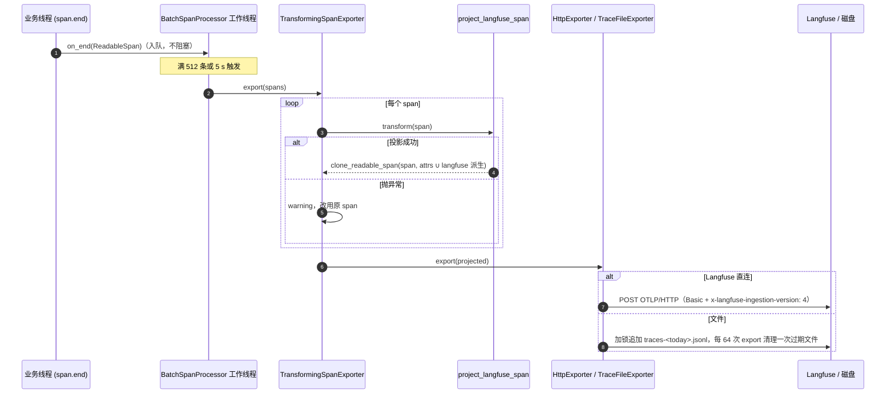
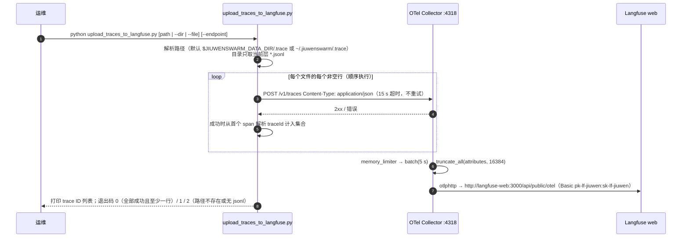

# 轨迹导出：Langfuse 适配与 OTel 兼容平台上报（含文件 WAL 与离线导入）

> 本文是 SDD-0022（轨迹观测框架）的导出层子设计：规范 span 如何到达三方观测平台。
> 采集层产出的规范 span 不含任何后端专属字段，见 SDD-0022 §4.3.1。
> 由代码逆向整理：agent-core `7e98a60f9`，jiuwenswarm `43e796e1d`。

## 1. 背景与问题 (Why)

### 1.1 三个真实场景

1. **在线排查**。开发者本地起一套 Langfuse，希望 Team 或单 agent 每次运行都能在 Langfuse 里看到：一条 trace 叫什么，一个 session 下有哪些 trace，每个 generation 的输入输出与 token，每个工具调用的参数与结果。
2. **离线或内网环境**。运行环境连不到观测后端，或者不想让业务进程依赖一个随时可能不可用的远端。希望先把 trace 写到本地盘，事后再批量导入 Langfuse。
3. **通用 OTel 后端**。有的团队用 OTel Collector 转发到 Jaeger、Tempo 或自研平台，只要标准 OTLP。

### 1.2 痛点

**(1) Langfuse 要的字段不是 OTel 标准字段。** Langfuse 的 OTel 摄入依赖以下几类字段来渲染 observation：

- `langfuse.observation.type` / `input` / `output`；
- 不带 `langfuse.` 前缀的 `session.id`；
- `langfuse.trace.name` / `tags`（仅 root span）。

老版本自托管 Langfuse 还只认已弃用的索引式 `gen_ai.prompt.{i}.*` / `gen_ai.completion.{i}.*`。v4 摄入协议则需要 `x-langfuse-ingestion-version: 4` 请求头。

**(2) 历史做法把后端字段写进采集层，代价明显：**

- **挤占配额**：`langfuse.*` 和采集时要写的 prompt 属性抢同一份 `SpanLimits(max_attributes=200)`。配额按 FIFO 淘汰，最先写入的 operation、model 反而先被丢掉。
- **消费者被污染**：同一个 span 还要喂给 Web 轨迹 sink、自演进和 RL 投影（SDD-0024/0024）。这些消费者只能看到"为 Langfuse 改过形"的数据。
- **后端被耦合**：换一个后端就要改采集代码。

**(3) 离线文件和在线上报容易走成两套形状。** 文件里存"纯标准 OTLP"、上报前再转换，那么导入工具就得复刻一遍 Langfuse 投影逻辑。两份实现迟早漂移。

**(4) 配置入口有历史包袱。** 旧配置用 `backend: langfuse` 选"形状"，新配置用 `exporter` 选"传输"，两者语义重叠。

## 2. 目标与非目标

**目标**

- G1 **后端投影只在导出时发生**：规范 span 保持不变，每个导出器只拿到自己需要的投影副本；投影失败时导出原始 span，不丢数据。
- G2 **Langfuse 直连**：一个 `exporter: langfuse` 就能完成 OTLP/HTTP 传输、Basic 认证、v4 摄入头和字段投影。
- G3 **文件 WAL**：`exporter: file` 不依赖 Collector，按天追加单 span OTLP JSON 行。文件内容与直连 Langfuse 时发送的投影**逐字节同形**，离线导入不需要再做转换。
- G4 **通用 OTLP**：`otlp_grpc` / `otlp_http` 原样发送规范 span，可对接任何兼容 OTLP 的 Collector 或后端。
- G5 **本地部署与离线导入工具**：一键起 Collector 加 Langfuse，并提供文件导入脚本。
- G6 **弃用平滑**：`backend` 只在初始化时翻译一次并告警，不进入采集层。

**非目标**

- 不定义规范 span 的形状，见 SDD-0022。
- 不定义 Web 轨迹存储。SQLite sink 不是导出器，而是独立的 SpanProcessor，见 SDD-0025。
- 不做除 Langfuse 之外的专属投影（如 Arize、Phoenix、LangSmith）。它们作为通用 OTLP 后端使用；如需专属字段，按本文 §4.3.2 的模式另写适配器。
- 不导出流式帧和 v2 事件的逐帧数据。v2 事件 span 本身会被导出，按普通 span 投影；帧只走进程内通道，见 SDD-0022 §5.5。
- 不做生产级 Langfuse 部署（高可用、密钥管理、TLS）。`deploy/observability` 仅供开发和演示。

## 3. 术语与上下文

| 术语 | 含义 |
|---|---|
| **规范 span** | 采集层产出的 span，只含标准 `gen_ai.*` 和 `openjiuwen.*` / `agentteam.*` 扩展键 |
| **Langfuse 投影** | `project_langfuse_span`：由规范 span 派生 `langfuse.*` / `session.id`（可选再加旧式索引属性），返回**完整副本**，原 span 不变 |
| **TransformingSpanExporter** | 包装一个导出器，逐 span 应用只读变换后再交给内层导出器 |
| **文件 WAL** | `TraceFileExporter` 写出的 `traces-YYYY-MM-DD.jsonl`，定位为"Langfuse 摄入的预写日志" |
| **Collector** | `otel/opentelemetry-collector-contrib`，本仓部署里负责接收 OTLP、限流、截断，再转发 Langfuse |
| **摄入版本** | Langfuse OTLP 摄入协议的主版本（3 或 4），v4 通过请求头选择 |

## 4. 方案设计 (What / How)

### 4.1 总体架构

```
                              TracerProvider（SDD-0022）
                                        │ on_end
               ┌────────────────────────┼─────────────────────────────────────────┐
               │ BatchSpanProcessor / SimpleSpanProcessor(exporter)               │ 其他处理器：
               │                                                                  │ TrajectorySpanProcessor
               ▼                                                                  │ SpanRecordProcessor
     build_span_exporter(config)  ← resolve_exporter_selection（backend 弃用翻译） │ （看到的仍是规范 span）
               │                                                                  └───────────────
   ┌───────────┼───────────────┬───────────────────────────┬──────────────────────────┐
   ▼           ▼               ▼                           ▼                          ▼
 console    otlp_grpc       otlp_http                  langfuse                     file
 Simple     OTLPSpanExporter HttpExporter       TransformingSpanExporter     TransformingSpanExporter
 规范 span  (insecure, Basic  (Basic 头可选)      ├ project_langfuse_span      ├ project_langfuse_span
            头可选)                                └ HttpExporter(endpoint,     └ TraceFileExporter
   │           │               │                     Basic + x-langfuse-          (traces_dir, retention)
   │           │ 规范 span     │ 规范 span            ingestion-version:4)          │ 投影后的 OTLP JSON 行
   ▼           ▼               ▼                           │ 投影后 span                ▼
 stdout   ┌─────────────── OTel Collector ──────────┐       │                  <traces_dir>/traces-
          │ memory_limiter → batch → transform/     │       │                    YYYY-MM-DD.jsonl
          │ limit_strings(16 KiB) → otlphttp/langfuse│       │                          │
          │ + debug                                  │       │     upload_traces_to_langfuse.py
          └──────────────────┬───────────────────────┘       │     （逐行 POST，不做变换）
                             ▼                               ▼                          │
                   Langfuse /api/public/otel ◄───────────────┘◄─────────────────────────┘
                   （或任意 OTLP 兼容后端）                          经 Collector :4318/v1/traces
```

**组件职责**

| 组件 | 位置 | 职责 |
|---|---|---|
| `build_span_exporter` / `resolve_exporter_selection` / `build_auth_headers` / `wrap_langfuse_projection` | agent-core `extensions/observability/runtime.py` | 按配置构造导出器；把 `backend` 翻译为 `exporter`；为通用 OTLP 生成可选的 Basic 头 |
| `TransformingSpanExporter` / `clone_readable_span` | `exporters/transforming.py` | 只读逐 span 变换；变换失败时回退原 span |
| `project_langfuse_attributes` / `project_langfuse_span` / `build_langfuse_auth_headers` / `build_langfuse_span_exporter` / `LangfuseExporterConfig` | `exporters/langfuse.py` | 整个采集链路中**唯一**知道 Langfuse 的模块 |
| `TraceFileExporter` | `file_exporter.py` | 按天追加 JSONL，惰性清理过期文件 |
| `encode_span_to_otlp_json` | `otlp_codec.py` | 单 span `ExportTraceServiceRequest` → JSON（十六进制 ID、整数枚举）。文件导出器与 `SpanRecordProcessor` 共用 |
| `build_observability_config` | jiuwenswarm `agents/harness/observability_runtime.py` | 把 `config.yaml` 的 `agent_observability` / `team_observability` 段映射为 `ObservabilityConfig` |
| `docker-compose.yml` / `otel-collector-config.yaml` / `README.md` | jiuwenswarm `deploy/observability/` | 本地 Collector 加 Langfuse v3 栈 |
| `upload_traces_to_langfuse.py` | 同上 | 文件 WAL 离线导入 |

### 4.2 数据流与时序

#### 4.2.1 三条上报路径

| 路径 | 配置 | 链路 | Langfuse 投影 | v4 头 | 实时性 |
|---|---|---|---|---|---|
| **A. 直连 Langfuse** | `exporter: langfuse`，`endpoint: …/api/public/otel/v1/traces` | 进程 → Langfuse | ✅ 导出时派生 | ✅（`ingestion_version=4`） | Batch（默认 5 s 或 512 span） |
| **B. 经 Collector** | `exporter: otlp_grpc`（或 `otlp_http`），`endpoint: localhost:4317` | 进程 → Collector → Langfuse 或其他后端 | ❌ 发送规范 span | ❌（Collector 只加 Basic 头） | Batch 加 Collector batch（5 s） |
| **C. 文件 WAL + 离线导入** | `exporter: file`，`traces_dir` | 进程 → jsonl →（事后）脚本 → Collector :4318 → Langfuse | ✅ 写盘前派生 | ❌（经 Collector） | 离线 |

路径 B 到达 Langfuse 时没有 `langfuse.*` 派生字段，只能依赖 Langfuse 对标准 `gen_ai.*` 属性的原生解析。解析覆盖范围随 Langfuse 版本变化，**本文未逐版本验证**。需要完整的 Langfuse 渲染时，请选路径 A 或 C，见 §10 Q2。

#### 4.2.2 导出时序（路径 A / C）



#### 4.2.3 离线导入时序（路径 C 后半段）



### 4.3 接口与数据模型

#### 4.3.1 导出器选择

```python
# extensions/observability/runtime.py
def resolve_exporter_selection(config: ObservabilityConfig) -> str:
    # backend == "langfuse" → DeprecationWarning，返回 "langfuse"（覆盖 exporter 的取值）
    # 否则返回 config.exporter
def build_span_exporter(config: ObservabilityConfig) -> SpanExporter:
    # console   → ConsoleSpanExporter（SimpleSpanProcessor）
    # file      → wrap_langfuse_projection(TraceFileExporter(traces_dir, file_retention_days), LangfuseExporterConfig)
    # langfuse  → build_langfuse_span_exporter(config)
    # otlp_grpc → OTLPSpanExporter(endpoint, insecure=True, headers=build_auth_headers(config))
    # otlp_http → HttpExporter(endpoint, headers=build_auth_headers(config))
    # 其他取值  → build_error(PARAM_INVALID_ERROR)
def build_auth_headers(config) -> dict[str, str]:
    # langfuse_public_key 与 langfuse_secret_key 都非空时返回 {"authorization": "Basic b64(pk:sk)"}
```

- 除 `console` 和 `span_exporter_override` 使用 `SimpleSpanProcessor` 外，其余导出器都用 `BatchSpanProcessor`，span 结束不阻塞业务线程。
- 通用 OTLP 路径的 Basic 头**复用 `langfuse_*_key` 字段**，这是命名上的历史遗留，见 §10 Q4。

#### 4.3.2 Langfuse 投影映射

> **Requirement:** 投影 SHALL 返回原 span 的完整副本，保留原 span 的 trace/span id、父上下文、resource、events、links、kind、status、时间戳与 scope，仅替换属性映射；输入 span SHALL 不被修改。
> **Scenario:** WHEN 同一个 span 同时经过 Langfuse 导出器和 SQLite sink THEN sink 看到的属性里没有任何 `langfuse.*`（`test_projection_returns_a_copy_and_never_mutates_the_input`）。

**observation 类型**（`_observation_type`，按顺序匹配）：

| 条件 | `langfuse.observation.type` |
|---|---|
| `gen_ai.operation.name` ∈ {`chat`, `generate_content`, `text_completion`} | `generation` |
| `gen_ai.operation.name` == `embeddings` | `embedding` |
| operation == `execute_tool` 或 `record.kind` == `tool` | `tool` |
| operation == `invoke_agent` 或 `record.kind` == `agent` | `agent` |
| operation == `retrieval` 或 `record.kind` == `retrieval` | `retriever` |
| operation == `workflow` 或 `record.kind` == `workflow` | `chain` |
| 其余（Step、Team root、task、msg、member、v2 事件等） | `span` |

**observation 输入与输出**：

| observation | `langfuse.observation.input` | `langfuse.observation.output` |
|---|---|---|
| generation / embedding | `[{"role":"system","parts": <gen_ai.system_instructions>}] + <gen_ai.input.messages>`（JSON 字符串） | `gen_ai.output.messages` |
| tool | `gen_ai.tool.call.arguments` | `gen_ai.tool.call.result` |
| agent | `openjiuwen.span.input` | `openjiuwen.span.output` |
| `record.kind=reasoning`（例如 `llm.reasoning`，operation 为 `chat`，归入 generation） | **无**（不放占位） | `gen_ai.output.messages` |
| 其他 span | `openjiuwen.span.input` | `openjiuwen.span.output` |

注：单 agent run root 的 operation 是 `invoke_agent`，归入 agent 类型；它的 `openjiuwen.span.input` / `output` 分别是用户 query 和最终回答。

**trace 与 session 级字段**：

| 源 | 目标 | 条件 |
|---|---|---|
| `gen_ai.conversation.id` | `session.id`（**无** `langfuse.` 前缀，与 Langfuse SDK `LangfuseOtelSpanAttributes` 一致） | 非空 |
| `span.name` | `langfuse.trace.name` | 仅 `span.parent is None`（trace root） |
| `agentteam.team.name` | `langfuse.trace.tags=[team_name]` | 仅 root 且非空 |

**可选的旧式投影**（`langfuse_legacy_prompt_projection=true`，默认关闭）：

```
gen_ai.input.messages[i]  → gen_ai.prompt.{i}.role / gen_ai.prompt.{i}.content（parts 内 content 拼接）
gen_ai.output.messages[i] → gen_ai.completion.{i}.role / gen_ai.completion.{i}.content
```

token 值保持 provider 原值。缓存和 reasoning 的 token 是 input/output 的**组成部分**，投影不做扣减，由 `test_projection_keeps_provider_raw_token_values` 保证。

**请求头**：

```python
build_langfuse_auth_headers(public_key, secret_key, ingestion_version=4) -> {
    "authorization": "Basic b64(pk:sk)",      # 两个 key 都非空时
    "x-langfuse-ingestion-version": "4",      # ingestion_version == 4 时
}
```

#### 4.3.3 文件 WAL 格式

- **路径**：`<traces_dir>/traces-<YYYY-MM-DD>.jsonl`。按本地日历日切分，所有 trace 共用一个文件，同一 trace 的 span 可能交错出现。
- **行**：一行一个 `ExportTraceServiceRequest`，只包含**单个** span。以下为经过投影的真实形态（节选）：

```json
{"resourceSpans":[{"resource":{"attributes":[{"key":"service.name","value":{"stringValue":"jiuwenswarm"}}]},
  "scopeSpans":[{"scope":{"name":"openjiuwen.extensions.observability"},
   "spans":[{"traceId":"4bf92f3577b34da6a3ce929d0e0e4736","spanId":"00f067aa0ba902b7","parentSpanId":"a3ce929d0e0e4736",
     "name":"execute_tool grep","kind":1,"startTimeUnixNano":"…","endTimeUnixNano":"…",
     "attributes":[
       {"key":"gen_ai.operation.name","value":{"stringValue":"execute_tool"}},
       {"key":"gen_ai.tool.name","value":{"stringValue":"grep"}},
       {"key":"gen_ai.tool.call.arguments","value":{"stringValue":"{\"pattern\":\"foo\"}"}},
       {"key":"gen_ai.tool.call.result","value":{"stringValue":"…"}},
       {"key":"gen_ai.conversation.id","value":{"stringValue":"sess_1"}},
       {"key":"session.id","value":{"stringValue":"sess_1"}},
       {"key":"langfuse.observation.type","value":{"stringValue":"tool"}},
       {"key":"langfuse.observation.input","value":{"stringValue":"{\"pattern\":\"foo\"}"}},
       {"key":"langfuse.observation.output","value":{"stringValue":"…"}}],
     "status":{"code":2,"message":"…"}}]}]}]}
```

编码约定（`otlp_codec.py`）：

- `traceId` / `spanId` / `parentSpanId` 使用**小写十六进制**，而不是 protobuf-JSON 默认的 base64；
- 枚举（`kind`、`status.code`）使用**整数**（`d2525b6ee`）。

两者都是为了让行可以直接 POST 到 Collector 和 Langfuse。

> **Requirement:** 文件导出器与 Langfuse 直连导出器 SHALL 使用同一投影函数，投影参数相同时输出属性集合完全一致。
> **Scenario:** WHEN 同一批 span 分别经 `file` 与 `langfuse` 导出 THEN 文件行中的属性与 HTTP 请求中的属性一致（`test_file_and_langfuse_exporters_share_identical_projection`）。

> **Requirement:** 文件导出器 SHALL 在 `export()` 内直接落盘、不做内存缓冲，`force_flush` / `shutdown` SHALL 为 no-op 且不丢数据。
> **Scenario:** WHEN 进程在 export 返回后崩溃 THEN 已 export 的行都在盘上（`test_export_writes_immediately`、`test_shutdown_is_noop_does_not_lose_data`）。

#### 4.3.4 JiuwenSwarm 配置映射

`build_observability_config(config, *, service_name, default_exporter="otlp_grpc", default_endpoint="http://localhost:4317", default_backend="langfuse", traces_dir)` 的映射：

| yaml 键 | `ObservabilityConfig` 字段 | 映射默认 | 单 agent 调用（`agent_observability.py`） | Team 调用（`team_manager.py`） |
|---|---|---|---|---|
| `service_name` | `service_name` | 调用方给定 | `jiuwenswarm-agent` | `jiuwenswarm` |
| `exporter` | `exporter` | `otlp_grpc` | 同 | 同 |
| `endpoint` | `endpoint` | `http://localhost:4317` | 同 | 同 |
| `backend` | `backend` | **`langfuse`** | 传入 `default_backend="otlp"` | **未传入，沿用 `langfuse`** |
| `sample_rate` | `sample_rate` | 1.0 | | |
| `max_attributes` | `max_attributes` | 200 | | |
| `attribute_value_max_length` | 同名 | **10240**（SDK 默认 40960） | | |
| `redact_prompts` / `redact_completions` | 同名 | false | | |
| `langfuse_public_key` / `langfuse_secret_key` | 同名 | "" | | |
| `traces_dir` | 同名 | `<workspace>/.trace` | | |
| `file_retention_days` | 同名 | 7 | | |

`ObservabilityConfig` 中另有 `langfuse_ingestion_version`、`langfuse_legacy_prompt_projection`、`export_timeout_ms` 三个字段，**jiuwenswarm 映射没有暴露**，因此始终取 SDK 默认值：4、false、5000。

### 4.4 关键流程

#### 4.4.1 投影失败与数据保全

`TransformingSpanExporter.export` 对每个 span 独立 `try`：

- 变换抛异常：记 warning（带变换函数名与 span 名），把**原始** span 放进导出批次；
- 同一批中其他 span 的投影不受影响；
- 投影只作用于被包装的导出器，处理器链上的其他成员（sink、轨迹投影）始终看到规范 span。

#### 4.4.2 文件保留期清理

- **触发**：每 64 次 `export()` 调用触发一次 `_cleanup_old_files`，降低常态写入延迟。
- **清理规则**：
  - 只处理 `traces_dir` 当前层的 `*.jsonl` 普通文件；
  - 按 **mtime** 与 `now − retention_days × 86400` 比较，过期即删除；
  - `retention_days <= 0` 表示不清理。
- **容错**：
  - 目录不存在、文件在 listdir 与 stat/remove 之间被其他进程删除：静默跳过；
  - 其他 `OSError`：记 warning，跳过该文件，不中断整轮清理；
  - 清理失败永不抛出。
- **注意**：清理只在"有 export 发生"时触发。进程长期无 span 时，过期文件不会被删除。

#### 4.4.3 `backend` 弃用翻译

```
config.backend == "langfuse" ─► warnings.warn(DeprecationWarning) ─► 返回 "langfuse"（忽略 config.exporter）
config.backend in (None, "otlp") ─► 返回 config.exporter
```

- 翻译只发生在 `build_span_exporter` 里，结果不会传给采集层（callback、bridge、rail），不影响规范 span 的形状。
- **已知后果**：jiuwenswarm Team 映射没有传 `default_backend`，默认值 `"langfuse"` 会被当作显式 `backend` 使用。打包的 `team_observability: {exporter: file, endpoint: http://localhost:4317}` 因此实际生效为 **Langfuse OTLP/HTTP 导出器，发往 gRPC 端口**，而不是写 jsonl。见 §9 R1，这是本文最高优先级的遗留缺陷。

#### 4.4.4 与 provider 共享的交互

- 导出器随 provider **首次**创建时确定（SDD-0022 §4.4.1）。
- 同一进程里单 agent 与 Team 都开启时，先获取需求的一方的 `exporter` / `endpoint` 生效，另一方的导出配置被忽略。`config.yaml` 注释中已说明这一点。
- `trajectory_ui.enabled` 也会拉起 provider，并**完整复用**对应运行时的导出配置。只想要 Web 轨迹、不想写 jsonl 的配置目前无法表达，见 SDD-0025 §9。
- 在线 RL 的 `rail_factory` 可能先以 `exporter=file`（`ONLINE_RL_OBSERVABILITY_TRACES_DIR`）初始化 provider，此时宿主后续的导出配置不会生效。

#### 4.4.5 本地部署栈

`deploy/observability/docker-compose.yml`：

| 服务 | 镜像 | 端口 | 说明 |
|---|---|---|---|
| otel-collector | `otel/opentelemetry-collector-contrib:0.154.0` | 4317 gRPC / 4318 HTTP | 无认证接收 |
| langfuse-web | `langfuse/langfuse:3` | 3000 | 初始化组织和项目 `jiuwen-*`，项目 key 为 `pk-lf-jiuwen` / `sk-lf-jiuwen`，登录用户 `jiuwenswarm@jiuwen.local` |
| langfuse-worker | `langfuse/langfuse-worker:3` | — | |
| postgres / clickhouse / redis / minio | `postgres:17` / `clickhouse-server` / `redis:7` / `minio`（bucket `langfuse`） | — | Langfuse v3 依赖 |

Collector 管线：

```
otlp(grpc 4317, http 4318)
  → memory_limiter(limit 1024 MiB, spike 256 MiB, check 2 s)
  → batch(timeout 5 s, send_batch_size 1024, max 2048)
  → transform/limit_strings: truncate_all(attributes, 16384)
  → otlphttp/langfuse(endpoint http://langfuse-web:3000/api/public/otel, Authorization: Basic <pk-lf-jiuwen:sk-lf-jiuwen>)
  + debug(verbosity basic)
```

- **截断**：Collector 把所有字符串属性截到 16 KiB，比 SDK 侧的 `attribute_value_max_length`（jiuwenswarm 默认 10240，SDK 默认 40960）以及"system prompt 不截断"更严格。**经过 Collector 的 system prompt 仍会被截断**。
- **密钥**：compose 中的 `NEXTAUTH_SECRET`、`SALT`、`ENCRYPTION_KEY` 和 Collector 的 Basic 头都是写死的开发值。

### 4.5 配置与开关

**agent-core `ObservabilityConfig`（导出相关字段）**

| 字段 | 默认 | 说明 |
|---|---|---|
| `exporter` | `"otlp_grpc"` | `otlp_grpc` / `otlp_http` / `langfuse` / `console` / `file` |
| `endpoint` | `"http://localhost:4317"` | `langfuse` 必须指向 `…/api/public/otel/v1/traces`；`file` 忽略 |
| `backend` | `None` | 已弃用。`"langfuse"` 等价于 `exporter="langfuse"` 并告警；`"otlp"` / `None` 无影响 |
| `langfuse_public_key` / `langfuse_secret_key` | `""` | Langfuse 直连认证；通用 OTLP 在两者都非空时也会复用为 Basic 头 |
| `langfuse_ingestion_version` | `4` | 3 或 4；4 时附加 `x-langfuse-ingestion-version: 4` |
| `langfuse_legacy_prompt_projection` | `False` | 额外输出 `gen_ai.prompt/completion.{i}.*` |
| `export_timeout_ms` | `5000` | 字段已定义，**当前导出器构造未使用**（见 §12） |
| `traces_dir` | `"./traces"` | 文件导出根目录（jiuwenswarm 默认 `<workspace>/.trace`） |
| `file_retention_days` | `7` | 按 mtime 清理 |
| `max_attributes` / `attribute_value_max_length` / `redact_*` | 见 SDD-0022 §4.5 | 投影读取的是已脱敏、已截断的规范值 |

**jiuwenswarm `config.yaml`（打包值）**

```yaml
team_observability:
  enabled: true
  exporter: file
  endpoint: http://localhost:4317
  service_name: jiuwenswarm
  attribute_value_max_length: 10240
  traces_dir: ""            # 默认 ~/.jiuwenswarm/.trace
  file_retention_days: 7
agent_observability:
  enabled: false
  exporter: file
  service_name: jiuwenswarm-agent
  # 其余同上
```

**上传脚本参数**

| 参数 | 默认 |
|---|---|
| 位置参数 `path` / `--dir` / `--file` | `$JIUWENSWARM_DATA_DIR/.trace` 或 `~/.jiuwenswarm/.trace` |
| `--endpoint` | `http://127.0.0.1:4318/v1/traces`（用 IPv4 回环，规避 macOS 上 `localhost` 先解析到 `::1` 时，Docker Desktop IPv6 转发返回 502 的问题） |

**灰度与回退**：导出器随进程配置生效，没有运行时热切换。改 `exporter` 后需要下一次 provider 创建（进程重启，或所有需求释放后重新获取）才生效。

## 5. 关键决策与权衡 (ADR)

### 5.1 投影在导出时派生，而非采集时写入

- **决策**：采集层只写规范 span，`langfuse.*` 由 `TransformingSpanExporter` 在导出线程上对**副本**派生（`bd9cf4f89`、`0c3f90947`）。
- **背景**：同一个 span 要同时喂给多个处理器。`SpanLimits` 在采集时生效，导出时派生的属性不占采集配额。
- **否决的备选**：
  - *采集时写 `langfuse.*`*（旧做法）：
    1. FIFO 淘汰会吃掉关键属性；
    2. Web sink、演进、RL 都会看到后端专属形状；
    3. 换后端要改采集代码。
  - *原地修改 span 属性再导出*：`ReadableSpan` 属于 SDK 内部状态，其他处理器可能同时持有它；原地改会让 sink 读到 `langfuse.*`。
  - *放在 Collector 的 transform processor 里做*：文件模式与直连模式都绕开 Collector，无法复用；OTTL 表达 JSON 重组（system instructions 与 messages 合并）也很笨重。
- **影响**：导出时多一次属性字典拷贝加若干次 JSON 解析和序列化，发生在 `BatchSpanProcessor` 的后台线程上。

### 5.2 文件导出器携带与 Langfuse 直连相同的投影

- **决策**：`file` 被包装进 `wrap_langfuse_projection`，文件定位为"Langfuse 摄入的 WAL"。
- **理由**：离线导入工具只需逐行 POST，不必复刻投影逻辑；直连与离线两条路径由同一个函数保证一致。
- **否决的备选**：*文件存纯规范 OTLP，导入时再投影*。这需要在 jiuwenswarm 的脚本或 Collector 里再实现一遍投影，两份实现必然漂移；而且脚本需要依赖 agent-core。
- **代价**：
  - 文件不再是"纯标准 OTLP"。但投影只**追加**属性、不删除规范键，其他 OTLP 后端读取这些文件时仍能拿到全部标准属性，只是多出一些 `langfuse.*` 键。
  - jiuwenswarm 的 `docs/zh/调试追踪.md` 与 `deploy/observability/README.md` 仍写"标准 OTLP JSON"，见 §12 偏差。

### 5.3 一行一个 span、按天一个文件、不按 trace 拆分

- **决策**：`traces-YYYY-MM-DD.jsonl` 按天追加，每行是自包含的单 span 请求。
- **理由**：
  - Collector 与 Langfuse 按每个 span 自带的 `traceId` / `parentSpanId` 重建 trace，物理顺序无关；
  - 追加写不需要知道 trace 何时结束；
  - 单行可独立重放，一行失败不影响其他行；
  - 按天切分让保留期清理可以按文件整删。
- **否决的备选**：
  - *按 trace 一个文件*：需要维护每个 trace 的文件句柄与结束时机，长会话与 HITL 恢复跨 trace 时难以判断何时关闭；文件数量爆炸。
  - *一行一个批次（多 span）*：单行变大，局部损坏影响整批，重放粒度变粗。

### 5.4 文件导出器不做缓冲，依赖 BatchSpanProcessor

- **决策**：`export()` 直接加锁 `open(…, "a")` 追加，`force_flush` / `shutdown` 为 no-op。
- **理由**：`BatchSpanProcessor` 已经负责异步批处理（默认 5 s 或 512 条）。导出器再缓冲一层会让崩溃时丢失的数据翻倍，也让 shutdown 语义更复杂。
- **代价**：每批一次 open/close。对开发和演示场景的吞吐足够。

### 5.5 上传脚本不做变换、不做批量、不重试

- **决策**：脚本逐行、顺序、单次 POST，只统计成功行的 trace ID。
- **理由**：文件已经是投影后的 OTLP 请求（§5.2）；Collector 负责 batch 与限流；脚本保持零依赖（只用标准库 `urllib`），可以脱离 agent-core 运行。
- **代价**：大文件导入慢；失败行需要重跑整个文件，Langfuse 侧对重复 span 的去重行为**未验证**。见 §10 Q3。

### 5.6 v4 摄入为默认，旧式索引投影按需开启

- **决策**：`langfuse_ingestion_version=4`、`langfuse_legacy_prompt_projection=False`。
- **理由**：索引式 prompt 已被 GenAI 标准弃用，默认输出会重复膨胀属性；只有老版本自托管 Langfuse 需要它。
- **缺口**：经 Collector 转发（路径 B、C）时没有 v4 头，最终使用 Langfuse 服务端的默认摄入版本。见 §10 Q2。

### 5.7 `backend` 保留为弃用翻译，而非直接删除

- **决策**：保留字段，初始化时翻译一次并发出 `DeprecationWarning`。
- **否决的备选**：*直接删除字段*。已有用户配置会因 pydantic 校验而启动失败。
- **教训**：翻译让 `backend="langfuse"` **覆盖** `exporter`。宿主映射层的默认值 `default_backend="langfuse"` 由此从"形状选择"变成了"传输选择"，造成 §9 R1。弃用字段的默认值在宿主层也应同步移除。

## 6. 影响面与兼容性

- **BREAKING `0c3f90947`**：采集层不再写 `langfuse.*`。
  - 直接读 OTLP 原始数据中 `langfuse.*` 的下游，需要改读规范键，或经 `exporter=langfuse/file` 拿投影后的数据；
  - Langfuse 直连用户无感；
  - `otlp_grpc` 经 Collector 到 Langfuse 的用户，会失去此前由采集层写入的 `langfuse.*`，Langfuse UI 的 observation 类型、输入输出渲染可能变化（见 §4.2.1 路径 B）。
- **文件内容变化**：`file` 模式的行里多出 `langfuse.*` 与 `session.id`，旧版读取脚本不受影响（只增不删）。
- **Langfuse v3 服务端**：需要显式设置 `langfuse_ingestion_version: 3`。jiuwenswarm 映射未暴露该字段，只能通过代码调用方设置。
- **jiuwenswarm 配置**：
  - 单 agent 映射传 `default_backend="otlp"`，不受弃用翻译影响；
  - Team 映射受影响（§9 R1）；
  - 现有测试 `tests/unit_tests/agentserver/test_observability_config_mapping.py` 只覆盖单 agent。
- **Collector 部署**：截断阈值 16 KiB 会影响 system prompt 完整性，与 SDD-0022 §5.11 的目标冲突，仅限经 Collector 的路径。

## 7. 测试与验证

**agent-core**

`tests/unit_tests/extensions/observability/test_langfuse_exporter.py`：

| 测试 | 不变量 |
|---|---|
| `test_collection_modules_contain_no_langfuse_references` | 采集模块源码中不出现 Langfuse 引用 |
| `test_same_canonical_span_standard_otlp_zero_langfuse_and_adapter_projected` | 同一个规范 span：标准 OTLP 路径零 `langfuse.*`，适配器路径有投影 |
| `test_projection_returns_a_copy_and_never_mutates_the_input` | 投影返回副本，不修改输入 |
| `test_tool_span_maps_arguments_and_result` / `test_agent_span_maps_span_io` / `test_task_and_event_spans_map_span_io` | 各类型输入输出映射 |
| `test_team_root_span_gets_trace_name_tags_and_session` | root 的 trace name、tags、session |
| `test_reasoning_span_has_no_input_placeholder` | reasoning 无输入占位 |
| `test_workflow_and_retrieval_operation_types` | chain / retriever 类型 |
| `test_legacy_prompt_projection_off_by_default_and_on_demand` | 旧式投影开关 |
| `test_transform_failure_exports_the_original_span` | 变换失败时导出原 span |
| `test_projection_keeps_provider_raw_token_values` | token 不扣减 |
| `test_langfuse_auth_and_ingestion_headers` / `test_langfuse_exporter_uses_otlp_http_behind_projection` | 头与传输 |
| `test_file_exporter_is_wrapped_in_the_langfuse_projection` / `test_file_and_langfuse_exporters_share_identical_projection` | 文件与直连同形 |
| `test_deprecated_backend_is_translated_once_with_warning` | 弃用翻译 |

`test_file_exporter.py`：立即写盘；每行是合法 OTLP JSON 且 ID 为十六进制；错误状态为整数枚举；同一或不同 trace 的 span 交错写入同一文件；无 session 属性照样写入；重复 export 不重复；shutdown 不丢数据；清理删除过期文件、保留近期文件；`build_span_exporter` 返回文件导出器。

**jiuwenswarm**：`tests/unit_tests/agentserver/test_observability_config_mapping.py`，覆盖单 agent 映射；**缺 Team 映射用例**。

**验收标准（建议补充的端到端验证）**

1. `docker compose up` 后，`exporter: langfuse` 运行一次单 agent 回合，Langfuse 中 trace name 为 `agent.{mode}.{sid}`、session 正确、generation 与 tool observation 的输入输出完整。
2. `exporter: file` 运行同一回合，再用脚本导入，Langfuse 渲染与 (1) 一致（system prompt 超过 16 KiB 时除外）。
3. `exporter: otlp_grpc` 经 Collector，记录 Langfuse 渲染与 (1) 的差异，形成兼容性说明。
4. Team 默认打包配置下，jsonl 实际写出（修复 R1 之后）。

## 8. 可观测性

| 信号 | 位置 | 含义 |
|---|---|---|
| `otel: span transform … failed for span … - exporting original` | `TransformingSpanExporter` | 投影异常，已回退为原 span |
| `file_exporter: append failed to …` / `cannot create traces_dir` / `cannot prune` / `cleanup failed` | `TraceFileExporter`（`team_logger`） | 磁盘不可写，或清理异常 |
| `DeprecationWarning: ObservabilityConfig.backend is deprecated` | 初始化 | 仍在使用 `backend` |
| OTLP 导出器自身的重试与失败日志 | opentelemetry SDK | 后端不可达 |
| Collector `debug` 导出器、`docker compose logs otel-collector` | 部署 | 转发链路 |
| 上传脚本退出码与 trace ID 列表 | 离线导入 | 导入结果 |

建议监控 `traces_dir` 磁盘占用与每日文件大小；在 Langfuse 侧按 `session.id` 抽查 trace 完整性。

## 9. 风险与回滚

| # | 风险 | 性质 | 缓解与建议 |
|---|---|---|---|
| R1 | **Team 导出器被误选**：`team_manager.py` 调用 `build_observability_config` 时没有传 `default_backend`，默认 `"langfuse"` 触发弃用翻译，覆盖 `exporter: file`。打包配置下 Team span 以 OTLP/HTTP 发往 `http://localhost:4317`（gRPC 端口），**不写 jsonl**，且只要该 span 能导出就会不停报错 | 已确认缺陷（代码核实） | 修复：Team 调用改传 `default_backend="otlp"`，或删除映射层的 `backend` 默认值；补 Team 映射测试 |
| R2 | 经 Collector 的路径（B / C）没有 `x-langfuse-ingestion-version` 头；路径 B 没有 Langfuse 投影 | 兼容缺口 | §10 Q2 |
| R3 | Collector 16 KiB 截断破坏 system prompt 完整性 | 部署配置 | 调大阈值或对 `gen_ai.system_instructions` 豁免 |
| R4 | compose 与 Collector 中写死开发密钥（Basic 头、`ENCRYPTION_KEY` 等） | 安全（仅限开发栈） | README 明示"仅开发用"；生产部署另行管理密钥 |
| R5 | 上传脚本无批量、无重试；失败行需重跑，重复导入的去重行为未验证 | 可用性 | §10 Q3 |
| R6 | 文件保留期清理只在有 export 时触发，进程空闲时过期文件不删 | 运维 | 可接受；或启动时清理一次 |
| R7 | 通用 OTLP 复用 `langfuse_*_key` 生成 Basic 头，配置语义混淆 | 可维护性 | §10 Q4 |
| R8 | 多个运行时共用 provider 时，后到者的导出配置被忽略；只开 `trajectory_ui` 也会按 `agent_observability.exporter` 写文件 | 配置可理解性 | 日志已打印 `provider_existed`；SDD-0025 §10 讨论"仅 sink 模式" |

**回滚**：
- **投影问题**：切到 `otlp_grpc` 经 Collector，发送不带投影的规范 span。
- **文件问题**：切到 `console` 或关闭对应 `*_observability.enabled`。
- **紧急修复 R1**：在用户配置里显式写 `backend: otlp`，映射层会读取该值，覆盖默认。

## 10. 开放问题 (Open Questions)

- [ ] Q1 修复 R1 的方式：是只改 `team_manager` 的调用，还是彻底从 jiuwenswarm 映射中移除 `backend`（以及 SDK 何时删除该字段）？
- [ ] Q2 经 Collector 转发 Langfuse 时，是否在 Collector 配置中补 `x-langfuse-ingestion-version: 4` 头？是否提供"Collector 模式也做 Langfuse 投影"的选项？可选做法有两种：应用侧 `otlp_*` 可选加投影，或 Collector transform。
- [ ] Q3 上传脚本是否增加批量（一次 POST 合并多个 `resourceSpans`）、重试与断点续传？Langfuse 对重复 span ID 的覆盖或去重语义需要确认。
- [ ] Q4 通用 OTLP 认证是否拆出独立的 `otlp_headers` 配置，替代复用 `langfuse_*_key`？
- [ ] Q5 jiuwenswarm 是否暴露 `langfuse_ingestion_version`、`langfuse_legacy_prompt_projection`、`export_timeout_ms`？
- [ ] Q6 是否需要为 Arize Phoenix、LangSmith 等其他平台提供专属适配器？沿用 `TransformingSpanExporter` 模式即可，本文不做。

## 11. 评审记录 (Iteration Log)

| 轮次 | 日期 | 版本 | 评审人 | 结论 | 主要修改/讨论 |
|---|---|---|---|---|---|
| 1 | 2026-09-15 | 1 | @alan_cheng | draft | 初稿：由 agent-core `7e98a60f9` 与 jiuwenswarm `43e796e1d` 逆向整理；核实并记录 Team 导出器误选缺陷（R1） |

## 12. 实现记录与偏差

### 实际实现

| 时间 | commit | 内容 |
|---|---|---|
| 2026-06-29 | agent-core `998f5caa2`、jiuwenswarm `cad7b35dc` | 文件导出器（标准 OTLP JSON）；默认输出到文件，提供手动上传脚本 |
| 2026-06-25 | jiuwenswarm `e9d1560a3` | 修正部署栈初始化用户名 |
| 2026-08-29 | agent-core `bd9cf4f89` | "derive backend shapes at export"：投影开始在导出时派生 |
| 2026-08-31 | agent-core `d2525b6ee` | OTLP 枚举编码为整数 |
| 2026-09-03 | agent-core `0c3f90947` | refactor!：Langfuse 投影隔离进导出适配器，文件导出器包进同一投影，`backend` 改为弃用翻译 |
| 2026-09-03 | agent-core `544ea2838` | refactor!：semconv 收敛，投影改读标准键 |

### 与设计的偏差

以代码为准，以下文档或注释与代码不一致：

1. **`exporters/langfuse.py` 模块 docstring** 的映射摘要写着 `agentteam.agent.input/output → agent observation I/O`、`gen_ai.conversation.id / openjiuwen.session.id → session.id`。实际代码中 agent 读 `openjiuwen.span.input/output`，session 只读 `gen_ai.conversation.id`（`openjiuwen.session.id` 已在 `544ea2838` 删除）。
2. **`ObservabilityConfig` docstring** 写 `export_timeout_ms` 是 "Span exporter shutdown timeout"，但 `build_span_exporter` 构造导出器时没有使用该字段。
3. **jiuwenswarm `docs/zh/调试追踪.md`、`docs/en/DebugTrace.md`、`deploy/observability/README.md`**：
   - 写文件导出器输出"标准 OTLP JSON"，实际带 Langfuse 投影；
   - 导出器列表缺 `langfuse`；
   - 把 `otlp_http` 描述为"直连 Langfuse"，该路径实际没有投影与 v4 头；
   - README 中 `service_name` 默认写 `openjiuwen-agent-teams`，jiuwenswarm 实际传 `jiuwenswarm` / `jiuwenswarm-agent`。
4. **README 与上传脚本不一致**：
   - README 示例使用 `localhost:4318` 与带 `[upload]` 前缀的输出，脚本默认 `127.0.0.1` 且日志无前缀；
   - 脚本注释说 README 解释了 IPv6 问题，README 中没有这部分；
   - 中文文档先警告不要用 `localhost`，示例却写 `--endpoint http://localhost:4318`。
5. **README 退出码**：写"任一行失败返回 1"，代码在"零行成功"时也返回 1。
6. **jiuwenswarm `observability_runtime.py` 与 `agent_observability.py` 的 docstring** 仍把 `backend` 描述为原生形状选择，与 SDK 当前"弃用传输选择器"的语义不符，是 R1 的根因。
7. **`config.yaml` 中 `team_observability` 注释**写"将事件转为 OTel span 导出到 Langfuse / OTLP Collector"，打包配置实际是 `exporter: file`，又因 R1 实际生效为 Langfuse 直连。

### 链接

- agent-core：`openjiuwen/extensions/observability/runtime.py`、`exporters/langfuse.py`、`exporters/transforming.py`、`file_exporter.py`、`otlp_codec.py`、`config.py`
- jiuwenswarm：`agents/harness/observability_runtime.py`、`agents/harness/agent_observability.py`、`agents/harness/team/team_manager.py`、`resources/config.yaml`、`deploy/observability/`

### 遗留与后续

- 修复 R1，补 Team 映射测试。
- 同步修正 §12 偏差中的文档与注释。
- §10 Q2 至 Q6。

## 13. 参考与关联设计

- **SDD-0022**：轨迹观测框架，定义规范 span、`ObservabilityConfig`、provider 共享与处理器顺序。
- **SDD-0025**：轨迹数据面。Web SQLite sink 是独立的 SpanProcessor，与本文导出器并列；`trajectory_ui` 复用本文的导出配置。
- Langfuse OpenTelemetry 摄入文档（`/api/public/otel`、`LangfuseOtelSpanAttributes`）。
- OpenTelemetry Collector contrib：`transform` processor（OTTL `truncate_all`）、`otlphttp` exporter。
