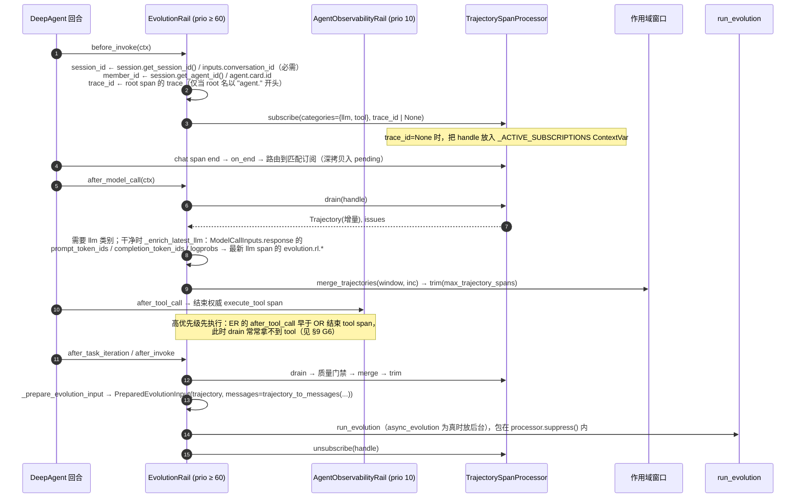
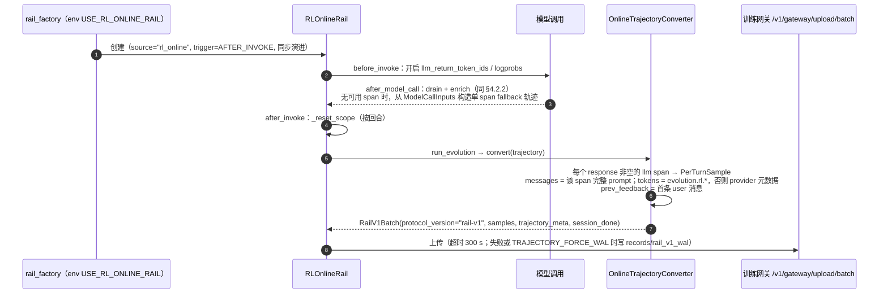

# 轨迹投影：把 OTel 标准轨迹投影为自演进与在线 AgentRL 输入

> 本文是 SDD-0022（轨迹观测框架）的下游子设计，讲的是 `TrajectorySpanProcessor` 如何把同一份规范 span 投影成演进与训练的输入。
> "投影"在本特性组有三种含义，本文专指"轨迹投影"，区分见 SDD-0022 §3。
> 由 agent-core `7e98a60f9` 逆向整理。§9 如实列出多项已知正确性缺口。

## 1. 背景与问题 (Why)

### 1.1 场景

一个挂了 `SkillEvolutionRail` 的 DeepAgent 完成一次回合后，演进器需要拿到回合的**对话消息序列**：system、user、assistant（含 tool_calls）、tool 结果。它据此判断某个 skill 是否被用对、是否需要改写。

同一个 agent 如果同时挂了在线 RL rail（`RLOnlineRail`），回合结束时要把**每一次模型调用**转成训练样本：完整 prompt、completion、生成时的 token id 与 logprob、工具定义、模型 ID，然后上传到训练网关。

在 Team 模式下，`TeamSkillEvolutionRail` 要看到整个团队（leader 与所有成员）的执行，并能按成员切片。

离线 RL（`ParallelRuntimeExecutor`）则是并发跑一批 case，每个 case 收集一条轨迹，转成 `Rollout` 交给 reward 函数。

### 1.2 痛点

1. **两套埋点。** 早期（2026-02 至 2026-07）的轨迹模块基于"step"形模型，自带 aggregator、registry、trace 类型，由各个 rail 自己记录 LLM 与工具步骤。它与 OTel 观测（SDD-0022）描述的是同一批事实，却是两份独立实现：
   - 字段不断漂移（token 口径、工具结果序列化方式）；
   - 无法和 Langfuse、Web 轨迹对照排查；
   - 观测侧修过的问题（并发 LLM 串线、sub-agent 归属）要在演进侧再修一遍。
2. **RL 需要观测没有的字段。** token id 与 logprob 只有在请求时打开 `llm_return_token_ids/logprobs` 才会返回，普通观测不需要；这些字段还必须精确对应到某一次推理。
3. **作用域不一致。** 单 agent 按"会话加成员"累积，Team 按"团队加会话"累积，RL 要求按回合重置，SFT 则按 token 阈值或会话结束刷新。窗口的生命周期各不相同。
4. **不能影响业务。** 捕获发生在 span 结束的同步回调里，任何异常都不能冒到模型或工具的执行路径上；演进本身调用的模型也不能被再次捕获进轨迹，否则会自我污染。

### 1.3 为何现在做

SDD-0022 把规范 span 定稿为唯一事实来源后，`37ed41059` 与 `8016d7ce1`（2026-08-11/12）把演进与 RL 的消费统一切换到 span；`ca99e37c1`（2026-08-18）在其上建立了在线 RL/SFT。本设计记录这一统一后的边界，同时暴露统一后遗留的正确性问题（§9），为后续让投影消费 v2 事件（上下文窗口链、compaction）立下基线。

## 2. 目标与非目标

**目标**

- G1 **零额外埋点**：演进与 RL 只消费 SDD-0022 的规范 span，不自建 trace 模型。
- G2 **投影结果仍是规范 OTLP**：`Trajectory` 是规范 span 子集的不可变信封；消息、rollout、样本都在读取时由无状态访问器派生。
- G3 **进程内实时捕获**：通过 SpanProcessor 订阅与 drain 获取增量；按类别和 trace 路由，靠 ContextVar 隔离并发的 agent 回合。
- G4 **作用域窗口**：以 `("agent", session, member)` 或 `("team", team, session)` 为键累积干净窗口；有质量门禁，可裁剪。
- G5 **RL 精确字段**：token id 与 logprob 富化到对应的 LLM span，富化结果不可变。
- G6 **多种派生视图**：
  - 演进用的 OpenAI 兼容消息序列；
  - 离线 RL 的 `Rollout`；
  - 在线 RL 的 `rail-v1` `PerTurnSample`；
  - SFT 的 `sft-raw-v1` 步骤；
  - 评审工具的 span 索引；
  - RSI 的角色轨迹；
  - Symphony 的执行片段。
- G7 **自我隔离**：演进运行期间 `suppress()`，演进自身的模型调用不进入轨迹。

**非目标**

- 不定义规范 span 的形状，也不定义 v2 事件，见 SDD-0022。
- 不做跨进程或分布式捕获，不回读导出器文件（jsonl）或 Web SQLite。
- 不定义训练网关协议（`rail-v1` / `sft-raw-v1` 的服务端语义），不定义演进算法。
- **当前不消费**以下数据，它们是 Web 数据面（SDD-0025/0025）专用的存储侧优化，见 §6.2 与 §10：
  - v2 `context.window.commit` 链与 `compaction.completed` 事件；
  - 寻址序列；
  - 流式帧。
- 不做 step/turn 的语义分段：投影以 span 为单位（见 §4.3.4）。

## 3. 术语与上下文

| 术语 | 含义 |
|---|---|
| **Trajectory** | `agent_evolving/trajectory/model.py` 中的不可变信封：`{"resourceSpans":[{resource, scopeSpans:[{scope, spans}]}]}`，资源属性必须带 `openjiuwen.trajectory_id` |
| **订阅（subscription）** | 对 `TrajectorySpanProcessor` 的一次登记，声明要哪些 span 类别，以及可选的 trace_id |
| **drain** | 取出订阅中已缓冲的 span，合并为一个增量 `Trajectory`，并返回捕获问题（issues） |
| **干净窗口（clean window）** | rail 在作用域键下累积的、通过质量门禁的增量合并结果，默认保留最新 200 个 span |
| **span 类别** | `llm`、`tool`、`agent`、`task`、`message`、`member`、`team`，决定路由与消费方式 |
| **无状态访问器** | `trajectory/spans.py`、`messages.py`、`team.py` 中的纯函数，读取 span 并派生字段，不持有状态 |
| **rail-v1 / sft-raw-v1** | 在线 RL 与 SFT 上传到训练网关的批次协议 |
| **fallback 轨迹** | 在线 RL/SFT 在没有可用 span 时，由 `ModelCallInputs` 回调直接构造的单 span 轨迹 |

## 4. 方案设计 (What / How)

### 4.1 总体架构

```
             TracerProvider（SDD-0022，进程级共享）
                       │ on_end（同步；在 SafeSpanProcessor 内）
                       ▼
┌─────────────── TrajectorySpanProcessor（进程级单例，经 demand 挂载）───────────────┐
│  on_end：suppress 深度 > 0 → 丢弃                                                  │
│          _category_for_span → None 则忽略                                           │
│          _span_to_otlp（单 span OTLP dict）                                         │
│          路由：订阅.active ∧ 类别 ∈ 订阅.categories ∧                               │
│                (订阅.trace_id == span.trace_id ∨ 订阅在当前 ContextVar 活跃集合中)   │
│          去重(identity) · max_pending_spans · 深拷贝入 pending                      │
│  subscribe / unsubscribe / drain / suppress                                        │
└──────────────────────┬─────────────────────────────────────────────────────────────┘
                       │ drain → Trajectory(增量) + issues
                       ▼
┌─────────────── EvolutionRail（harness/rails/evolution）─────────────────────────────┐
│ before_invoke：解析 session/member/trace → subscribe                                │
│ after_model_call：drain(require llm) → _enrich_latest_llm(token ids/logprobs)        │
│ after_tool_call / after_task_iteration / after_invoke：drain → 质量门禁 → merge → trim │
│ 作用域窗口：("agent", session, member) | ("team", team, session)                    │
│ _prepare_evolution_input → PreparedEvolutionInput(trajectory, messages)             │
│ run_evolution（后台或同步，processor.suppress() 内）                                 │
└───────┬──────────────┬──────────────┬───────────────┬────────────────┬──────────────┘
        ▼              ▼              ▼               ▼                ▼
 Skill/TeamSkill/  TrajectoryRail   RLRail         RLOnlineRail      SFTOnlineRail
 SkillCreate/      → TrajectoryStore (离线 RL)      → OnlineTrajectory → SFTRawTrajectory
 ContextEvolve     (jsonl / RSI     → trajectory_   Converter          Converter
 / Symphony        角色文件)          to_rollouts    → RailV1Batch      → sft-raw-v1 / samples
   ▲                                  ▲             → 网关上传(WAL 兜底)  → 网关上传
   │                                  │
 trajectory_to_messages ◄── 无状态访问器（spans.py / messages.py / team.py）──► review.py 索引
```

**模块职责**

| 模块 | 职责 |
|---|---|
| `trajectory/processor.py` | `TrajectorySpanProcessor`：订阅、路由、drain、suppress；`on_end` 永不抛出 |
| `trajectory/model.py` | `Trajectory` 信封：校验、深拷贝、封存后不可变、资源属性派生 |
| `trajectory/spans.py` | OTLP 值编解码、span 读取器、合并与裁剪、GenAI 读写器（`read_llm_exchange`、`read_tool_call`、`read_usage`、`read_rl_fields`、`read_span_error`） |
| `trajectory/messages.py` | `trajectory_to_messages`：重建 OpenAI 兼容消息序列 |
| `trajectory/team.py` | `span_category`、Team 森林、成员与任务选择器、按成员分组 |
| `trajectory/store.py` | `TrajectoryStore` 协议、`InMemoryTrajectoryStore`、`FileTrajectoryStore`（按版本追加 jsonl） |
| `trajectory/schema.py` | 资源属性与 RL 字段键 |
| `trajectory/legacy.py` · `legacy_semconv.py` | 旧 step 形记录与旧键的**只读**升级 |
| `trajectory/offline/{builder,extractor}.py` | 离线构建器，以及从旧 `core.session.tracer` 抽取轨迹 |
| `harness/rails/evolution/evolution_rail.py` | `EvolutionRail` 基类与 `_TeamTrajectoryCaptureMixin` |
| `harness/rails/evolution/trajectory_rail.py` | `TrajectoryRail`：每次 invoke 归档一条轨迹 |
| `agent_evolving/agent_rl/{schemas,rl_rail}.py` | `Rollout`、`trajectory_to_rollouts`、`RLRail` |
| `agent_evolving/agent_rl/online/{core,backends/rl,backends/sft}` | 在线 rail 基类、工厂、RL/SFT 转换器与上传 |
| `rsi/harness_rsi/evaluator/{case_backend,trajectory_paths}.py` | RSI 评测的角色轨迹 |
| `agent_evolving/tools/review.py` | 给评审 agent 的 span 索引与读取工具 |

### 4.2 数据流与时序

#### 4.2.1 处理器挂载

- **规范路径**：宿主调用 `harness.observability.acquire_observability` 或 `agent_teams.observability.acquire_observability`，经 `demand.acquire_observability_demand`，把 `(get_trajectory_span_processor(), get_span_record_processor())` 交给 `ObservabilityRuntime.initialize`。处理器按对象身份只挂一次，外面包 `SafeSpanProcessor`（SDD-0022 §4.4.1）。
- **自建实例的三处**（与"进程唯一"的文档约定不符，见 §12）：
  - `agent_rl/online/core/rail_factory.py`：`_DEFAULT_TRAJECTORY_SPAN_PROCESSOR`，经 `init_observability`（文件导出器）或 `add_span_processors` 挂载；
  - `agent_rl/offline/runtime/parallel_executor.py`：`_prepare_observability`，由多个 worker 共享；
  - `rsi/harness_rsi/evaluator/case_backend.py`：`default_factory=TrajectorySpanProcessor` 加 `init_observability`。
- **jiuwenswarm**：`team_runtime_inheritance.py`、`swarm/assembly.py`、`swarm/context.py`、`swarm/registry.py` 传递 `get_trajectory_span_processor()`。`SwarmBuildContext.to_seed()` 不序列化处理器，由接收进程在本地重新注入。

#### 4.2.2 单 agent 回合的实时捕获



**质量门禁**（`_drain_for_hook`）：满足以下任一条件时，本次增量返回 `None`，**不并入**窗口：

- processor 返回了 issues（如 `pending_buffer_full`、`span_conversion_error`）；
- 旧式 `gen_ai.prompt.N` 索引出现空洞；
- 工具参数或结果以 `[` / `{` 开头但 `json.loads` 失败；
- hook 要求的类别缺失（如 `after_model_call` 要求 `llm`）。

`TrajectoryRail` 的归档累加器（`_record_execution_increment`）在门禁**之前**接收增量，所以脏数据仍会被归档，只是不进干净窗口。

#### 4.2.3 在线 RL（ppo_turn）



SFT（`SFTOnlineRail`）的不同之处：

- **不走演进触发**：`_allow_evolution_trigger` 恒为 False，改为在 `_on_after_invoke` 里按 `SFTSessionFlushPolicy` 同步刷新，刷新时机为 invoke 结束、显式关闭或 token 阈值；
- **fallback 始终记录**：总是同时记录回调侧的 fallback turns；轨迹里有 llm span 时优先用 span 轨迹，否则用 fallback；
- **窗口跨 invoke 累积**：直到刷新时才清空。

#### 4.2.4 离线路径

| 路径 | 获取方式 | 产物 |
|---|---|---|
| 离线 RL | `offline/runtime/collector.py`：为每个任务挂 `RLRail(trigger=NONE, max_trajectory_spans=None)`，`agent.invoke`，在注销前调用 `rail.get_trajectory(session_id, member_id)` | `trajectory_to_rollouts` → `RolloutMessage` 与 reward |
| `TrajectoryExtractor` | 读旧 `session.tracer().tracer_agent_span_manager.get_all_spans()`（**不是** OTel），把 llm/tool/plugin 映射为 `chat` / `execute_tool` span | `Trajectory`，唯一消费方是 `agent_evolving/trainer/trainer.py` |
| `FileTrajectoryStore.load/query` | 读 `trajectories_<version>.jsonl`，读取时升级旧 step 记录与别名资源键 | `Trajectory` |

**不存在**"读取观测导出器文件或 Web SQLite 再投影"的路径，文档明确禁止回读导出器文件。

### 4.3 接口与数据模型

#### 4.3.1 处理器与信封

```python
class TrajectorySpanProcessor(SpanProcessor):
    def __init__(self, *, max_pending_spans: int | None = None) -> None
    def subscribe(self, *, include_span_categories: Collection[str], trace_id: str | None = None) -> object
        # categories ⊆ {llm, tool, agent, task, message, member, team}；非空
        # 含 "team" 时必须给 trace_id
        # trace_id=None 时以 ContextVar 活跃集合路由（同一 asyncio 上下文及其子 task 可见）
    def unsubscribe(self, subscription: object) -> None
    def drain(self, subscription: object) -> tuple[Trajectory | None, tuple[Mapping[str, object], ...]]
        # pending 按 resource/scope 分组，按 end_time 排序合并；默认 trajectory_id = 首个 span 的 traceId
    @contextmanager
    def suppress(self) -> Iterator[None]      # 可嵌套；深度 > 0 时 on_end 丢弃
    def on_end(self, span: ReadableSpan) -> None  # 永不抛出；issues 上限 128

class Trajectory:
    def __init__(self, payload: Mapping, *, _allow_missing_session: bool = False)
    @classmethod
    def from_otlp(cls, payload) -> "Trajectory"
    @classmethod
    def from_historical_otlp(cls, payload) -> "Trajectory"   # 允许缺 session（历史数据）
    def to_otlp(self) -> dict
    resource_attributes / trajectory_id / session_id / team_id / member_id / metadata   # 属性
    def with_resource_attributes(self, attrs) -> "Trajectory"
```

**信封校验**：
- `resourceSpans` 必须是非空的映射列表；
- 第一个带属性的 resource 必须有非空的 `openjiuwen.trajectory_id`；
- 有 team_id 或 member_id 时必须有 session_id（`from_historical_otlp` 除外）；
- 构造时深拷贝，封存后 `__setattr__` 抛异常。

**span 形状**（由处理器输出）：
- `traceId`（32 hex）、`spanId`（16 hex）、`parentSpanId`、`name`、`kind`；
- `attributes`（OTLP AnyValue 列表）；
- `status{code:"STATUS_CODE_*", message}`；
- `startTimeUnixNano` / `endTimeUnixNano`（字符串）；
- 可选的 `events`、`links`。

**rail 写入的资源属性**（`_with_scope_metadata`，会**替换**生产方原有的资源属性，如 `service.name`）：

| 键 | 值 |
|---|---|
| `openjiuwen.trajectory_id` | 每次投影新生成的 `uuid4`（见 §9 G8） |
| `openjiuwen.trajectory.schema_version` | `"0.2"` |
| `openjiuwen.trajectory.source` | `online`（默认）/ `rl_offline` / `rl_online` / `sft_online` / `offline` |
| `gen_ai.conversation.id` | session |
| `agentteam.member.name` / `agentteam.team.id` / `agentteam.agent.role` | 可选 |
| 在线 rail 追加 | `tenant_id`、`status`、`started_at`、`exception`、`ended_at` |

#### 4.3.2 span 类别：两个分类器

路由（处理器）与读取（`team.span_category`）使用两个**不同**的分类器：

| 规则 | 处理器 `_category_for_span`（路由） | `team.span_category`（读取） |
|---|---|---|
| `gen_ai.operation.name` | 优先：`chat` → llm，`execute_tool` → tool | `chat` / `text_completion` / `generate_content` → llm，`execute_tool` → tool |
| `llm.reasoning`（operation 为 `chat`） | **llm**（会被捕获） | **排除** |
| 名字前缀 | `llm.call`、`tool.*`、`agent.*`、`task.*`、`message.*`/`msg.*`、`member.*`、`team.*`/`plan.*`/`event.*` → team | `llm.*`、`tool.*`/`execute_tool*`、单独的 `plan`/`event` 类别；另回退到 `agentteam.event_type`、`task.id`、`member.name` 属性 |
| `context.window.commit`、`compaction.completed` | 不匹配 → **不捕获** | None |
| run root `agent.{mode}.{sid}` | agent（按名字） | agent |

`2105c5e1c` 把分类改为以 `gen_ai.operation.name` 优先。起因是 `e305880af` 把 span 名改成 `chat {model}` / `execute_tool {tool}` 之后，LLM 与工具 span 在投影中**静默消失**。

#### 4.3.3 属性到投影字段的映射

| span 属性 / 事件 | 访问器 | 投影字段 |
|---|---|---|
| `gen_ai.system_instructions`（parts JSON） | `_standard_prompt_messages` | 首条 `{"role":"system","content": 文本 parts 以 "\n" 拼接}` |
| `gen_ai.input.messages`（`[{role,parts,name}]`） | `_flatten_structured_message` | `content`：所有 string content 的 part 拼接；只有单个非字符串 part 时保留原结构（多模态）。`tool_calls`：由 `type:"tool_call"` part 重建。`role=tool`：`content` / `tool_call_id` 取首个 `tool_call_response` 的 `response` / `id` |
| `gen_ai.output.messages` | 同上 | completions 列表；`Rollout.output_response`、`PerTurnSample.response` 取**最后一条** |
| `gen_ai.tool.name`、`gen_ai.tool.call.id` | `read_tool_call` | `name`、`id` |
| `gen_ai.tool.call.arguments` / `.result` | 同上 | `input` / `output`（仅当以 `[`、`{`、`"` 开头时才 JSON 解码） |
| status=ERROR、`status.message`、`exception` 事件 | `read_span_error` | `error{status, message, exception{…}}`；工具消息 content 缺失时回退为 `error.message` |
| `gen_ai.usage.input_tokens` / `output_tokens` | `read_usage` | `prompt_tokens`、`completion_tokens`、`total_tokens`（缺失时相加） |
| `evolution.rl.{prompt_token_ids, completion_token_ids, logprobs, reward}`（或 `openjiuwen.rl.*`） | `read_rl_fields` | 整数、浮点列表与 reward。**不读** `openjiuwen.gen_ai.response.{prompt_token_ids,…}`，尽管观测侧会写这些键 |
| `gen_ai.tool.definitions` | `decode_json_attribute` | `input_prompt["tools"]` / `PerTurnSample.tools` / `SFTRawStep.tools` |
| `gen_ai.request.model`（再 `response.model`，再 span 名） | 转换器 | `model_id` |
| 全部属性加 name / spanId / parentSpanId / traceId | `_span_meta` | `meta` |
| 旧键（`gen_ai.tool_calls`、`gen_ai.prompt`、`gen_ai.tool.{id,input,output}`、`gen_ai.usage.{prompt,completion,total}_tokens`） | `legacy.py` / 访问器回退 | 同上（只读兼容） |

#### 4.3.4 消息重建算法（`trajectory_to_messages`）

```
messages = []; tool_call_names = {}
for span in sorted(spans, key=(start, end, traceId, spanId)):
    if span_category(span) == "llm":
        prompt, completions = read_llm_exchange(span)            # 已归一化为 OpenAI 形状
        _merge_prompt(messages, prompt):
            跳过与 messages 同位置相等的前导 system/developer 消息
            overlap = 最长的 k：messages[-k:] == prompt[:k]       # O(n²)
            messages += prompt[overlap:]
        messages += completions
        记录 call_id → tool name
    elif span_category(span) == "tool":
        messages.append({"role":"tool", name, tool_call_id, content: JSON 文本(output) | error.message})
return [按 fields 选择字段(m) for m in messages]                  # 未知字段 → ValueError
```

- **依据的假设**：每个 chat span 都完整复述了当时的上下文。因此窗口裁剪掉早期 span 不会丢失后续 prompt 中仍然存在的内容；发生压缩时除外。
- **没有**链或 delta 重放，没有窗口基线，没有 turn/step 分段：span 就是投影单位。RL 的"turn"是每个 LLM span，SFT 的"step"是按顺序的 LLM span 与工具 span。工具结果与调用**只按 `tool_call_id` 配对**。

#### 4.3.5 派生产物

```python
# agent_rl/schemas.py
class Rollout(BaseModel):
    turn_id: int
    input_prompt: dict            # {"message": [...], "tools": [...]}
    output_response: dict
    llm_config: dict | None       # 在线路径不产生
    input_prompt_ids: list[int] | None
    output_response_ids: list[int] | None
def trajectory_to_rollouts(trajectory: Trajectory) -> list[Rollout]   # 每个 llm span 一个

# online/backends/rl/converter.py
class PerTurnSample: messages, response, tools, model_id, prompt_token_ids, completion_token_ids, logprobs,
                     render_fingerprint, meta, ...
class RailV1Batch:   protocol_version="rail-v1", samples, trajectory_meta: TrajectoryMeta, prev_feedback, session_done

# online/backends/sft/converter.py
class SFTRawStep:    step_index, type ("llm"|"tool"), messages, response, response_text, model_id, tools,
                     tool_name, tool_args, tool_result, meta
class SFTRawTrajectoryBatch: ...

# harness/rails/evolution/evolution_rail.py
@dataclass(frozen=True)
class PreparedEvolutionInput:
    trajectory: Trajectory
    messages: tuple[dict, ...]
    skill_name: str | None
```

RL 转换器还会读取 `provider_response_json`、`response_mask`、`routed_experts`、`render_fingerprint`、`prompt_ids`，但这些**只由 `legacy.py` 写入**。在实时 span 上它们是占位字段，恒为空。

> **Requirement:** `on_end` SHALL 不向业务线程抛出任何异常；转换或路由失败 SHALL 记录为 issue。
> **Scenario:** WHEN span 无法转换为 OTLP THEN 为匹配订阅记录 `span_conversion_error`，下一次 drain 时返回，业务不受影响。

> **Requirement:** 演进运行期间产生的 span SHALL 不进入任何订阅。
> **Scenario:** WHEN `run_evolution` 在 `processor.suppress()` 中调用模型 THEN 该 chat span 在 `on_end` 被丢弃。

> **Requirement:** RL 富化 SHALL 只作用于本次增量中最新的 llm span，且 SHALL 返回新的 `Trajectory`，原对象不变。
> **Scenario:** WHEN `after_model_call` 拿到 token id THEN 只有增量中最新的 llm span 获得 `evolution.rl.*`（`test_evolution_rail_cutover.py`）。

### 4.4 关键流程

#### 4.4.1 单 agent、sub-agent 与 Team 的差异

| 维度 | 单 agent | sub-agent | Team |
|---|---|---|---|
| 订阅类别 | `llm`、`tool` | 无专门投影（沿用父或自身 rail） | `llm`、`tool`、`agent`、`task`、`message`、`member`、`team` |
| 路由 | root 名以 `agent.` 开头时按 trace_id，否则按 ContextVar | 与父同 trace：按 trace 路由的父订阅会**同时捕获** sub-agent 的 LLM/工具 span | 必须按 trace_id：要求有正在记录的 root，trace_id 非零，且带 `agentteam.team.name`，否则 `RuntimeError`（无回退） |
| 作用域键 | `("agent", session, member)` | 挂在 sub-agent 上的 rail 使用自己的 member | `("team", team_id, session)`，member 恒为 None |
| 结果 | 一条 agent 轨迹 | 父轨迹里**交错**着 sub-agent 的消息（不按 `execution.subject.id` 过滤） | 一条团队轨迹，包含根 trace 上所有进程内成员的 span；**不做**按成员的副本 |
| 按成员视图 | — | — | `select_member_spans(value, member_id, …)`：按 `agentteam.member.name`/`agentteam.agent.id` 标注，含原生后代 |

- **Team 根**：`team.{team_name}`，其中 `agentteam.team.id` 就是 team_name。
- **Team 演进**：`TeamSkillEvolutionRail` 把**整个交错的团队消息流**交给演进器。
- **Symphony 例外**：只有 Symphony 显式处理 sub-agent，它会投影 `task_tool` / `subagent_spawn` / `sessions_spawn` 片段。

#### 4.4.2 窗口生命周期

| rail | 窗口寿命 | 裁剪 |
|---|---|---|
| `EvolutionRail`（Skill 等） | 跨 invoke 持续，直到 `_reset_current_scope` | `max_trajectory_spans=200`，保留最新；按 resource/scope 分组保留归属（`c61caeec3`） |
| `TrajectoryRail` | 归档累加器在 rail 生命周期内按 span 身份去重；每次 invoke 调一次 `store.save()` | 窗口会被裁剪，**归档累加器不裁剪** |
| `RLRail`（离线） | 单任务 | 不裁剪 |
| `RLOnlineRail` | 每个回合 `_reset_scope` | 继承 |
| `SFTOnlineRail` | 跨 invoke，按刷新策略清空 | 继承 |

#### 4.4.3 RSI 角色轨迹

`case_backend` 挂载 `TrajectoryRail(store=RoleFileTrajectoryStore(<out>/tr, role))`，把 `<case>/tr/<role>.jsonl` **覆盖写**为旧 step 形记录：

```jsonc
{"execution_id":…, "session_id":…, "steps":[{"kind":…, "detail":…}]}   // 限 4 条消息、1200 字符
```

`case_runner.py` 以原始 JSON 读回该文件，不经过 `Trajectory`。因此"旧格式"在 RSI 中仍是**活跃的写格式**。

#### 4.4.4 评审工具

`tools/review.py` 为评审 agent 提供两个工具：

- `list_trajectory_spans`：分页索引。每项包含引用 `span:<trace>:<span>`、kind、模型名或工具名、是否出错。
- `read_trajectory_spans`：有界读取 LLM 消息、工具输入输出与上下文属性。

数据来自评审作用域中的 `trajectory`。

### 4.5 配置与开关

**观测前提**（`ObservabilityConfig`，SDD-0022 §4.5）：

- `enabled`：为 False 时不捕获；
- `sample_rate < 1`：采样掉的 trace 不可见；
- `redact_prompts/completions`：开启后内容变为哈希，演进与训练拿到的都是哈希；
- `attribute_value_max_length`：截断后缀会触发质量门禁，见 §9 G5。

**rail 参数**

| 参数 | 默认 |
|---|---|
| `EvolutionRail(evolution_trigger=AFTER_INVOKE, async_evolution=True, max_concurrent_evolution=1, max_trajectory_spans=200)` | — |
| `TrajectoryRail` | `max_trajectory_spans=200`，trigger NONE，priority 10 |
| `RLRail` | `max_trajectory_spans=None`，source `rl_offline` |
| `TrajectorySpanProcessor(max_pending_spans=None)` | issues 上限 128 |

**在线 RL/SFT 环境变量**（`online/core/rail_factory.py`）

| 变量 | 默认 |
|---|---|
| `USE_RL_ONLINE_RAIL` | 关（truthy 时开启） |
| `TRAIN_BACKEND` | `ppo`（可选 `sft`） |
| `RL_ONLINE_CAPTURE_MODE` | `ppo_turn` |
| `TRAJECTORY_GATEWAY_URL` / `TRAJECTORY_GATEWAY_API_KEY` | `http://127.0.0.1:18080` / 空 |
| `RL_ONLINE_TENANT_ID`、`LORA_DEFAULT_POLICY` | 空、`disabled` |
| `SFT_SCENARIO` / `SFT_ONLINE_UPLOAD_MODE` | `multi_turn_supervisor` / `raw` |
| `RL_ONLINE_SESSION_DONE_ON_INVOKE_END` | ppo 为 true，sft 为 false |
| `TRAJECTORY_SESSION_FLUSH_TOKEN_THRESHOLD_K` | 0 |
| `TRAJECTORY_UPLOAD_TIMEOUT_SECONDS` | 300 |
| `TRAJECTORY_WAL_DIR` / `TRAJECTORY_FORCE_WAL` | `records/rail_v1_wal` / false |
| `ONLINE_RL_OBSERVABILITY_TRACES_DIR` / `ONLINE_RL_OBSERVABILITY_SERVICE_NAME` | provider 未初始化时，工厂以文件导出器自行初始化 |
| `SFT_DATASET_CASE_JSON`、`SFT_DOCKER_IMAGE`、`SFT_TASK_PROMPT`、`SFT_INSTANCE_ID`、`SFT_WORKSPACE_REF_JSON` | SFT 元数据 |

**回退**：
- 不设 `USE_RL_ONLINE_RAIL`：在线 rail 不挂载；
- 演进 rail 由 agent 配置决定是否挂载；
- harness 工厂在没有传入处理器时不追加在线 rail，只记 warning。

## 5. 关键决策与权衡 (ADR)

### 5.1 投影结果仍是规范 OTLP，派生视图读时计算

- **决策**：`Trajectory` 只是规范 span 子集的不可变信封；消息、rollout、样本都由无状态函数在读取时派生（`17bcd1d4a`、`89b9cbe8f`）。
- **理由**：
  - 与观测、Langfuse、Web 轨迹使用同一种数据，可以直接对照；
  - 存储格式单一（`FileTrajectoryStore` 只写规范记录）；
  - 新增视图（如 SFT、review）不需要改动存储。
- **否决的备选**：
  - *保留旧 step 形模型并由 span 转换写入*：两种模型并存，字段语义漂移，旧实现正是因此被移除（`7d26aaad6`）；
  - *投影时就物化消息与样本*：视图随消费方变化，物化后存储里会出现多份派生冗余。
- **代价**：每次读取都要重新派生，消息重建是 O(n²)（§9 G11）。

### 5.2 进程内 SpanProcessor 订阅，而非回读导出器或独立埋点

- **决策**：处理器挂在共享 provider 上，rail 通过 `subscribe` / `drain` 按 hook 取增量（`37ed41059`、`8016d7ce1`）。
- **否决的备选**：
  - *回读导出器 jsonl 或 Collector*：有批处理延迟，拿不到 hook 时刻的精确增量；RL 富化需要在 `after_model_call` 时点把 token id 绑定到具体 span；文件内容还带 Langfuse 投影（SDD-0023 §5.2）。
  - *回读 Web SQLite（SDD-0025）*：jiuwenswarm 专属，SDK 不能依赖；并且那边有寻址和合并逻辑，读取成本高。
  - *各 rail 自己记录模型和工具步骤*：即旧方案的双埋点。
- **代价**：只能捕获本进程内的 span；分布式成员与外部 CLI 的原生 span（除非桥接成规范 span）不可见。

### 5.3 两种路由：trace 与 ContextVar

- **决策**：能拿到 run root 时按 trace_id 订阅；否则把 handle 放进 ContextVar，仅路由当前异步上下文结束的 span。Team 强制要求 trace_id。
- **理由**：同一进程可能并发多个 agent 回合，ContextVar 保证互不串线；按 trace 路由能跨越 detached `Context()`（`test_evolution_rail_cutover.py` 覆盖了"根 trace 路由跨 detached context"）。Team 成员运行在各自的 task 里，ContextVar 不可靠，只能按 trace。
- **代价**：sub-agent 与父回合同 trace，会被父订阅一并捕获（§4.4.1）。

### 5.4 质量门禁宁可丢增量，也不让窗口带脏数据

- **决策**：drain 带 issues，或数据形状异常时，整段增量不进干净窗口。
- **理由**：演进和训练对错误样本敏感，截断的 JSON 工具结果会被当成真实观测。
- **代价**：截断在长工具输出中很常见，门禁会丢掉整段增量，而且判定条件与真实截断后缀不匹配（§9 G5）。

### 5.5 Team 单轨迹加成员选择器

- **决策**：Team 只维护一条团队轨迹，成员视图由 `select_member_spans` 按属性切片。
- **否决的备选**：*每个成员一份窗口副本*。成员间消息与任务的因果关系会被切断，存储也会重复。
- **代价**：`TeamSkillEvolutionRail` 直接使用整个交错的消息流，成员 A 的上下文与成员 B 的消息会在 `trajectory_to_messages` 中交错，重叠合并更容易失败。

### 5.6 在线 RL 按 span 出样本，不做回合语义分段

- **决策**：每个 response 非空的 LLM span 就是一个 `PerTurnSample`，messages 取该 span 的完整 prompt。
- **理由**：prompt 是模型"当时看到的完整输入"，与 token id、logprob 一一对应，不需要重建历史。
- **代价**：compaction 调用、reasoning 子 span 也会被当作样本或混入内容（§9 G2、G3）。

## 6. 影响面与兼容性

### 6.1 BREAKING

| commit | 影响 |
|---|---|
| `7d26aaad6` | 删除 aggregator / registry / trace / types 模块；builder 和 extractor 移到 `offline/`；保留 `legacy.py` 做只读升级；`trajectory/__init__.py` 对已移除名称抛 `AttributeError` 并给出提示 |
| `544ea2838` | "existing stored trajectories lose session/team routing"。旧键只保留在 `legacy.py` |
| `a51e9fe08` / `e076d1a3e` | 改为只读标准的 `gen_ai.input/output.messages`；主路径不再读索引式 prompt |

### 6.2 与 SDD-0022/0024/0025 数据路径的分歧

投影直接读原始 `ReadableSpan` 属性，每个 chat span 都完整复述上下文。以下能力都在处理器层或 Web 数据面，**投影当前不消费**：

- **内容寻址**：只发生在 `SpanRecordProcessor` 的存储编码中；本仓内没有代码为投影调用 `add_consumer`。
- **`context.window.commit` 链**：事件 span 不匹配任何投影类别，不会被捕获。
- **compaction 编号与 `request.purpose`**：`agent_evolving`、`harness/rails/evolution`、`rsi` 下没有文件引用 `compaction` 或 `request.purpose`。
- **流式帧**：不走 span，本来就不可见。

后果：Web UI 看到的"上下文窗口、压缩、ask_user"与演进看到的"消息序列"，由**两套不同算法**从同一批 span 得出，可能不一致。见 §10 Q1。

### 6.3 兼容保留

- 访问器保留旧键回退：`read_llm_exchange`、`read_tool_call`、`read_usage`、`span_category` 均可读 `gen_ai.prompt` 等旧键。
- `FileTrajectoryStore` 读取时自动升级旧记录。
- `online/rail/*` 保留为兼容 shim（`ca99e37c1`）。

## 7. 测试与验证

`tests/unit_tests/agent_evolving/trajectory/`：

| 测试 | 固化的不变量 |
|---|---|
| `test_processor.py` | fan-out；drain 每个 span 只返回一次；类别与 trace 路由；ContextVar 隔离；嵌套 suppress；幂等 shutdown 与重新订阅；`on_end` 永不抛出 |
| `test_messages.py` | 真正重复出现的消息不做全局去重；重复 system 前缀之后的尾部截断 prompt 能合并；工具结果**只按 id** 关联；字段选择与未知字段拒绝；工具输出的错误回退 |
| `test_team.py` | Team 森林；成员与任务选择器；排除 `llm.reasoning`；`execute_tool` 的 operation 优先于 `team.*` 名 |
| `test_legacy.py` / `test_store.py` | 别名与 step 升级；存储往返；版本隔离；文件存储只写规范记录 |

`tests/unit_tests/harness/rails/evolution/`：

- `test_evolution_rail_cutover.py`：hook 与干净视图；RL 富化不可变且落在最新 llm span；缺 session 拒绝；session 的 agent_id 优先于 card id；归档至多写一次；根 trace 路由跨 detached Context；跨增量保留 scope 分组。
- `test_team_capture_mixin.py`：没有正在记录的 team root 时抛 `RuntimeError`。

`tests/unit_tests/agent_evolving/agent_rl/online/`：工厂、转换器、上传。

**测试缺口**（建议补齐）：

1. 工具结果回灌到后续 prompt 的真实三段 `llm → tool → llm` 用例，对应 G1；
2. `test_processor.py` 仍只用 `llm.call` 名，未覆盖 `chat {model}` / `execute_tool {tool}`（`2105c5e1c` 的回归风险）；
3. compaction 调用混入；
4. reasoning part 混入 content；
5. 截断后缀触发门禁。

## 8. 可观测性

| 信号 | 位置 |
|---|---|
| `trajectory span processor capture issue: …`（warning） | `processor.py`，转换或 drain 失败 |
| drain 返回的 issues：`pending_buffer_full`、`span_conversion_error`、`trajectory_conversion_error`、`missing_required_span` | rail 质量门禁 |
| 在线 RL 上传成功、失败与 WAL 落盘日志 | `online/core/uploader.py` |
| `TrajectoryRail` 归档文件 | `FileTrajectoryStore` 目录 |

建议指标：每回合干净窗口 span 数与增量丢弃次数（门禁命中率）；在线 RL 每回合样本数、WAL 堆积量。

## 9. 风险与回滚

以下是经代码核实的已知正确性缺口，按影响排序：

| # | 问题 | 证据 | 影响 |
|---|---|---|---|
| G1 | **带工具时历史重复（已复现）**。span 派生的 tool 消息带 `name`（来自 `gen_ai.tool.name` 或 call-id 映射）；下一次 prompt 里来自 `gen_ai.input.messages` 的 tool 消息**没有** `name`（`ability_manager` 构造 `ToolMessage` 时不带 name，flatten 也不提升 part 的 name）。`_longest_overlap` 相等比较失败，整个后续 prompt 被重新追加。合成用例 llm → tool → llm 得到 7 条消息而非 4 条。dict 结果与 JSON 文本 content 的差异也会破坏相等比较 | `messages.py` `_merge_prompt` / `_tool_message`；`spans.py` flatten | 所有消息消费方：skill 演进、Team 演进、signal、评审反馈、Symphony |
| G2 | **reasoning 混进 content**。结构化输出 part `{"type":"reasoning"}` 被并入 assistant content，产生 `"think\nanswer"` | `spans.py` flatten | RL/SFT 的 `response_text` 被污染；进一步破坏重叠匹配 |
| G3 | **compaction 未处理**。压缩调用是普通 chat span，会变成消息段、`PerTurnSample`、SFT 步骤；压缩后的 prompt 与历史无重叠，被整段追加 | 投影侧无 `request.purpose` 处理 | 演进输入与训练样本失真 |
| G4 | **`llm.reasoning` 被捕获**：处理器按 operation=chat 归为 llm，占用 200 span 窗口预算，也写进归档，读取侧却忽略它 | 两个分类器不一致（§4.3.2） | 有效窗口变小 |
| G5 | **质量门禁误伤**。任何被截断的 JSON 工具载荷（后缀 `...<OTel attribute truncated: N chars omitted>`）都会让整段增量被判为脏数据。Symphony 的容忍正则匹配的是 `...<truncated N chars>`，与真实后缀不符 | `evolution_rail.py` 门禁；`redaction.py` 截断；`symphony_*` 正则 | 长工具输出场景丢失增量 |
| G6 | **tool hook 很可能拿到 None**（按执行顺序推断，未测）。`AgentObservabilityRail`（prio 10）在自己的 `after_tool_call` 中结束权威工具 span；高优先级先执行，演进 rail（≥ 60）drain 时 span 尚未结束，得到 `missing_required_span`。AFTER_TOOL_CALL 触发实际上不会生效，工具 span 要到下一次 drain 才到达 | rail 优先级与执行顺序 | 以工具为触发点的演进不工作 |
| G7 | **捕获依赖父 span**。LLM/工具 span 只在有 agent 或 root span 时才创建（SDD-0022 §4.4.2）；环境变量创建的在线 rail 与 RSI 后端不挂 `AgentObservabilityRail`、也不开 run root，只能依赖 fallback 路径 | `callback_handler.py` 父上下文 | 无 root 时 span 路径为空 |
| G8 | **`trajectory_id` 不稳定**：每次投影都重新生成 `uuid4`，上传和归档中的 ID 与窗口 ID 不同 | `_with_scope_metadata` | 无法跨产物关联同一回合 |
| G9 | **schema 版本键冲突**：`openjiuwen.trajectory.schema_version` 作为投影资源属性时是 `"0.2"`，作为 v2 事件 span 属性时是 `"2"` | `schema.py` / `semconv.py` | 读取方混淆 |
| G10 | **sub-agent 与 Team 成员交错**：不按 `openjiuwen.execution.subject.id` 过滤 | §4.4.1 | 演进看到的是混合对话 |
| G11 | **合并开销平方增长**：长会话中 `_longest_overlap` 每个 span 是 O(n²) | `messages.py` | 长会话演进准备慢 |
| G12 | **处理器实例不唯一**：三处自建实例，与"进程唯一"约定冲突；同一 provider 上挂两个实例会导致重复捕获 | §4.2.1 | 潜在的重复轨迹 |
| G13 | **归档无上限**：`TrajectoryRail` 的归档累加器不裁剪，与文档"限制每次 invoke 归档 span 数"不符 | `trajectory_rail.py` | 长会话归档膨胀 |

**缓解与回滚**：
- 演进 rail 与在线 rail 都是可插拔的，出现问题可以按 rail 卸载；
- 在线 RL 通过 `USE_RL_ONLINE_RAIL` 关闭；
- G1/G2/G3 对 RL 样本的 prompt 本身无影响，它们作用于消息重建，因为 `PerTurnSample.messages` 直接取 span prompt；但 G2 影响 `response_text`，G3 影响样本集合。

## 10. 开放问题 (Open Questions)

- [ ] Q1 投影是否改为消费 v2 `context.window.commit` 链（基线加 delta，按 `message_id` 出现身份），以取代"prompt 重叠合并"？这样可以一次解决 G1、G3、G11，并与 Web UI（SDD-0026）的窗口重建保持一致。代价是订阅类别要新增 `event`，读取方要处理 epoch 与缺窗。
- [ ] Q2 G1 的最小修复：tool 消息比较时忽略 `name`，或者在 flatten 时把 `tool_call_response.name` 提升到消息级别？dict 与 JSON 文本 content 要不要做规范化？
- [ ] Q3 reasoning 是否作为独立字段（`reasoning_content`）输出，而不是拼进 content？RL 与 SFT 的 `response_text` 口径需要与训练侧对齐。
- [ ] Q4 compaction 调用在演进消息、RL 样本、SFT 步骤中分别怎么处理：排除、单独标注，还是作为特殊样本？
- [ ] Q5 两个分类器是否统一，并明确排除 `llm.reasoning`？
- [ ] Q6 sub-agent 与 Team 成员是否默认按 `execution.subject.id` 切分轨迹（与 SDD-0025/0025 的主体模型一致）？
- [ ] Q7 质量门禁识别真实截断后缀（统一到 `redaction.truncate` 的格式常量），并对截断降级为"标注"而非"丢弃"？
- [ ] Q8 `trajectory_id` 是否与窗口绑定并保持稳定？`read_rl_fields` 是否读取观测侧已写入的 `openjiuwen.gen_ai.response.{prompt_token_ids,completion_token_ids,logprobs}`，从而减少 `_enrich_latest_llm` 的时序依赖？
- [ ] Q9 在线 RL 工厂、离线并行执行器、RSI 后端改用 `get_trajectory_span_processor()` 单例（G12）？

## 11. 评审记录 (Iteration Log)

| 轮次 | 日期 | 版本 | 评审人 | 结论 | 主要修改/讨论 |
|---|---|---|---|---|---|
| 1 | 2026-09-15 | 1 | @alan_cheng | draft | 初稿：由 agent-core `7e98a60f9` 逆向整理；记录统一 span 消费后的边界与 13 项已知缺口（G1 经合成用例复现） |

## 12. 实现记录与偏差

### 实际实现

| 时间 | commit | 内容 |
|---|---|---|
| 2026-02 至 04 | `4e96b1c36`、`20659e2f7` | 原始 step 形轨迹模块 |
| 2026-07 | `7216b8af6`、`fd6febc56` | 转向 OTLP 优先 |
| 2026-08-10 | `17bcd1d4a` | 规范 `Trajectory` 与存储边界 |
| 2026-08-11 | `89b9cbe8f`、`37ed41059` | 无状态访问器；通用观测迁到 `extensions.observability`，并在 provider 中注册 `TrajectorySpanProcessor` |
| 2026-08-12 | `8016d7ce1` | Evolution、SkillCreate、TrajectoryRail 与离线/在线 RL 切换到处理器；根 trace 捕获；`run_agent_and_collect_trajectory`；并行执行器共享处理器 |
| 2026-08-13 | `7d26aaad6`、`534e26095` | 离线工具隔离、删除旧实现；统一 `trajectory_to_messages` |
| 2026-08-18 | `ca99e37c1` | 拆出 `backends/rl`、`backends/sft` 的 rail 与转换器，`core/rail.py`、`rail_factory.py` |
| 2026-08-29 | `a51e9fe08`、`af3970ff3`、`e076d1a3e` | 读标准 GenAI 消息；flatten 时重建 tool_calls |
| 2026-09-03 | `544ea2838` | 每个事实一个 semconv 键；旧名只留在 `legacy.py` |
| 2026-09-05 | `2105c5e1c` | 按 GenAI operation 分类 span |
| 2026-09-10 | `c61caeec3` | 裁剪时保留 resource/scope 归属 |
| 2026-09-11 | `3b3a4c6a8` | 修复 SFT 上传问题 |

### 与设计的偏差

以代码为准，文档与代码不一致之处：

1. **`docs/zh/2.开发指南/API文档/openjiuwen.harness/rails/evolution/trajectory_rail.md`**：
   - 说 `max_trajectory_spans` 限制每次 invoke 归档的 span 数，实际只裁剪干净窗口，归档不裁剪（G13）；
   - 说只归档 llm/tool span，实际 `llm.reasoning` 也会被归档（G4）。
2. **`trajectory.md`、`evolution_rail.md`**：
   - 说"不要另建处理器，始终用 `get_trajectory_span_processor()`"，实际有三处自建（G12）；
   - 说"构造前必须先获取观测"，但没有强制，缺失时 hook 静默拿到 None；
   - 说"不要覆盖 `before_invoke` / `after_*`"，实际 `TrajectoryRail`、`BaseOnlineTrainingRail`、Symphony 都有覆盖（调用了 super）。
3. **`trajectory.md`、`trajectory/AGENTS.md`**：说文件存储只追加且只写规范记录，但生产子类 `RoleFileTrajectoryStore` 是覆盖写，并写旧 step 形（§4.4.3）。
4. **`trajectory.md`、`evolution_rail.md`**：说重叠 prompt 会被合并，但真实工具结果与 reasoning 场景下合并失败（G1、G2）；两份文档都未提 compaction、sub-agent 和 Team 交错。
5. **`trajectory.md`**：类别只写了"llm、tool 等"，没有说明处理器的 `team` 类别包含 `plan.*` / `event.*`，也没有说明 `llm` 包含 `llm.reasoning`，更没有说明两个分类器的差异。
6. **与代码一致的部分**：根导出、`Trajectory` 校验、`suppress()`、Team 作用域规则、`priority = 10` 顺序说明。

### 链接

- agent-core：`openjiuwen/agent_evolving/trajectory/`、`openjiuwen/harness/rails/evolution/`、`openjiuwen/agent_evolving/agent_rl/`、`openjiuwen/rsi/harness_rsi/evaluator/`、`openjiuwen/agent_evolving/tools/review.py`
- 文档：`docs/zh/2.开发指南/API文档/openjiuwen.agent_evolving/trajectory.md`、`openjiuwen.harness/rails/evolution/{trajectory_rail,evolution_rail}.md`

### 遗留与后续

- 修复 G1、G2、G3（优先），补齐 §7 列出的测试缺口。
- 评估 §10 Q1：让投影消费 v2 事件链，与 Web UI 使用同一套窗口语义。
- 按 §12 偏差修正文档。

## 13. 参考与关联设计

- **SDD-0022**：轨迹观测框架。规范 span、处理器挂载、v2 事件定义。
- **SDD-0011**：可演进 Team 工作区。演进方写回的工作区，与本文的演进输入构成闭环。
- **SDD-0026**：前端轨迹 UI。基于 v2 事件链重建上下文窗口，与本文 §10 Q1 的对齐方向。
