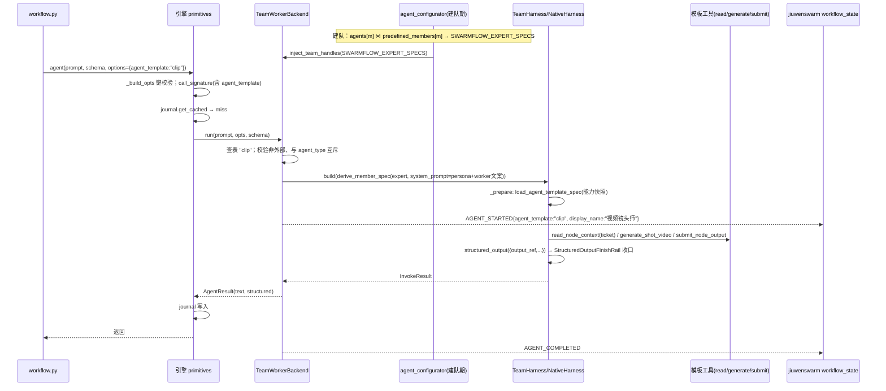

# Swarmflow 专家 worker：agent_template 算子参数复用专家团成员

## 1. 背景与问题 (Why)

JiuwenDesign 是基于 swarmflow 的多模态创作平台（Agent + 无限画布）。典型场景是 AI 短剧：
用户在画布上生成一张执行图，图上有大纲、角色、场景、分镜、镜头视频、合成、配乐、配音等
节点；每个节点由一个"专家"执行——视频镜头师、分镜师、角色设计师各有一套人设、技能、
门禁规则和工具。JiuwenDesign 正把自研的图执行引擎替换为 swarmflow：执行图编译成
`workflow.py`，每个节点变成一次 `agent()` 调用。

替换后立刻撞上 swarmflow worker 的一条既有不变量：**所有 worker 都是同一份 teammate 基
spec 的复印件**。`TeamWorkerBackend` 从 `worker_base_spec`（= `spec.agents["teammate"]`）
派生每个 worker，系统提示词写死为"你是一名单次执行的 swarmflow 工作节点……"，工具是
teammate 的通用工具。脚本能表达"这一步叫什么（`label`）、属于哪个阶段（`phase`）、用
什么模型（`model`）、交给哪个外部 CLI（`agent_type`）"，但**不能表达"这一步由谁来干"**。

与此同时，Team 模式已经有了"谁"的概念——专家团（`agent_group` 包）：会话绑定一个专
家团后，每个成员的人设（persona）和能力快照（skills / tools / rails / mcps）都已经进入
`TeamAgentSpec`，预定义队友据此启动。但这条链路止步于队友，swarmflow worker 看不到它：

```
会话绑定 agent_group_name="designer"
  → jiuwenswarm 组装：spec.agents[member] = 基线 + 能力快照
                      spec.predefined_members[] = (member_name, display_name, prompt=persona)
  → agent-core 建队：队友从上面两处取人设与能力          ✅ 已通
  → agent-core 派生 worker 基 spec：只取 spec.agents["teammate"]   ✗ 专家信息到此丢失
  → TeamWorkerBackend：每个 agent() 都是通用 teammate 复印件
```

JiuwenDesign 侧为此写了临时方案（每个节点自己 `create_deep_agent`，人设直接拍进
system_prompt），本设计把它收编为 swarmflow 的正式能力：**脚本用一个算子参数点名专家，
引擎从会话已绑定的专家团里取出这个成员的人设与能力来构造 worker**。

## 2. 目标与非目标

**目标**
- `agent()` / `agent_session()` 新增 options 键 `agent_template`，值为当前会话绑定专家团的
  成员名；命中后 worker 以该成员的 persona 与能力快照运行。
- 复用专家团已有链路：不新增包类型、不新增配置面、jiuwenswarm 侧专家解析零改动。
- 专家 worker 的能力来自模板本身（最小权限），不继承 teammate 的通用工具与技能。
- persona 与引擎既有 worker 提示词**拼接**，引擎的结构化交付协议不被替代。
- `agent_template` 参与缓存签名、事件透传（成员名 + 展示名），Web 画布可按专家渲染节点。
- 定义与 JiuwenDesign 之间的包契约：成员清单、收尾顺序、回执 schema、票据工具落点。

**非目标**
- 不做脚本级 `plugins` 参数；专家团 manifest 的插件装配（顶层共享 / 成员专属）整体遗留。
- 不打通模板声明外部运行时（`runtime` 非空）的专家在 swarmflow 里执行——本期收录但报错。
- 不定义票据（`shot_ticket`）的格式与签发——那是单点运行特性的内容；本设计只提出约束。
- 不改 graph.json → workflow.py 的编译器；不改画布 RPC / 事件；不做 TUI 适配。
- 不支持游离的单个 `agent_template` 包（未组进专家团的包）作为取值。

## 3. 术语与上下文

| 术语 | 含义 |
|---|---|
| `agent_template` 包 | 一个"专家"的包：`manifest.json` + `persona/` + 可选 `skills/` `tools/` `rails/` `mcps/`。agent-core 加载为 `AgentTemplateSpec` |
| `agent_group` 包（专家团） | 一组专家：顶层 manifest 声明 `agents`（必含 `leader`）与共享 `skills`；每个成员是 `agents/<name>/` 下的 `agent_template` 包。会话经 `chat.send.agent_group_name` 绑定，**一个会话只能绑一个** |
| persona | 成员人设全文，由 `AgentTemplateSpec.prompt_sections` 按语言拍平得到；队友路径存于 `predefined_members[].prompt` |
| 能力快照 | `DeepAgentSpec.agent_template_spec`：去掉 `prompt_sections` 的 `AgentTemplateSpec` JSON；`NativeHarness._prepare` 据此热挂 skills / tools / rails / mcps |
| worker | swarmflow 的单次执行成员：`TeamHarness(role=WORKER)`，`run_once` 即弃，无 DB 身份（SDD-0007） |
| 票据（`shot_ticket`） | 编译器写进 `agent()` prompt 的不透明字符串，节点工具凭它拉上下文、交产物。本设计只约束其性质 |
| Design 节点类型 | brief / character / scene / storyboard / clip / compose / music / speech，对应 `designer` 专家团 8 个 worker 成员 |

前置知识：SDD-0007（worker 基 spec 来源与去队友化）、SDD-0020（options 键白名单 `_ENGINE_OPTIONS | backend.KNOWN_OPTIONS`）、SDD-0021（`agent_type` 路由分叉点与事件透传四层链路）。

## 4. 方案设计 (What / How)

### 4.1 总体架构

```
workflow.py
  await agent("执行节点 n_clip_3\nshot_ticket: <票据>",
              label="clip_3", phase="镜头",
              schema=NODE_RESULT_SCHEMA,
              options={"agent_template": "clip"})
        │
        ▼  引擎 primitives._build_opts：键 ∈ _ENGINE_OPTIONS | backend.KNOWN_OPTIONS
        │  call_signature：agent_template 非空则并入 identity
        │  journal 命中 → 回放，不碰 backend
        ▼
TeamWorkerBackend.run(prompt, opts, schema)
        │
        ├─ opts.agent_type 非空 ─────────────────────▶ 三方路径（SDD-0021，本设计不动）
        │     （与 agent_template 同时出现 → 发射前 BackendError）
        │
        ├─ opts.agent_template 缺省 ─────────────────▶ 既有 native 路径：worker_base_spec
        │
        └─ opts.agent_template = "clip"
              │ 查专家表 SWARMFLOW_EXPERT_SPECS（建队时派生，见下）
              │   缺失 → BackendError（列出可用成员名）
              │   外部成员 → BackendError（"外部运行时暂未支持"）
              ▼
           derive_member_spec(expert_spec,
                 system_prompt = persona + "\n\n" + swarmflow_worker.{free|schema})
              ▼
           TeamHarness.build(role=WORKER)
              └─ NativeHarness._prepare：读 agent_template_spec → load_agent_template_spec
                 （模板的 tools / mcps / rails / skills 热挂；既有机制，零改动）
              ▼
           run_once(prompt + structured_output.reminder) → structured_output → AgentResult
              ▼
           AGENT_STARTED{agent_template, display_name} → tool_swarmflow → jiuwenswarm
           workflow_state → workflow.updated → Web 画布节点（专家名 + 头像）

专家表的来源（agent-core agent_configurator，建队期一次性派生）：

TeamAgentSpec
  ├─ agents[member]            ← 能力快照 + skills（jiuwenswarm _apply_agent_group 已写入）
  └─ predefined_members[i]     ← member_name / display_name / prompt=persona / role_type
                                  或 ExternalCliMemberSpec（模板 runtime 非空）
        │  按 member_name join，排除 leader / human / bridge
        ▼
SWARMFLOW_EXPERT_SPECS: dict[member_name, ExpertEntry]
   ExpertEntry = (DeepAgentSpec 最小基线 + 能力快照, persona, display_name, external_cli | None)
```

组件职责一句话：**jiuwenswarm 决定"有哪些专家"（已有），agent-core 决定"worker 怎么变成
某个专家"（本设计），脚本决定"这一步用谁"（一个键）。**

### 4.2 数据流与时序



### 4.3 接口与数据模型

#### 4.3.1 脚本面：options 键

| 键 | 类型 | 取值 | 作用域 |
|---|---|---|---|
| `agent_template` | `str` | 当前会话绑定专家团的 worker 成员名（裸名，如 `"clip"`；不含 `/`） | `agent()`、`agent_session()` |

> **Requirement:** 引擎 SHALL 接受 `options.agent_template`（经 `TeamWorkerBackend.KNOWN_OPTIONS` 加入白名单，`_ENGINE_OPTIONS` 不变）。
> **Scenario:** WHEN 脚本传入 `options={"agent_template": "clip"}` THEN worker 以 `designer` 专家团成员 `clip` 的 persona 与能力运行。
> **Scenario:** WHEN 值含 `/`（如 `"designer/clip"`）THEN 发射前 `BackendError`，文案提示只接受成员名。
> **Scenario:** WHEN 值不在专家表 THEN 发射前 `BackendError`，文案列出可用成员名；未绑定专家团时文案说明需先绑定。
> **Scenario:** WHEN `agent_template` 与 `agent_type` 同时非空 THEN 发射前 `BackendError`。
> **Scenario:** WHEN 会话绑定了专家团但脚本未传 `agent_template` THEN 行为与现状逐字节一致（teammate 基线 worker）。

#### 4.3.2 缓存签名

> **Requirement:** `call_signature` SHALL 在 `agent_template` 非空时将其并入 identity 字典；为空时签名与现有格式字节一致（存量 journal 零迁移，做法同 `agent_type`）。
> **Scenario:** WHEN 同一 prompt 改用另一个成员重跑 THEN 签名失配、重新执行。
> **Scenario:** WHEN persona 文本修改但成员名不变 THEN 签名不变（命中旧结果）——这是刻意的：人设属模板版本，不属调用身份。

#### 4.3.3 专家表（agent-core 内部数据模型）

```python
@dataclass(frozen=True)
class SwarmflowExpertEntry:
    member_name: str
    display_name: str          # 来自 predefined_members[i].display_name
    persona: str               # 来自 predefined_members[i].prompt（已拍平、已选语言）
    spec: DeepAgentSpec        # 最小基线 + agent_template_spec 快照（见 4.4.1）
    external_cli: Any | None   # ExternalCliMemberSpec.external_cli；非空即外部成员

TeamHandleKey.SWARMFLOW_EXPERT_SPECS = "team.swarmflow_expert_specs"   # dict[str, SwarmflowExpertEntry]
```

> **Requirement:** `agent_configurator` SHALL 在派生 `worker_base_spec` 的同一处派生专家表，并经 `inject_team_handles` 注入；无专家团时注入空表。

#### 4.3.4 system_prompt 组成

```
有 agent_template：  persona + "\n\n" + t("swarmflow_worker", key="schema"|"free")
无 agent_template：  t("swarmflow_worker", key="schema"|"free")          ← 现状
user prompt：        脚本 prompt 原文 (+ 现有 structured_output.reminder)  ← 两种情况相同
```

> **Requirement:** 引擎既有 worker 文案 SHALL 原文保留、不新增 i18n 键；persona SHALL 只影响 system_prompt，不进入 user prompt。

#### 4.3.5 事件

`WorkflowProgressEvent`（`AGENT_STARTED`）新增两个可选字段，沿 `agent_type` 的四层链路透传：

| 字段 | 类型 | 说明 |
|---|---|---|
| `agent_template` | `str \| None` | 成员名；native 通用 worker 为 `None` |
| `display_name` | `str \| None` | 专家表中的展示名（会话语言） |

> **Requirement:** jiuwenswarm `WorkflowProgress` / `WorkflowAgentState` SHALL 透传两字段到 `workflow.updated`；TUI 不适配。

**Web 展示规则**（画布节点、成员名册、任务卡三处同脸）：

| 字段 | 画布节点 | 成员名册 | 任务卡 |
|---|---|---|---|
| `label`（脚本给节点的角色名） | 主文字 | 第一行（同普通 worker） | 名字 |
| `member_id` | — | 第二行 `@…`（同普通 worker） | — |
| `display_name` + `agent_template` | 悬浮提示 | 第三行辅助 `★ 展示名（成员名）` | — |
| 头像 | 哈希插画（按 label，与镜像名册同键）+ ★ 角标（包图不参与运行态，仅管理页） | 同左 | 同左 |

头像规则：前端按会话绑定的 `agent_group_name` 调一次既有 `agent_groups.show` RPC 并缓存，仅用于判定"是否包成员"（决定 ★）与聊天区 Leader / 群头像；成员镜像事件 `team.member.spawned` 同样携带 `agent_template`。**成员与团级 `avatar` 均不参与运行态渲染**（同团包图往往只有一张，成员间会撞脸），运行态统一按 label 哈希插画 + ★（与镜像成员名册同键，三处同脸）。团级 `avatar` 用于聊天区 Leader / 群头像并以同一缓存兜底输入框列表未到达时的跳变。
名册里专家团的预定义成员（非 swarmflow）同样走"包头像 → 哈希插画 + ★"，swarmflow 与非 swarmflow 两种场景同一外观；Leader 新建的普通队友为哈希插画、无角标。
图片只是装饰：拉取失败、包已卸载都退回插画 + 角标，不影响运行。

#### 4.3.6 回执 schema（与 JiuwenDesign 的契约）

编译器为每个 Design 节点的 `agent()` 写入同一常量：

```json
{"type": "object", "required": ["output_ref"],
 "properties": {
   "output_ref":  {"$ref": "#/$defs/AssetRef"},
   "output_refs": {"type": "array", "items": {"$ref": "#/$defs/AssetRef"}},
   "message":     {"type": "string"}},
 "$defs": {"AssetRef": {"type": "object", "required": ["kind", "uri"],
   "properties": {"kind": {"type": "string"}, "uri": {"type": "string"},
                  "mime_type": {"type": "string"}, "label": {"type": "string"}}}}}
```

> **Requirement:** Design 专家 worker SHALL 先经模板工具 `submit_node_output` 把产物写回 graph，再调引擎 `structured_output` 回执同一 `output_ref`，然后停止。persona 与门禁 rail 不得在 `structured_output` 之前结束回合。

#### 4.3.7 票据约束（交单点运行特性与 JiuwenDesign）

> **Requirement:** worker SHALL 对票据完全不透明——不解析、不校验、不改写 prompt；prompt 原样进 `call_signature`。
> **Requirement（对外约束）:** 票据 SHALL 是内容寻址的 `(graph_id, node_id, context_snapshot_id)`，其中快照 id 为该节点本次运行所依赖的上游产物引用与锁字段的内容哈希。否则上游变更后下游签名不变，缓存会错误命中。

### 4.4 关键流程

#### 4.4.1 建队期：派生专家表

1. 遍历 `spec.predefined_members`，跳过 `role_type ∈ {leader, human_agent, bridge_agent}`。
2. 取 `base = spec.agents[member_name]`（jiuwenswarm `_apply_agent_group` 已写入能力快照）。
3. 构造最小基线：从 `base` 保留 `model`、`enable_task_loop` / `enable_task_planning`、
   `agent_template_spec`、`skills`（模板技能名，供 Skill 可见性声明）与 **`rails`（teammate 的
   基础设施 rails：事件流、文件操作、上下文压缩、安全、异常检测等，与专家团队友路径一致）**；
   **清空 `tools`**，再追加观测 rails（与 `_derive_swarmflow_worker_base_spec` 同口径），
   `progressive_tool` 随团队开关。边界：个别 rail 自带注册的工具（如 Skill 工具集 rail 的
   `search_skill` / `install_skill`）随 rail 保留，"最小权限"只覆盖 `DeepAgentSpec.tools` 列表。
4. `persona = member.prompt`，`display_name = member.display_name`；
   `ExternalCliMemberSpec` 则记录 `external_cli`，`spec` 不构造。
5. 注入 `SWARMFLOW_EXPERT_SPECS`。native 成员若无能力快照（`agent_template_spec is None`）**不进表**：
   引擎无法区分"专家团成员"与"配置文件里的普通预定义队友"，两者都走 `predefined_members`；把缺快照当错误
   会让"普通预定义队友 + `enable_swarmflow`"这一合法配置无法建队。专家团包自身的 fail-closed 由平台 loader
   （`agent_group.py`）在加载期保证；脚本引用了不在表中的成员名，得到的是"未知成员"错误。

#### 4.4.2 调用期：`agent()` 命中专家

```
run(prompt, opts, schema)
  ├─ agent_type 与 agent_template 同时非空 → BackendError（非重试）
  ├─ agent_template 含 "/" 或不在表 → BackendError（列出可用成员名）
  ├─ 表项 external_cli 非空 → BackendError("专家 X 为外部运行时，swarmflow 暂未支持")
  ├─ model = _resolve_model(opts.model)（规则不变）
  ├─ worker_spec = derive_member_spec(entry.spec, system_prompt=persona+worker文案,
  │                                   model, extra_tools=[structured_output])
  ├─ 工作区 / worktree / Skill 可见性：与现状相同
  ├─ TeamHarness.build(role=WORKER) → _prepare 热挂模板能力
  └─ run_once → 结果与计费与现状相同
```

所有校验都在 `_worktrees.ensure` 之前，失败不消耗 worktree 槽位，与 SDD-0021 的三方校验
位置一致。

#### 4.4.3 调用期：缓存命中

签名含 `agent_template`，命中即回放、不碰 backend——专家 worker 不会被构建。模板工具的副作
用（产物已写回 graph）也不会重放，这与"命中不重建 worktree"是同一条既有语义。

#### 4.4.4 `agent_session`

同键同表。模板在 `_ensure_open`（首个未命中轮次）随模型一起锁定；后续 `send` 带不同
`agent_template` → `EngineError` 指向 `fork()`；`fork()` 子会话继承父会话模板，fork 时可换。
实现复用 SDD-0021 的 `_opened_model` 首锁结构。

#### 4.4.5 Design 节点端到端（以 `clip` 为例）

1. 编译器把节点 `n_clip_3` 物化为 `agent("执行视频镜头节点 n_clip_3\nshot_ticket: <票据>", schema=NODE_RESULT_SCHEMA, options={"agent_template": "clip"})`。
2. worker 以"视频镜头师" persona 启动，带模板的 `read_node_context` / `generate_shot_video` /
   `submit_node_output` 工具与门禁 rail。
3. `read_node_context(票据)` 拉分镜行与锁 → 写 prompt → `generate_shot_video` 一次 →
   `submit_node_output` 写回 graph.json 的 `output_ref`。
4. `structured_output({"output_ref": …})` → `StructuredOutputFinishRail` 结束回合。
5. `AgentResult.structured` 回到脚本，可供下游节点绑定；画布经 `workflow.updated` 看到
   "视频镜头师 · 已完成"。

异常：`generate_shot_video` 失败 → 门禁 rail `request_force_finish` → worker 结束但未调
`structured_output` → `BackendError("did not submit a structured result")` → `AGENT_FAILED`
到 Leader，不重试（确定性）。

### 4.5 配置与开关

无新增配置项。生效前提只有两个既有条件：会话已绑定专家团（`agent_group_name`）、团队开启
swarmflow。无特性开关——`agent_template` 缺省即旧行为，天然回退。

**引擎版本门禁**：jiuwenswarm 的 `openjiuwen` pin 早于本特性时，`agent_template` 会被旧引擎
的 `KNOWN_OPTIONS` 白名单**硬拒**（`EngineError`），而不是像 `agent_type` 那样静默忽略；
jiuwenswarm 侧必须与 agent-core 同步升 pin 后才能发布。

## 5. 关键决策与权衡 (ADR)

### 5.1 算子键命名 `agent_template`，不叫 `expert`
- **决策：** `options={"agent_template": "<成员名>"}`。
- **背景：** 三处既有词汇已经用它：包 `package_type: "agent_template"`、单 Agent 请求字段
  `agent_template_name`、JiuwenDesign graph.json 节点字段 `config.agent_template`。
- **备选与理由：** `expert` 是临时命名，没有任何既有对齐；编译器从 graph.json 到脚本是逐字抄
  字段，不该造新词。

### 5.2 引用专家（成员名），不引用专家团
- **决策：** 值是成员名；专家团由会话绑定，算子不写组。
- **背景：** 一次 `agent()` 需要恰好一个 persona；会话只能绑一个专家团。
- **备选与理由：** 引用专家团无法指定谁来干；重复会话已定的事。Design 场景因此要求
  `designer` 专家团包含全部 8 类节点专家（一组多成员，而非每节点一个独立包）。

### 5.3 专家表由 agent-core 从 `TeamAgentSpec` 自身派生（而非 jiuwenswarm 另造字段）
- **决策：** `agents[m]` ⋈ `predefined_members[m]`，建队期一次性派生。
- **背景：** 两个字段都是 agent-core 的 schema，不是 jiuwenswarm 私有约定；专家团配置已是唯
  一真相源。
- **备选与理由：** jiuwenswarm 新增 `TeamAgentSpec.swarmflow_experts` 并重复写一份——两份真
  相源、改一处漏一处，且 jiuwenswarm 要多一个字段与一段组装代码。否决。

### 5.4 专家 worker 最小能力基线
- **决策：** 继承 teammate 的 model / workspace / 基础设施 rails / task-loop 开关；**通用工具列表
  不继承**，技能可见性只声明模板技能；能力全来自模板 + 引擎 `structured_output`。
- **背景：** 视频 / 图片 worker 不应拿到 shell、文件、浏览器等通用工具；工具描述占 token；
  persona 对工具集有明确假设。rails 不是"能力"而是运行基础设施（事件流、文件操作生命周期、
  上下文压缩、安全），专家团队友路径同样全部保留，清空会让 worker 无法运行。
- **备选与理由：** 与预定义队友同口径（teammate 全部工具 + 模板）——一致性好，但违反最小权
  限且与 persona 行为预期冲突。否决，并在 §6 明示"worker 与同名队友工具集不一致"。

### 5.5 persona 与引擎 worker 文案拼接，不替代
- **决策：** `system_prompt = persona + 引擎原文`；user prompt 不动。
- **背景：** 引擎 `schema` 文案承载结构化交付协议，backend 事后硬检查 `structured_output`
  是否被调。
- **备选与理由：** 完全替代（JiuwenDesign 本地曾如此改）在 free 模式碰巧可用，一旦要结构化
  回执即触发 `did not submit a structured result`。否决。另一备选"去掉引擎身份句只留协议段"
  需新增 i18n 键、改动引擎文案——用户要求原文保留，否决。

### 5.6 不做脚本级 `plugins`；专家团插件装配整体遗留
- **决策：** 算子只认 `agent_template`；专家团 manifest 的 `plugins`（顶层共享 / 成员专属）
  本期不实现。
- **背景：** 引擎 `DeepAgentSpec` 只有模板快照字段，team 路径从未挂过插件；专家团 loader 也
  不认 `plugins`。v1 唯一共享件（票据工具 + 门禁 rail）对全部专家恒定。
- **备选与理由：** 脚本级 `plugins` = 每次派活重配工具箱，同一专家行为不可预期；且要新增
  插件注册表、运行时折叠、签名并入、`agent_session` 开会后禁改等一串机制。专家团级装配是正
  确位置（单 Agent 的插件同样挂在"使用现场"即会话，而不是模板包内），但本期无消费者，遗留。
  本期由各成员包内各自声明共享工具。

### 5.7 外部运行时成员：收录进表，执行期明确报错
- **决策：** `ExternalCliMemberSpec` 成员进专家表并标记外部；`agent()` 引用它 → 发射前
  `BackendError("暂未支持")`。
- **背景：** worker 的外部路径今天只认 `agent_type` + 团队 `external_cli_agents` 声明，不认成
  员；"专家支持三方 Agent"是后续独立特性。
- **备选与理由：** 不收录（落入通用"未知成员"错）——零代码但后续特性要重做表；当 native 跑
  ——静默降级、`runtime` 被忽略，否决。收录 + 明确报错让后续特性只替换一处。

### 5.8 统一结构化回执
- **决策：** 所有 Design 节点 `schema = {output_ref, output_refs?, message?}`；流程固定为
  `submit_node_output` → `structured_output` → 停止。
- **备选与理由：** free 文本 + 解析——脆弱，且完成信号只能靠 persona 自觉。否决。

### 5.9 事件透传成员名 + 展示名
- **决策：** `AGENT_STARTED` 带 `agent_template` 与 `display_name`，四层透传，Web only。
- **备选与理由：** 只透成员名、前端查目录——冷恢复 / 历史回放时目录可能已变，且多一次查询。否决。

### 5.9a Leader 不作 worker，报错指路
- **决策：** Leader 不进专家表（D1）。`agent_template="leader"` 由 jiuwenswarm 脚本校验器在运行前拒绝，引擎 `_gate_agent_template` 单独报"is the Team Leader, not a worker"而非泛泛的"not a member"。
- **理由：** Leader 由 `AGENT.md` 另行装配，persona 是"分派与审阅"，拼进 worker 提示词会让它去找不存在的团队工具；它也正驱动着发起 workflow 的对话。"总览 / 汇总"节点应做成独立 worker 成员（如 `brief`）。
- **备选与理由：** 放开 Leader（单独派生、剥 `AGENT.md`）——改 D1 + 两仓各一条派生路径，把指挥官人设当 worker 的坑留给脚本作者。否决。

### 5.10 只接受裸成员名
- **决策：** 含 `/` 即报错；编译器负责去掉 graph.json 的 `designer/` 前缀。
- **备选与理由：** 兼收 `group/member` 并校验组名——引擎多一条解析分支和一类错误，为迁就一
  个数据面约定。否决。

### 5.11 未写键时保持旧行为
- **决策：** 绑定专家团但 `agent()` 未传 `agent_template` → teammate 基线 worker，字节兼容。
- **备选与理由：** 强制声明——破坏所有非 Design 专家团会话跑 swarmflow 的兼容性。否决。

### 5.12 其他被否决备选
- 新增 `agent_type="template"` 之类的路由维度：`agent_type` 是 CLI 协议维度，与"谁"正交；混用
  会让同一 worker 两种声明方式冲突。
- 支持游离单包 `agent_templates/{built_in,local}` 作为取值：会话级出现第二个真相源，两套解析
  路径；需要时作为扩展再加。
- persona 进 user prompt：职责错位，且改一字 persona 让全部节点签名失效。

### 5.13 专家头像来自成员包 `avatar`，前端按绑定专家团拉取
- **决策：** 专家节点用成员包 `agents/<m>/manifest.json: avatar`，前端按会话 `agent_group_name` 调一次既有 `agent_groups.show` 拉 `members[].avatar` 并缓存，以 `agent_template` 命中；无图退回哈希插画（按 `display_name`，与镜像名册同键）+ 专家角标。团级 `avatar` 不作成员兜底（0c 轮实测只有团级图的包让所有专家同脸，撤回）。
  事件链路**不变**：`AGENT_STARTED` 仍只带 `agent_template` + `display_name`，不带图。
- **备选与理由：**
  - 镜像事件 `team.member.spawned` 内联 data URL——事件构造点（`_wf_spawned_member_event`）没有会话/专家团上下文，要把元数据读取穿进事件转换路径；且每次 spawn 重复下发同一张图。否决。
  - 仿 `team_leader_identity` 在建队时把全员头像写进会话元数据一次下发——新增持久化面与建队/冷恢复两条装配路径，收益只是省一次 RPC。否决，留作性能兜底。
  - 与 §5.9"不让前端查目录"的关系：§5.9 的对象是 `display_name`，它决定节点叫什么，冷恢复时错了会误导；头像是装饰，拉不到就退回插画，可接受前端查询。

## 6. 影响面与兼容性

**agent-core（`openjiuwen/agent_teams`）**

| 位置 | 改动 |
|---|---|
| `workflow/backends/team_worker_backend.py` | `KNOWN_OPTIONS` 加 `agent_template`；`run()` 新增专家分支与三类前置校验；`_execute_worker` 接受专家 spec 与拼接后的 system_prompt |
| `workflow/backends/avatar_session_backend.py` | `agent_session` 同表查找、首锁、fork 继承 |
| `workflow/engine/journal.py`（`call_signature`） | `agent_template` 非空并入 identity |
| `workflow/engine/progress.py`、`workflow/tool_swarmflow.py` | 事件两字段 |
| `agent/agent_configurator.py` | 派生 `SWARMFLOW_EXPERT_SPECS`；`rails/team_context.py` 新 `TeamHandleKey` |
| `tools/locales/descs/*/workflow/swarmflow.md` | 工具描述补 `agent_template` |
| `docs/specs/S_18`、新增 `docs/features/F_NN` | 按该仓规范记录 |

**jiuwenswarm**

| 位置 | 改动 |
|---|---|
| `agents/harness/team/handlers/workflow_state.py`、`workflow_monitor_handler.py` | 透传 `agent_template` / `display_name` |
| Web `WorkflowAgent` 节点渲染、成员名册、任务卡 | `label` 主文字 + `display_name` 次文字 + `agent_template` 悬浮；头像按 §5.13 取成员包图，回落哈希插画 + 专家角标；名册 `TeamMember` 保留 `agent_template` |
| `resources/.../skills/swarmskill-creator/scripts/validate_swarmskill.py` 与模板 | 认 `agent_template` 键 |
| `resources/agent/workspace/plugins/agent_groups/designer/` | 内置货架新增 `designer` 专家团（内容由 JiuwenDesign 产出）；需一条"内置包默认安装"规则，因 `resolve_agent_group_dir` 只认 marketplace 已安装 |
| `pyproject.toml` | 升 `openjiuwen` pin（见 §4.5 门禁） |
| `agents/swarm/agent_group.py`、`assembly.py` | **零改动** |

**JiuwenDesign（包与编译器，非本仓代码）**：`designer` 专家团 9 成员（`leader` + 8 worker）；
成员包各自声明票据工具与门禁 rail；persona 收尾改为"submit → structured_output → 停止"；
编译器写 `agent_template` 裸名与回执 schema；修正 Beta 仓 `_DESIGNER_MEMBERS` 与
`ROLE_DEFAULT_TEMPLATES`（`brief` 不再映到 `leader`，`compose` 不再共用 `clip`）。

**兼容性**：`agent_template` 缺省 → 全链路字节不变（签名、提示词、事件）。无 BREAKING。
已知不一致（刻意）：同名专家作为队友与作为 worker 的工具集不同——队友继承 teammate 通用工具，worker 不继承；rails 两者一致（§5.4）。

**与代码事实的核对**：`DeepAgentSpec.agent_template_spec` 与 `NativeHarness._prepare` 的热挂
已存在；`McpServerSpec` 无 `timeout_s` 字段（`extra=forbid`）——JiuwenDesign 样例 mcp.json 中
的 `timeout_s: 7300` 会被拒，若选 MCP 落点需另行约定超时。

## 7. 测试与验证

验收标准（将转写为 jiuwenswarm OpenSpec 的 Given/When/Then 场景与 agent-core 单测）：

1. 绑定含 `clip` 的专家团，`agent(options={"agent_template": "clip"})` → worker system_prompt
   以 persona 开头、以引擎 worker 原文结尾；工具集 = 模板工具 + `structured_output`，不含
   teammate 通用工具。
2. 同 prompt 分别用 `clip` / `scene` → 两个不同签名；无 `agent_template` → 签名与升级前字节一致。
3. 未知成员 / 含 `/` / 与 `agent_type` 同时出现 / 外部成员 → 发射前非重试 `BackendError`，文案
   符合 §4.3.1，且未创建 worktree。
4. 未绑定专家团 → 传 `agent_template` 报错；不传 → 旧行为。
5. `agent_session` 首轮锁定模板，二轮换名报 `EngineError`；`fork()` 子会话继承。
6. `AGENT_STARTED` 携带两字段，jiuwenswarm `workflow.updated` 透传；Web 节点主文字为 `label`、次文字为 `display_name`，头像取成员包图，无图退回哈希插画 + 角标，普通节点渲染不变。
7. 端到端（联调）：最小验收包（假 persona + echo 工具 + 一个 rail）跑通 `read → submit →
   structured_output`；随后换 `designer-video-clip` 真包跑单节点。
8. 无能力快照的 native 预定义成员不进专家表；脚本引用它 → 发射前"未知成员"错误；建队不受影响。

## 8. 可观测性

- `AGENT_STARTED/COMPLETED/FAILED` 新字段进 `workflow.updated`，画布节点可按专家聚合。
- backend 在专家命中 / 校验失败处打一条含成员名的 info / warning 日志；缓存命中沿用引擎既有
  `cache_hit` 路径（不构建 worker，无新日志）。
- 建队期派生专家表记一条 info：成员数、外部成员数。

## 9. 风险与回滚

| 风险 | 缓解 |
|---|---|
| pin 未升级时脚本被旧引擎硬拒 | 发布前置：agent-core 合入 → jiuwenswarm 升 pin → 再内置 `designer` 包 |
| persona 与引擎文案在"何时停止"上冲突 | 包契约硬约束（§4.3.6）+ 验收包用例 7 |
| 票据非内容寻址导致缓存误命中 | 作为对单点运行特性的接口约束（§4.3.7）写入 I3 契约 |
| graph.json 成员名与专家团成员名漂移 | 清单固定 8 个裸名；编译器校验值 ∈ 已绑定专家团 |
| MCP 落点超时字段不被 schema 接受 | 优先 `tools/` 落点；选 MCP 时在 §10 关闭超时方案 |
| 回滚 | 脚本去掉 `agent_template` 即回旧路径；引擎改动对缺省键无行为影响 |

## 10. 开放问题 (Open Questions)

- [ ] JiuwenDesign：票据工具落点 `tools/` 还是 `mcps/`；选 MCP 时 7200s 视频生成的超时如何表达。
- [ ] JiuwenDesign：快照哈希的输入字段清单（上游 `output_ref`、各类 `*_lock`…）。
- [ ] JiuwenDesign：`brief` / `compose` 从 `leader` / `clip` 拆出的独立 persona 与工具白名单；9 个成员的 `display_name {zh, en}` 与 `avatar`（团级一张兜底，可缺省）。
- [ ] JiuwenDesign：F04 所述 `team.design` 分支位置，及 agent-core 本地"persona 替代提示词"未提交改动，需与 §5.5 对齐。
- [ ] 单点运行特性（swarmflow 同事）：票据格式与签发方（§4.3.7 约束）。
- [ ] 内置 `designer` 包的"默认安装"由谁触发（首次启动 seed 还是 OpenSpec 内置安装规则）。
- [ ] 后续特性："专家支持三方 Agent"接管 §5.7 的外部成员分支；专家团 `plugins` 装配（§5.6）。

## 11. 评审记录 (Iteration Log)

| 轮次 | 日期 | 版本 | 评审人 | 结论 | 主要修改/讨论 |
|---|---|---|---|---|---|
| 0 | 2026-10-14 | 1 | — | draft | 初稿；决策 D1–D7、Q1–Q11 已由 owner 与需求方逐项确认 |
| 0a | 2026-10-14 | 1 | — | draft | agent-core 实现回写：缺快照 native 成员改为"不进表"（原"建队失败"会误伤普通预定义队友）；模板门禁先于 `agent_type` 门禁；`MockBackend` 预览同样接受 `agent_template`；非字符串值由引擎 `_build_opts` 拒绝 |
| 0b | 2026-10-14 | 1 | — | draft | Web 展示补全：原设计只按 `display_name` 显示+哈希头像，专家与普通节点无法区分且 `label` 丢失；改为三字段分层 + 成员包头像（§4.3.5、§5.13） |
| 0c | 2026-10-14 | 1 | — | draft | 实测回写：撤回团级头像兜底（同团专家同脸），无图改为首字母头像 + 团级图淡水印；去掉画布悬浮提示；次文字与 label 相同不显示；聊天区专家团身份改为缓存兜底（既有跳变）；`agent_template="leader"` 静态拦截 + 指路文案（§5.9a） |
| 0d | 2026-10-14 | 1 | — | draft | 实测回写：无图回落再改回哈希插画 + ★——首字母 + 水印在同专家多节点时全部同脸（用户实测反馈），且 probe / verify 节点也被脚本指定专家，字母观感不佳；插画按展示名哈希，专家间可分，同专家节点同脸属预期 |
| 0e | 2026-10-14 | 1 | — | draft | 实测回写：专家头像最终定为"统一插画 + ★，包图一律不参与运行态"——多数包只有一张团级图，成员间撞脸；包内 `avatar` 仅保留给管理页 |
| 0f | 2026-10-14 | 1 | — | draft | 实测回写：画布节点行去掉展示名次文字与成员名徽章——★ 已能辨专家，身份细节由悬浮"专家：展示名（成员名）"承担，行内不再重复 |
| 0g | 2026-10-14 | 1 | — | draft | 实测回写：名册专家条目改为与普通 worker 同形（label / `@member_id`），展示名与成员名降为第三行辅助；镜像事件 `name` 改回 label，画布 / 任务卡 / 名册统一按 label 哈希头像 |

## 12. 实现记录与偏差

### 实际实现
agent-core 侧已落地（分支 `feat/swarmflow_jiuwen_design`，两组三提交：专家表 / 路由 / 首锁 / 事件；`leader` 指路报错；`F_118` + `S_18` 不变量 9）。jiuwenswarm 侧已落地（同名分支，两组三提交）：事件透传、校验器（含 `leader` 静态拦截）、货架 seed、验收包、Web 展示（0b–0g 定稿：label 主文字 + ★ 插画 + 悬浮身份；名册同形 + 辅助行）、冷恢复保真（`get_phase` 摘要保留 `agent_type` / `agent_template` / `display_name`，历史恢复保留 `workflow_run_id` / `agent_template` / `display_name`）。pin 升级待 agent-core 合入上游（上游 `acc35ed32` 尚不含本特性）。

实施中顺带修复的既有缺陷（与本特性无关但同链路暴露）：
- 会话元数据三处丢更新：`session_swarmflow_config` / `workflow_runs` / `session_budget` 原走异步整文件写，被随后 `cache_bust` 读盘的整文件回写覆盖（动态工作流开关切会话后消失；完成的 run 刷新后恢复为 running 19/19）。改为同步单字段合并写。
- `get_phase` 摘要白名单原缺 `agent_type`，三方节点刷新后退化为普通节点。
- 任务卡 worker 头像栈按 `name` 去重，同名并行一次性节点（3 个 `assemble`）被折成 1 个；改为仅折叠 `agent_session` 多轮。
- `CompactTaskList` 的 hook 在空列表早退之后调用（React #310），导致整棵面板在空 ↔ 非空切换时崩溃。

### 与设计的偏差
0. Web 展示与初稿（§4.3.5 原文"以 `display_name` 显示并复用头像解析"）差异大，经 0b–0g 七轮实测收敛为现行 §4.3.5 表；镜像事件 `name` 最终为 label 而非展示名。
1. 缺能力快照的 native 预定义成员**不进专家表**而非建队失败（见 §4.4.1 第 5 步说明）。
2. `_gate_agent_template` 在 `agent_type` 门禁**之前**执行，使互斥错误成为被抛出的那一个。
3. `MockBackend.KNOWN_OPTIONS` 同样声明 `agent_template`，否则离线预览（`preprocess_swarmflow`）会拒绝真实后端接受的脚本。
4. 非字符串 `agent_template` 由引擎 `_build_opts` 以 `EngineError` 拒绝（覆盖 `agent()` 与 `agent_session().send()`），后端 `isinstance` 守卫作纵深防御。
5. worker 不继承成员 `workspace`（与所有 worker 一致由 `_setup_worker_workspace` 自建），§4.4.1 原文"保留 workspace"按实现修正为不保留。

### 链接
agent-core issue #2003；jiuwenswarm issue #4729。

### 遗留与后续
- 首轮失败后用不同 `agent_template`（或不同模型）重试：只改写锁、不重建 avatar——与既有模型首锁同形，需一并修复（`_completed_turns == 0` 时关闭并重建 avatar）。
- 停止会话后，成员已 `paused` 但其认领中的 Team 任务卡仍按 `in_progress` 转圈（前端未按认领人暂停态派生展示）；既有缺陷，另立项。
- 成员包 `avatar` 运行态启用：待 JiuwenDesign 提供成员级图后，在 `resolveTeamMemberAvatar` 恢复"有图用图"分支（约半天）。
- 见 §10 最后两项。

## 13. 参考与关联设计

- SDD-0007：worker 去队友化与 `worker_base_spec` 来源（本设计的派生起点）。
- SDD-0020：options 键白名单机制（`agent_template` 经 `KNOWN_OPTIONS` 加入）。
- SDD-0021：`agent_type` 路由分叉点、`call_signature` 并入方式、事件四层透传、`agent_session` 首锁——本设计逐一复用其结构。
- SDD-0013 / SDD-0018：运行态控制与 Team 生命周期，专家 worker 不改变其语义。
- 专家团（`agent_group`）加载设计：[team_expert_group_manifest_design.md](../../../../../../jiuwenclaw/.agents/agent-docs/designs/archive/team_expert_group_manifest_design.md)（旧格式资料，无 frontmatter、INDEX 未收录；本设计以 jiuwenswarm `agents/swarm/agent_group.py` 与 `assembly.py` 的代码事实为准）。
- 需求方资料（jiuwenswarm 本地 `docs/local/jiuwen_design/`）：执行图 Schema、F04 页面 API 契约、视频节点 worker manifest 样例、`designer` 专家团包需求清单。
