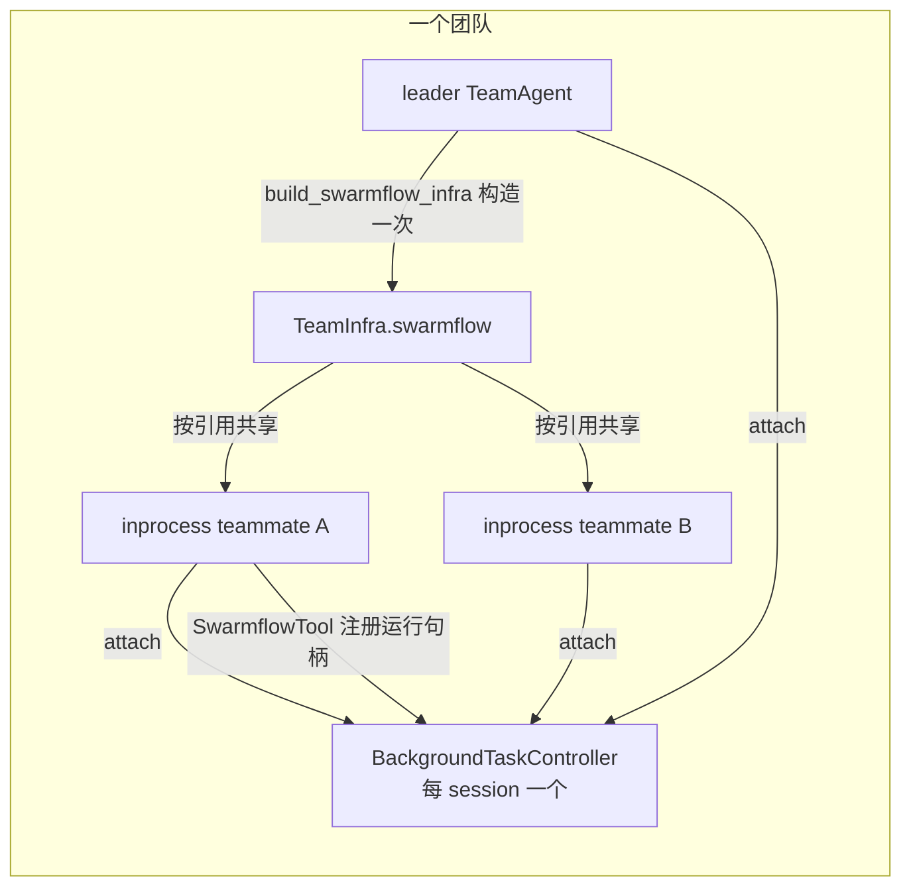
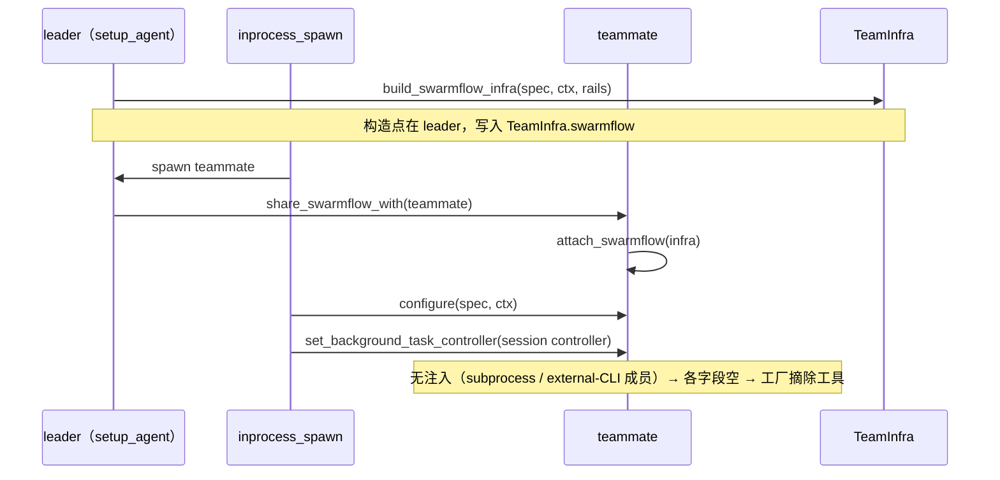
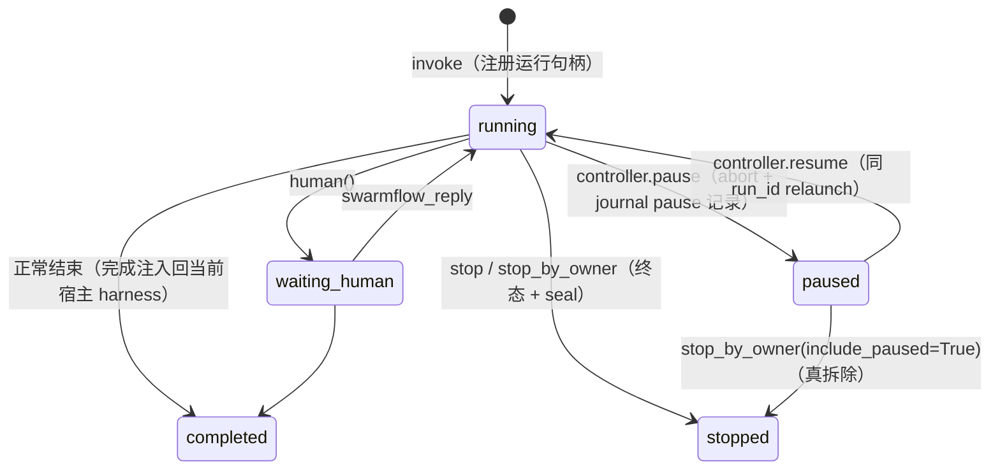
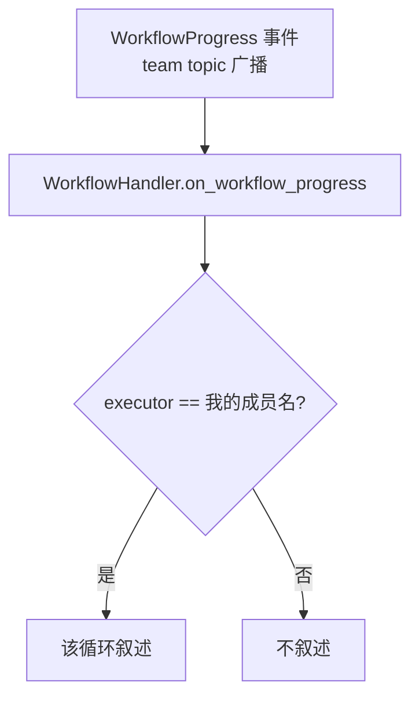
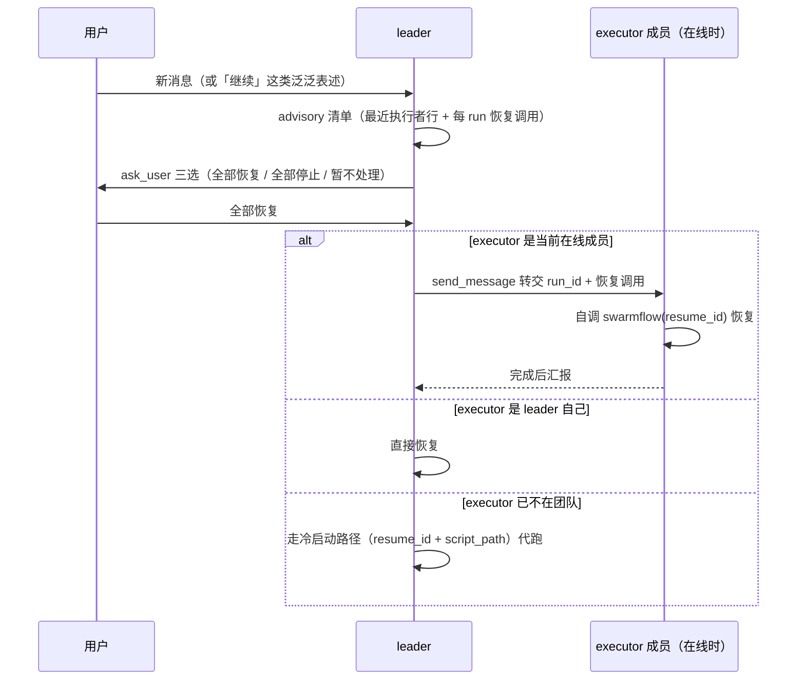
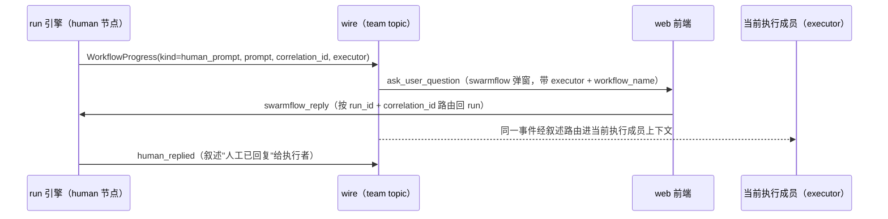
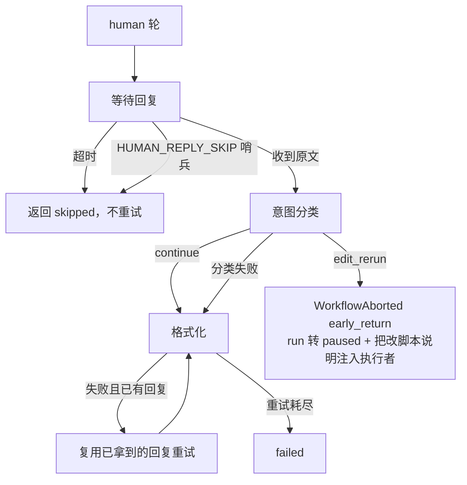

# 集群模式teammate支持swarmflow工具

## 1. 背景与目标

swarmflow 此前是 leader 专属工具：teammate 收到需要工作流的任务时，只能把请求上交
leader 代跑，run 的进展叙述、结果注入、暂停恢复全部落在 leader 上下文，leader 成为
编排瓶颈。本设计让**队内 in-process teammate 成为与 leader 对等的编排者**：直接调
`swarmflow` 发起 run、自主暂停恢复、消化自己 run 的结果，叙述与结果注入按当前执行
者落点，预算与并发治理队级共享。

核心目标：

1. **工具开放**：in-process teammate 的工具集含 `swarmflow`；共享设施（worker 模型
   解析、并发治理、预算账本）team 级单例，成员按引用共享，不另建池。
2. **run 归因单字段**：`executor` 是唯一的归因键——每条进度事件按当前宿主现算，
   叙述、结果注入、run 卡徽章与恢复转交全部读它。谁在跑这个 run，进展叙述和结果
   就进谁的上下文；leader 也填名（不再有 leader=None 的旁路语义）。
3. **恢复按最近执行者转交**：用户请求恢复时，leader 优先把 run 转交给最近执行它的
   在线成员自恢复（而非自己代跑），让叙述和结果回到该成员的上下文而不是落到 leader
   头上。
4. **human 往返硬化**：human 节点的 timeout 只计"等人"，慢回复不再触发重复弹窗与
   重问。

非目标：跨进程/external-cli worker 的工具开放（后由 §8.1 打通 SDK 族发起者方向）；
叙述去重表机制（重放即设计，去重移除）。

## 2. 共享设施与工具开放

### 2.1 SwarmflowInfra（team 级单例）

swarmflow 的共享对象必须 team 级单例：所有成员在同一预算池、同一 L1/L3 并发治理下
扣减。`SwarmflowInfra`（`workflow/swarmflow_infra.py`）由 leader 的 configurator 经
`build_swarmflow_infra` 一次构建、挂到其 `TeamInfra`；in-process teammate 在
configure 前经 `TeamAgent.share_swarmflow_with` 按引用收养。

| 字段 | 来源 | 必须全队一份的原因 |
|---|---|---|
| `model_resolver` | `_SwarmflowModelResolver(ctx.team_spec)` | run 内 worker 模型解析口径一致 |
| `worker_base_spec` | `_derive_swarmflow_worker_base_spec(spec, rails)` | worker 基座同源（含静态观测 rail 对） |
| `human_base_spec` | human_agent / teammate / leader 基座派生 | human 会话 avatar 同源 |
| `concurrency_governor` | `ConcurrencyGovernor(...)` | L1 全局并发 run、L3 全局并发 agent 的权威 |
| `budget` | `BudgetLedger(total=spec.swarmflow_budget)` | 唯一账本 |
| `external_cli_agents` | `_derive_swarmflow_external_cli_agents(spec)` | 外部 CLI agent 允许表 |
| `expert_specs` | `derive_swarmflow_expert_specs(spec, rails)` | 专家成员表，脚本按名选用 |

成员未注入时各字段为空，tool factory 的 resolver gate 会把 `swarmflow` 从其工具集
剔除——开放是"能力可达"而非"强制持有"。

### 2.2 注入链与 attach 时序

三条时序约束：

- **单构造点**：只有 leader 的 `setup_agent` 调 `build_swarmflow_infra`；成员只收养
  引用，不重建。
- **注入早于 configure**：configure 之后 setup 已跑完，读到的是空字段；因此
  `inprocess_spawn` 在 `configure` 之前调 `share_swarmflow_with`。
- **controller attach 晚于 configure**：`set_background_task_controller` 在
  configure 之后调用（pre-configure 无 harness，调用是 no-op）；controller 取的是
  leader 的同一实例，全队 run 落同一注册表。

### 2.3 工具开放的三道门

| 层 | 落点 | 变更 |
|---|---|---|
| 权限集 | `tools/tool_permissions.py` | `swarmflow` 从 `LEADER_ONLY_TOOLS` 移入 `SHARED_TOOLS`；`LEADER_TOOLS = LEADER_ONLY ∪ SHARED` 幂等，leader 工具面恒等 |
| 装配 | `agent/agent_configurator.py` | 构造 gate 不变（leader + `enable_swarmflow`）；成员改为读注入实例 |
| 工厂减法 | `tools/tool_factory.py` | 零改动：`swarmflow_model_resolver is None` → 从允许集摘除 `swarmflow`（对 leader 亦然） |

开关复用 `enable_swarmflow`，不新增成员级开关；design 团队整团关闭该开关，天然隔离。

### 2.4 预算 rail

rail 的挂载条件从 `role == LEADER` 放宽为持有账本即挂（`swarmflow_budget is not
None`，`agent_configurator.py`）：teammate 的 run 内模型调用和它自己的普通对话轮都
计入同一 session ledger，leader 与成员共用额度、同受 rail 约束。

| 层 | 撞顶对象 | 结果 | 语义 |
|---|---|---|---|
| session 总额 | `TeamAgentSpec.swarmflow_budget`（部署配置，非工具入参） | `WORKFLOW_STOPPED`（终态） | 部署方定的花钱上限 |
| 单 run 限额 | 脚本 `META.workflow_token_limit` | `WORKFLOW_FAILED` | 可改脚本重跑 |

`SwarmflowBudgetRail.after_model_call → budget.add` 是唯一记账者；单例化后全队 run
落同一个 `BudgetLedger`，记账天然收敛。按成员的消耗从 run record 聚合推导，engine
不加成员维度。

## 3. run 生命周期与控制面

### 3.1 宿主模型

run 宿在成员的 `AsyncToolRuntime` + 团队级 `BackgroundTaskController` 上，**不宿在
对话轮的 native 上**：

- 工具 invoke 是"发起即还控"（async tool 框架语义），run 在后台跑；
- 成员的 native 每轮轮换（`kernel.finalize_round → harness.stop()`），run 不受影响；
- 完成注入走宿主 harness 的 `send(immediate=False)`，不需要发起轮在场。

因此轮收尾的 `TeamHarness.stop()` **不碰 run**（native 重建，无 in-flight 工具），
真拆除才在 `dispose()` 前调 `stop_by_owner(include_paused=True)`。

teammate 被 shutdown（真拆除）时，它名下的工作流一并停止：拆除前经 session 级
controller 调 `stop_by_owner(member, include_paused=True)`，该成员的所有 run（含
paused）落终态并 seal，邻居 run 不受影响。

### 3.2 运行句柄与 controller 接口

运行句柄是 controller 注册表里的一条 run 记录
（`runtime/background_task_controller.py` `SwarmflowRunHandle`）：

| 字段 | 语义 |
|---|---|
| `run_id` | run 唯一标识；relaunch 强制新 run_id |
| `task_id` | async-tool 任务 id |
| `abort_event` | 引擎取消信号（reason: pause / stop） |
| `backend` | 该 run 的引擎 backend |
| `native` | 宿主成员引用 |
| `launcher` | 拉起该 run 的 `SwarmflowTool`（resume 路由宿主） |
| `owner_member` | 宿主成员名；leader run 也带 leader 名，`stop_by_owner` 按它过滤 |

`BackgroundTaskController`（每 session 一个）：

| 方法 | 语义 |
|---|---|
| `register` / `deregister` | active 表进出；deregister 保留 paused 句柄 |
| `pause(run_id \| None)` | 三步：set `abort_event` → `backend.abort_sessions` → native cancel task，等任务真 unwind；句柄移入 `_paused` |
| `resume(run_id \| None)` | 该 run 自己的 launcher 优先（`_launcher_alive` 探测）；launcher 已死回退发起 resume 调用的成员工具（`via`，控制动作入参）；无调用方再回退当前周期全局槽位 |
| `stop(run_id \| None)` | 终态：active 三步 abort，不入 paused；对已 paused 的句柄只丢弃重拉入口 |
| `stop_by_owner(member_name, *, include_paused=False)` | owner 过滤版；`include_paused=True` 连 paused 句柄一起清（真拆除） |
| `set_launcher(tool)` | 当前周期全局槽位（跨轮重建的回退宿主） |
| `is_paused(run_id?)` | busy 判定数据源 |

### 3.3 状态机

### 3.4 四类生命周期事件

| 事件 | 链路 | run 下场 |
|---|---|---|
| 轮收尾（每轮） | `finalize_round → harness.stop()` | 存活；完成注入跨轮投递 |
| 会话级 pause | `controller.pause(None)` → `Runner.pause` | 全部 run park 成 paused + `WORKFLOW_PAUSED` + journal pause 记录 |
| 成员真拆除 | `stop_by_owner(member, include_paused=True)` → `harness.dispose()` | 该成员 run 终态 stopped + seal；paused 句柄清；邻居 run 不受影响 |
| team stop | 先 `controller.stop(None)`，再 `Runner.stop` | 全部 run seal 终态 |

### 3.5 控制动作的可见性

| 动作 | 对执行者的可见面 | 机制 |
|---|---|---|
| pause | 无叙述，run 卡翻 paused | `WORKFLOW_PAUSED` wire 事件；引擎静默取消 |
| resume | 无叙述，run 卡翻 running | relaunch 重发 `WORKFLOW_STARTED`（`relaunch_kind="resume"` 保树）翻 run 卡；paused 的 phase/agent 子卡靠缓存重放的 `agent_started` 帧翻回；journal 前缀缓存命中 |
| stop（run 正在运行） | 失败注入 + run 卡翻 stopped | `WORKFLOW_STOPPED` → `BackendError(停止文案)` |
| human 节点回复判为 edit_rerun | 失败注入 + run 卡翻 paused | `WORKFLOW_PAUSED` → `BackendError(改脚本说明)` |
| stop（paused / 冷启动） | 只有 wire 事件 | 无 engine task 可 unwind，`_announce_stopped` 补发 |

控制态对执行者叙述静默是明确裁决：暂停/恢复叙述曾诱发发起者零用户输入的自发
resume，回到"暂停安静停着等用户决定"；事件保留指 `WORKFLOW_PAUSED` 供前端翻卡，
`WORKFLOW_RESUMED` 已随"STARTED 兜底"裁决移除。

## 4. 事件与归因

归因只有一个字段、一个语义：`executor` 是这条进度事件发出时的宿主成员名，leader
也填自己的成员名。叙述路由、结果注入、run 卡徽章与恢复转交决策全部读它，没有第二个
归因源。事件在发出时才知道宿主是谁，因此不再有"最早是谁发起的"这个字段——用户裁决
"上次是谁跑的就让谁去恢复"：恢复跟随最近执行者，不跟随原始发起者。

### 4.1 WorkflowProgressTeamEvent 接口

| 字段 | 类型 | 语义 |
|---|---|---|
| `kind` | `str` | 进度种类：`workflow_started` / `phase` / `agent_started` / `agent_completed` / `agent_failed` / `workflow_completed` / `workflow_failed` / `human_prompt` / `human_replied` / `log` … |
| `run_id` | `str \| None` | run 标识，同一 run 的所有事件一致 |
| `executor` | `str \| None` | 当前宿主成员名（leader 也填名）；None = 无团队上下文（库内嵌/旧事件），由 leader 循环兼容处理 |
| `relaunch_kind` | `str \| None` | `resume`（同 run 续跑）或 `relaunch`（改脚本重跑，结构重置）；新发起为 None |
| `script_path` | `str \| None` | `workflow_started` 上携带，供冷启动 resume 用 `resume_id + script_path` 重拉 |

本次只新增 `executor` 一个可选字段，事件类型与 RPC 都不变，旧事件缺该字段时按 None
（无团队上下文）处理，向后兼容。字段的端到端流向：

- **agent-core 产出**：`SwarmflowTool._build_progress_message` 在每条进度事件上填
  `executor`（`_announce_stopped` 补发的 `WORKFLOW_STOPPED` 同样填）。值从 hosting
  harness 的 `build_context` 现算（`_executor_member_name`），每次发起或重拉时按当前
  宿主重算；leader 宿主时就是 leader 的成员名。
- **wire 透传**：事件仍走原来的 `WORKFLOW_PROGRESS`，payload 只是多了这个键。
- **jiuwenswarm 消费**：`WorkflowProgress` 镜像该字段；`WorkflowRunState` 在
  `workflow_started` 时刷新 `executor`（None 不覆盖旧值），delta 与 snapshot 都带它。
  run 卡的徽章按它画，advisory 按它决定恢复转交给谁（见 5）。
- **web 前端**：只画一个 executor 徽章，标示最近一次 started 时的宿主。

run 卡上的 `executor` 是"最近一次 started 时的宿主"：leader 重拉时覆盖为 leader，
成员重拉时覆盖为该成员——徽章与恢复决策都跟随它，重拉后不会互相矛盾。

### 4.2 叙述路由

leader 与 teammate 在这条路由上**没有任何区别**：leader 循环就是一个成员名为
`team-leader` 的循环，`executor=team-leader` 的事件（leader 代跑）匹配它叙述，与
`executor=erin` 的事件匹配 erin 循环完全同构——没有 leader 特殊分支。

`executor=None` 仅出现在无团队上下文的场景（agent-core 作为库被单独嵌入、或反序列化
缺失该字段的旧事件），**队内运行时永不出现**；此时由 leader 循环处理（兼容，非队内
交互语义）。

叙述按当前执行者路由：谁在跑这个 run，started / phase / human_prompt / human_replied
就进谁的上下文——成员自己跑时就是该成员，被别人重拉时就是重拉者，leader 跑时就是
leader。实现上 handler 只读 `payload.executor`；None 只出现在没有团队上下文的场景
（库内嵌 / 旧事件），由 leader 循环兼容处理（队内交互不涉及此情形）。终态不叙述——
完成/失败经 async-tool 注入回当前宿主 harness。

### 4.3 注入落点

| 回灌内容 | 落点 | 说明 |
|---|---|---|
| 完成 / 失败 | 当前执行者（发出完成的宿主 harness） | async-tool follow-up；宿主在跑轮则排队，空闲则立即开轮 |
| human 节点的回复判为 edit_rerun 时的说明 | 当前执行者 | 带 run_id 的失败注入，不走叙述（见 6.2） |
| 过程里程碑（started / phase / human_prompt / human_replied） | 当前执行者 | 见 4.2 |

叙述和回灌遵循同一条规则：谁执行，就进谁的上下文，不存在"叙述给 A、注入给 B"。
任何成员都可以拿别人的 `resume_id` 重拉 run（已决策支持）；重拉后事件按新宿主现算，
叙述和结果都落重拉者。run 卡上的 `executor` 同步刷新为新宿主，恢复时按它转交（见 5）；
转交成功后执行者就是被转交的成员，规则自然收敛。

## 5. 恢复转交（advisory 处理规则）

用户在会话暂停后发消息时，嵌入层注入 `[swarmflow-advisory]` 上下文（leader 轮）。
处理规则：

1. 用户消息明确点名某 run 的恢复/停止时，直接执行对应调用。
2. 否则 leader 先 ask_user 单题：「已暂停的工作流如何处理？」选项收敛为「全部恢
   复 / 全部停止 / 暂不处理」三选（"继续"这类泛泛表述不算点名）。
3. 恢复执行按 run 卡记录的最近执行者（`executor`，见 4.1）三分支：

| 分支 | 条件 | 行为 | 叙述与注入落点 |
|---|---|---|---|
| 转交 | executor 是当前在线成员 | leader `send_message` 转交 run_id + 恢复调用，成员自调恢复 | 该成员（它自己执行） |
| 直恢复 | executor 是 leader 自己 | leader 直接恢复 | leader |
| 回退 | executor 已不在团队 | advisory 走冷启动路径（`resume_id + script_path`）由 leader 代跑 | leader（谁执行谁收） |

后两个分支的执行者是 leader，叙述与注入自然落 leader——这是"谁执行谁收"的直接
结果，不是例外；此时原执行者已无法收自己的 run。

**注入面**：advisory 的触发条件与 develop 基线一致（`enable_swarmflow` 开启、纯文本
消息、存在可列 run、文本不指向成员）；本设计只改注入内容——run 清单行带最近执行者、每个
run 按"有运行句柄（controller 注册表）"或"冷启动（`resume_id + script_path`）"两种
情况给恢复提示、同进程整队暂停后的下一条消息也走 first-request 注入。已知成本：
paused run 长期不处理时，每条 leader 消息都会重复携带同一份清单，展示层按标记剔除但
token 逐轮占用。

## 6. human 节点往返

### 6.1 三链分工

| 链路 | 内容 | 依赖 |
|---|---|---|
| 交互链 | `ask_user_question` → 渠道渲染 → `swarmflow_reply` 按 run_id 路由 | 渠道无关、成员无关、不依赖 leader |
| 叙述链 | started / phase / human_prompt / human_replied 进当前执行成员上下文 | 事件由当前宿主发出 + 叙述路由 |
| 汇报链 | 完成后 `send_message` 三要素（run_id / 结论 / 产物路径） | 提示词契约 |

回复按 `swarmflow:<run_id>:<correlation_id>` run-scoped 寻址，与发起者无关；
`correlation_id` 由引擎按 `{phase}:{label}:{turn}` 确定性派生，跨 resume / 重启稳定。

### 6.2 human 节点的回复分类与人等时限

human 节点是脚本里向人提问的节点（`human(...)`，即 human 算子）：它把问题推给一个人，
停下等人回复。人回复后，引擎先判这条回复是哪一类：

| 回复类别 | 含义 | 后续 |
|---|---|---|
| continue | 这就是在回答 human 节点的问题 | 把回复格式化进本轮结果，run 继续 |
| edit_rerun | 这条回复不是在回答问题，而是要求改工作流脚本后重跑 | run 暂停（可恢复）；把人要改的点、原话和重跑方式作为说明注入当前执行者；执行者改脚本后用原 `resume_id` 重跑，不需要重新发起 run |

`edit_rerun` 的触发点是 **human 节点的回复内容**，不是 leader 的判断：人在 human 节点
说"改成 XX 再跑"，run 就回到当前执行者手里改脚本。teammate 自己发起并运行的 run，
执行者就是 teammate 自己；只有 leader 代跑或重拉这个 run 时，说明才落 leader。

human 轮 = 等人（`_await_human_reply`）→ 意图分类 → 格式化（`_human_turn`）。
`_attempt_calls` 默认 3 次尝试；若把人等时间算进这轮调用预算，慢回复会杀死分类/格式
化步骤并重弹同一问题。硬化后：

- human 轮不设外层 `asyncio.timeout`；`options.timeout` 只承担"等人时限"语义，
  超时返回 `skipped`、不重试。
- `_human_reply_reuse` 缓存已拿到的原始回复，格式化轮失败重试时复用而不是再问。
- 显式跳过：前端"跳过/取消"发 `{skip: true}`，映射为 `HUMAN_REPLY_SKIP` 哨兵，与超时
  同收口。
- 等人之后的分类/格式化模型调用**不设节点级超时**：引擎对任何算子的模型
  调用都不强制逐调用超时（未声明 `options.timeout` 的 agent 轮同样无上界），
  模型调用挂死统一由控制面终结（pause/stop 的三步 abort 取消任务）。human 轮
  与全局口径一致，不为它单独引入逐段超时。

### 6.3 弹窗去重与暂停窗口

- `seen_human_waiting` 从 loop 级提升到 handler 级（与另外四张去重表同处），delta 流
  对同一状态重复广播时 popup 检测不重发 ask_user；暂停/恢复后重放缓存前缀不再重播同
  一 request_id。
- 暂停/取消后重放层剔除已过期的 interaction 帧，缺 record 按已清场处理（fail-close）；
  前端对 ask_user 再补一层 request_id 去重。
- 已知张力：暂停窗口内到达的回复随旧 backend 丢弃（`abort_all` 清三张表，resume 的
  relaunch 建新 backend），resume 后重新提问；跨暂停靠 correlation 稳定 + 轮重跑 +
  弹窗重弹，不靠回复缓存。

## 7. 异常、中断与恢复

| 情形 | 事实与处置 |
|---|---|
| invoke 参数错误 | `_launch_input_error` 直接返回可读错误，不产生 run |
| 提交前失败 | 运行句柄未注册，无副作用；错误文本回灌当前执行者 |
| 引擎部分成功 | run 落 journal/WAL；resume 从 journal 前缀重放，已完成 agent 轮 `CACHE_HIT` 直出 |
| 超时或结果未知 | resume 按 `run_id` 经运行句柄重拉，或按 `resume_id + script_path` 冷启动重拉；冷启动路径无 in-flight 互斥，同 run_id 并发重拉会双起引擎（已知边界） |
| 重复请求 | 运行句柄路径按 run_id 键控 + 单锁串行，第二个 resume 得 not_found；工具面渲染可读文案 |
| 取消/中断 | pause 走三步 abort 并等 unwind（journal pause 记录在 finally）；stop 在 task cancel 屏蔽下写 seal，落盘中途不丢记录 |
| 进程重启 | controller 注册表清空；恢复由 leader 经 advisory 处理（§5），paused run 保留在 journal/快照 |

## 8. 边界与遗留

- **三方成员（SDK 族）发起支持**：外部 CLI 成员（claude/codex）经
  `ExternalSwarmflowHost` 适配器持有 `swarmflow` 工具，见 §8.1。
- **与小飞机（会话灯）的关系**：run 独立于对话轮存活，灯的开关不由 run 决定。灯由两道
  hold 撑住：任务进行中（框架层成员 BUSY）与 run-lamp（嵌入层 run 活跃）。teammate 的 run
  通常包在任务里，所以灯亮满 run 全程。用户已裁决灯语义 = 任务全部完成 + 对话输出完成，
  本设计不改灯。
- **RPC 控制后运行方无感知**（遗留，高优先级）：run 被暂停/停止/恢复后，非宿主成员收
  不到通知，会继续等待任务。暂不加回灌（回灌会唤醒一轮会话，有上下文污染先例）；方向
  是超时后由运行方自行决策标记任务完成。
- **swarmflow 脚本位置不一致**（遗留）：teammate 执行前要先去找脚本，白白浪费轮次；
  后续批次统一脚本路径。
- **swarmflow 提示词缺 human 节点参数说明**（遗留）：描述里没写 human 节点
  `options.timeout` 等参数的语义，模型不易正确使用；后续补提示词。

### 8.1 三方成员 swarmflow 发起支持

外部 CLI 成员（claude / codex SDK 族）作为发起者调 `swarmflow` 工具，语义与本进程
成员一致：invoke 即还控、结果 follow-up 回灌、归因 `executor`=成员名、控制面走
会话级共享 controller。CLI 子进程只承担发起决策；工具执行、run 引擎、infra、
controller 全部留在 team 进程。

`SwarmflowTool` 通过 `parent_agent` 读取五个宿主依赖。外部 CLI 成员没有
NativeHarness，由 `ExternalSwarmflowHost`（`workflow/external_swarmflow_host.py`）
提供同构面：

| `SwarmflowTool` 探针 | host 提供 | NativeHarness 语义 |
|---|---|---|
| `launch_async_tool` | 自有 `AsyncToolRuntime`（协程在 team 进程跑） | harness 异步工具运行时 |
| 完成注入 | `inject → member_runtime.send(immediate=False)` | follow-up 回灌 |
| `build_context.member_name` | 从成员 spec 派生 | run 归因键 |
| `model` | 恒 None（CLI 模型与池不对齐，worker 走 base spec/池解析） | 发起者模型 |
| `background_task_controller` | 会话级共享控制器 | pause/stop/stop_by_owner |

`SwarmflowTool`、两条工具通道（claude SDK MCP 桥 / codex ToolGateway）、工厂减法门
零改动——工具对外一个名字、一个 schema、一个 invoke，差异全部收在 host 适配器。
`external_cli_spawn._bind_protocol_member_team_tools` 两条通道各传 `parent_agent=host`
+ 五共享句柄（来自 `TeamInfra.swarmflow`，与 leader 同源：一个 governor、一个账本）。

成员发起的 run 内再派三方 worker（`agent(options={"agent_type":...})`）：host 派生
成员 context 后回写 `SWARMFLOW_EXTERNAL_CLI_AGENTS` / `SWARMFLOW_EXPERT_SPECS` 两个
extras key（`_gate_agent_type` 的允许表从 build_context extras 读取，不回写则 inner
节点按 "not declared" 拒绝）。

边界：adapter 族（gemini/openclaw/hermes 等一次性子进程）与三方 harness provider 的
工具在 out-of-band MCP server 独立进程执行，infra 状态会跨进程分裂，本设计不覆盖；
配置面不注入该工具即保持现状，跨进程桥待另行立项。

验证：UT（`test_external_swarmflow_host.py` host 探针 7 项 +
`test_external_cli_spawn_wrapper.py` 接线 3 项）；ST 三层——回灌归属（成员 turn 收到
结果而非错发 leader）、inner `agent_type` 节点真实执行（codex 节点产出结果）、
codex+claude 双成员矩阵；Web UI 端到端（codex 成员发起→completed→成员汇报，run 卡
归因 executor=成员名）。

## 9. 验证

UT 全绿（153 passed，`tests/unit_tests/agent_teams/` 下 infra/attach/owner/
locales/factory/leader/reply_buffer/engine_retryable/pause_resume/runner/
invoke_control/shutdown_stops_owned_runs 13 件）。嵌入层（jiuwenswarm）适配与端到端验证见该仓
F_20261030_2018_teammate-swarmflow-adaptation。
