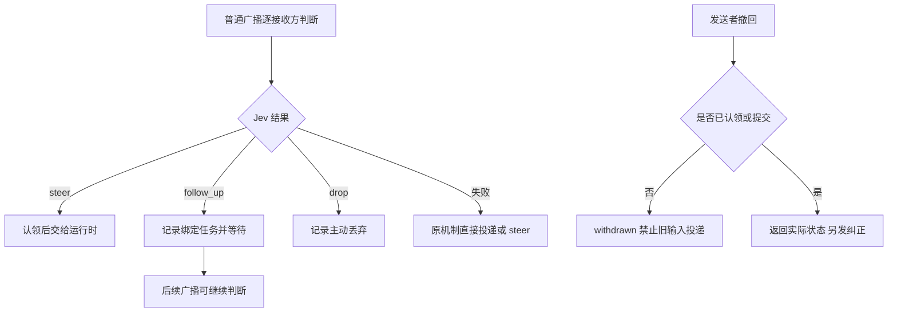

# 问题与修复

1. 时间水位让延后广播挡住新的紧急广播。普通广播改为逐消息、逐接收方 handled 状态；群聊保留时间游标。
2. Jev 异常被误记为主动丢弃。依用户要求，未配置或失败时退回原投递机制；反馈标明 legacy_fallback。
3. 私信缺反馈且旧要求无法撤回。增加私信 message_id/status 和 withdraw；只允许发送者撤回尚未交给运行时的接收方输入。写锁串行化撤回与投递认领。
4. abort 错误清除普通输入、受单任务限制及时间戳碰撞影响。清除 follow_up，其他旧输入 held 留在历史，Leader 当前成员中止不依赖任务数量。时间戳按团队递增。
5. 团队契约分叉、共享文件验收漂移、交接冒充完成和回执循环。中英文 Leader/Teammate 提示词要求单一契约维护者、递增版本、任务写入版本、提交/摘要快照验收、区分交接与完成、只在有实质变更时回复。

## 验证与边界

最终回归：379 passed、19 skipped（13 项依赖弃用警告）。测试日志在工作区 work/routing-fix-final.out。覆盖消息 DAO、消息工具、消息处理、群聊、TeamAgent、NativeHarness 中止和 TeamHarness。
新增回归覆盖广播越过等待消息且不丢失旧消息、私信状态、撤回权限及认领竞争、同 tick 的停止恢复、Jev 缺配置和失败时的原机制回退和 abort 分类处理。
本轮未重跑真实模型业务情景；提示词协作约束不等同于程序强制的契约隔离。外部 Harness 及模型是否遵守协作要求仍需情景验证。
