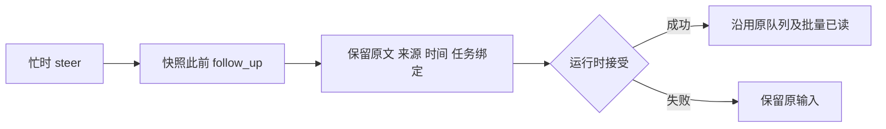

# 团队消息投递规则

日期：2026-11-17。关联 [jiuwenswarm#5251](https://gitcode.com/openJiuwen/jiuwenswarm/issues/5251)。
本记录合并本次 PR 内的停止、反馈与上下文合并记录，描述收紧后的最终行为。

## 决策与边界

| 入口 | 规则 |
|---|---|
| 普通私信 | 发送者显式选 steer / follow_up；abort 仅 Leader 可发，成员向 Leader 申请。运行时兼容旧调用省略模式 |
| steer | 下一次模型决策前注入，不取消当前工具 |
| follow_up | 绑定当前任务或执行轮次，结束后处理；空闲直接投递 |
| abort | 停止执行、清空 follow_up；旧输入保留历史但不重放，正文不执行，仅新的显式 Leader 私信恢复 |
| 广播 | 每个接收方 Jev 选择 steer / follow_up / drop，发送方不选模式 |
| 群聊 | 被 @ 且忙碌时 Jev 选 steer / follow_up；被 @ 且空闲时直接投递，未被 @ 不唤起 |
| Jev 不可用 | 未配置、失败或非法输出回退原机制：空闲直接投递、忙时 steer |

选择依据是“任务结束后收到是否太晚”，不能因对方忙碌延后当前所需信息。提示词要求显式选择不代表模型必然遵循。
停止屏障覆盖调度输入、异步结果和 goal 自动续跑；保留上游审批验证与恢复窗口，普通输入不绕过审批门禁。停止不完成任务，也不撤销已发生的文件修改。

## 合并与反馈

复用 Native supervisor 原 FIFO：成功推入 steering 后才取出相同上下文的连续输入；InteractiveInput 与不同上下文隔离，晚到输入继续排队。邮箱复用原串行 drain、原入站 XML 渲染和 finally 批量已读，投递失败保留原消息；两处共用 state.follow_up_context 包装函数，运行时输入不写成数据库行。
广播只保存逐接收方 follow_up 模式、目标任务与 handled 标记，延后消息不阻塞后续 steer/drop；群聊保留原时间游标。返回 message_id 与基本发送结果，不提供 status 查询，不维护私信投递状态。已读仅表示运行时接受，不表示模型阅读或任务完成。

## 复用现有接口

本次移除原 PR 新建的 private_message、broadcast_delivery、follow_up_merge 三个 Python 模块。模式与元数据归已有 TeamMessageManager；Jev 调用在已有消息处理器内完成，群聊复用该函数，判断文案使用现有 cn/en 模板加载器。send / deliver_input / InboxMessage 恢复原接口，不再跨层传递 delivery_id。
删除合并令牌、预留/认领、合成消息、超时恢复和重复广播缓存。每类队列由其原所有者消费，不另建持久化投递协议。保留广播逐接收方模式/已读、任务绑定、Leader 停止与审批/goal 守卫。

## 进一步精简（2026-11-17）

按用户确认移除完整投递状态查询：删除 send_message 的 action/status/message_id 查询参数、查询权限和状态机，恢复原 required 参数；私信不写反馈，abort/合并不再逐条写 stopped/cleared/held/merged。广播的模式与已读信息是避免延后广播被较新水位吞掉的必要状态，因此保留，写入只发生在 follow_up 决策和原已读路径。旧终态反馈只兼容读取，不继续产生。

上下文包装复用现有 harness/state.py 中同一个函数，两类队列仍由原所有者读取。Native 停止标记以 child session 为事实源，不再同时在 TeamAgent 写副本；无 Native 停止接口的外部 CLI 保留原备用标记和投递闸门。保留窄接口转发及 Native 的 send/resume/goal 守卫。没有通过跨层访问私有 Native 对象来换取行数减少。

运行时代码相对基线新增从 560 行降至 483 行；本次不删任务绑定、审批门禁或 Jev 异步判断期间的任务切换检查来压行数。

## 不采用的方案

- 不新建第二套待办、完成销账或自动提醒；成员根据当前看板和最新有效指令判断旧信息。
- 不以新 steer 自动使全部旧请求失效，不将合并视为任务完成。
- 本 PR 移出消息撤回工具，以及强制 CONTRACT.md、契约版本和快照验收的通用流程提示。撤回作为独立后续能力；已存在的 withdrawn 历史反馈仍按终态读取，避免重放。
- 不继续以 Swarm 依赖补丁分发；实现直接提交 agent-core，取代 GitHub Swarm PR #11987。

## 验证与限制

Windows、Python 3.13，上轮复用改写后运行 14 个相关测试文件：322 passed、19 skipped。本轮精简后最终运行 20 个相关测试文件：397 passed、19 skipped，29 条依赖警告。跳过项沿用原有测试标记，没有新增跳过。覆盖投递与权限、停止和恢复、广播及群聊、Jev 回退、上下文合并、审批与 goal 兼容、工具描述及提示词装配。
本次未运行真实模型业务情景；外部 CLI Harness 的 Native 合并与停止规则未做端到端验证。运行时接受不是模型消费证明，异常重试不保证恰好消费一次。
