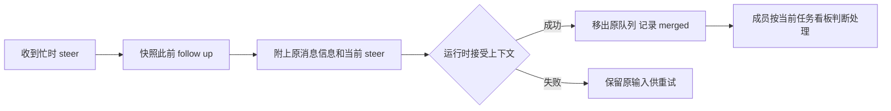

# 背景与决定

## 后续修正：提示词主动选模式

真实会议室预约测试的 5 次私信均省略 mode（其中 2 次使用 targets），因此未覆盖显式模式和合并。用户要求保留代码兼容，仅由提示词要求选择。现为中英文 Leader/Teammate 策略和三种 send_message 工具描述补充该要求：当前工作相关信息用 steer，独立后续请求用 follow_up，只有 Leader 决定 abort；定向多人拆为单独私信，广播仍由接收方选择。schema 的 required、运行时默认分支和权限不变，仅修正 mode 参数说明，避免鼓励当前模型省略。该约束不保证模型遵循，真实选择仍待后续情景测试；已存在团队的历史策略不会自动改写，进程缓存需要重载。

验证：使用 swarm 的 Python 环境运行 test_tool_message、test_locales_variants、test_prompt_loader、test_member_system_prompt，82 passed。覆盖工具参数与兼容调用、描述插值以及提示词装配；未将这些结果解释为真实模型已遵循模式选择。

## 后续修正：模式选择质量与说明冲突

下一轮自然测试（web_1a1e3b6eade_b940a67252b3）在检查时已有 7 条显式私信（5 steer、2 follow_up），并真实发生 follow_up→steer 合并：17:42:24 文档成员的模型输入包含开发样例说明和 Leader 的 v2 要求。与此同时，17:37:01 的测试前置指导用 follow_up 发送，直到 17:40:35 测试完成后才进入 QA 模型上下文，已失去用途；开发发给正在写文档的成员的样例纠正同样不宜延后。这是选择质量问题，不能以模式被使用或合并成功替代正确性结论。

按用户确认完善：使用“任务结束后收到是否太晚”的判断；强调 steer 不停止当前工具，follow_up 仅用于独立且结束后仍有价值的请求；混合请求拆分，不因忙碌延后必要信息；abort 适用于执行本身必须停止，沉默不构成中止理由。统一中英文角色策略、三种工具描述及 mode 参数说明。清除参数表对 targets 的推荐，与私信逐个选模式保持一致；仅能联系 Leader 的调度工具保留本身权限边界。运行时、schema required、权限和队列行为均未改变。完善后的真实模式选择仍需下一轮验证。

本轮验证：上述四个工具与提示词测试文件 82 passed（11.54s），依赖补丁对固定基线 git apply --cached --check 通过。未重启正在运行的服务；现有会话不会自动替换已披露的策略。

忙时 steer 到达后，旧 follow_up 若继续排队，会在后续轮次再次唤起成员。现将这些输入合并进当前 steer 的上下文，成功提交运行时后移出投递队列。合并不是任务完成。

用户明确要求不建立第二套待办：没有 pending/resolve 工具入口，没有 obligation 字段，没有自动后续提醒，不因消息未销账而阻塞团队完成。任务状态继续由现有任务看板负责。成员依据当前任务、契约版本及最新有效指令自行判断旧信息是否仍适用；有冲突则询问 Leader。

## 数据流与实现

- TeamToolRail 为 NativeHarness 装配 TeamFollowUpMerger。没有该适配策略的普通 NativeHarness 保持原行为。
- native supervisor 获取相同 run_context 的连续 FIFO 快照，InteractiveInput 与不同上下文保持隔离。LoopQueues/持久化 follow_up 先归入既有 FIFO，不丢弃。
- 邮箱只合并当前 steer 服务端时间之前的 follow_up；保留消息 ID、发送者、时间、任务绑定、原模式及全文。快照之后的新输入继续留在原队列。
- 持写锁预留接收方投递，避免撤回与提交竞争；成功进入 steering 通道后记 merged/handled，移出原队列。失败恢复原反馈、保留原输入。合并登记中断后，原投递可在 30 秒后重试。
- merged 只表示上下文提交，不代表模型已经阅读、执行或完成任务。原文和反馈仍在历史。用户测试需使用新团队加载新工具描述和策略。

## 拒绝的方案

独立维护合并待办、逐条完成/过时/暂缓、自动提醒，与现有任务看板重复，已按用户要求撤掉。也不采用“新 steer 自动使旧要求失效”或“合并即完成”。

## 验证与限制

验证结果：广泛回归 491 passed、19 skipped；最后增加恢复边界后的定向回归 70 passed。
回归日志：work/steer-context-only.out；最终恢复边界测试日志：work/steer-context-recovery.out。
覆盖真实 NativeHarness supervisor 排队/合并、失败重试、晚到消息保留、邮箱投递状态、无第二待办、工具装配及群聊兼容。
本轮未运行真实模型业务情景；任务是否完成、旧要求是否过时仍由成员及任务看板处理。外部 CLI Harness 不支持此合并能力，保持原接口与行为。运行时接受不是模型消费证明；异常边界重试可能导致上下文再次可见，不保证恰好消费一次。

## 2026-11-17：直接移植到 GitCode agent-core develop

关联 Issue：[openJiuwen/jiuwenswarm#5251](https://gitcode.com/openJiuwen/jiuwenswarm/issues/5251)。本次将原 Swarm 依赖补丁中的框架实现直接移入 agent-core，取代 GitHub Swarm PR #11987 的补丁分发方式；不包含下游服务配置、测试产物和会话模型切换修复。

保留最新 develop 的工具审批校验、恢复窗口与 goal 轮次逻辑。普通模式不得把待审批消息当作执行输入，审批回复不得被 follow_up 的任务绑定延后；Leader 停止屏障额外覆盖 goal 自动续跑，避免 IDLE nudge 绕过 abort。

验证环境为 Windows、Python 3.13；本次候选在官方 develop 基线上运行 14 个相关测试文件，319 passed、19 skipped（28 条依赖弃用警告）。覆盖 NativeHarness 停止与目标续跑、审批邮箱与恢复、私信模式与工具权限、广播延后与 Jev 回退、群聊、合并与投递反馈、中英文工具描述及提示词装配。19 项为已有跳过用例，没有新增跳过。文档索引由当前 sync_documents.py 重新生成。

上述结果是本次移植的确定性回归证据。此前历史记录中的场景和测试总数不代表最新 develop 已完成相同验证；本次没有重跑真实模型协作任务，外部 CLI Harness 的合并与停止端到端行为仍未验证。
