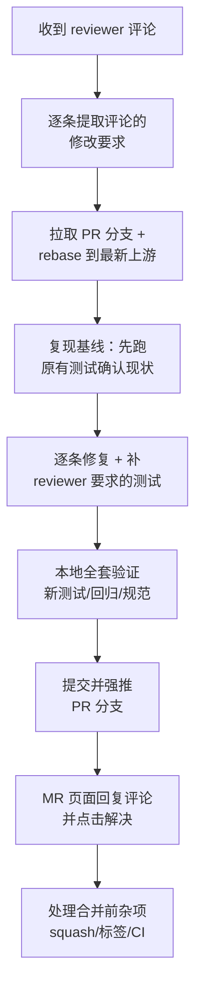

# 开源 PR Review 追加修改全流程实战复盘
## ——以 openJiuwen agent-core !2323（跨事件循环 TaskGroup 复用缺陷）为例

> 分享用途：当你向开源社区提交 PR 后收到 reviewer 评论，如何规范地完成"理解评论 → 基于最新代码修改 → 验证 → 提交推送 → 回复闭环"的完整流程。
>
> 案例背景：`fix(runner): detect stale event loop in _ensure_root_task_group to prevent cross-loop reuse`，修复 `GLOBAL_RUNNER` 进程级单例在多事件循环场景下复用陈旧 owner task 导致的 `RuntimeError: Task ... attached to a different loop`。

---

## 一、整体流程总览



整个流程分 6 个阶段：**读评论 → 同步代码 → 修复 → 验证 → 推送 → 闭环**。

---

## 二、阶段 1：读懂评论，把"建议"翻译成"任务"

Reviewer 的 3 条评论及翻译结果：

| # | 评论原文（摘要） | 翻译成任务 | 性质 |
|---|---|---|---|
| 1 | `runner.py:165` 只判断 owner loop 是否存活；旧 loop 仍活着但不是当前 running loop 时，还是会复用 foreign-loop TaskGroup。建议同时判断 `owner_loop is asyncio.get_running_loop()` | 复用条件加 `is current_loop` 判断 | **代码修复** |
| 2 | 新增了多共享字段的 clear→rebuild 流程；两个 loop/线程同时触发 rebuild，状态可能互相覆盖。建议补一个并发 rebuild 的回归测试，确认是否需要串行化 | 补并发测试，用测试结论决定要不要加锁 | **补测试** |
| 3 | 当前回归测试覆盖的是旧 loop 已关闭的场景，建议再补一个 loop1 未关闭、loop2 调用 Runner 的 case | 补 live foreign loop 测试 | **补测试** |

**经验点：**

1. **注意评论里的"建议"分两类**：一类是明确给了改法的（评论 1 直接给了代码），照做即可；一类是开放性问题（评论 2 "确认是否需要串行化"）——这类**不要想当然加锁**，正确姿势是先写探测性测试，用测试结果回答问题。本案例测试证明：rebuild 中 `await ready.wait()` 让出控制权后，赢家写入的 owner 字段对输家完全可见，输家重入直接命中复用分支返回，**不需要串行化**。
2. **评论之间有依赖关系**：评论 3 的测试依赖评论 1 的修复才能通过（修复前 live foreign loop 场景必挂）。识别这种配套关系，修复和测试一起交付。
3. **顺手清理 AI bot 的评论**：atomgit-bot 的 P2 审查结论与评论 1 是同一问题，回复时说明"已在评论 1 中一并修复"后一起解决即可。

---

## 三、阶段 2：基于最新代码，而不是旧基线

这是本次最关键的教训之一。

### 操作步骤

```bash
# 1. 克隆 fork 的 PR 分支
git clone --branch fix/runner-ensure-root-task-group-loop-liveness \
    https://atomgit.com/spacewing/agent-core.git

# 2. 添加上游仓库并拉最新 develop
git remote add upstream https://atomgit.com/openJiuwen/agent-core.git
git fetch upstream develop

# 3. 检查 PR 分支落后程度
git rev-list --count HEAD..upstream/develop   # 本例：落后 93 个提交

# 4. rebase 到最新 develop
git checkout -b fix/review-2323-rebase
git rebase upstream/develop
```

### 为什么必须 rebase

1. MR 页面挂着"behind the target branch by 93 commits"，很多社区合入前会强制要求同步；
2. **旧基线上的测试通过 ≠ 新基线上通过**。本案例 rebase 后原 PR 的 2 个测试立刻失败——不是因为我们的修改，而是最新 develop 引入了 `ReadWriteLockManager`（文件读写锁周期清理任务），其 `stop()` 在跨 loop 场景下同样会炸。**如果不 rebase，这个连带 bug 会潜伏到合并后才被发现**；
3. rebase 后发现的新问题如果与评论根因相同（本例：都是"陈旧任务跨 loop 操作"），可以一并修，但**必须在 MR 里显式说明第 3 个文件的来历**，否则 reviewer 会疑惑范围扩张。

### 修复后的复用判断（评论 1 落地）

```python
async def _ensure_root_task_group(self) -> None:
    owner = self._root_task_group_owner
    if self._root_task_group is not None and owner is not None:
        try:
            owner_loop = owner.get_loop()
        except RuntimeError:
            owner_loop = None
        current_loop = asyncio.get_running_loop()
        # 只有"loop 存活"且"就是当前 running loop"才复用
        if owner_loop is not None and not owner_loop.is_closed() and owner_loop is current_loop:
            return
    # 否则清空四个共享字段后重建
    self._root_task_group = None
    ...
```

### rebase 连带发现的问题及修法

`ReadWriteLockManager.stop()` 原代码对绑定在已关闭 loop 上的 cleanup task 直接 `task.cancel()`——`cancel()` 内部走 `call_soon`，对 closed loop 抛 `RuntimeError: Event loop is closed`：

```python
if task is not None and not task.done():
    try:
        task_loop = task.get_loop()
    except RuntimeError:
        task_loop = None
    if task_loop is asyncio.get_running_loop():
        # 只有自己的 loop 上的 task 才能安全 cancel + await
        task.cancel()
        try:
            await task
        except asyncio.CancelledError:
            pass
    else:
        # 陈旧 task（closed/foreign loop）：丢弃引用并告警
        logger.warning("Dropping read-write lock cleanup task bound to a stale event loop")
```

**经验点**：`asyncio` 里"跨 loop 操作 task/future"是系统性风险，判断条件一律是 `task.get_loop() is asyncio.get_running_loop()`（identity 比较，不是 `==`）。**注意一个反直觉点：loop 已关闭时也不能 cancel，必须丢弃**——cancel 的调度本身就依赖 loop 活着。

---

## 四、阶段 3：补测试（回应评论 2、3）

### live foreign loop 测试（评论 3）

```python
def test_reuse_on_live_foreign_loop_rebuilds_on_current_loop() -> None:
    runner = _RunnerImpl(config=DEFAULT_RUNNER_CONFIG)
    loop1 = _new_loop()
    loop1.run_until_complete(runner.start())
    assert not loop1.is_closed()   # 关键：loop1 不关闭，保持存活

    loop2 = _new_loop()
    try:
        loop2.run_until_complete(runner.start())
        owner = runner._root_task_group_owner
        assert owner is not owner_after_first          # 没复用旧 owner
        assert owner.get_loop() is loop2               # 重建在当前 loop
        loop2.run_until_complete(runner.stop())        # 无跨 loop 异常
    finally:
        loop2.close()
        loop1.close()
```

### 并发 rebuild 测试（评论 2）

```python
def test_concurrent_ensure_root_task_group_on_two_loops() -> None:
    # 两线程各持一个 live loop，Barrier 对齐后同时调 _ensure_root_task_group()
    # 断言：无异常、字段三元组自洽、owner 绑定两 loop 之一且未 done
    #       之后 runner 仍可干净 start/stop
```

**经验点：**

1. **测试要能"修复前失败、修复后通过"**才有防御价值。live foreign loop 测试在旧代码（只查 `is_closed()`）下必挂——这正是它存在的意义；
2. **并发测试用"探测 + 断言不变量"的写法**，而不是"复现一个具体交错"（后者不稳定）。断言的不变量：owner 唯一且绑定两 loop 之一、四个字段自洽、后续可正常启停；
3. 测试文档串里写清楚 reviewer 反馈来源（"Review feedback on !2323: ..."），半年后还能追溯为什么有这个测试。

---

## 五、阶段 4：验证——分层跑，分清责任

| 层级 | 命令 | 结果 | 说明 |
|---|---|---|---|
| 目标测试 | `pytest tests/test_runner_ensure_root_task_group.py` | 6/6 | 原 4 + 新 2 |
| 直接影响面 | `pytest tests/unit_tests/core/sys_operation/local/test_fs_operation.py` | 40 passed | rw lock 修改的回归 |
| 大范围回归 | `pytest tests/unit_tests/core/runner` | 481 passed / 0 failed | runner 全量 |
| 代码规范 | 行宽 ≤120（ruff 配置） | 通过 | 本地装不上 ruff 时按 pyproject 手动核验 |

**经验点：**

1. **出现"环境性失败"要对照验证**：runner 套件有 4 个 error，用 `git stash` 在干净树上重跑同样出现 → 判定为预存环境问题（pytest 9 fixture 兼容性），与本次修改无关。**不要把环境问题当成自己的 bug 去修，也不要无视它——用对照实验定责**；
2. `pyproject.toml` 里 `addopts` 带了 `--html` 参数但环境没装插件时，用 `-o addopts=""` 覆盖后再跑；
3. Windows 下注意 `pytest` 输出里的 "Task was destroyed but it is pending!"——这类告警在本场景（故意弃置陈旧 task）是预期行为。

---

## 六、阶段 5：提交与推送

### 提交规范

一条提交承载一次完整的 review 回应，commit message 结构：标题 + 评论处理明细：

```
fix(runner): also detect live foreign loops in _ensure_root_task_group

Address review feedback on !2323 (houshengluan):

1. Reuse check only tested owner-loop liveness; ... (评论 1)
2. ReadWriteLockManager.stop() cancelled the cleanup task ... (连带修复)
3. New regression tests: ... (评论 2、3)
```

### 推送策略

```bash
# rebase 改写了历史，必须 force push
git push origin fix/runner-ensure-root-task-group-loop-liveness --force
```

**经验点：**

1. **rebase 后必须 force push**，且推送前确认本地分支指向新提交链（本案例曾出现本地 PR 分支仍指旧 commit，需 `git branch -f` 后再推）；
2. force push 会触发两件事：**CI 重跑**（等它变绿）+ **行内 review 评论挂到旧 diff 上变成"过期"**——这是正常的，不是丢评论；
3. push 前 `git status` 确认工作区干净；中途 stash 过的话记得 `git stash list` 清点。

---

## 七、阶段 6：MR 闭环（回复 + 解决 + squash）

### 回复的写法模板

每条回复包含四要素：**结论先行 → 改了什么 → 怎么验证的 → 关联测试**：

> 已修复。复用条件已改为同时校验存活与归属：（代码块）
> 单 loop 正常路径不受影响（`is` 恒为 True）……配套新增回归测试 `test_reuse_...`（场景描述），修复前该测试必挂。

对于"要不要串行化"这类开放问题，回复要**给出测试结论**：

> 已补并发回归测试……测试结论：当前实现不需要串行化——rebuild 过程中 await 会让出控制权，但赢家写入的 owner 字段对输家完全可见……

另发一条**总回复**说明范围扩张（第 3 个文件为何进来）——rebase 后连带发现的同根因问题，主动交代比被 reviewer 问到强。

### 合并前杂项清单

| 项 | 处理 |
|---|---|
| 行内评论点"解决" | 逐条回复后点 Resolve（注意：force push 后旧 diff 评论可能显示过期，不阻塞合并） |
| `stat/needs-squash` 标签 | 3 个提交 squash 为 1 个后强推，标签自动消失 |
| CLA | 已签（`openJiuwen-cla/yes`） |
| CI 等 `ci-successful` | squash 强推后自动重跑，约 10 分钟 |
| 分配合并人/审查人 | 讨论区 @ 维护者请求 assign（SIG 成员名单在机器人欢迎语里） |

### squash 操作

```bash
git reset --soft upstream/develop
git commit -m "fix(runner): detect stale/foreign event loops in _ensure_root_task_group

（完整重写的 commit message：问题、修复、测试、关联 issue）"
git push origin <branch> --force
```

**经验点**：squash 后 commit message 要重写成完整独立的（不能只是拼接三条旧 message），因为它是这个 PR 留在主干的唯一记录。squash 后本地把目标测试再跑一遍（本例 6/6）确认无损。

---

## 八、可复用的检查清单（下次直接照着走）

**读评论**
- [ ] 每条评论翻译成明确任务（修复 / 补测试 / 回答问题）
- [ ] 识别评论间依赖（测试是否依赖某条修复）
- [ ] 区分"给了改法的建议"和"开放性问题"

**同步代码**
- [ ] `git fetch upstream` + 检查落后提交数
- [ ] rebase 到最新 develop，冲突逐个解决
- [ ] rebase 后重跑原有测试——新基线可能暴露连带问题

**修复**
- [ ] 跨 loop 安全判断统一用 `task.get_loop() is asyncio.get_running_loop()`
- [ ] closed loop 上的 task 不能 cancel，只能丢弃
- [ ] 开放性问题用探测性测试回答，不凭感觉加锁

**验证**
- [ ] 目标测试 + 直接影响面 + 大范围回归三层
- [ ] 疑似环境失败 → 干净树对照实验定责
- [ ] 行宽等 lint 规则核验

**提交推送**
- [ ] commit message 引用评论编号逐条回应
- [ ] rebase/squash 后 force push
- [ ] 确认本地分支指向正确再推

**MR 闭环**
- [ ] 每条评论回复（结论先行 + 改动 + 验证 + 测试名）后点解决
- [ ] 范围扩张（新文件）单独发总回复说明
- [ ] 处理 needs-squash → squash 强推
- [ ] 等 CI 绿 → @ 维护者请求 review/assign

---

## 九、本案例的三个核心认知

1. **"基于最新代码做修改"不是流程要求，是质量手段**——93 个新提交里藏着让原修复失效的连带 bug（rw lock），只有 rebase 后才能发现。"PR 当时能跑通"只是历史快照。

2. **开放性 review 意见的正确回应是证据，不是服从**——reviewer 问"是否需要串行化"，答案用并发测试的不变量断言给出（不需要），而不是 defensively 加一把锁。加不需要的锁是负优化，还会引来下一轮"为什么这里要加锁"的追问。

3. **闭环沟通和代码同等重要**——逐条回复 + 总回复交代范围扩张 + 主动 squash，让 reviewer 复审成本最低。开源协作里 reviewer 的时间是最稀缺资源，你的 PR 让他看得越省力，合得越快。

---

*案例信息：openJiuwen/agent-core !2323（AtomGit）≈ GitHub openJiuwen-ai/agent-core #525，关联 issue #1444/#245（Runner 进程级单例绑单一事件循环）。本地工作目录 `D:/workspace/agent-core-pr2323`。*
