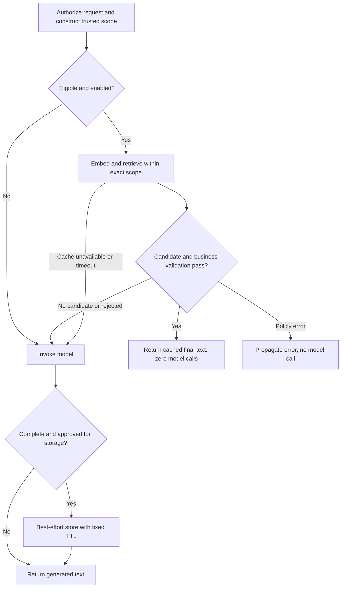

# Optional semantic response caching

This extension reuses complete text answers in explicitly authorized, read-only,
single-turn QA applications. It does not implement token/KV caching, select a model,
or change `Model.invoke`. Existing applications are unaffected. It is disabled by
default. Install the optional backend with `pip install 'openjiuwen[semantic-cache]'`.
Redis Search is required; an embedding service/model is provisioned separately.

## Request flow



## How to enable (step-by-step & 3 mandatory gates)

The extension ships **off by default** (`enabled=False`, `eligible=False`) so
installing or importing `openjiuwen` never activates caching silently. Turning it
on safely requires four explicit steps:

1. **Install & provision dependencies**: install `pip install 'openjiuwen[semantic-cache]'`,
   provision a dedicated Redis Search server, and configure an **asynchronous,
   non-blocking** `embed` callable (for CPU/local encoders, offload to an HTTP
   embedding microservice or `asyncio.to_thread(...)` so the event loop stays
   unblocked under concurrency).
2. **Gate 1 — Instance switch (`enabled=True`)**: initialize
   `SemanticResponseCache(..., enabled=True)`. Keep `cache.enabled = False` as a
   hot kill-switch to bypass all Redis and embedding work immediately at runtime
   without restarting your service.
3. **Gate 2 — Per-request eligibility (`eligible=True`)**: pass `eligible=True`
   in `cache.invoke(...)` **only** after request authorization succeeds and only
   for single-turn, read-only text QA (never for tool calls, mutable state,
   multi-turn history, or streaming).
4. **Gate 3 — Domain validator & storage approval (`can_reuse` & `reusable=True`)**:
   supply a domain-specific async `can_reuse(prompt, candidate)` check (rejecting
   negation flips, entity/number mismatches, or stale policies) and mark
   `GeneratedAnswer(text, reusable=True)` only for complete, non-refusal outputs.

## Backend configuration

At application startup, create a **dedicated** RedisVL `SemanticCache` with a
`scope_key` TAG field and bounded Redis socket timeouts. Supply an explicit
vectorizer to avoid an unintended default model download. Its dimension, dtype,
model and preprocessing must match the async `embed` callable. Keep one
configuration per index; changing the embedding requires a new index as well as
a new scope version. Do not share this index with untrusted writers. Use Redis
authentication, access controls and encryption as appropriate.

```python
from redisvl.extensions.cache.llm import SemanticCache
from openjiuwen.extensions.semantic_cache import SemanticResponseCache
from openjiuwen.extensions.semantic_cache.redisvl import RedisVLBackend

# vectorizer and async embed are application-provided, using the same revision.
redis_cache = SemanticCache(
    name="application_qa_v1",
    redis_url=redis_url,
    vectorizer=vectorizer,
    filterable_fields=[{"name": "scope_key", "type": "tag"}],
    distance_threshold=calibrated_threshold,
    ttl=300,
    refresh_ttl_on_hit=False,
    connection_kwargs={
        "max_connections": 128,
        "socket_connect_timeout": 0.5,
        "socket_timeout": 0.5,
        "retry_on_timeout": False,
        "health_check_interval": 30,
    },
)
backend = RedisVLBackend(redis_cache, embed, ttl=300)
cache = SemanticResponseCache(
    backend,
    enabled=True,
    timeout=0.5,
    coalesce_misses=True,
    max_concurrent_backend=32,
    circuit_breaker_threshold=5,
    circuit_breaker_cooldown=30.0,
)
```

For concurrent workloads and service stability:
- Size Redis `connection_kwargs={"max_connections": ...}` above expected request
  concurrency and set tight `socket_connect_timeout` / `socket_timeout` so stale
  TCP sockets fail fast rather than exhausting worker slots.
- Set `coalesce_misses=True` for in-process single-flight keyed by
  `(scope.key, prompt)` for reusable answers (each waiter still runs its own
  `can_reuse`).
- Set `max_concurrent_backend` to bound backend `lookup` and `store` concurrency
  via independent semaphores so slow lookups never starve writes, while dropping
  saturated best-effort stores instead of queuing.
- Set `circuit_breaker_threshold` (for example `5`) and
  `circuit_breaker_cooldown` (for example `30.0` seconds) so consecutive Redis or
  embedder failures automatically open the circuit (`cache.circuit_open == True`)
  and bypass cache calls with zero extra latency until one half-open probe
  succeeds after cooldown.
- Monitor `cache.stats` (`CacheStats`) for `hits`, `coalesced_hits`,
  `validator_rejections`, `backend_errors`, `store_errors`,
  `store_skipped_overload` and `circuit_open_bypasses`. Warning logs record only
  truncated `scope_key` prefixes and exception types—never user prompts or
  cached responses.

## Production stability & rollout checklist

- **Phased canary rollout**: deploy with `enabled=False` or `eligible=True`
  restricted to an internal/canary tenant first; calibrate `distance_threshold`
  and `can_reuse` against false hits before expanding traffic.
- **Instant kill-switch & zero-downtime invalidation**: set `cache.enabled = False`
  at runtime to drain traffic back to direct generation instantly, or bump any
  `CacheScope` version field (`access`, `template`, `context`, `embedding`) to
  isolate stale entries immediately.
- **Graceful shutdown**: stop accepting new cache invocations (`cache.enabled = False`)
  and await in-flight requests before calling `await redis_cache.adisconnect()`
  and `redis_cache.disconnect()`. Synchronous startup and shutdown should run
  outside request handling. Async callbacks must cooperate with cancellation;
  timeout is not a hard interrupt for blocking Python code.

See `examples/semantic_cache/read_only_qa.py` for the explicit `Model.invoke` bridge.
It returns `CacheResult(text, cache_hit)`, not a fabricated provider message. Hits
have no provider usage, response ID or callback event; instrument them at the
application layer. Misses retain normal model invocation callbacks. Only final
text is stored, not reasoning or provider metadata. Within the same task,
`RedisVLBackend` reuses the lookup vector for the matching miss store instead of
embedding twice; embeddings are not cached across separate requests.

## Required application policies

Construct `CacheScope` from trusted server state after authorization. Its eight
required fields partition tenant, access/permission revision, application,
resolved provider/model/revision, template, immutable knowledge/context revision,
generation/output contract and embedding revision. No field can be empty. A digest
is a partition identifier, not encryption or authorization. Revocations require
changing access scope; knowledge edits require changing context scope.

`eligible=True` is an explicit assertion that this request is a safe, read-only,
single-turn text request. Do not use this wrapper for tools/actions, mutable state,
multiturn history, multimodal or structured outputs. Set `eligible=False` to bypass
both lookup and storage. Unknown eligibility must remain false.

`can_reuse(question, candidate)` is mandatory. It must check whether this particular
answer is still valid, including entities, negation, permissions, context and time.
“Refund” and “do not refund” may be close in vector space. Similarity alone is not
proof of answer equivalence. The extension has **no built-in general negation or
NLI guarantee**. A validator exception/timeout fails closed and propagates; it does
not call the model. Callers can explicitly reject uncertain candidates with False
to request generation. Do not implement validation as `return True` in production.

The generation callback returns `GeneratedAnswer(text, reusable=False)` by default.
Set reusable to True only for complete successful answers approved for storage;
reject refusals, partial output and sensitive text. A successful model status alone
is not that approval. In the example, `may_store` implements this business rule.

Redis/embedding lookup failures fall back to generation. Store failures preserve
the generated answer. Cancellation propagates. No background tasks, streaming
replay, global invalidation or distributed authorization are provided. Set
`coalesce_misses=True` for in-process identical-prompt coalescing (cross-process
or different paraphrases still miss independently). Concurrent misses with
`coalesce_misses=False` may both generate. TTL bounds retention and is never
extended by hits. Calibration and held-out quality evaluation remain application
responsibilities; this implementation makes no performance or quality guarantee.

## Validation

```bash
PYTHONPATH=. python -m unittest discover -s tests/unit_tests/extensions/semantic_cache -v
SEMANTIC_CACHE_TEST_REDIS_URL='<REDIS_URL>' PYTHONPATH=. \
  python -m unittest discover -s tests/system_tests/extensions/semantic_cache -v
```

The integration tests create unique indexes and delete only their own indexes.
They use deliberately identical synthetic vectors to test isolation, validator
rejection, real retrieval, expiration and model-call counts. They do not measure
embedding quality, real LLM latency or production throughput. Run them only against
a dedicated test Redis Search service.
