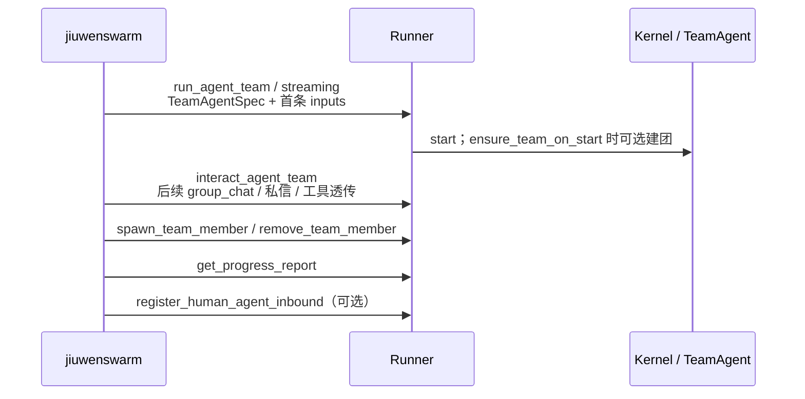

# 项目空间 · agent-core 接口说明（当前实现）

> 面向 jiuwenswarm 接线。以分支 `feat/project-space-agent-core` 的**已落地代码**为准。  
> 结构参考 caozhenhua 工作区《agent-core提供的接口说明.md》，但字段、入口和语义已按本分支重写。  
> 与需求方案 / 上层详细设计不一致之处，集中写在文末「与方案的出入」。

| 项 | 值 |
|---|---|
| 代码基线 | `5be83d240`（公开讨论 + 被动真人）+ `878ca0aa0`（成团 / 提示词 / 宿主成员 / 进展）+ 同名重加入 |
| 远程 | `self/feat/project-space-agent-core` |
| 需求文档 | `project-space-agent-core-requirements.md` |
| 范围 | 只描述 agent-core。Project / Discussion / IM / 项目秘书不在此 |

---

## 0. 调用总览



| 场景 | 接口 |
|---|---|
| 第一次进场 | `Runner.run_agent_team` / `run_agent_team_streaming` |
| 同一场后续发言 | `Runner.interact_agent_team` |
| 运行中加人 / 软停 / 同名重加 | `spawn_team_member` / `remove_team_member` |
| 按需进展 | `get_progress_report` |
| 真人私信入站 | `register_human_agent_inbound` |

成员内部工具（`group_send_message`、`send_message`、`build_team` 等）由 Runtime 内模型调用，宿主一般不直接调。

---

## 1. 建团队：规格 + 入口

### 1.1 入口

```python
await Runner.run_agent_team(spec, inputs, session=session)
async for chunk in Runner.run_agent_team_streaming(spec, inputs, session=session):
    ...
```

`spec` 为 `TeamAgentSpec`。流式入口在首次迭代时完成校验。

### 1.2 与项目空间相关的规格字段

| 字段 | 类型 | 默认 | 说明 |
|---|---|---|---|
| `team_name` | `str` | `"agent_team"` | 团队唯一名 |
| `agents` | `dict` | 必填 | 至少含 `"leader"`；可为成员名挂专属 `DeepAgentSpec` |
| `enable_hitt` | `bool` | `False` | 真人总开关；挂 `human_agent` / `passive_human` 必须为 `True` |
| `predefined_members` | `list` | `[]` | 预置名册 |
| `ensure_team_on_start` | `bool` | `False` | 为真且无团行时，`Kernel.start` 调用 `ensure_team_built` |
| `team_desc` | `str` | `""` | 声明即成团时写入的团队描述 |
| `prompt_overrides` | `dict[str,str]` | `{}` | 按 section 整段替换；空串=去掉该段 |
| `base_prompt` | `str` | — | 仍作为 `team_extra` 默认正文 |
| `dispatch_mode` 等 | — | 沿用原专家团 | 调度/自主、lifecycle、swarmflow 等 |

**本分支没有** `enable_group_chat`、`group_context_tail`。公开讨论由输入形状决定，不靠规格开关。

### 1.3 `prompt_overrides` 合法 section

| section | 说明 |
|---|---|
| `team_identity` | 外部 CLI 等 |
| `team_role` | 角色定位 |
| `team_hitt` | 真人协作规则 |
| `team_bridge` | 桥接 |
| `team_workflow` | leader 工作流 |
| `team_dispatch` | 调度/自主 |
| `team_lifecycle` | 生命周期 |
| `team_extra` | 即 `base_prompt` |
| `team_inbound_tags` | 入站 XML 约定 |

未知键在 `TeamAgentSpec.build()` 失败。关掉某一段**不**关掉对应 rail/工具。

与旧接口说明的差异：没有 `team_bootstrap`、`team_task_state`；合法名以 `TeamSectionName.ALL` 为准。

### 1.4 声明即成团

| `ensure_team_on_start` | 探测后有团行 | 行为 |
|---|---|---|
| `False` | 否 | 等 leader 调 `build_team`（专家团） |
| `True` | 否 | `ensure_team_built()`；失败则启动失败，不降级单代理 |
| 任意 | 是 | 不重建 |

团行已存在时再调 `build_team`：能力上限校验后**空成功**，名册/描述/本次开关都不改。  
预定义名册团队会从 leader 工具里拿掉 `spawn_*`；宿主门面不受此限制。

### 1.5 项目空间装配示例

```python
spec = TeamAgentSpec(
    team_name="jiuwen_team",
    agents={"leader": DeepAgentSpec(...)},
    enable_hitt=True,
    ensure_team_on_start=True,
    team_desc="项目协作讨论",
    predefined_members=[
        TeamMemberSpec(member_name="writer", display_name="撰稿", role_type="teammate"),
        TeamMemberSpec(member_name="pm_1", display_name="产品", role_type="passive_human"),
    ],
    prompt_overrides={
        "team_workflow": "# 团队已建好\n不要调用 build_team。\n...",
    },
)
```

---

## 2. 成员管理

### 2.1 加成员 / 同名重加

```python
await Runner.spawn_team_member(
    spec,                 # TeamMemberSpec
    team_name="jiuwen_team",
    session=session_id,   # 或 AgentTeamSession；省略则用池内当前场
    allow_rejoin=False,   # True：允许软停后按原名重新启用
)
# -> {"ok": bool, "reason": str}
```

| `role_type` | 行为 |
|---|---|
| `teammate` | 登记 UNSTARTED → `auto_start_member` |
| `human_agent` | `spawn_human_agent` → `auto_start_member` |
| `passive_human` | `spawn_passive_human`，READY，不启进程 |
| 其他 | `unsupported_role_type` |

**`allow_rejoin=False`（默认）**

- 名册已有同名行（含已 `SHUTDOWN`）→ `ok=False`，reason 含 `already exists`

**`allow_rejoin=True`**

| 情况 | 结果 |
|---|---|
| 不存在 | 走正常新建 |
| 同名且 role 不同 | `member_conflict` |
| `SHUTDOWN_REQUESTED` 且非 passive | `member_shutting_down`（稍后重试） |
| `SHUTDOWN_REQUESTED` 且 passive | 先落到 `SHUTDOWN` 再重启用 |
| `SHUTDOWN` / `ERROR`，role 兼容 | 重启用：passive → `READY`；teammate/avatar → `restart_teammate` |
| 仍在队且 role 一致 | 幂等 `ok=True`（不启第二份实例） |

成功时 `reason=""`。沿用原名册行与历史；默认不改旧配置字段。  
团队必须已在目标 session 运行，否则 `team_not_active`。

### 2.2 软停

```python
await Runner.remove_team_member(
    team_name, member_name, session=session_id, force=False,
)
# -> {"ok": bool, "reason": str}
```

- 软停：名册行与历史保留，状态进入停机路径  
- 已停机或不存在：幂等成功  
- 真人（含 passive）持有进行中任务且 `force=False`：拒绝  
- **passive**：无成员进程收尾，软停后直接落到 `SHUTDOWN`，避免永久卡在 `SHUTDOWN_REQUESTED`

查名册仍用既有监控接口（如 `get_agent_team_monitor`），本分支不另提供 `get_member` 宿主门面。

---

## 3. 发消息

### 3.1 公开讨论区（本分支主路径）

```python
payload = {
    "type": "group_chat",
    "body": "请看这个方案",
    "client_message_id": "msg-001",   # 必填，会话内幂等
    "mentions": ["writer"],           # 结构化点名；不解析正文 @
    "attachments": [{"name": "a.txt", "path": "/shared/a.txt"}],
}

# 首轮可放在 inputs["query"]；之后：
await Runner.interact_agent_team(
    payload,  # 或 GroupChatMessage
    team_name="jiuwen_team",
    session_id="sess_xxx",
)
```

| 规则 | 行为 |
|---|---|
| 底账 | 数据库一条 `broadcast`，`meta.type=group_chat` |
| 投影 | 可重建的 `history.jsonl`；`context_path` 指向它 |
| 作者 | 宿主入口固定 `user`，**不能**传 `sender` |
| 空 `mentions` | 只归档，不喂任何成员模型 |
| 非空 `mentions` | 仅名单内可执行成员进未读摘录；不含发送者、`user`、`passive_human` |
| 缺团行 | `invalid_group_chat`，**不**自动 `build_team` |
| 同 ID 同内容 | `duplicate=true`，不插第二行，仍 sync 投影并再发布 |
| 同 ID 不同内容 | 失败 |

成功时 `DeliverResult.data` 含：`message`、`duplicate`、`notified_members`（**可唤醒资格**，不是已读回执）、`context_path`。

成员公开回复：工具 `group_send_message`（作者=当前成员）。`human_agent` / `passive_human` **不**注册该工具。

### 3.2 普通内部广播 / 私信（旧能力，仍可用）

`interact` 字符串语法例如 `# @all …`、`$alice @dev-1 …`，走 HITT/操作者通道：

- **不是**公开 Thread，不进 `history.jsonl` 这套投影约定  
- 按普通广播/定向邮箱规则投递  
- 可达真人可触发 `register_human_agent_inbound` 回调  

与公开区 `@all`（文档里的全员激活）不是同一套语义。本分支公开区**没有**语义化 `@all` token；要全员醒须由宿主把成员名填进 `mentions`。

### 3.3 公开区与 HITT 回调

公开群广播在 `_notify_human_agent_inbound` 中**直接返回**，不因群聊扇出真人回调。  
定向私信、普通内部广播仍通知已注册且可达的 `human_agent` / `passive_human`。

---

## 4. 被动真人

| | `passive_human` | `human_agent` | 团外 `user` |
|---|---|---|---|
| 名册 | 有 | 有 | 无 |
| 模型 | 无 | 有（avatar） | 无 |
| 公开区被 `@` | 只记名 | 可进模型摘录 | — |
| 宿主工具透传 | `HumanAgentToolCall` | 不支持（avatar 路径） | — |
| `target=None` | `passive_member_no_avatar` | 驱动 avatar | — |

`HumanAgentToolCall` 白名单：`view_task`、`member_complete_task`、`verify_task`、`send_message`；自主调度下另有 `claim_task`。  
这是宿主**代真人按按钮**，不是入站回调。

---

## 5. 进展汇报

```python
text = await Runner.get_progress_report(
    team_name="jiuwen_team",
    session_id="sess_xxx",
    scope="all",          # team | member | all
    member_name=None,
)
```

- 按需生成，不落库，不写回公开讨论区  
- 材料：团队描述、名册、任务板、本会话 `history.jsonl`  
- 无任务且无历史 → `"暂无进展"`（不调模型）  
- 有材料无模型 → `report_model_unavailable`  

**不是**详细设计中的 `publish_runtime_output`，也不是私下 Coordinator Query。

---

## 6. 稳定失败 reason（节选）

| reason | 含义 |
|---|---|
| `invalid_group_chat` | 公开消息非法或团队不存在等 |
| `group_chat_delivery_failed` | 归档/发布失败 |
| `team_not_active` | 池中无该团或 session 不匹配 |
| `team_backend_unavailable` | 无 backend |
| `unsupported_role_type` | 宿主 spawn 不支持的角色 |
| `member_conflict` | 重加时同名但角色/关键配置冲突 |
| `member_shutting_down` | 仍在停机中，稍后重试 |
| `member_rejoin_failed` | 重启用状态机或 restart 失败 |
| `passive_member_no_avatar` | 被动真人 `target=None` |
| `human_agent_not_enabled` | 未开 HITT |
| `already exists`（文案） | 同名仍在名册且未允许 rejoin |

上层应匹配稳定 token / 固定短语，不要依赖完整中文句式。

---

## 7. 与方案 / 旧接口说明的出入

下列项以**本分支实现**为准；上层详细设计或旧说明若不同，需对齐后再改代码。

| 主题 | 旧说明 / 部分方案 | 本分支 |
|---|---|---|
| 公开区开关 | `enable_group_chat`、`group_context_tail` | **无**；`type=group_chat` + 固定摘录 5 条 |
| 公开历史 | `history.json` + `.notified.json` | DB 底账 + `history.jsonl`；读进度用广播水位 |
| 宿主公开作者 | 可指定 sender（部分草案） | 固定 `user` |
| 空 `mentions` / 无 `@` | collaboration：默认叫醒 leader 或最近发言者 | **只归档，谁也不醒** |
| 公开 `@all` | collaboration：并行叫醒全部 Agent/Team | **未实现**；须枚举进 `mentions` |
| `# @all` | 旧 interact 语法 | 仍是**内部广播**，不是公开 Thread |
| 群聊 → 真人回调 | 部分方案希望 Thread 推 IM | 公开群聊**不调** HITT 回调；IM 由上层读 Thread/事件 |
| `notified_members` | 「已叫醒」 | 「允许唤醒的资格名单」 |
| `duplicate` | 「整次跳过」 | 不插第二行，仍 sync + 再发布 |
| section 名 | 含 `team_bootstrap` / `team_task_state` | 见上文九个合法名 |
| 同名重加 | 方案要求 ensure/rejoin | 已提供 `allow_rejoin=True` |
| RuntimeOutput | 详细设计有 | **未做** |
| Coordinator Query | 详细设计有 | **未做**；可用 `get_progress_report` 作按需摘要 |
| LocalTeamBinding | 阶段三 | **未做** |
| `ensure_team_on_start` 默认提示词 | 曹振华改成「勿调 build_team」 | 旗标为真时模板仍可能让 leader 再调一次（空成功）；可用 `prompt_overrides` 覆盖 |

---

## 8. 建议联调顺序

1. `ensure_team_on_start=True` 起团  
2. 发一条 `group_chat`（有/无 `mentions`）  
3. 确认 `history.jsonl` 一条记录、被点名成员醒、未被点名不醒  
4. `spawn_team_member` → `remove_team_member` → `allow_rejoin=True` 再加回  
5. `get_progress_report`  
6. （可选）真人私信 + `register_human_agent_inbound`  

回归命令：

```text
uv run --no-sync pytest tests/unit_tests/agent_teams/test_group_chat.py `
  tests/unit_tests/agent_teams/test_project_space_host.py `
  tests/unit_tests/agent_teams/test_coordination_lifecycle.py -q --tb=short
```
