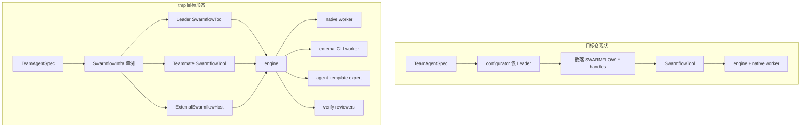

# Swarmflow：从 tmp\agent-core 迁移到 agent-core

## 元信息

| 项 | 值 |
|---|---|
| 日期 | 2026-11-04 |
| 状态 | 主体已落地 |
| 范围 | `openjiuwen/agent_teams/workflow/**` 及装配链（`agent_configurator` / `TeamInfra` / `rails/team_context` / `tool_factory` / `runtime/background_task_controller` / `schema/events` / `paths` / locales / 相关单测与 E2E） |
| 关联 spec | [[S_18]]（引擎与 worker）；[[S_21]]（并发治理）；tmp 侧另有 [[S_25]]（verify，目标仓尚无） |
| 关联既有 feature | 目标仓已有 F_27~F_48、F_66；tmp 增量以 F_81 / F_86~F_88 / F_96 / F_100 / F_110 / F_112~F_116 / F_118 / teammate 编排等为主 |
| 确认 | 待确认 |
| 作者 | （分析稿） |
| 源仓 | `D:\work\OpenJiuwen\tmp\agent-core` |
| 目标仓 | `D:\work\OpenJiuwen\agent-core` |
| 测试基线 | `522 passed, 1 xfailed`（workflow + swarmflow_infra + BTC；expert BoundGroup 仍 xfail） |

## 1. 设计定位与阅读说明

本文原为迁移前分析；**2026-11-04 主体代码已按下文分期落入目标仓**（见文末「落地状态」）。历史差距描述保留作对照；以代码与单测基线为准。

- **功能源**：tmp 的 `openjiuwen/agent_teams/workflow/` + 对应装配链与 `.agents/agent-docs` 下 F/S 文档。
- **合并原则**：保留目标仓已落地的 F_27~F_66 契约与独有周边能力；按 tmp 契约补齐缺口；文档归档仍落在目标仓 `docs/features` / `docs/specs`（不要照搬 tmp 的 `.agents/agent-docs` 目录布局）。
- 体量信号（同源文件字节对比，约）：`tool_swarmflow.py` 20KB→53KB；`team_worker_backend.py` 23KB→59KB；`avatar_session_backend.py` 29KB→83KB；`engine/primitives.py` 49KB→97KB；`engine/runner.py` 7KB→21KB。另 tmp 独有 9 个文件。
- **能力释义（是什么 / 干什么 / 为什么要用）**：见姊妹篇 [[F_86_swarmflow-gap-modules-explained]]；本文偏迁移改动与分期，不重复展开产品语义。

## 2. 背景、目标与范围

### 2.1 两边定位

| 维度 | 目标仓（本项目） | tmp 源仓 |
|---|---|---|
| 核心骨架 | 已有：`engine/` + `TeamWorkerBackend` / `AvatarSessionManager` + `SwarmflowTool` + L1/L2/L3 + journal/WAL + pause/resume + 单层 budget | 同源骨架上大幅演进 |
| 谁能发 swarmflow | **仅 Leader**（`agent_configurator` 按 role 门控） | Leader + in-process teammate（`SwarmflowInfra` 共享）+ 外部 CLI（`ExternalSwarmflowHost`） |
| journal 路径 | `(team, session, META.name)/journal.jsonl` 共享文件 | **per-run** `journal-{run_id}.jsonl` + `wal/{run_id}.wal`（legacy 只读种子） |
| budget | Leader 级单账本（`swarmflow_budget`） | Session 账本 + per-run `workflow_token_limit` 双层；`BudgetExhausted.scope` |
| 脚本原语 | `agent` / session / parallel / pipeline / phase / log / workflow / budget… | 另有 **`verify()`**；options 生效面更大 |
| worker 种类 | 仅 native `TeamHarness.run_once` | native + **三方 CLI**（`agent_type`）+ **专家**（`agent_template`） |
| 可观测 | `workflow_started` / `phase` 等粗粒度；无工具级活动 | **`AGENT_ACTIVITY`** 双钩不节流；`relaunch_kind` / seal-pause / `executor` 归因 |
| session fork | F_37 明确不做 | **F_81** 已做（native + 后续外部 fork） |
| 工具参数 | `name` / `resume_id` 返回 not supported | resume_id / seal-guard / early_return / stop_all 等控制面齐备 |
| 文档布局 | `agent_teams/docs/{features,specs}` | `.agents/agent-docs/{features,specs,designs}` |

### 2.2 目标

迁完后，目标仓 Swarmflow 与 tmp 在**脚本契约、run 隔离、双层预算、验收原语、三方/专家 worker、活动流、teammate/外部宿主共享基建、pause-seal 控制面**上对齐；装配仍遵守四条铁律（`workflow/AGENTS.md`）。

### 2.3 范围与非目标

- **包含**：`workflow/` 增量文件与同源大 diff 合并；`TeamHandleKey` / `SwarmflowInfra` / configurator / tool_factory / BTC / events / paths / locales；对应单测与 E2E；修订 S_18/S_21、新增 S_25 与 feature 归档。
- **不包含**：重写引擎业务无关边界；把调度模式 `settle_review_tally` 与 `verify` 强行合并；整仓覆盖目标仓独有的 multi_agent / harness / IntelliRouter 等周边；一次性迁完 tmp 全部 F_12x 团队专家目录（F_125）——专家 worker 可先做「已装进 `agents[]` 的快照」路径，目录热加载可作为 follow-up。

## 3. 能力对比总表

| 能力 | 目标仓 | tmp | 迁移优先级 |
|---|---|---|---|
| 声明式脚本 + 基本原语 | ✅ | ✅ | 已对齐，合并时防回退 |
| 单轮 worker / `run_once` | ✅ | ✅ | 已对齐 |
| 有状态 `agent_session` / `human*` | ✅ | ✅（更深：fork、首锁、活动） | P1 |
| L1/L2/L3 并发 | ✅（`concurrency.py` 字节级一致） | ✅ | 已对齐 |
| 内联 `script` 物化 | ✅ | ✅（按 run 物化） | P1 |
| pause/resume | ✅（基础 BTC） | ✅（stop_all / unwind 等待 / set_launcher / announce） | P0 |
| 单层 token budget | ✅ | ✅（保留为 session 层） | 升级为双层 |
| per-run journal + run_id 缓存隔离 | ❌（共享 journal + 弱隔离） | ✅ F_87/F_40 修订 | **P0** |
| 双层 budget + `scope` | ❌ | ✅ F_87 | **P0** |
| seal / pause 记录 + `relaunch_kind` | ❌ | ✅ F_88 | **P0** |
| `verify()` + `build_reviewers` | ❌ | ✅ F_86 / S_25 | P1 |
| `AGENT_ACTIVITY` 实时活动 | ❌ | ✅ F_112 | P1 |
| 三方 `agent_type` worker/session | ❌ | ✅ F_114/F_116 | P1 |
| 专家 `agent_template` | ❌（且缺 `DeepAgentSpec.agent_template_spec`） | ✅ F_118 | P2（有前置依赖） |
| session `fork` | ❌ | ✅ F_81 | P2 |
| model hint fail-fast | 未命中则静默继承 | ✅ F_115 池外值 fail-fast | P1 |
| worker 名稳定 + isolation 入签名 | 部分 | ✅ F_96 | P1 |
| `SwarmflowInfra` 共享 | ❌（散落 inject） | ✅ | **P0（装配底座）** |
| teammate 可发 swarmflow | ❌ | ✅ F_20261030 | P2 |
| `ExternalSwarmflowHost` | ❌ | ✅ | P2 |
| 工具 `resume_id` / seal-guard | 明确拒绝 | ✅ | P1 |

## 4. 文件级差距

### 4.1 仅存在于 tmp（需新增）

| 相对路径 | 职责 | 原因（为何要迁） |
|---|---|---|
| `workflow/swarmflow_infra.py` | 团队级单例容器：resolver / base specs / governor / budget / external allowlist / expert 表 | 目标仓把同类对象散落在 leader configurator；无法安全共享给 teammate / 外部宿主，后续特性都挂在这一容器上 |
| `workflow/external_swarmflow_host.py` | 外部 CLI 成员发起 AsyncTool 表面 | 没有它，三方成员只能做客、不能编排 |
| `workflow/review.py` | `build_reviewers`（业务侧） | engine `verify` 只认中性 `Reviewer`；提示词拼装必须在业务层，否则破铁律 1 |
| `workflow/engine/verify.py` | `Reviewer` / `VerifyVote` / `settle_verify_tally` | 验收原语的判定真相源 |
| `workflow/backends/activity_emitter.py` | 活动事件形状 + 64KB 截断工厂 | 避免 worker / avatar / external 三处发射漂移 |
| `workflow/backends/expert_specs.py` | `derive_swarmflow_expert_specs` | `agent_template` 选项的查找表 |
| `workflow/backends/external_model.py` | 三方 model / builtin_model / effort | F_116：三方模型源与 native pool 解耦 |
| `workflow/backends/external_turns.py` | 三方单轮 → `TurnResult` | F_114：CLI 事件流折成一次调用 |
| `workflow/backends/external_fork.py` | 三方 session fork | 依赖 F_81；可与 fork 同阶段 |

### 4.2 同源文件需大合并（非整文件覆盖）

| 文件 | 主要缺口（目标仓 → tmp） |
|---|---|
| `tool_swarmflow.py` | seal-guard、relaunch_kind、resume_id、early_return、控制面、progress/终态 awaited publish、executor 归因、按 run 物化 script |
| `runner.py` | per-run journal/WAL 解析、legacy 种子、`workflow_budget`、external/expert 透传 |
| `backends/team_worker_backend.py` | `agent_type` / `agent_template` 闸、活动 rail、外部执行、describe_model/template、call_key 稳定命名 |
| `backends/avatar_session_backend.py` | fork、首轮模型/模板锁、活动 rail、外部 turn、human 硬化 |
| `backends/budget_rail.py` | 双层记账、`bill()` 供外部事后入账 |
| `engine/primitives.py` | verify、options 校验收口、run_id 缓存重建花费、agent_id 注入、fork、fail-fast model |
| `engine/runner.py` | seal/pause 记录、workflow_budget、progress 绑定、CancelledError 兜底 |
| `engine/journal.py` | `get_cached(..., run_id)`、run 级 seal/pause 记录、WAL 按 run 隔离 |
| `engine/progress.py` | `AGENT_ACTIVITY` / verify_* / paused/stopped 等 ProgressKind 与字段 |
| `engine/backends/base.py` | `bind_progress_sink`、`KNOWN_OPTIONS`、`describe_model`、`model_pool_names` |
| `worktree.py` | 稳定 member 名 / isolation 签名对齐 F_96 |
| `schema.py`（workflow） | `AgentActivity.agent_id`、活动归位 |
| 装配链：`agent_configurator` / `team_context` / `tool_factory` / `team_agent` / `infra` | 改走 `build_swarmflow_infra` + `share_swarmflow_with`；新增 handle 键 |
| `runtime/background_task_controller.py` | `stop(None)`、unwind 等待、`set_launcher`、`stop_by_owner` |
| `schema/events.py` | `relaunch_kind` / `executor` / `budget_exhausted_scope` / activity 字段 / `script_path` |
| `paths.py` | `workflow_run_journal_path` / `workflow_run_wal_path` |
| locales | tmp 路径为 `descs/{cn,en}/workflow/swarmflow.md`；目标仓为 `descs/{cn,en}/swarmflow.md`——**合并内容，保留目标仓路径或统一后改 tool_factory** |
| `harness/schema/deep_agent_spec.py` | 补 `agent_template_spec`（专家前置） |

### 4.3 目标仓必须保留（勿被覆盖）

- 既有 F_27~F_66 / S_18 / S_21 文档：按新契约**修订**，不删档另起。
- 目标仓独有的 multi_agent / IntelliRouter / KVCache 等与 swarmflow 无关能力。
- `concurrency.py` / `observer.py` / `_member_spec.py` 已与 tmp 一致或近似——优先确认无回退。
- 公开 `__init__.py` 导出面：只增不随意改名；破坏性变更写进 S_18 与 changelog。

## 5. 架构差异（装配与运行）

### 5.1 目标仓现状

```
TeamAgentSpec(enable_swarmflow, swarmflow_concurrency, swarmflow_budget)
  → agent_configurator（仅 LEADER）：散落构造 resolver / governor / budget / base specs
  → inject_team_handles(SWARMFLOW_*)
  → TeamToolRail → create_team_tools → SwarmflowTool
  → admit → run_id → launch_async_tool → run_swarmflow → TeamWorkerBackend
```

### 5.2 tmp 目标形态

```
LEADER + enable_swarmflow:
  build_swarmflow_infra(...) → TeamInfra.swarmflow（团队单例）
  share_swarmflow_with(teammate) / attach 到 session controller
  inject 额外：EXTERNAL_CLI_AGENTS / EXPERT_SPECS
  SwarmflowTool（leader & teammate）+ ExternalSwarmflowHost（CLI）
  journal/WAL 按 run_id 隔离；双层 budget；verify / activity / 三方 / 专家
```



### 5.3 关键不变量（迁移全程不得破坏）

1. `engine/` **不得** import `openjiuwen.agent_teams` 业务模块（铁律 1）。
2. Worker ≠ teammate：无团队工具、不写 team DB、不经 `TeamAgent.invoke`。
3. 结构化输出走工具（native）；三方走 prompt+JSON 解析是明确例外，需文档化。
4. Budget：**backend 记账、engine 只读**；`BudgetExhausted` / `WorkflowAborted` 为 `BaseException`。
5. Pause：**不**释放 L1；顺序 abort_event → abort_sessions → cancel。
6. 异步落盘必须 `aiofiles`。

## 6. 分阶段迁移工作清单

### Phase 0 — 契约钉死与依赖盘点（不写大 diff）

- [x] 对齐文档源：以 tmp `.agents/agent-docs` 的 F_87/F_88/F_40 修订、S_18 最新稿为准，列出对目标仓 S_18/S_21 的**破坏性变更**（尤其 journal 路径、工具 `resume_id` 语义）。
- [x] 决议 locales 路径：`swarmflow.md` vs `workflow/swarmflow.md`。
- [x] 盘点前置依赖：
  - 三方：`external/cli_agent`、`build_cli_workflow_runtime`（tmp F_114）在目标仓是否齐套。
  - 专家：`DeepAgentSpec.agent_template_spec`（tmp harness 有、目标仓无）是否先迁。
  - progressive_tool / AgentGroup 目录（F_125）是否本期纳入。
- [ ] 确认嵌入层（jiuwenswarm）是否已依赖 `relaunch_kind` / `stop_all` / `script_path` 进 progress——决定 Phase 1 是否必须一次到位。

**验收：** 书面契约表 + 依赖缺口清单；评审确认分期边界。

**原因：** 盲目拷贝会撞坏现有 E2E journal 路径假设，或迁了 expert 却因缺 `agent_template_spec` 永远为空表。

### Phase 1 — Run 隔离 / 双层 Budget / Seal-Pause / Infra 底座（P0）

**改什么**

- [x] 新增 `swarmflow_infra.py`；configurator 改 `build_swarmflow_infra`；`TeamInfra.swarmflow`；`team_context` 扩展 handle。
- [x] `paths.py` + `runner.py` + `journal.py`：per-run journal/WAL + legacy 只读种子。
- [x] `Runtime.workflow_budget`、`BudgetExhausted.scope`、`SwarmflowBudgetRail` 双记。
- [x] seal/pause 记录、`relaunch_kind`、`tool_swarmflow` seal-guard / early_return 语义。
- [x] BTC：`stop(None)`、unwind 等待、`set_launcher`（避免跨 cycle 死 harness）。
- [x] 单测：`test_budget` / `test_pause_resume` / `test_journal` / `test_swarmflow_invoke_control` 等从 tmp 迁并适配。

**为什么先做**

- 几乎所有后续能力（多成员发起、并发 ST、嵌入层卡片、预算可区分重试）都建立在 **run_id 真隔离** 与 **终态可查** 上；目标仓共享 journal 在并发下会 compaction/WAL 互踩（tmp F_40 修订 3 的实证原因）。
- `SwarmflowInfra` 是 teammate/外部共享的唯一干净挂点；不先收口，后面每加一个 handle 都会继续散落。

**验收：** 同 session 两并发同名脚本互不污染 journal；workflow 撞顶可同 run_id 重试、session 撞顶为终端；pause→stop→冷启动 resume 路径可测。

### Phase 2 — 可观测与验收：Activity + Verify（P1）

- [x] 新增 `activity_emitter.py`、`engine` progress 字段、`SwarmflowActivityRail`、avatar/external 绑定。
- [x] 新增 `engine/verify.py` + `review.py` + reviewer 提示词（cn/en）+ locales 指引；facade 导出 `verify`。
- [x] `WorkflowHandler` 保持「不播报 per-agent 活动」（太吵）；活动进 4 层 `WorkflowRun` + 原始 `WORKFLOW_PROGRESS` 流。
- [x] 迁入 `test_verify*`、activity 相关单测；修订 S_18，**新增 S_25**（spec 归档可后续补）。

**原因：** 不依赖三方/专家即可独立交付；产品侧 Monitor/Swarm Map 与脚本质量门禁是高频诉求；verify 遵守铁律 1（判定在 engine，模板在 review.py）。

### Phase 3 — Worker 执行面扩展：三方 + fail-fast + 命名稳定（P1）

- [ ] **不迁 `agent_type`**：不迁入 `external_{model,turns,fork}.py` / `harness_protocol` / `harness_providers` / `external.member_runtime`；`TeamWorkerBackend` / `AvatarSessionManager` 对 `agent_type` 直接 `BackendError`。
- [x] F_96 稳定 member 名；`call_signature` 仍可折叠 `agent_type` 字段（防缓存串行），但执行面不再跑三方 worker。
- [ ] 外部 token `bill()` / 三方 structured-output 例外随 `agent_type` 一并搁置。

**原因：** 本轮只迁 native swarmflow；团队 spawn 外部 CLI（`spawn_external_cli`）仍保留，与编排脚本里的 `agent_type` worker 解耦。

### Phase 4 — 专家 worker + session fork（P2）

- [x] harness `DeepAgentSpec.agent_template_spec` 已补。
- [x] 迁入 `expert_specs.py`；与 `agent_type` 互斥闸；persona 拼接不替代 structured-output 协议。
- [x] native session fork 已随 workflow 迁入（`external_fork.py` 随 `agent_type` 不迁）。
- [ ] BoundGroupExpertLoader / F_125 目录热加载——本树 AgentGroup manifest（`package_type`）与 `extension_loader`（`packageType`/`agentCard`）仍不对齐，相关单测 xfail。

**原因：** 画布类「按节点点名专家」需要 `agent_template`；缺 snapshot 字段则表恒空。fork 是长会话编排的刚需，但改动面大，宜在活动/三方稳定后做。

### Phase 5 — 多发起者：Teammate + ExternalSwarmflowHost（P2）

- [x] `share_swarmflow_with` / inprocess spawn 前收养 Infra；BTC `stop_by_owner` 已具备。
- [x] 事件 `executor` 归因已迁入。
- [ ] **不迁 `ExternalSwarmflowHost`**（依赖已剥离的三方 runtime）。
- [ ] E2E：teammate 编排、恢复转交、human 往返（可与嵌入层联调）仍待系统测试补齐。

**原因：** Infra 与 BTC owner 语义就绪后，才能安全让非 leader 持有工具；否则会出现「跑在死 harness 上」「停成员时 run 永挂」类故障（tmp F_20261030 已踩过）。

### Phase 6 — 文档 / E2E / 公开 API 收口（全程穿插，结束时强制）

- 修订 `workflow/AGENTS.md`、S_18、S_21；新增 S_25；按目标仓规范新增 F_NN（可按 Phase 拆多份，或一份总迁移 F + 若干落地 F）。
- 系统测试：`tests/system_tests/agent_swarm/swarmflow/` 对齐 tmp 场景（并发、budget scope、pause/stop_all、三方、verify）。
- 公开导出与工具描述与代码一致（删掉「接口就位、执行推进中」过时句）。

## 7. 风险与待决

| 项 | 说明 |
|---|---|
| Journal 路径 BREAKING | 旧 session 共享 `journal.jsonl` 需 legacy 只读兼容；嵌入层若写死路径要同步 |
| 工具 `resume_id` | 目标仓今天明确拒绝；打开后与 BTC relaunch / seal-guard 语义纠缠，需产品确认 |
| 三方依赖水位 | 若目标仓 CLI workflow runtime / `require_checkpoint` 未齐，Phase 3 只能先落接口 |
| 专家前置字段 | 无 `agent_template_spec` 则 F_118 无数据源 |
| Locales 路径 | 两仓不一致，合并策略需一次定案避免双份漂移 |
| 文档双轨 | tmp 用 `.agents/agent-docs`；目标仓强制 `docs/features`——迁移时**转写**而非拷贝路径 |
| 测试体量 | tmp workflow 单测远多于目标仓；应按 Phase 分批迁，避免一次红海 |
| 与 IntelliRouter 迁移（F_84）交叉 | model resolver / pool 语义若并行改，需约定集成顺序（建议先完成本文 Phase 1，再接 Intelli 池） |

## 8. 建议落地顺序（一句话）

**先底座（Infra + per-run journal + 双层 budget + seal/pause）→ 再可观测与 verify → 再三方执行面 → 再专家/fork → 最后多发起者（teammate/外部宿主）。**

原因：前两步修正确并发与终态契约；中间扩展「谁来干、怎么验」；最后才放开「谁能发起」，否则会在错误的生命周期假设上叠能力。

## 9. 已知不迁或可延后

- **`agent_type` 整栈**（`harness_protocol` / `harness_providers` / `external_{model,turns,fork}` / `member_runtime` / `ExternalSwarmflowHost`）；编排脚本遇 `agent_type` 直接失败。
- 调度模式 `settle_review_tally` 与 `verify` 逻辑合并（tmp 有意保持两份以守铁律 1）。
- F_125 专家目录热加载 / BoundGroupExpertLoader（无产品面可延后）。
- swarmskill-creator 等外仓 skill（仅文档引用）。
- 把 tmp `.agents/agent-docs` 目录布局搬进目标仓（与 AGENTS 归档规约冲突）。

## 落地状态

Phase 0~2 + native Phase 4 主体已落入目标仓；**Phase 3 `agent_type` 整栈明确不迁**。workflow 相关关键单测（worker / avatar / expert / session / journal / verify）本轮本地绿。

**仍存 gaps（follow-up）：**

| 缺口 | 说明 |
|---|---|
| Phase 4 专家 / fork 产品面 | BoundGroup 目录热加载；native session fork 完整契约 |
| Phase 5 多发起者 | teammate `share_swarmflow_with` 端到端联调（无 ExternalSwarmflowHost） |
| `TaskOutcomeTracker` / `TaskRevisionTracker` | 目前仅为 import 占位 stub；完整 F_119/F_129 逻辑未迁 |
| 嵌入层 progress 字段确认 | Phase 0 最后一项仍待与 jiuwenswarm 对齐 |

## 10. 参考索引（tmp）

| 类型 | 路径（均在 `tmp\agent-core\.agents\agent-docs\`） |
|---|---|
| Spec | `specs/agent_teams/S_18_*`、`S_21_*`、`S_25_swarmflow-verify` |
| 底座 | `F_87_*`、`F_88_*`、`F_40_*`、`F_110_*` |
| 验收/活动 | `F_86_*`、`F_100_*`、`F_112_*` |
| 执行面 | `F_114_*`、`F_115_*`、`F_116_*`、`F_118_*`、`F_81_swarmflow-session-fork`、`F_96_swarmflow-worker-name-*` |
| 多发起者 | `F_20261030_2012_teammate-swarmflow-orchestration`；设计 `designs/proposals/SDD-0031-*` |
| 模块地图 | `openjiuwen/agent_teams/workflow/AGENTS.md` |
