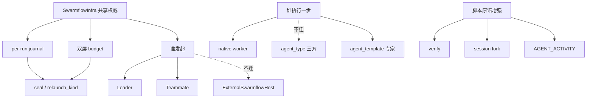

# Swarmflow 能力差距模块释义

## 元信息

| 项 | 值 |
|---|---|
| 日期 | 2026-11-04 |
| 状态 | 草稿 |
| 范围 | 相对本仓现状，tmp 仓已具备而本仓尚未对齐的 Swarmflow 能力模块（释义，不含落地改动清单） |
| 关联 | [[F_85]]（迁移改动与分期）；实现契约见 tmp 侧 F_81 / F_86~F_88 / F_112~F_118 等 |
| 确认 | 待确认 |

## 1. 阅读说明

本文只回答三件事：**是什么、干什么、为什么需要**。落地改哪些文件、怎么分期见 [[F_85]]。

对照基线：

| | 本仓（已有） | 本文讨论的差距 |
|---|---|---|
| 能力水位 | 引擎、native worker、会话、L1/L2/L3、pause/resume 基础、**单层** budget | 下列 9 组能力（可再拆文件，但按产品语义成组解释） |

---

## 2. `SwarmflowInfra`（团队级共享基建容器）

### 是什么

`workflow/swarmflow_infra.py` 里的一个**团队单例对象**，把 Swarmflow 运行所需的共享件收进一个容器：

- model resolver（`agent(model=...)` 查池）
- worker / human 的 base `DeepAgentSpec`
- `ConcurrencyGovernor`（L1/L2/L3）
- `BudgetLedger`（session 级账本）
- 三方 CLI 白名单、专家表等

Leader 在 `enable_swarmflow` 时 `build_swarmflow_infra(...)` 建一次，挂到 `TeamInfra.swarmflow`；同进程 teammate 通过 `share_swarmflow_with` **按引用收养**，不各自再建一套。

### 干什么

解决「谁持有权威资源」：

- 所有成员发起的 run **共用**同一并发闸与同一 token 池
- 工具工厂仍用「resolver 是否为 None」门控是否注入 `swarmflow` 工具；没拿到 Infra 的成员自然没有工具

本仓今天等价逻辑散落在 **仅 Leader** 的 `agent_configurator` 局部变量里，经 `inject_team_handles` 注入——没有可共享的对象身份。

### 为什么要用

1. **正确性**：并发与预算必须是团队级真相源；每人一份 Governor/Ledger 会让 L3/预算形同虚设。
2. **可扩展**：teammate / 外部宿主发起（见第 10、11 节）都要挂同一套权威；没有 Infra，只能继续往 Leader-only 装配链打补丁。
3. **生命周期清晰**：构造点唯一（Leader setup），其余角色只收养引用，避免重复校验与配置漂移。

---

## 3. Per-run journal（按 run 隔离的续跑账本）

### 是什么

Swarmflow 用 **content-addressed journal** 做确定性续跑：同一调用路径 + 签名命中则跳过真实 LLM，直接回放结果。

- **本仓**：路径按 `(team, session, META.name)` → 共享 `journal.jsonl`（+ 同前缀 WAL）。多 run 同名脚本挤在同一文件。
- **tmp**：每个 `run_id` 独立文件  
  `.../workflows/{name}/journal-{run_id}.jsonl` 与 `wal/{run_id}.wal`；旧共享文件仅作 **legacy 只读种子**。

同时，缓存命中条件从 `(call_path, sig)` 升级为带 **`run_id` 双重检查**，命中后还要用记录里的 `tokens` **重建本 run 花费**。

### 干什么

- 保证「这次 run 只看见自己的进度」，pause/resume 续跑不会误吃上一次已 seal 的结果。
- 并发同名脚本时，compaction / finalize / save **不会互相覆盖**对方的 journal/WAL。

### 为什么要用

共享 journal 在「单 run」时够用；一旦打开多 run（本仓 L1 已允许并行），会出现三类实锤问题（tmp F_40 修订实证）：

1. 第二次 run **无条件命中**第一次的缓存 → 看起来「秒完成」，budget 也不涨。
2. 已终态（seal）的记录被当成在途结果 resume。
3. 文件级竞争：compaction 盖掉并发 append、finalize 误删别人的 WAL。

没有 per-run journal，后面的双层 budget、seal/pause、嵌入层多卡片并行都不可靠。

---

## 4. 双层 budget（session 池 + per-run 上限）

### 是什么

Token 账本拆成两层，同一笔真实 usage **同时记两本账**：

| 层 | 配置来源 | 含义 |
|---|---|---|
| Session / Leader 级 | `TeamAgentSpec.swarmflow_budget` | 这个团队会话一共能烧多少（部署方硬顶） |
| Workflow / Run 级 | 脚本 `META["workflow_token_limit"]` | **这一趟**编排最多烧多少 |

撞顶时 `BudgetExhausted.scope` 区分：

- `scope="workflow"` → 可改脚本 / 调高 run 上限后 **同 run_id 重试**
- `scope="session"` → 会话钱花光，属**终端**（需新 session 或调高部署配置）

本仓只有 session 层：`swarmflow_budget` 一个池，所有 run 一起抽；撞顶一律终态，分不清「这趟脚本太贵」还是「会话额度没了」。

### 干什么

给 Leader / 前端 / 运维一个**可行动的失败语义**：该重跑脚本，还是该加配额。脚本也可在 run 内用 `budget.remaining()` 自行收束。

### 为什么要用

生产上常见两种诉求叠在一起：

1. 平台要控总账单（session 硬顶）。
2. 作者要控单次实验成本（避免一个写炸的循环拖垮整个会话额度）。

单层账本无法表达第 2 点；撞顶后 Leader 也只能盲目重试或盲目加钱。双层是最小能区分这两种决策的模型。

---

## 5. Seal / `relaunch_kind`（终态契约与续跑语义）

### 是什么

两套互补机制：

**Seal / Pause 记录（落 journal）**

- `__run__:seal:{run_id}`：run 已终态（completed / stopped），**禁止再当 pause 续跑**。
- `__run__:pause:{run_id}`：可恢复中断点；进程重启后仍可从 journal 反查，不依赖内存里 BTC 的 `_paused` 池。

**`relaunch_kind`（进度事件字段）**

| 值 | 含义 | UI / Leader 怎么用 |
|---|---|---|
| `None` | 全新 launch | 新阶段树 |
| `"resume"` | pause → resume | **增量合并**阶段树 |
| `"relaunch"` | 改脚本后同逻辑重跑 | **整体替换**阶段树 |

另配合：early_return → 可恢复暂停；session 撞顶 / stop → 终端 `STOPPED`；workflow 撞顶 → 可重试 `FAILED` 等事件语义对齐。

本仓 pause/resume 主要靠进程内 `BackgroundTaskController`；工具侧 `resume_id` 仍返回 not supported；没有 journal 级 seal，也没有 `relaunch_kind` 信号。

### 干什么

把「还能不能续」「这次是续还是重开」从**猜进程状态**变成**可读契约**（journal + 事件）。

### 为什么要用

1. **进程会丢**：嵌入层切会话 / 断连 / 冷启动后，内存 `_paused` 没了；没有 seal/pause 记录就无法正确恢复或拒绝非法 resume。
2. **前端需要明确信号**：同 `run_id` 下「替换树」还是「合并树」不能靠猜；猜错会出现阶段重复或进度空洞。
3. **与预算/stop 语义对齐**：避免「该终态的发成可恢复、该重试的发成终态」。

---

## 6. `verify`（脚本内验收原语）

### 是什么

脚本可调用的原语：`from swarmflow import verify`（engine）+ 业务辅助 `build_reviewers`（`workflow/review.py`）。

典型形态：

```python
reviewers = build_reviewers(deliverable, [
    {"type": "verifier", "instruction": "..."},   # pass/fail，一票否决
    {"type": "inspector", "instruction": "..."},  # 0~1 分，看平均是否过阈值
    {"type": "challenger", "instruction": "..."}, # 对抗视角，pass/fail
])
result = await verify(reviewers, threshold=0.85)
if not result.passed:
    # 脚本自己决定是否返工再 verify
    ...
```

实现上：**每个 reviewer = 一次带 schema 的 `agent()`**，经 `parallel()` 派发；判定函数 `settle_verify_tally` 留在 engine（中性、业务无关），提示词模板在业务层渲染——守铁律 1。

### 干什么

把「起 N 个审查员 → 收结构化票 → 汇总 pass/fail」从每个脚本手写样板，收成**可复用、语义稳定**的原语。

### 为什么要用

1. 没有它，质量门禁只能靠提示词或脚本私货，**判定口径漂移**。
2. 调度模式已有 reviewer 理念，但绑的是团队任务工具；Swarmflow worker 无那些工具，需要脚本侧同构能力。
3. **单次判定、返工由脚本控制**：保持编排确定性（引擎不暗自循环重做）。

---

## 7. 活动流（`AGENT_ACTIVITY`）

### 是什么

在粗粒度的 `agent_started` / `agent_completed` 之间，把 worker **中途工具调用**推成进度事件：

- `activity_type`：`tool_call`（执行前）/ `tool_result`（执行后）
- `tool_call_id` / `tool_name` / `content`（入参或结果，64KB 上限防护）
- 经统一工厂 `activity_emitter.py` 发；native rail 双钩不节流；session / 三方各有绑定方式

消费路径：

- 进 4 层 `WorkflowRun` 快照（按 `agent_id` 归位）
- 进原始 `WORKFLOW_PROGRESS` 流（给 Monitor / Swarm Map）
- **不**灌给 Leader 自然语言播报（太吵；`WorkflowHandler` 仍只讲 phase 级里程碑）

本仓一次 `agent()` 对外几乎是黑盒：只有开始/结束两个点。

### 干什么

让观战方知道「这个 worker 正在写文件 / 跑命令 / 调哪个工具」，而不是干等几十秒。

### 为什么要用

长 worker（多工具、多轮）若只有起止点，产品侧进度条与排障都失效。活动流是**可观测性**补齐，不改变编排语义；共享 emitter 避免三处发射形状漂移。

---

## 8. 三方 Agent（`options.agent_type`）与专家（`options.agent_template`）

这两项都是「**谁来执行这一步**」的扩展，但正交：

| | 三方 `agent_type` | 专家 `agent_template` |
|---|---|---|
| 选的是 | 运行时形态：Claude Code / Codex 等 CLI | 团队里某个**具名专家成员**的人设与能力快照 |
| 配置闸 | 必须在 `TeamAgentSpec.external_cli_agents` 声明 | 成员须在 `agents[]` 带模板快照（`agent_template_spec`） |
| 互斥 | 与 `agent_template` 同时出现 → 脚本错误 | 同左 |
| 本仓 | 参数白名单透传，**执行留空** | 无字段 / 无专家表 |

### 三方是干什么的、为什么要

团队对话场景已能把 Claude/Codex 拉成一等成员，但 Swarmflow 脚本的 `agent()` 只能派 native worker——**同一团队两套用人渠道**。`agent_type` 让编排脚本也能点名三方：

- 走 `build_cli_workflow_runtime`（不加盟 MCP 团队工具，只当单向 worker）
- token 轮末事后记账；结构化输出用 prompt + JSON 解析（CLI 无 StructuredOutputTool）

**用途**：需要特定 IDE/CLI 能力（代码库操作、厂商工具链）的步骤，不必先「假扮成 teammate」再间接调用。

### 专家是干什么的、为什么要

默认 worker = teammate 基 spec 的复印件（通用工具 + 通用提示词）。画布/流水线场景需要「这一步由分镜师 / 镜头师 / 合成师来干」——点的是**人设与能力包**，不是随便一个 CLI。

`agent_template="<成员名>"`：

- 查专家表，清空通用 tools，挂模板能力 + persona 拼进 worker 提示词（**不替换** structured-output 协议段）
- Leader 永不进专家表（指挥官人设不宜当工人）

**用途**：产品节点与团队专家名册对齐；没有它，脚本只能表达「做什么」，不能表达「由谁的专业身份做」。

---

## 9. Session fork（有状态会话分叉）

### 是什么

在 `agent_session` 上提供 `await session.fork(...)`：从当前会话**捕获上下文**，派生出新的子会话，各自继续 `send`，互不影响。

支持与团队 `spawn_teammate` 对齐的多种 `fork_mode`（如 `full` / 按轮裁剪等）；human_session 不允许 fork。实现依赖 avatar **固定 session_id** 与 `capture_fork` 接缝，而不是「每轮重建 + 重放 history」。

本仓 F_37 明确将 fork 列为不做；只有单线多轮会话。

### 干什么

同一份「已建立的认知」上开多条探索支线，例如：

- 一个 `analyst` 先读懂基类，再 fork 出「方案 A / 方案 B」两个实现者
- 研究脚本：共用调研上下文，再分叉写不同报告

### 为什么要用

没有 fork，只能：

- 重开全新 session（丢掉已付费的上下文），或
- 在提示词里手工粘贴摘要（易丢工具消息、难 resume）

Fork 把「上下文继承」变成一等原语，并与 journal/resume 模型兼容——是复杂有状态编排的刚需，不是语法糖。

---

## 10. Teammate 发起 Swarmflow

### 是什么

不只 Leader，**进程内 teammate** 也可以持有 `swarmflow` 工具并启动 run。前提是收养同一份 `SwarmflowInfra`，并把 run 登记到**会话级** `BackgroundTaskController`（跨 Leader cycle 存活）。

配套约束（tmp 已踩坑后的硬化）：

- 成员 `shutdown` 前必须 `stop_by_owner` 停掉名下 run，否则会「无终态事件、卡片永挂」
- 进度叙述 / 完成注入带 `executor` 字段，归到真正发起的宿主上下文
- 预算仍进**同一** session ledger（成员 run 与成员自己的普通轮一起计数）

### 干什么

让「负责某一子域的 teammate」在自己的任务循环里直接开编排，而不必事事请示 Leader 调工具。

### 为什么要用

集群模式下，Leader 只做分派、teammate 做深执行时，若只有 Leader 能开 swarmflow，所有编排都挤回中心，延迟与上下文错位都会放大。共享 Infra + owner 生命周期是安全放开的前提——否则会出现死 harness 上 relaunch、停成员却留僵尸 run。

---

## 11. 外部宿主发起（`ExternalSwarmflowHost`）— **本轮不迁**

### 是什么

外部 CLI 成员（大脑在 CLI 子进程）没有 `NativeHarness.launch_async_tool` / `send(immediate=False)` 等表面；tmp 侧用 `ExternalSwarmflowHost` 伪装成 SwarmflowTool 所需的 `parent_agent`，把完成注入转到三方 runtime，同时共用 session BTC / 预算 / journal。

### 本仓状态

随 `agent_type` 整栈（`harness_protocol` / `harness_providers` / `member_runtime`）一并**不迁**。团队仍可用 `spawn_external_cli` 拉外部成员做客；编排脚本里的 `agent_type` worker 与 ExternalSwarmflowHost 发起路径均不可用。

---

## 12. 能力关系简图



**依赖直觉（与 [[F_85]] 分期一致）：**

1. 先有 Infra + per-run journal + 双层 budget + seal —— 多 run / 多发起者才站得住。
2. verify / 活动流可相对独立增强「验」与「看」。
3. 三方 / 专家扩展「干活的人」；fork 扩展「有状态怎么分岔」。
4. teammate / 外部宿主最后放开「谁能发起」，避免在错误生命周期上叠能力。

---

## 13. 对照速查

| 模块 | 一句话 | 没有它会怎样 |
|---|---|---|
| SwarmflowInfra | 团队一份并发/预算/解析器 | 无法安全共享给非 Leader |
| Per-run journal | 每个 run 自己的续跑账本 | 并发互踩、误命中旧缓存 |
| 双层 budget | 总会话顶 + 单趟顶 | 撞顶后不知该重试还是该加钱 |
| Seal / relaunch_kind | 终态可查 + 续跑/重开信号 | 冷启动乱恢复、UI 阶段树错乱 |
| verify | 脚本内稳定验收 | 质量门禁靠私货样板漂移 |
| 活动流 | worker 工具级进度 | Monitor 只能看到开始/结束 |
| 三方 agent_type（不迁） | 步骤交给 CLI runtime | 本仓编排脚本不可用 `agent_type` |
| 专家 agent_template | 步骤交给具名人设 | 只能「通用工人」无法点名专家 |
| Session fork | 会话分叉继承上下文 | 支线探索只能重开或手贴摘要 |
| Teammate 发起 | 成员自己开编排 | 所有编排挤回 Leader |
| ExternalSwarmflowHost（不迁） | CLI 成员也能开编排 | 外部成员只能做客不能编排 |

---

## 14. 相关文档

- 迁移改动与分期：[[F_85_swarmflow-migration-from-tmp]]
- 本仓已有契约：[[S_18]]、[[S_21]]、[[F_66]]、[[F_43]]、[[F_47]]
- tmp 侧实现叙事（源仓 `.agents/agent-docs`）：F_87/F_88（journal/budget/seal）、F_86/S_25（verify）、F_112（活动）、F_114/F_116/F_118（三方/专家）、F_81（fork）、F_20261030（teammate 发起）
