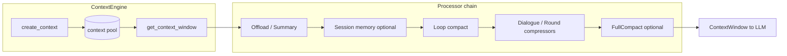

# Context engine — implementation narrative

**日期**：2026-10-26  
**读者**：在 agent-core 内改 ContextEngine / processors / context-engineer rails 的 coding agent。

## 一句话

Session 对话在每次模型调用前流经 **ContextEngine**：消息列表经 **processor 链** 裁剪、卸载、压缩，产出 **ContextWindow**；token/usage 层提供可观测性；harness **rails** 把 preset 链与 system prompt 里的 workspace/context/tools 装配进 DeepAgent。

## 生命周期（概念）

DeepAgent 路径上，`ContextProcessorRail` 在 agent `init` 写入 processor 列表；`ContextAssembleRail` 在 `before_model_call` 刷新 prompt sections。溢出后的 force compact / retry 循环由 **jiuwenswarm** 的 recovery rail 驱动，core 只保证 `FullCompactProcessor` setter 语义（[[S_04]]）。

## 从哪里学用法（用户文档）

- 教程与场景说明：**不要读本文件** — 请读  
  `docs/en/2.Development Guide/Advanced Usage/Context Engine.md`  
  （中文：`docs/zh/2.开发指南/高级用法/` 下对应 Context Engine 章节）。
- API 参数与 processor 目录：  
  `docs/en/2.Development Guide/API Docs/openjiuwen.core/context_engine.README.md`

## 从哪里改契约（本 archive）

| 主题 | Spec |
|------|------|
| 双仓与边界 | [[S_01]] |
| 窗口与 engine 生命周期 | [[S_02]] |
| Preset / forked / bailout | [[S_03]] |
| FullCompact / force | [[S_04]] |
| Recall / reload | [[S_05]] |
| Assemble & Processor rails | [[S_06]] |

入口索引：[`../../AGENTS.md`](../../AGENTS.md)。

## 姊妹产品

产品级 context 装配、config.yaml、overflow recovery、read patch：**jiuwenswarm/server/runtime/context/** —  sister product docs live in jiuwenswarm; do not duplicate product assembly in this archive.
