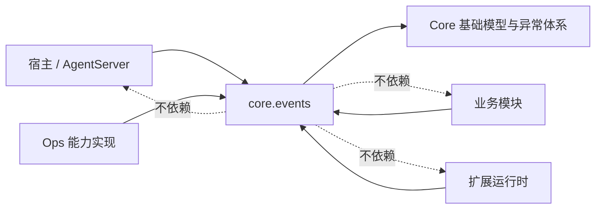
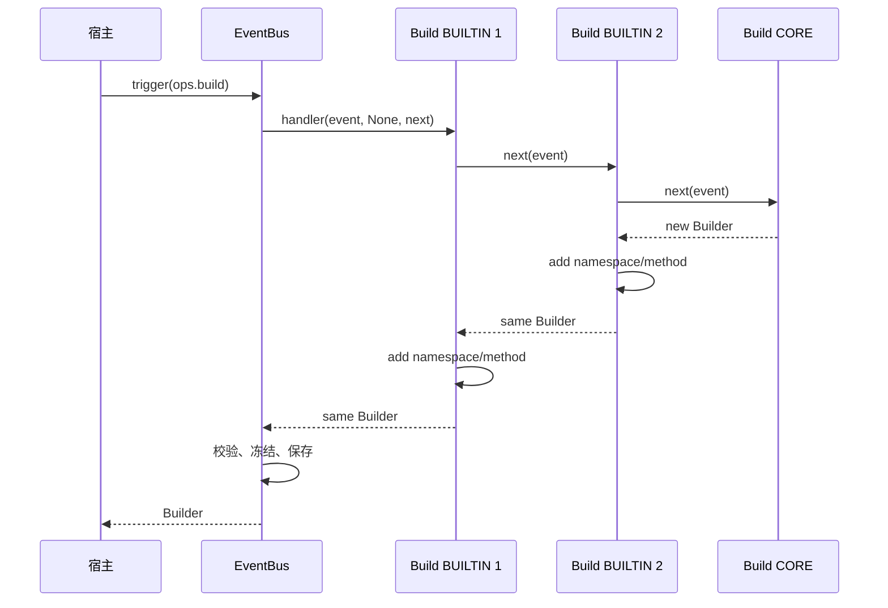
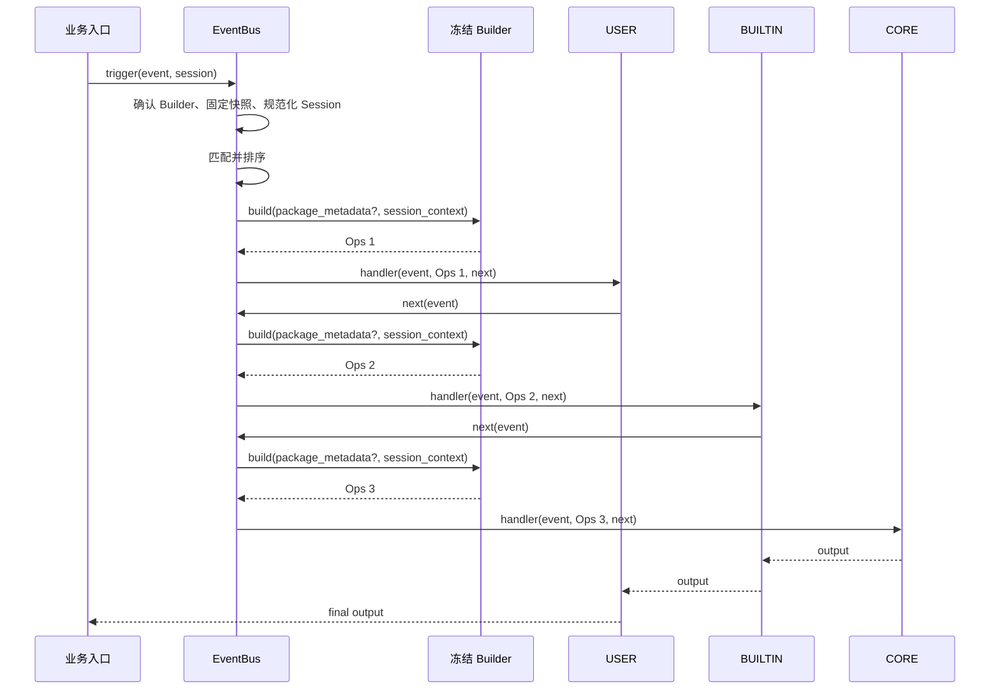

# ExtensionEventBus 事件机制详细架构设计

| 项 | 内容 |
| --- | --- |
| 文档类型 | 目标架构设计；公共接口以 [S_01](../specs/S_01_events-contract.md) 为准 |
| 最近一次修订日期 | 2026-10-19 |
| 所属模块 | `agent-core/openjiuwen/core/events/` |
| 配套文档 | [设计概览](events-overview.md)、[开发计划](events-development-plan.md)、[Events 维护规范](../../AGENTS.md) |

本文说明事件注册、匹配、执行链和 Ops 构建的完整关系。Events 当前仍无实现和专项测试，文中行为均为已确认、待实现的目标。

## 1. 目标与边界

### 1.1 真实问题

平台业务需要一个稳定扩展点：平台保留唯一默认行为，扩展可在默认行为前后处理，业务入口仍通过一次 `await trigger(...)` 得到最终结果。

Events 解决四个问题：

1. 哪些 Handler 参与本次调用。
2. Handler 以什么顺序进入和返回。
3. Handler 如何继续、跳层或短路。
4. Handler 如何取得统一能力入口 Ops。

Events 不解决业务 payload 建模、插件安装、包身份认证、权限模型、宿主停机、外部副作用确认和跨进程可靠投递。

### 1.2 核心约束

- 每个业务事件只有一个 CORE。
- 调用顺序固定为 USER → BUILTIN → CORE，同层按注册顺序。
- 一次调用使用固定注册快照。
- 普通业务 `trigger()` 不执行 `ops.build`。
- 宿主显式触发 `ops.build`；第一次成功后 Builder 冻结并长期保存。
- 每个实际进入的普通 Handler 从冻结 Builder 构建独立 Ops。
- Builder 保留 `package_metadata` 入参；EventBus 注册表不保存包身份。
- 注销不打断已经取得快照的调用。

## 2. 数据结构与事实归属

### 2.1 核心对象

| 对象 | 数据 | 所有者 |
| --- | --- | --- |
| 事件注册事实 | EventType、MatchPatternFunc、唯一 CORE | EventBus |
| Handler 注册事实 | Handler、MatchPattern、HandlerLevel、注册序号、HandlerId | EventBus |
| Event | event_type、event_input | 调用方 |
| Invocation | 固定快照、当前位置、SessionContext、EventNext 使用状态 | 单次 trigger |
| Builder | namespace/method 能力目录、冻结标记 | EventBus |
| Ops | Builder 能力视图、PackageMetadata、SessionContext、有效期 | 当前 Handler |

设计中不公开 EventDefinition，也不展示注册表内部 Entry 类型。内部实现可以选择 dataclass、字典或索引结构，只要满足原子注册、稳定顺序和快照语义。

### 2.2 公共模型边界

EventType 是 `str`，不是枚举。Core 只声明：

```python
OPS_BUILD_EVENT_TYPE = "ops.build"
```

业务平台在自己的仓库定义 `tool.call`、`ui.message` 等业务事件名和 payload。调用方不得登记、覆盖或注销任何 `ops.` 前缀事件。

事件登记直接接收三个参数：

```python
register_event_type(event_type, match_pattern_func, core_handler)
```

Handler 登记使用四个业务参数，层级默认为 USER：

```python
register_event_handler(
    event_type,
    handler,
    match_pattern,
    handler_level=HandlerLevel.USER,
)
```

接口不接收 PackageMetadata。包身份属于扩展运行时或 Handler 闭包/包装层。

## 3. 模块划分与依赖方向



建议实现责任按行为拆分：

| 行为 | 责任 |
| --- | --- |
| 公共模型与 Protocol | 类型、签名、常量和公开导出 |
| 注册表 | 原子登记、注销、唯一 CORE、注册序号和 HandlerId |
| 匹配器 | 调用 MatchPatternFunc，生成有序快照 |
| 执行器 | EventNext、当前位置、继续、跳层、短路、异常传播 |
| Builder/Ops | 能力登记、冻结、build、动态访问和上下文绑定 |
| EventBus | 串联注册、Build、业务 trigger 和 Session 投影 |

不为这些职责额外公开生命周期对象、锁或内部注册结构。

## 4. 注册与快照

### 4.1 事件注册

`register_event_type(event_type, match_pattern_func, core_handler)` 将三个值作为一个原子事实写入。失败时不留下半条记录。

拒绝以下情况：

- event_type 格式非法或重复；
- 使用保留的 `ops.` 前缀；
- match_pattern_func 或 core_handler 不可调用。

CORE 不通过 `register_event_handler()` 登记，避免出现多个默认行为。

### 4.2 Handler 注册

普通入口只允许 USER 和 BUILTIN。每次成功注册获得新的 HandlerId 和单调注册序号；同一个函数多次注册是多条独立记录。

MatchPattern 在注册时复制并转成只读值。注册表只保存 Handler、模式、层级和顺序，不保存 PackageMetadata。

`ops.build` 是内置事件，只接受空模式 BUILTIN。第一次 Build 成功后，Build Handler 列表冻结；之后登记或注销 Build Handler 均拒绝。

### 4.3 注销与快照

普通 `trigger()` 在首次 `await` 前取得需要的事件事实和 Handler 记录，随后本次调用只读该快照。

因此：

- 注销立即影响之后取得的快照；
- 已取得旧快照的调用仍可能进入被注销 Handler；
- 注销返回不代表 Handler 已停止，也不代表包资源可以立即释放；
- 等待在途调用和释放包资源由扩展运行时/宿主负责。

Events 不需要为此提供 drain 或 close。快照自身持有执行所需引用即可。

## 5. 匹配与三层执行链

### 5.1 匹配

MatchPatternFunc 接收业务输入和某条 Handler 的 MatchPattern，必须同步返回 bool：

```python
matched = match_pattern_func(event.event_input, handler.match_pattern)
```

- USER / BUILTIN 参与匹配。
- CORE 不匹配，始终位于链尾。
- 返回 False 只排除当前 Handler。
- 抛错或返回非 bool 使本次调用失败，不解释为未命中。
- 匹配函数不得执行网络、文件或其他阻塞/业务副作用。

### 5.2 排序

匹配完成后按以下键排序：

1. HandlerLevel：USER、BUILTIN、CORE。
2. 同层注册序号升序。

如果没有扩展命中，链中只有 CORE。

### 5.3 EventNext

EventNext 保存当前快照位置和使用状态。调用方式：

- `next(event)`：进入链中下一条 Handler。
- `to(event, BUILTIN)`：USER 跳过剩余 USER，从首个 BUILTIN 或 CORE 继续。
- `to(event, CORE)`：USER / BUILTIN 直接进入 CORE。
- 不调用 EventNext：当前 Handler 直接返回，形成短路。

EventNext 只能由当前 Handler 所属任务使用一次。重复、并发、跨任务或 Handler 退出后使用必须在进入下游前拒绝。

推进时 event_type 必须保持不变；event_input 可以改变，但固定快照不重新匹配。如果业务需要改变事件类型，应发起新的 `trigger()`。

### 5.4 返回与异常

全部 Handler 继续时，进入顺序是 USER → BUILTIN → CORE，返回顺序是 CORE → BUILTIN → USER。外层 Handler 可以加工下游输出。

Events 不提供通用 validate_input / validate_output。业务 payload 的合法性由具体模型、Handler 或 CORE 负责。

Handler 及能力函数异常保持原类型和 cause 向外传播；取消原样传播。Events 不自动补跑 CORE、不重试 Handler、不把失败转换成 `None`。

## 6. Builder 与 Ops

### 6.1 能力目录

Builder 以 `namespace.method` 组织能力：

```python
builder.add_namespace("session")
builder.add_method("session", "cwd", get_cwd)
```

规则：

- namespace / method 必须是合法、非下划线开头的 Python 标识符；
- namespace 不可重复；
- add_method 要求 namespace 已存在；
- 同一 namespace 的 method 不可重名；
- Builder 冻结后不允许任何 add 操作。

### 6.2 Build 协议

Core 内部预置 `ops.build` 和对应 CORE。宿主先登记所有 Build BUILTIN，再显式调用：

```python
await bus.trigger(Event(OPS_BUILD_EVENT_TYPE, None), None)
```

调用过程：



第一次成功前，异常、取消、非法结果或能力冲突都丢弃本次部分 Builder，宿主可修正后重试。第一次成功后：

- 同一 Bus 不再执行第二次 Build；
- Builder 保持冻结；
- Build Handler 不再登记或注销；
- 普通业务 trigger 才具备执行前提。

是否用锁或其他方式处理并发 Build 是实现细节。公共设计不引入 `_build_lock`、生命周期枚举或初始化接口。

### 6.3 Builder.build 与 PackageMetadata

Builder 必须保留：

```python
build(
    package_metadata: PackageMetadata | None = None,
    session_context: SessionContext | None = None,
) -> EventHandlerOps
```

规则：

- 每次 build 创建独立 Ops。
- Builder 只读共享能力目录，不保存可变的当前包或当前会话。
- PackageMetadata 和 SessionContext 原样绑定到新 Ops。
- EventBus Handler 注册接口不接收、不保存 PackageMetadata。
- 包上下文由扩展运行时或 Handler 包装层持有，并在其掌握 Builder 调用点时传入。
- 通用 Bus 不能取得包上下文时传 `None`，不得从 Event、Session 或闭包反射猜测。

这保留了 package-aware 能力，同时避免把插件身份管理塞进 EventBus 注册表。

### 6.4 Ops 调用

Handler 通过 `ops.<namespace>.<method>(...)` 调用能力。OpsMethod 是异步函数，调用时当前 Ops 作为第一个参数传入能力函数。

名词能力直接读取或计算状态，例如 `ops.session.cwd()`。动词能力可以基于当前 SessionContext 触发新的业务事件，例如 `ops.tool.call(...)`。新事件形成独立快照和调用链；它完成后不会自动推进原链。

PackageMetadata 说明执行包上下文，不是权限结论。实际工具、文件和网络入口仍必须按宿主权限模型检查。

## 7. 普通 trigger 主流程



Bus 的固定处理顺序：

1. 校验 EventType；未知事件失败。
2. 确认冻结 Builder 已存在；否则业务调用失败。
3. 在首次 await 前固定注册快照。
4. 将受支持 Session 规范化为 SessionContext 或 None。
5. 匹配 USER / BUILTIN，追加 CORE。
6. 每进入一个 Handler 构建一次独立 Ops。
7. 返回最外层输出并释放本次 Invocation。

## 8. Session、并发与资源

### 8.1 Session 投影

- `SessionContext` 直接复制并冻结允许字段。
- `openjiuwen.core.single_agent.Session` 首版只提取 `get_session_id()`。
- `None` 保持 None。
- cwd 缺失时保持 None，不回退到进程目录。
- 其他“看起来像 Session”的对象不做鸭子类型猜测。

同一次 trigger 的 Handler 使用同一份 SessionContext；不同 trigger 各自持有调用上下文。

### 8.2 并发

不同 trigger 可以并发，Events 不承诺开始或完成顺序，也不按 session_id 串行。冻结 Builder 可以被并发读取，但每次 build 必须返回独立 Ops。

注册快照解决注册/注销与调用并发问题；不需要为注销等待在途调用。Build 成功边界的并发原子性由实现保证，但不公开锁对象。

### 8.3 资源与停止

Events 没有 `close()`、DRAINING / CLOSED 或内部 drain 协议。

宿主停止顺序：

1. 停止接受并发起新的业务请求。
2. 等待宿主持有的 `trigger()` 任务返回、异常或取消完成。
3. 扩展运行时确认相关 Handler 不再被旧快照使用。
4. 释放插件、能力资源和 Bus。

固定停机超时和强制取消策略属于宿主。Events 不跟踪所有任务，也不承诺撤销已经发生的业务副作用。

## 9. 错误与安全边界

Events 使用 Core 统一 StatusCode，不新增异常族：

- `EVENTS_REGISTRATION_INVALID`
- `EVENTS_UNKNOWN_EVENT_INVALID`
- `EVENTS_STATE_INVALID`
- `EVENTS_PAYLOAD_INVALID`
- `EVENTS_MATCH_INVALID`
- `EVENTS_NEXT_INVALID`
- `EVENTS_OPS_INVALID`

`EVENTS_STATE_INVALID` 只描述 Builder 尚不可用、重复 Build、冻结后修改 Build Handler 等内部阶段约束，不表示存在公开状态机。

USER 可以短路或跳过 BUILTIN，因此不可绕过的权限检查必须放在业务入口或实际资源入口。进程内回调、只读数据和 Ops 门面不能替代恶意代码隔离。

## 10. 接入与验证

### 10.1 新增业务事件

1. 业务平台定义字符串事件名和 payload 模型。
2. 实现同步 MatchPatternFunc。
3. 实现唯一 CORE。
4. 调用 `register_event_type(name, matcher, core)`。
5. 在真实业务入口调用 `trigger()`。

只完成注册不代表业务入口已经接通。

### 10.2 新增 Ops 能力

1. 实现异步 OpsMethod。
2. 在平台 Build BUILTIN 中先调用 next。
3. 对返回 Builder 调用 add_namespace / add_method。
4. 宿主完成全部 Build Handler 登记后触发一次 `ops.build`。
5. 用普通 Handler 验证能力和 Session/PackageMetadata 绑定。

### 10.3 新增扩展 Handler

1. 为已有业务事件实现统一 EventHandler。
2. 在扩展运行时/闭包保留已核实的包上下文。
3. 调用 `register_event_handler(event_type, handler, pattern)`。
4. 保存 HandlerId 供注销。
5. 卸载时先注销，再由运行时等待自己管理的在途调用，最后释放包资源。

### 10.4 必须验证的场景

| 主题 | 结果 |
| --- | --- |
| 注册 | 唯一 CORE；非法/重复登记原子失败；`ops.` 不可覆盖 |
| 匹配 | USER / BUILTIN 正确筛选；CORE 不匹配；同层顺序稳定 |
| 快照 | 注销只影响新调用，旧调用继续完成 |
| EventNext | 继续、跳层、短路正确；重复/跨任务/失效调用拒绝 |
| Build | 首次成功冻结；失败可重试；成功后重复 Build 和变更 Handler 拒绝 |
| Builder/Ops | package_metadata 入参保留；多次 build 相互隔离；冻结目录并发只读 |
| 普通调用 | 无 Builder 时失败；业务 trigger 不执行 Build；逐 Handler build 一次 |
| 停止 | 宿主停止新调用并等待自身任务；Events 不提供 close/drain |

具体拆分、依赖和负责人见[开发计划](events-development-plan.md)。

## 11. 已确认选择与待验证项

| 主题 | 结论 |
| --- | --- |
| EventType | `str`；业务事件由平台仓库定义 |
| 事件注册 | 三参数接口，不公开 EventDefinition |
| Handler 注册 | 原始参数；handler_level 默认 USER；无 package_metadata |
| Builder | 保留 `build(package_metadata, session_context)` |
| Build 时机 | 宿主显式 `trigger(ops.build)`；第一次成功后冻结 |
| 生命周期 | 无 initialize、close 和公开状态机 |
| 注销 | 只更新注册表；在途调用继续 |
| 内部实现 | 不在设计中展示 Entry 或 `_build_lock` |

错误码号段已在 [F_01](../features/F_01_ev08-public-contract.md) 定为 `EVENTS` / `200000`–`200999`，仍待 EV-08 实现验证。真实 Session 输入、扩展运行时如何在包装层使用 PackageMetadata、真实业务入口接入，以及并发/嵌套容量限制仍待后续实现或联调验证。
