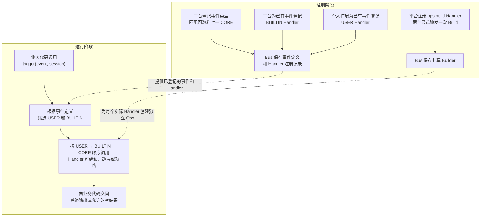
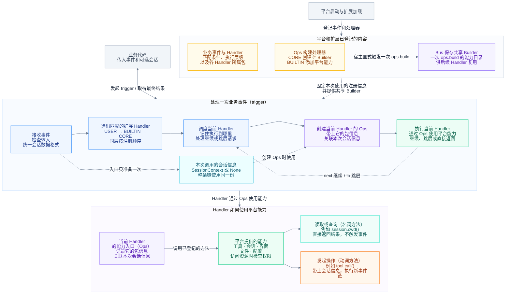
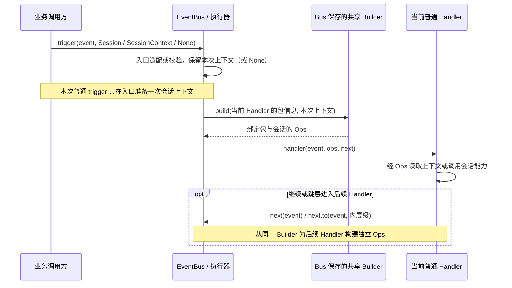
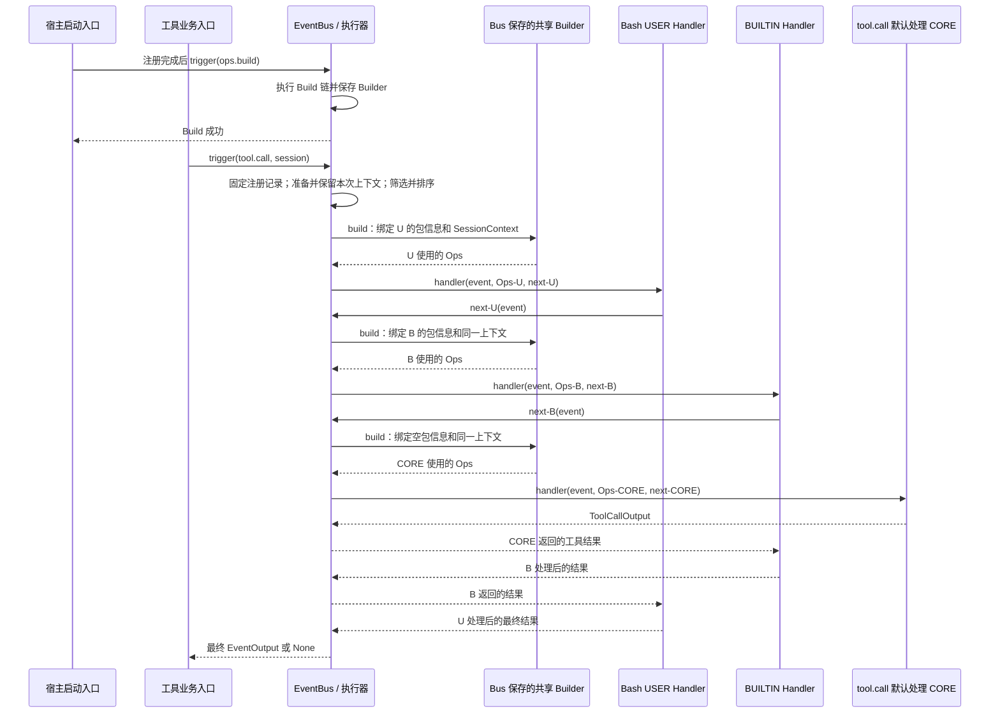
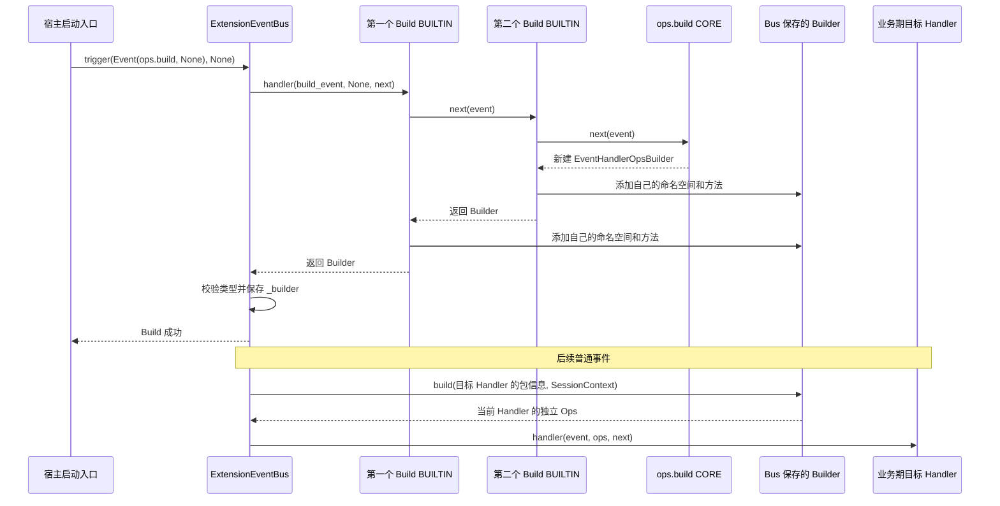
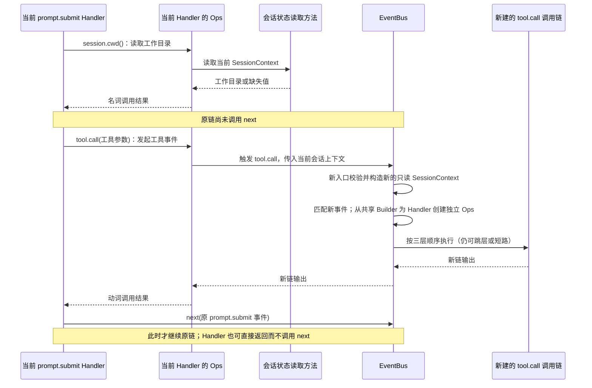
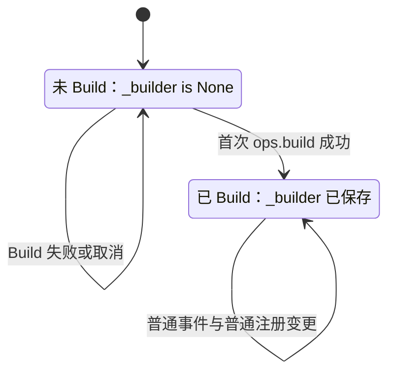

# ExtensionEventBus 事件机制详细架构设计

| 项 | 内容 |
| --- | --- |
| 文档类型 | 已实现架构；EV-01～EV-04 已落地，M-01 / M-02 与真实业务接入尚未验证 |
| 最近一次修订日期 | 2026-10-21 |
| 维护责任 | Events 模块维护者；Ops、扩展运行时及宿主维护者共同确认跨模块约定，具体负责人待认领 |
| 所属模块 | `agent-core/openjiuwen/core/events/` |
| 配套文档 | [设计概览](events-overview.md)、[Events 维护规范](../../AGENTS.md)、[Core 公共规范](../../../AGENTS.md) |

本文说明一次事件调用怎样从业务入口进入 EventBus，经过扩展处理，最后返回业务结果。全文围绕“登记事件和平台能力 → 业务触发事件 → 选择并执行 Handler → 返回结果”展开。

Handler 是事件处理函数。EventHandlerOps（下文简称 Ops）是 Handler 调用平台能力的入口。EventHandlerOpsBuilder（下文简称 Builder）在一次启动 Build 中收集能力定义，之后为每个 Handler 创建绑定包信息和会话上下文的独立 Ops。宿主是创建和管理这些运行时对象的应用，例如 JiuwenSwarm 的 AgentServer。

**实现状态：**Events 已完成公共模型、注册与三层执行链、EventNext、Builder/Ops、builtin 自动注册、显式 Build、Session 规范化和逐 Handler Ops 接线，并从 `openjiuwen.core.events` 公开导出。F-04 与开发计划记录 Events 单元测试基线为 67 passed。M-01 EventBus MVP、M-02 Swarm 联合验收和真实业务入口仍未完成。

**设计状态：**第 1～8 节区分当前实现事实与宿主接入要求；并发上限、卸载排空、授权适配、真实事件和能力仍属于待落地边界。精确公共契约以 [S-01](../specs/S_01_events-contract.md) 为准，实现取舍和证据见 F-01～F-04，进度以[开发计划](events-development-plan.md)为准。

**设计依据与适用关系：**当前实现沿用历史设计中的三层链、Ops 和会话投影，但采用“宿主启动期显式执行一次 `ops.build`、Bus 保存共享 Builder、普通事件按 Handler 创建独立 Ops”的生命周期。旧文中的 ExtensionUtils / ExtensionSDK / extension_sdk.build 不作为本方案的接口名称。实现事实以当前代码、S-01 和 F-04 为准。

**代码的阅读方式：**本文中的公共签名以当前实现为准，业务事件和能力代码仍是接入示例。`tool.call`、`session.cwd()` 等示例不代表 Core 已内置这些业务能力。

| 阅读目的 | 章节入口 |
| --- | --- |
| 了解范围、核心对象与模块分工 | 第 1～3 节 |
| 理解注册、匹配、执行链、Ops 和协作流程 | 第 4～5 节 |
| 查阅 SessionContext 的构建时机与传递路径 | 第 4.4 节；普通事件主流程见第 5.1 节 |
| 核对状态、数据、故障、权限与运行限制 | 第 6～10 节 |
| 推演场景、检查设计选择及未决问题 | 第 11～12 节 |
| 查阅基础模型、操作与完整接入示例 | 第 2.1、4.1、4.3、4.5.2、5.5 节 |
| 检查设计内容及其说明位置 | 第 11.3 节 |

## 1. 定位、目标与范围

### 1.1 定位与目标

ExtensionEventBus 让平台和个人扩展在同一次业务调用中协作。平台提供默认处理函数 CORE，扩展可以在它之前处理输入，也可以在它返回后处理结果。业务代码通过 `await trigger(event, session)` 等待整条调用链结束。

链中的三个层级依次为 USER（个人扩展）、BUILTIN（平台内置扩展）、CORE（平台默认处理）。本文件把 USER 称为外层，把 CORE 称为最内层。每个已注册事件都有一个 CORE，但前面的 Handler 可以短路，因此一次调用不一定执行到 CORE。

以 Bash 工具调用为例，平台登记 `tool.call` 及默认工具执行逻辑，个人扩展注册仅匹配 Bash 的 USER Handler。调用时，USER Handler 可以读取 Ops 提供的会话工作目录，继续链路，并在工具返回后加工输出。实际工具执行仍由业务模块实现。

设计需要让开发者看清四件事：事件接收什么、Handler 按什么顺序执行、谁决定继续或结束，以及每个 Handler 使用哪份包信息和会话信息。平台能力统一通过 Ops 提供，便于扩展使用和问题定位。

### 1.2 范围与外部责任

| 本文覆盖 | 外部责任或范围限制 |
| --- | --- |
| EventType、Handler 的注册与注销、匹配和分层调度 | 事件所属业务模块定义输入输出、匹配含义和默认实现 |
| EventNext 的继续、跳层、短路及返回 | 业务模块负责执行工具、核对外部结果，并决定重复请求能否安全重试 |
| EventHandlerOps / Builder 的基础模型、一次性 Build 与上下文绑定，以及名词/动词两类能力 | 平台实现工具、会话、界面（UI）、文件系统和配置等能力，并检查访问权限 |
| 共享 Builder、逐 Handler Ops、并发和嵌套调用边界 | 宿主负责串行启动 Build、停止、扩展装卸，以及限制同时进入的业务调用数量 |
| 异常、取消、内存状态和验证要求 | 不定义持久队列、远程事件协议、自动重试或故障重放 |

这里的 EventBus 直接调用并等待 Handler，不负责消息队列投递。`trigger()` 正常返回只说明当前调用链交回了结果。工具是否执行成功、文件是否写入、结果是否送达用户，分别由业务代码和相关系统确认。下文把写文件、执行工具等对外部状态的改变称为“副作用”。

### 1.3 关键要求与对应设计

| 关键要求 | 主要设计位置 | 支持条件与限制 |
| --- | --- | --- |
| 每个 EventType 登记一个 CORE | 第 4.1 节 | CORE 不参加模式筛选；前序短路时不会执行 |
| USER → BUILTIN → CORE，同层按注册顺序 | 第 4.2～4.3 节 | 顺序只约束一条已选定的链，不约束不同 trigger 的先后 |
| next 继续、to 跳向内层、不调用即短路 | 第 4.3 节 | 前序扩展可以跳过 BUILTIN 和 CORE，安全边界见第 9 节 |
| 宿主显式触发一次 Build，普通事件按 Handler 构建独立 Ops | 第 4.5、5.2 节 | Build 成功前拒绝普通事件；成功后 Bus 保存 Builder，不再执行 Build 链 |
| Session 只在入口转换一次 | 第 4.4 节 | 从运行时 Session 只提取会话 ID；工作目录等资料由宿主补充 |
| 名词方法独立调用、动词方法触发对应事件 | 第 4.5.1、5.4 节 | 同一 namespace 可兼有两类方法；动词不能替代当前链的 next |
| 平台新增事件、能力及个人新增 Handler | 第 5.5、11.1 节 | 展示完整接入责任与业务结果，示例代码不限定最终接口 |
| 错误、取消、并发与隔离需明确 | 第 6～9 节 | Core 已实现错误传播和 EventNext 有效期；容量、排空和跨线程边界仍由宿主确认 |

### 1.4 影响架构选择的因素

Handler 需要在下游执行前后都能处理数据，因此采用逐层调用、反向返回的“洋葱式调用链”。例如 U1 调用 U2，U2 调用 CORE；CORE 的结果先返回 U2，再返回 U1。当前实现允许有效 EventNext 多次调用，因此重复调用会重复执行下游；幂等和副作用保护由 Handler 与业务能力负责。每个 Handler 取得与自己所属包关联的独立 Ops，不能沿用上一个 Handler 的绑定。

本文的“普通事件”指 `ops.build` 以外的事件，“普通 Handler”指处理这些事件的 Handler，包含 USER、BUILTIN 和 CORE。`ops.build` 在宿主启动阶段显式执行一次，构建 Handler 接收空 Ops；成功后 Builder 由 Bus 保存。普通事件进入每个 Handler 前只调用共享 Builder 的 `build()`，绑定包与会话。不同宿主的 Session 类型不统一，Events 只适配当前单智能体 Session 和 SessionContext。当前没有性能实测数据，本文不设延迟、吞吐或容量数值保证。

## 2. 核心概念与共同规则

### 2.1 对象、关系与生命周期

| 对象 | 含义与关联 | 创建、共享与结束 |
| --- | --- | --- |
| EventType / 事件定义 | EventType 是字符串别名，如 `tool.call`；事件定义把该标识与匹配函数、唯一 CORE 关联起来 | 由平台注册，由所属 Bus 实例管理 |
| Event / EventInput / EventOutput | 一次事件及业务输入、链路输出；输出可能由外层 Handler 加工 | 调用方创建输入，Handler 返回结果；不默认持久化 |
| HandlerRegistration | 一条 Handler 注册记录，保存处理函数、事件类型、层级、匹配模式、注册顺序和所属包 | 注册时创建；注销后不再供新取得注册记录的调用使用 |
| HandlerLevel | USER 为个人扩展，BUILTIN 为平台内置扩展，CORE 为业务默认处理 | 层级决定链内先后，不表示权限等级 |
| MatchPattern / MatchPatternFunc | Handler 声明的筛选条件 / 平台解释条件的同步函数 | 模式随注册记录保存，匹配函数属于事件定义 |
| Invocation | 一次 trigger 所需的临时状态，包括选中的 Handler、会话上下文和执行位置 | 每次调用独立创建，调用结束后释放 |
| EventNext | 当前 Handler 继续或跳过部分后续处理的控制对象 | 由执行器为当前 Handler 创建；限制所属 Task 与 Handler 有效期，当前允许有效期内多次调用 |
| SessionContext | 提供给 Ops 的会话信息，包括会话 ID、可选工作目录 cwd 和少量 metadata | 每次普通 trigger 在入口统一准备，由本次调用保留；各 Handler 的 Ops 绑定同一份上下文，构建时机与路径见第 4.4 节 |
| PackageMetadata | 当前 Handler 所属包的元信息；不同于本次操作发起方的授权依据 | 扩展运行时提供并关联注册记录，不能由事件输入覆盖；授权边界见第 9.1 节 |
| EventHandlerOpsBuilder / EventHandlerOps | Builder 保存 Bus 级平台能力目录；Ops 让当前 Handler 使用这些能力，并携带它的包信息和会话上下文 | Build 成功后 Builder 由 Bus 保存；每个实际进入的 Handler 从它创建独立 Ops |
| Namespace / 名词方法 / 动词方法 | 命名空间组织能力；名词方法直接读取或计算状态；动词方法进入对应事件 | 两类方法可共存；具体方法和事件映射由平台定义 |

同一 EventType 可对应多个 USER / BUILTIN 和一个 CORE。一次 trigger 选择其中一部分形成链，链中的每个 Handler 使用自己的 Ops。相同 session_id 的两次 trigger 仍是两个独立 Invocation。

下文的“注册快照”指一次调用开始时固定下来的事件定义和 Handler 记录；“能力目录”指 namespace 和方法的定义集合，不是文件目录。“会话投影”指从运行时会话中提取所需字段、形成 SessionContext 的过程。

Event 由 `event_type` 和 `event_input` 组成，EventInput / EventOutput 分别表达输入与输出角色；HandlerLevel 的 USER、BUILTIN、CORE 分别以 user、builtin、core 表示。SessionContext 的 session_id 必填，cwd 默认缺失，metadata 默认空映射。MatchPattern 表达键到条件值的映射。

下面的模型代码摘取当前公共模型关系。统一回调的 Ops 参数允许为空，以表达 `ops.build` 的构建特例；Build 成功后的普通业务 Handler 接收到构建完成的 Ops，见第 5.2 节。

```python
from collections.abc import Awaitable, Callable, Mapping
from dataclasses import dataclass, field
from enum import StrEnum
from types import MappingProxyType
from typing import Final, TypeAlias


EventType: TypeAlias = str
EventInput: TypeAlias = object
EventOutput: TypeAlias = object
OPS_BUILD_EVENT_TYPE: Final[EventType] = "ops.build"


class HandlerLevel(StrEnum):
    """Handler 执行层级。"""

    USER = "user"
    BUILTIN = "builtin"
    CORE = "core"


@dataclass(frozen=True, slots=True)
class Event:
    """一次事件调用。"""

    event_type: EventType
    event_input: EventInput


def _empty_metadata() -> Mapping[str, object]:
    return MappingProxyType({})


@dataclass(frozen=True, slots=True)
class SessionContext:
    """EventHandlerOps 使用的只读会话上下文。"""

    session_id: str
    cwd: str | None = None
    metadata: Mapping[str, object] = field(default_factory=_empty_metadata)


@dataclass(frozen=True, slots=True)
class PackageMetadata:
    package_id: str
    package_version: str | None = None


MatchPattern: TypeAlias = Mapping[str, object]
MatchPatternFunc: TypeAlias = Callable[[EventInput, MatchPattern], bool]


class EventNext:
    """EventBus 注入的执行链控制对象。"""

    async def __call__(self, event: Event) -> EventOutput | None:
        """继续执行链中的下一个 Handler。"""
        ...

    async def to(
        self,
        event: Event,
        handler_level: HandlerLevel,
    ) -> EventOutput | None:
        """从指定内层级继续执行。"""
        ...


EventHandler: TypeAlias = Callable[
    [Event, "EventHandlerOps | None", EventNext],
    Awaitable[EventOutput | None],
]
```

### 2.2 共同规则索引

下表汇总当前实现规则及仍由宿主负责的外部约束。

| 规则 | 适用范围与保证责任 | 不满足时的处理 | 主要说明 |
| --- | --- | --- | --- |
| EV-A01 唯一 CORE | EventBus 注册事件时一并保存 CORE | 拒绝重复类型及普通接口注册 CORE | 第 4.1 节 |
| EV-A02 固定层级与同层注册顺序 | 单次调用的匹配器和执行器 | 不允许调用方传入任意链顺序 | 第 4.2 节 |
| EV-A03 只能向内层跳转；EventNext 受 Task 和 Handler 有效期约束 | EventNext 保存创建 Task、层级和后续位置 | 拒绝非法跳转、跨任务或失效后的推进；有效期内可多次推进 | 第 4.3 节 |
| EV-A04 入口转换会话、每个 Handler 单独绑定 Ops | 会话适配器提取信息，Builder 绑定当前包和会话；ops.build 使用空 Ops | 无效上下文报错；能力所需资料缺失时由该能力处理 | 第 4.4～4.5 节 |
| EV-A05 一次 Build 成功后才允许普通事件 | 宿主显式触发 Build，Bus 校验 Builder 类型并保存 | 失败不提交 Builder；首次成功前可重试，成功后拒绝再次 Build | 第 5.2 节 |
| EV-A06 一次调用固定匹配结果 | EventBus 在 dispatch 前复制候选注册并产生命中集合 | 注册变更影响后续匹配；已进入框架的调用按既有链继续 | 第 7.1 节 |
| EV-A07 异常与取消不触发隐式重试 | 执行器传播，业务核对副作用 | 不自动补跑 CORE；失败不能解释为未执行 | 第 8 节 |
| EV-A08 在实际资源访问处检查权限，本文的安全接入要求 | 宿主与能力提供方确定并落实检查位置 | 拒绝越权访问；必需检查不能只放在可能被跳过的 Handler 中 | 第 9.1 节 |
| EV-A09 能力调用与当前链推进分开 | 名词方法不进入 Bus；动词方法触发新链；next 推进当前链 | 不把动词当成 next，不把名词返回视作后续 Handler 已执行 | 第 4.5.1、5.4 节 |

## 3. 架构总览与模块分工

### 3.1 内外部关系

从使用者角度，整体分为注册与 Build、业务运行两个阶段。平台注册事件及唯一 CORE，再由平台和个人分别登记 BUILTIN / USER；宿主显式完成一次 Build 后，真实业务入口才能触发普通事件：



下图分为三部分：平台和扩展已登记的内容、一次业务事件的处理过程，以及 Handler 可使用的平台能力。平台启动时登记构建处理器并显式 Build 一次；会话信息在普通事件入口准备，创建每个 Handler 的 Ops 时使用：



图例：蓝色表示事件处理步骤，紫色表示收集能力和创建 Ops，黄色表示已登记的内容。青色虚线说明会话信息如何交给 Ops；绿色和青绿色表示平台能力及直接查询，橙色表示发起新事件。三个分组都在同一进程内，具体代码归属见第 3.2 节。

业务方可传入 Session、SessionContext 或 None。入口规范化一次会话上下文，并由本次调用保留；传入 None 时保持为空。普通事件不再触发 ops.build。执行器进入每个实际 Handler 前，从 Bus 保存的 Builder 调用 `build(package_metadata, session_context)`，得到绑定当前 Handler 包信息与本次上下文的独立 Ops。同链各 Handler 使用同一份会话投影，但 Ops 和包绑定相互独立。会话来源见第 4.4 节，Build 步骤见第 5.2 节。

Handler 通过 next/to 控制当前链，也可直接返回而短路；继续或跳层只为实际进入的 Handler 构建 Ops，不重新准备本次会话上下文。动词方法携带当前上下文进入同一 Bus 的新 trigger，新入口重新规范化会话参数；它不能替代当前 next。结果仍沿各自已进入的调用栈返回。

### 3.2 代码归属与依赖方向

公共 Event、SessionContext、PackageMetadata、Ops、Builder、`ops.build` 定义及其默认 CORE 归属于 `core/events`。`types.py`、`protocol.py`、`ops.py`、`event_next.py`、`bus.py` 分别承载公共模型、协议、能力目录、链路控制和总线实现，`__init__.py` 提供公共导出。平台提供具体业务 CORE、Build BUILTIN 和能力函数，启动时登记到 Bus；Events 不导入包管理、JiuwenSwarm 或具体工具执行器。

```text
jiuwenswarm 宿主 / agent-core 扩展控制面 / 业务模块
    ├─依赖→ core/events 的公共接口
    └─提供→ CORE、BUILTIN、Ops 能力及受控注册入口

core/events
    ├─依赖→ Core 日志、异常公共能力
    ├─适配→ 当前支持的运行时 Session（仅提取 ID）
    └─不依赖→ jiuwenswarm、包管理实现、具体工具执行器
```

下表按当前实现职责分组：

| 逻辑组成 | 内容 |
| --- | --- |
| 公共事件与上下文模型 | Event、层级、回调约定、SessionContext 和最小包关联信息 |
| 注册管理 | 事件定义、Handler 记录、标识索引和快照 |
| 匹配与执行控制 | 筛选出的 Handler 顺序、单次调用状态和 EventNext 控制 |
| EventBus 门面 | 对外入口、会话规范化、一次性 Build 门禁和逐 Handler Ops 构建 |
| Ops 基础能力 | EventHandlerOps、Builder、能力访问与 Build 事件模型 |
| 平台能力提供方 | 名词方法实现、动词到事件的映射，以及各 namespace 的 Build Handler |

以下目录只说明基础设施和平台能力的组织边界：

```text
agent-core/openjiuwen/core/events/
├── types.py、protocol.py              # 公共模型与协议
├── bus.py、event_next.py              # 注册、匹配、执行链与推进控制
├── ops.py                             # Builder、Ops 与动态 namespace
├── bootstrap.py                       # builtin 自动发现与注册
├── ops_impl/                          # 能力实现（fs.*、mcp.*）；不被 bootstrap 自动注册
└── builtins/
    ├── event_types/                   # 内置事件；含 ops.build、fs.* 与 mcp.*
    ├── handler_ops/                   # Core 平台能力 Build Handler
    └── event_handlers/                # Core 内置业务 Handler
```

`bootstrap.py` 按 `event_types → handler_ops → event_handlers` 顺序发现带 `register(bus)` 的模块。业务平台也可通过公开接口注册自己的事件、Build Handler 和业务 Handler；这些实现依赖 Events 公共模型，Events 不反向依赖它们。工作区内标记 `TEMPORARY` 的 `manual_probe_*` 只用于手工验证自动注册，不构成稳定产品能力。

### 3.3 分工与外部所需保证

| 模块或参与方 | 负责内容 | 交出什么、负责到哪里 |
| --- | --- | --- |
| EventBus 调用入口 | 检查参数和实例状态，接收会话，发起事件调用 | 向业务方返回整条链的结果或异常；工具实际结果由业务方核对 |
| 注册表与匹配器 | 保存注册关系，固定本次记录，按模式筛选并排序 | 将本次应执行的 Handler 顺序交给执行器 |
| 执行器与 EventNext | 从共享 Builder 为当前 Handler 构建 Ops，处理继续、跳层和返回 | 管理一次 trigger 中的调用状态；不额外启动后台消费任务 |
| Ops 基础层 | 保存能力定义的访问方式，提供当前包和会话信息 | 名词调用平台方法，动词触发对应新事件；资源权限由能力实现检查 |
| 平台初始化入口 | 确定登记顺序，登记事件及 Build Handler，显式触发一次 `ops.build` | Build 成功后开放业务；当前实现要求宿主串行完成启动流程 |
| 扩展运行时 | 核实包来源，限制扩展可用的注册操作，记录并注销 handler_id | 负责扩展装卸及包资源释放；Bus 不解析包声明 manifest |
| 宿主与业务模块 | 提供会话资料和真实业务入口，实现默认动作及权限检查 | 核对业务结果，限制并发，并在停机时等待运行中的调用退出 |

### 3.4 现有基础与缺口

Events 基础运行时已落地：`ExtensionEventBus`、EventNext、Builder/Ops、公共导出和 builtin bootstrap 均有实现与专项测试。当前支持的运行时 Session 来自[单智能体公开入口](../../../single_agent/__init__.py)，通过 `get_session_id()` 投影为 SessionContext；[BaseSession / ProxySession](../../../session/session.py)等其他类型不会按同名属性自动适配。

已有 [Tool 抽象](../../../foundation/tool/base.py)提供 `invoke()` 和 `stream()`，但尚无真实 `tool.call` 事件接入。M-01 / M-02、真实 Ops 能力、包来源、授权、卸载排空和容量治理仍未验证。工具已有流式入口不代表 Events 已提供流式协议。

## 4. 关键模块设计

### 4.1 事件与 Handler 注册表

事件定义保存 EventType、MatchPatternFunc 和唯一 CORE dispatch。USER / BUILTIN 注册记录保存 handler_id、回调适配器、冻结后的模式和可选 PackageMetadata；同层顺序由 callback framework 的注册顺序保持。CORE 只由 `register_event_type()` 创建，不参与 Pattern 筛选。

以下是当前公共门面的关键签名；精确类型和错误码以 S-01 及源码为准。

下面仅列门面的架构操作。trigger 的处理顺序见第 5.1 节，校验责任见第 4.3 节；此处不指定内部方法或存储实现：

```python
class ExtensionEventBus:
    def register_event_type(
        self,
        event_type: EventType,
        match_pattern_func: MatchPatternFunc,
        core_handler: EventHandler,
    ) -> None:
        ...

    def unregister_event_type(self, event_type: EventType) -> None:
        ...

    def register_event_handler(
        self,
        event_type: EventType,
        handler: EventHandler,
        match_pattern: MatchPattern,
        handler_level: HandlerLevel = HandlerLevel.USER,
        *,
        package_metadata: PackageMetadata | None = None,
    ) -> str:
        ...

    def unregister_event_handler(self, handler_id: str) -> None:
        ...

    async def trigger(
        self,
        event: Event,
        session: "Session | SessionContext | None" = None,
    ) -> EventOutput | None:
        ...
```

| 公共操作 | 作用 | 当前前置条件与错误处理 |
| --- | --- | --- |
| `register_event_type(event_type, match_pattern_func, core_handler)` | 同时登记事件类型、匹配函数和唯一 CORE | 已登记的类型报重复错误，不自动覆盖；处理函数须符合回调约定 |
| `register_event_handler(..., package_metadata=...)` | 为已有事件登记 USER / BUILTIN，冻结 MatchPattern，保存可选包信息，返回 handler_id | 未知事件、非法层级、非法包信息或通过此入口登记 CORE 时拒绝；Build 成功后拒绝新增 Build Handler |
| `unregister_event_handler(handler_id)` | 注销指定 USER / BUILTIN 注册记录 | 未知标识不作处理；Build 成功后拒绝注销 Build Handler |
| `unregister_event_type(event_type)` | 注销事件定义、CORE 及其 USER / BUILTIN 注册记录 | 未知普通事件不作处理；`ops.*` 保留事件不允许注销 |
| `trigger(event, session=None)` | 转换会话、匹配并执行 Handler，交回最终输出或允许的 None | 未知事件、普通事件所需能力未就绪时拒绝；异常不能伪装成正常空结果 |

注册在写入前完成可预期校验；callback framework 登记成功而内部记录写入失败时会回滚 callback，避免不可注销的半成品。Handler 顺序由 USER 优先级 200、BUILTIN 优先级 100 和同优先级注册顺序决定。空模式的含义由事件匹配函数解释，Bus 不统一把空模式视为命中。

PackageMetadata 通过 `register_event_handler()` 的关键字参数显式传入并随注册记录保存，进入该 Handler 前再绑定到独立 Ops。平台直接登记的 CORE 或 BUILTIN 可以使用空包信息。扩展运行时仍负责核实来源；Bus 只校验字段形态，不完成身份认证。

`EventType` 是字符串别名。事件名必须符合小写点分格式；除 `ops.build` 外的 `ops.*` 名称保留并拒绝注册。事件命名与业务语义仍由平台统一维护。

### 4.2 匹配与执行链规划

一次调用在 dispatch 前复制该 EventType 的候选注册记录，并用入口收到的事件输入执行匹配。匹配器只筛选 USER / BUILTIN；callback framework 按 USER、BUILTIN、CORE 优先级和注册顺序执行。

每次模式判断把事件的 EventInput 和某条注册记录的 MatchPattern 一起交给该 EventType 的 MatchPatternFunc，由它返回是否命中。模式含义由事件定义者维护，不由扩展自行改变匹配函数。工具示例先识别输入是否为工具调用，再比较模式中的 tool 条件。

例如，U1、U2 是按顺序登记的两个 USER，B1、B2 是按顺序登记的两个 BUILTIN。全部命中时，执行顺序为 `U1 → U2 → B1 → B2 → CORE`。没有扩展命中时，链中只有 CORE；有扩展时，CORE 是否执行取决于前序 Handler 是否继续。包依赖关系不由 Bus 排序，宿主应先确定包加载顺序，再据此登记 Handler。

匹配函数必须同步返回 bool。函数抛错、返回 awaitable 或其他类型时，本次 trigger 失败，不能把错误当成“没有命中”。MatchPattern 在注册时深度冻结；进入执行链后不重新匹配。

**输入传递规则：** EventNext 要求 `event_type` 与当前链一致，但允许 Handler 替换 `event_input`。已确定的命中集合不会因新输入重新计算，因此下游看到的输入可能与首次匹配时不同。需要重新按新输入选择 Handler 时，应通过新的 `trigger()` 发起新事件。

### 4.3 执行器与 EventNext

执行器保存命中的 Handler 标识和当前执行位置。每次进入普通 Handler 前，从 Bus 保存的 Builder 创建独立 Ops，并为它创建专属 EventNext，最后等待回调结果。`ops.build` 在 Builder 尚未存在时执行，构建 Handler 接收空 Ops。Handler 可在 await next 前处理输入，在 next 正常返回后处理下游结果。下游抛错时，next 也会抛错；资源清理由 Handler 自己的 try / finally 等逻辑承担。

三个层级使用第 2.1 节的同一回调：event 提供输入，ops 提供平台能力，next_handler 用于继续或跳层。普通 Handler 的调用示例见第 5.5 节；ops.build 使用空 Ops。

所有已命中的 Handler 都继续，且下游正常返回时，顺序如下。被跳过或尚未进入的 Handler 不执行任何前置或后置处理：

```text
进入：USER-1 → USER-2 → BUILTIN-1 → BUILTIN-2 → CORE
返回：USER-1 ← USER-2 ← BUILTIN-1 ← BUILTIN-2 ← CORE
```

| 当前层级 | `next(event)` | `to(event, BUILTIN)` | `to(event, CORE)` |
| --- | --- | --- | --- |
| USER | 调用链中的下一个 Handler，可能仍是 USER | 跳过剩余 USER，调用首个已命中的 BUILTIN；没有 BUILTIN 则调用 CORE | 跳过剩余 USER / BUILTIN，调用 CORE |
| BUILTIN | 调用下一个已命中的 BUILTIN；没有则调用 CORE | 拒绝：不能跳回当前层级 | 跳过剩余 BUILTIN，调用 CORE |
| CORE | 已到链尾，返回 None | 拒绝：BUILTIN 是外层 | 拒绝：不能跳向当前层级 |

`to(..., USER)` 总是拒绝。跳过的 Handler 不会执行其前置或后置逻辑。Handler 不调用 next 而直接返回即短路，包括返回 None；Bus 不因结果为空就补跑 CORE。

EventNext 只能在所属 Handler 激活期间、由创建它的同一 asyncio Task 使用；`to()` 只能跳向更内层。当前实现没有“已使用一次”状态，因此有效期内可以多次调用 next 或 to，每次都会从相同后续位置重新执行。跨 Task、Handler 退出后调用、改变 event_type 或非法跳层会被拒绝。

多次推进可能重复执行下游和外部副作用，Core 不做幂等保护。CORE 通常不使用 next，保留统一签名是为了简化协议。

EventBus 校验事件结构、事件名、注册状态、matcher 返回值和 EventNext 控制约束。EventType 注册可选的 `input_validator` 与 `output_validator`（同步 callable，严格 `bool`），在 matcher 前、EventNext 转发前及 Handler/CORE 正常返回后执行业务校验；未配置时跳过对应项。USER / BUILTIN Adapter 对扩展 Handler 自身故障执行固定 skip 与禁止重放恢复；CORE、下游、Validator 自身故障及取消仍传播。EventInput / EventOutput 仍是角色别名；无 Validator 时业务合法性仍由事件定义方与调用方约定。

### 4.4 Session 入口适配

**SessionContext 按一次普通事件调用准备，Ops 按一次普通 Handler 执行构建。** EventBus 在普通 trigger 的入口统一适配或校验会话参数，之后在 dispatch 参数中传递结果。每次从共享 Builder 构建 Handler 的 Ops 时，绑定这份已经准备好的上下文，不重新读取原始 Session，也不重新查询宿主会话资料。传入 None 时结果仍为空，不创建 SessionContext。

#### 4.4.1 构建时机与信息来源

宿主可以在调用 trigger 前先查询会话资料并构建 SessionContext，也可以直接传入受支持的运行时 Session，由 Bus 在入口创建。两种方式最终都经过入口校验，形成供本次调用使用的上下文。普通事件先确认事件存在且 Builder 已就绪，再规范化会话并匹配 Handler；参数无效时不进入匹配或业务链。

| 传入的会话参数 | 当前转换结果 | 责任与限制 |
| --- | --- | --- |
| `None` | 保留为空 | 只有事件及其能力允许时才可无会话；依赖会话的能力须报告缺失 |
| `SessionContext` | 检查 session_id / cwd，并深度冻结 metadata，创建新的 SessionContext | 宿主先查询 cwd / metadata；Bus 不代查，也不用进程工作目录补齐 |
| 当前单智能体 Session | `SessionContext(session_id=session.get_session_id())` | cwd 为 None，metadata 为空；不导入其状态、环境和工作目录 |
| 其他对象 | 拒绝为不支持的 session 类型 | 当前不支持 BaseSession、工作流或多智能体 Session，也不按任意同名属性猜测 |

SessionContext 包含非空字符串 session_id、可缺失的字符串 cwd 和 metadata。metadata 只接受可深度冻结的标量、Mapping 和非字符串 Sequence，循环引用及不支持的对象会被拒绝。`ops.build` 明确使用空会话。

#### 4.4.2 从业务入口到 Handler 的传递路径

传递路径为“业务调用方 → trigger 入口的会话适配 → 本次调用的执行状态 → Builder.build 的绑定参数 → 当前 Handler 的 Ops → 会话能力”。SessionContext 作为执行上下文传递，不写入业务 EventInput，也不通过 next 的事件参数在 Handler 之间搬运。执行器推进当前链时，继续使用本次调用保留的上下文。



共享 Builder 已由启动阶段的 `ops.build` 产生并保存在同一 Bus 中，不接收业务 SessionContext。普通事件只把目标 Handler 的包信息和本次上下文交给 `build()`；具体生命周期见第 5.2 节。

Handler 通过 Ops 读取会话上下文或调用相关能力，不接收原始 Session。`ops.session.id()` 返回其中的会话标识，`ops.session.cwd()` 返回工作目录。建议区分两种情况：没有会话上下文时报告缺失；有会话但未提供 cwd 时返回 None。第 5.5.2 节的示例采用这一建议，目录返回类型相应写作 `str | None`。

最终类型和缺失值处理仍由能力规约确认。访问文件的能力还须检查目录与权限，不能把空值默认为进程工作目录。

#### 4.4.3 当前链、构建链与新事件的上下文边界

| 调用场景 | 上下文怎样传递 | 是否重新准备 SessionContext |
| --- | --- | --- |
| 普通事件第一次进入 trigger | 业务方传入 Session、SessionContext 或 None，入口适配或校验后由本次调用保留 | 在该次入口统一准备一次；传入 None 则保持为空 |
| 同一事件经 next/to 进入下一个 Handler | 执行器将本次同一份上下文绑定到下一个 Handler 自己的 Ops；包信息改用该 Handler 的所属包 | 不重新准备，也不再次查询原始 Session 或宿主 |
| 从 Builder 为当前 Handler 创建 Ops | 执行器把当前 Handler 的 PackageMetadata 和本次上下文传给 `builder.build()` | 不重新准备；共享 Builder 只读能力目录，不保存当前会话 |
| Ops 动词触发另一个普通事件 | 动词方法把当前 Ops 的上下文作为新 trigger 的会话参数；原上下文为空时继续传 None | 新入口仍按第 4.4.1 节校验并创建新的只读 SessionContext，不从原始 Session 重新取资料 |

同一调用内的 USER、BUILTIN 和 CORE 使用各自的 Ops，但读取同一份规范化上下文。新事件有自己的调用状态和重新创建的 SessionContext；即使 session_id 相同，也不共享执行位置。新入口不会自动刷新 cwd、补齐 metadata，也不会继承发起者的包身份。

本次调用结束时，执行器释放其持有的上下文引用；Bus 不将该上下文放入全局“当前会话”。宿主会话资料在执行期间变化，不会自动改写已准备的上下文；若业务需要使用更新后的资料，应由宿主明确提供，并通过新的事件调用进入。嵌套新事件的执行顺序见第 5.4 节。

### 4.5 EventHandlerOps 与 Builder

EventHandlerOps 是所有 USER、BUILTIN、CORE Handler 统一使用的引擎能力入口。它按 `namespace.method` 组织能力；运行时统一存储 OpsMethod，不编码“名词方法/动词方法”类型。下面 4.5.1 保留能力设计语义，4.5.2 说明实际目录与绑定机制。

#### 4.5.1 名词方法、动词方法与链路推进

| 调用示意 | 类型 | 执行的工作 | 对事件链的影响 |
| --- | --- | --- | --- |
| `ops.session.cwd()` | 名词方法 | 会话能力读取当前上下文的工作目录，可能缺失 | 不进入 EventBus，不推进当前链 |
| `ops.session.id()` | 名词方法 | 会话能力读取当前上下文的会话标识 | 不进入 EventBus，不推进当前链 |
| `ops.prompt.submit()` | 动词方法 | 构造并触发 prompt.submit，等待该事件结果 | 新建一条按三层顺序执行的链，Handler 仍可跳层或短路 |
| `ops.tool.call()` | 动词方法 | 构造并触发 tool.call，等待该事件结果 | 新建一条按三层顺序执行的链，Handler 仍可跳层或短路 |
| `next_handler(event)` | 执行控制 | EventBus 从当前执行位置继续，返回下游结果 | 继续当前链，不重新匹配开链 |

名词方法是独立的平台调用，直接读取或计算状态，仍须按资源性质检查权限和处理失败。动词方法对应一个事件；其他 Handler 可以匹配、拦截、加工它触发的新链。方法名的词性用于表达这两类语义，具体分类和事件映射由平台能力定义，不要求实现通过英文单词自动判断。

在 `tool.call` Handler 中继续当前工具处理应使用 next；再次调用 `ops.tool.call()` 会申请一次新的工具事件执行。两者不能互相替代，同类递归风险与防护边界见第 6.2 节。CORE 实现默认动作时也应区分“调用底层能力完成当前动作”和“通过动词再发起一项动作”，避免无意重开自身事件。

#### 4.5.2 能力收集与当前 Handler 绑定

Builder 按命名空间保存 OpsMethod。`add_namespace()` 登记命名空间，`add_method()` 登记其中的方法，`build(package_metadata, session_context)` 为当前 Handler 创建 Ops。命名空间和同一命名空间内的方法名不能重复；namespace / method 名必须是合法的小写标识。访问未登记能力会抛出明确错误。

登记方法时需要提供命名空间、方法名和 async 实现函数。运行时 build 只接收 PackageMetadata 和规范化后的 SessionContext，两者允许为空，不接收原始 Session。每个 Ops 保存独立的绑定上下文，并共享 Builder 中的能力目录。

下面的代码说明当前 Builder 的能力登记与绑定职责，以及 Ops 的包关联和动态 namespace 访问角色：

```python
class EventHandlerOpsBuilder:
    def add_namespace(self, namespace: str) -> None:
        """增加能力命名空间。"""
        ...

    def add_method(
        self,
        namespace: str,
        method_name: str,
        method: Callable[..., Awaitable[object]],
    ) -> None:
        """向命名空间增加能力方法。"""
        ...

    def build(
        self,
        package_metadata: "PackageMetadata | None" = None,
        session_context: "SessionContext | None" = None,
    ) -> "EventHandlerOps":
        """构建当前 Handler 使用的 EventHandlerOps。"""
        ...


class EventHandlerOps:
    @property
    def package_metadata(self) -> "PackageMetadata | None":
        ...

    @property
    def session_context(self) -> "SessionContext | None":
        ...

    def __getattr__(self, namespace: str):
        """动态返回只绑定当前 Ops 的 namespace 代理。"""
        ...
```

平台初始化登记 Build Handler，宿主显式执行一次 Build，Build Handler 向共享 Builder 添加能力。普通事件随后只调用 `builder.build()`。以下示意分别展示启动期添加与业务期使用；完整构建流程见第 5.2 节：

```python
# 平台注册能力
builder.add_namespace("session")
builder.add_method("session", "cwd", session_cwd)

# EventHandler 使用能力
cwd = await ops.session.cwd()
```

能力函数的第一个参数是当前 Ops，用于读取包信息和会话上下文。`ops.session` 返回动态 namespace 代理，`ops.session.cwd(...)` 查找方法并把当前 Ops 自动作为第一个参数传入。

Ops 提供 package_metadata、session_context 和已登记能力。一次成功的 `ops.build` 产生 Bus 级 Builder；不同 Handler 和并发业务调用共享能力目录，但每次 `build()` 创建新的 Ops，不通过全局“当前会话”或“当前包”字段传递绑定信息。包括 CORE 在内的每个 Handler 都单独绑定：注册记录有包信息的使用该值，CORE 使用空包信息。

Core 当前不为 Ops 维护 active / closed 状态，Handler 退出后调用 Ops 不会被框架自动拒绝。能力实现如果依赖请求级资源，必须自行定义有效期；宿主也不应让后台任务无限持有包或会话资源。

Builder 没有 freeze 状态，也不在 `add_*` 或 `build()` 中检查阶段。生命周期规则由 EventBus 保证：Build 成功后禁止再次 Build，也禁止增删 Build Handler；平台不得再修改已发布目录。能力函数使用的连接池、业务状态等可共享，其并发安全和关闭顺序由能力实现负责。

## 5. 模块协作与处理流程

### 5.1 普通事件主流程

宿主已完成一次 Build 后，业务入口构造事件并发起 trigger。以 tool.call 为例，输入包含工具名和参数，并可附带会话。Bus 按以下七步处理；Handler 从外层向内层进入，结果按相反顺序返回：

| 步骤 | 负责模块及结果 | 完成依据与失败处理 |
| --- | --- | --- |
| 1. 检查事件与 Build 门禁 | Bus 校验 Event 和 event_type，读取事件定义，并确认已保存 Builder | 未知事件、事件格式无效或 Build 未成功时拒绝 |
| 2. 准备本次会话上下文 | 会话适配器按第 4.4 节处理 Session、SessionContext 或 None，由本次调用保留结果 | 每次普通 trigger 只在入口处理一次；参数无效时不开始构建 Ops，None 保持为空 |
| 3. 校验初始输入 | 若事件定义配置了 `input_validator`，校验 `event_input` | 返回 `False` 时 trigger 失败，matcher 与 Handler 不执行；Validator 自身故障传播 |
| 4. 筛选扩展 Handler | 匹配器对候选注册逐条判断 USER / BUILTIN 的模式，产生 handler_id 集合 | 匹配函数报错、返回 awaitable 或非 bool 时失败；CORE 不参加筛选 |
| 5. 进入 callback 链 | framework 按 USER、BUILTIN、CORE 优先级和同层注册顺序调度 | adapter 根据命中集合和目标层级跳过不应进入的 Handler |
| 6. 创建当前 Handler 的 Ops | adapter 从共享 Builder 绑定当前 Handler 的 PackageMetadata 和本次 SessionContext | 被跳过的 Handler 不构建 Ops；build 失败则不进入该 Handler |
| 7. 调用 Handler | 从第一条开始，传入该 Handler 的 Ops 和专属 next | USER / BUILTIN Adapter 在 forward 前校验 EventNext 新输入、在 Handler 返回后校验输出，并按 EV-05 处理扩展故障；进入下一条前再次执行第 6 步 |
| 8. 返回并结束调用 | CORE 或短路 Handler 产生合法结果，已进入的外层依次处理并返回 | CORE 输出经 Validator 后交回；Bus 释放本次临时状态；业务方仍须核对工具实际结果 |



图示假定所有 Handler 都继续，且调用正常返回。next 由执行器处理，Handler 不直接调用下一条处理函数。启动期只执行一次 Build；三个 Handler 从同一 Builder 创建三个独立 Ops。被跳过的 Handler 不调用 `builder.build()`。本例 CORE 没有所属扩展包，因此使用空包信息。

<a id="52-ops-初始化与完整目录发布"></a>

### 5.2 启动期 Build 与业务期 Ops 构建

ExtensionEventBus 构造时通过 bootstrap 自动注册 `ops.build` 事件和 CORE。平台在启动期完成业务事件、普通 Handler 和 Build Handler 注册，然后由宿主显式调用 `trigger(Event(OPS_BUILD_EVENT_TYPE, None), None)`。bootstrap 只注册，不替宿主触发 Build。

Build 事件使用 `event_input=None` 和 `session=None`。由于 Builder 尚不存在，Build Handler 的 ops 参数为 None。内置 matcher 只让空 MatchPattern 命中，但注册接口不额外强制 Build Handler 必须是 BUILTIN 或空模式；宿主受控入口必须保证注册约定。

Build CORE 返回新的 EventHandlerOpsBuilder。Build BUILTIN 通常先 await next，取得下游返回的 Builder，再添加 namespace 和 method，并原样返回。EventBus 当前只校验最终结果是 EventHandlerOpsBuilder，不验证各层是否始终传递同一实例。

类型校验通过后，EventBus 把结果保存到 `_builder`。普通事件只有在 `_builder` 存在时才能执行；进入每个实际 Handler 前，adapter 调用 `self._builder.build(package_metadata, session_context)`，创建独立 Ops。被匹配但因跳层或短路未进入的 Handler 不构建 Ops。

Build 失败、取消或返回错误类型时不写入 `_builder`，宿主可以在首次成功前修正配置并重试。Build 成功后，再次触发 `ops.build` 会失败，新增或注销 Build Handler 也会失败；普通业务事件与 Handler 仍可按公共注册接口变更。



H1 先进入、H2 先添加能力，因为填写发生在 next 返回以后。命名空间或方法重名会让 Build 失败；若 Build Handler 改换为另一个 Builder，只要最终类型正确，当前 EventBus 不额外拒绝。

Build 扩展应只由可信平台登记。构建处理器只组装能力定义，连接池等共享资源由平台独立管理。Build 期间普通事件会因 `_builder` 尚未提交而被拒绝；递归触发 `ops.build` 没有并发锁保护，不属于支持用法。

当前实现没有 Build 锁，约定宿主在对外提供 Bus 前串行完成注册和 Build。并发 Build、Build 与注册并发修改、Build 成功后直接修改 Builder 均不在支持范围。

如果没有 Build BUILTIN，CORE 返回空 Builder，Build 仍可成功；普通 Handler 访问未登记能力时才报错。Builder 和 Ops 的边界见第 4.5.2 节，完成确认点见第 6.3 节。

### 5.3 Handler 装卸与运行中的调用

扩展运行时记录本批注册成功后得到的 handler_id。批次失败时，按装载规则逆序注销已经登记的 Handler。Bus 只保证单次注册修改的完整性，整包安装失败后的清理由扩展运行时负责。

卸载先注销 Handler，再等待仍持有该包记录或能力的已有调用退出，最后释放包资源。等待范围包括已经进入 callback 链的旧调用，以及尚未结束的业务子调用；不能仅检查注册表中是否仍有记录。共享 Builder 可能继续引用由 Build Handler 登记的能力函数，删除能力提供方前应停用整个 Bus 或建立宿主级引用与排空机制。

如何跟踪这些调用、等待多久，由后续运行时协作方案确定。注销接口返回只表示注册表已更新，不表示包已停止使用。需要立刻禁止资源访问时，实际能力入口仍应检查最新权限。

### 5.4 名词直接调用与动词新事件协作

名词方法使用当前 Ops 读取或计算状态，直接把结果返回给调用它的 Handler。动词方法则构造对应事件，并把当前 Ops 的会话上下文作为会话参数传给新的 trigger。新入口按第 4.4 节重新校验和构造只读上下文；原上下文为空时仍传 None。随后 Bus 为新事件重新匹配 Handler、确定顺序并等待结果。

动词方法在发起前按当前 Handler 的包和宿主权限检查请求，新链继续保留本次操作的授权边界，见第 9.1 节。新链各 Handler 仍从同一 Bus 保存的 Builder 创建自己的 Ops，不能沿用发起者的 Ops，也不能因执行者换成平台 CORE 而扩大原请求权限。新链重新匹配当前注册表；事件参数及输出转换由能力与事件的协作规约确定。



本例只说明 prompt.submit 处理中可以调用工具，不要求所有 prompt.submit 都执行工具。原 Handler 会等待工具事件返回，因此这是嵌套调用。工具新链失败时，错误返回给发起方，按能力与 Handler 的约定处理。

如果 tool.call Handler 再次调用 tool.call 动词，会新建同类事件链，可能递归进入自己；它不会替代当前 next。Core 当前不限制这种重入，宿主和能力实现按第 6.2 节增加保护。

### 5.5 平台与个人扩展的接入方式

本节按“新增事件 → 新增平台能力 → 在普通 Handler 使用 → 个人注册扩展”的顺序，说明平台默认行为、能力构建与个人拦截怎样接通。所有代码均为架构示意；示例中的类型、签名、占位执行函数和异常用于说明职责，不代表已提供的 API 或最终实现方案。

#### 5.5.1 平台新增事件类型并接入真实入口

平台新增事件依次完成六项工作：定义事件标识、定义输入输出、定义匹配函数、实现 CORE、统一登记事件与 CORE、在真实业务入口触发。对于 tool.call，输入表达 tool_name 和 arguments，输出表达 result；匹配函数先判断输入类型，再解释模式中的 tool 条件。

```python
from collections.abc import Mapping
from dataclasses import dataclass


# 1. 定义平台业务事件名；EventType 本身是字符串别名。
TOOL_CALL_EVENT_TYPE: EventType = "tool.call"


# 2. 定义事件输入和输出。
@dataclass(frozen=True, slots=True)
class ToolCallInput(EventInput):
    tool_name: str
    arguments: Mapping[str, object]


@dataclass(frozen=True, slots=True)
class ToolCallOutput(EventOutput):
    result: object


# 3. 定义 Handler 匹配规则。
def match_tool_call(
    event_input: EventInput,
    match_pattern: MatchPattern,
) -> bool:
    if not isinstance(event_input, ToolCallInput):
        return False

    expected_tool = match_pattern.get("tool")
    return expected_tool is None or event_input.tool_name == expected_tool


# 4. 实现 CORE Handler，调用平台已有的 Tool 执行函数。
async def tool_call_core_handler(
    event: Event,
    _ops: EventHandlerOps | None,
    _next_handler: EventNext,
) -> EventOutput | None:
    event_input = event.event_input
    if not isinstance(event_input, ToolCallInput):
        raise TypeError("tool.call requires ToolCallInput")

    result = await execute_tool(
        tool_name=event_input.tool_name,
        arguments=event_input.arguments,
    )
    return ToolCallOutput(result=result)


# 5. 初始化时注册 EventType；这一步已经注册了 CORE Handler。
def register_tool_call_event(event_bus: ExtensionEventBus) -> None:
    event_bus.register_event_type(
        event_type=TOOL_CALL_EVENT_TYPE,
        match_pattern_func=match_tool_call,
        core_handler=tool_call_core_handler,
    )


# 6. 在真实 Tool 执行入口触发事件。
async def call_tool(
    event_bus: ExtensionEventBus,
    tool_name: str,
    arguments: Mapping[str, object],
    session: SessionContext | Session,
) -> EventOutput | None:
    event = Event(
        event_type=TOOL_CALL_EVENT_TYPE,
        event_input=ToolCallInput(
            tool_name=tool_name,
            arguments=arguments,
        ),
    )
    return await event_bus.trigger(event, session=session)
```

事件登记已经创建唯一 CORE，不通过普通 Handler 接口再次登记。业务入口只构造事件并触发，不在链外额外执行同一工具。agent-core 可以提供运行时 Session，由 Bus 投影；JiuwenSwarm 查询会话资料后自行构造 SessionContext。CORE 继续使用平台已有的工具执行能力，注册完成不等于真实入口已接通。

在这个匹配示例中，`{"tool": "Bash"}` 只选择 Bash，未指定 tool 表示不限制工具名，输入类型不符合时不命中。其他事件的字段或空模式含义仍由各自匹配函数定义。

#### 5.5.2 平台新增 EventHandlerOps 引擎能力

以 session.cwd 为例，能力使用者最终通过 Ops 读取当前会话的工作目录：

```python
current_directory = await ops.session.cwd()
```

能力提供方先实现方法，再提供 `ops.build` Handler；平台启动时登记，宿主显式 Build 一次，普通 Handler 随后使用。能力开发者不必在每个使用处重复写注册代码：

```text
实现能力方法
→ 实现 ops.build BUILTIN Handler
→ 平台初始化统一注册构建处理器
→ 宿主显式触发一次 ops.build，Bus 保存 Builder
→ 普通事件从共享 Builder 为当前 Handler 构建 Ops
→ 普通 EventHandler 通过 ops 调用
```

Agent Core 维护 Build 事件，各平台在 `builtins/handler_ops/` 或自身装配代码中登记所属 namespace。下面代码直接使用第 5.2 节的 Builder 返回协议：

```python
async def session_cwd(ops: EventHandlerOps) -> str | None:
    """返回当前会话的工作目录，未提供目录时返回 None。"""
    session_context = ops.session_context
    if session_context is None:
        raise RuntimeError("session.cwd requires SessionContext")

    return session_context.cwd


async def session_ops_build_handler(
    event: Event,
    _ops: EventHandlerOps | None,
    next_handler: EventNext,
) -> EventOutput | None:
    """向 EventHandlerOps 添加 session 命名空间。"""
    builder = await next_handler(event)
    if not isinstance(builder, EventHandlerOpsBuilder):
        raise TypeError("unexpected ops.build result")

    builder.add_namespace("session")
    builder.add_method(
        namespace="session",
        method_name="cwd",
        method=session_cwd,
    )
    return builder
```

Builder 由 CORE 创建，故 Build Handler 先调用 next，取得 Builder 后登记 session/cwd 并返回。建议一个 Handler 负责一个完整 namespace，避免重复注册冲突。

示例中的 RuntimeError 和 TypeError 仅表达业务能力自己的缺失上下文或结果检查；Events 内部错误使用 Core ValidationError 与 Events 状态码。

#### 5.5.3 普通 Handler 使用新增能力

EventBus 将绑定了当前包和会话信息的 Ops 传给普通 Handler。下面的 BUILTIN 示例先检查是否收到 Ops，再调用已登记的 session.cwd，最后使用 next 继续原链。Ops 不为空并不证明该方法已登记或会话一定存在，相关检查仍由能力调用完成：

```python
async def workspace_builtin_handler(
    event: Event,
    ops: EventHandlerOps | None,
    next_handler: EventNext,
) -> EventOutput | None:
    if ops is None:
        raise RuntimeError("business event requires EventHandlerOps")

    current_directory = await ops.session.cwd()
    return await next_handler(event)
```

名词方法只返回能力结果，不推进当前链；继续执行仍依赖 next。调用任何动词方法则触发对应的新链，二者的协作方式见第 5.4 节。

#### 5.5.4 个人开发者注册 USER Handler

个人开发者选择平台已有的 tool.call，登记 Bash 模式，使用默认 USER 层级。回调先读取当前 cwd，再用 next 等待工具结果，确认输出符合约定后组合 cwd 与 tool_result。返回的 handler_id 用于后续注销：

```python
async def bash_tool_handler(
    event: Event,
    ops: EventHandlerOps | None,
    next_handler: EventNext,
) -> EventOutput | None:
    """记录 Bash Tool 调用所在的工作目录。"""
    if ops is None:
        raise RuntimeError("tool.call requires EventHandlerOps")

    current_directory = await ops.session.cwd()
    output = await next_handler(event)
    if not isinstance(output, ToolCallOutput):
        raise TypeError("unexpected tool.call output")

    return ToolCallOutput(
        result={
            "cwd": current_directory,
            "tool_result": output.result,
        },
    )


handler_id = event_bus.register_event_handler(
    event_type=TOOL_CALL_EVENT_TYPE,
    handler=bash_tool_handler,
    match_pattern={"tool": "Bash"},
    package_metadata=PackageMetadata(
        package_id="example.bash-extension",
        package_version="1.0.0",
    ),
)

```

PackageMetadata 由可信扩展运行时在注册时提供，Bus 保存并在构建该 Handler 的 Ops 时绑定。前置读取、下游执行和后置加工是三个不同阶段。USER Handler 可按事件契约短路；若要继续当前调用，必须使用 next。在 tool.call Handler 中再次调用对应 Ops 动词会触发新的工具事件链，不能代替当前 next。

## 6. 状态、事件与完成条件

### 6.1 Bus 实例与单次调用状态

EventBus 当前只有一个实际门禁：`_builder` 是否已经由首次成功的 `ops.build` 设置。没有公开 initialize、close、drain 或 CONFIGURING / READY / CLOSED 状态。



未 Build 时可以增删 Build Handler，但普通事件被拒绝；Build 成功后普通事件可执行，再次 Build 以及增删 Build Handler 被拒绝。普通事件类型和普通 Handler 仍可注册或注销。

停止时由宿主关闭外部新业务和管理入口、跟踪并等待在途调用，再释放包与能力资源。EventBus 不识别父子调用、不提供排空计数，也不阻止停止期间通过现有引用发起的新 trigger。

宿主可以取消自己持有的根任务，asyncio 取消会沿 await 链传播；已经发出的外部请求和副作用未必撤销。超时、资源保留和强制退出策略由宿主定义。

一次普通调用经历门禁、会话规范化、匹配、逐 Handler 创建 Ops、执行和返回，也可能异常或取消结束。执行器在 Handler 退出时只使 EventNext 失效；Ops 没有框架级失效状态。Events 不持久保存执行现场。

### 6.2 并发、取消与重入

当前实现面向同一进程内的 asyncio 调用，不承诺跨线程或跨事件循环安全。不同普通 trigger 可以并发，共享只读使用 Build 后的 Builder，各次 `build()` 创建独立 Ops；即使 session_id 相同，Bus 也不自动排队。需要按会话串行执行时，由宿主调度。启动期 Build 没有并发锁，必须串行完成。

EventBus 在 trigger 的 await 调用链中直接等待 Handler，不把它另起为独立后台任务。因此调用方取消 trigger 时，取消沿等待关系传播；Bus 不把取消转换为正常返回。

底层同步代码或已经发出的远程请求未必立即停止，业务方仍需核对实际结果。Bus 不管理脱离调用链的后台任务；EventNext 退出后会拒绝使用，但 Ops 不会自动失效。后台任务是否允许继续使用某项能力，取决于该能力的资源生命周期与宿主策略。

动词方法发起新的事件调用，原 Handler 等待它结束。同类事件反复触发、或多个事件互相触发，都可能使嵌套调用无限循环。

当前没有父子调用跟踪、嵌套深度或重入限制。宿主与具体 OpsMethod 应根据真实业务增加超时、深度、配额或幂等保护，不能依赖 Python 递归上限保护系统。彼此独立的同类型调用可以并发。

### 6.3 完成与结果交接

| 确认点 | 依据与可确认的事实 | 仍需外部确认 |
| --- | --- | --- |
| 注册成功 | 注册表已保存本次事件定义或 Handler 记录 | 真实业务入口是否已接通，整个扩展包是否安装成功 |
| Bus 的能力目录已发布 | 宿主显式 Build 返回 EventHandlerOpsBuilder，Bus 完成类型校验并保存 | 具体能力依赖的服务状态、权限和资源是否可用 |
| 当前 Handler 的 Ops 已绑定 | 执行器用共享 Builder 绑定目标包与普通事件的 SessionContext，成功创建独立 Ops | 其他实际进入的 Handler 仍会各自构建；权限另行检查 |
| trigger 正常返回 | 当前最外层 Handler 返回了 EventOutput 或 None | CORE 是否执行、返回值是否符合业务模型、实际业务动作及用户交付是否完成 |
| 工具操作完成 | 工具业务结果、实际系统记录或外部回执确认完成 | 外层处理是否成功，结果是否已展示或送达用户 |

能力目录确认点只发生在启动 Build；Ops 绑定发生在每次实际进入 Handler 前。前一步成功不保证具体能力调用成功，失败责任见第 8.1 节。

本期不提供待处理事件队列、消息消费确认或自动排队限流。await trigger 会等待当前链结束，同时允许进入多少次调用由宿主控制。空结果代表什么由事件业务约定确定，不能只根据示例中的 None 注解推断。

## 7. 数据管理与保存规则

### 7.1 注册快照与生效范围

注册表记录当前 Bus 实例登记了哪些事件和 Handler。普通 trigger 在进入 await 调用链前读取事件定义、复制该事件的候选 Handler 注册并计算命中 handler_id 集合；callback framework 的本次调用按已经进入的包装链继续。后续注册或注销影响后续调用，不撤销已经在途的 Handler 引用。

Build Handler 只在首次 `ops.build` 中读取；Build 成功后不允许增删，因此普通调用始终使用同一 Builder。动词发起的业务子调用在新入口读取当前普通事件注册；父调用不保证子事件仍然存在，注销后新触发该事件会按未知事件报错。

| 数据 | 修改责任与生效点 | 保留与释放 |
| --- | --- | --- |
| 事件定义、CORE、USER / BUILTIN 注册记录 | 通过 Bus 管理接口修改；影响之后取得记录的调用 | 注销后，已有调用可继续使用旧记录，最后一个使用者退出后才能释放 |
| MatchPattern 及包来源 | MatchPattern 注册时深度冻结，PackageMetadata 经校验后随记录保存 | 注册方再修改原模式不影响已登记内容；PackageMetadata 是 frozen dataclass |
| 能力定义与 Bus 级 Builder | 首次成功 Build 由 CORE 新建、BUILTIN 补充，Bus 保存并供后续 Ops 构建 | 持续到 Bus 不再使用；无 freeze / close 状态，宿主不得在发布后修改 |
| 单次调用状态、EventNext、Ops 和上下文 | 执行器按调用与 Handler 创建；Handler 读取包和会话绑定信息 | Handler 退出时 EventNext 失效；Ops 无自动失效，调用结束后框架不持久保存执行现场 |
| 业务结果及外部回执 | 业务模块维护 | 保存方式、幂等键和保留期由业务契约定义 |

快照只固定注册配置和引用，不会固定工具服务、资源权限或能力函数使用的外部状态。注销不会撤销已经发生的调用或副作用。如果一个无扩展 Handler 的事件在调用进行中被注销，已有快照仍保留原 CORE；后续调用再读取注册表时会发现该事件已不存在。

### 7.2 会话与包数据的只读范围

EventBus 对 MatchPattern 和 SessionContext.metadata 使用同一深度冻结规则：支持 None、bool、int、float、str、Mapping 及非字符串 Sequence；Mapping 转为只读映射，Sequence 转为 tuple，循环引用、非字符串键和不支持的对象被拒绝。SessionContext 会重新构造，因此调用方之后修改原始 metadata 不影响已规范化上下文。

cwd 是宿主提供的字符串资料，不会随着执行期间目录变化自动更新，也不代表已获得该目录的访问权限。PackageMetadata 只包含非空 package_id 和可选 package_version，作为 frozen dataclass 随注册记录和 Ops 传递；它不是完整 manifest，也不是授权结果。

### 7.3 持久化与跨模块一致性

Events 不保存待执行消息、调用栈或自动恢复日志。进程重启后由平台重新注册事件和 Build Handler、显式 Build，再开放普通业务；handler_id 只在所属 Bus 实例内用于注销，不作为跨进程稳定业务标识。

注册表更新、业务工具写入和外层输出加工属于不同操作，不构成共同事务。包安装的部分可见性由扩展运行时通过启动期安装或受控切换解决，不能依靠一条 Handler 注销来回滚已发生的业务操作。

## 8. 故障处理与继续执行

### 8.1 故障与责任

下表说明当前实现的失败传播及仍需外部处理的责任。Events 使用 Core ValidationError 与 EVENTS_* 状态码；Handler 与业务能力可以继续抛出自己的异常。

| 故障位置 | 当前调用的处理 | 清理与后续责任 |
| --- | --- | --- |
| 未知事件、事件或 Session 参数无效、注册操作不合法 | 拒绝该操作；不进入事件链；注册失败按实现回滚已写入 callback | 注册方或业务入口修正输入 |
| 匹配函数抛错、返回 awaitable 或非 bool | 本次 trigger 失败，不进入 dispatch | 事件定义方修复同步匹配规则 |
| `ops.build` 冲突、异常、取消或返回非 Builder | 不提交 `_builder`；首次成功前宿主可修正后重试 | 能力提供方修复构建逻辑；Bus 不自动重试 |
| `builder.build()` 参数或 Ops 动态访问无效 | 不进入目标 Handler，或能力调用处失败 | 错误沿等待关系返回；不自动改跑 CORE |
| USER / BUILTIN 自身故障 | skip 当前 Handler，按下游尚未执行 / 最后成功 / 最后失败三种事实恢复；写一条 error 日志 | 不重放已执行下游或 CORE；不回滚副作用 |
| 下游 Handler、CORE、Validator 自身故障或能力抛错 | 错误沿等待关系返回 | Bus 不 skip、不伪造成功；外层可按业务约定捕获下游异常 |
| EventNext 跨任务、退出后使用、改变 event_type 或非法跳层 | 在进入下游前拒绝 | 有效期内重复调用不拒绝，重复副作用由 Handler 负责 |
| 超时或取消 | 向调用方报告异常或取消，不改成正常 None，不自动重试 | Handler 清理自身资源，业务方核对工具实际结果 |
| 进程退出 | 未持久保存的调用状态丢失 | 平台重建注册配置，业务方核对可能尚未完成的操作 |

外层 Handler 可以捕获下游异常并返回合法输出；配置了 `output_validator` 时 Bus 在校验通过后才接受 USER / BUILTIN 的正常返回。未配置 Validator 时仍无法仅凭“外层正常返回”判断业务已恢复。必须执行的检查应由平台限制注册权限或在能力入口落实，不能只依赖扩展主动报告错误。

### 8.2 外部副作用、结果未知与重试

例如 CORE 已写入文件，USER 在整理 ToolCallOutput 时抛错，调用方会收到 trigger 失败，但文件可能已经存在。调用方应使用业务请求标识、工具记录或外部回执确认结果，再决定是否重试。

如果业务需要幂等，即重复请求不会重复产生同一副作用，应由业务层生成和维护幂等键。handler_id 标识 Handler 的注册记录，不能代替一次业务操作的幂等键。

Bus 不自动重试 Handler，也不在失败后绕过扩展重新执行 CORE。只有业务确认原操作未发生，或下游支持受约束的幂等重试时，调用方才可重新触发。重复 trigger 是新调用，将重新匹配和执行，不能称为从原 next 位置恢复。

### 8.3 可以重建什么

首次 Build 失败后可以修正能力定义或注册配置，再由宿主重新触发 `ops.build`；一旦 Build 成功，该 Bus 不支持重建能力目录，需要新建 Bus 实例。进程重启后也要重新注册并 Build。这些操作只能重建配置，不能恢复旧 Handler 的局部变量、执行位置或调用栈，也不能撤销已经发生的工具操作。

## 9. 权限、隔离与资源限制

### 9.1 身份与授权检查

Handler 层级只决定顺序，包元信息说明所属扩展，SessionContext 提供会话资料；这些信息本身都不是授权结果。USER 能跳过 BUILTIN，或直接短路，所以必须执行的权限检查应放在业务触发入口或实际工具、文件、网络访问入口。具体位置由业务方确认，不能只放在可被跳过的 BUILTIN 中。

当前 Handler 的包身份回答“谁在执行这段扩展”，操作发起方及宿主授权依据回答“这项请求允许做什么”，两者不能互相替代。可信宿主在业务入口建立授权边界；动词方法发起新事件前检查当前包可否申请该操作，并由执行器在嵌套等待关系中保留原授权边界，新增调用只能保持或收紧权限。实际资源入口依据该边界、当前包和最新权限再次检查；平台 CORE 的空包信息不表示原请求拥有平台权限。授权依据不得由 EventInput 或普通 metadata 声明覆盖，具体传递方式复用宿主授权机制，本文不新增权限对象或公共参数。

扩展运行时只向个人扩展提供 USER 注册操作；事件定义、BUILTIN、Build 和初始化管理入口留给可信平台代码。能力在真正访问资源时，应核对包来源、会话归属和宿主当前权限。包权限撤销后，即使旧调用仍在运行，后续资源访问也应被拒绝；已经发出的远程操作能否撤回，则由具体业务能力决定。

当前方案是进程内回调机制，不提供恶意代码隔离。受限门面、只读上下文和 Ops 能力入口是交互约束；需要执行不可信代码时，进程或沙箱隔离及跨边界协议须另行设计，不能从 Ops 的存在推断已具备隔离环境。

### 9.2 共享与隔离

一个 Bus 实例共享注册配置、Build 后的 Builder 及平台能力实现，每个 Handler 获得独立 Ops。不同租户需要不同扩展集合或能力目录时，应使用独立 Bus 或由宿主提供经过验证的隔离设计；metadata 中的 tenant_id 不会自动分区。

每次调用有自己的注册快照和执行位置，每个 Handler 的 Ops 绑定自己的包信息。同一次调用可以共享只读 SessionContext，但不能用一个可变的“当前会话”字段服务所有调用。连接池等公共资源可按能力约定共享，会话私有缓存则必须按所属会话或业务范围隔离。

### 9.3 容量与资源使用

匹配开销随该事件已注册 Handler 数增加，执行等待时间还受 Handler 数和外部能力耗时影响。同步匹配不得执行文件或网络阻塞操作。EventBus 不管理模型额度或工具并发许可；宿主负责调用并发、超时、包注册数量及输入大小限制，能力提供方负责自己的资源池和配额。

登记 B 个 Build BUILTIN 时，能力收集只在启动 Build 执行一次；一次业务调用实际进入 H 个 Handler 时，额外创建 H 个 Ops 和 namespace 代理。匹配开销仍随候选 Handler 数增长，嵌套业务调用分别累计。Events 与 Ops 维护者应在真实集成中记录 Build 成本、匹配规模、Handler 数、嵌套深度和调用总延迟，再依据测量结果决定是否需要优化。

具体限制和递归深度尚无数据依据，需由维护者根据真实负载确认。平台开放扩展前应明确过载拒绝策略，避免用无界任务堆积实现吞吐。EventNext 的 Task/有效期约束不会阻止 Handler 多次推进或自行创建其他任务，不能替代运行时资源治理。

## 10. 运行保障与版本维护

### 10.1 保证范围与成立条件

顺序保证来自 callback 优先级、同层注册顺序和命中 handler_id 集合；上下文隔离来自逐 Handler 独立 Ops 与深度冻结的 SessionContext。EV-01～EV-04 已有专项测试和 67 项 Events 回归记录；这些证据覆盖 Core 单元范围，不覆盖 M-01 / M-02、真实权限或宿主生命周期。

本期不保证多次 trigger 按发起顺序执行或完成，也不提供持久可靠投递、工具全局只执行一次、进程退出后的执行恢复或副作用回滚。宿主或能力实现不满足某项接入前提时，应限制依赖它的入口，不能因局部步骤成功就认定整个业务完成。

### 10.2 运行问题的发现与定位

建议 Bus 为每次 trigger 分配一个调用跟踪标识，用它串联事件类型、handler_id、所属包、进入和退出时间、跳层或短路动作，以及异常发生的位置。该标识用于排查一次调用，不能代替会话 ID 或业务幂等键。

日志使用 Core 既有入口，默认不记录工具原始参数、完整 metadata、文件内容、凭据或完整输出。记录应能区分“尚未进入 CORE”“已经进入 CORE”和“CORE 返回后外层处理失败”；进入 CORE 仍不证明外部操作已完成。指标和告警阈值由后续方案确定，日志写入失败不能成为重复执行业务的理由。

### 10.3 升级、停止与删除

业务 Handler 注册变更影响后续调用；Build 成功后 Build Handler 不允许变更。能力目录或能力实现需要不兼容升级时，应创建新 Bus、完成注册与 Build 后由宿主切换入口，旧实例停止接收并等待调用退出。当前没有多版本热切换或 drain API。

停止并释放 Bus 只结束该实例的使用，不自动删除业务记录或撤销工具结果。释放扩展包资源前，仍应按第 5.3 节等待已有调用退出。事件类型、输入输出或 Ops 方法变化时，需要同步公共导出、S-01、相关 Feature、概览和调用方。

## 11. 完整场景与验证要求

### 11.1 代表性场景

**Bash 调用正常返回。** 平台登记 tool.call、session 能力的 Build BUILTIN 和业务扩展，宿主显式 Build 成功后开放工具入口。宿主传入 `SessionContext(session_id="s1", cwd="/workspace")`，匹配器选中 USER U1 和 BUILTIN B1。进入 U1、B1 和 CORE 前，执行器从共享 Builder 分别创建 Ops。U1 先用自己的 Ops 读取 cwd，再调用 next；B1 继续到 CORE。CORE 经过工具入口的权限检查后执行工具，返回 ToolCallOutput，B1、U1 依次处理并返回。若只传入当前单智能体 Session，Bus 只提取会话 ID，不会自动得到 cwd。

**读取会话资料后触发新事件。** prompt.submit Handler 调用 session.id / session.cwd 时，只取得会话资料；随后调用 tool.call 动词，则发起可被工具扩展拦截的新链。新链返回后，原 Handler 仍需决定是否调用自己的 next。工具事件已结束，不表示原 prompt.submit 链已经继续。具体过程见第 5.4 节。

**跳层或短路。** U1 调用 to(CORE) 时，跳过剩余 USER 和所有 BUILTIN，执行器为 CORE 创建其自己的 Ops 后调用它。U1 若直接返回结果，则后续 Handler 和 CORE 都不执行。放在 BUILTIN 中的检查可能被跳过，所以必须执行的权限检查要按第 9.1 节放在不能绕过的入口。

**启动 Build 冲突。** H1、H2 都要登记 session 命名空间，H2 在 next 返回后先登记成功，H1 随后发生重名冲突。首次 Build 失败，Bus 不保存 Builder，普通事件继续被门禁拒绝。平台修正 namespace 分工后，宿主可以重新触发 Build；一旦成功，同一 Bus 不再支持重建。

**并发注销。** 调用 A 已保存包含 U1 的注册快照，随后等待外部能力返回。此时扩展运行时注销 U1；之后开始的调用 B 读取新注册表，不再包含 U1。A 仍按旧快照执行，运行时要等 A 退出后再释放它使用的包资源。注销返回只证明注册记录已移除。

**工具已完成而外层失败。** CORE 的外部请求成功，U1 在结果加工时异常。若下游已成功且 EV-05 恢复条件成立，`trigger()` 返回下游结果且 CORE 不会重跑；否则向调用方报错。调用方先查业务回执，不能直接重复触发。若回执暂时未知，保持结果未知，由业务核对处理；Bus 不提供自动续跑。

**改写输入与短路。** USER 可以替换 event_input 后调用 next，只要 event_type 不变；Bus 不重新匹配，所以下游链仍按入口命中结果执行。转发前若配置了 `input_validator` 且返回 `False`，非法输入不进入下游并按扩展故障 skip 恢复。USER 直接返回任意对象或 None 时形成短路；配置了 `output_validator` 时在校验通过前按扩展故障处理，未配置时 Bus 仍不做通用业务输出校验，也不补跑 CORE。

**子调用授权与停止。** 扩展通过动词申请工具操作，新链 CORE 的空包身份不能扩大原请求权限。停止准入由宿主实现，Bus 本身不会拒绝新 trigger 或跟踪父子调用；宿主必须等待自己跟踪的调用退出后再释放资源。Handler 退出后 EventNext 会失效，但缓存的 Ops 不会被框架自动拒绝。

**构建配置变更。** Build 成功后，注册或注销 `ops.build` Handler 会被拒绝。能力目录变更需要创建新 Bus 实例并重新 Build；旧 Bus 仍可能通过共享 Builder 引用旧能力函数，宿主应等待在途调用退出后再释放对应资源。

### 11.2 架构要求与验证归属

| 主题 | 需要证明的结果 | 设计位置 | 验证归属 |
| --- | --- | --- | --- |
| 注册完整性 | 每个事件只有一个 CORE；非法操作被拒绝；注册失败和注销后各类记录保持一致 | 第 4.1 节 | Events 的注册规约与特性方案 |
| 匹配和顺序 | 同层按登记顺序；CORE 不筛选；无扩展命中及 matcher 异常/非 bool 行为明确；next 后不重新匹配 | 第 4.2 节 | F-02 与 EventBus 执行测试 |
| 执行控制 | 正确反向返回、短路和跳层；拒绝改变 event_type、非法跳层、跨任务和失效后的 next；允许有效期内多次推进 | 第 4.3 节 | F-02 与 EventNext 测试 |
| 一次性 Build 与逐 Handler Ops | builtin 自动注册；宿主显式 Build；失败不提交；成功后保存 Builder；普通事件从共享 Builder 构建独立 Ops | 第 4.5、5.2 节 | F-03、F-04 与集成测试 |
| 名词和动词能力 | 名词直接执行；动词触发可被拦截的新链；同一命名空间能容纳两类方法 | 第 4.5.1、5.4 节 | 能力与事件的协作规约和方案 |
| 原链与新链 | 会话正确传递，各 Handler 绑定自己的包；原授权边界保留，CORE 不扩大请求权限；新链结束不自动继续原链 | 第 5.4、9.1 节 | Events、宿主与能力提供方的协作验证 |
| 开发接入流程 | 平台事件、Build 能力和个人 Bash Handler 能在真实入口连成完整调用 | 第 5.5 节 | 平台、能力提供方与扩展运行时的集成验证 |
| 上下文与包隔离 | 普通 trigger 入口仅准备一次；Session 只提取 ID，None 保持为空；metadata 深度冻结；PackageMetadata 随注册记录绑定到独立 Ops | 第 4.4、7.2、9 节 | F-04 与上下文测试；真实包来源待宿主验证 |
| 并发和退出 | 普通调用共享 Builder；EventNext 有 Task/有效期检查；停止准入、调用排空和 Ops 资源有效期由宿主负责 | 第 4.5.2、5.3、6～8 节 | Events 单元测试与 M-01 / M-02 协作验证 |
| 真实业务接入 | 工具实际经事件入口执行；权限检查不能绕过；结果未知时先核对再决定重试 | 第 8～9 节 | 工具业务与宿主的集成验证 |
| 容量与成本 | 记录一次 Build、匹配规模、Handler 数、Ops 创建、嵌套及并发开销 | 第 9.3 节 | M-01 / M-02 与真实负载验证 |

S-01、F-01～F-04 和开发计划已经建立，Core 单元行为已有验证记录。M-01 / M-02、真实工具入口、授权和宿主排空仍无联合证据，不能由本次文档一致性检查替代。

### 11.3 设计内容检查清单

评审时按第 2.2 节的规则索引核对约束，用第 11.1 节场景推演正常与异常路径，再按第 11.2 节确定验证归属。模型、操作与开发示例分别见第 2.1、4.1、4.3、4.5.2 和 5.5 节。

## 12. 设计选择与待确认事项

### 12.1 重要设计选择及理由

| 设计问题 | 设计方案与理由 | 代价与限制 | 状态 |
| --- | --- | --- | --- |
| 扩展怎样处理默认行为的输入和结果 | 用统一回调逐层调用，正常返回时逐层处理结果 | 前序可短路，业务不能假设每次调用都执行 CORE | 已实现 |
| 默认行为如何登记 | EventType 与唯一 CORE 一并注册 | 普通接口不能登记 CORE；注销普通事件会级联移除 Handler | 已实现 |
| Ops 能力如何收集 | Build CORE 创建 Builder，BUILTIN 在 next 返回后添加能力 | 后进入的 Handler 先添加；构建阶段 ops 为 None | 已实现 |
| Ops 方法如何执行 | 名词直接读取或计算，动词触发对应事件，同一命名空间可有两类方法 | 运行时统一为 OpsMethod；动词是否触发事件由实现函数决定 | 已实现基础机制；具体能力待平台提供 |
| Ops 基础模型放在哪里 | 通用模型、Builder 与 Build 默认行为归属 core/events，平台登记具体能力 | 平台能力单向依赖 Events | 已实现，见第 3.2 节 |
| 何时触发 Ops 构建 | 宿主启动期显式 Build 一次，Bus 保存 Builder；普通 Handler 前只创建独立 Ops | Build 后目录按约定不再修改；无 Build 锁和 freeze 状态 | 已实现 |
| 如何绑定包身份 | `package_metadata` 作为 Handler 注册的关键字参数保存，构建 Ops 时绑定 | Bus 校验结构但不认证来源；进程内无法隔离恶意代码 | 已实现基础传递；来源认证待宿主 |
| 注册变更如何影响执行 | 匹配时复制候选记录并固定命中 handler_id 集合 | 卸载须等旧调用退出，不能即时撤销已选 Handler | 已实现 Core 语义；排空待宿主 |
| 如何控制重复执行下游 | EventNext 限制所属 Task、有效期、event_type 和向内跳层 | 有效期内可多次推进，可能重复副作用 | 已实现；幂等待业务处理 |

表中“已实现”只表示 Core 当前代码与单元测试范围，不表示真实平台、安全或宿主生命周期已经验收。

### 12.2 未验证前提与待确认问题

#### 12.2.1 尚未完成的联合验证

| 待验证范围 | 还缺的证明 | 未完成时的限制 | 验证责任与记录 |
| --- | --- | --- | --- |
| M-01 EventBus MVP | 真实 Bus 与 Fake 业务能力的联合正常、短路、异常和上下文场景 | 不能宣称端到端业务路径可用 | Core 与消费方按开发计划记录 |
| M-02 Swarm 联合验收 | Server、插件、WebUI、Session 映射和 E2E 串联 | 不能宣称真实平台与插件入口已交付 | Swarm 计划与 Events 开发计划 |
| 扩展包与卸载 | 包来源核实、受限注册门面、在途调用跟踪和资源排空 | PackageMetadata 只能视为声明，不能安全热卸载 | 扩展运行时与宿主 |
| 真实业务与授权 | 真实事件、OpsMethod、资源入口授权、取消和副作用未知场景 | 不能仅凭 EventBus 或示例宣称工具扩展可用 | 业务模块、能力提供方与宿主 |
| 容量与并发 | 多 Handler、多会话、嵌套、超时和过载实测 | 只能使用宿主保守限制，不能给出容量保证 | M-01 / M-02 与性能验证 |

#### 12.2.2 尚未确定的设计问题

| 问题 | 本文建议或待定范围 | 责任与维护位置 | 确认条件及影响 |
| --- | --- | --- | --- |
| Q01 真实事件与能力目录 | 确定首批业务 EventType、payload、CORE 和 OpsMethod | 业务模块、能力提供方；M-01 / M-02 | 从示例转成真实业务入口和能力契约 |
| Q02 受控注册与包来源 | 个人扩展只能登记 USER，PackageMetadata 由可信运行时提供 | 扩展运行时与宿主 | 防止公开 Bus 门面被用于伪造层级或包身份 |
| Q03 停止与卸载排空 | 定义停止准入、在途调用跟踪、能力引用释放和超时策略 | 宿主与扩展运行时 | Builder 长期引用能力函数，资源不能在调用结束前释放 |
| Q04 并发、重入与容量 | 确定跨线程限制、嵌套深度、调用并发、超时和输入大小 | Events、宿主和能力提供方 | 防止无界嵌套、重复 EventNext 和资源耗尽 |
| Q05 Build Handler 注册约束 | 决定是否在 Core 强制 `ops.build` 仅 BUILTIN 且 MatchPattern 为空 | Events 维护者；后续兼容评估 | 当前公开接口允许 USER 或非空模式，只是非空模式不会命中内置 matcher |
| Q06 授权上下文传递 | 明确动词新事件怎样继承原请求授权并在资源入口复核 | 宿主与业务能力 | 防止执行者切换到 CORE 时权限扩大 |

Events 当前复用 AsyncCallbackFramework 组织洋葱链；该衔接已落地，不再是架构待决项。

上述问题确认后须写回相应正文、S-01 或对应 Feature。实现排期、负责人和测试进展由开发计划统一维护，本文不建立第二份进度台账。

### 12.3 相关文档

| 文档 | 阅读用途 |
| --- | --- |
| [设计概览](events-overview.md) | 查看总体定位、职责、目标机制及开放前提 |
| [Events 维护规范](../../AGENTS.md) | 查看模块边界、后续 spec / feature 归属及交付要求 |
| [Core 公共规范](../../../AGENTS.md) | 查看公共 API、代码与文档同步、验证范围和模板要求 |
| [S-01 Events 公共契约](../specs/S_01_events-contract.md) | 查看当前公共模型、签名、不变量和错误语义 |
| [F-01 公共契约](../features/F_01_ev01-public-contract.md) | 查看公共导出、Protocol 和错误码实现证据 |
| [F-02 EventBus 引擎](../features/F_02_ev02-event-bus-engine.md) | 查看注册、匹配、callback 链和 EventNext 实现方案 |
| [F-03 Builder/Ops](../features/F_03_ev03-builder-ops.md) | 查看能力目录、动态访问和上下文隔离实现方案 |
| [F-04 Build 集成](../features/F_04_ev04-event-bus-integration.md) | 查看 builtin、显式 Build、逐 Handler Ops 和集成验证 |
| [Events 开发计划](events-development-plan.md) | 查看 EV-01～EV-04、M-01、M-02 的状态、负责人和验证记录 |

Core 架构事实以当前代码、S-01 和 F-04 为准；M-01 / M-02 与真实平台状态以开发计划及对端计划为准。
