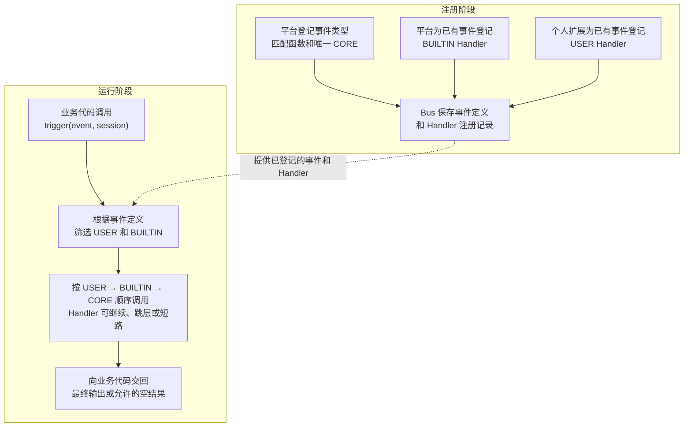
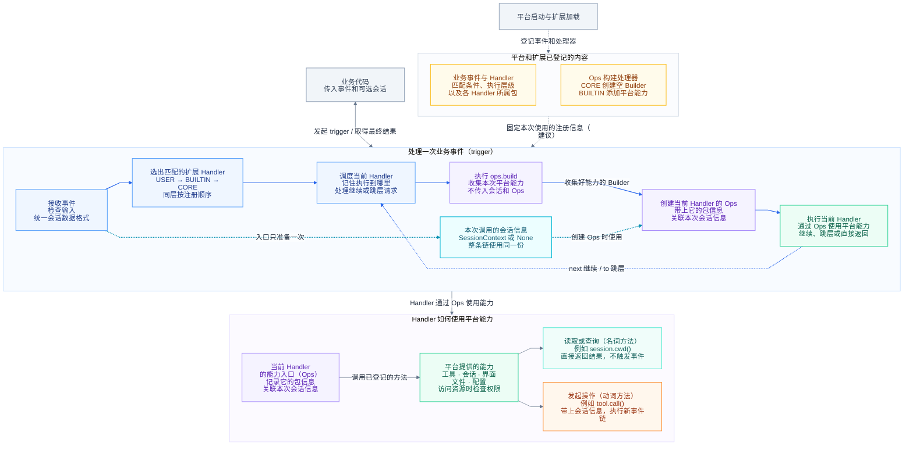
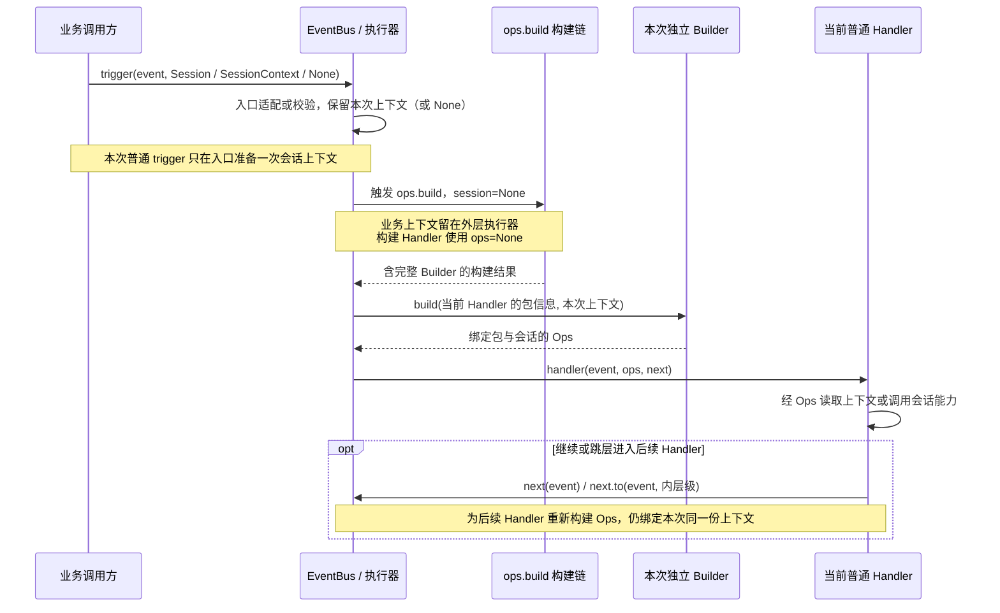
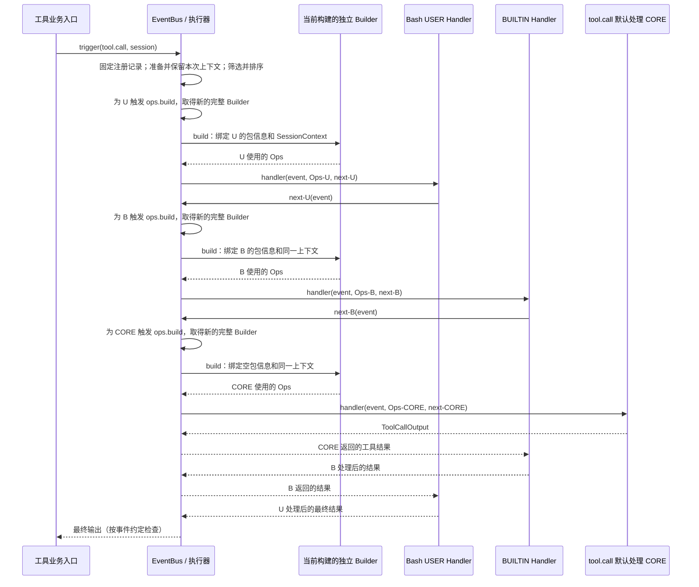
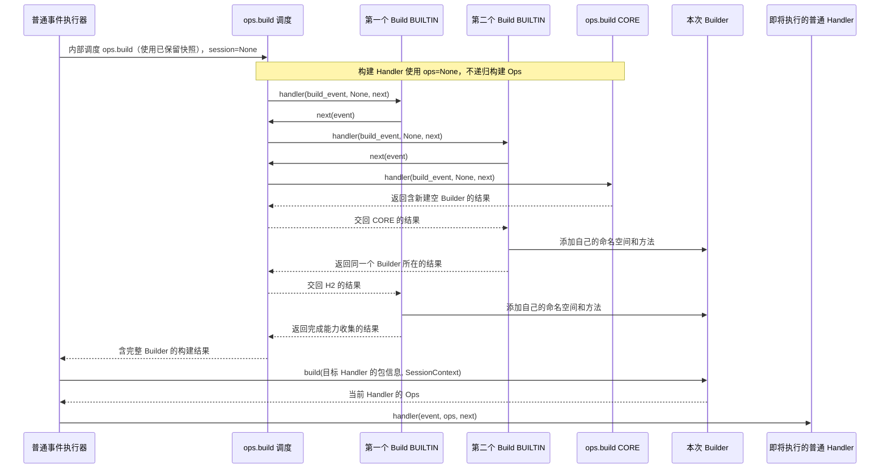
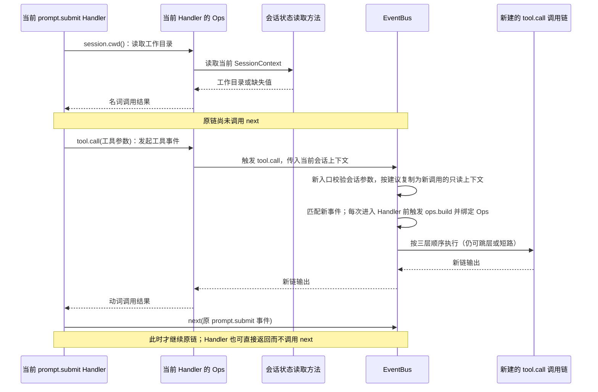
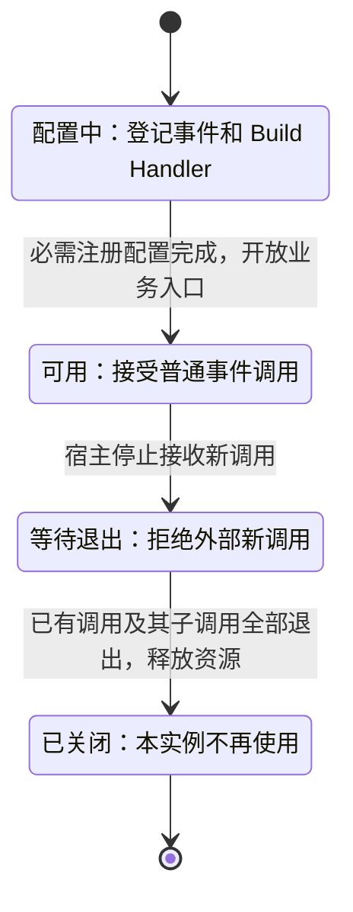

# ExtensionEventBus 事件机制详细架构设计

| 项 | 内容 |
| --- | --- |
| 文档类型 | 目标设计草案；公共接口和部分约束仍待确认，不代表能力已实现 |
| 最近一次修订日期 | 2026-10-17 |
| 维护责任 | Events 模块维护者；Ops、扩展运行时及宿主维护者共同确认跨模块约定，具体负责人待认领 |
| 所属模块 | `agent-core/openjiuwen/core/events/` |
| 配套文档 | [设计概览](events-overview.md)、[Events 维护规范](../../AGENTS.md)、[Core 公共规范](../../../AGENTS.md) |

本文说明一次事件调用怎样从业务入口进入 EventBus，经过扩展处理，最后返回业务结果。全文围绕“登记事件和平台能力 → 业务触发事件 → 选择并执行 Handler → 返回结果”展开。

Handler 是事件处理函数。EventHandlerOps（下文简称 Ops）是 Handler 调用平台能力的入口。EventHandlerOpsBuilder（下文简称 Builder）在每次构建中收集平台提供的能力定义，再创建绑定当前 Handler 包信息和会话上下文的 Ops。宿主是创建和管理这些运行时对象的应用，例如 JiuwenSwarm 的 AgentServer。

**实现状态：**截至本次修订，Events 目录只有维护规则和设计材料，没有 Python 实现、公开导出和事件专项测试。当前单智能体 Session 和工具抽象可作为后续适配基础，不能据此认定事件入口已接通。本文所有事件接口、内部模块和目录划分均为目标设计。

**设计状态：**本文说明三层执行顺序、唯一 CORE、匹配规则、短路与跳层、Ops 构建、名词/动词能力和会话转换，并讨论代码归属、按需构建、注册错误、并发及失败处理。其中标为建议的方案仍待确认，责任与影响见第 12.2 节。后续规约（spec）统一维护确认后的接口和规则，特性方案（feature）记录具体开发与验证，本文说明整体架构。

**设计依据与适用关系：**[事件机制 v1](../../../../../../rsi_native_agent_os/refs/extension_event_bus_core_mechanism_v1.md)提供三层链、Ops 和会话投影的基础设计；[扩展整体方案](../../../../../../rsi_native_agent_os/refs/扩展性方案总览_V3.md)及[加载注册说明](../../../../../../rsi_native_agent_os/refs/扩展包加载与注册说明.md)用于理解宿主和扩展运行时的分工，三份参考均位于 `rsi_native_agent_os` 仓库。本文采用逐 Handler 按需构建，替代参考材料中初始化时收集并保存 Builder 的做法；旧文中的 ExtensionUtils / ExtensionSDK / extension_sdk.build 不作为本方案的接口名称。按需构建让可变 Builder 仅属于当前 Handler，构建失败也在本次调用内处理，代价是重复收集能力，成本与验证见第 9.3 节。参考材料尚未同步，本模块目标方案以本文和概览为准，正式契约仍待 spec 建立。

**代码的阅读方式：**本文代码用于说明对象关系、调用顺序和数据传递，不是可直接使用的最终 API。`trigger`、`next`、`add_method` 等名称表达相应的架构操作。具体签名、类型表示、文件划分和实现算法由后续方案确定；示例中的 StrEnum、dataclass、Protocol 和类型注解不构成实现约束。

| 阅读目的 | 章节入口 |
| --- | --- |
| 了解范围、核心对象与模块分工 | 第 1～3 节 |
| 理解注册、匹配、执行链、Ops 和协作流程 | 第 4～5 节 |
| 查阅 SessionContext 的构建时机与传递路径 | 第 4.4 节；普通事件主流程见第 5.1 节 |
| 核对状态、数据、故障、权限与运行限制 | 第 6～10 节 |
| 推演场景、检查设计选择及未决问题 | 第 11～12 节 |
| 查阅基础模型、操作与完整接入示例 | 第 2.1、4.1、4.3、4.5.2、5.5 节 |
| 检查设计内容及其说明位置 | 第 11.3 节 |

## 1. 定位、目标与范围

### 1.1 定位与目标

ExtensionEventBus 让平台和个人扩展在同一次业务调用中协作。平台提供默认处理函数 CORE，扩展可以在它之前处理输入，也可以在它返回后处理结果。业务代码通过 `await trigger(event, session)` 等待整条调用链结束。

链中的三个层级依次为 USER（个人扩展）、BUILTIN（平台内置扩展）、CORE（平台默认处理）。本文件把 USER 称为外层，把 CORE 称为最内层。每个已注册事件都有一个 CORE，但前面的 Handler 可以短路，因此一次调用不一定执行到 CORE。

以 Bash 工具调用为例，平台登记 `tool.call` 及默认工具执行逻辑，个人扩展注册仅匹配 Bash 的 USER Handler。调用时，USER Handler 可以读取 Ops 提供的会话工作目录，继续链路，并在工具返回后加工输出。实际工具执行仍由业务模块实现。

设计需要让开发者看清四件事：事件接收什么、Handler 按什么顺序执行、谁决定继续或结束，以及每个 Handler 使用哪份包信息和会话信息。平台能力统一通过 Ops 提供，便于扩展使用和问题定位。

### 1.2 范围与外部责任

| 本文覆盖 | 外部责任或范围限制 |
| --- | --- |
| EventType、Handler 的注册与注销、匹配和分层调度 | 事件所属业务模块定义输入输出、匹配含义和默认实现 |
| EventNext 的继续、跳层、短路及返回 | 业务模块负责执行工具、核对外部结果，并决定重复请求能否安全重试 |
| EventHandlerOps / Builder 的基础模型、构建与上下文绑定，以及名词/动词两类能力 | 平台实现工具、会话、界面（UI）、文件系统和配置等能力，并检查访问权限 |
| Ops 按需构建、实例隔离、并发和嵌套调用的建议规则 | 宿主负责启动、停止、扩展装卸，以及限制同时进入的业务调用数量 |
| 异常、取消、内存状态和验证要求 | 不定义持久队列、远程事件协议、自动重试或故障重放 |

这里的 EventBus 直接调用并等待 Handler，不负责消息队列投递。`trigger()` 正常返回只说明当前调用链交回了结果。工具是否执行成功、文件是否写入、结果是否送达用户，分别由业务代码和相关系统确认。下文把写文件、执行工具等对外部状态的改变称为“副作用”。

### 1.3 关键要求与对应设计

| 关键要求 | 主要设计位置 | 支持条件与限制 |
| --- | --- | --- |
| 每个 EventType 登记一个 CORE | 第 4.1 节 | CORE 不参加模式筛选；前序短路时不会执行 |
| USER → BUILTIN → CORE，同层按注册顺序 | 第 4.2～4.3 节 | 顺序只约束一条已选定的链，不约束不同 trigger 的先后 |
| next 继续、to 跳向内层、不调用即短路 | 第 4.3 节 | 前序扩展可以跳过 BUILTIN 和 CORE，安全边界见第 9 节 |
| 每个普通 Handler 执行前触发 Build 事件，收集能力并构建 Ops | 第 4.5、5.2 节 | 平台初始化只登记 Build Handler；构建事件自身使用空 Ops |
| Session 只在入口转换一次 | 第 4.4 节 | 从运行时 Session 只提取会话 ID；工作目录等资料由宿主补充 |
| 名词方法独立调用、动词方法触发对应事件 | 第 4.5.1、5.4 节 | 同一 namespace 可兼有两类方法；动词不能替代当前链的 next |
| 平台新增事件、能力及个人新增 Handler | 第 5.5、11.1 节 | 展示完整接入责任与业务结果，示例代码不限定最终接口 |
| 错误、取消、并发与隔离需明确 | 第 6～9 节 | 建议方案须定稿并验证后才能作为能力保证 |

### 1.4 影响架构选择的因素

Handler 需要在下游执行前后都能处理数据，因此采用逐层调用、反向返回的“洋葱式调用链”。例如 U1 调用 U2，U2 调用 CORE；CORE 的结果先返回 U2，再返回 U1。重复调用下游可能重复执行工具，所以需要限制 EventNext 的使用。每个 Handler 还必须取得与自己所属包关联的 Ops，不能沿用上一个 Handler 的包信息。

本文的“普通事件”指 ops.build 以外的事件，“普通 Handler”指处理这些事件的 Handler，包含 USER、BUILTIN 和 CORE。Ops 能力在每次调用普通 Handler 前通过 ops.build 事件收集。构建过程中尚无可用 Ops，因此这个事件的 Handler 接收空 Ops，避免构建过程依赖自己尚未完成的结果。不同宿主的 Session 类型也不统一，Events 只提取所需会话信息，其他资料由宿主查询。当前没有性能实测数据，本文不设延迟、吞吐或容量数值保证。

## 2. 核心概念与共同规则

### 2.1 对象、关系与生命周期

| 对象 | 含义与关联 | 创建、共享与结束 |
| --- | --- | --- |
| EventType / 事件定义 | EventType 是事件标识，如 tool.call；事件定义把该标识与匹配函数、唯一 CORE 关联起来 | 由平台注册，由所属 Bus 实例管理 |
| Event / EventInput / EventOutput | 一次事件及业务输入、链路输出；输出可能由外层 Handler 加工 | 调用方创建输入，Handler 返回结果；不默认持久化 |
| HandlerRegistration | 一条 Handler 注册记录，保存处理函数、事件类型、层级、匹配模式、注册顺序和所属包 | 注册时创建；注销后不再供新取得注册记录的调用使用 |
| HandlerLevel | USER 为个人扩展，BUILTIN 为平台内置扩展，CORE 为业务默认处理 | 层级决定链内先后，不表示权限等级 |
| MatchPattern / MatchPatternFunc | Handler 声明的筛选条件 / 平台解释条件的同步函数 | 模式随注册记录保存，匹配函数属于事件定义 |
| Invocation | 一次 trigger 所需的临时状态，包括选中的 Handler、会话上下文和执行位置 | 每次调用独立创建，调用结束后释放 |
| EventNext | 当前 Handler 继续或跳过部分后续处理的控制对象 | 由执行器为当前 Handler 创建；建议限制其调用次数和有效期，见第 4.3 节 |
| SessionContext | 提供给 Ops 的会话信息，包括会话 ID、可选工作目录 cwd 和少量 metadata | 每次普通 trigger 在入口统一准备，由本次调用保留；各 Handler 的 Ops 绑定同一份上下文，构建时机与路径见第 4.4 节 |
| PackageMetadata | 当前 Handler 所属包的元信息；不同于本次操作发起方的授权依据 | 扩展运行时提供并关联注册记录，不能由事件输入覆盖；授权边界见第 9.1 节 |
| EventHandlerOpsBuilder / EventHandlerOps | Builder 保存可调用的平台能力定义；Ops 让当前 Handler 使用这些能力，并携带它的包信息和会话上下文 | 每次调用普通 Handler 前触发 ops.build，创建独立 Builder 并构建对应 Ops |
| Namespace / 名词方法 / 动词方法 | 命名空间组织能力；名词方法直接读取或计算状态；动词方法进入对应事件 | 两类方法可共存；具体方法和事件映射由平台定义 |

同一 EventType 可对应多个 USER / BUILTIN 和一个 CORE。一次 trigger 选择其中一部分形成链，链中的每个 Handler 使用自己的 Ops。相同 session_id 的两次 trigger 仍是两个独立 Invocation。

下文的“注册快照”指一次调用开始时固定下来的事件定义和 Handler 记录；“能力目录”指 namespace 和方法的定义集合，不是文件目录。“会话投影”指从运行时会话中提取所需字段、形成 SessionContext 的过程。

Event 由 `event_type` 和 `event_input` 组成，EventInput / EventOutput 分别表达输入与输出角色；HandlerLevel 的 USER、BUILTIN、CORE 分别以 user、builtin、core 表示。SessionContext 的 session_id 必填，cwd 默认缺失，metadata 默认空映射。MatchPattern 表达键到条件值的映射。

下面的模型代码说明对象关系、模式判断和回调角色。枚举、类型别名、dataclass 和 Protocol 都是架构表达方式，不限定最终数据表示。统一回调的 Ops 参数允许为空，以表达 ops.build 的构建特例；普通业务 Handler 接收到的是构建完成的 Ops，见第 5.2 节。

```python
from collections.abc import Awaitable, Callable, Mapping
from dataclasses import dataclass, field
from enum import StrEnum
from typing import Protocol


class EventType(StrEnum):
    """平台支持的事件类型。"""

    TOOL_CALL = "tool.call"
    OPS_BUILD = "ops.build"


class HandlerLevel(StrEnum):
    """Handler 执行层级。"""

    USER = "user"
    BUILTIN = "builtin"
    CORE = "core"


class EventInput:
    """事件输入基类。"""


class EventOutput:
    """事件输出基类。"""


@dataclass(frozen=True, slots=True)
class Event:
    """一次事件调用。"""

    event_type: EventType
    event_input: EventInput


@dataclass(frozen=True, slots=True)
class SessionContext:
    """EventHandlerOps 使用的只读会话上下文。"""

    session_id: str
    cwd: str | None = None
    metadata: Mapping[str, object] = field(default_factory=dict)


MatchPattern = Mapping[str, object]
MatchPatternFunc = Callable[[EventInput, MatchPattern], bool]


class EventNext(Protocol):
    """EventBus 注入的执行链控制对象。"""

    async def __call__(self, event: Event) -> EventOutput | None:
        """继续执行链中的下一个 Handler。"""
        ...

    async def to(
        self,
        event: Event,
        handler_level: HandlerLevel,
    ) -> EventOutput | None:
        """从指定内层级继续执行。"""
        ...


EventHandler = Callable[
    [Event, "EventHandlerOps | None", EventNext],
    Awaitable[EventOutput | None],
]
```

### 2.2 共同规则索引

下表汇总各模块共同遵守的目标规则；其中标为“建议”的约束尚待确认。

| 规则 | 适用范围与保证责任 | 不满足时的处理 | 主要说明 |
| --- | --- | --- | --- |
| EV-A01 唯一 CORE | EventBus 注册事件时一并保存 CORE | 建议拒绝重复类型及普通接口注册 CORE | 第 4.1 节 |
| EV-A02 固定层级与同层注册顺序 | 单次调用的匹配器和执行器 | 不允许调用方传入任意链顺序 | 第 4.2 节 |
| EV-A03 只能向内层跳转；建议每个 next 最多推进一次 | 执行器保存当前位置，并检查 next 是否仍可使用 | 拒绝非法跳转，以及重复、跨任务或失效后的推进 | 第 4.3 节 |
| EV-A04 入口转换会话、每个 Handler 单独绑定 Ops | 会话适配器提取信息，Builder 绑定当前包和会话；ops.build 使用空 Ops | 无效上下文报错；能力所需资料缺失时由该能力处理 | 第 4.4～4.5 节 |
| EV-A05 构建成功后才进入当前普通 Handler | 执行器逐 Handler 触发 ops.build，取得完整 Builder 后绑定 Ops | 构建失败不使用部分结果，不进入该 Handler；不改变整个 Bus 的可用状态 | 第 5.2 节 |
| EV-A06 一次调用固定注册快照，建议 | 注册表和匹配器 | 注册变更仅影响之后取得快照的调用 | 第 7.1 节 |
| EV-A07 异常与取消不触发隐式重试，建议 | 执行器传播，业务核对副作用 | 不自动补跑 CORE；失败不能解释为未执行 | 第 8 节 |
| EV-A08 在实际资源访问处检查权限，本文的安全接入要求 | 宿主与能力提供方确定并落实检查位置 | 拒绝越权访问；必需检查不能只放在可能被跳过的 Handler 中 | 第 9.1 节 |
| EV-A09 能力调用与当前链推进分开 | 名词方法不进入 Bus；动词方法触发新链；next 推进当前链 | 不把动词当成 next，不把名词返回视作后续 Handler 已执行 | 第 4.5.1、5.4 节 |

## 3. 架构总览与模块分工

### 3.1 内外部关系

从使用者角度，整体分为注册与运行两个阶段。平台注册事件及唯一 CORE，再由平台和个人分别登记 BUILTIN / USER；真实业务入口触发事件后，Bus 匹配、执行并交回结果：



下图分为三部分：平台和扩展已登记的内容、一次业务事件的处理过程，以及 Handler 可使用的平台能力。会话信息在入口准备一次，创建每个 Handler 的 Ops 时使用；平台启动时只登记构建处理器，实际能力收集发生在 Handler 执行之前：



图例：蓝色表示事件处理步骤，紫色表示收集能力和创建 Ops，黄色表示已登记的内容。青色虚线说明会话信息如何交给 Ops；绿色和青绿色表示平台能力及直接查询，橙色表示发起新事件。三个分组都在同一进程内，具体代码归属见第 3.2 节。

业务方可传入 Session、SessionContext 或 None。入口只准备一次会话上下文，并由本次调用保留；传入 None 时保持为空。执行器在进入每个普通 Handler 前触发 ops.build，该构建事件使用 session=None、ops=None。图中的会话数据路径直接进入 Builder.build，不经过 ops.build；执行器取得完整 Builder 后，才将当前 Handler 的包信息与本次上下文一起绑定为 Ops，再传入 event、ops、next。同链各 Handler 的 Ops 绑定各自的包信息，使用本次同一份会话上下文。会话来源与传递细节见第 4.4 节，构建步骤见第 5.2 节。

Handler 通过 next/to 控制当前链，也可直接返回而短路；继续或跳层只会为将要进入的 Handler 构建 Ops，不重新准备本次会话上下文。下方“当前 Ops”表示该 Handler 已取得的同一 Ops，通过它读取上下文或调用平台能力。动词方法携带当前上下文进入同一 Bus 的新 trigger，新入口重新校验会话参数，按第 4.4.3 节建议复制为新调用的只读上下文；它不能替代当前 next。结果仍沿各自已进入的调用栈返回。

### 3.2 代码归属与依赖方向

公共 Event、SessionContext、最小包关联信息、Ops、Builder、ops.build 定义及其默认 CORE 归属于 `core/events` 的通用基础层，由执行器直接使用。平台提供具体业务 CORE、Build BUILTIN 和能力函数，初始化时登记到 Bus；能力函数需要发起事件时，由平台装配绑定当前 Bus 的调用入口。这样 Events 不需要导入平台能力实现、包管理或 JiuwenSwarm。具体文件拆分和公开导出路径留给实现方案，不再保留两套公共模型归属。

```text
jiuwenswarm 宿主 / agent-core 扩展控制面 / 业务模块
    ├─依赖→ core/events 的公共接口
    └─提供→ CORE、BUILTIN、Ops 能力及受控注册入口

core/events
    ├─依赖→ Core 日志、异常公共能力
    ├─适配→ 当前支持的运行时 Session（仅提取 ID）
    └─不依赖→ jiuwenswarm、包管理实现、具体工具执行器
```

下表按逻辑职责分组，不指定实际文件名、类划分或公开导出路径：

| 逻辑组成 | 内容 |
| --- | --- |
| 公共事件与上下文模型 | Event、层级、回调约定、SessionContext 和最小包关联信息 |
| 注册管理 | 事件定义、Handler 记录、标识索引和快照 |
| 匹配与执行控制 | 筛选出的 Handler 顺序、单次调用状态和 EventNext 控制 |
| EventBus 门面 | 对外入口、会话规范化和按需触发 Ops 构建 |
| Ops 基础能力 | EventHandlerOps、Builder、能力访问与 Build 事件模型 |
| 平台能力提供方 | 名词方法实现、动词到事件的映射，以及各 namespace 的 Build Handler |

以下目录只说明基础设施和平台能力的组织边界：

```text
agent-core/openjiuwen/
├── core/events/                       # 公共模型、执行器及内置 ops.build
└── extensions/ops_build_handlers/     # Core 平台提供的能力构建处理器

jiuwenswarm/jiuwenswarm/extensions/
└── ops_build_handlers/
```

两个平台各自维护所属能力的 Ops Build Handler，初始化负责统一登记 BUILTIN；这些能力依赖 Events 公共模型，Events 不反向依赖它们。上述平台目录为组织示意，尚非既有实现。

### 3.3 分工与外部所需保证

| 模块或参与方 | 负责内容 | 交出什么、负责到哪里 |
| --- | --- | --- |
| EventBus 调用入口 | 检查参数和实例状态，接收会话，发起事件调用 | 向业务方返回整条链的结果或异常；工具实际结果由业务方核对 |
| 注册表与匹配器 | 保存注册关系，固定本次记录，按模式筛选并排序 | 将本次应执行的 Handler 顺序交给执行器 |
| 执行器与 EventNext | 每次调用普通 Handler 前触发 ops.build 并绑定 Ops，处理继续、跳层和返回 | 管理一次 trigger 中的调用状态；不额外启动后台消费任务 |
| Ops 基础层 | 保存能力定义的访问方式，提供当前包和会话信息 | 名词调用平台方法，动词触发对应新事件；资源权限由能力实现检查 |
| 平台初始化入口 | 确定登记顺序，登记事件及 Build Handler | 完成注册配置后开放业务；Ops 由执行器在运行时按需构建 |
| 扩展运行时 | 核实包来源，限制扩展可用的注册操作，记录并注销 handler_id | 负责扩展装卸及包资源释放；Bus 不解析包声明 manifest |
| 宿主与业务模块 | 提供会话资料和真实业务入口，实现默认动作及权限检查 | 核对业务结果，限制并发，并在停机时等待运行中的调用退出 |

### 3.4 现有基础与缺口

已有[单智能体公开入口](../../../single_agent/__init__.py)导出 [Session 实现](../../../session/agent.py)，其会话标识入口为 `get_session_id()`。底层 [BaseSession / ProxySession](../../../session/session.py)使用 `session_id()`，同文件的旧 `Session` 已标记弃用。这些类型需要显式适配，示例中的 Session 泛称不表示已有统一接口。

已有 [Tool 抽象](../../../foundation/tool/base.py)提供 `invoke()` 和 `stream()`，但尚无本文事件接入。工具是否通过统一入口触发、是否需要流式事件，必须由工具业务特性明确。本期示例只说明单次调用；`EventOutput | None` 不自动提供流式输出协议。

## 4. 关键模块设计

### 4.1 事件与 Handler 注册表

事件定义保存 EventType、MatchPatternFunc 和唯一 CORE 记录。USER / BUILTIN 记录按事件分组，保存 handler_id、回调、层级、模式和单调注册序号。CORE 也作为 Handler 记录管理，但只由 `register_event_type()` 创建，不参与 Pattern 筛选。

以下名称表达注册管理中的架构操作，参数仅说明所需信息，不构成最终方法签名。注册、触发和注销的具体校验与错误类型在规约中确定。

下面仅列门面的架构操作。trigger 的处理顺序见第 5.1 节，校验责任见第 4.3 节；此处不指定内部方法或存储实现：

```python
class ExtensionEventBus:
    def register_event_type(
        self,
        event_type: EventType,
        match_pattern_func: MatchPatternFunc,
        core_handler: EventHandler,
    ) -> None:
        ...

    def unregister_event_type(self, event_type: EventType) -> None:
        ...

    def register_event_handler(
        self,
        event_type: EventType,
        handler: EventHandler,
        match_pattern: MatchPattern,
        handler_level: HandlerLevel = HandlerLevel.USER,
    ) -> str:
        ...

    def unregister_event_handler(self, handler_id: str) -> None:
        ...

    async def trigger(
        self,
        event: Event,
        session: "Session | SessionContext | None" = None,
    ) -> EventOutput | None:
        ...
```

| 架构操作示意 | 作用 | 建议的前置条件与错误处理 |
| --- | --- | --- |
| `register_event_type(event_type, match_pattern_func, core_handler)` | 同时登记事件类型、匹配函数和唯一 CORE | 已登记的类型报重复错误，不自动覆盖；处理函数须符合回调约定 |
| `register_event_handler(event_type, handler, match_pattern, handler_level=USER)` | 为已有事件登记 USER / BUILTIN，返回用于注销的字符串 handler_id | 未知事件、非法层级或通过此入口登记 CORE 时拒绝；同一函数分次登记会得到不同标识 |
| `unregister_event_handler(handler_id)` | 注销指定 USER / BUILTIN 注册记录 | 建议未知标识不作处理，便于重复卸载；CORE 随事件定义管理 |
| `unregister_event_type(event_type)` | 注销事件定义及其 CORE | 建议未知事件不作处理；仍有关联 USER / BUILTIN 时拒绝，先注销这些记录 |
| `trigger(event, session=None)` | 转换会话、匹配并执行 Handler，交回最终输出或允许的 None | 未知事件、普通事件所需能力未就绪时拒绝；异常不能伪装成正常空结果 |

建议每次注册先完成检查，再一次更新相关记录；失败时不留下“事件已登记、CORE 却缺失”的状态。Handler 的顺序只由层级和同层注册顺序决定。空模式的含义也由该事件的匹配函数判断，Bus 不统一把空模式视为命中。

**包关联补充建议：**扩展运行时通过受控注册入口，将 Handler 与已验证的所属包关联，再由 Builder 在执行时绑定。平台直接登记的 CORE / BUILTIN 可以没有包；包身份不明确的个人扩展应在运行时登记前拒绝。使用注册上下文、受限门面还是显式参数由后续方案决定，本文不规定新增 `package_metadata` 注册参数。

`EventType` 表示平台支持的事件类型，例如 tool.call、ops.build。事件命名与语义由平台统一维护。示例采用枚举表达事件类型；最终使用枚举、标识对象还是受控字符串，以及宿主如何增加事件，由事件目录规约确定。

### 4.2 匹配与执行链规划

按照第 7.1 节的快照建议，一次调用先固定要读取的注册记录，再用入口收到的事件输入匹配。匹配器只筛选该 EventType 下的 USER / BUILTIN，分别按注册顺序排列，最后放入该事件的 CORE。

每次模式判断把事件的 EventInput 和某条注册记录的 MatchPattern 一起交给该 EventType 的 MatchPatternFunc，由它返回是否命中。模式含义由事件定义者维护，不由扩展自行改变匹配函数。工具示例先识别输入是否为工具调用，再比较模式中的 tool 条件。

例如，U1、U2 是按顺序登记的两个 USER，B1、B2 是按顺序登记的两个 BUILTIN。全部命中时，执行顺序为 `U1 → U2 → B1 → B2 → CORE`。没有扩展命中时，链中只有 CORE；有扩展时，CORE 是否执行取决于前序 Handler 是否继续。包依赖关系不由 Bus 排序，宿主应先确定包加载顺序，再据此登记 Handler。

**补充建议：**匹配函数同步返回 bool，不修改业务状态，也不进行阻塞的文件或网络操作。函数抛错或返回其他类型时，本次 trigger 失败，不能把错误当成“没有命中”。注册时复制模式，执行 Handler 后不重新匹配，避免输入变化使同一 Handler 再次执行。

**输入传递规则：**事件定义方须说明哪些输入字段参与匹配；这些字段及 event_type 在当前链中保持不变，Handler 只能通过 next 调整不影响匹配的业务参数。tool.call 示例中 tool_name 用于匹配，不能把非 Bash 调用经 next 改为 Bash；需要换工具或事件类型时，应通过动词发起新事件，重新匹配。Bus 在 next/to 入口检查该约束，不在链中重新筛选 Handler。若某事件按 arguments 中的字段匹配，对应字段也须保持不变。

### 4.3 执行器与 EventNext

执行器保存选中的 Handler 顺序和当前执行位置。每次进入普通 Handler 前，先触发 ops.build 收集能力，再由返回的 Builder 创建 Ops，并为它创建专属 EventNext，最后等待回调结果。ops.build 的 Handler 直接接收空 Ops，不进入上述构建流程。Handler 可在 await next 前处理输入，在 next 正常返回后处理下游结果。下游抛错时，next 也会抛错；异常处理和资源清理由 Handler 自己的 try / finally 等逻辑承担。

三个层级使用第 2.1 节的同一回调：event 提供输入，ops 提供平台能力，next_handler 用于继续或跳层。普通 Handler 的调用示例见第 5.5 节；ops.build 使用空 Ops。

所有已命中的 Handler 都继续，且下游正常返回时，顺序如下。被跳过或尚未进入的 Handler 不执行任何前置或后置处理：

```text
进入：USER-1 → USER-2 → BUILTIN-1 → BUILTIN-2 → CORE
返回：USER-1 ← USER-2 ← BUILTIN-1 ← BUILTIN-2 ← CORE
```

| 当前层级 | `next(event)` | `to(event, BUILTIN)` | `to(event, CORE)` |
| --- | --- | --- | --- |
| USER | 调用链中的下一个 Handler，可能仍是 USER | 跳过剩余 USER，调用首个已命中的 BUILTIN；没有 BUILTIN 则调用 CORE | 跳过剩余 USER / BUILTIN，调用 CORE |
| BUILTIN | 调用下一个已命中的 BUILTIN；没有则调用 CORE | 拒绝：不能跳回当前层级 | 跳过剩余 BUILTIN，调用 CORE |
| CORE | 已到链尾；建议返回 None，不再调用任何 Handler | 拒绝：BUILTIN 是外层 | 拒绝：不能跳向当前层级 |

`to(..., USER)` 总是拒绝。跳过的 Handler 不会执行其前置或后置逻辑。Handler 不调用 next 而直接返回即短路，包括返回 None；Bus 不因结果为空就补跑 CORE。

**推进约束补充建议：**每个 EventNext 只能在 next 和 to 中选择一次有效调用。执行器先检查参数、Handler 是否仍在执行、调用是否来自该 Handler 所属的异步任务，再将它标为已使用。即使下游抛错，也不能再次用这个对象推进。

因此，Handler 不能反复调用 next、并发调用 next/to，不能把 EventNext 转给子任务，也不能在回调结束后继续使用它。执行器在 Handler 退出时使 EventNext 失效。这些建议用于避免同一段下游逻辑被重复执行，具体约定仍需定稿。

这些约束限制一条调用链中的下游进入次数；不能据此承诺工具全局只执行一次。Handler 内部、Ops 能力或调用方仍可能重复执行业务操作。CORE 通常不使用 next，保留统一签名是为了简化调度和协议。

**输入输出校验责任：**业务模块提供所属事件的输入、输出及 None 是否允许的校验规则，Bus 在以下边界执行；具体校验函数怎样关联事件定义，由实现方案确定，不要求新增固定的 Schema 注册参数。

| 边界 | 检查内容与失败处理 |
| --- | --- |
| trigger 入口，匹配之前 | Bus 检查事件结构、已登记类型，并执行该事件的输入校验；失败不匹配、不进入 Handler |
| next/to 入口，推进之前 | Bus 检查新输入仍符合事件约定，且未改变 event_type 和匹配字段；失败不进入下游 |
| 每个 Handler 返回时 | Bus 检查输出是否符合该事件规则，包括短路结果和 None；失败向外层传播，外层可按第 8 节处理 |
| 最终结果交回业务入口后 | 业务入口核对实际业务结果与副作用；结构校验通过不证明工具执行或用户交付成功 |

校验适用于被短路的调用，不只放在 CORE 内。EventInput / EventOutput 表达输入输出角色，不强制最终实现采用基类继承。

### 4.4 Session 入口适配

**SessionContext 按一次普通事件调用准备，Ops 按一次普通 Handler 执行构建。** EventBus 在普通 trigger 的入口统一适配或校验会话参数，之后由本次调用的执行状态保留结果。每次构建 Handler 的 Ops 时，绑定这份已经准备好的上下文，不重新读取原始 Session，也不重新查询宿主会话资料。这个入口处理过程称为“会话规范化”；传入 None 时结果仍为空，不创建 SessionContext。

#### 4.4.1 构建时机与信息来源

宿主可以在调用 trigger 前先查询会话资料并构建 SessionContext，也可以直接传入受支持的运行时 Session，由 Bus 在入口创建。两种方式最终都经过入口校验，形成供本次调用使用的上下文。会话处理在查找事件定义之后、筛选 Handler 和第一次触发 ops.build 之前完成；参数无效时，不进入业务 Handler，也不开始为其构建 Ops。

| 传入的会话参数 | 转换结果或建议处理 | 责任与限制 |
| --- | --- | --- |
| `None` | 保留为空 | 只有事件及其能力允许时才可无会话；依赖会话的能力须报告缺失 |
| `SessionContext` | 检查字段，建议复制为本次调用的只读上下文 | 宿主先查询 cwd / metadata；Bus 不代查，也不用进程工作目录补齐 |
| 当前单智能体 Session | `SessionContext(session_id=session.get_session_id())` | cwd 为 None，metadata 为空；不导入其状态、环境和工作目录 |
| 其他运行时 Session | 经显式支持的适配取 ID | 是否支持 BaseSession、工作流或多智能体 Session 须逐一确认；不按任意同名属性猜测 |

SessionContext 包含必填会话标识、可缺失的工作目录和少量平台 metadata，例如 channel_id、user_id、mode。代码用 `session_id: str`、`cwd: str | None`、`metadata: Mapping[str, object]` 表达这些字段，最终类型由后续规约确定。会话标识应有效且非空；metadata 允许包含什么、怎样保持只读，见第 7.2 节。ops.build 明确使用空会话。

#### 4.4.2 从业务入口到 Handler 的传递路径

传递路径为“业务调用方 → trigger 入口的会话适配 → 本次调用的执行状态 → Builder.build 的绑定参数 → 当前 Handler 的 Ops → 会话能力”。SessionContext 作为执行上下文传递，不写入业务 EventInput，也不通过 next 的事件参数在 Handler 之间搬运。执行器推进当前链时，继续使用本次调用保留的上下文。



图中的 ops.build 构建链属于同一 Bus。它接收空会话和空 Ops，只负责收集能力，不负责创建、接收或补齐业务 SessionContext。Builder 返回后，外层执行器才把目标 Handler 的包信息和本次上下文一起交给 build，具体构建过程见第 5.2 节。图中的操作名只表达架构顺序，不固定最终内部调用形式。

Handler 通过 Ops 读取会话上下文或调用相关能力，不接收原始 Session。`ops.session.id()` 返回其中的会话标识，`ops.session.cwd()` 返回工作目录。建议区分两种情况：没有会话上下文时报告缺失；有会话但未提供 cwd 时返回 None。第 5.5.2 节的示例采用这一建议，目录返回类型相应写作 `str | None`。

最终类型和缺失值处理仍由能力规约确认。访问文件的能力还须检查目录与权限，不能把空值默认为进程工作目录。

#### 4.4.3 当前链、构建链与新事件的上下文边界

| 调用场景 | 上下文怎样传递 | 是否重新准备 SessionContext |
| --- | --- | --- |
| 普通事件第一次进入 trigger | 业务方传入 Session、SessionContext 或 None，入口适配或校验后由本次调用保留 | 在该次入口统一准备一次；传入 None 则保持为空 |
| 同一事件经 next/to 进入下一个 Handler | 执行器将本次同一份上下文绑定到下一个 Handler 自己的 Ops；包信息改用该 Handler 的所属包 | 不重新准备，也不再次查询原始 Session 或宿主 |
| 为当前 Handler 触发 ops.build | 业务上下文留在外层调用中；构建事件的 session 和 ops 均为 None | 构建链不创建业务 SessionContext；Builder 返回后再绑定 |
| Ops 动词触发另一个普通事件 | 动词方法把当前 Ops 的上下文作为新 trigger 的会话参数；原上下文为空时继续传 None | 新入口仍按第 4.4.1 节校验；建议复制为新调用的只读上下文，不从原始 Session 重新取资料 |

同一调用内的 USER、BUILTIN 和 CORE 使用各自的 Ops，但读取同一份规范化上下文。新事件则有自己的调用状态；即使 session_id 相同，也不能据此认定两次调用共享同一个上下文对象或执行位置。新入口校验或复制不会自动刷新 cwd、补齐 metadata，也不会继承发起者的包身份。复制方式和各层数据的只读保证仍按第 7.2 节的建议定稿，本文不规定具体复制算法。

本次调用结束时，执行器释放其持有的上下文引用；Bus 不将该上下文放入全局“当前会话”。宿主会话资料在执行期间变化，不会自动改写已准备的上下文；若业务需要使用更新后的资料，应由宿主明确提供，并通过新的事件调用进入。嵌套新事件的执行顺序见第 5.4 节。

### 4.5 EventHandlerOps 与 Builder

EventHandlerOps 是所有 USER、BUILTIN、CORE Handler 统一使用的引擎能力入口，覆盖 Tool、Session、UI、文件系统和配置等平台能力。它按 `namespace.method` 组织能力；同一 namespace 可以同时包含名词方法和动词方法。下面先区分调用语义，再解释能力如何收集与绑定。

#### 4.5.1 名词方法、动词方法与链路推进

| 调用示意 | 类型 | 执行的工作 | 对事件链的影响 |
| --- | --- | --- | --- |
| `ops.session.cwd()` | 名词方法 | 会话能力读取当前上下文的工作目录，可能缺失 | 不进入 EventBus，不推进当前链 |
| `ops.session.id()` | 名词方法 | 会话能力读取当前上下文的会话标识 | 不进入 EventBus，不推进当前链 |
| `ops.prompt.submit()` | 动词方法 | 构造并触发 prompt.submit，等待该事件结果 | 新建一条按三层顺序执行的链，Handler 仍可跳层或短路 |
| `ops.tool.call()` | 动词方法 | 构造并触发 tool.call，等待该事件结果 | 新建一条按三层顺序执行的链，Handler 仍可跳层或短路 |
| `next_handler(event)` | 执行控制 | EventBus 从当前执行位置继续，返回下游结果 | 继续当前链，不重新匹配开链 |

名词方法是独立的平台调用，直接读取或计算状态，仍须按资源性质检查权限和处理失败。动词方法对应一个事件；其他 Handler 可以匹配、拦截、加工它触发的新链。方法名的词性用于表达这两类语义，具体分类和事件映射由平台能力定义，不要求实现通过英文单词自动判断。

在 `tool.call` Handler 中继续当前工具处理应使用 next；再次调用 `ops.tool.call()` 会申请一次新的工具事件执行。两者不能互相替代，同类递归风险与防护边界见第 6.2 节。CORE 实现默认动作时也应区分“调用底层能力完成当前动作”和“通过动词再发起一项动作”，避免无意重开自身事件。

#### 4.5.2 能力收集与当前 Handler 绑定

Builder 按命名空间保存能力方法。`add_namespace()` 登记命名空间，`add_method()` 登记其中的方法，`build(package_metadata, session_context)` 为当前 Handler 创建 Ops。命名空间不能重复登记，同一命名空间内的方法名也不能重复。访问未登记的能力应明确报错。

登记方法时需要提供命名空间、方法名和实现函数，代码以异步回调表示这种函数。运行时 build 只接收包元信息和转换后的 SessionContext，两者按场景允许为空，不接收原始 Session。Ops 让 Handler 读取当前绑定信息并调用已登记能力。

下面的架构代码说明 Builder 的能力登记与绑定职责，以及 Ops 的包关联和 namespace 访问角色。此处展示访问入口，不要求最终实现采用特定代理或方法注入机制：

```python
class EventHandlerOpsBuilder:
    def add_namespace(self, namespace: str) -> None:
        """增加能力命名空间。"""
        ...

    def add_method(
        self,
        namespace: str,
        method_name: str,
        method: Callable[..., Awaitable[object]],
    ) -> None:
        """向命名空间增加能力方法。"""
        ...

    def build(
        self,
        package_metadata: "PackageMetadata | None" = None,
        session_context: "SessionContext | None" = None,
    ) -> "EventHandlerOps":
        """构建当前 Handler 使用的 EventHandlerOps。"""
        ...


class EventHandlerOps:
    @property
    def package_metadata(self) -> "PackageMetadata | None":
        ...

    def __call__(self, namespace: str):
        """返回指定命名空间，供 Handler 调用其中已注册的方法。"""
        ...
```

平台初始化登记 Build Handler；运行时每次构建 Ops，Build Handler 向本次 Builder 添加能力，业务 Handler 随后使用能力。以下示意分别展示添加与使用操作，均不是启动时执行的固定步骤；完整构建流程见第 5.2 节，session 能力的实现和接入见第 5.5.2 节：

```python
# 平台注册能力
builder.add_namespace("session")
builder.add_method("session", "cwd", session_cwd)

# EventHandler 使用能力
cwd = await ops.session.cwd()
```

能力函数应能读取当前 Ops 绑定的包信息和会话上下文，并检查自己所需的信息是否存在。`session_cwd(ops)` 表达这种关联，`ops("session")` 和 `ops.session` 表达命名空间访问。最终访问形式及参数绑定方式由后续方案统一，本文不要求特定代理或参数注入算法。

Ops 提供包信息 package_metadata、会话上下文 session_context 和已登记能力。每次 ops.build 创建独立 Builder，收集该次使用的方法定义；Ops 保存当前 Handler 的绑定信息。不同 Handler 和并发构建不共享可变 Builder，也不能通过全局“当前会话”或“当前包”字段传递绑定信息。包括 CORE 在内的每个 Handler 都单独绑定：属于扩展包的使用自己的包信息，平台直接登记且无所属包的使用空包信息。

Ops 只在所属 Handler 执行期间使用，Handler 正常返回、异常或取消退出时，由执行器关闭其使用范围，后续能力调用应被拒绝。Handler 不得将 Ops、命名空间代理或绑定方法缓存到后续调用，也不得交给会在自身退出后继续运行的任务。辅助任务必须在 Handler 退出前等待结束；取消时由 Handler 清理并等待它们。该约束不引入后台任务管理器，也不改变平台连接池等独立资源的生命周期。

**只读补充建议：**本次 ops.build 完成后，Builder 不再接受命名空间和方法变更，随后 build 只读取本次定义。这种限制仅适用于当前构建结果，不形成启动时发布的共享能力目录。能力函数使用的连接池、业务状态等仍可能共享，其并发安全由能力实现负责。本文不引入 Builder 缓存或跨 Handler 复用。

## 5. 模块协作与处理流程

### 5.1 普通事件主流程

业务入口先构造并校验事件，再发起 trigger。以 tool.call 为例，输入包含工具名和参数，并可附带会话。Bus 按以下七步处理；Handler 从外层向内层进入，结果按相反顺序返回：

| 步骤 | 负责模块及结果 | 完成依据与失败处理 |
| --- | --- | --- |
| 1. 查找事件定义 | Bus 检查准入状态和事件输入，按 event_type 读取定义，并固定本次注册记录 | 未知事件、输入无效、外部调用被停止或必需构建事件未登记时，向调用方报错 |
| 2. 准备本次会话上下文 | 会话适配器按第 4.4 节处理 Session、SessionContext 或 None，由本次调用保留结果 | 每次普通 trigger 只在入口处理一次；参数无效时不开始构建 Ops，None 保持为空 |
| 3. 筛选扩展 Handler | 匹配器逐条判断 USER / BUILTIN 的模式 | 匹配函数报错时不进入任何 Handler；CORE 不参加筛选 |
| 4. 确定执行顺序 | 先排 USER，再排 BUILTIN，最后放入 CORE；同层按注册顺序 | 没有扩展命中时只有 CORE；执行中不重新匹配 |
| 5. 创建当前 Handler 的 Ops | 执行器触发 ops.build，取得完整 Builder 后绑定当前 Handler 的包信息和本次 SessionContext | 被跳过的 Handler 不触发构建；构建失败不进入该 Handler，按第 8 节处理 |
| 6. 调用 Handler | 从第一条开始，传入该 Handler 的 Ops 和专属 next | Handler 决定继续、跳层或短路；进入下一条前再次执行第 5 步 |
| 7. 返回并结束调用 | CORE 或短路 Handler 产生结果，已进入的外层依次处理并返回 | Bus 释放本次临时状态并交回最终结果；业务方仍须核对工具实际结果 |



图示假定所有 Handler 都继续，且调用正常返回。next 由执行器处理，Handler 不直接调用下一条处理函数。只有将要进入的普通 Handler 才触发 ops.build 并创建 Ops；三个 Handler 对应三次构建，不共用 Builder。第 5.2 节展开其中一次构建。本例 CORE 由平台直接登记，没有所属扩展包，因此使用空包信息。

<a id="52-ops-初始化与完整目录发布"></a>

### 5.2 调用 Handler 前构建 Ops

平台初始化只登记 ops.build 事件及其处理器，不触发构建、不保存供所有业务调用共享的 Builder。Agent Core 提供该事件及默认 CORE，各平台将自己的能力构建处理器登记为 BUILTIN。事件和 CORE 的登记由 Bus 构造流程还是平台装配流程完成，具体方式待接口方案确定。

执行器每次即将调用普通 USER、BUILTIN 或 CORE Handler 时，先执行一次 ops.build。它使用无字段的空输入对象表示“无业务输入”，session 和传给构建 Handler 的 ops 均为 None。Build BUILTIN 只接受空模式 `{}`；内置匹配函数对合法空输入与空模式返回 True，非法输入或非空模式分别在触发或注册时拒绝。因此全部已登记的 Build BUILTIN 都参与收集。构建 CORE 不参加模式筛选。

执行器按本次普通调用已经保留的 Build 注册快照调度构建链，不重新读取注册表，也不按外部新调用重新准入。本文所述“触发 ops.build”表达内部构建调度，不要求再次调用公共 trigger。构建 Handler 直接接收空 Ops，避免递归构建；外层保留目标包、会话和授权依据，仅在 Builder 返回后绑定目标 Ops，会话路径见第 4.4 节。

构建 CORE 每次创建一个空 Builder。本文统一用带 builder 的构建结果交接它，各 BUILTIN 先 await next，再向同一个 Builder 添加能力，最后交回该结果。第 5.5.2 节以 EventHandlerOpsBuildOutput 表达这种包装；类名及具体类型仍是示意，不再混用直接返回 Builder 的另一种协议。

执行器取得完整结果后，调用 Builder 的 build 操作，绑定目标 Handler 的包信息和普通事件的 SessionContext，得到 Ops，随后调用目标 Handler。一次普通事件若实际进入三个 Handler，就执行三次 ops.build，各自产生独立 Builder 和 Ops；短路或跳层所跳过的 Handler 不触发构建。



图中的普通事件执行器与 ops.build 调度属于同一个 Bus；分列展示是为了区分外层业务执行和内层构建链，不表示两个服务。H1 先进入，H2 先添加能力，因为填写发生在 next 返回以后。建议每个 Build Handler 负责一个完整 namespace；命名空间和方法的重名范围见第 4.5.2 节，不同构建各自使用独立 Builder。

**构建事件的额外限制建议：**Build 扩展只由可信平台作为 BUILTIN 登记，不接受个人 USER；Build CORE 在实例使用期间保留。构建 Handler 不应触发普通业务事件或再次触发 ops.build，以免经 Ops 构建重入形成循环。构建处理器只组装能力，连接池等共享资源由平台独立管理，不在每次构建中重复初始化。

**构建结果检查建议：**执行器确认各 Build BUILTIN 在 next 返回后填充并交回 CORE 创建的同一个 Builder。短路导致未创建 Builder、换成无关 Builder、未返回构建结果、登记重名能力或回调抛错，均视为本次构建失败。失败或取消时丢弃本次结果，不进入目标 Handler；错误交接与清理责任集中见[第 8.1 节](#81-故障与责任)，具体校验方法由后续方案确定。

如果没有 Build BUILTIN，CORE 返回的能力集合为空；空 Builder 本身不表示构建失败。目标 Handler 能否执行取决于其所需能力是否存在，访问未登记能力应报错。本次定义的只读与资源共享边界见第 4.5.2 节，构建完成和 Ops 绑定完成的确认点见第 6.3 节。

### 5.3 Handler 装卸与运行中的调用

扩展运行时记录本批注册成功后得到的 handler_id。批次失败时，按装载规则逆序注销已经登记的 Handler。Bus 只保证单次注册修改的完整性，整包安装失败后的清理由扩展运行时负责。

按第 7.1 节的快照建议，卸载先注销 Handler，再等待仍持有该包记录或能力的已有调用退出，最后释放包资源。等待范围包括已保留的 Build 快照、构建后仍供 Ops 调用的能力，以及尚未结束的业务子调用；不能仅检查该包当前是否有普通 Handler 正在执行。Ops 的使用期限见第 4.5.2 节。

如何跟踪这些调用、等待多久，由后续运行时协作方案确定。注销接口返回只表示注册表已更新，不表示包已停止使用。需要立刻禁止资源访问时，实际能力入口仍应检查最新权限。

### 5.4 名词直接调用与动词新事件协作

名词方法使用当前 Ops 读取或计算状态，直接把结果返回给调用它的 Handler。动词方法则构造对应事件，并把当前 Ops 的会话上下文作为会话参数传给新的 trigger。新入口按第 4.4 节校验，建议复制为新调用的只读上下文；原上下文为空时仍传 None。随后 Bus 为新事件重新匹配 Handler、确定顺序并等待结果。

动词方法在发起前按当前 Handler 的包和宿主权限检查请求，新链继续保留本次操作的授权边界，见第 9.1 节。新链各 Handler 仍使用自己的包信息创建 Ops，不能沿用发起者的 Ops，也不能因执行者换成平台 CORE 而扩大原请求权限。新链在自己的入口取得当前注册快照；其内部 Build 固定使用该快照，因此可以与父调用使用不同版本，见第 7.1 节。事件参数及输出转换由能力与事件的协作规约确定。



本例只说明 prompt.submit 处理中可以调用工具，不要求所有 prompt.submit 都执行工具。原 Handler 会等待工具事件返回，因此这是嵌套调用。工具新链失败时，错误返回给发起方，按能力与 Handler 的约定处理。

如果 tool.call Handler 再次调用 tool.call 动词，会新建同类事件链，可能递归进入自己；它不会替代当前 next。这类重入允许到什么程度，需结合第 6.2 节建议定稿。

### 5.5 平台与个人扩展的接入方式

本节按“新增事件 → 新增平台能力 → 在普通 Handler 使用 → 个人注册扩展”的顺序，说明平台默认行为、能力构建与个人拦截怎样接通。所有代码均为架构示意；示例中的类型、签名、占位执行函数和异常用于说明职责，不代表已提供的 API 或最终实现方案。

#### 5.5.1 平台新增事件类型并接入真实入口

平台新增事件依次完成六项工作：定义事件标识、定义输入输出、定义匹配函数、实现 CORE、统一登记事件与 CORE、在真实业务入口触发。对于 tool.call，输入表达 tool_name 和 arguments，输出表达 result；匹配函数先判断输入类型，再解释模式中的 tool 条件。

```python
from collections.abc import Mapping
from dataclasses import dataclass


# 1. 在平台 EventType 中增加事件。
class EventType(StrEnum):
    TOOL_CALL = "tool.call"


# 2. 定义事件输入和输出。
@dataclass(frozen=True, slots=True)
class ToolCallInput(EventInput):
    tool_name: str
    arguments: Mapping[str, object]


@dataclass(frozen=True, slots=True)
class ToolCallOutput(EventOutput):
    result: object


# 3. 定义 Handler 匹配规则。
def match_tool_call(
    event_input: EventInput,
    match_pattern: MatchPattern,
) -> bool:
    if not isinstance(event_input, ToolCallInput):
        return False

    expected_tool = match_pattern.get("tool")
    return expected_tool is None or event_input.tool_name == expected_tool


# 4. 实现 CORE Handler，调用平台已有的 Tool 执行函数。
async def tool_call_core_handler(
    event: Event,
    _ops: EventHandlerOps | None,
    _next_handler: EventNext,
) -> EventOutput | None:
    event_input = event.event_input
    if not isinstance(event_input, ToolCallInput):
        raise TypeError("tool.call requires ToolCallInput")

    result = await execute_tool(
        tool_name=event_input.tool_name,
        arguments=event_input.arguments,
    )
    return ToolCallOutput(result=result)


# 5. 初始化时注册 EventType；这一步已经注册了 CORE Handler。
def register_tool_call_event(event_bus: ExtensionEventBus) -> None:
    event_bus.register_event_type(
        event_type=EventType.TOOL_CALL,
        match_pattern_func=match_tool_call,
        core_handler=tool_call_core_handler,
    )


# 6. 在真实 Tool 执行入口触发事件。
async def call_tool(
    event_bus: ExtensionEventBus,
    tool_name: str,
    arguments: Mapping[str, object],
    session: SessionContext | Session,
) -> EventOutput | None:
    event = Event(
        event_type=EventType.TOOL_CALL,
        event_input=ToolCallInput(
            tool_name=tool_name,
            arguments=arguments,
        ),
    )
    return await event_bus.trigger(event, session=session)
```

事件登记已经创建唯一 CORE，不通过普通 Handler 接口再次登记。业务入口只构造事件并触发，不在链外额外执行同一工具。agent-core 可以提供运行时 Session，由 Bus 投影；JiuwenSwarm 查询会话资料后自行构造 SessionContext。CORE 继续使用平台已有的工具执行能力，注册完成不等于真实入口已接通。

在这个匹配示例中，`{"tool": "Bash"}` 只选择 Bash，未指定 tool 表示不限制工具名，输入类型不符合时不命中。其他事件的字段或空模式含义仍由各自匹配函数定义。示例局部声明 EventType 是为了说明新增事件标识，不要求实现重复定义公共类型。

#### 5.5.2 平台新增 EventHandlerOps 引擎能力

以 session.cwd 为例，能力使用者最终通过 Ops 读取当前会话的工作目录：

```python
current_directory = await ops.session.cwd()
```

能力提供方先实现方法，再提供 ops.build 的 BUILTIN Handler；平台初始化统一登记，普通 Handler 在运行时使用。能力开发者不必在每个使用处重复写注册代码：

```text
实现能力方法
→ 实现 ops.build BUILTIN Handler
→ 平台初始化统一注册构建处理器
→ 执行器在每次调用普通 Handler 前触发 ops.build 并构建 Ops
→ 普通 EventHandler 通过 ops 调用
```

Agent Core 维护 Build 事件，各平台自己的 ops_build_handlers 负责所属 namespace，目录组织见第 3.2 节。下面代码采用第 4.4 节的 cwd 缺失处理建议，以及第 5.2 节带 builder 的构建结果；EventHandlerOpsBuildOutput 是该结果的类型名称示意：

```python
async def session_cwd(ops: EventHandlerOps) -> str | None:
    """返回当前会话的工作目录，未提供目录时返回 None。"""
    session_context = ops.session_context
    if session_context is None:
        raise RuntimeError("session.cwd requires SessionContext")

    return session_context.cwd


async def session_ops_build_handler(
    event: Event,
    _ops: EventHandlerOps | None,
    next_handler: EventNext,
) -> EventOutput | None:
    """向 EventHandlerOps 添加 session 命名空间。"""
    output = await next_handler(event)
    if not isinstance(output, EventHandlerOpsBuildOutput):
        raise TypeError("unexpected ops.build output")

    output.builder.add_namespace("session")
    output.builder.add_method(
        namespace="session",
        method_name="cwd",
        method=session_cwd,
    )
    return output
```

Builder 由 CORE 创建，故 Build Handler 必须先调用 next，取得构建结果后再登记 session/cwd，并交回携带同一个 Builder 的结果。建议一个 Handler 负责一个完整 namespace，避免重复注册冲突。

示例中的 RuntimeError 和 TypeError 仅表达缺失上下文或构建结果不符合本例约定的错误；正式异常类型由规约确定。

#### 5.5.3 普通 Handler 使用新增能力

EventBus 将绑定了当前包和会话信息的 Ops 传给普通 Handler。下面的 BUILTIN 示例先检查是否收到 Ops，再调用已登记的 session.cwd，最后使用 next 继续原链。Ops 不为空并不证明该方法已登记或会话一定存在，相关检查仍由能力调用完成：

```python
async def workspace_builtin_handler(
    event: Event,
    ops: EventHandlerOps | None,
    next_handler: EventNext,
) -> EventOutput | None:
    if ops is None:
        raise RuntimeError("business event requires EventHandlerOps")

    current_directory = await ops.session.cwd()
    return await next_handler(event)
```

名词方法只返回能力结果，不推进当前链；继续执行仍依赖 next。调用任何动词方法则触发对应的新链，二者的协作方式见第 5.4 节。

#### 5.5.4 个人开发者注册 USER Handler

个人开发者选择平台已有的 tool.call，登记 Bash 模式，使用默认 USER 层级。回调先读取当前 cwd，再用 next 等待工具结果，确认输出符合约定后组合 cwd 与 tool_result。返回的 handler_id 用于后续注销：

```python
async def bash_tool_handler(
    event: Event,
    ops: EventHandlerOps | None,
    next_handler: EventNext,
) -> EventOutput | None:
    """记录 Bash Tool 调用所在的工作目录。"""
    if ops is None:
        raise RuntimeError("tool.call requires EventHandlerOps")

    current_directory = await ops.session.cwd()
    output = await next_handler(event)
    if not isinstance(output, ToolCallOutput):
        raise TypeError("unexpected tool.call output")

    return ToolCallOutput(
        result={
            "cwd": current_directory,
            "tool_result": output.result,
        },
    )


handler_id = event_bus.register_event_handler(
    event_type=EventType.TOOL_CALL,
    handler=bash_tool_handler,
    match_pattern={"tool": "Bash"},
)

```

前置读取、下游执行和后置加工是三个不同阶段。示例检查空 Ops 和输出类型，表达“依赖的能力和结果必须可用”，不指定最终异常或类型检查算法。USER Handler 可按事件契约短路；若要继续当前调用，必须使用 next。在 tool.call Handler 中再次调用对应 Ops 动词会触发新的工具事件链，不能代替当前 next。

## 6. 状态、事件与完成条件

### 6.1 Bus 实例与单次调用状态

**补充建议：**用下列四个逻辑状态区分配置、可用、等待退出和关闭。Ops 构建属于单次调用的内部步骤，不是 Bus 实例的生命周期状态。这些名称不要求作为公共枚举提供。



配置中登记事件和 Build Handler；注册配置完成后可接受普通 trigger。可用状态下的注册变更按第 7.1 节生效。单次 Ops 构建失败不改变 Bus 的 READY 状态，当前调用的错误处理见第 8.1 节。

停止时，宿主关闭外部新业务和管理操作入口。已接收调用仍可推进后续 Handler、内部 Build，以及由有效 Ops 发起并等待的业务子调用；子调用遵守正常的授权和重入限制。执行器根据仍在运行的父调用识别这些派生工作，不能仅凭相同 session_id 放行新请求。宿主等待整组调用退出后再释放资源。

宿主达到停机超时后可以取消根调用，并沿等待关系取消子调用；取消尚未完成时仍不得释放被使用的资源。如何通知停止及超时时长由宿主实现方案确定，不新增公共 close API。

一次调用经历准备、匹配、逐 Handler 构建 Ops、执行和返回，也可能异常或取消结束。执行器在各 Handler 退出时使其 next 和 Ops 失效，调用结束时释放上下文及快照引用；Handler 在退出前清理自身资源和辅助任务。Events 不持久保存执行现场。

### 6.2 并发、取消与重入

建议一个 Bus 只在同一个 asyncio 事件循环中使用。修改注册记录和取得快照时不执行 await，避免这两个步骤被其他任务的修改打断。不同 trigger 及其内部 Ops 构建可以并发，各次构建使用独立 Builder；即使 session_id 相同，Bus 也不自动排队。需要按会话串行执行时，由宿主调度。跨线程或跨事件循环使用仍需另行设计。

建议 Handler 始终由 trigger 所在的 await 调用链等待，执行器不把它另起为独立后台任务。这样，调用方取消 trigger 时，取消可以沿等待关系传递。Bus 不把取消转换为正常返回，Handler 也不应把它当成短路成功。

底层同步代码或已经发出的远程请求未必立即停止，业务方仍需核对实际结果。Bus 不管理脱离调用链的后台任务；Handler 对辅助任务的等待和清理遵守第 4.5.2 节，不允许携带本次 Ops 或 next 在退出后继续工作。

动词方法发起新的事件调用，原 Handler 等待它结束。同类事件反复触发、或多个事件互相触发，都可能使嵌套调用无限循环。

**补充建议：**记录父子调用关系，限制嵌套深度或按业务规则检查重入，防止无限调用。允许哪些嵌套、超过限制怎样报错、上限是多少，仍需定稿。不能依赖 Python 递归上限保护系统，也不能在规则未定前一律拒绝所有同类嵌套。彼此独立的同类型调用可以并发。

### 6.3 完成与结果交接

| 确认点 | 依据与可确认的事实 | 仍需外部确认 |
| --- | --- | --- |
| 注册成功 | 注册表已保存本次事件定义或 Handler 记录 | 真实业务入口是否已接通，整个扩展包是否安装成功 |
| 当前 Handler 的能力已收集（结果检查建议） | 本次 ops.build 返回完整 Builder，并按第 5.2 节检查构建结果 | 仍须绑定目标 Handler 的包和会话；取得 Builder 不等于已得到可用 Ops |
| 当前 Handler 的 Ops 已绑定 | 执行器用本次 Builder 绑定目标包与普通事件的 SessionContext，成功创建 Ops | 此时才可进入目标 Handler；其他 Handler 仍须单独构建，具体服务状态与访问权限另行检查 |
| trigger 正常返回 | 当前最外层 Handler 返回了通过该事件输出校验的结果 | CORE 是否执行、实际业务动作及用户交付是否完成 |
| 工具操作完成 | 工具业务结果、实际系统记录或外部回执确认完成 | 外层处理是否成功，结果是否已展示或送达用户 |

上述两个 Ops 确认点属于每次进入普通 Handler 前的内部步骤。前一步成功不保证后一步成功，失败责任见第 8.1 节。

本期不提供待处理事件队列、消息消费确认或自动排队限流。await trigger 会等待当前链结束，同时允许进入多少次调用由宿主控制。空结果代表什么由事件业务约定确定，不能只根据示例中的 None 注解推断。

## 7. 数据管理与保存规则

### 7.1 注册快照与生效范围

注册表记录当前 Bus 实例登记了哪些事件和 Handler。建议每次普通 trigger 在首次 await 前保存本次要用的事件定义、匹配函数和 Handler 记录，同时固定其后各次 ops.build 所用的构建事件定义与 Build Handler 记录。该业务调用内的所有构建使用同一版本注册配置，各次仍创建独立 Builder，不保存共享 Builder 引用。后续注册或注销修改注册表，供之后取得记录的调用使用。

快照由当前调用状态持有，执行器直接把其中的 Build 记录交给内部构建调度。动词发起的业务子调用则在新入口取得当前注册记录，并固定自己的 Build 记录；父调用不保证子事件仍然存在，注销后新触发该事件会按未知事件报错。停机时是否准入与读取哪个版本分开判断，派生调用的准入见第 6.1 节。

| 数据 | 修改责任与生效点 | 保留与释放 |
| --- | --- | --- |
| 事件定义、CORE、USER / BUILTIN 注册记录 | 通过 Bus 管理接口修改；影响之后取得记录的调用 | 注销后，已有调用可继续使用旧记录，最后一个使用者退出后才能释放 |
| 匹配模式及包来源 | 注册时从可信来源复制并保存 | 注册方再修改原对象，不应改变已经登记的内容 |
| 单次构建的能力定义与 Builder | 每次 ops.build 由 CORE 新建，BUILTIN 逐层补充，执行器用于创建当前 Ops | 收集完成后建议只读；随本次构建和当前 Ops 的使用结束释放，不跨 Handler 缓存 |
| 单次调用状态、next、Ops 和上下文 | 执行器按调用创建；Handler 只读包和会话绑定信息 | 各 Handler 退出时 next/Ops 失效；调用结束后释放上下文及快照，不放入全局缓存 |
| 业务结果及外部回执 | 业务模块维护 | 保存方式、幂等键和保留期由业务契约定义 |

快照只固定注册配置和引用，不会固定工具服务、资源权限或能力函数使用的外部状态。注销不会撤销已经发生的调用或副作用。如果一个无扩展 Handler 的事件在调用进行中被注销，已有快照仍保留原 CORE；后续调用再读取注册表时会发现该事件已不存在。

### 7.2 会话与包数据的只读范围

frozen dataclass 只限制字段重新赋值，Mapping 注解本身也不保证底层对象只读；两者都不能阻止 metadata 内部对象被修改。

**补充建议：**明确 metadata 和 MatchPattern 允许包含哪些基础值及嵌套结构，在入口复制这些数据，并使复制后的各层映射和序列只读。不能安全复制或转成只读结构的对象应拒绝。允许的值和转换方式由正式模型确定，仅保护最外层映射不能称为“全部只读”。

cwd 是宿主提供的资料，不会随着执行期间目录变化自动更新，也不代表已获得该目录的访问权限。包信息需要能关联稳定包标识和版本，完整字段由扩展控制面定义。建议 Ops 只保存供 Handler 读取的数据副本，不把包管理器或可修改的 manifest 对象直接交给 Handler。

### 7.3 持久化与跨模块一致性

Events 不保存待执行消息、调用栈或自动恢复日志。进程重启后由平台重新注册事件和 Build Handler，业务执行时再按需构建 Ops；handler_id 只在所属 Bus 实例内用于注销，不作为跨进程稳定业务标识。

注册表更新、业务工具写入和外层输出加工属于不同操作，不构成共同事务。包安装的部分可见性由扩展运行时通过启动期安装或受控切换解决，不能依靠一条 Handler 注销来回滚已发生的业务操作。

## 8. 故障处理与继续执行

### 8.1 故障与责任

下表说明不同位置失败时应停止什么、由谁处理，均为待确认建议。错误分类用于说明含义；实现应沿用 Core 的异常和日志机制，具体异常类型及错误码由后续规约确定。

| 故障位置 | 当前调用的处理 | 清理与后续责任 |
| --- | --- | --- |
| 未知事件、参数无效或注册操作不合法 | 拒绝该操作；不进入事件链，注册失败也不留下部分记录 | 注册方或业务入口修正输入 |
| 匹配函数抛错或未返回 bool | 不进入该次事件选取的 Handler；内部 Build 匹配失败也不进入目标普通 Handler，错误沿外层等待关系传播 | 事件定义方修复匹配规则；外层已执行的步骤不回滚 |
| ops.build 发生冲突、非法短路或取消 | 丢弃本次 Builder，不进入目标 Handler；沿外层等待关系传播，不改变 Bus 可用状态 | 能力提供方修复构建逻辑或注册配置；不自动重试，已发生的业务副作用仍需核对 |
| Builder 绑定包与会话、创建 Ops 失败 | 能力收集已结束，但不进入目标 Handler；外层 Handler 可能已经执行 | 错误沿等待关系返回，执行器使相应 next 失效；Ops 维护者定位问题，不自动改跑 CORE |
| Handler 或能力抛错、返回不符合约定的结果 | 错误沿等待关系返回；外层可按业务约定捕获处理 | Bus 不自动隐藏错误，也不回滚已经完成的操作 |
| next 使用不合法，或嵌套调用超出已确认限制 | 在再次调用下游或进入受限新链前拒绝 | Handler 作者修正调用方式，平台明确允许的嵌套范围 |
| 超时或取消 | 向调用方报告异常或取消，不改成正常 None，不自动重试 | Handler 清理自身资源，业务方核对工具实际结果 |
| 进程退出 | 未持久保存的调用状态丢失 | 平台重建注册配置，业务方核对可能尚未完成的操作 |

外层 Handler 可以捕获下游异常，但返回什么仍须符合该事件的业务约定；Bus 无法仅凭“外层正常返回”判断业务已恢复。必须执行的检查应由平台限制注册权限或在能力入口落实，不能只依赖扩展主动报告错误。

### 8.2 外部副作用、结果未知与重试

例如 CORE 已写入文件，USER 在整理 ToolCallOutput 时抛错，调用方会收到 trigger 失败，但文件可能已经存在。调用方应使用业务请求标识、工具记录或外部回执确认结果，再决定是否重试。

如果业务需要幂等，即重复请求不会重复产生同一副作用，应由业务层生成和维护幂等键。handler_id 标识 Handler 的注册记录，不能代替一次业务操作的幂等键。

Bus 不自动重试 Handler，也不在失败后绕过扩展重新执行 CORE。只有业务确认原操作未发生，或下游支持受约束的幂等重试时，调用方才可重新触发。重复 trigger 是新调用，将重新匹配和执行，不能称为从原 next 位置恢复。

### 8.3 可以重建什么

构建失败后可以修正能力定义或注册配置，后续业务调用在进入普通 Handler 前重新触发 ops.build。进程重启后，也可以根据平台配置和包声明重新登记事件与 Handler。但这些操作只能重建配置，不能恢复旧 Handler 的局部变量、执行位置或调用栈，也不能撤销已经发生的工具操作。普通日志用于定位问题，不是可恢复执行的日志，也不能代替外部结果回执。

## 9. 权限、隔离与资源限制

### 9.1 身份与授权检查

Handler 层级只决定顺序，包元信息说明所属扩展，SessionContext 提供会话资料；这些信息本身都不是授权结果。USER 能跳过 BUILTIN，或直接短路，所以必须执行的权限检查应放在业务触发入口或实际工具、文件、网络访问入口。具体位置由业务方确认，不能只放在可被跳过的 BUILTIN 中。

当前 Handler 的包身份回答“谁在执行这段扩展”，操作发起方及宿主授权依据回答“这项请求允许做什么”，两者不能互相替代。可信宿主在业务入口建立授权边界；动词方法发起新事件前检查当前包可否申请该操作，并由执行器在嵌套等待关系中保留原授权边界，新增调用只能保持或收紧权限。实际资源入口依据该边界、当前包和最新权限再次检查；平台 CORE 的空包信息不表示原请求拥有平台权限。授权依据不得由 EventInput 或普通 metadata 声明覆盖，具体传递方式复用宿主授权机制，本文不新增权限对象或公共参数。

扩展运行时只向个人扩展提供 USER 注册操作；事件定义、BUILTIN、Build 和初始化管理入口留给可信平台代码。能力在真正访问资源时，应核对包来源、会话归属和宿主当前权限。包权限撤销后，即使旧调用仍在运行，后续资源访问也应被拒绝；已经发出的远程操作能否撤回，则由具体业务能力决定。

当前方案是进程内回调机制，不提供恶意代码隔离。受限门面、只读上下文和 Ops 能力入口是交互约束；需要执行不可信代码时，进程或沙箱隔离及跨边界协议须另行设计，不能从 Ops 的存在推断已具备隔离环境。

### 9.2 共享与隔离

建议一个宿主运行实例持有一个 Bus，同实例共享注册配置及平台能力实现，每次构建使用独立 Builder。不同租户需要不同扩展集合时，使用独立 Bus 或由宿主提供已确认的隔离设计；不把 metadata 中的 tenant_id 当作自动分区机制。

每次调用有自己的注册快照和执行位置，每个 Handler 的 Ops 绑定自己的包信息。同一次调用可以共享只读 SessionContext，但不能用一个可变的“当前会话”字段服务所有调用。连接池等公共资源可按能力约定共享，会话私有缓存则必须按所属会话或业务范围隔离。

### 9.3 容量与资源使用

匹配开销随该事件已注册 Handler 数增加，执行等待时间还受 Handler 数和外部能力耗时影响。同步匹配不得执行文件或网络阻塞操作。EventBus 不管理模型额度或工具并发许可；宿主负责调用并发、超时、包注册数量及输入大小限制，能力提供方负责自己的资源池和配额。

一次业务调用实际进入 H 个普通 Handler、登记 B 个 Build BUILTIN 时，能力收集约执行 `H × (B + 1)` 个回调，另有逐次登记方法和创建 Ops 的成本；嵌套业务调用需分别累计。逐 Handler 构建优先保持 Builder 生命周期简单，暂不增加缓存。Events 与 Ops 维护者应比较仅 CORE、多扩展、多 namespace、嵌套及并发场景下的构建耗时、调用总延迟和分配开销，在特性验证中记录环境与规模；若构建成为主要开销，再依据测量结果调整方案。

具体限制和递归深度尚无数据依据，需由维护者根据真实负载确认。平台开放扩展前应明确过载拒绝策略，避免用无界任务堆积实现吞吐。基于单次 next 的调用约束不会阻止 Handler 自行创建无限任务，不能替代运行时资源治理。

## 10. 运行保障与版本维护

### 10.1 保证范围与成立条件

顺序保证依赖注册快照、无业务副作用的匹配和 EventNext 推进约束；隔离保证依赖独立 Builder、逐 Handler 绑定及只读上下文。进入 Handler 前的确认点见[第 6.3 节](#63-完成与结果交接)，失败交接与清理责任见[第 8.1 节](#81-故障与责任)。这些都是待实现并验证的目标，当前没有对应验收证据。

本期不保证多次 trigger 按发起顺序执行或完成，也不提供持久可靠投递、工具全局只执行一次、进程退出后的执行恢复或副作用回滚。宿主或能力实现不满足某项接入前提时，应限制依赖它的入口，不能因局部步骤成功就认定整个业务完成。

### 10.2 运行问题的发现与定位

建议 Bus 为每次 trigger 分配一个调用跟踪标识，用它串联事件类型、handler_id、所属包、进入和退出时间、跳层或短路动作，以及异常发生的位置。该标识用于排查一次调用，不能代替会话 ID 或业务幂等键。

日志使用 Core 既有入口，默认不记录工具原始参数、完整 metadata、文件内容、凭据或完整输出。记录应能区分“尚未进入 CORE”“已经进入 CORE”和“CORE 返回后外层处理失败”；进入 CORE 仍不证明外部操作已完成。指标和告警阈值由后续方案确定，日志写入失败不能成为重复执行业务的理由。

### 10.3 升级、停止与删除

业务 Handler 注册变更按第 7.1 节影响后续快照；Build Handler 的注册变更也遵循该快照范围；能力实现不兼容升级建议创建新实例，完成注册配置后由宿主切换入口，旧实例停止接收并等待调用退出。当前没有多版本热切换 API，不能宣称卸载或替换能即时终止旧调用。

停止并释放 Bus 只结束该实例的使用，不自动删除业务记录或撤销工具结果。释放扩展包资源前，仍应按第 5.3 节等待已有调用退出。事件类型、输入输出或 Ops 方法变化时，需要同步公开导出、调用方和正式规约。首版接口应先统一空 Ops、包来源和按需构建规则，再编写可运行示例，避免架构示意代码被误当作最终标准。

## 11. 完整场景与验证要求

### 11.1 代表性场景

**Bash 调用正常返回。**平台登记 tool.call、session 能力的 Build BUILTIN 和业务扩展，完成注册配置后开放工具入口。宿主传入 `SessionContext(session_id="s1", cwd="/workspace")`，匹配器选中 USER U1 和 BUILTIN B1。进入 U1、B1 和 CORE 前，执行器各触发一次 ops.build，收集能力并分别绑定 Ops。U1 先用自己的 Ops 读取 cwd，再调用 next；B1 继续到 CORE。CORE 经过工具入口的权限检查后执行工具，返回 ToolCallOutput，B1、U1 依次处理并返回。业务调用方检查最终结果并负责展示。若改为只传入当前单智能体 Session，Bus 只提取会话 ID，不会自动得到 cwd。

**读取会话资料后触发新事件。**prompt.submit Handler 调用 session.id / session.cwd 时，只取得会话资料；随后调用 tool.call 动词，则发起可被工具扩展拦截的新链。新链返回后，原 Handler 仍需决定是否调用自己的 next。工具事件已结束，不表示原 prompt.submit 链已经继续。具体过程见第 5.4 节。

**跳层或短路。**U1 调用 to(CORE) 时，跳过剩余 USER 和所有 BUILTIN，执行器为 CORE 创建其自己的 Ops 后调用它。U1 若直接返回结果，则后续 Handler 和 CORE 都不执行。放在 BUILTIN 中的检查可能被跳过，所以必须执行的权限检查要按第 9.1 节放在不能绕过的入口。

**按需构建冲突。**执行器准备进入 B1 时触发 ops.build。H1、H2 都要登记 session 命名空间，H2 在 next 返回后先登记成功，H1 随后发生重名冲突。本次构建失败，执行器丢弃 Builder，不进入 B1，错误经等待中的 next 返回外层 Handler。之前已执行的步骤不回滚，Bus 仍可处理其他调用；相同配置可能让其他构建同样失败。平台修正 namespace 分工后，后续调用使用新配置重新构建。

**并发注销。**调用 A 已保存包含 U1 的注册快照，随后等待外部能力返回。此时扩展运行时注销 U1；之后开始的调用 B 读取新注册表，不再包含 U1。A 仍按旧快照执行，运行时要等 A 退出后再释放它使用的包资源。注销返回只证明注册记录已移除。

**工具已完成而外层失败。**CORE 的外部请求成功，U1 在结果加工时异常，trigger 向调用方报错。调用方先查业务回执，不能直接重复触发。若回执暂时未知，保持结果未知，由业务核对处理；Bus 不提供自动续跑。

**改写输入与短路校验。**USER 将非 Bash 工具名改成 Bash 后调用 next，Bus 在推进前拒绝；若只调整未参与匹配的参数，输入校验通过后继续原链。USER 直接短路返回非法类型或该事件不允许的 None 时，回调边界同样报错，不补跑 CORE。

**子调用授权与停止。**扩展通过动词申请工具操作，新链 CORE 的空包身份不能扩大原请求权限。宿主开始停止后，外部新 trigger 被拒绝，已接收的父调用仍可通过有效 Ops 发起并等待受限子调用；宿主等待两者退出后才释放资源。Handler 退出后再使用缓存的 Ops 应被拒绝。

**构建配置变更。**调用 A 已固定 Build 记录后，平台注销其中一个构建处理器；A 后续构建仍使用旧记录，其业务子调用则读取新注册配置。即使旧构建处理器已返回，运行时也要等仍使用它所提供能力的 Ops 结束，才能释放对应包资源。

### 11.2 架构要求与验证归属

| 主题 | 需要证明的结果 | 设计位置 | 验证归属 |
| --- | --- | --- | --- |
| 注册完整性 | 每个事件只有一个 CORE；非法操作被拒绝；注册失败和注销后各类记录保持一致 | 第 4.1 节 | Events 的注册规约与特性方案 |
| 匹配和顺序 | 同层按登记顺序；CORE 不筛选；无扩展命中及匹配报错行为明确；next 改写匹配字段被拒绝 | 第 4.2 节 | Events 执行方案及单元测试 |
| 执行控制与校验 | 正确反向返回、短路和跳层；拒绝非法输入、短路输出及不允许的 None；按建议拒绝重复、跨任务和失效后的 next 调用 | 第 4.3 节 | Events 的执行规约与特性方案 |
| Ops 按需构建 | 初始化只注册；每次进入普通 Handler 前触发 Build；构建 Handler 不递归构建；各次 Builder 独立；冲突或取消时不进入目标 Handler | 第 4.5、5.2 节 | Ops 与执行器的协作方案 |
| 名词和动词能力 | 名词直接执行；动词触发可被拦截的新链；同一命名空间能容纳两类方法 | 第 4.5.1、5.4 节 | 能力与事件的协作规约和方案 |
| 原链与新链 | 会话正确传递，各 Handler 绑定自己的包；原授权边界保留，CORE 不扩大请求权限；新链结束不自动继续原链 | 第 5.4、9.1 节 | Events、宿主与能力提供方的协作验证 |
| 开发接入流程 | 平台事件、Build 能力和个人 Bash Handler 能在真实入口连成完整调用 | 第 5.5 节 | 平台、能力提供方与扩展运行时的集成验证 |
| 上下文与包隔离 | 普通 trigger 入口仅准备一次；Session 只提取 ID，None 保持为空；同链各 Ops 绑定同一上下文；Build 不接收业务会话；新事件入口重新校验；按建议验证复制与嵌套 metadata 只读，包来源经过核实 | 第 4.4、7.2、9 节 | Events、扩展运行时与宿主的适配方案 |
| 并发和退出 | 同调用 Build 使用入口快照，子事件取当前快照；停止拒绝外部新调用、允许已接收调用派生工作；Ops 退出后失效，卸载等待能力使用结束；取消正确传递 | 第 4.5.2、5.3、6～8 节 | Events 单元测试与运行时协作验证 |
| 真实业务接入 | 工具实际经事件入口执行；权限检查不能绕过；结果未知时先核对再决定重试 | 第 8～9 节 | 工具业务与宿主的集成验证 |
| 构建成本 | 比较仅 CORE、多扩展、多 namespace、嵌套及并发下的开销，记录规模和环境后判断是否需要调整 | 第 9.3 节 | Events 与 Ops 特性验证 |

当前尚未建立上述 spec、feature 或验证记录，由对应维护者建档。这里只规定需要证明的架构性质，具体测试步骤及实际结果写入实现方案。本文完成的文档一致性检查不能替代事件执行测试或真实工具联调。

### 11.3 设计内容检查清单

评审时按第 2.2 节的规则索引核对约束，用第 11.1 节场景推演正常与异常路径，再按第 11.2 节确定验证归属。模型、操作与开发示例分别见第 2.1、4.1、4.3、4.5.2 和 5.5 节。

## 12. 设计选择与待确认事项

### 12.1 重要设计选择及理由

| 设计问题 | 设计方案与理由 | 代价与限制 | 状态 |
| --- | --- | --- | --- |
| 扩展怎样处理默认行为的输入和结果 | 用统一回调逐层调用，正常返回时逐层处理结果 | 前序可短路，业务不能假设每次调用都执行 CORE | 目标设计 |
| 默认行为如何登记 | EventType 与唯一 CORE 一并注册 | 替换默认行为需显式变更定义，不能普通注册 CORE | 目标设计；注销细节待确认 |
| Ops 能力如何收集 | Build CORE 创建 Builder，BUILTIN 在 next 返回后添加能力 | 后登记的 Handler 先添加能力；构建阶段不能依赖已有 Ops | 目标设计 |
| Ops 方法如何执行 | 名词直接读取或计算，动词触发对应事件，同一命名空间可有两类方法 | 动词需要新链的匹配与执行，并管理嵌套调用；不能替代 next | 目标设计 |
| Ops 基础模型放在哪里 | 通用模型、Builder 与 Build 默认行为归属 core/events，平台登记具体能力 | 平台能力单向依赖 Events；文件拆分和公开导出由实现方案确定 | 目标设计，见第 3.2 节 |
| 何时触发 Ops 构建 | 每个普通 Handler 前用固定 Build 快照构建，带 builder 的结果统一交接 | 可变定义仅在当前 Handler 范围内使用；重复收集成本按第 9.3 节验证 | 目标设计，替代参考材料的初始化收集方案 |
| 如何绑定包身份 | 建议由可信运行时将包来源关联到注册记录 | 关联参数和门面形式待定；进程内无法隔离恶意代码 | 补充建议 |
| 注册变更如何影响执行 | 建议每次 trigger 固定注册快照 | 卸载须等旧调用退出，不能即时撤销已选 Handler | 补充建议 |
| 如何避免重复执行下游 | 建议 next 只能由所属任务在 Handler 执行期间有效使用一次 | 不能将同一个 next 分给多个任务并行推进；业务重试仍需独立幂等控制 | 补充建议 |

本文未把尚未讨论过的备选方案记为历史决策。补充建议确认后更新状态并写入主责规约；未确认前按本草案评审，不据此声明公共接口已生效。

### 12.2 未验证前提与待确认问题

#### 12.2.1 尚未验证的重要前提

| 待验证前提 | 还缺的证明 | 不成立时的影响 | 验证责任与记录 |
| --- | --- | --- | --- |
| 运行时会话可经明确适配提供 ID；已核对单智能体 get_session_id | 工具调用实际传入哪些 Session，是否支持工作流和多智能体会话 | 不能仅凭示例中的 Session 泛称决定支持范围 | Session 与 Events 维护者在适配方案中验证并记录 |
| 扩展运行时能核实所属包，并等待使用该包的调用退出 | 包信息模型、受限注册入口、调用跟踪与卸载协作验证 | 无法可靠绑定包来源，也无法保证卸载时资源不再被使用 | 扩展运行时与 Events 维护者在协作方案中验证并记录 |
| 真实工具入口可统一接入且实际资源操作有权限检查 | 正常、短路、跳层、取消及副作用未知的真实接入验证 | 不能仅凭注册 tool.call 对外宣称工具扩展可用 | 工具与宿主维护者记录集成证据 |
| 同实例能力函数能在多会话并发下安全使用共享资源 | Ops 绑定隔离与能力外部状态的并发验证 | 需限制宿主并发或调整能力实现 | Ops 能力提供方记录验证 |

#### 12.2.2 尚未确定的设计问题

| 问题 | 本文建议或待定范围 | 责任与维护位置 | 确认条件及影响 |
| --- | --- | --- | --- |
| Q01 公共模型导出与包信息表示 | 归属及依赖已按第 3.2 节收敛；具体文件、公开导出和最小包关联数据待细化 | Events、Ops、运行时维护者；后续 spec | 形成唯一公共模型，平台能力不成为 Events 的反向依赖 |
| Q02 构建与生命周期的实现 | 按第 5.2 节空输入、空模式和带 builder 的结果实现；细化 Ops 有效期、调用跟踪与宿主停止通知 | Events、Ops 与宿主维护者；Ops 规约和特性方案 | 验证固定快照构建、失败不进入 Handler、停止等待子调用及能力使用结束；不新增后台任务管理机制 |
| Q03 注册错误与包关联方式 | 第 4.1 节错误处理建议及可信包来源关联 | Events 与运行时维护者；注册 spec | 定稿错误类别、包信息和受控登记方式，不预设新注册参数 |
| Q04 校验接入与推进约束 | 第 4.2～4.3 节已分配校验责任、限制匹配字段改写；具体校验逻辑关联方式、next 单次约束及链尾行为待规约化 | Events 与业务维护者；执行规约 | 入口、next 及返回边界均可检查，覆盖短路与非法 None，不仅依赖 CORE 校验 |
| Q05 Ops 访问与只读数据范围 | 命名空间如何访问，包和会话如何绑定，cwd 缺失怎样处理 | Ops 与宿主维护者；Ops / 上下文规约 | 确定错误处理，以及 metadata 和 Pattern 可包含哪些值、怎样保持只读 |
| Q06 并发、重入与容量参数 | 按第 6～7 节的父子调用准入和快照范围细化实现，确定嵌套深度、并发限额及停机超时 | Events 与宿主维护者；执行和生命周期 feature | 验证取消与资源清理，按第 9.3 节记录构建成本；参数依据实际负载确定 |
| Q07 宿主新增事件方式 | 平台统一维护事件含义，具体标识表示与扩展方式待定 | Events 与宿主维护者；事件目录规约 | 明确事件名称治理，不根据架构示意中的枚举固定扩展方式 |
| Q08 能力契约与宿主授权适配 | 第 5.4、9.1 节已区分执行包与原请求授权；具体能力映射、参数转换和宿主授权传递待适配 | Ops、宿主与业务事件维护者；能力与事件 spec | 原授权边界不因 CORE 或新链扩大，资源入口可复核；不新增通用权限模型 |

与既有 Callback 框架的衔接为遗留议题，本文暂不定义两者的协作或替代关系。

上述问题确认后须把结果写回相应正文和正式 spec，不能只在问题表中标记完成。实现排期、负责人认领和测试进展由后续开发计划统一维护，本文不建立第二份进度台账。

### 12.3 相关文档

| 文档 | 阅读用途 |
| --- | --- |
| [设计概览](events-overview.md) | 查看总体定位、职责、目标机制及开放前提 |
| [Events 维护规范](../../AGENTS.md) | 查看模块边界、后续 spec / feature 归属及交付要求 |
| [Core 公共规范](../../../AGENTS.md) | 查看公共 API、代码与文档同步、验证范围和模板要求 |

正式 spec、具体实现 feature 和统一开发计划尚未建立，建立责任与影响见第 11.2、12.2 节；当前不添加指向不存在文件的链接。
