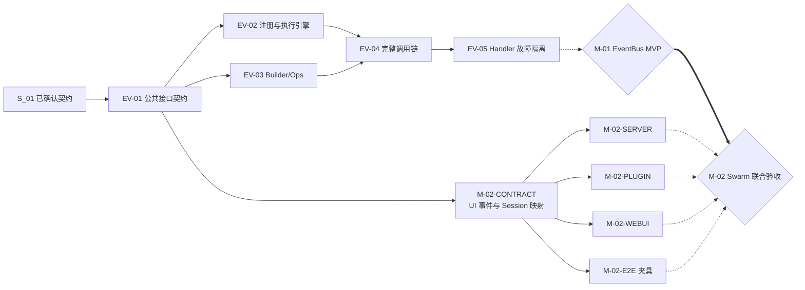

# Events 特性开发计划

## 1. 计划范围与维护规则

- **目标：** 用 6 个可认领、可验证的工作项交付 Events。
- **本期工作项：** EV-01～EV-06，共 6 项；M-01、M-02 是交付节点，不计入工作项数量。
- **负责人：** EV-01～EV-05 及 M-01、M-02 由张瑶负责；本轮增量 EV-06 由刘瑜负责。
- **模块边界：** Events 只提供通用事件机制，不依赖 JiuwenSwarm、具体业务执行器或插件管理实现。
- **外部范围：** UI 事件名和 payload、AgentServer、插件装卸、WebUI、E2E 环境由 JiuwenSwarm 对端计划维护。
- **公共契约：** 以 [S_01](../specs/S_01_events-contract.md) 为唯一来源。
- **维护日期：** 2026-10-22。
- **进度摘要：** 完成 6/6；EV-01～EV-06 已完成；M-01、M-02 未验证。

每个未完成工作项开工前，在 `docs/features/` 建立对应 feature 文档，记录实现文件、接口影响、验收命令和实际结果。当前状态和证据只在第 4 节维护。

## 2. 实际开发工作项

### EV-01 公共接口契约可供外部开发

- **目标与范围：** 提供稳定、可导入、可类型检查的公共接口，使 Swarm 可以基于 Protocol 和自有 Fake 并行开发。
- **交付范围：**
  1. EventType、EventInput、EventOutput、HandlerId、OPS_BUILD_EVENT_TYPE。
  2. HandlerLevel、Event、SessionContext、PackageMetadata、MatchPattern。
  3. EventNext、EventHandlerOpsBuilder、EventHandlerOps、ExtensionEventBusProtocol。
  4. 7 个 Events StatusCode、`__all__` 和接口契约测试。
- **不交付：** ExtensionEventBus、Builder/Ops 真实实现、Fake Bus、注册表和执行链。
- **关键签名：**
  - `register_event_type(event_type, match_pattern_func, core_handler)`。
  - `register_event_handler(event_type, handler, match_pattern, handler_level=USER)`。
  - `Builder.build(package_metadata=None, session_context=None)`。
  - Protocol 中没有 state、initialize 或 close。
- **开工硬前置：** 无。
- **错误契约：** scope 为 `EVENTS`，号段为 `200000`～`200999`，7 个码使用 `200001`～`200007`；不新增 Events 异常类。
- **验收标准：**
  1. EV-01-V-01：公共导出与 S_01 一致。
  2. EV-01-V-02：值对象只读，Protocol 参数、默认值和返回类型一致。
  3. EV-01-V-03：消费方自建最小 Fake 可满足 Protocol；Core 不发布 Fake Bus。
  4. EV-01-V-04：7 个 StatusCode 名称合法、数值唯一并解析为 ValidationError。
- **联合交付：** EV-01 完成后，Swarm 可以开始 M-02 的契约、Server、插件和 WebUI 模拟开发；真实运行时验收仍等待 M-01。

### EV-02 EventBus 可注册并执行事件链

- **目标与范围：** 连续完成注册表、匹配快照和 Handler 执行链，对外形成一致的事件调度行为。
- **交付范围：**
  1. 事件、唯一 CORE、USER / BUILTIN Handler 的原子注册和注销。
  2. HandlerId、注册序号、只读 MatchPattern 和 `ops.` 前缀保护。
  3. 同步匹配、USER → BUILTIN → CORE 排序和稳定执行快照。
  4. EventNext、next、to、短路、反向返回、异常和取消传播。
- **不交付：** Builder/Ops、Session 投影、逐 Handler Ops、`ops.build` 调度和完整业务 `trigger()` 集成。
- **开工硬前置：** EV-01 的公共模型、Protocol 和错误码。
- **验收标准：**
  1. EV-02-V-01：三参数事件登记原子完成；重复、非法登记和非唯一 CORE 被拒绝。
  2. EV-02-V-02：USER / BUILTIN Handler 可登记并幂等注销；注销 EventType 时同步级联删除其 USER / BUILTIN Handler、HandlerId 索引和事件定义；普通入口拒绝 CORE；EV-02 注册记录不含 PackageMetadata，EV-04 起改为随注册记录保存。
  3. EV-02-V-03：匹配结果和同层注册顺序正确；无扩展命中时只保留 CORE。
  4. EV-02-V-04：匹配返回 False 只排除当前 Handler；抛错或返回非 bool 时调用失败。
  5. EV-02-V-05：已生成快照不受后续注册或注销影响，新快照反映最新注册表。
  6. EV-02-V-06：完整链按 USER → BUILTIN → CORE 进入并反向返回。
  7. EV-02-V-07：to(BUILTIN)、to(CORE) 和短路只执行约定范围。
  8. EV-02-V-08：跨任务或失效 EventNext 被拒绝。
  9. EV-02-V-09：event_type 变更被拒绝；event_input 可调整但不重新匹配。
- **联合交付：** EV-02 与 EV-03 在 EV-04 汇合，不单独声明 EventBus 运行时可用。

### EV-03 Builder 可构建独立 Ops

- **目标与范围：** 实现独立于 EventBus 执行引擎的能力目录和上下文 Ops。
- **交付范围：** Builder/Ops 公开具体类、namespace/method 登记、动态访问、Ops 构造和上下文隔离；不引入 Ops 失效机制。
- **关键边界：** `Builder.build(package_metadata, session_context)` 保留 package_metadata；Builder 不保存可变的当前包或当前会话。
- **开工硬前置：** EV-01 的 EventHandlerOpsBuilder、EventHandlerOps、PackageMetadata 和 SessionContext 契约。
- **验收标准：**
  1. EV-03-V-01：Builder/Ops 为公开具体类；合法能力可登记，非法名称、重复和同步函数被拒绝。
  2. EV-03-V-02：同一 Builder 顺序以不同 PackageMetadata / SessionContext 构建两个 Ops，随后可并发调用共享能力且上下文相互隔离。
  3. EV-03-V-03：动态调用把当前 Ops 传给能力；未知 namespace/method 被拒绝，业务异常和取消原样传播。
  4. EV-03-V-04：多个 Ops 可共享能力并发调用（2026-10-21 删除冻结契约后，原“freeze 后 add 被拒绝”不再适用）。
- **联合交付：** EV-03 与 EV-02 在 EV-04 汇合，不保存 EventBus 注册表或执行状态。

### EV-04 EventBus 可完成 Build 和业务调用

- **目标与范围：** 将 EV-02 的执行引擎与 EV-03 的 Builder/Ops 组合为完整 EventBus。
- **交付范围：**
  1. Bus 构造时由 bootstrap 按 `event_types → handler_ops → event_handlers` 自动注册 Core 预置内容，只注册不触发事件；本期只预置 `ops.build` 内置事件和 Build CORE。
  2. 宿主显式触发 Build 后 Bus 保存 Builder，以及 Build Handler 变更门禁。
  3. 普通 `trigger()` 的 Builder 可用性门禁：只判断 Bus 是否已保存 Builder。
  4. `register_event_handler()` 仅关键字 `package_metadata`、Session 投影和逐 Handler Ops。
  5. 名词/动词能力和嵌套事件。
- **不交付：** initialize、公开状态机、close、drain 和 Build 锁；不支持并发 Build，由宿主串行触发。
- **包上下文边界：** USER / BUILTIN 的 PackageMetadata 随 Handler 注册记录保存，构建 Ops 时传入；CORE 使用 None。不从 Event 或 Session 推断。
- **开工硬前置：** EV-02 的稳定执行链和 EV-03 的 Builder/Ops。
- **验收标准：**
  1. EV-04-V-01：宿主显式 `trigger(ops.build)`，Build 链只接受第一次成功结果。
  2. EV-04-V-02：异常、取消、非法结果或能力冲突时丢弃部分结果，首次成功前允许重试。
  3. EV-04-V-03：Build 成功后，重复 Build 和 Build Handler 变更被拒绝。
  4. EV-04-V-04：Bus 尚未保存 Builder 时普通业务 trigger 失败；普通 trigger 不执行 Build。
  5. EV-04-V-05：SessionContext、单智能体 Session 和 None 按 S_01 规范化。
  6. EV-04-V-06：每个实际进入的 Handler 只构建一次 Ops；被跳过的 Handler 不构建 Ops。
  7. EV-04-V-07：名词能力直接执行；动词能力触发独立新链且不自动推进原链。
  8. EV-04-V-08：嵌套调用的 Session 传递正确，异常和取消沿等待关系传播。
- **联合交付：** EV-04 验收通过后进入 EV-05；M-01 必须等待故障隔离语义完成。

### EV-05 扩展 Handler 故障隔离与输出校验

- **优先级：** P0；阻止单个扩展 Handler 击穿 AgentLoop，是 M-01 的硬前置。
- **目标与范围：** USER 与 BUILTIN 使用同一套固定 skip 规则。Handler 自身异常、非 awaitable、输入/输出协议违规时跳过当前 Handler；已执行的下游或 CORE 不得因恢复逻辑重放。
- **交付范围：**
  1. EventType 注册增加可选、仅关键字的 `input_validator` 与 `output_validator`；现有三参数注册和未声明 Validator 的事件保持原行为。
  2. 校验顺序：初始输入 → matcher → Handler → EventNext 新输入 → 下游 → Handler/CORE 输出；`ops.build` 通过普通注册参数声明 Validator，无专用容错分支。
  3. 每次 USER / BUILTIN Adapter 调用仅用局部事实记录下游执行次数、最后成功输出与最后失败；不写入 Bus、Session 或持久化状态。
  4. 下游尚未执行：用该 Handler 收到的原始 Event 继续下游一次；最后一次下游成功：复用该结果（含合法 `None`）；最后一次下游失败：传播该失败，不重跑下游。
  5. 对被隔离的 Handler 写一条 Core error 日志（`event_type`、`handler_id`、`handler_level`、可用的 `package_id`、异常信息），不记录业务 payload，不新增诊断对象或前端错误协议。
- **固定失败边界：**
  - USER / BUILTIN 自身故障（异常、非 awaitable、转发输入或输出 Validator 返回 `False`）：进入上述 skip 恢复。
  - CORE、下游 Handler、Validator 自身故障及 `asyncio.CancelledError`：原样传播，不适用 skip。
  - matcher、Ops 构建等框架错误：原样传播。
- **不交付：** Handler 超时、`.catch()`、策略枚举、自动重试、熔断、自动禁用、Worker/进程隔离、副作用回滚。Handler 超时与 `.catch()` 作为二期独立特性评估。
- **开工硬前置：** EV-04 完整调用链；[F_05](../features/F_05_ev05-handler-fault-tolerance.md) 已建档；S_01、概览、架构与本节 EV-05 范围已对齐。
- **验收标准：** 见 F_05 第 8.1 节 EV-05-V-01～V-14（注册兼容、USER/BUILTIN 前置与后置故障、禁止重放、初始/转发输入、Validator/CORE/取消传播、`ops.build` 通用链路、error 日志与回归）。
- **联合交付：** EV-05 验收通过后进入 M-01 EventBus MVP 联合场景验证。

### EV-06 宿主按 Handler ID 限定派发

- **目标与范围：** trigger 增加默认 None 的仅关键字 handler_ids，可消费 Runtime 已公开的注册 ID；候选缩小后仍走原 matcher/层级/容错。
- **负责人及状态：** 见第 4 节；关联 [F_06](../features/F_06_handler-selection.md) 与 [S_01](../specs/S_01_events-contract.md)。
- **必要前置：** EV-04/05；Server PR06 消费该机制，不把包激活策略放入 Core。
- **验收：** 省略/空/混合/非法白名单、快照与注销、USER/BUILTIN、Validator/取消/故障隔离、旧调用兼容和真实宿主包定向调用。
- **边界：** 无业务事件或 Ops，非授权；不改变原 M-01 的 EV-01～05 MVP 里程碑范围。

## 3. 依赖关系与开发顺序



### 3.1 Core 开发顺序

1. EV-01 已完成，公共接口已经可以被 Core 和 Swarm 共同引用。
2. EV-02 和 EV-03 只依赖 EV-01，代码边界独立，可以并行开发。
3. EV-02 和 EV-03 全部通过后，执行 EV-04 完整调用链集成。
4. EV-04 只组装已有执行引擎和 Builder/Ops，并补齐跨模块门禁，不重复实现前两项的内部能力。
5. EV-04 完成后执行 EV-05；先同步失败与输入/输出校验契约，再实现 USER / BUILTIN 固定 skip 与禁止重放，最后进入 M-01。

建议 EV-02、EV-03、EV-04、EV-05 分别提交 PR；已经完成的 EV-01 不再作为待开发工作重复排期。

### 3.2 M-02 如何并行

EV-01 已完成，Swarm 不需要等待真实 EventBus 即可开展以下工作：

| 工作包 | 可以先做什么 | 等待什么才能真实验收 |
| --- | --- | --- |
| M-02-CONTRACT | 定义 UI 事件字符串、payload、SessionContext 映射、错误到 UI 状态映射 | EV-01 公共接口已具备 |
| M-02-SERVER | 用消费方自有 Fake 完成 AgentServer 注册、显式 trigger(ops.build) 和业务触发适配 | M-01 真实 Bus |
| M-02-PLUGIN | 用自有 Fake 完成 USER Handler 登记/注销；登记时传入已核实的 PackageMetadata | M-01 快照、故障隔离语义和真实调用 |
| M-02-WEBUI | 用 Mock payload 完成上行操作与下行渲染 | M-02-CONTRACT |
| M-02-E2E | 预建环境、插件样例、测试数据和断言 | M-01 与上述真实实现 |

停止路径不依赖 Events close：AgentServer 停止接收请求，等待自己创建的 trigger 任务，再释放插件和 Bus。插件注销只阻止新快照，运行时负责等待其管理的在途使用。

### 3.3 交付节点

- **M-01 EventBus MVP：** EV-01～EV-05 全部通过。使用 Fake 业务 CORE/能力验证 `宿主 trigger(ops.build) → Bus 保存 Builder → 普通事件 → USER/BUILTIN/CORE → 故障扩展 Handler 被隔离且下游不重复 → 嵌套事件 → 返回`。
- **M-02 Swarm 联合验收：** M-01 加 M-02-CONTRACT/SERVER/PLUGIN/WEBUI/E2E。验证真实事件上行、页面下行、插件装卸、在途等待和宿主停止。

M-02 外部开发可以基于 EV-01 和消费方自有 Fake 并行，但 Mock 结果不代表真实 EventBus 已接通。

## 4. 开发计划与进展

| ID / 名称 | 状态 | 负责人       | 硬前置 | 验收状态 | 进展说明 |
| --- | --- |-----------| --- | --- | --- |
| EV-01 公共接口契约 | 完成 | 张瑶        | 无 | EV-01-V-01～04 通过 | 公共模型、Protocol、错误码及导出已实现；`tests/unit_tests/core/events/test_events_contract.py` 8 项通过 |
| EV-02 EventBus 注册与执行引擎 | 完成 | 张瑶        | EV-01 | EV-02-V-01～09 通过 | 注册表、匹配快照、分层执行链和 EventNext 已实现；EV-02 专项、EV-01 契约及 callback wrap 回归共 69 项通过 |
| EV-03 Builder/Ops | 完成 | 张瑶        | EV-01 | EV-03-V-01～04 通过 | 公开具体类、上下文隔离和动态调用已实现；EV-03 专项 25 项、Events 回归 64 项通过（冻结契约已于 2026-10-21 删除，现专项 21 项） |
| EV-04 完整调用链集成 | 完成 | 张瑶        | EV-02、EV-03 | EV-04-V-01～08 通过 | builtin 自动注册、外部 Build（只校验结果类型）、状态门禁、Session 规范化、逐 Handler Ops 和 `ExtensionEventBus` 导出已实现；EV-04 集成 5 项、Events 回归 67 项通过；V-02 的异常/取消与 V-06 的跳过不构建、V-08 的异常传播复用 EV-02/EV-03 覆盖，未新增专项用例 |
| EV-05 扩展 Handler 故障隔离 | 已完成 | 张瑶        | EV-04 | EV-05-V-01～14 已覆盖；Events + callback 468 passed | 外部取消 `trigger()` 未单独覆盖；二期超时/`.catch` 不在范围 |
| EV-06 宿主限定派发 | 完成 | 刘瑜 | EV-04/05 | 568 项通过，见 F_06 | handler_ids 机制、Protocol 及真实 Registry 定向调用已验证；不代表 Server 模型回复联调 |
| M-01 EventBus MVP | 待开始 | 张瑶        | EV-01～EV-05 | 联合场景未执行 | 使用真实 Bus 和 Fake 业务能力 |
| M-02 Swarm 联合验收 | 待开始 | 张瑶、李雷、李志远 | M-01、五个外部工作包 | 联合场景未执行 | 对端实现进度由 Swarm 计划维护 |

本期进度统计 EV-01～EV-06 六个实际工作项，交付节点不计入特性数量。

## 附录 A. 验证命令基线

每个工作项按实际改动选择并记录以下命令：

```text
make test TESTFLAGS="tests/unit_tests/core/events/"
make type-check
make check
git diff --check
```

接口测试不能替代行为测试，行为单测不能替代 M-02 真实宿主联调。

## 附录 B. 变更记录

| 日期 | 版本  | 变更 | 未解决项 |
| --- |-----| --- | --- |
| 2026-10-19 | 1.0 | 将当前计划统一编排为 EV-01～EV-04；公共接口契约记为 EV-01 并标记完成；其余三个编号分别对应注册与执行引擎、Builder/Ops、完整调用链集成 | 真实 Session 输入、包上下文包装层和容量参数仍待后续 feature 或联调验证 |
| 2026-10-21 | 1.1 | EV-04 完成，记录验收结果；实现记录见 F_04 第 6 节 | M-01 联合场景未执行；`ops.build` Handler 注册期级别/模式不强制 |
| 2026-10-22 | 1.2 | 新增 P0 工作项 EV-05，确定一期 USER Handler 固定 skip、下游结果复用和输出校验边界；M-01 改为依赖 EV-01～EV-05 | EV-05 尚未建立 feature、同步公共契约或开始实现；二期 `.catch` 尚未设计 |
| 2026-10-23 | 1.3 | EV-05 范围对齐 F_05：USER/BUILTIN 统一 skip、input/output Validator、禁止下游重放；同步 S_01、概览、架构与本计划 | 代码与 EV-05-V-01～14 测试尚未执行 |
| 2026-10-23 | 1.4 | EV-05 实现并验收：Validator、USER/BUILTIN skip 与禁止重放、`ops.build` 通用 Validator | 见 F_05 第 8.2 节；M-01 联合场景待执行 |
