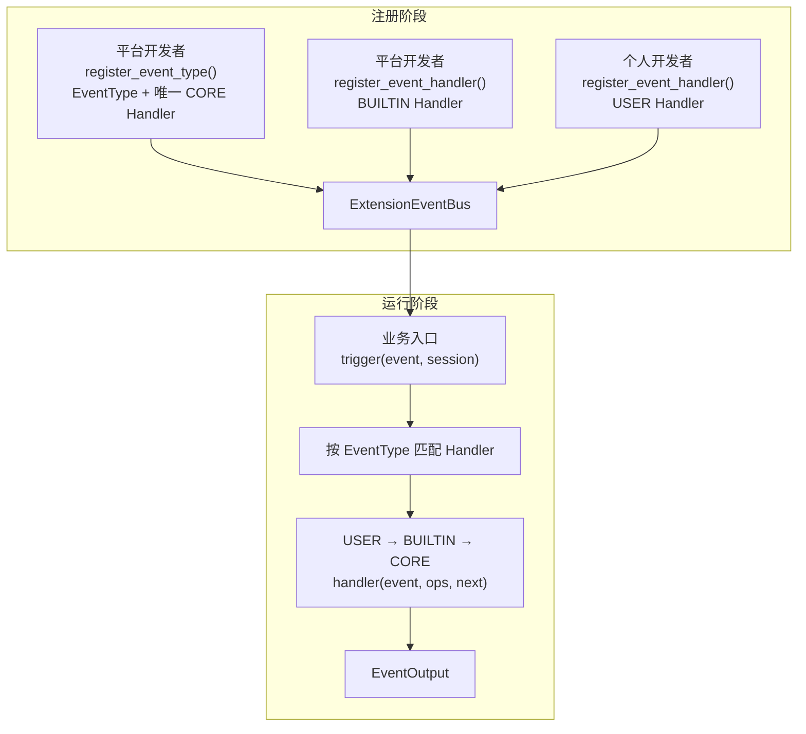

# ExtensionEventBus 事件与扩展开发指南

## 1. 机制简介

`ExtensionEventBus` 为平台业务提供统一的事件扩展入口。注册阶段登记 EventType、CORE Handler、BUILTIN Handler 和 USER Handler；运行阶段由业务代码调用 `trigger()`，EventBus 匹配 Handler，并按照 `USER → BUILTIN → CORE` 执行完整事件链。



精确公共接口以 [S_01 Events 公共契约](../specs/S_01_events-contract.md)为准，整体架构见[事件机制详细架构](events-architecture.md)。

## 2. 初始化与预置注册

### 2.1 初始化流程

创建 `ExtensionEventBus` 时，构造函数会调用 `register_builtins()`，自动注册平台预置的 EventType、CORE Handler、BUILTIN Handler 和 Ops Build Handler。

初始化只完成预置内容注册，不执行 `ops.build`，也不触发普通事件。宿主完成全部注册后，需要显式触发 `ops.build`；业务事件则由实际业务入口调用 `trigger()` 触发。

### 2.2 预置目录与加载顺序

`register_builtins()` 依次扫描以下目录，并调用每个模块的 `register(bus)`：

```text
builtins/
├── event_types/      # 预置 EventType 和 CORE Handler
├── handler_ops/      # 预置 Ops Build Handler
└── event_handlers/   # 预置 BUILTIN Handler
```

固定加载顺序为 `event_types → handler_ops → event_handlers`。同一目录按模块名排序；子目录以及 `_` 开头的模块不会加载。被加载的模块必须提供可调用的 `register(bus)`。

个人扩展的 USER Handler 不放入预置目录，由扩展运行时调用注册接口。

### 2.3 后续开发入口

- 新增 EventType 和 CORE Handler：见第 3 章。
- 新增 USER / BUILTIN Handler：见第 4 章。
- 新增和使用 Ops：见第 5 章。

## 3. 新增 EventType

### 3.1 开发步骤

在 `builtins/event_types/` 下新增模块，例如 `tool_call.py`，并完成以下内容：

1. 定义事件名。事件名必须由至少两段小写名称组成，例如 `tool.call`。
2. 定义事件输入和输出的数据结构。
3. 实现同步匹配函数，用事件输入匹配 Handler 的 `MatchPattern`。
4. 实现异步 CORE Handler，承接平台默认行为。
5. 实现 `register(bus)`，调用 `register_event_type()` 一次性注册事件、匹配函数和 CORE Handler。
6. 在真实业务入口调用 `bus.trigger()`，不能只注册不触发。

### 3.2 注意事项

- EventType 必须匹配 `segment.segment` 形式；每段只能使用小写字母、数字和下划线，并以小写字母开头。
- 一个 EventType 只能注册一次，并且必须同时提供唯一的 CORE Handler。
- 匹配函数必须同步返回 `bool`。抛异常或返回其他类型时，整次触发失败。
- CORE Handler 与普通 Handler 使用相同签名：`async (event, ops, event_next)`。
- CORE 不参与 Pattern 筛选，始终位于事件链尾部。
- 可通过 `register_event_type(..., input_validator=..., output_validator=...)` 声明同步 Validator（严格返回 `bool`）；未声明时 EventBus 不校验业务输入输出结构。Validator 抛异常或返回非 `bool` 时整次触发失败。
- EventType 注册成功只表示 Bus 已认识该事件，不表示真实业务入口已经接入。
- 普通事件必须在 `ops.build` 成功后触发，否则返回 `EVENTS_STATE_INVALID`。
- `trigger()` 是进程内异步调用，不提供跨进程投递、持久化、自动重试或失败恢复。
- 注销 EventType 会同时删除它的 USER / BUILTIN Handler。
- 链内只能修改 `event_input`，不能通过 EventNext 改变 `event_type`。
- 当前代码只对 `ops.build` 提供特殊 Build 语义；不要为普通业务事件复用这个名字。

### 3.3 完整示例

下面新增一个 `tool.call` 事件。示例中的 CORE Handler 代表平台已有的工具执行入口。

```python
# openjiuwen/core/events/builtins/event_types/tool_call.py
from __future__ import annotations

from dataclasses import dataclass
from typing import TYPE_CHECKING

from openjiuwen.core.events import (
    Event,
    EventHandlerOps,
    EventNext,
    EventOutput,
    EventType,
    MatchPattern,
)

if TYPE_CHECKING:
    from openjiuwen.core.events import ExtensionEventBus


TOOL_CALL_EVENT_TYPE: EventType = "tool.call"


@dataclass(frozen=True, slots=True)
class ToolCallInput:
    tool_name: str
    arguments: dict[str, object]


@dataclass(frozen=True, slots=True)
class ToolCallOutput:
    tool_name: str
    result: object


def match_pattern_func(event_input: object, match_pattern: MatchPattern) -> bool:
    # Matcher 必须同步返回 bool；这里按工具名称筛选 Handler。
    if not isinstance(event_input, ToolCallInput):
        return False
    expected_name = match_pattern.get("tool_name")
    return expected_name is None or expected_name == event_input.tool_name


async def core_handler(
    event: Event,
    ops: EventHandlerOps | None,
    event_next: EventNext,
) -> EventOutput:
    # 当前 CORE 不需要 Ops，也不会继续推进；保留参数以符合统一 Handler 签名。
    if not isinstance(event.event_input, ToolCallInput):
        raise TypeError("tool.call requires ToolCallInput")

    # CORE 位于链尾，负责调用平台已有的工具执行器。
    return ToolCallOutput(
        tool_name=event.event_input.tool_name,
        result={"arguments": event.event_input.arguments},
    )


def register(bus: ExtensionEventBus) -> None:
    # 注册 EventType 时一并确定 Matcher 和唯一 CORE Handler。
    bus.register_event_type(
        TOOL_CALL_EVENT_TYPE,
        match_pattern_func,
        core_handler,
    )
```

业务入口只负责构造 Event 并触发：

```python
# 业务入口只触发事件，不手工执行各层 Handler。
result = await bus.trigger(
    Event(
        "tool.call",
        ToolCallInput(tool_name="bash", arguments={"command": "pwd"}),
    ),
    session,
)
```

## 4. 新增 Handler

### 4.1 开发步骤

1. 确认目标 EventType 已经注册。
2. 实现异步 Handler，签名为 `async (event, ops, event_next)`。
3. 为 Handler 配置 `MatchPattern`。
4. 平台预置逻辑注册为 BUILTIN；个人扩展注册为 USER。
5. 保存 `register_event_handler()` 返回的 HandlerId，用于后续注销。

平台预置 Handler 放在 `builtins/event_handlers/`，由 Bootstrap 自动调用 `register(bus)`。个人扩展不写入预置目录，由扩展运行时调用公共注册接口。

Handler 需要读取所属包信息时，参见 [F_06 的使用说明](../features/F_06_ops-package.md#5-使用方式与实现)。

### 4.2 注意事项

Handler 有五种常用控制方式：

| 写法 | 行为 |
| --- | --- |
| `await event_next(event)` | 进入当前链中的下一条 Handler |
| 直接 `return result` | 短路，后续 Handler 和 CORE 不再执行 |
| `await event_next.to(event, HandlerLevel.BUILTIN)` | USER 跳过剩余 USER，从 BUILTIN 开始执行 |
| `await event_next.to(event, HandlerLevel.CORE)` | USER / BUILTIN 跳过中间层，直接执行 CORE |
| 多次调用 `event_next(event)` | 每次都从相同下一节点重新执行下游链 |

正常调用形成洋葱结构。例如 U1、B1、CORE 的进入和返回顺序是：

```text
U1 enter → B1 enter → CORE → B1 exit → U1 exit
```

Handler 可以构造同 EventType 的新 Event 并替换 `event_input`，但 EventBus 不会重新匹配 Handler。命中集合在 `trigger()` 进入执行链前已经固定。
- USER 只能跳到 BUILTIN 或 CORE；BUILTIN 只能跳到 CORE；不能跳回外层或跳到同层。
- EventNext 只能在当前 Handler 执行期间。
- Handler 返回、抛错或取消后，EventNext 立即失效。
- EventNext 不能改变 `event_type`。
- 多次推进不会去重。下游 Handler、CORE 和外部副作用都会重复执行。
- EventBus 不自动重试 Handler，也不回滚已经发生的副作用。
- USER / BUILTIN Handler 抛异常、返回非 awaitable、转发输入或输出未通过 Validator 时被跳过并记录一条 error 日志：下游未执行则用原始 Event 继续，已成功则复用最后一次结果，已失败则传播该错误；不会重放下游。
- CORE 异常、下游异常、Validator 自身故障（即使被 Handler 捕获）、matcher / Ops 构建错误和 `CancelledError` 会继续向外传播。Handler 内的 EventNext 误用、Ops 方法或 Builder 报错若未被 Handler 处理，视为 Handler 故障并被跳过。

### 4.3 完整示例

下面分别展示正常调用、短路、跳层和重复调用。Handler 不使用某个参数时可以直接保留，不需要执行 `del`。

```python
# openjiuwen/core/events/builtins/event_handlers/tool_call_audit.py
from __future__ import annotations

from typing import TYPE_CHECKING

from openjiuwen.core.events import (
    Event,
    EventHandlerOps,
    EventNext,
    HandlerLevel,
)

if TYPE_CHECKING:
    from openjiuwen.core.events import ExtensionEventBus


async def audit_handler(
    event: Event,
    ops: EventHandlerOps | None,
    event_next: EventNext,
) -> object:
    # 先处理请求，再推进链路，最后处理下游返回值。
    # 实际项目可在这两个位置分别记录调用前、调用后审计信息。
    result = await event_next(event)
    return result


def register(bus: ExtensionEventBus) -> None:
    # 预置模块由 Bootstrap 自动发现；register() 只负责登记 Handler。
    bus.register_event_handler(
        "tool.call",
        audit_handler,
        {},
        HandlerLevel.BUILTIN,
    )
```

个人扩展可以按需要选择短路、跳层或重复推进：

```python
from openjiuwen.core.events import (
    Event,
    EventHandlerOps,
    EventNext,
    HandlerLevel,
    PackageMetadata,
)
from openjiuwen.core.events.builtins.event_types.tool_call import (
    ToolCallInput,
    ToolCallOutput,
)


async def block_dangerous_command(
    event: Event,
    ops: EventHandlerOps | None,
    event_next: EventNext,
) -> object:
    # 直接返回会短路执行链，后续 BUILTIN 和 CORE 都不会执行。
    if isinstance(event.event_input, ToolCallInput):
        return ToolCallOutput(event.event_input.tool_name, "blocked")
    return await event_next(event)


async def skip_to_core(
    event: Event,
    ops: EventHandlerOps | None,
    event_next: EventNext,
) -> object:
    # USER Handler 可以跳过剩余 USER / BUILTIN，直接进入 CORE。
    return await event_next.to(event, HandlerLevel.CORE)


async def execute_twice(
    event: Event,
    ops: EventHandlerOps | None,
    event_next: EventNext,
) -> object:
    # 两次推进会把相同的下游链完整执行两次。
    first = await event_next(event)
    second = await event_next(event)
    return first, second


# 扩展运行时负责提供可信的 PackageMetadata，并保存返回的 HandlerId。
handler_id = bus.register_event_handler(
    "tool.call",
    skip_to_core,
    {"tool_name": "bash"},
    HandlerLevel.USER,
    package_metadata=PackageMetadata(
        package_id="example.extension",
        package_version="1.0.0",
    ),
)

# 卸载扩展时注销；已经进入执行链的旧调用不会被中断。
bus.unregister_event_handler(handler_id)
```

`execute_twice` 只适合明确允许重复执行的无副作用场景。工具调用、写文件、扣费、发消息等操作必须由业务层提供幂等保护，否则不要重复推进。

## 5. 新增和使用 Ops

### 5.1 开发步骤

Ops 用于向 Handler 提供平台能力。开发一个 Ops 能力需要：

1. 在 `builtins/handler_ops/` 下新增模块。
2. 实现异步 OpsMethod，第一个参数必须是当前 `EventHandlerOps`。
3. 实现一个 `ops.build` BUILTIN Handler。
4. 先调用 `event_next(event)` 取得下游创建的 Builder。
5. 调用 `builder.add_namespace()` 和 `builder.add_method()` 注册能力。
6. 实现 `register(bus)`，将 Build Handler 注册到 `ops.build`。
7. 宿主完成所有注册后，显式触发一次 `ops.build`。

普通事件进入每个实际命中的 Handler 前，EventBus 会基于共享 Builder 创建独立 Ops，并绑定该 Handler 的 PackageMetadata 和当前 SessionContext。

### 5.2 注意事项

Handler 通过动态路径调用能力：

```python
cwd = await ops.session.cwd()
result = await ops.tool.call("bash", {"command": "pwd"})
```

OpsMethod 可以读取：

- `ops.session_context`：本次事件的会话信息。
- `ops.package_metadata`：当前 USER / BUILTIN Handler 注册时绑定的扩展包信息；CORE 为 `None`。

OpsMethod 有两种常见实现：

- 直接能力：读取或计算当前资源，例如 `session.cwd()`。
- 事件能力：内部调用 `bus.trigger()` 发起一条新的事件链，例如 `tool.call()`。

通过 Ops 发起新事件不会推进当前 Handler 的原事件链。新事件返回后，当前 Handler 仍要自行决定是否调用自己的 EventNext。
- namespace 和 method 必须是合法、非关键字、非 `_` 开头的 Python 标识符。
- namespace 不能与 `EventHandlerOps` 已有属性冲突。
- namespace 不能重复；method 所属 namespace 必须先存在，同一 namespace 下的方法不能重名。
- OpsMethod 必须使用 `async def`。
- `ops.build` 第一次成功后，同一 Bus 不能再次 Build，也不能继续增删 Build Handler。
- 首次 Build 失败时 Builder 不会保存，宿主修正注册后可以重试。
- EventBus 不提供并发 Build 保护；宿主必须串行执行 Build。
- 未知 namespace、未知 method、能力冲突和非法名称都会返回 `EVENTS_OPS_INVALID`。
- OpsMethod 的业务异常和取消会直接传播给调用它的 Handler，EventBus 不自动降级或重试；Handler 未处理的业务异常按 Handler 故障跳过，取消继续向外传播。

### 5.3 完整示例

下面新增 `session.cwd()`：

```python
# openjiuwen/core/events/builtins/handler_ops/session.py
from __future__ import annotations

from typing import TYPE_CHECKING

from openjiuwen.core.common.exception.codes import StatusCode
from openjiuwen.core.common.exception.errors import raise_error
from openjiuwen.core.events import (
    OPS_BUILD_EVENT_TYPE,
    Event,
    EventHandlerOps,
    EventHandlerOpsBuilder,
    EventNext,
    HandlerLevel,
)

if TYPE_CHECKING:
    from openjiuwen.core.events import ExtensionEventBus


async def current_cwd(ops: EventHandlerOps) -> str | None:
    # 每个 Handler 得到独立 Ops；上下文已经由 EventBus 绑定。
    if ops.session_context is None:
        return None
    return ops.session_context.cwd


async def build_session_ops(
    event: Event,
    ops: EventHandlerOps | None,
    event_next: EventNext,
) -> EventHandlerOpsBuilder:
    # Build 阶段尚未生成普通 Handler 使用的 Ops，因此这里不读取 ops。
    # 先让内层 CORE 创建 Builder，再由当前 BUILTIN 添加能力。
    builder = await event_next(event)
    if not isinstance(builder, EventHandlerOpsBuilder):
        raise_error(
            StatusCode.EVENTS_OPS_INVALID,
            reason="ops.build did not return EventHandlerOpsBuilder",
        )

    builder.add_namespace("session")
    builder.add_method("session", "cwd", current_cwd)
    return builder


def register(bus: ExtensionEventBus) -> None:
    # 初始化阶段只注册 Build Handler，不立即构建 Ops。
    bus.register_event_handler(
        OPS_BUILD_EVENT_TYPE,
        build_session_ops,
        {},
        HandlerLevel.BUILTIN,
    )
```

宿主启动时构建 Ops：

```python
from openjiuwen.core.events import (
    OPS_BUILD_EVENT_TYPE,
    Event,
    ExtensionEventBus,
    SessionContext,
)
from openjiuwen.core.events.builtins.event_types.tool_call import ToolCallInput


bus = ExtensionEventBus()
# 所有 EventType、Handler 和 Ops Build Handler 注册完成后，只 Build 一次。
await bus.trigger(Event(OPS_BUILD_EVENT_TYPE, None))

session = SessionContext(
    session_id="session-1",
    cwd="/workspace",
)
tool_call_event = Event(
    "tool.call",
    ToolCallInput(tool_name="bash", arguments={"command": "pwd"}),
)
result = await bus.trigger(tool_call_event, session)
```

普通 Handler 使用该能力：

```python
from openjiuwen.core.events import Event, EventHandlerOps, EventNext


async def handler(
    event: Event,
    ops: EventHandlerOps | None,
    event_next: EventNext,
) -> object:
    if ops is None:
        raise RuntimeError("ordinary handlers require completed ops.build")

    # Ops 能力调用不会自动推进当前事件链。
    cwd = await ops.session.cwd()
    result = await event_next(event)
    return {"cwd": cwd, "result": result}
```

如果 OpsMethod 需要发起新事件，可以在注册能力时闭包引用 Bus，并继续传递当前会话：

```python
from openjiuwen.core.events import (
    Event,
    EventHandlerOps,
    ExtensionEventBus,
    OpsMethod,
)
from openjiuwen.core.events.builtins.event_types.tool_call import ToolCallInput


def create_call_tool(bus: ExtensionEventBus) -> OpsMethod:
    """创建绑定当前 Bus 的 tool.call OpsMethod。"""

    async def call_tool(
        ops: EventHandlerOps,
        tool_name: str,
        arguments: dict[str, object],
    ) -> object:
        # 动词型 OpsMethod 显式触发一条新的事件链，并沿用当前会话。
        return await bus.trigger(
            Event("tool.call", ToolCallInput(tool_name, arguments)),
            ops.session_context,
        )

    return call_tool
```

### 5.4 内置 package 能力

Handler 可使用预置的 `ops.package` 能力读取所属包的根目录和包 ID。
方法说明、调用前提、Handler 示例及登记流程见
[F_06 包信息读取能力](../features/F_06_ops-package.md#5-使用方式与实现)。
