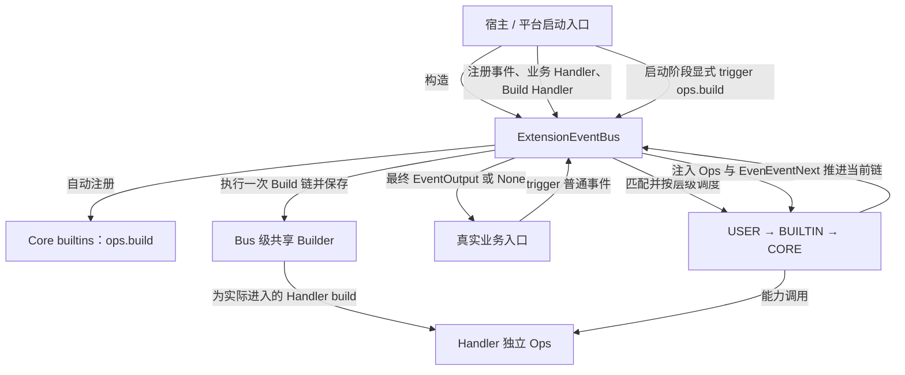
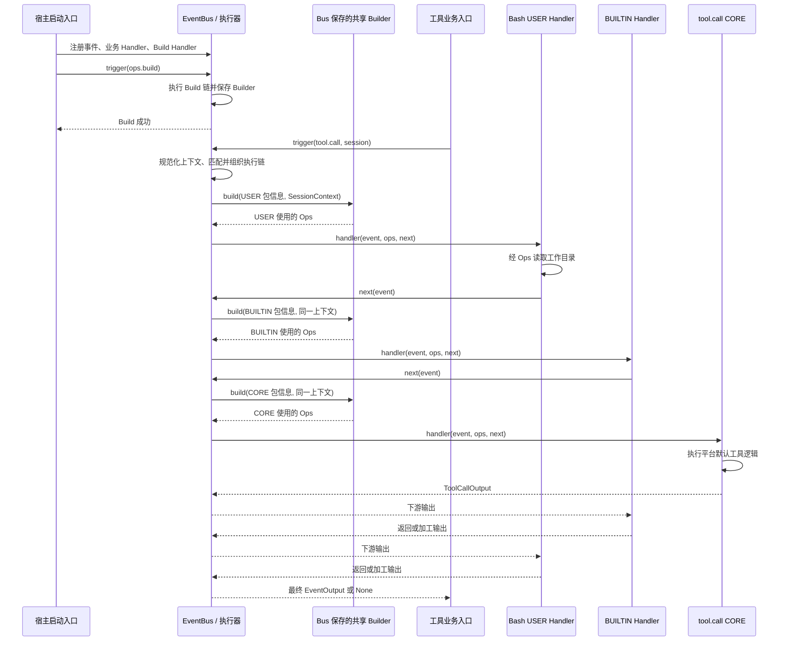

# ExtensionEventBus 事件机制设计概览

## 文档状态与阅读说明

| 项 | 说明 |
| --- | --- |
| 类型 | 已实现架构概览；EV-01～EV-04 已落地，真实业务接入与联合验收尚未完成 |
| 最近一次修订日期 | 2026-10-21 |
| 维护责任 | Events 模块维护者；具体负责人待认领 |
| 所属模块 | `agent-core/openjiuwen/core/events/` |
| 详细设计 | [事件机制详细架构](events-architecture.md)；展开机制细节和历史设计，尚需按当前实现同步 |
| 目录规范与模板 | [Events 维护规范](../../AGENTS.md)、[Core Overview 模板](../../../docs/templates/overview-template.md) |
| 关键待确认项 | M-01 EventBus MVP 联合验收、M-02 真实平台集成，以及宿主授权、卸载排空和容量限制，见第 5.2 节 |

本文面向平台开发者、个人扩展开发者，以及参与设计评审、开发和测试的人员。第 1～4 节描述当前 Core 实现的架构和运行约束；第 5 节说明实现证据、真实接入缺口和待验证边界。

本文只维护高层设计，不复制精确接口和验收台账。公共契约以 [S_01 规范](../specs/S_01_events-contract.md)为准，具体实现和验证记录见 F-01～F-04，阶段进度见[开发计划](events-development-plan.md)。

设计沿用历史 `rsi_native_agent_os` 事件机制中的三层链和会话投影，但当前实现采用“宿主显式执行一次 `ops.build`、Bus 保存 Builder、普通事件按 Handler 构建独立 Ops”的生命周期。

图表表示同一进程内的逻辑调用和数据交接。业务调用方通过一次 `await trigger(...)` 等待结果；本设计没有独立的消息消费或结果投递阶段。

| 阅读目的 | 阅读位置 |
| --- | --- |
| 了解目标、典型场景和范围 | 第 1 节 |
| 确认职责、对象和事实来源 | 第 2 节 |
| 区分 Ops 能力调用与链路推进 | 第 2.4 节 |
| 理解注册、显式构建、事件执行、接入路径和完成口径 | 第 3 节 |
| 理解上下文、执行控制和资源约束 | 第 4 节 |
| 核对当前基础、接入缺口及文档归属 | 第 5 节 |

## 1. 目标与范围

### 1.1 定位与目标

ExtensionEventBus 为平台业务提供统一的事件扩展入口。平台先定义支持的事件类型、匹配规则及默认处理逻辑，平台内置扩展和个人扩展再注册各自的事件处理器（Handler）。业务发生时，调用方通过 `trigger(event, session)` 发起一次事件调用，由 EventBus 匹配 Handler、组织执行链并返回结果。

以工具调用为例：平台可以登记 `tool.call` 事件及实际执行工具的 CORE Handler，个人开发者再注册仅匹配 Bash 工具的 USER Handler。业务入口触发 Bash 调用后，个人 Handler 可读取会话工作目录、继续调用链，并在工具结果返回后加工输出。`tool.call` 和 `session.cwd()` 当前只是接入示例，尚未成为 Core 内置业务能力。

这条链路要实现三个目标：平台用唯一 CORE Handler 承接默认行为，扩展按确定顺序增加前后处理，业务入口取得扩展处理后的最终输出。EventHandlerOps（下文简称 Ops）向各层 Handler 提供平台能力，EventHandlerOpsBuilder（下文简称 Builder）负责收集能力并构建 Ops。

### 1.2 职责与范围边界

Events 负责事件类型和 Handler 的注册、注销、匹配、分发及执行链控制。输入是事件及可选的会话信息，输出是当前调用链产生的 `EventOutput` 或 `None`。

业务模块负责定义事件的业务含义、输入输出和匹配规则，实现默认处理逻辑，并在真实业务入口触发事件。平台注册了事件类型，不等于实际工具入口已完成事件接入；后者必须由业务模块改造和验证。

Events 的通用基础层维护事件、上下文、Ops、Builder 和内置 Build 事件；平台实现并登记具体能力，提供会话与扩展包信息，并在资源入口执行权限检查。个人开发者为平台已有事件编写 USER Handler。Events 不反向依赖平台能力、工具执行器或包管理实现。

### 1.3 当前设计范围与后续扩展

本次概览覆盖事件注册与注销入口、USER / BUILTIN / CORE 三层 Handler、匹配与执行顺序、继续执行与短路，以及 Ops 构建和会话上下文传递。`tool.call` 和 `session.cwd()` 用于贯穿说明接入方式，实现现状见第 5.1 节。

当前实现描述的是一次 `await trigger(...)` 调用内的进程内执行链，没有定义持久化事件日志、消息队列、跨进程投递、故障重放、自动重试、流式事件协议或关闭排空接口。这些能力如后续需要，应另行明确需求和责任。

## 2. 核心模型与职责

### 2.1 总体关系

构造 ExtensionEventBus 时会自动登记 Core 内置事件。宿主完成事件、Handler 和 Ops Build Handler 注册后，显式触发一次 `ops.build`；Bus 保存构建成功的 Builder。普通事件执行时，Bus 使用这个共享能力目录为每个实际进入的 Handler 构建独立 Ops，Handler 通过 Ops 使用平台能力，通过 EventNext 推进当前链路。

`ops.build` 是启动屏障，不是普通 Handler 的前置子流程。Build 成功后，能力定义由 Bus 级 Builder 持有；包信息和 SessionContext 只在 `builder.build()` 时绑定到当前 Handler 的 Ops。CORE Handler 实现业务默认行为，EventNext 由 EventBus 注入并控制当前链的位置。

| 参与方 | 负责的行为 | 责任边界 |
| --- | --- | --- |
| Events / ExtensionEventBus | 保存事件和 Handler 注册关系，匹配并调度执行链，规范化会话输入，传入 Ops | 确认当前链路的返回；不替业务模块确认外部副作用或用户交付 |
| 平台开发者与业务模块 | 定义事件及输入输出、实现匹配函数和 CORE / BUILTIN Handler、接入真实触发入口 | 维护业务语义、默认执行结果及错误处置依据 |
| Core bootstrap | 按固定顺序发现并注册 `event_types`、`handler_ops`、`event_handlers` 内置项 | 当前仅保证 Core 内置项注册，不代替宿主业务注册 |
| 平台初始化入口 | 注册事件、业务 Handler 和 Ops Build Handler，并在开放业务前显式触发一次 Build | Build 成功后不得再次 Build，也不得修改 Build Handler |
| 扩展运行时与宿主 | 核实包来源，控制注册入口，管理扩展装卸与实例停止 | 负责等待使用相关资源的调用退出，再释放包或实例资源；生命周期建议见第 4.1 节 |
| Ops 能力提供方 | 向 Builder 注册命名空间和方法，依据当前 Ops 上下文执行能力 | 维护能力实现、资源访问和授权检查 |
| 个人扩展开发者 | 为已有事件注册 USER Handler，通过 Ops 使用能力和上下文 | 控制是否继续、跳层或短路，并返回符合该事件约定的结果 |
| 会话提供方 | agent-core 提供运行时 Session；JiuwenSwarm 查询元数据后构造 SessionContext | 对会话来源与字段含义负责，EventBus 不代查平台会话元数据 |

### 2.2 核心对象及事实来源

| 对象或事实 | 含义与关系 | 权威来源与修改责任 | 不能据此推断的事实 |
| --- | --- | --- | --- |
| EventType 与事件定义 | `EventType` 是字符串别名；一个事件类型关联匹配函数和唯一 CORE Handler | 平台定义；EventBus 保存注册关系 | 事件已注册不证明真实业务入口已触发它，也不提供运行时强类型隔离 |
| Event、EventInput、EventOutput | 一次调用及其业务输入、链路返回值 | 调用方构造输入；实际执行的 Handler 产生或加工输出 | 返回结果不证明 CORE 一定执行，也不等于外部副作用已核对 |
| Handler 注册记录 | 关联事件、回调、匹配模式、层级、注册顺序和 `PackageMetadata`；CORE 由事件类型注册创建 | EventBus 保存；注册方通过注销接口管理 | 持有 Handler 标识或包信息不代表具备额外平台权限 |
| MatchPattern 与 MatchPatternFunc | 扩展声明筛选条件，由事件所属平台定义其解释方式 | 注册方提供模式；事件定义方提供匹配函数 | 模式是筛选条件，不是授权依据 |
| EventNext | EventBus 为当前 Handler 提供的后续链路控制入口；当前实现允许同一 Handler 激活期间多次调用 | EventBus 创建并控制执行位置、Task 身份和有效期；Handler 调用 | 调用 Ops 方法不能代替推进当前事件链；多次调用会重复执行下游链 |
| SessionContext | 当前事件可使用的统一只读会话数据模型，供 Builder 绑定并经 Ops 提供 | 由运行时 Session 投影或由宿主构造；平台对元数据负责 | session_id 关联不代表已取得工作目录或资源权限 |
| 扩展包信息 | `PackageMetadata` 随 Handler 注册记录保存，构建该 Handler 的 Ops 时绑定 | 平台或扩展运行时在注册时提供 | 包关联本身不授予资源权限，也不应由事件输入替代 |
| EventHandlerOpsBuilder | Bus 级共享能力目录，由一次成功的 Build 链产生并保存 | Ops Build Handler 填充；EventBus 校验返回类型并持有 | Builder 已存在不代表具体资源在线，也不代表具备业务权限 |
| EventHandlerOps | 由共享 Builder 为每个实际进入的 Handler 独立创建，绑定该 Handler 的包信息与本次 SessionContext | EventBus 在调用 Handler 前执行 `builder.build()` | Ops 实例存在不代表能力已授权、上下文完整或业务调用成功 |

### 2.3 贯穿设计的原则

1. **事件默认行为由平台定义。** 每个 EventType 只有一个 CORE Handler，通过 `register_event_type()` 一并注册。它不参与 Pattern 筛选，位于链尾；是否实际到达它取决于前序 Handler 的控制行为。
2. **层级优先于注册先后。** 链路按 `USER → BUILTIN → CORE` 组织，同层按注册顺序进入；正常返回按调用栈反向经过已进入的 Handler。平台实现须保留这一可解释的包裹关系。
3. **Build 是一次性启动屏障。** 宿主在完成注册后显式 Build；成功后 Bus 保存 Builder，普通事件不得触发或重建能力目录。
4. **链路控制与能力访问各有入口。** EventNext 控制当前链的继续与跳层，Ops 提供平台能力；具体调用语义见第 2.4 节。
5. **上下文在入口统一，Ops 按 Handler 隔离。** EventBus 为每次普通事件规范化 SessionContext；进入每个 Handler 前，使用同一 Builder 创建绑定当前包和会话的独立 Ops。

### 2.4 Ops 能力调用与链路推进

Ops 按 `namespace.method` 动态组织平台能力，例如 `session.cwd`。运行时没有“名词方法”或“动词方法”的专用类型；二者只是能力设计分类。同一个命名空间可以包含直接访问资源的方法，也可以包含显式调用 `bus.trigger()` 发起新事件的方法，具体语义由能力实现定义。

| 调用示意 | 处理方式 | 对当前事件链的影响 |
| --- | --- | --- |
| `await ops.session.cwd()`、`await ops.session.id()` | 能力实现直接读取或计算当前会话状态，不进入 EventBus | 当前 Handler 取得结果后继续自身逻辑，后续 Handler 尚未因此执行 |
| `await ops.tool.call(...)`、`await ops.prompt.submit(...)` | 对应 OpsMethod 在实现中显式调用 `bus.trigger()`，等待一条新的 `USER → BUILTIN → CORE` 链返回 | 当前 Handler 等待新链；原链的后续部分仍须通过 EventNext 推进 |
| `await next_handler(event)` | 从当前执行位置继续已经选定的 Handler 链 | 下游返回后，当前 Handler 可以加工输出再向外返回 |

发起新事件的 OpsMethod 需要显式传递当前会话资料；新链重新匹配，各 Handler 使用自己的包信息和独立 Ops。原操作的授权边界应继续保留，不能因执行者切换到平台 CORE 而扩大权限。新链结束后，原 Handler 再决定继续或短路。

例如在 `tool.call` Handler 中，调用 `next_handler(event)` 继续当前工具处理；调用实现了 `bus.trigger()` 的 `ops.tool.call(...)` 会发起新的工具事件，可能递归进入自身。当前 EventNext 在所属 Handler 激活且由同一 asyncio Task 调用时可多次推进；每次都会从相同后续位置重新执行，不会重新匹配，也不会改变当前事件类型。

## 3. 关键流程与完成语义

### 3.1 注册与显式构建 Ops 能力目录

构造 ExtensionEventBus 时，`bootstrap.py` 按 `event_types → handler_ops → event_handlers` 的顺序注册 Core builtins；当前 Core 内置事件含 `ops.build`、`fs.*` 与 `mcp.*`。平台随后登记业务 EventType、匹配函数和 CORE Handler，再为已有事件登记 BUILTIN / USER Handler。`register_event_handler()` 的默认层级为 USER，`package_metadata` 是关键字参数并随注册记录保存。

完成事件和 Build Handler 注册后，宿主必须在开放普通业务前显式触发一次 `ops.build`。Build CORE 创建空 Builder，各 Build Handler 可在下游返回后向同一个 Builder 添加 namespace 和 method。EventBus 只校验最终输出是 EventHandlerOpsBuilder，然后把它保存为 Bus 级能力目录。

Build 成功前，普通事件会被拒绝。Build 成功后，再次触发 `ops.build` 会被拒绝，Build Handler 也不再允许注册或注销。Builder 当前没有公开 freeze 状态；一次性约束由 EventBus 的生命周期检查保证。

`ops.build` 本身不依赖已有 Builder，不递归构建 Ops。命名空间和方法不允许重复。Build 失败或取消时，EventBus 不提交部分 Builder；宿主可以在首次成功前修正配置并重新触发 Build。

Build Handler 只组装能力定义；共享服务、连接池及其关闭顺序由平台独立管理。当前实现没有 Build 锁，宿主必须串行完成启动期注册和 Build，避免并发构建或边构建边修改注册表。

### 3.2 运行：匹配并执行业务事件

以 Bash 工具调用为例，业务模块构造 `tool.call` 事件及工具名、参数，并传入会话信息。EventBus 先确认 Builder 已完成，再查找事件定义，在入口规范化 SessionContext，使用该事件的 MatchPatternFunc 筛选 USER / BUILTIN Handler，并按 `USER → BUILTIN → CORE` 及同层注册顺序构造快照。CORE 不参与匹配；没有扩展命中时，由 CORE 处理。

进入每个实际执行的 Handler 前，EventBus 使用已保存的 Builder 调用 `build(package_metadata, session_context)`，得到独立 Ops。被匹配但因短路或跳层未进入的 Handler 不构建 Ops。EventNext 可替换 `event_input`，但必须保持 `event_type` 不变；同一条链不会因输入变化重新匹配。

EventBus 校验核心控制契约（事件存在、matcher 返回 bool、EventNext 任务与层级合法性）。EventType 还可通过 `register_event_type(..., input_validator=..., output_validator=...)` 声明可选业务输入/输出 Validator；顺序为初始输入 → matcher → Handler → EventNext 新输入 → 下游 → Handler/CORE 输出。未配置 Validator 时行为与现网一致。USER / BUILTIN 在自身故障时固定 skip 并写一条 error 日志；下游、CORE、Validator 自身故障及 `asyncio.CancelledError` 仍传播。详见 [S_01 规约](../specs/S_01_events-contract.md) 与 [F_05](../features/F_05_ev05-handler-fault-tolerance.md)。

图示为各扩展均继续的正常路径。启动期只执行一次 Build；业务期只从已保存的 Builder 为当前 Handler 创建 Ops。个人 Handler 在 `next` 前读取工作目录，在其返回后加工工具结果；调用方取得最外层 Handler 的最终输出。真实工具动作由 CORE 调用底层业务能力完成，业务入口不在 `trigger()` 返回后重复执行同一工具。

### 3.3 完成与结果的确认点

| 确认点 | 由谁、依据什么确认 | 允许得出的结论 |
| --- | --- | --- |
| 事件及 Handler 已登记 | EventBus 接受注册并保存相应记录 | 后续触发可以使用这些定义；不证明业务入口已接通 |
| Bus 的能力目录已构建 | 宿主显式触发 `ops.build`，Build 链返回 Builder，EventBus 完成类型校验并保存 | 普通事件可以开始执行；不证明具体服务在线或本次访问已获授权 |
| 当前 Handler 的 Ops 已构建 | EventBus 使用已保存的 Builder 绑定该 Handler 的包信息和本次会话 | 可以进入当前 Handler；其他实际进入的 Handler 会获得各自独立 Ops |
| 当前事件调用已返回 | 调用方完成 `await trigger(...)` 并取得返回值 | 当前调用链已交回控制与结果；可能由短路 Handler 直接返回 |
| 业务默认行为或外部副作用已完成 | 业务 CORE Handler 及下游系统根据各自业务结果或回执确认 | 只确认该业务契约覆盖的结果；最终输出可能被外层 Handler 加工 |

`EventOutput | None` 是公共通用返回形态，`None` 是否代表可接受结果须由各事件定义说明。最终结果的展示或交付由业务调用方负责。

### 3.4 执行控制、失败与重试

假设匹配结果为 `USER-1 → USER-2 → BUILTIN-1 → CORE`，USER-1 可采用以下控制方式：

| USER-1 的行为 | 后续执行 | 返回时的处理 |
| --- | --- | --- |
| `await next_handler(event)` | USER-2、BUILTIN-1、CORE，前提是后续各层继续 | 下游结果按调用栈反向返回，已进入的 Handler 可加工输出 |
| `await next_handler.to(event, HandlerLevel.BUILTIN)` | 跳过 USER-2，从 BUILTIN-1 继续 | USER-2 的前后处理均不执行，USER-1 仍可加工返回值 |
| `await next_handler.to(event, HandlerLevel.CORE)` | 直接进入 CORE | USER-1 取得 CORE 输出后继续自身逻辑 |
| 直接返回结果或 `None`，不调用 EventNext | 后续 Handler 和 CORE 均不执行，称为短路 | 直接返回值成为当前 Handler 的输出，是否允许 `None` 由事件约定 |

`to()` 只允许跳向尚未执行的内层级，不能返回当前或外层级。EventNext 只能在所属 Handler 尚未退出且由创建它的同一 asyncio Task 调用。当前实现允许在有效期内多次调用；这会重复执行同一后续链，调用方必须自行评估副作用。

某个 Pattern 未命中表示该扩展不加入链，与匹配函数抛错不同。未知事件、未完成 Build、matcher 非 bool、注册冲突由 Events 抛错；非法 EventNext 与 Builder 冲突先抛给当前 Handler。USER / BUILTIN 在自身异常（含未处理的 EventNext、Ops 错误）、非 awaitable、转发输入或输出协议违规时被隔离，并按下游执行事实恢复或复用最后一次下游结果；下游、CORE、Validator 自身故障和 `asyncio.CancelledError` 仍沿 await 链传播。容错不重放已执行的下游或 CORE，也不自动补跑 CORE 或吞掉不可恢复错误。Handler 超时与 `.catch()` 不在本期范围。

工具调用可能已经产生外部副作用，外层 Handler 仍可能在加工结果时失败。下游已成功且符合 EV-05 恢复条件时，`trigger()` 可能返回下游结果且 CORE 不会重跑；否则调用方收到失败。无论哪种情况，都不能仅凭返回值推断工具是否执行；业务调用方须依据工具及下游系统的事实核对结果，再按业务幂等约束决定是否重试。

### 3.5 开发者接入路径

新增事件、新增平台能力和新增扩展 Handler 有不同的接入责任。Core bootstrap 从 `builtins/event_types/`、`builtins/handler_ops/`、`builtins/event_handlers/` 发现内置注册项；平台业务可以通过公开注册接口增加自己的定义。

| 接入目标 | 谁负责、如何接入 | 调用方可观察的结果 |
| --- | --- | --- |
| 新增事件，例如 `tool.call` | 平台定义事件及输入输出、匹配规则和 CORE；通过 `register_event_type()` 一并登记，再将真实业务入口接到 `trigger()` | 业务调用进入匹配后的执行链，按扩展控制取得最终输出；仅注册事件尚未完成接入 |
| 新增 Ops 能力，例如 `session.cwd()` | 能力提供方实现 OpsMethod，并在 `builtins/handler_ops/` 或平台自己的 Build Handler 中向 Builder 注册 namespace 和 method；宿主须在 Build 前完成注册 | Build 成功后的普通 Handler 可通过 Ops 调用该能力；读取工作目录仍依赖宿主提供 cwd |
| 新增 USER Handler，例如只处理 Bash | 个人开发者编写 `handler(event, ops, next_handler)`，通过 `register_event_handler(..., package_metadata=...)` 登记并声明 `{"tool": "Bash"}` 等模式；保存返回的 Handler 标识供注销 | 仅匹配的调用进入该扩展；扩展可前后处理、跳层或短路，返回值须符合事件约定 |

匹配模式的含义由该事件的匹配函数解释，不能将示例中的工具筛选规则推广到所有事件。宿主启动顺序应固定为：构造 Bus、完成全部注册、显式 Build、开放普通业务调用。

## 4. 运行状态与关键约束

### 4.1 状态与资源生命周期

当前实现需要区分 Bus 持有的注册定义和共享 Builder、单次事件的执行现场，以及逐 Handler 创建的 Ops：

| 状态或资源 | 创建与使用责任 | 生命周期边界 |
| --- | --- | --- |
| 事件定义、Handler 注册记录 | 平台和扩展通过 EventBus 登记、注销，Bus 保存并用于后续匹配 | 归属于 Bus 的注册状态；注册变更的生效范围按下述快照建议确定 |
| Bus 级 Builder | 宿主显式触发一次 `ops.build`，Build 链创建并填充，EventBus 保存 | 从首次 Build 成功持续到 Bus 不再使用；当前没有公开 freeze 或 close 接口 |
| 匹配结果、执行位置、SessionContext | EventBus 为一次 `trigger()` 组织并传递 | 属于当前调用；并发调用及相同会话标识不意味着可共享执行位置 |
| 当前 Handler 的 Ops | 共享 Builder 为实际进入的 Handler 独立创建，绑定该 Handler 的包信息与本次会话 | Core 当前不主动使 Ops 失效；能力实现若依赖短生命周期资源，必须自行定义和检查有效期 |
| EventNext | EventBus 调度 Handler 时创建，记录后续执行位置、所属 Task 和激活状态 | 所属 Handler 退出后失效；不得由其他 Task 或退出后的后台任务继续调用 |

EventBus 匹配时复制候选注册记录，已取得快照的调用可能继续执行随后被注销的 Handler。因此注销返回只确认注册表已更新，不能证明旧调用已经排空。宿主需要先阻止新调用或注销注册，再等待旧调用退出，最后释放包和能力依赖的资源；Core 当前没有内置 drain 或等待接口。

实例停止和资源释放由宿主编排。取消根调用不会撤销已经发生的外部副作用，也不能替代能力实现自身的清理。

### 4.2 会话来源与隔离范围

`trigger()` 接收的会话资料在每次事件入口统一为 SessionContext。当前支持三类输入：

| 入口输入 | 上下文来源与内容 | 资料补齐责任 |
| --- | --- | --- |
| agent-core 当前单智能体 Session | EventBus 调用 `get_session_id()`，只投影会话 ID；cwd 和平台 metadata 不自动导入 | 需要更多资料时由宿主显式构造 SessionContext |
| 宿主构造的 SessionContext | JiuwenSwarm 等宿主先查询会话资料，提供 session_id、可选 cwd 和少量 metadata | 宿主对资料来源与含义负责，EventBus 不代查会话元数据 |
| `None` | 不携带会话上下文 | 普通事件可触发，但依赖会话的能力必须自行处理缺失；`ops.build` 也采用此路径 |

SessionContext 包含必填 `session_id`、可选 `cwd` 和 `metadata`。构造时会校验 session_id 与 cwd，并深度冻结 metadata；这保证数据结构不可变，不保证其中身份或权限信息可信。`cwd` 无法确定时为 `None`，依赖工作目录的能力必须明确缺失值行为。

同一次事件调用的各 Handler 使用入口规范化后的 SessionContext，各自通过共享 Builder 绑定所属包并创建独立 Ops。嵌套 `bus.trigger()` 是新的事件入口，会重新执行会话规范化；实现不使用全局“当前会话”字段。

### 4.3 权限、并发与重入边界

Core 已实现事件、Handler、层级、Build 屏障和 PackageMetadata 传递，但公开 API 本身没有按调用者身份限制 USER、BUILTIN 或 CORE 操作。扩展运行时必须只向个人扩展暴露受控的 USER 注册入口；事件定义、BUILTIN、Build Handler 和初始化操作应由可信平台代码控制。

Ops 的包信息说明当前 Handler 来源，不是鉴权结果。原请求身份、当前包和最新权限需要由可信宿主及实际资源入口共同校验；授权依据不能由 EventInput 或普通 metadata 覆盖。Core 当前未实现通用授权策略。

USER Handler 可以跳过 BUILTIN 或短路，因此 BUILTIN 层级本身不能保证某项安全检查必然执行。不可绕过的校验应由业务触发入口或实际资源访问入口承接，具体位置由业务及能力提供方确认，见[架构第 9.1 节](events-architecture.md#91-身份与授权检查)。

本机制在进程内调用 Handler，不提供恶意代码隔离。受控注册、只读上下文和 Ops 约定不能替代沙箱；执行不可信代码所需的进程或沙箱隔离须另行设计。

单链顺序不保证不同 `trigger()` 的执行或完成顺序。当前没有跨线程安全承诺、Build 并发锁、嵌套深度、调用次数、超时或容量上限。EventNext 多次调用和 OpsMethod 递归触发新事件都可能放大副作用；宿主与业务能力必须按实际风险增加限流、幂等、超时和重入保护。

## 5. 现有基础与落地边界

### 5.1 当前基础与接入缺口

截至本次修订，EV-01～EV-04 已完成 Core 实现，主要事实如下：

| 能力 | 当前状态 | 实现与验证依据 |
| --- | --- | --- |
| 公共模型、Protocol、错误码和导出 | 已实现 | `types.py`、`protocol.py`、`__init__.py`；`test_events_contract.py` |
| 事件注册、注销、匹配快照和三层执行链 | 已实现 | `bus.py`、`event_next.py`；`test_event_bus_registration.py`、`test_event_bus_execution.py` |
| Builder、逐 Handler 独立 Ops 和动态能力访问 | 已实现 | `ops.py`；`test_event_handler_ops.py` |
| 内置注册、宿主显式 Build、Session 规范化和完整业务调用 | 已实现 | `bootstrap.py`、`builtins/event_types/ops_build.py`、`bus.py`；`test_event_bus_integration.py` |
| Events 单元测试基线 | 已记录通过 | F-04 与开发计划记录 `tests/unit_tests/core/events/` 67 passed；本次文档更新不重新执行该基线 |

`builtins/event_types/`、`builtins/handler_ops/`、`builtins/event_handlers/` 已具备自动发现路径。
预置能力包括 `ops.build`、`fs.*`、`mcp.*`、包管理事件、package 信息和
[store 持久化事件与 Ops](../features/F_14_ops-store.md)。store 使用宿主提供的目录，不绑定应用配置；
定义和登记的验证不代表应用业务已接入。TEMPORARY 标记的 manual_probe_* 不构成公开产品能力。

Core 已有[当前单智能体 Session](../../../session/agent.py)，EventBus 会投影其 session ID；宿主也可以直接提供 SessionContext。已有 [Tool 抽象](../../../foundation/tool/base.py)提供 `invoke()` 和 `stream()`，但尚未通过 Events 接入真实 `tool.call`，已有流式接口也不代表 Events 已有流式协议。

当前缺口不在 EventBus 基础实现，而在真实业务集成：M-01 尚未用真实 Bus 和 Fake 业务能力执行联合场景，M-02 尚未完成 Swarm 联合验收；真实事件、Ops 能力、包来源、授权入口、卸载排空和容量策略也仍需由宿主及业务模块落地。

### 5.2 落地条件与待确认问题

| 主题 | 当前判断与协作方 | 对落地的影响 |
| --- | --- | --- |
| Core Events 基础运行时 | EV-01～EV-04 已实现；Events 维护者继续维护公共契约、注册执行和 Build 生命周期 | 可以供消费方开发和单元验证，不等于真实平台已经接通 |
| M-01 EventBus MVP | 待用真实 Bus 与 Fake 业务能力执行联合场景；由 Core 与消费方共同验收 | 未完成前，不能宣称端到端业务路径可用 |
| M-02 Swarm 联合验收 | 待完成契约、Server、插件、WebUI 和 E2E 串联；由 Swarm 计划维护对端进度 | 未完成前，不能宣称真实插件和平台入口已交付 |
| 真实业务与安全 | 业务模块和能力提供方落实事件定义、OpsMethod、SessionContext 映射、包来源、资源入口鉴权和幂等 | 防止把 PackageMetadata、match pattern 或 BUILTIN 层误当授权边界 |
| 宿主生命周期 | 宿主定义串行 Build、停止准入、卸载排空、超时、取消、重入和容量上限 | Core 当前没有 Build 锁、drain、限流或沙箱，生产开放前必须补齐 |

具体状态、负责人和验收项只在[开发计划](events-development-plan.md)维护。本概览不重复进度台账；详细架构中的旧生命周期描述在同步前不能覆盖当前代码、S-01 和 F-04 的实现事实。

### 5.3 详细设计与实施文档索引

| 文档或维护位置 | 内容及阅读时机 |
| --- | --- |
| [Events 模块维护规范](../../AGENTS.md) | 查看模块职责、文档分工、命名和交付检查要求 |
| [Core 公共规范](../../../AGENTS.md) | 查看公共接口、模块边界和开发文档维护要求 |
| [公共契约 S-01](../specs/S_01_events-contract.md) | 事件、Handler、Build、Ops、SessionContext、错误和生命周期的精确公共契约 |
| [详细架构](events-architecture.md) | 机制细节、跨模块关系和历史方案；当前仍需同步一次性 Build 与共享 Builder 生命周期 |
| [EV-01 公共契约](../features/F_01_ev01-public-contract.md) | 公共模型、Protocol、错误码和导出的实现取舍与证据 |
| [EV-06 AgentRuntime 与业务事件](../features/F_06_ev06-agent-runtime-business-events.md) | CORE 通过 `AgentRuntime` 执行真实 Agent 业务、Ops 嵌套触发及业务 EventType 示例 |
| [EV-02 EventBus 引擎](../features/F_02_ev02-event-bus-engine.md) | 注册、匹配、三层链、EventNext 和快照语义 |
| [EV-03 Builder/Ops](../features/F_03_ev03-builder-ops.md) | Builder、独立 Ops、动态能力和上下文隔离 |
| [EV-04 Build 与业务调用集成](../features/F_04_ev04-event-bus-integration.md) | builtin 自动注册、显式 Build、逐 Handler Ops 和集成验证 |
| [EV-12 FS 事件与 `ops.fs`](../features/F_12_fs-ops-events.md) | 会话文件能力事件、后端解析与路径边界 |
| [EV-13 MCP 事件与 `ops.mcp`](../features/F_13_mcp-ops-events.md) | 包内 MCP 声明、连接发布与工具调用 |
| [Events 特性开发计划](events-development-plan.md) | EV-01～EV-04、M-01、M-02 的状态、依赖、负责人和验证记录 |
