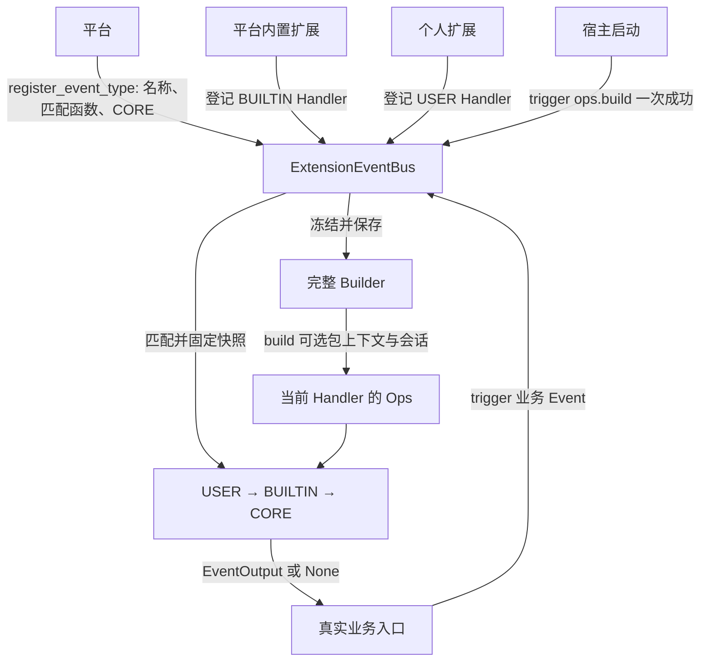

# ExtensionEventBus 事件机制设计概览

## 文档状态

| 项 | 说明 |
| --- | --- |
| 类型 | 目标设计概览；公共接口以 [S_01](../specs/S_01_events-contract.md) 为准 |
| 最近一次修订日期 | 2026-10-19 |
| 所属模块 | `agent-core/openjiuwen/core/events/` |
| 详细设计 | [事件机制详细架构](events-architecture.md) |
| 开发拆分 | [Events 特性开发计划](events-development-plan.md) |

ExtensionEventBus 为业务模块提供统一的扩展调用链。平台登记事件、匹配函数和唯一 CORE Handler；平台内置扩展与个人扩展登记 BUILTIN / USER Handler；真实业务入口通过 `trigger(event, session)` 执行一条 `USER → BUILTIN → CORE` 链并取得结果。

## 1. 目标与边界

Events 只负责五件事：

1. 登记和注销事件及 Handler。
2. 按事件的匹配函数筛选 USER / BUILTIN Handler。
3. 固定单次调用快照，并按 USER → BUILTIN → CORE 调度。
4. 用 EventNext 实现继续、跳层和短路。
5. 收集 Builder 能力，并为实际进入的 Handler 构建 Ops。

业务事件 payload、外部副作用、权限决策、插件装卸、包身份认证、宿主停机等待不属于 Events。

当前机制是同进程异步调用，不提供消息队列、跨进程投递、自动重试、故障恢复或副作用回滚。

## 2. 核心对象和责任

| 对象 | 责任 |
| --- | --- |
| EventType | 小写点分字符串。业务事件由平台仓库定义；Core 只保留 `ops.build` 和 `ops.` 前缀 |
| Event | 一次调用的事件名和业务输入 |
| HandlerLevel | USER、BUILTIN、CORE；只表示执行层级，不表示权限等级 |
| MatchPatternFunc | 由事件平台提供，同步判断某个 USER / BUILTIN 是否命中 |
| EventNext | 推进当前链、跳向内层或形成短路 |
| SessionContext | 调用入口统一准备的只读会话投影 |
| PackageMetadata | Builder 构建 Ops 时可选的包上下文；不进入 EventBus 注册记录 |
| Builder | 保存完整能力目录；第一次 `ops.build` 成功后冻结并由 Bus 保存 |
| Ops | Builder 为当前 Handler 构建的能力入口，绑定可选包上下文和会话上下文 |

包身份由扩展运行时或 Handler 包装层持有。EventBus 不从注册记录、EventInput 或 SessionContext 推断 PackageMetadata。`Builder.build(package_metadata, session_context)` 保留两个入参；没有包上下文时显式传 `None`。

## 3. 总体流程



### 3.1 登记事件

平台注册业务事件时直接传入三个参数：

```python
bus.register_event_type(event_type, match_pattern_func, core_handler)
```

Events 不公开 EventDefinition。调用方不能登记或覆盖 `ops.` 前缀；`ops.build` 由 Core 内置。

Handler 使用原始四参数接口，`handler_level` 默认为 USER：

```python
handler_id = bus.register_event_handler(
    event_type,
    handler,
    match_pattern,
    handler_level,
)
```

接口不接收 package_metadata。注销只更新注册表，已经取得旧快照的调用继续执行。

### 3.2 宿主触发 Build

宿主在登记完所有 Build BUILTIN 后调用一次：

```python
await bus.trigger(Event(OPS_BUILD_EVENT_TYPE, None), None)
```

Build CORE 创建空 Builder；BUILTIN 在下游返回后调用 `add_namespace()` / `add_method()`；Bus 校验成功后冻结并保存 Builder。第一次成功前允许宿主修正配置后重试；成功后拒绝再次 Build，也拒绝登记或注销 Build Handler。

没有冻结 Builder 时，业务 `trigger()` 失败。普通业务调用不会再次运行 `ops.build`。并发保护是实现细节，不进入公共设计。

### 3.3 执行业务事件

一次普通调用按以下顺序执行：

1. 校验 Event，并确认冻结 Builder 已存在。
2. 在首次 `await` 前固定匹配函数、CORE 和 Handler 注册快照。
3. 规范化 SessionContext。
4. 用 MatchPatternFunc 筛选 USER / BUILTIN；CORE 不匹配。
5. 按 USER → BUILTIN → CORE 进入，按相反顺序返回。
6. 每个实际进入的 Handler 构建一次独立 Ops。

EventNext 的 event_type 不允许改变；event_input 可以调整，但当前链不重新匹配。Handler 不调用 EventNext 而直接返回即短路，Events 不自动补跑 CORE。

## 4. Ops 与包上下文

Builder 公开的关键签名保持为：

```python
def build(
    self,
    package_metadata: PackageMetadata | None = None,
    session_context: SessionContext | None = None,
) -> EventHandlerOps: ...
```

这个入参不能删除，原因是 Ops 能力仍可能需要知道当前扩展包。边界如下：

- Builder 只保存能力定义，不保存可变的当前包或当前会话。
- 每次 build 创建独立 Ops，并原样绑定调用方提供的 PackageMetadata 和 SessionContext。
- EventBus 注册接口不保存 PackageMetadata。
- 扩展运行时或 Handler 包装层掌握包上下文时负责传入；通用 Bus 没有包上下文时使用 `None`。
- PackageMetadata 不是授权结果，实际资源入口仍按宿主权限模型校验。

## 5. 生命周期与资源语义

Bus 不公开 `initialize()`、`close()` 或 CONFIGURING / READY / DRAINING / CLOSED 状态。

唯一内部边界是“冻结 Builder 是否存在”：

| 条件 | 行为 |
| --- | --- |
| 尚无冻结 Builder | 允许登记/注销 Build Handler；普通业务 trigger 失败 |
| 第一次 ops.build 成功 | 冻结并保存 Builder |
| Builder 已冻结 | 拒绝再次 Build，以及 Build Handler 的登记/注销；普通事件注册仍可变更 |

停止由宿主完成：先停止发起新的 `trigger()`，再等待自己持有的调用返回，最后释放插件和 Bus。Events 不维护 drain 状态、不跟踪宿主任务，也不定义停机超时。

注销只影响后续快照。已经取得快照的调用继续执行，这也是扩展运行时释放包资源前必须自行等待在途使用结束的原因。

## 6. 开发接入顺序

1. 先以 [S_01](../specs/S_01_events-contract.md) 冻结公共模型、Protocol、错误码和签名。
2. 实现注册表、匹配快照与 EventNext 链。
3. 实现 Builder/Ops 及冻结行为。
4. 接入宿主显式 `trigger(ops.build)` 和普通业务 trigger。
5. 业务平台在自己的仓库登记事件名、payload 和真实 CORE。
6. 宿主用真实 Session、插件装卸和业务入口完成联合验证。

具体负责人、依赖和验收项见[开发计划](events-development-plan.md)。
