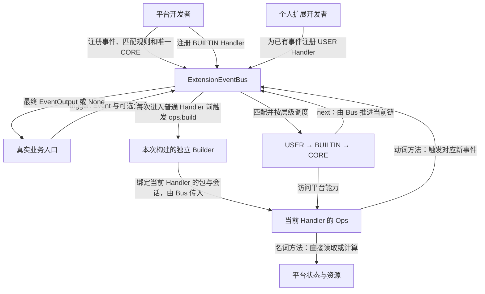
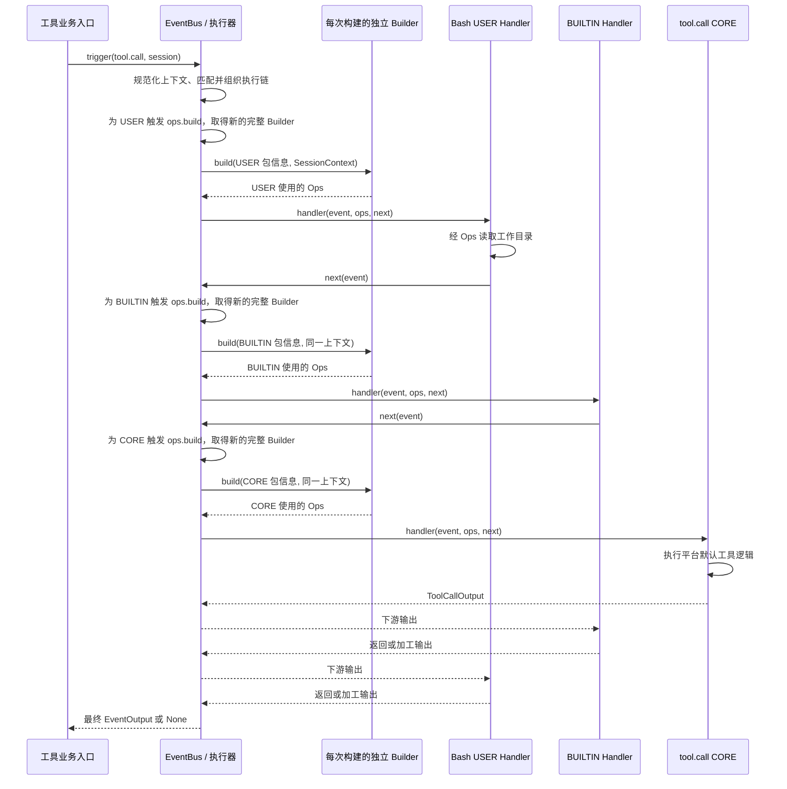

# ExtensionEventBus 事件机制设计概览

## 文档状态与阅读说明

| 项 | 说明 |
| --- | --- |
| 类型 | 目标设计草案；用于说明整体方案，不代表接口已实现或契约已定稿 |
| 最近一次修订日期 | 2026-10-17 |
| 维护责任 | Events 模块维护者；具体负责人待认领 |
| 所属模块 | `agent-core/openjiuwen/core/events/` |
| 详细设计 | [事件机制详细架构](events-architecture.md)；展开执行机制及待确认的补充方案 |
| 目录规范与模板 | [Events 维护规范](../../AGENTS.md)、[Core Overview 模板](../../../docs/templates/overview-template.md) |
| 关键待确认项 | 公共模型导出、校验接入、宿主授权适配及并发限制，见第 5.2 节；当前仍为待实现草案 |

本文面向平台开发者、个人扩展开发者，以及参与设计评审、开发和测试的人员，说明事件机制的定位、参与方职责、核心对象和主要工作链路。第 1～4 节描述事件机制的目标方案；第 5 节单独说明当前基础、接入条件和待确认问题。

本文通过操作名和调用示意说明机制，不限定最终签名、类型表示或文件划分。构建结果的校验与只读处理、注册快照、EventNext 单次推进等仍是详细架构中的补充建议；待确认主题集中见第 5.2 节，契约与实施文档的分工见第 5.3 节。

设计参考来自 `rsi_native_agent_os` 仓库的[事件机制 v1](../../../../../../rsi_native_agent_os/refs/extension_event_bus_core_mechanism_v1.md)。本方案沿用三层链和会话投影，改为逐 Handler 按需构建，不再采用初始化时收集并保存 Builder 的流程；与扩展整体方案、加载注册说明的适用关系及取舍见[架构开篇](events-architecture.md)。

图表表示同一进程内的逻辑调用和数据交接。业务调用方通过一次 `await trigger(...)` 等待结果；本设计没有独立的消息消费或结果投递阶段。

| 阅读目的 | 阅读位置 |
| --- | --- |
| 了解目标、典型场景和范围 | 第 1 节 |
| 确认职责、对象和事实来源 | 第 2 节 |
| 区分 Ops 能力调用与链路推进 | 第 2.4 节 |
| 理解注册、按需构建、事件执行、接入路径和完成口径 | 第 3 节 |
| 理解上下文、执行控制和资源约束 | 第 4 节 |
| 核对当前基础、接入缺口及文档归属 | 第 5 节 |

## 1. 目标与范围

### 1.1 定位与目标

ExtensionEventBus 为平台业务提供统一的事件扩展入口。平台先定义支持的事件类型、匹配规则及默认处理逻辑，平台内置扩展和个人扩展再注册各自的事件处理器（Handler）。业务发生时，调用方通过 `trigger(event, session)` 发起一次事件调用，由 EventBus 匹配 Handler、组织执行链并返回结果。

以工具调用为例：平台登记 `tool.call` 事件及实际执行工具的 CORE Handler，个人开发者注册仅匹配 Bash 工具的 USER Handler。当业务入口触发 Bash 调用时，个人 Handler 可读取会话工作目录、继续调用链，并在工具结果返回后加工输出。业务入口通过同一个事件调用取得最终结果。

这条链路要实现三个目标：平台用唯一 CORE Handler 承接默认行为，扩展按确定顺序增加前后处理，业务入口取得扩展处理后的最终输出。EventHandlerOps（下文简称 Ops）向各层 Handler 提供平台能力，EventHandlerOpsBuilder（下文简称 Builder）负责收集能力并构建 Ops。

### 1.2 职责与范围边界

Events 负责事件类型和 Handler 的注册、注销、匹配、分发及执行链控制。输入是事件及可选的会话信息，输出是当前调用链产生的 `EventOutput` 或 `None`。

业务模块负责定义事件的业务含义、输入输出和匹配规则，实现默认处理逻辑，并在真实业务入口触发事件。平台注册了事件类型，不等于实际工具入口已完成事件接入；后者必须由业务模块改造和验证。

Events 的通用基础层维护事件、上下文、Ops、Builder 和内置 Build 事件；平台实现并登记具体能力，提供会话与扩展包信息，执行资源权限检查。个人开发者为平台已有事件编写 USER Handler。Events 不反向依赖平台能力、工具执行器或包管理实现，具体文件及导出路径由后续方案确定。

### 1.3 当前设计范围与后续扩展

本次概览覆盖事件注册与注销入口、USER / BUILTIN / CORE 三层 Handler、匹配与执行顺序、继续执行与短路，以及 Ops 构建和会话上下文传递。`tool.call` 和 `session.cwd()` 用于贯穿说明接入方式，实现现状见第 5.1 节。

当前设计描述的是一次 `await trigger(...)` 调用内的执行链，没有定义持久化事件日志、消息队列、跨进程投递、故障重放或自动重试。这些能力如后续需要，应另行明确需求和责任。异常、取消、并发及重入的完整契约仍待确认，不能从异步函数签名推断相关保证。

## 2. 核心模型与职责

### 2.1 总体关系

平台注册事件默认行为和内置能力，个人扩展为已有事件增加处理逻辑；真实业务入口统一进入 EventBus。普通事件执行时，EventBus 为当前 Handler 构建 Ops，Handler 通过 Ops 使用平台能力，通过 EventNext 推进当前链路。

图中箭头表示注册、能力访问、链路推进或结果返回。CORE Handler 实现业务默认行为；Ops 提供能力调用入口；EventNext 由 EventBus 注入，负责推进当前链。平台初始化只登记 Build Handler；运行时每次进入普通 Handler 前，Bus 触发 ops.build 收集能力，再用返回的独立 Builder 绑定当前包与会话，构建 Ops。

| 参与方 | 负责的行为 | 责任边界 |
| --- | --- | --- |
| Events / ExtensionEventBus | 保存事件和 Handler 注册关系，匹配并调度执行链，规范化会话输入，传入 Ops | 确认当前链路的返回；不替业务模块确认外部副作用或用户交付 |
| 平台开发者与业务模块 | 定义事件及输入输出、实现匹配函数和 CORE / BUILTIN Handler、接入真实触发入口 | 维护业务语义、默认执行结果及错误处置依据 |
| 平台初始化入口 | 注册事件及 Ops Build Handler | 完成必需注册配置后开放业务；运行时由执行器按 Handler 触发构建 |
| 扩展运行时与宿主 | 核实包来源，控制注册入口，管理扩展装卸与实例停止 | 负责等待使用相关资源的调用退出，再释放包或实例资源；生命周期建议见第 4.1 节 |
| Ops 能力提供方 | 向 Builder 注册命名空间和方法，依据当前 Ops 上下文执行能力 | 维护能力实现、资源访问和授权检查 |
| 个人扩展开发者 | 为已有事件注册 USER Handler，通过 Ops 使用能力和上下文 | 控制是否继续、跳层或短路，并返回符合该事件约定的结果 |
| 会话提供方 | agent-core 提供运行时 Session；JiuwenSwarm 查询元数据后构造 SessionContext | 对会话来源与字段含义负责，EventBus 不代查平台会话元数据 |

### 2.2 核心对象及事实来源

| 对象或事实 | 含义与关系 | 权威来源与修改责任 | 不能据此推断的事实 |
| --- | --- | --- | --- |
| EventType 与事件定义 | 一类扩展入口，关联输入输出语义、匹配函数和唯一 CORE Handler | 平台定义；EventBus 保存注册关系 | 事件已注册不证明真实业务入口已触发它 |
| Event、EventInput、EventOutput | 一次调用及其业务输入、链路返回值 | 调用方构造输入；实际执行的 Handler 产生或加工输出 | 返回结果不证明 CORE 一定执行，也不等于外部副作用已核对 |
| Handler 注册记录 | 关联事件、回调、匹配模式、层级及注册顺序；CORE 由事件类型注册创建 | EventBus 保存；注册方通过拟议注销接口管理 | 持有 Handler 标识不代表具备额外平台权限 |
| MatchPattern 与 MatchPatternFunc | 扩展声明筛选条件，由事件所属平台定义其解释方式 | 注册方提供模式；事件定义方提供匹配函数 | 模式是筛选条件，不是授权依据 |
| EventNext | EventBus 为当前 Handler 提供的后续链路控制入口 | EventBus 创建并控制执行位置；Handler 调用 | 调用 Ops 方法不能代替推进当前事件链 |
| SessionContext | 当前事件可使用的统一只读会话数据模型，供 Builder 绑定并经 Ops 提供 | 由运行时 Session 投影或由宿主构造；平台对元数据负责 | session_id 关联不代表已取得工作目录或资源权限 |
| 扩展包信息 | 关联当前 Handler 的来源，供 Ops 能力使用 | 平台或扩展运行时提供；关联注册记录的方式待确认 | 包关联本身不授予资源权限，也不应由事件输入替代 |
| EventHandlerOpsBuilder / EventHandlerOps | Builder 收集平台能力；Ops 绑定当前 Handler 的包信息与事件上下文 | 平台 Build Handler 填充本次 Builder；EventBus 每次调用普通 Handler 前触发构建并绑定 Ops | Ops 实例存在不代表能力已授权、上下文完整或业务调用成功 |

### 2.3 贯穿设计的原则

1. **事件默认行为由平台定义。** 每个 EventType 只有一个 CORE Handler，通过 `register_event_type()` 一并注册。它不参与 Pattern 筛选，位于链尾；是否实际到达它取决于前序 Handler 的控制行为。
2. **层级优先于注册先后。** 链路按 `USER → BUILTIN → CORE` 组织，同层按注册顺序进入；正常返回按调用栈反向经过已进入的 Handler。平台实现须保留这一可解释的包裹关系。
3. **链路控制与能力访问各有入口。** EventNext 控制当前链的继续与跳层，Ops 提供平台能力；具体调用语义见第 2.4 节。
4. **上下文在入口统一。** EventBus 只在入口规范化一次会话数据，后续 Builder 与 Handler 使用 SessionContext；Handler 只通过 Ops 使用会话信息，不接收原始 Session。

### 2.4 Ops 能力调用与链路推进

Ops 按 `namespace.method` 组织平台能力，例如 `session.cwd`。能力方法按名词和动词区分两类调用语义；同一个命名空间可以同时包含两类方法。具体能力和事件映射由平台定义。

| 调用示意 | 处理方式 | 对当前事件链的影响 |
| --- | --- | --- |
| `await ops.session.cwd()`、`await ops.session.id()` | 名词方法，直接读取或计算当前会话状态，不进入 EventBus | 当前 Handler 取得结果后继续自身逻辑，后续 Handler 尚未因此执行 |
| `await ops.tool.call(...)`、`await ops.prompt.submit(...)` | 动词方法，触发对应事件，等待一条新的 `USER → BUILTIN → CORE` 链返回 | 当前 Handler 等待新链；原链的后续部分仍须通过 EventNext 推进 |
| `await next_handler(event)` | 从当前执行位置继续已经选定的 Handler 链 | 下游返回后，当前 Handler 可以加工输出再向外返回 |

动词方法携带当前会话资料发起新事件，新链重新匹配，各 Handler 使用自己的包信息和 Ops；原操作的授权边界继续保留，不能因执行者切换到平台 CORE 而扩大权限。新链结束后，原 Handler 再决定继续或短路。数据及授权交接见[架构第 5.4 节](events-architecture.md#54-名词直接调用与动词新事件协作)。

例如在 `tool.call` Handler 中，调用 `next_handler(event)` 继续当前工具处理；再次调用 `ops.tool.call(...)` 会发起新的工具事件，可能递归进入自身。允许的嵌套范围见第 4.3 节。

## 3. 关键流程与完成语义

### 3.1 注册与按需构建 Ops

平台初始化先登记业务 EventType、匹配函数和 CORE Handler，再为已有事件登记 BUILTIN / USER Handler。`register_event_handler()` 的默认层级为 USER；CORE 由事件类型注册创建，不重复通过普通 Handler 注册接口登记。

Agent Core 内置 ops.build 事件及其默认 CORE，各平台统一将自己的 Ops Build Handler 注册为 BUILTIN。平台初始化只完成注册，不触发 ops.build，也不保存跨 Handler 共享的 Builder。运行时，EventBus 在每次调用普通 Handler 前触发 ops.build，收集本次能力并构建该 Handler 的 Ops。

一次构建分为三步：执行器使用本次调用保留的 Build 注册快照调度构建链；Build CORE 新建空 Builder，BUILTIN 在 next 返回后向同一个 Builder 添加能力；执行器取得带 builder 的结果，再绑定目标包和本次会话，创建 Ops 后进入目标 Handler。

ops.build 用空输入和空模式登记、匹配全部 Build BUILTIN，session 和 ops 均为 None，不递归构建 Ops。命名空间和方法不允许重复；构建协议及详细时序统一见[架构第 5.2 节](events-architecture.md#52-调用-handler-前构建-ops)。

构建失败或取消时丢弃部分结果，不进入目标 Handler，错误沿业务调用的等待关系传播；不自动重试，不将 Bus 切回配置状态。本文不引入启动时能力目录发布、Builder 缓存或跨 Handler 复用。构建处理器只组装能力，共享服务和连接池等资源由平台独立管理。

### 3.2 运行：匹配并执行业务事件

以 Bash 工具调用为例，业务模块构造 `tool.call` 事件及工具名、参数，并传入会话信息。EventBus 查找事件定义，在入口规范化 SessionContext，使用该事件的 MatchPatternFunc 筛选 USER / BUILTIN Handler，再按层级和同层注册顺序构造链路。CORE 不参与匹配；没有扩展命中时，由 CORE 处理。

同链不重新匹配，next 只允许调整不影响匹配的参数；event_type 及参与匹配的字段保持不变。例如更换工具名必须发起新事件，不能把非 Bash 调用通过 next 改成 Bash。业务模块提供事件校验规则，Bus 在入口、next/to 和各 Handler 返回边界执行，覆盖短路结果及 None；业务入口仍负责核对实际业务结果。

执行每个普通 Handler 时，EventBus 先触发一次 ops.build，取得本次独立 Builder，再构建 Ops，绑定当前 Handler 的扩展包信息及该事件的 SessionContext。Handler 可使用 `ops.session.cwd()` 等已注册能力，并自行决定是否继续链路。

图示为各扩展均继续的正常路径，EventNext 始终经 EventBus 调度后续 Handler，每个普通 Handler 前都单独触发 ops.build，再使用绑定自身包信息的 Ops；被跳过的 Handler 不构建 Ops。个人 Handler 在 `next` 前读取工作目录，在其返回后加工工具结果；调用方取得最外层 Handler 的最终输出。真实工具动作由 CORE 调用底层业务能力完成，业务入口不在 `trigger()` 返回后重复执行同一工具。

### 3.3 完成与结果的确认点

| 确认点 | 由谁、依据什么确认 | 允许得出的结论 |
| --- | --- | --- |
| 事件及 Handler 已登记 | EventBus 接受注册并保存相应记录 | 后续触发可以使用这些定义；不证明业务入口已接通 |
| 当前 Handler 的 Ops 已构建 | 本次 ops.build 返回完整 Builder，执行器绑定目标包信息与会话 | 可以进入当前 Handler；其他 Handler 仍须单独构建，具体服务是否在线、本次访问是否获授权仍需检查 |
| 当前事件调用已返回 | 调用方完成 `await trigger(...)` 并取得返回值 | 当前调用链已交回控制与结果；可能由短路 Handler 直接返回 |
| 业务默认行为或外部副作用已完成 | 业务 CORE Handler 及下游系统根据各自业务结果或回执确认 | 只确认该业务契约覆盖的结果；最终输出可能被外层 Handler 加工 |

`EventOutput | None` 是目标通用返回形态，`None` 是否代表可接受结果须由各事件定义说明。最终结果的展示或交付由业务调用方负责。

### 3.4 执行控制、失败与重试

假设匹配结果为 `USER-1 → USER-2 → BUILTIN-1 → CORE`，USER-1 可采用以下控制方式：

| USER-1 的行为 | 后续执行 | 返回时的处理 |
| --- | --- | --- |
| `await next_handler(event)` | USER-2、BUILTIN-1、CORE，前提是后续各层继续 | 下游结果按调用栈反向返回，已进入的 Handler 可加工输出 |
| `await next_handler.to(event, HandlerLevel.BUILTIN)` | 跳过 USER-2，从 BUILTIN-1 继续 | USER-2 的前后处理均不执行，USER-1 仍可加工返回值 |
| `await next_handler.to(event, HandlerLevel.CORE)` | 直接进入 CORE | USER-1 取得 CORE 输出后继续自身逻辑 |
| 直接返回结果或 `None`，不调用 EventNext | 后续 Handler 和 CORE 均不执行，称为短路 | 直接返回值成为当前 Handler 的输出，是否允许 `None` 由事件约定 |

`to()` 只允许跳向尚未执行的内层级，不能返回当前或外层级。CORE 位于链尾，通常不调用 EventNext。

某个 Pattern 未命中表示该扩展不加入链，与匹配函数抛错不同。匹配错误、Ops 构建失败、Handler 异常、超时和取消的统一传播或清理规则仍待确认；Events 负责明确执行和错误交接，Handler 与能力提供方负责各自资源处置。详细建议见[架构第 8 节](events-architecture.md#8-故障处理与继续执行)，当前机制不承诺失败后自动补跑 CORE 或自动重试。

工具调用可能已经产生外部副作用，外层 Handler 仍可能在加工结果时失败。此时不能仅凭 `trigger()` 未返回正常结果就判定工具未执行；业务调用方须依据工具及下游系统的事实核对结果，再按业务幂等约束决定是否重试。该核对责任不由 EventBus 的执行顺序替代。

### 3.5 开发者接入路径

新增事件、新增平台能力和新增扩展 Handler 有不同的接入责任。以下串联必要步骤，具体接入示例见[架构第 5.5 节](events-architecture.md#55-平台与个人扩展的接入方式)。

| 接入目标 | 谁负责、如何接入 | 调用方可观察的结果 |
| --- | --- | --- |
| 新增事件，例如 `tool.call` | 平台定义事件及输入输出、匹配规则和 CORE；通过 `register_event_type()` 一并登记，再将真实业务入口接到 `trigger()` | 业务调用进入匹配后的执行链，按扩展控制取得最终输出；仅注册事件尚未完成接入 |
| 新增 Ops 能力，例如 `session.cwd()` | 能力提供方实现方法，在负责该 namespace 的 Ops Build BUILTIN 中，先继续到 CORE 取得 Builder，再添加 namespace 和方法；平台初始化统一注册构建处理器，执行器在调用普通 Handler 前触发构建 | 普通 Handler 通过 Ops 调用该能力；读取工作目录还依赖宿主提供 cwd |
| 新增 USER Handler，例如只处理 Bash | 个人开发者为已有事件编写统一回调 `handler(event, ops, next_handler)`，通过 `register_event_handler()` 登记及声明 `{"tool": "Bash"}` 等模式；保存返回的 Handler 标识供注销 | 仅匹配的调用进入该扩展；扩展可前后处理、跳层或短路，返回值须符合事件约定 |

能力实现由各平台维护；Ops Build Handler 拟集中放在 `ops_build_handlers/`，具体文件与导出路径由实现方案确定。匹配模式的含义由该事件的匹配函数解释，不能将示例中的工具筛选规则推广到所有事件。

## 4. 运行状态与关键约束

### 4.1 状态与资源生命周期

目标方案需要区分 Bus 持有的注册定义、单次事件的执行现场，以及每次构建产生的 Builder 和当前 Handler 的 Ops：

| 状态或资源 | 创建与使用责任 | 生命周期边界 |
| --- | --- | --- |
| 事件定义、Handler 注册记录 | 平台和扩展通过 EventBus 登记、注销，Bus 保存并用于后续匹配 | 归属于 Bus 的注册状态；注册变更的生效范围按下述快照建议确定 |
| 本次能力定义与 Builder | 每次进入普通 Handler 前触发 ops.build，由 CORE 新建 Builder，BUILTIN 填充，执行器用于绑定 Ops | 每次构建独立；收集完成后建议只读，不跨 Handler 缓存；随本次构建及当前 Ops 的使用结束释放 |
| 匹配结果、执行位置、SessionContext | EventBus 为一次 `trigger()` 组织并传递 | 属于当前调用；并发调用及相同会话标识不意味着可共享执行位置 |
| EventNext 与当前 Handler 的 Ops | EventBus 调度 Handler 时提供，Ops 绑定该 Handler 的包信息与本次会话 | 所属 Handler 退出后失效；不得缓存或由未结束的后台任务继续使用，辅助任务须在退出前清理并等待结束 |

按架构的注册快照与卸载建议，扩展运行时先注销 Handler，防止后续取得注册记录的调用选中它，再等待使用该包的已有调用退出，最后释放包资源。已经取得旧快照的调用仍可能执行被注销的 Handler，因此注销返回只确认注册表已更新，不能据此立即释放资源。具体快照、调用跟踪和等待机制仍待确认，见[架构第 5.3 节](events-architecture.md#53-handler-装卸与运行中的调用)。

实例停止时拒绝外部新调用和管理操作，已有调用可继续其 Handler、Build 及通过有效 Ops 发起并等待的业务子调用。宿主等待这些调用全部退出后释放资源；超时可取消根调用，但资源须保留至取消和清理完成。准入与快照范围见[架构第 6.1 节](events-architecture.md#61-bus-实例与单次调用状态)，具体停机接口由宿主确定。该流程不撤销已发生的业务操作。

### 4.2 会话来源与隔离范围

`trigger()` 接收的会话资料在入口统一为 SessionContext。不同来源携带的信息不同：

| 入口输入 | 上下文来源与内容 | 资料补齐责任 |
| --- | --- | --- |
| agent-core 运行时 Session | EventBus 仅投影会话 ID，cwd 和平台 metadata 不由 Session 自动导入 | 具体支持的 Session 类型由适配设计确认；需要更多资料时由宿主提供 |
| 宿主构造的 SessionContext | JiuwenSwarm 等宿主先查询会话资料，提供 session_id、可选 cwd 和少量 metadata | 宿主对资料来源与含义负责，EventBus 不代查会话元数据 |
| `None` | 不携带会话上下文 | `ops.build` 明确采用此路径；普通事件是否可执行取决于其 Handler 和能力是否依赖会话 |

SessionContext 的目标字段为必填 `session_id`、可选 `cwd` 和少量平台扩展 `metadata`。`cwd` 无法确定时为 `None`；需要工作目录的 Ops 能力如何处置缺失值及采用何种返回类型，必须由能力契约明确，不能推断目录一定存在。

Builder 接收规范化后的上下文，为当前 Handler 绑定 Ops。同一次调用的各 Handler 使用这份会话投影，各自绑定所属包；各次构建使用独立 Builder，避免用全局“当前会话”字段承载不同调用。metadata 的深层只读保证、并发隔离和上下文更新方式仍待定稿，详细建议见[架构第 7.2 节](events-architecture.md#72-会话与包数据的只读范围)。

### 4.3 权限、并发与重入边界

扩展运行时只向个人扩展提供 USER 注册操作；事件定义、BUILTIN、Ops Build 和初始化管理入口由可信平台代码控制。受控入口及包来源校验的具体方式由后续方案确定。

Ops 的包信息说明当前 Handler 来源，原请求的授权边界由可信宿主提供，两者不能互相替代。动词发起前检查当前包能否申请该操作，嵌套调用继续保留原授权边界；实际资源入口按该边界、当前包和最新权限检查。授权依据不能由 EventInput 或普通 metadata 覆盖，具体适配见[架构第 9.1 节](events-architecture.md#91-身份与授权检查)。

USER Handler 可以跳过 BUILTIN 或短路，因此 BUILTIN 层级本身不能保证某项安全检查必然执行。不可绕过的校验应由业务触发入口或实际资源访问入口承接，具体位置由业务及能力提供方确认，见[架构第 9.1 节](events-architecture.md#91-身份与授权检查)。

本机制在进程内调用 Handler，不提供恶意代码隔离。受控注册、只读上下文和 Ops 约定不能替代沙箱；执行不可信代码所需的进程或沙箱隔离须另行设计。

单链顺序不保证不同 `trigger()` 的执行或完成顺序。EventNext 的次数与有效期、注册快照、合法嵌套及取消传递仍按架构建议评审；并发、深度和容量上限需结合业务与实际验证确定，详见[架构第 6.2 节](events-architecture.md#62-并发取消与重入)。

## 5. 现有基础与落地边界

### 5.1 当前基础与接入缺口

截至本次修订，`agent-core/openjiuwen/core/events/` 已建立维护规则和文档目录，尚无事件机制实现文件或公开导出；在 `openjiuwen/`、`tests/`、`examples/` 中也未检出 ExtensionEventBus、EventHandlerOpsBuilder 或 EventHandlerOps 的实现与接入。

Core 已有[当前单智能体 Session](../../../session/agent.py)，通过 `get_session_id()` 提供会话标识；[底层会话抽象](../../../session/session.py)的标识入口不同，同文件的旧 `Session` 已弃用。这些类型不是本文提出的 SessionContext，也不证明事件入口已完成会话投影。具体适配范围仍需结合实际业务模块确认，建议方案见[详细架构第 4.4 节](events-architecture.md#44-session-入口适配)。

已有 [Tool 抽象](../../../foundation/tool/base.py)提供 `invoke()` 和 `stream()`，可供工具业务接入时核对；当前尚未通过本文事件链调度。当前事件设计仅描述一次调用的返回，工具已有流式入口不代表事件机制已有流式协议。

落地需补齐三层执行链、Ops Build、包信息绑定和真实工具入口接入，并按下节条件完成验证。

### 5.2 落地条件与待确认问题

| 主题 | 需定稿的整体结论与协作方 | 对落地的影响 |
| --- | --- | --- |
| 模型与公共入口 | 通用模型及 Build 归属 Events；维护者补齐公开导出与最小包信息表示 | 平台能力单向依赖 Events，不引入反向业务依赖 |
| 按需构建与生命周期 | 按本文构建、快照及退出规则细化实现，验证 Ops 有效期、子调用退出和构建成本 | 每次构建完成后才进入目标 Handler，资源释放覆盖仍被使用的能力 |
| 注册与执行 | Events、运行时与业务维护者确定校验规则的接入、错误类型和并发限制 | 覆盖输入改写、短路输出及非法推进，保持错误反馈可解释 |
| 能力与上下文 | Ops 与宿主落实包和会话绑定、只读范围、嵌套授权及事件参数转换 | 新链使用正确会话，执行者切换不扩大原请求权限 |
| 真实业务与安全 | 业务模块和能力提供方确认真实触发入口、授权位置及业务幂等条件 | 确保开放能力具备真实接入和结果核对依据 |

具体问题及建议集中维护在[架构第 12.2 节](events-architecture.md#122-未验证前提与待确认问题)。下表仅说明能力开放条件；验收要求和实际证据由后续 spec、feature 及开发计划维护，归属见[架构第 11.2 节](events-architecture.md#112-架构要求与验证归属)。

| 能力范围 | 必要条件与验证依据 | 条件未具备时的限制 |
| --- | --- | --- |
| 普通事件与 Handler 执行 | 注册、注销、匹配、顺序、短路、跳层及错误契约定稿；对应实现覆盖正常和失败路径 | 限制相应事件及扩展入口的开放 |
| Ops 能力与多会话使用 | 逐 Handler 触发构建的流程定稿，包来源和会话适配明确；验证不递归构建、冲突传播、上下文缺失及并发隔离 | 限制依赖未就绪能力的事件，以及未经验证的共享和并发范围 |
| 真实工具扩展 | 真实业务入口统一触发事件，资源入口落实授权；验证默认执行、扩展加工、短路、取消及副作用未知场景 | 仅有 EventBus 或 `tool.call` 注册不能宣称工具扩展已接通 |

### 5.3 详细设计与实施文档索引

| 文档或维护位置 | 内容及阅读时机 |
| --- | --- |
| [Events 模块维护规范](../../AGENTS.md) | 查看模块职责、文档分工、命名和交付检查要求 |
| [Core 公共规范](../../../AGENTS.md) | 查看公共接口、模块边界和开发文档维护要求 |
| [详细架构](events-architecture.md) | 维护模块归属、注册和执行机制、Ops 按需构建、名词/动词能力、接入示例、跨模块依赖及待确认的补充方案 |
| 模块 spec（尚未建立） | 后续作为已确认事件、Handler、Ops、上下文及失败语义的唯一契约维护位置 |
| Feature 与验证记录（尚未建立） | 后续维护具体实现方案、取舍、接入影响及实际验证证据 |
| 开发计划（尚未建立） | 需要多阶段跟踪时建立，统一维护特性拆分、依赖、负责人和进度；概览不维护进度台账 |
