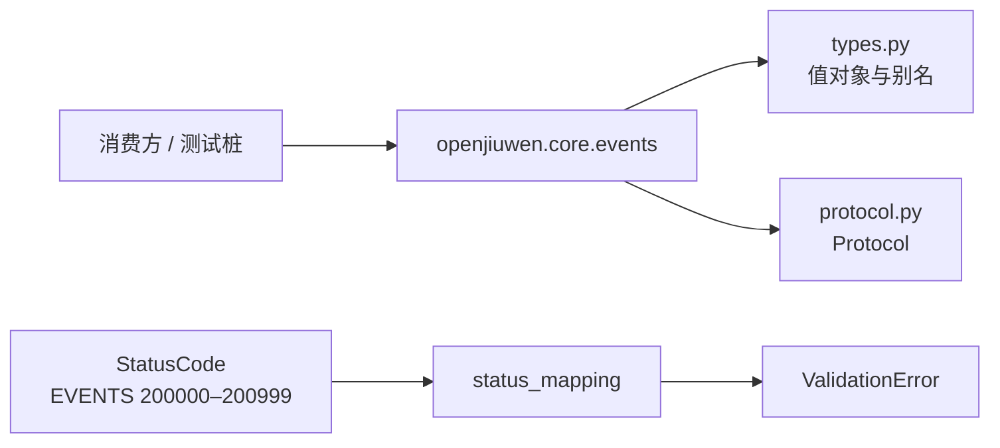

# EV-08 公共契约与接口基线设计方案

## 1. 元信息

| 项 | 值 |
| --- | --- |
| 建档日期 | 2026-10-19 |
| 范围 | `agent-core` 的 `openjiuwen.core.events` 公共模型、Protocol、公开导出，以及 `StatusCode` 中的 Events 契约失败码 |
| 方案成熟度 | 已确认。契约以 [S_01](../specs/S_01_events-contract.md) 为准；号段以开发计划 EV-08「已决定号段」为准 |
| 计划条目 | [EV-08](../designs/events-development-plan.md#ev-08-公共契约与接口基线可供外部并行开发)。负责人、状态和验收 ID 只在开发计划维护 |
| 设计依据 | [概览](../designs/events-overview.md)、[架构](../designs/events-architecture.md)、[S_01](../specs/S_01_events-contract.md) |
| 关联 feature | 无已建立的前置或替代 feature。EV-01、EV-04、EV-05、EV-06 将消费本契约 |
| 验证摘要 | 2026-10-19：契约单测 8 passed；本特性源文件在 `--follow-imports=silent` 下 mypy 通过。未跑 `make test`。按计划直接 mypy 会带出仓库既有错误。详见第 7 节 |
| Refs | 无关联 issue / PR。差异对照见 [ExtensionEventBus 事件机制设计 v2](../../../../../../.cursor/plans/ExtensionEventBus%20事件机制设计_v2.md)，不得照抄 |

验收 ID `EV-08-V-01`～`EV-08-V-04` 的通过条件以开发计划为准。本文展开方案、实施位置和技术验证记录。

## 2. 背景、目标与范围

### 2.1 背景与问题

`openjiuwen.core.events` 在本特性之前没有实现、公开导出和错误码。JiuwenSwarm 无法在真实 EventBus 完成前，按稳定名字导入模型并实现 Protocol 桩。

公共名字、字段、方法、默认值和返回类型以 S_01 为准。异常必须进入现有 `StatusCode` 体系：`SCOPE` 必须属于 `ALLOWED_SCOPES`，数值必须落在该 scope 自己的号段。`100000`–`199999` 已被占满，Events 码不能写入现有段。

v2 把 `EventType` 画成含 `TOOL_CALL` 的枚举，并给出具体 `ExtensionEventBus`、`bootstrap` 和 `builtins/`。这些属于后续特性或业务仓库。

### 2.2 目标与关键场景

消费方可以 `import openjiuwen.core.events`，得到 S_01 中的模型、类型别名和 Protocol；用自建最小桩通过类型检查；7 个契约失败码可被解析为不可重试的 `ValidationError`。导入 Events 不要求安装或初始化 JiuwenSwarm，也不改变已有 StatusCode 的数值和异常分类。

| 场景 / 触发条件 | 当前行为 | 目标行为 / 可观察变化 |
| --- | --- | --- |
| 消费方导入 `openjiuwen.core.events` | 没有稳定的公共模型、Protocol 和 `__all__` | 得到第 5.3 节列出的 17 个名字，可按这些名字编写桩 |
| 消费方在自己的测试或仓库里实现 `ExtensionEventBusProtocol` | 没有可类型检查的协议表面 | 五个方法的参数、默认值和返回标注与 S_01 第 4.1 节一致，类型检查可以通过 |
| 后续特性或测试读取 7 个 `EVENTS_*` 码并调用 `build_error` | Events 没有 StatusCode | 得到 `ValidationError`，且 `recoverable` 为假 |

### 2.3 本次范围与非目标

- 本次包含：类型别名、`HandlerLevel`、三个只读值对象、四个 Protocol、`EventHandler` 别名、`openjiuwen.core.events` 的公开导出、7 个契约失败码，以及测试目录中的消费方最小桩。
- 本次不包含：`ExtensionEventBus` 类、`EventDefinition`、注册表、匹配、执行链、Builder/Ops 行为、`trigger`、Session 投影、Fake Bus、生命周期，以及 `raise_error` 调用。事件名正则、空 `package_id`、非法 MatchPattern、注册原子性和 `trigger` 失败分别属于 EV-01、EV-04、EV-06。

## 3. 设计约束、假设与待决问题

- 已确认约束与依赖：公共签名以 S_01 第 2、4 节为唯一完整定义。异常分类沿用 `status_mapping`：名称含 `INVALID` 时命中关键字规则，归入 `ValidationError`；未命中时由号段兜底。`100000`–`199999` 已分配完毕。`Session` 的类型来自 `openjiuwen.core.single_agent.Session`，只允许出现在标注中。
- 关键假设：无。上述号段占用和关键字分类已在现有异常模块中核对。
- 待决问题：无。错误码号段已决定。真实 Session 投影、包上下文包装层和容量参数不属于本特性的未决选择。

## 4. 总体方案与设计取舍

### 4.1 方案概览

EV-08 只建立两条静态边界：消费方按公开名字依赖契约；契约失败码进入现有异常分类。没有运行时调用链，也没有 Bus、注册表或 Builder 实例。

箭头表示导入依赖和异常分类，不表示一次调用的执行顺序。消费方从公开包取得模型和 Protocol，在自己的代码里实现协议。`StatusCode` 不从 Events 包导出；读取码值后，由现有映射得到 `ValidationError`。

### 4.2 关键决策

#### D-01 只交付可导入契约

- 选择与依据：本特性交付模型、Protocol、导出和错误码。S_01 把注册、匹配、执行和 Builder 行为分给后续特性；开发计划把 EV-08 定为 EventBus 实现前的并行基线。
- 代价与成立条件：消费方只能做类型检查和桩实现，不能用 Core 提供的 Bus 跑通调用。出现真实 Bus 类时，再把 `ExtensionEventBus` 加入公开导出。
- 实现体现：第 5.1、5.3 节和第 6 节 I-02～I-05；验证为 EV-08-V-01、EV-08-V-03。
- 相关候选：R-01。
- 确认依据：开发计划 EV-08 的交付范围与不交付清单。

#### D-02 错误码使用新 scope 与 ValidationError

- 选择与依据：scope 名为 `EVENTS`，号段 `200000`–`200999`，7 个码为 `200001`–`200007`。名称沿用 S_01 第 4.7 节，后缀 `INVALID` 先命中关键字规则；号段兜底同样指向 `ValidationError`。不新增 `EventsError`。本特性只登记码，不调用 `raise_error`。
- 代价与成立条件：后续特性必须使用这 7 个名称表达对应契约失败。若名称去掉 `INVALID` 且移出本号段，分类会落到其他异常。
- 实现体现：第 5.5 节和 I-01；验证为 EV-08-V-04。
- 相关候选：R-02。
- 确认依据：开发计划 EV-08「已决定号段」；S_01 要求契约失败为不可重试的 `ValidationError`。

#### D-03 事件名保持字符串别名

- 选择与依据：`EventType` 是 `str`。业务事件名由业务仓库维护，Core 只定义常量 `OPS_BUILD_EVENT_TYPE = "ops.build"`。`HandlerLevel` 只有 `user`、`builtin`、`core`。
- 代价与成立条件：Core 不在导入时拒绝非法事件名。事件名正则仍由后续注册实现检查。
- 实现体现：`types.py` 与 EV-08-V-01。
- 相关候选：R-03。
- 确认依据：S_01 第 2.1 节。

#### D-04 缺省 metadata 为新的只读空映射

- 选择与依据：`SessionContext.metadata` 的缺省值由 `default_factory` 返回新的 `MappingProxyType({})`。`frozen=True` 只能阻止字段重新赋值，不能阻止调用方修改共享或可变的 `dict`。
- 代价与成立条件：调用方自行传入的 `metadata` 不会在本特性被复制成只读映射。Bus 在边界复制并转成只读形态仍属于后续特性。S_01 第 2.1 节示例写的是 `default_factory=dict`；当前实现比该示例更严格，完整字段语义仍以 S_01 第 2.2 节为准。
- 实现体现：`SessionContext` 与 EV-08-V-02。
- 相关候选：无其他候选。直接使用可变 `dict` 不能满足只读边界。
- 确认依据：本 feature 的实现决策；S_01 对 metadata 只读形态的要求。

#### D-05 Session 只出现在类型标注中

- 选择与依据：`trigger` 的 `session` 标注为 `Session | SessionContext | None`。`Session` 仅在 `TYPE_CHECKING` 中从 `openjiuwen.core.single_agent` 导入。运行时导入 Events 不加载 `single_agent`，也不实现 Session 投影。
- 代价与成立条件：消费方做类型检查时仍需能解析 `Session`。投影行为属于 EV-06。
- 实现体现：`protocol.py` 与 EV-08-V-02、EV-08-V-03。
- 相关候选：无。
- 确认依据：S_01 第 4.1 节的 `session` 标注；架构中 Session 投影不属于 EV-08。

### 4.3 替代方案与排除理由

| 候选 / 关联决策 | 候选目的与关键差异 | 拒绝或暂缓原因 | 重新评估条件 |
| --- | --- | --- | --- |
| R-01 / D-01 在 EV-08 实现 `ExtensionEventBus`、`bootstrap` 和 `builtins/` | 消费方可以直接调用真实 Bus | 这些行为属于后续特性或业务仓库。提前实现会把注册、执行和生命周期重新放进本特性 | EV-01～EV-06 开始实现对应行为时，在各自 feature 交付 |
| R-02 / D-02 把码写入 `100000`–`199999`，或新增 `EventsError` | 少一个 scope，或让 Events 自带异常类 | 现有号段已满；S_01 要求契约失败进入现有 `ValidationError`，不导出专属异常类 | 现有号段规则或 S_01 的异常分类要求改变 |
| R-03 / D-03 采用含 `TOOL_CALL` 的 `EventType` 枚举 | 在 Core 内列出已知事件 | 业务事件名会被锁进本仓库，与 S_01 的字符串别名冲突 | S_01 改成封闭事件枚举 |

## 5. 详细设计

### 5.1 模块责任与关键不变量

| 模块 | 承担的责任 | 不承担的责任 |
| --- | --- | --- |
| `openjiuwen/core/events/types.py` | 别名、`HandlerLevel`、`Event`、`SessionContext`、`PackageMetadata` | 事件名、`package_id`、`session_id` 的校验 |
| `openjiuwen/core/events/protocol.py` | `EventNext`、`EventHandlerOpsBuilder`、`EventHandlerOps`、`ExtensionEventBusProtocol` 和 `EventHandler` 的签名 | 方法实现、`state`、`initialize`、`close` |
| `openjiuwen/core/events/__init__.py` | 导出第 5.3 节的 17 个名字 | Bus 类、Fake Bus、异常类 |
| `StatusCode` 与 `status_mapping` | 7 个码的名称、数值和 `ValidationError` 分类 | 由 Events 包定义新的异常类 |
| 消费方 | 在自己的仓库或测试中实现 Protocol | Core 不提供可导入的 Fake Bus |

本特性必须保持的保证：

- 公开名字与 S_01 第 2.3 节的模型和 Protocol 一致，且当前不包含 `ExtensionEventBus`。对应 EV-08-V-01。
- `Event`、`SessionContext`、`PackageMetadata` 构造后不能重新赋值；两个缺省 `SessionContext` 的 `metadata` 不是同一个可变对象。对应 EV-08-V-02。
- Bus、Builder 和 `EventNext` 的参数、默认值、返回标注与 S_01 第 4.1、4.6 节一致。对应 EV-08-V-02。
- 7 个码的数值唯一，并解析为不可重试的 `ValidationError`。对应 EV-08-V-04。

S_01 第 3 节的运行时不变量（唯一 CORE、调用快照、单次推进、Build 一次成功）要到后续特性才有实现，不在本特性成立。

### 5.2 关键类与函数设计

符号均为当前实现。完整字段和签名的契约来源是 S_01；下表只说明本特性的落点。

| 类名 / 所属模块 | 变更类型与可见范围 | 职责与边界 | 继承 / 实现 / 组合关系 |
| --- | --- | --- | --- |
| `openjiuwen.core.events.types.HandlerLevel` | 新增；公开 | 固定三层：`USER="user"`、`BUILTIN="builtin"`、`CORE="core"` | `StrEnum` |
| `openjiuwen.core.events.types.Event` | 新增；公开 | 一次调用的 `event_type` 与 `event_input` | `frozen=True, slots=True` 的 dataclass，无基类 |
| `openjiuwen.core.events.types.SessionContext` | 新增；公开 | 调用边界上的只读会话事实 | 同上。`metadata` 缺省为新的 `MappingProxyType` |
| `openjiuwen.core.events.types.PackageMetadata` | 新增；公开 | Builder 入参中的包身份 | 同上。`package_version` 缺省为 `None` |
| `openjiuwen.core.events.protocol.EventNext` | 新增；公开 | 当前链的一次推进和跳层入口 | `Protocol`，无实现 |
| `openjiuwen.core.events.protocol.EventHandlerOpsBuilder` | 新增；公开 | 声明 namespace、method，并 `build` 出一次 Ops 视图 | `Protocol`，无实现 |
| `openjiuwen.core.events.protocol.EventHandlerOps` | 新增；公开 | 一次 Handler 调用可见的包身份和会话事实 | `Protocol`；只有两个只读属性 |
| `openjiuwen.core.events.protocol.ExtensionEventBusProtocol` | 新增；公开 | 注册、注销和 `trigger` 的签名 | `Protocol`，无实现 |

#### 值对象

三个值对象都不持有需要释放的资源。构造后字段不可重新赋值。

| 关键属性 | 类型与初始值 | 含义与约束 | 更新主体与时机 |
| --- | --- | --- | --- |
| `Event.event_type` / `event_input` | `EventType` / `EventInput`；均必填 | 一次调用的事件名和输入。本特性不检查事件名正则 | 只读 |
| `SessionContext.session_id` | `str`；必填 | 会话身份。本特性不检查非空 | 只读 |
| `SessionContext.cwd` | `str \| None`；缺省 `None` | 工作目录事实 | 只读 |
| `SessionContext.metadata` | `Mapping[str, object]`；缺省为新的空 `MappingProxyType` | 缺省映射不可变，且不在实例间共享。传入值保持调用方给出的对象 | 只读字段；缺省值不能就地写入 |
| `PackageMetadata.package_id` | `str`；必填 | 包身份。本特性不检查非空 | 只读 |
| `PackageMetadata.package_version` | `str \| None`；缺省 `None` | 包版本 | 只读 |

#### 辅助别名与工厂

| 函数 / 所属模块 | 完整签名与变更类型 | 职责与调用方 | 输入输出及行为约束 |
| --- | --- | --- | --- |
| `openjiuwen.core.events.types._empty_metadata` | `() -> Mapping[str, object]`；新增；内部；同步 | 只作为 `SessionContext.metadata` 的 `default_factory` | 每次返回新的空 `MappingProxyType`。无异常、无共享状态 |

`EventType`、`EventInput`、`EventOutput`、`HandlerId`、`MatchPattern`、`MatchPatternFunc`、`OpsMethod`、`EventHandler` 是公开类型别名，没有独立运行时对象。`OPS_BUILD_EVENT_TYPE` 是公开常量 `"ops.build"`。

### 5.3 接口定义与消息契约

当前有效定义在 S_01 第 2.1、4.1、4.6 节，实现位于 `protocol.py`。本特性的调用约束是：这些方法只有签名，没有成功、失败或副作用的实现。

| 入口 / 消息 | 调用方 / 消费者 | 输入与成功结果 | 失败语义 |
| --- | --- | --- | --- |
| `ExtensionEventBusProtocol` 的五个方法 | 消费方实现；Core 在本特性不提供实现 | 参数和返回标注与 S_01 第 4.1 节一致。`handler_level` 缺省 `HandlerLevel.USER`，返回 `HandlerId`。`session` 缺省 `None`，返回 `EventOutput \| None` | 协议上不存在 `state`、`initialize`、`close`。拒绝行为由后续特性实现 |
| `EventHandlerOpsBuilder.build` | 后续 Builder 实现；本特性只固定签名 | 保留 `package_metadata` 与 `session_context`，默认均为 `None`，返回 `EventHandlerOps` | 冻结、冲突和构建失败属于 EV-04，使用 `EVENTS_OPS_INVALID` |
| `EventNext.__call__` / `to` | 后续执行链实现 | 推进或跳到指定 `HandlerLevel`，返回 `EventOutput \| None` | 非法跳层属于 EV-03，使用 `EVENTS_NEXT_INVALID` |
| `EventHandlerOps` | Handler 读取 | 只有 `package_metadata`、`session_context` 两个只读属性 | 不包含 v2 的动态 `__call__` |
| `openjiuwen.core.events.__all__` | 外部导入 | 17 个模型和 Protocol 名字，顺序见实现与契约测试 | 不导出 `ExtensionEventBus`、`EventDefinition`、`EventsError` 或测试桩 |

S_01 第 2.3 节的目标导出还包含运行时类 `ExtensionEventBus`。该类尚未存在。后续特性加入该类时，再同步放宽 EV-08-V-01 的导出断言。

消息字段的完整约束在 S_01 第 2.2 节。本特性不复制第二套字段定义，也不在构造时执行这些校验。

### 5.4 消费方使用路径

1. 消费方导入 `openjiuwen.core.events`，取得值对象、别名和 Protocol。
2. 消费方在自己的模块实现 `ExtensionEventBusProtocol` 的五个方法。Core 测试中的对应示例是 `tests/unit_tests/core/events/consumer_stub.py` 的 `ConsumerEventBus`；`consumer_bus()` 把实例标成该 Protocol。
3. 类型检查对照 Protocol。桩的方法体不包含注册、匹配或执行逻辑。
4. 需要表达契约失败时，读取 `StatusCode` 的 7 个 `EVENTS_*` 成员。本路径到此结束，不创建 Bus，也不抛出异常。

这条路径就是第 4.1 节的图，不另设运行时时序。

### 5.5 失败与异常语义

本特性没有提交点，也没有部分成功的运行时状态。

- 码值与已有 `StatusCode` 重复时，Python `Enum` 会静默合并同值成员。I-01 必须先检索 `200001`–`200007`，测试再断言每个数值只有一个名称。
- 号段若落入其他 scope，范围兜底会分到错误异常类。`200000`–`200999` 不与既有 `RANGE_RULES` 重叠，并显式映射到 `ValidationError`。
- `build_error(StatusCode[name], reason=...)` 对 7 个码得到 `ValidationError`，`recoverable` 为假。Events 代码在本特性不调用它。
- 消息模板使用 `{reason}`。漏参、Handler 异常、取消、冻结和并发没有本特性的拒绝行为，不为它们单独建用例。

### 5.6 跨仓接入边界

JiuwenSwarm 可以依赖 `openjiuwen.core.events` 的公开名字编写自己的桩，不必等待真实 EventBus，也不需要在导入时初始化 Swarm。Core 与对端的交接面只有第 5.3 节的符号和 S_01。

`ConsumerEventBus` 是当前可运行的测试桩，位于 Core 测试目录，不是生产适配，也不从 `openjiuwen.core.events` 导出。对端的 UI 事件字符串、payload 和错误到 UI 状态的映射属于开发计划中的 M-02，不在本特性验证。

## 6. 影响面与实施设计

### 6.1 修改点与实施顺序

兼容核对：本特性之前没有 Events 公共 API。已有 StatusCode 数值和分类保持不变；新增号段不与原有 `RANGE_RULES` 重叠。导入 Events 不初始化 JiuwenSwarm。`Session` 只在 `TYPE_CHECKING` 中导入。没有旧调用、旧数据或旧会话需要迁移，因此不单列兼容与迁移。

| 实施项 | 模块 / 文件或符号 | 修改内容与责任 | 必要前置 / 独立验证产物 |
| --- | --- | --- | --- |
| I-01 | `code_template.py`、`status_mapping.py`、`codes.py`、异常模块 `CLAUDE.md` | `ALLOWED_SCOPES` 增加 `EVENTS`；号段 `200000–200999`；`RANGE_RULES` 指向 `ValidationError`；新增 7 个带 `{reason}` 的成员 | 先检索数值未被占用。EV-08-V-04 |
| I-02 | `openjiuwen/core/events/types.py` | 按 S_01 第 2.1 节定义别名、`HandlerLevel` 和三个冻结值对象；缺省 `metadata` 使用新的只读空映射 | I-01 已有测试文件。EV-08-V-01、EV-08-V-02 |
| I-03 | `openjiuwen/core/events/protocol.py` | 按 S_01 第 2.1、4.1、4.6 节定义 Protocol 和 `EventHandler`。`Session` 仅类型导入 | I-02。EV-08-V-02 |
| I-04 | `openjiuwen/core/events/__init__.py` | `__all__` 导出 17 个模型和 Protocol，不导出 `ExtensionEventBus` | I-03。EV-08-V-01 |
| I-05 | `tests/unit_tests/core/events/consumer_stub.py`、`test_events_contract.py` | 测试桩只实现五个方法；契约测试覆盖导出、模型、签名和错误码 | I-04。EV-08-V-03；桩不进入公开包 |

7 个成员为：`EVENTS_REGISTRATION_INVALID`（200001）、`EVENTS_UNKNOWN_EVENT_INVALID`（200002）、`EVENTS_STATE_INVALID`（200003）、`EVENTS_PAYLOAD_INVALID`（200004）、`EVENTS_MATCH_INVALID`（200005）、`EVENTS_NEXT_INVALID`（200006）、`EVENTS_OPS_INVALID`（200007）。适用场景以 S_01 第 4.7 节为准。

### 6.2 文档同步

- spec：本特性不改 S_01 的名称和签名。S_01 第 2.1 节示例仍是 `default_factory=dict`，当前缺省实现见 D-04。S_01 第 7 节仍写「当前没有 Events 实现和专项测试」，与第 7 节证据不一致；本次未改 spec。
- 架构 / 模块约定：架构文档已引用本 feature 的号段，并仍写「待 EV-08 实现验证」。异常模块 `CLAUDE.md` 的号段表已在 I-01 增加 `EVENTS`。
- 开发计划：验收 ID、负责人和状态仍以计划第 2、4 节为准。计划第 4 节在本次重排前仍写「进行中」和「接口代码和测试未执行」，与第 7 节证据不一致；本次未改计划。
- 其他入口：`status_code_docgen.py` 的号段表尚未包含 `200000`。没有新增示例或使用说明。

## 7. 验证设计、执行记录与结论

### 7.1 验证设计与通过条件

验收原文在开发计划 EV-08。下表是技术入口和通过条件。

| 验证 ID | 场景 / 前置状态与输入 | 操作或验证入口 | 预期结果 / 通过条件 | 验证层级与环境 |
| --- | --- | --- | --- | --- |
| EV-08-V-01 | 导入 `openjiuwen.core.events` | `test_events_exports_match_contract`、`test_events_models_aliases_and_handler_level` | `__all__` 等于 17 个契约名字，且没有 `ExtensionEventBus`、`EventDefinition`、`EventsError`。四个别名分别对应 `str` 或 `object`，`OPS_BUILD_EVENT_TYPE` 为 `"ops.build"`，`HandlerLevel` 只有 `user`、`builtin`、`core` | 单元测试 |
| EV-08-V-02 | 构造三个值对象；检查 Protocol 签名 | `test_events_models_frozen_fields_reject_assignment`、`test_events_models_default_metadata_is_not_shared`、`test_events_protocol_bus_signature`、`test_events_protocol_builder_and_event_next_signatures` | 字段赋值失败。两个缺省 `metadata` 不是同一对象，且不能就地写入；`cwd` 和 `package_version` 缺省为 `None`。五个 Bus 方法、`build`、`EventNext` 和 Ops 属性与 S_01 一致，没有 `state`、`initialize`、`close` 和 Ops `__call__` | 单元测试 |
| EV-08-V-03 | 测试目录存在只实现五个方法的 `ConsumerEventBus` | `uv run mypy --follow-imports=silent openjiuwen/core/events tests/unit_tests/core/events/consumer_stub.py`；导出测试确认桩不在包内 | 上述源文件类型检查通过。`__all__` 不含 `ConsumerEventBus` 或 `ExtensionEventBus` | 单元测试与 mypy。`--follow-imports=silent` 的原因见第 9 节 |
| EV-08-V-04 | `StatusCode` 已登记 7 个 Events 码 | `test_events_status_codes_names_range_and_uniqueness`、`test_events_status_codes_resolve_to_non_recoverable_validation_error` | 名称与 S_01 第 4.7 节一致，数值为 `200001`–`200007`，每个数值只有一个成员。`build_error` 得到 `ValidationError`，`recoverable` 为假 | 单元测试 |

这些断言承重的原因：外部并行开发依赖这组名字和签名；共享可变缺省值会让后写会话污染先写会话；重复码值会被 Enum 静默合并；契约失败必须是校验错误，不能变成可重试的执行错误。

未列入：事件名正则、空 `package_id`、非法 MatchPattern、注册原子性、`trigger` 失败、消息模板漏参、Handler 执行、冻结和并发。它们不属于 EV-08 的拒绝行为。

### 7.2 实际执行与证据

环境为 2026-10-19 的本地工作区，命令在 `agent-core` 下执行。记录中没有提交号。

| 执行日期 / 验证范围 | 实现版本与环境 | 命令 / 复现步骤 / 记录链接 | 实际结果 | 未覆盖项 / 失败原因 |
| --- | --- | --- | --- | --- |
| 2026-10-19，EV-08-V-04 | 本地源码；I-01 完成后 | `uv run pytest tests/unit_tests/core/events/test_events_contract.py -k status_codes -q` | 实现前 2 failed（`KeyError: EVENTS_REGISTRATION_INVALID`）；实现后 2 passed。`ruff check` 通过 | 未覆盖消息模板漏参 |
| 2026-10-19，EV-08-V-01 的别名部分与 EV-08-V-02 的模型部分 | 本地源码；I-02 完成后 | `uv run pytest tests/unit_tests/core/events/test_events_contract.py -k models -q` | 实现前收集失败（缺少 `types`）；实现后 3 passed。`ruff check` 通过 | 未检查事件名和身份字段 |
| 2026-10-19，EV-08-V-02 的签名部分 | 本地源码；I-03 完成后 | `uv run pytest tests/unit_tests/core/events/test_events_contract.py -k protocol -q` | 首轮 1 failed：断言把 Protocol 的 `__init__`、`__subclasshook__` 算进方法集合。收窄后 2 passed。`ruff check` 通过 | 见第 9 节 |
| 2026-10-19，EV-08-V-01 的导出部分 | 本地源码；I-04 完成后 | `uv run pytest tests/unit_tests/core/events/test_events_contract.py -k exports -q` | 实现前 `AttributeError`（没有 `__all__`）；实现后 1 passed。`ruff check` 通过 | 未把未来的 `ExtensionEventBus` 算进当前导出 |
| 2026-10-19，EV-08-V-03 与四项合跑 | 本地源码；I-05 完成后 | `uv run mypy openjiuwen/core/events tests/unit_tests/core/events/consumer_stub.py`；`uv run mypy --follow-imports=silent` 对这 4 个源文件；`uv run pytest tests/unit_tests/core/events/test_events_contract.py -q` | 直接 mypy 退出码 1：519 个文件中已有 3279 个错误，`events` 与桩文件无错误。`--follow-imports=silent` 为 Success。pytest 为 8 passed。`ruff check` 通过 | 直接 mypy 不能当作本特性失败，也不能证明全仓类型检查通过 |
| 2026-10-19，既有异常测试回归 | 本地源码 | `tests/unit_tests/core/common/test_errors.py`、`test_status_code.py` | 7 passed、1 skipped | skipped 与 `status_code_docgen.py` 尚未收录 `200000` 有关。未跑 `make test` |

### 7.3 验证结论

- 已证明范围：EV-08-V-01～EV-08-V-04 的契约单测通过。消费方桩和 `openjiuwen/core/events` 在不跟随外部导入时通过 mypy。既有异常单测没有因新号段失败。
- 未覆盖或未通过的承诺：全仓 `make test` 未执行。按计划不带 `--follow-imports=silent` 的 mypy 被仓库既有错误阻断。错误码文档生成测试仍跳过。没有真实 JiuwenSwarm 联调。
- 可支持的交付判断：上述证据支持「公共契约可以被导入、被类型检查，并且 7 个码进入 `ValidationError`」。它不支持「Events 运行时或 M-02 对端已经接通」。特性状态是否改为完成，仍由开发计划第 4 节更新。

## 8. 已知遗留

| 遗留项 | 未处理原因 / 性质 | 影响与现有处置 | 后续入口 / 条件及所需验证 |
| --- | --- | --- | --- |
| 调用方传入的 `metadata` 不会被复制成只读映射 | 有意取舍。本特性只保证缺省值 | 传入的可变映射仍可被调用方修改。缺省路径已由 EV-08-V-02 覆盖 | Bus 边界复制属于后续实现；需验证边界上的只读副本 |
| 事件名、`package_id`、`session_id` 和 MatchPattern 不校验 | 范围外 | 非法值可以构造成功 | EV-01、EV-04、EV-06 的拒绝用例 |
| 没有 EventBus、Builder 和执行链实现 | 范围外 | 消费方不能通过 Core 完成真实 `trigger` | EV-01～EV-06；M-01 使用真实 Bus 验证 |
| `status_code_docgen.py` 未收录 `200000` | 未实现的文档生成范围 | 对应既有测试跳过，不影响 7 个码的分类测试 | 生成器号段表纳入 `EVENTS` 后，skipped 测试改为通过 |
| 直接 mypy 会报告仓库既有错误 | 已发现限制 | 本特性文件本身无错误，但计划中的命令退出码为 1 | 全仓 mypy 清理后，可以去掉 `--follow-imports=silent` 再验证 |
| S_01 第 7 节和开发计划第 4 节仍描述实现前状态 | 本次只重排 feature，未改那两份文档 | 读者若只看计划，会认为接口和测试尚未执行 | 以第 7.2 节为技术证据，由计划维护人更新状态 |

## 9. 设计演进与修订

### 2026-10-19 Protocol 方法集合与 mypy 入口

- 原结论与适用范围：I-03 用类上的方法集合核对 Protocol；I-05 的验证命令是不带额外开关的 `uv run mypy`。
- 新证据与原因：`Protocol` 自带 `__init__` 和 `__subclasshook__`，首轮断言失败。`trigger` 的 `Session` 标注使 mypy 跟随导入，报出仓库中已有的 3279 个错误；`events` 和桩文件没有错误。
- 最终变化：方法集合忽略双下划线名字，只保留 `__call__`。类型检查证据改为 `uv run mypy --follow-imports=silent` 对 4 个源文件的 Success。
- 旧结论的效力：签名预期仍有效。原 mypy 命令不再作为本特性的通过条件，见第 7.1 节 EV-08-V-03。
- 影响与同步：未改变 S_01 签名和公开导出。
- 验证：收窄后的 protocol 用例 2 passed；silent mypy 为 Success；契约文件 8 passed。

### 2026-10-19 文档结构对齐特性设计模板

- 原结论与适用范围：本文原先按问题、目标、架构、实现步骤、测试设计和执行日志组织。
- 新证据与原因：特性设计模板要求把方案取舍、当前实现、实施影响和验证证据分开，并避免在有开发计划时重复维护负责人与状态。
- 最终变化：重组为当前九节。D-01～D-05、I-01～I-05 和 EV-08-V-01～V-04 保持原结论。执行日志中的命令和结果移到第 7.2 节。
- 旧结论的效力：原步骤和测试主题已由第 5～7 节替代。进度状态不再在本文登记。
- 影响与同步：未改代码、spec 和开发计划。第 6.2、8 节记录了因此仍然过时的入口。
- 验证：本次是文档重排，未重新执行测试。
