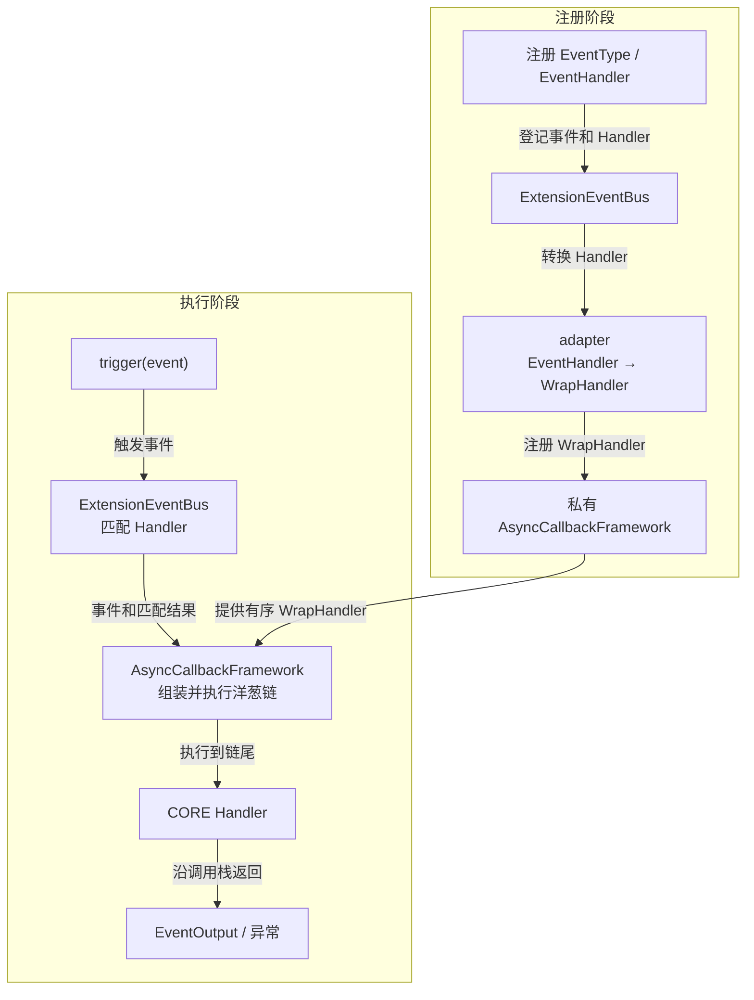

# EV-02 EventBus 注册与执行引擎设计方案

## 1. 背景、目标与约束

### 1.1 背景与问题

EV-01 已提供 `Event`、`EventHandler`、`EventNext` 和 `ExtensionEventBusProtocol` 等公共契约，但 `openjiuwen.core.events` 还没有 EventBus 实现。当前缺少 EventType 和 Handler 的注册、匹配、执行及注销能力。

Runner 已有 `AsyncCallbackFramework`，其中：

- `on_wrap()` 可以按事件名和 priority 注册 `WrapHandler`；
- `wrap()` 可以把多个 `WrapHandler` 包装到一个终点函数外层；
- `register_sync()` 和 `unregister_sync()` 提供同步注册、精确注销；
- `create_wrap_by_event_decorator()` 和 `_build_wrap_chain_regular()` 已实现动态成员读取和洋葱链组装。

EV-02 的真实问题是把 Events 的 EventType、MatchPattern、HandlerLevel 和 EventNext 语义适配到现有 wrap-chain。

### 1.2 设计目标

- 注册和注销 EventType、唯一 CORE、USER / BUILTIN Handler。
- 同步匹配 Handler，并按 USER → BUILTIN → CORE 稳定执行。
- 复用 callback framework 构建洋葱链，支持前置处理、反向返回和短路。
- 通过 EventNext 支持继续执行、跳到 BUILTIN、跳到 CORE。
- USER Handler 热注册、热注销只影响后续 `trigger()`，不打断在途调用。
- 保持 EV-01 的公共方法签名和错误码不变。

### 1.3 设计约束

- `ExtensionEventBus` 实例持有一个私有 `AsyncCallbackFramework` 实例，与 Runner 中已有的 framework 实例互不共享注册表。
- `register_event_type()`、`unregister_event_type()`、`register_event_handler()` 和 `unregister_event_handler()` 保持同步；只有 `trigger()` 是异步接口。
- 注册和注销只修改内存数据，不执行 I/O；首版只支持同一 asyncio 事件循环内调用，不承诺跨线程并发安全。
- matcher 必须同步执行。一次 `trigger()` 的匹配结果在第一次 `await` 前确定，链内修改 `event_input` 不重新匹配。
- EV-02 调用 Handler 时传入 `ops=None`。Session 规范化和逐 Handler Ops 由 EV-04 接入，不改变本方案的注册与洋葱链结构。
- `unregister_event_type()` 的目标语义是删除 EventType 及其全部 USER / BUILTIN callback。当前 S_01 中“存在关联 Handler 时拒绝删除”的描述与本方案冲突，实施前必须同步规约。

## 2. 总体架构

### 2.1 架构概览

`ExtensionEventBus` 负责 Events 领域语义，并直接持有一个私有的 `AsyncCallbackFramework` 实例。两者通过 adapter 连接：

- `ExtensionEventBus` 负责事件注册、Handler 匹配和 EventNext 语义。
- adapter 将 `EventHandler` 转换为 callback framework 支持的 `WrapHandler`。
- `AsyncCallbackFramework` 负责 Handler 排序和洋葱链执行。

整体分为注册和执行两个阶段：



注册阶段把 Events Handler 转换并注册到 callback framework。执行阶段先由 EventBus 完成匹配，再进入 callback framework 生成的洋葱链。

### 2.2 callback_framework 复用机制

#### 2.2.1 已有能力与链式调用原理

callback framework 当前已经支持：

| 已有能力 | ExtensionEventBus 的使用方式 |
| --- | --- |
| 注册和注销 `WrapHandler` | 管理 EventHandler 对应的 adapter |
| 按 priority 稳定排序 | 确定洋葱链中的 Handler 顺序 |
| `wrap()` 封装最终处理器 | 将 CORE Handler 放在链最内层 |
| 通过 `call_next` 组装 Wrap 链 | 实现洋葱式调用 |

callback framework 的链式调用过程是：

```text
on_wrap(event) 注册有序 WrapHandler
    → wrap(event)(CORE) 生成 dispatch
    → 调用 dispatch 时读取当前 WrapHandler
    → 反向组装 WrapHandler 链
    → 从最外层 Handler 开始执行
```

假设同一事件注册了 H1 和 H2，callback framework 构造出的调用关系为：

```text
H1(
    H2(
        CORE
    )
)
```

每个 `WrapHandler` 都会收到下一层对应的 `call_next`。Handler 可以在调用 `call_next` 前后执行逻辑，也可以不调用 `call_next`，直接终止内层链路。返回值和异常沿 `await` 调用栈自然向外传播。

#### 2.2.2 Adapter 适配关系

callback framework 不理解以下 Events 领域概念：

- `EventType` 和 `MatchPattern`；
- `HandlerLevel`；
- `EventHandler(event, ops, next)` 接口；
- `EventNext` 的一次调用和层级跳转语义。

因此需要 adapter 连接两套 Handler 协议：

```text
EventHandler(event, ops, EventNext)
                │
                │ adapter
                ▼
WrapHandler(call_next, event, ...)
```

adapter 在运行时还会把 callback framework 提供的 `call_next` 封装为 `EventNext`：

```text
EventHandler 调用 EventNext
    → adapter 调用 call_next
    → 进入下一个 WrapHandler
```

职责边界如下：

| ExtensionEventBus | callback framework |
| --- | --- |
| EventType、MatchPattern 和 HandlerLevel | WrapHandler 注册和 priority 排序 |
| EventHandler → WrapHandler adapter | 为 adapter 注入 `call_next` |
| EventNext、层级跳转和短路语义 | 组装并执行洋葱链 |
| HandlerId 注销语义 | 保存和移除具体 adapter |

`ExtensionEventBus` 不自行实现排序和洋葱链，只补充 callback framework 缺少的 Events 领域语义。它不使用 `AsyncCallbackFramework.trigger()`，而是复用 `wrap()`、`on_wrap()` 及其现有 chain composer。

### 2.3 ExtensionEventBus 内部组成

`ExtensionEventBus` 只维护三个核心成员：

```text
ExtensionEventBus
├── _framework    私有 AsyncCallbackFramework
├── _events       EventType 对应的 matcher 和 dispatch
└── _handlers     HandlerId 对应的匹配条件和 adapter
```

- `_framework` 保存 adapter，负责排序和洋葱链执行。
- `_events` 支持 EventType 校验、匹配和查找执行入口。
- `_handlers` 支持 Handler 匹配和按 HandlerId 注销。

每个 `ExtensionEventBus` 拥有独立的 `_framework` 实例，其生命周期与 EventBus 相同，不与 Runner 中的 callback framework 实例共享状态。接口参数、字段结构和注销流程在详细设计中展开。

### 2.4 注册阶段

注册阶段包含两条链路。

EventType 注册：

```text
EventType + matcher + CORE Handler
    → ExtensionEventBus
    → framework.wrap(CORE Handler)
    → 保存 matcher 和 dispatch
```

`framework.wrap()` 将 CORE Handler 封装为执行入口。CORE Handler 位于洋葱链的最内层。

EventHandler 注册：

```text
EventHandler + MatchPattern + HandlerLevel
    → ExtensionEventBus
    → adapter 转换为 WrapHandler
    → framework.on_wrap() 注册
```

`ExtensionEventBus` 保存 HandlerId 和匹配信息；Handler 顺序交给 callback framework 管理。

注销时，EventBus 删除自身保存的事件或 Handler 记录，并从私有 callback framework 删除对应 adapter。具体校验、回滚和级联删除顺序在详细设计中说明。

### 2.5 执行阶段与洋葱链

执行阶段的主链路为：

```text
trigger(event)
    → 查找 EventType
    → 匹配 EventHandler
    → 调用 dispatch
    → callback framework 组装洋葱链
    → adapter 调用 EventHandler
    → CORE Handler
    → 返回 EventOutput
```

假设匹配后的 Handler 顺序为：

```text
USER-1 → USER-2 → BUILTIN-1 → CORE
```

callback framework 组装出的调用关系为：

```text
USER-1(
    USER-2(
        BUILTIN-1(
            CORE
        )
    )
)
```

执行顺序为：

```text
USER-1 before
  → USER-2 before
    → BUILTIN-1 before
      → CORE
    ← BUILTIN-1 after
  ← USER-2 after
← USER-1 after
```

callback framework 负责构建嵌套调用关系；adapter 负责将 `call_next` 转换为 `EventNext`。如果 Handler 不调用 `EventNext`，当前 Handler 直接返回，后续 Handler 和 CORE 不再执行，从而实现链路短路。

## 3. 详细设计

### 3.1 内部数据结构

目标实现只需要两个内部记录：

```python
EventDispatcher: TypeAlias = Callable[..., Awaitable[EventOutput | None]]


@dataclass(frozen=True, slots=True)
class _EventRegistration:
    matcher: MatchPatternFunc
    dispatch: EventDispatcher


@dataclass(frozen=True, slots=True)
class _HandlerRegistration:
    event_type: EventType
    match_pattern: MatchPattern
    wrap_handler: WrapHandler
```

`ExtensionEventBus` 只持有：

```python
self._framework = AsyncCallbackFramework()
self._events: dict[EventType, _EventRegistration] = {}
self._handlers: dict[HandlerId, _HandlerRegistration] = {}
```

不增加额外执行层、调用快照对象、分层 callback 容器或反向 EventType 索引：

- CORE 被 `dispatch` 闭包捕获，不重复保存。
- priority 和注册顺序由 callback framework 保存，不在 EventBus 再存一份序号。
- HandlerId 只是精确注销和匹配关联键，`_HandlerRegistration` 不复制 HandlerId。
- EventType 注销是低频操作，直接扫描 `_handlers`，无需维护第二份索引。

### 3.2 注册与注销

注册和注销接口保持同步。它们只执行参数校验、字典修改和 callback framework 内存注册，不执行 I/O，也不等待在途 Handler。

#### 3.2.1 EventType 注册

`register_event_type(event_type, matcher, core_handler)` 按以下顺序执行：

1. 校验 EventType、保留前缀、重复注册、matcher 和 CORE callable。
2. 创建 `core_terminal()`，内部以 `ops=None` 调用 CORE Handler。
3. 为 CORE 提供链尾 EventNext：`next(event)` 返回 `None`，任何 `to()` 均拒绝。
4. 执行 `dispatch = self._framework.wrap(event_type)(core_terminal)`。
5. 保存 `_events[event_type] = _EventRegistration(matcher, dispatch)`。

`dispatch` 不固化 Handler 列表。后续注册的 USER / BUILTIN 会在下一次调用 `dispatch` 时自动进入链。

#### 3.2.2 EventHandler 注册

`register_event_handler()` 只允许 USER 和 BUILTIN：

1. 校验 EventType 已存在、Handler 可调用、层级合法、MatchPattern 合法。
2. 复制并冻结 MatchPattern，避免注册后被调用方修改。
3. 生成当前 Bus 实例内唯一的 HandlerId。
4. 创建唯一 WrapHandler adapter，闭包捕获 HandlerId、EventHandler 和 HandlerLevel。
5. 按固定 priority 调用 `self._framework.on_wrap(event_type, priority=priority)(wrap_handler)`。
6. 保存 `_handlers[handler_id] = _HandlerRegistration(...)`。

priority 只表达层级，不表达业务权重：

| HandlerLevel | priority | 执行位置 |
| --- | ---: | --- |
| USER | 200 | 外层 |
| BUILTIN | 100 | USER 内层、CORE 外层 |
| CORE | 不注册 | `dispatch` 终点 |

`register_sync()` 使用 Python 稳定排序，因此同一 priority 保持注册顺序。EventBus 不再实现第二套排序。

所有可预期校验都在写入前完成。如果 framework 注册成功但 `_handlers` 写入失败，立即使用同一个 `wrap_handler` 调用 `unregister_sync()` 回滚，避免留下无法注销的 callback。

#### 3.2.3 Handler 与 EventType 注销

`unregister_event_handler(handler_id)`：

1. 未知 HandlerId 幂等返回。
2. 从 `_handlers` 取得 `event_type` 和原始 `wrap_handler`。
3. 调用 `framework.unregister_sync(wrap_registry_key, wrap_handler)` 精确删除。
4. 删除 `_handlers[handler_id]`。

callback framework 将 WrapHandler 存在 `__wrap__:{event_type}`。该 key 的拼接只放在 EventBus 的一个内部 helper 中，避免业务逻辑直接访问 `_callbacks`。

`unregister_event_type(event_type)`：

1. 未知 EventType 幂等返回。
2. 扫描 `_handlers`，找出属于该 EventType 的记录。
3. 逐条通过 `unregister_sync()` 删除对应 WrapHandler，并删除 HandlerId。
4. 删除 `_events[event_type]`，随之释放 matcher、dispatch 和 CORE 闭包。

该接口的语义是“删除事件以及事件下的全部 callback”，调用方不需要先逐个注销 Handler。callback framework 的 `unregister_event()` 是异步接口，且接收内部 wrap registry key；EV-02 不为调用它而把公共注销接口改成异步。

未知 EventType 或 HandlerId 幂等返回。同步方法在同一事件循环内执行期间不会发生 task 切换，可以连续更新 EventBus 状态和 framework 注册表。只有未来需要跨线程注册、等待在途 Handler 排空或执行异步资源初始化时，才需要新增异步生命周期接口。

### 3.3 Trigger 执行

`trigger()` 是 EventBus 唯一的异步接口，负责完成匹配并进入已注册的 callback framework 洋葱链。

#### 3.3.1 匹配与 Dispatch

目标流程如下：

```python
async def trigger(self, event: Event, session=None) -> EventOutput | None:
    registration = self._events.get(event.event_type)
    if registration is None:
        raise_unknown_event(event.event_type)

    candidates = tuple(
        (handler_id, registered)
        for handler_id, registered in self._handlers.items()
        if registered.event_type == event.event_type
    )
    matched_handler_ids = frozenset(
        handler_id
        for handler_id, registered in candidates
        if registration.matcher(event.event_input, registered.match_pattern)
    )

    return await registration.dispatch(
        event,
        matched_handler_ids=matched_handler_ids,
        target_level=None,
    )
```

这是目标伪代码，不是完整实现。正式实现还需补充 S_01 规定的 Event、matcher 返回值和错误码校验。

`trigger()` 在第一次 `await` 前完成以下工作：

1. 固定 `_EventRegistration`。
2. 复制当前 EventType 的候选 Handler 记录。
3. 逐条调用同步 matcher。
4. 生成只读的 `matched_handler_ids`。

matcher 返回 `False` 只排除当前 Handler；matcher 抛错、返回非 bool 或返回 awaitable 时，在任何 Handler 执行前以 `EVENTS_MATCH_INVALID` 失败。

framework 链仍包含调用开始时启用的全部 WrapHandler。每个 adapter 根据自己的 HandlerId 判断：

- ID 在 `matched_handler_ids` 中：执行领域 Handler；
- ID 不在其中：直接 `await call_next(...)`，不构建 Ops，不改变结果。

这样匹配属于 Events，排序和链组装仍属于 callback framework。EventNext 传入新的 `event_input` 时继续使用同一个 `matched_handler_ids`，不会重新匹配。

#### 3.3.2 Adapter 与洋葱链

callback framework 调用 Adapter 时注入 `call_next`。Adapter 根据匹配结果和目标层级决定透传还是执行领域 Handler：

```python
async def adapter(call_next, event, matched_handler_ids, target_level):
    if handler_id not in matched_handler_ids or should_skip_level(target_level):
        return await call_next(
            event,
            matched_handler_ids=matched_handler_ids,
            target_level=target_level,
        )

    event_next = create_event_next(call_next, current_level)
    return await event_handler(event, None, event_next)
```

这是目标伪代码，`should_skip_level()` 和 `create_event_next()` 只表达职责，不要求新增同名公共函数。

Adapter 只负责三件事：

- 未匹配或被跳层排除时调用 `call_next`；
- 实际进入 Handler 时，用只接收 Event 和目标层级的 `forward` 包装 `call_next`，再创建 EventNext；
- 调用 Handler，并拒绝非 awaitable 返回值。

领域 Handler 不直接接触 framework `call_next`；匹配结果和调用上下文由 adapter 闭包固定，Handler 只能通过 EventNext 传递 Event 或请求向内层跳转。洋葱链仍由 callback framework 构造，EventBus 不直接调用 composer，也不手工拼接 USER 和 BUILTIN 链。返回值和异常沿原有 `await` 调用栈向外传播。

#### 3.3.3 EventNext、短路与跳层

每次实际进入一个 Handler 都创建新的 EventNext。EventNext 内部保存当前 Handler 层级、原始 event_type、所属 asyncio Task、有效状态和 adapter 提供的 `forward`，不直接持有 framework `call_next` 或匹配结果。

| 调用 | 行为 |
| --- | --- |
| `await next_handler(event)` | 调用当前 adapter 的 `call_next`，进入下一条匹配 Handler |
| USER `to(BUILTIN)` | 透传剩余 USER；到首个匹配 BUILTIN 时恢复正常执行；没有匹配 BUILTIN 则进入 CORE |
| USER / BUILTIN `to(CORE)` | 透传剩余 USER / BUILTIN，直接进入 CORE |
| Handler 不调用 EventNext | 直接返回，短路全部内层逻辑 |

跳层使用一个内部 `target_level` 沿同一条 framework 链传递，不创建第二条链：

- adapter 层级未到目标时直接调用 `call_next` 并保留 target；
- 到达首个匹配目标层时清除 target，正常执行该 Handler；
- 目标是 CORE 时，所有剩余 adapter 都透传，由 `core_terminal` 接收。

EventNext 推进前依次校验：仍在有效期内、由创建它的 Task 调用、参数是 Event、event_type 未改变、目标是合法的 HandlerLevel 且只能向内层跳转。EventBus 使用 `with EventNext(...)` 限定有效期，Handler 正常返回、抛错或取消后都会使它失效；违规调用统一以 `EVENTS_NEXT_INVALID` 拒绝。

同一 Handler 在有效期内、同一 Task 中可以多次推进，每次都会从相同下一节点重新执行下游链，可能重复产生副作用。EventNext 不校验具体 `event_input` 和返回值的业务结构。

#### 3.3.4 调用隔离与异常语义

`trigger()` 在第一次 `await` 前固定候选记录和匹配结果。紧接着进入 `dispatch` 时，callback framework 也会在第一次执行 Handler 前复制当前 WrapHandler 列表。同一事件循环内，这两个动作之间没有 task 切换点。

因此：

- 在一次 Trigger 开始前完成的注册或注销立即生效；
- Trigger 已进入 Handler 后发生的注册或注销不影响当前调用；
- 当前调用继续持有原 Handler 引用，新调用读取最新注册表；
- 注销返回不表示旧调用已经排空，插件资源释放仍由宿主等待其管理的调用结束。

返回、异常与取消遵循以下语义：

- 最外层 Handler 的返回值原样作为 `trigger()` 结果。
- USER、BUILTIN、CORE 的业务异常保持原类型向外传播。
- `asyncio.CancelledError` 原样传播，不转换成 `None`，也不补跑 CORE。
- 未匹配 adapter 只透传，不吞掉下游返回值或异常。
- Handler 返回非 awaitable 时以 `EVENTS_REGISTRATION_INVALID` 失败。
- EventNext 的状态错误转换为 `EVENTS_NEXT_INVALID`；matcher 契约错误转换为 `EVENTS_MATCH_INVALID`。

## 4. 实施影响

### 4.1 文件与实现顺序

1. 新增 `openjiuwen/core/events/bus.py`，实现最小注册记录、ExtensionEventBus、adapter 和 EventNext。
2. 先实现 EventType/Handler 注册注销，再实现匹配和 Trigger，最后补齐 EventNext 跳层与错误处理。
3. 新增 `tests/unit_tests/core/events/test_event_bus_registration.py` 和 `test_event_bus_execution.py`。
4. 运行 callback framework 现有 wrap 测试，确认复用没有改变 Runner 行为。
5. EV-02 暂不从 `openjiuwen.core.events.__init__` 公开 `ExtensionEventBus`；EV-04 完成 Builder/Ops 和完整调用链后再公开。

### 4.2 callback_framework 影响

本方案不修改 callback framework 的注册表、排序算法或 chain composer，也不增加 Events 专用 callback 字段。EventBus 只组合现有：

- `AsyncCallbackFramework.wrap()`；
- `AsyncCallbackFramework.on_wrap()`；
- `AsyncCallbackFramework.unregister_sync()`；
- `create_wrap_by_event_decorator()` 已有的调用期成员读取；
- `_build_wrap_chain_regular()` 已有的洋葱链构造。

WrapHandler registry key 的拼接属于唯一实现耦合点，应封装在 EventBus 内部 helper，不扩散到业务代码。

### 4.3 契约与后续 Feature

- S_01 需要把 `unregister_event_type()` 从“存在 Handler 时拒绝”修订为“级联删除 EventType 及全部 Handler”。这是实施前的契约同步项，本次只重写 F02，不修改 S_01。
- EV-03 独立实现 Builder/Ops，不依赖 EventBus 内部注册结构。
- EV-04 在 adapter 实际调用 EventHandler 前构建 Ops，并在 Trigger 入口规范化 Session；不改变 framework wrap-chain。
- `ops.build` 的特殊门禁由 EV-04 实现，不塞入 EV-02 的普通事件注册主链。

## 5. 验证设计与风险

### 5.1 核心验证场景

| 场景 | 验证内容 | 预期结果 |
| --- | --- | --- |
| EventType 注册 | 合法、重复、非法名称、非法 matcher/CORE | 合法注册生成 dispatch；失败无残留 |
| Handler 注册注销 | USER/BUILTIN、非法 CORE、重复函数登记、精确 HandlerId 注销 | 每次登记独立；只删除目标记录 |
| EventType 注销 | EventType 下存在多个 USER/BUILTIN | 一次删除事件、CORE 和全部 callback |
| 匹配与顺序 | 部分 Pattern 命中，混合 USER/BUILTIN | 只执行命中项；USER 在外、BUILTIN 在内，同层保持注册顺序 |
| 洋葱执行 | 每层在 EventNext 前后记录 trace | USER → BUILTIN → CORE 进入，反向返回 |
| 短路与跳层 | 不调用 next、to(BUILTIN)、to(CORE) | 只执行约定的当前层和内层范围 |
| EventNext 非法使用 | 跨 Task、退出后使用、非 Event、改变 event_type、非法层级或跳转 | 进入下游前以 `EVENTS_NEXT_INVALID` 拒绝 |
| EventNext 重复推进 | 同一 Handler 在有效期内连续推进两次 | 两次均从相同下一节点执行下游链 |
| Handler 返回协议 | USER / BUILTIN / CORE 返回非 awaitable | 以 `EVENTS_REGISTRATION_INVALID` 拒绝 |
| 热注册与注销 | U1 等待期间注销 U2、注册 U3，再触发第二次 | 旧调用仍执行 U2 且不见 U3；新调用执行 U3 且不见 U2 |
| 异常与取消 | USER/BUILTIN/CORE 抛错或取消 | 原异常或 CancelledError 向外传播，不补跑后续链 |
| callback framework 回归 | 运行既有 `test_framework_wrap.py` | priority、动态成员、短路、反向返回行为不变 |

当前仅完成目标设计，EV-02 行为测试尚未实现和执行。

### 5.2 风险与已知边界

- `on_wrap()` 使用 `__wrap__:{event_type}` 保存 Handler，但 callback framework 没有公开同步 `unregister_wrap()`；EventBus 必须集中封装该 key，避免多处依赖内部前缀。
- 当前一致性保证建立在同一 asyncio 事件循环、注册方法无 `await` 的前提上；跨线程热加载需要宿主切回 EventBus 所属事件循环。
- 注销没有 drain 语义。若未来插件卸载需要等待旧 Handler 结束，应由扩展运行时跟踪自己发起的任务，不能把即时注销改成隐式等待。
- EventNext 只约束当前链的推进，不校验业务输入输出，也不提供副作用隔离、幂等、重试或调用次数限制。
- EV-02 的 `ops=None` 仅用于隔离注册与执行引擎开发，不代表完整 EventBus 已可供业务使用；完整运行时依赖 EV-03 和 EV-04。


