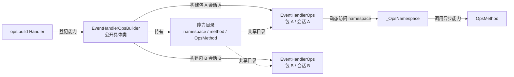
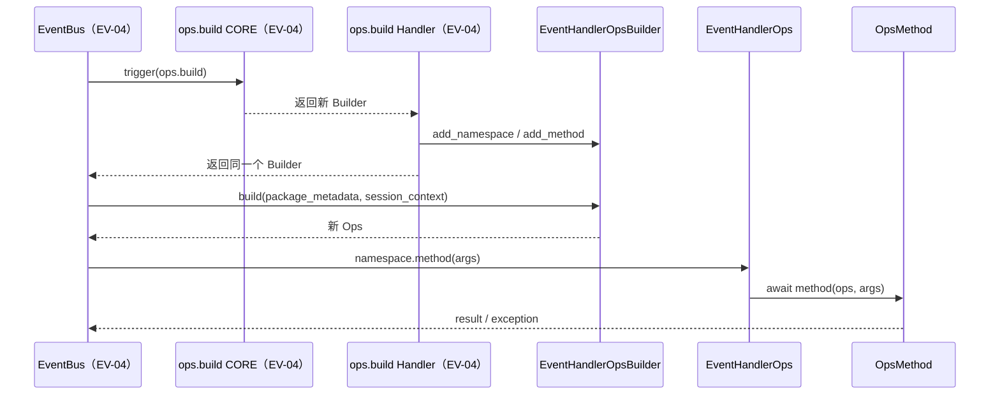

# EV-03 Builder/Ops 设计方案

## 1. 元信息

| 项 | 值 |
| --- | --- |
| 建档日期 | 2026-10-20 |
| 范围 | `openjiuwen.core.events` 的 Builder/Ops 公开实现、能力目录、动态调用和上下文隔离 |
| 方案成熟度 | 已确认 |
| 计划条目 | [Events 特性开发计划](../designs/events-development-plan.md) EV-03 |
| 设计依据 | [S_01 Events 公共契约](../specs/S_01_events-contract.md) 第 4.6、4.7 节 |
| 关联 feature | [F_01 EV-01 公共接口契约](F_01_ev01-public-contract.md)；EV-04 负责后续 EventBus 集成 |
| 验证摘要 | 2026-10-20：EV-03 专项 25 passed，Events 回归 64 passed；Ruff、格式、目标 mypy 和 `git diff --check` 通过 |
| Refs | 无 |

## 2. 背景、目标与范围

### 2.1 背景与问题

EV-01 最初以 Protocol 公开 `EventHandlerOpsBuilder`、`EventHandlerOps` 的类型和方法签名。F_03 已在 `openjiuwen/core/events/ops.py` 提供可运行的公开具体类，支持登记 namespace 和 method，并构建带 PackageMetadata、SessionContext 和动态能力的 Ops；EventBus 接线仍由 EV-04 完成。

EV-03 解决两个直接问题：

1. 提供可实例化、可公开导入的 Builder/Ops 具体类。
2. 用同一个能力目录构造多个上下文相互隔离的 Ops。

### 2.2 目标

- `EventHandlerOpsBuilder` 和 `EventHandlerOps` 直接作为公开具体类实现，不再维护同名 Protocol 和私有实现两套类型。
- 平台开发者在 `ops.build` Handler 中取得 Builder 后，直接调用 `add_namespace()`、`add_method()` 登记能力。
- `ops.build` 成功后能力目录不再修改，可被多个 `EventHandlerOps` 并发共享。
- 每次 `build(package_metadata, session_context)` 返回独立 Ops，不在 Builder 中保存可变的当前包或当前会话。
- Handler 可以通过 `ops.<namespace>.<method>(...)` 调用异步能力，能力收到当前 Ops 作为第一个参数。

### 2.3 本次范围

本次包含：

- namespace 和 method 登记、校验及冲突处理；
- Ops 构造、上下文保存和动态能力调用；
- 公开导出、契约调整和 EV-03 单元测试。

本次不包含：

- `ops.build` 预置事件、Build CORE 和 EventBus 对 Builder 的保存；
- PackageMetadata 的注册、认证或获取方式；
- Session 到 SessionContext 的投影；
- 普通事件逐 Handler 构建 Ops 的接线；
- `set_package_info()`、Ops 失效、锁、状态机或资源清理机制。

上述 EventBus 编排由 EV-04 完成。

## 3. 总体方案与设计取舍

### 3.1 架构概览



- `EventHandlerOpsBuilder`：拥有能力目录，负责登记和构建 Ops。
- `EventHandlerOps`：拥有单次构建传入的包与会话上下文，共享能力目录。
- `_OpsNamespace`：只负责某个 namespace 下的方法查找和调用转发，保持私有。
- `OpsMethod`：异步能力函数，首个实参固定为当前 `EventHandlerOps`。

### 3.2 核心时序

下图同时标明 EV-03 提供的对象行为和 EV-04 的未来调用位置。EV-03 不实现 EventBus 部分。




## 4. 详细设计

### 4.1 公开类与内部类

当前公开接口如下：

```python
from typing import Any


class EventHandlerOpsBuilder:
    def add_namespace(self, namespace: str) -> None: ...

    def add_method(
        self,
        namespace: str,
        method_name: str,
        method: OpsMethod,
    ) -> None: ...

    def build(
        self,
        package_metadata: PackageMetadata | None = None,
        session_context: SessionContext | None = None,
    ) -> EventHandlerOps: ...


class EventHandlerOps:
    @property
    def package_metadata(self) -> PackageMetadata | None: ...

    @property
    def session_context(self) -> SessionContext | None: ...

    def __getattr__(self, namespace: str) -> Any: ...
```

`_OpsNamespace` 是唯一新增的私有辅助类。它保存当前 Ops 和某个 namespace 的 method 映射，通过 `__getattr__` 返回异步调用入口。不增加额外 Method 包装类、注册中心或工厂层。

### 4.2 Builder 数据结构

Builder 使用普通嵌套字典：

```python
dict[str, dict[str, OpsMethod]]
```

`add_namespace()`：

1. 校验 namespace 是合法 Python 标识符；
2. 拒绝 Python 关键字、下划线开头名称；
3. 拒绝与 `EventHandlerOps` 公共属性冲突的 `package_metadata`、`session_context`；
4. 拒绝重复 namespace；
5. 创建空 method 字典。

`add_method()`：

1. 使用相同的标识符、关键字和下划线规则校验 method 名；
2. 要求 namespace 已存在；
3. 拒绝同 namespace 下的重复 method；
4. 使用 `inspect.iscoroutinefunction()` 拒绝同步函数；
5. 保存原始 OpsMethod，不包装、不执行。

### 4.3 build 与上下文隔离

`build()` 只接受 `PackageMetadata | None` 和 `SessionContext | None`：

- 参数类型不合法时使用 `EVENTS_PAYLOAD_INVALID` 拒绝；
- 每次创建新的 `EventHandlerOps`；
- Ops 共享同一份能力目录，但分别保存本次传入的上下文引用；
- Builder 不回写、缓存或推断 PackageMetadata/SessionContext。

PackageMetadata 的来源不属于 EV-03。EV-04 在掌握当前 Handler 身份的调用点显式传入；没有包上下文时传入 `None`。

### 4.4 动态访问与调用

访问链为：

```text
ops.<namespace>
    -> EventHandlerOps.__getattr__
    -> _OpsNamespace
    -> namespace.<method>
    -> _OpsNamespace.__getattr__
    -> await method(current_ops, *args, **kwargs)
```

每次能力调用必须把创建 namespace 视图的当前 Ops 作为首个参数。这样同一 OpsMethod 可以读取当前 Handler 对应的 `package_metadata` 和 `session_context`，不需要从全局变量或 Builder 查询上下文。

未知 namespace、未知 method 均使用 `EVENTS_OPS_INVALID` 拒绝。OpsMethod 返回值原样返回；业务异常和 `asyncio.CancelledError` 原样传播，不转换为 Events 错误。

### 4.5 并发与生命周期

Builder 不设生命周期状态。能力登记由 `ops.build` 初始化链串行完成，不承诺跨线程并发写安全；`ops.build` 成功后目录不再修改，可由多个 Ops 无锁共享；本轮只验证顺序 build 两个 Ops 后并发调用共享能力，未单独测试并发 build。每个 Ops 没有失效状态，不需要清理。

### 4.6 错误语义

| 场景 | 错误码 / 行为 |
| --- | --- |
| 非法、重复或冲突名称 | `EVENTS_OPS_INVALID` |
| namespace 不存在、method 重名或 method 非异步函数 | `EVENTS_OPS_INVALID` |
| 未知 namespace 或 method | `EVENTS_OPS_INVALID` |
| PackageMetadata/SessionContext 类型非法 | `EVENTS_PAYLOAD_INVALID` |
| OpsMethod 业务异常或取消 | 原样传播 |

Events 不新增专属异常类，统一通过 Core `raise_error()` 使用现有 StatusCode。

## 5. 影响面与实施设计

### 5.1 文件与实现顺序

| 顺序 | 文件 | 修改内容 |
| --- | --- | --- |
| 1 | `openjiuwen/core/events/ops.py` | 新增公开 `EventHandlerOpsBuilder`、`EventHandlerOps` 和私有 `_OpsNamespace` |
| 2 | `openjiuwen/core/events/protocol.py` | 删除同名 Builder/Ops Protocol；`EventHandler` 类型别名引用 `ops.py` 中的公开 `EventHandlerOps` |
| 3 | `openjiuwen/core/events/__init__.py` | 从 `ops.py` 重导出 Builder/Ops，保持公开名称不变 |
| 4 | `tests/unit_tests/core/events/test_events_contract.py` | 将 Builder/Ops 断言从 Protocol 签名调整为公开具体类签名和导出来源 |
| 5 | `tests/unit_tests/core/events/test_event_handler_ops.py` | 新增登记、构建、动态调用、并发隔离和失败行为测试 |

`ops.py` 只依赖 `types.py` 和 Core 统一错误入口，不依赖 `bus.py`。`protocol.py` 可以引用 `ops.py` 的公开类；`ops.py` 不反向引用 `protocol.py`，避免循环依赖。

### 5.2 EventBus 影响

EV-03 不修改 `ExtensionEventBus`、注册记录、callback adapter 或执行快照。EV-02 现有测试行为必须保持不变。

EV-04 只需要组合 EV-03 提供的公开类：

1. Build CORE 创建并返回 `EventHandlerOpsBuilder`；
2. `ops.build` BUILTIN Handler 取得同一个 Builder 并登记能力；
3. 完整 Build 链成功后，EventBus 校验结果类型并直接保存 Builder；
4. 普通 Handler 执行前调用 `build(package_metadata, session_context)`。

### 5.3 契约与文档同步

本方案改变 EV-01 中“Builder/Ops 仅为 Protocol”的设计，并删除 Ops 失效语义。本轮同步：

- `docs/specs/S_01_events-contract.md`：具体类归属、动态访问声明，以及删除“失效 Ops”要求；
- `docs/features/F_01_ev01-public-contract.md`：标明 Builder/Ops Protocol 已由 EV-03 公开具体类替代；
- `docs/designs/events-development-plan.md`：更新 EV-03 范围、验收项和验证状态；
- `docs/designs/events-architecture.md`：删除 Ops 有效期描述，保留只读能力视图和上下文。

## 6. 验证设计

| 验证 ID | 场景 | 测试内容 | 预期结果 |
| --- | --- | --- | --- |
| EV-03-V-01 | 公开具体类与能力登记 | 从 `openjiuwen.core.events` 导入具体类；覆盖合法登记、非法名称、重复、冲突、同步函数 | 合法登记成功；非法操作使用 `EVENTS_OPS_INVALID` 拒绝 |
| EV-03-V-02 | 上下文隔离 | 同一 Builder 使用不同 PackageMetadata/SessionContext 顺序 build 两个 Ops，随后并发调用共享能力 | 每次返回不同 Ops；并发调用时上下文互不污染；共享能力可用 |
| EV-03-V-03 | 动态调用与异常传播 | 调用 `ops.tool.call()` 并读取当前 Ops；访问未知 namespace/method；OpsMethod 抛业务异常或取消 | 方法收到当前 Ops；未知能力被拒绝；原始异常和 `CancelledError` 原样传播 |
| EV-03-V-04 | 共享调用 | 多个 Ops 共享同一目录并发调用同一能力 | 并发调用时上下文隔离 |
| EV-03 回归 | EV-01/EV-02 | 运行 Events 契约、注册和执行测试 | 公开导出按新契约更新；EV-02 行为无回归 |

