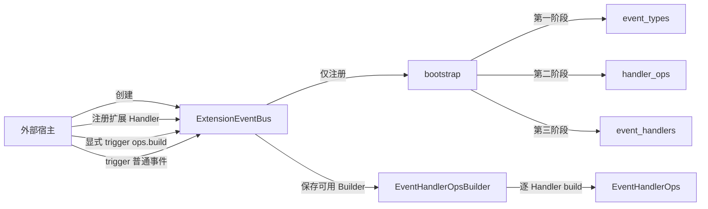
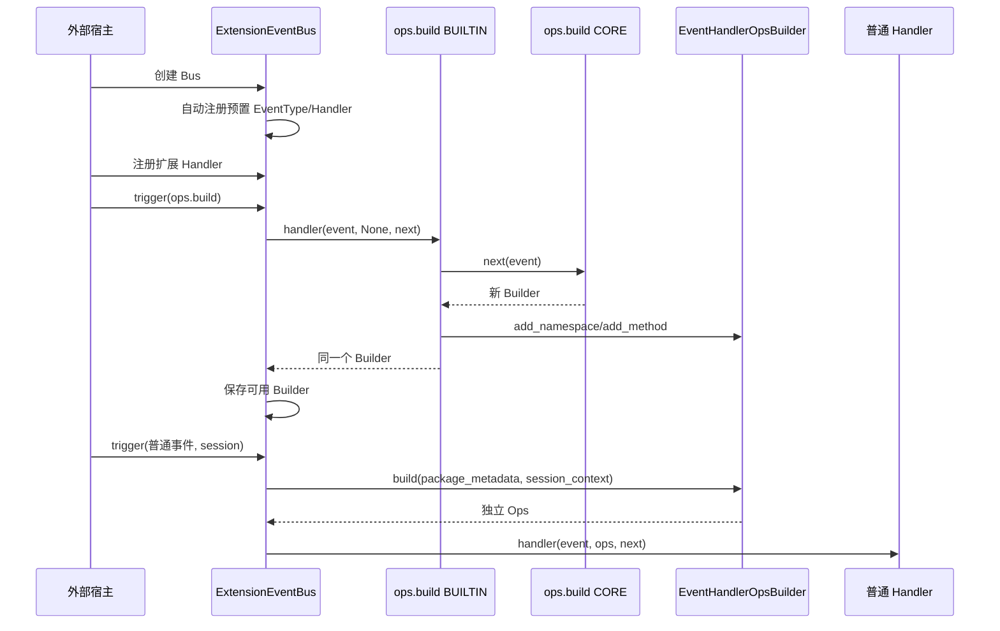

# EV-04 EventBus Build 与业务调用集成设计方案

> 建档日期：2026-10-21
>
> 方案状态：已实现，待审核（实现记录见第 6 节）
>
> 计划条目：[Events 特性开发计划 EV-04](../designs/events-development-plan.md#ev-04-eventbus-可完成-build-和业务调用)
>
> 前置特性：[F_02 EventBus 注册与执行引擎](F_02_ev02-event-bus-engine.md)、[F_03 Builder/Ops](F_03_ev03-builder-ops.md)

## 1. 问题

EV-02 已实现事件注册、匹配和 USER → BUILTIN → CORE 执行链，EV-03 已实现 `EventHandlerOpsBuilder` 和独立 `EventHandlerOps`。两者尚未接通：

- `ExtensionEventBus` 创建后没有预置 `ops.build`，宿主无法直接完成能力目录构建；
- Handler 和 CORE 当前收到的 `ops` 始终为 `None`；
- `trigger()` 尚未规范化 Session，也没有为实际进入的 Handler 构建独立 Ops；
- 当前 Handler 注册记录没有 PackageMetadata，无法为不同扩展包构建正确的 Ops；
- Core 预置事件和 Handler 没有统一放置及自动注册入口。

EV-04 需要完成最小集成，同时守住以下边界：

- `ExtensionEventBus` 内部只负责注册预置 EventType 和 Handler，不主动触发 `ops.build`；
- `ops.build` 由 Bus 外部宿主在完成扩展注册后显式触发；
- 普通业务 `trigger()` 不隐式 Build，也不自动重试 Build；
- 不增加 `initialize()`、`close()`、公开状态机、Build 锁或新的调度层；
- 不在 Core 中预置没有明确业务归属的 EventType、Handler Ops 或业务 Handler。

[S_01](../specs/S_01_events-contract.md)、[详细架构](../designs/events-architecture.md)和[开发计划](../designs/events-development-plan.md)已于 2026-10-21 同步本方案的 PackageMetadata、自动注册、外部 Build 和无锁边界。

## 2. 目标

EV-04 完成后应具备以下可验证行为：

1. 每个 `ExtensionEventBus` 实例创建时，自动注册 Core 预置的 EventType 和 Handler。
2. Core 预置 `ops.build` EventType 及唯一 CORE Handler；外部不能覆盖或注销该事件。
3. 宿主在 Bus 外部显式调用 `trigger(Event(OPS_BUILD_EVENT_TYPE, None))`，成功后 Bus 保存可用 Builder。
4. 普通事件只能在 Build 成功后执行；普通事件不会触发 `ops.build`。
5. `register_event_handler()` 接收可选 PackageMetadata，并在实际进入该 Handler 时用于构建 Ops。
6. Session 在一次 `trigger()` 开始时规范化一次；每个实际进入的 Handler 获得独立 Ops。
7. 名词能力直接执行；动词能力通过普通 `bus.trigger()` 发起独立嵌套事件，不自动推进原事件链。
8. EV-02 的匹配、排序、快照、短路和 EventNext 语义，以及 EV-03 的 Builder/Ops 语义保持不变。


## 3. 架构

### 3.1 模块与目录

```text
openjiuwen/core/events/
├── bootstrap.py
├── bus.py
└── builtins/
    ├── __init__.py
    ├── event_types/
    │   ├── __init__.py
    │   └── ops_build.py
    ├── handler_ops/
    │   └── __init__.py
    └── event_handlers/
        └── __init__.py
```

- `bootstrap.py`：按固定顺序发现并注册预置模块，不触发事件。
- `event_types`：放置 EventType、matcher 和唯一 CORE Handler。
- `handler_ops`：放置注册到 `ops.build` 的 BUILTIN Handler，用于扩展 Builder。
- `event_handlers`：放置普通事件的 BUILTIN Handler。
- `bus.py`：保存注册表和 Build 成功产生的可用 Builder，执行 Build 或普通事件调用链。

本期生产代码只增加 `event_types/ops_build.py`。`handler_ops` 和 `event_handlers` 先建立稳定目录与发现规则，不放入示例能力或虚构业务 Handler。



图中的两条 Host → Bus 调用是外部行为。Bootstrap 只完成注册，不调用 `trigger()`。

### 3.2 主流程



## 4. 详细设计

### 4.1 预置内容与自动注册

每个可发现模块统一提供：

```python
def register(event_bus: ExtensionEventBus) -> None:
    ...
```

`ExtensionEventBus.__init__()` 先创建私有注册表和 Builder 引用，再调用 `register_builtins(self)`。加载规则保持简单：

1. 固定按 `event_types → handler_ops → event_handlers` 加载；
2. 同一目录按模块名排序；
3. 只发现目录下直接 Python 模块；
4. 忽略 `__init__.py` 和 `_` 开头模块；
5. 缺少 `register()` 或注册失败时直接终止 Bus 构造，不吞异常；
6. 每个 Bus 实例都调用一次模块的 `register()`，不使用全局已注册标记或单例 Bus。

`builtins/event_types/ops_build.py` 提供：

- `ops.build` 的 matcher；
- 返回新 `EventHandlerOpsBuilder` 的 CORE Handler；
- 在 Bus 构造时调用公共 `register_event_type()` 的 `register()`。

`register_event_type()` 只放行保留名 `ops.build`，并拒绝其他 `ops.*`。`ops.build` 由构造期 bootstrap 先登记，之后再次登记仍按已注册拒绝。`unregister_event_type()` 继续拒绝全部 `ops.*`。不增加 `allow_reserved` 等公共参数。

### 4.2 Handler 注册与 PackageMetadata

公共接口增加一个仅关键字可选参数：

```python
def register_event_handler(
    event_type: EventType,
    handler: EventHandler,
    match_pattern: MatchPattern,
    handler_level: HandlerLevel = HandlerLevel.USER,
    *,
    package_metadata: PackageMetadata | None = None,
) -> HandlerId:
    ...
```

已有四参数调用保持兼容。`_HandlerRegistration` 增加 `package_metadata`，注册时校验并保存：

- USER/BUILTIN 普通 Handler 使用自身注册记录中的 PackageMetadata；
- CORE 没有独立 Handler 注册记录，构建 Ops 时使用 `None`；
- `ops.build` 链始终向 CORE 和 BUILTIN Handler 传 `ops=None`，不会为 Build Handler 构建 Ops；
- Bus 不从 EventInput 或 Session 推断 PackageMetadata。

### 4.3 外部触发 Build

宿主负责以下启动顺序：

```text
创建 Bus
→ Bus 自动注册 Core 预置内容
→ 宿主/扩展注册 USER、BUILTIN 和 ops.build Handler
→ 宿主显式 trigger(ops.build)
→ 对外提供 Bus
```

Bus 只在收到外部 `trigger(ops.build)` 后执行 Build 链：

1. Build CORE 创建新的空 Builder；
2. 各 `handler_ops` BUILTIN 先调用 `next(event)`，再修改返回的同一个 Builder；
3. 链返回后，Bus 只校验结果是 `EventHandlerOpsBuilder`，不比较 CORE Builder 身份；
4. 校验通过后将可用 Builder 保存到 `self._builder`；
5. 异常、取消、能力冲突、短路未取得 Builder 或结果类型非法时不保存结果。

Build Handler 视为可信平台代码，“修改并返回同一个 Builder”是编码约定，不做运行时身份校验；违反约定（返回新 Builder）属于编码错误，由代码评审保证。

正常启动只触发一次。首次成功前若失败，由宿主决定是否再次调用；Bus 不自动重试。成功后重复 Build，以及注册或注销 `ops.build` Handler，均使用 `EVENTS_STATE_INVALID` 拒绝。

EV-04 只以“Build 成功且 `self._builder` 已保存”作为普通事件的可用性边界。Builder 没有冻结状态：`ops.build` 成功返回即代表能力目录构建完成，Bus 校验结果类型后直接保存。

不增加 Build 锁。约定宿主在对外提供 Bus 前串行完成 Build，并发 Build 不属于支持范围，也不设计并发 Build 测试。

### 4.4 普通事件与逐 Handler Ops

普通事件进入现有 EV-02 执行链前，Bus 必须已成功完成 `ops.build` 并保存可用 Builder；否则使用 `EVENTS_STATE_INVALID` 拒绝，且不执行任何 Build 行为。门禁只判断 `self._builder` 是否存在。

Session 只规范化一次：

| 输入 | SessionContext |
| --- | --- |
| `None` | `None` |
| `SessionContext` | 校验并复制为只读值 |
| `openjiuwen.core.single_agent.Session` | 使用 `get_session_id()` 构造；当前无稳定来源的 `cwd` 和 `metadata` 保持缺省值 |
| 其他类型 | `EVENTS_PAYLOAD_INVALID` |

每个 adapter 只在对应 Handler 确实进入执行时调用一次：

```python
ops = self._builder.build(
    package_metadata=registration.package_metadata,
    session_context=session_context,
)
```

未匹配、被 `to()` 跳过或因外层短路未进入的 Handler 不构建 Ops。CORE 实际进入时也构建独立 Ops，但 PackageMetadata 固定为 `None`。

### 4.5 名词能力、动词能力与异常

EventBus 不分析方法名称，也不新增能力分类类型：

- 名词能力是普通 OpsMethod，直接读取或计算并返回结果；
- 动词能力也是普通 OpsMethod，由能力实现显式调用 `await bus.trigger(new_event, ops.session_context)`；
- 嵌套事件形成新的匹配快照和 Handler 链；
- 动词能力返回后，原 Handler 是否调用 EventNext 仍由原 Handler 决定；
- 业务异常和 `asyncio.CancelledError` 沿原有 `await` 关系传播，不转换为成功结果。

该设计复用现有 `OpsMethod` 和 `trigger()`，不增加动词注册表、事件映射表或嵌套调度器。

### 4.6 实施影响

| 文件 | 修改内容 |
| --- | --- |
| `openjiuwen/core/events/bootstrap.py` | 新增三类 builtin 的确定性发现与注册 |
| `openjiuwen/core/events/builtins/event_types/ops_build.py` | 新增 `ops.build` matcher、CORE Handler 和注册入口 |
| `openjiuwen/core/events/builtins/handler_ops/` | 建立 Handler Ops 扩展目录，本期不增加示例能力 |
| `openjiuwen/core/events/builtins/event_handlers/` | 建立普通 BUILTIN Handler 扩展目录，本期不增加示例 Handler |
| `openjiuwen/core/events/bus.py` | 自动注册、Builder 保存、Build 分支、Session 规范化和逐 Handler Ops |
| `openjiuwen/core/events/protocol.py` | 为 `register_event_handler()` 增加仅关键字 PackageMetadata 参数 |
| `openjiuwen/core/events/__init__.py` | 公开 `ExtensionEventBus` |
| `docs/specs/S_01_events-contract.md` | 同步自动注册、PackageMetadata 来源和无 Build 锁约束 |
| `docs/designs/events-development-plan.md` | 补充自动注册验收范围并记录 EV-04 进度 |

## 5. 测试设计

EV-04 只补跨模块集成行为。EV-02 已覆盖注册、匹配、层级、短路、异常和取消；EV-03 已覆盖 Builder 的能力冲突、上下文隔离和 OpsMethod 调用。上述基础行为不在 EV-04 重复排列组合。

### 5.1 端到端主用例

端到端测试必须从公开入口直接触发 `ops.build`，再证明普通 Handler 能使用 Build Handler 新增的引擎能力：

1. 创建 `ExtensionEventBus`，不手工注册 `ops.build` EventType；
2. 为 `ops.build` 注册一个 BUILTIN Handler，该 Handler 在 `next(event)` 返回后增加 `engine.echo()`；
3. 注册一个普通 EventType 和 USER Handler，并为 USER Handler 传入 PackageMetadata；
4. 由测试中的外部宿主直接执行：

   ```python
   await bus.trigger(Event(OPS_BUILD_EVENT_TYPE, None))
   ```

5. 外部宿主再触发普通事件并传入 SessionContext；
6. USER Handler 断言 `ops` 非空，并调用 `await ops.engine.echo(value)`；
7. `engine.echo()` 返回调用参数以及当前 Ops 中的 PackageMetadata、SessionContext。

通过条件：

- `ops.build` 无需调用方手工注册 EventType，证明预置注册生效；
- Build 只因外部显式 `trigger(ops.build)` 执行一次；
- 普通 Handler 能从 `ops` 访问新增引擎能力；
- 能力取得的 PackageMetadata 和 SessionContext 与当前 Handler 注册及本次调用一致；
- 普通事件不会再次执行 Build Handler。

### 5.2 最小用例集

| 用例 | 测试内容 | 核心断言 | 保留原因 |
| --- | --- | --- | --- |
| EV-04-E2E-01 Build 后 Handler 使用 Ops 能力 | 按第 5.1 节完整执行外部 Build 和普通事件 | Handler 成功调用 `ops.engine.echo()`，包与会话上下文正确 | 直接证明 EV-02 与 EV-03 已完成集成，是 EV-04 的核心验收 |
| EV-04-E2E-02 Build 边界 | Build 前触发普通事件；Build 成功后再次 Build 或修改 Build Handler | Build 前普通调用失败且没有隐式 Build；成功后重复 Build 和变更被拒绝 | 证明唯一能力可用边界，避免隐式初始化和重复提交 |
| EV-04-E2E-03 Build 失败后由宿主重试 | 使用一次能力冲突令 Build 失败，移除冲突 Handler 后由外部再次触发 `ops.build` | 首次失败不保存部分 Builder；第二次显式 Build 成功 | 用一个代表性失败覆盖“失败不提交”，不穷举替换 Builder、异常和取消 |
| EV-04-E2E-04 Ops 动词触发嵌套事件 | Build Handler 增加一个内部调用 `bus.trigger()` 的能力，外层 Handler 通过 Ops 调用它 | 嵌套事件形成独立调用链并取得同一 SessionContext；结果返回外层 Handler | 证明动词能力只复用普通 trigger，没有额外调度机制 |

公共签名和输入校验直接扩展已有测试：

- 在 `test_events_protocol_bus_signature` 中断言 `package_metadata` 是仅关键字可选参数；
- 在现有 Handler 注册非法输入参数化用例中增加非法 PackageMetadata；
- 运行现有 Events 测试目录作为 EV-01～EV-03 回归，不再为层级、短路、异常、取消和 Builder 基础行为新增 EV-04 用例。


建议验证命令：

```text
uv run pytest tests/unit_tests/core/events/ -q
uv run ruff check openjiuwen/core/events tests/unit_tests/core/events
uv run ruff format --check openjiuwen/core/events tests/unit_tests/core/events
uv run mypy --follow-imports=silent openjiuwen/core/events tests/unit_tests/core/events/consumer_stub.py
git diff --check
```

## 6. 实现记录

实现日期：2026-10-21。实现与第 4 节一致，以下为落地细节和与第 5 节的差异。

- **Build 结果校验：** 只校验 Build 链结果类型；曾实现的 CORE Builder 身份校验（私有单槽 `_core_builder`）经评审移除，理由见第 4.3 节。
- **Build 链 `ops=None`：** 不按事件类型分支，而是由“Build 只在 `_builder is None` 时执行、成功后拒绝重复 Build”保证 adapter 与 CORE 构建 Ops 时 Builder 尚不存在。
- **未强制：** 注册期不校验 `ops.build` Handler 必须为 BUILTIN 或空匹配模式。
- **删除冻结契约：** 经评审删除 `EventHandlerOpsBuilder.freeze()` 及冻结前后状态检查（`ops.py`）；Bus 校验结果类型后直接保存 Builder。
- **测试差异：** E2E-01 按 `SessionContext` 与单智能体 `Session` 参数化。EV-02 执行测试改为先外部 Build 再触发普通事件。EV-03 测试删除冻结相关参数行，契约测试删除 `freeze` 签名断言。


