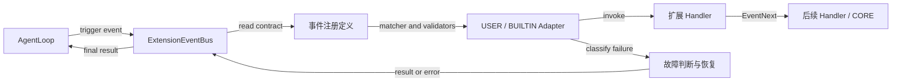
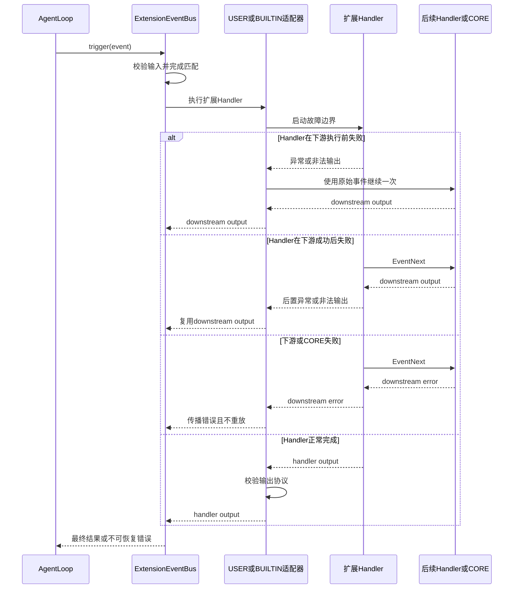

# EV-05 扩展 Handler 容错机制设计方案

> 建档日期：2026-10-23
>
> 方案状态：已实现并验证
>
> 计划条目：[Events 特性开发计划 EV-05](../designs/events-development-plan.md#ev-05-扩展-handler-故障隔离与输出校验)
>
> 前置特性：[F_02 EventBus 注册与执行引擎](F_02_ev02-event-bus-engine.md)、[F_04 EventBus Build 与业务调用集成](F_04_ev04-event-bus-integration.md)
>
> 公共契约：[S_01 Events 公共契约规约](../specs/S_01_events-contract.md)
>
> 验证摘要：代码与契约已同步；EV-05-V-01～V-14 均有测试覆盖，Events 与 callback 回归 468 passed，Ruff、格式与目标 mypy 通过（见第 8.2 节）。

## 1. 问题

扩展 Handler 与 Agent Loop 运行在同一条事件调用链上。当前 USER / BUILTIN Handler 的异常和非法返回会沿 `trigger()` 传播，单个扩展故障可能直接中断当前事件及其所在的 Agent Loop。[E-01][E-04][E-05]

EV-05 一期需要隔离两类扩展故障：

- Handler 抛出异常；
- Handler 接收或返回不符合事件协议的数据。

同时必须避免更严重的恢复错误：Handler 已经通过 `EventNext` 执行下游 Handler 或 CORE 工具，随后在后置逻辑中失败时，容错机制不能再次执行下游，否则可能重复调用工具并重复产生外部副作用。

## 2. 目标与范围

### 2.1 目标

1. USER 和 BUILTIN Handler 使用完全相同的容错规则。
2. Handler 抛异常或违反事件协议时，默认跳过当前 Handler。
3. Handler 在下游执行前失败时，继续执行后续链路。
4. Handler 在下游成功后失败时，复用下游结果。
5. CORE 已执行的工具不因 Handler 后置逻辑失败而再次执行。
6. 下游、CORE、Validator 自身故障及外部取消不被误吞。
7. 保持现有三层顺序、匹配快照、短路、跳层和多次调用 `EventNext` 的语义。

上述容错保证以“后续 Handler 或 CORE 能产生合法结果”为前提。CORE 或下游自身失败时，Events 不伪造成功结果。

### 2.2 本次范围

- EventType 注册增加可选的输入 Validator 和输出 Validator。
- USER / BUILTIN Handler Adapter 增加故障边界和恢复决策。
- 输入在 matcher 或下游消费前校验，输出在 Handler 返回后校验。
- 预置事件通过普通注册参数声明自己的 Validator，不增加事件专用容错分支。
- 在 Handler 隔离点输出可定位的 error 日志，不新增诊断记录模型或前端错误协议。

### 2.3 非目标

一期不包含：

- `.catch()` 自定义兜底；
- `skip`、`propagate` 等公共策略配置；
- retry、熔断、自动禁用；
- Worker 或进程隔离；
- Handler 已产生副作用的事务回滚；
- 通用 Schema 框架；
- Handler 和 CORE 的统一超时治理。

## 3. 设计约束与关键决策

### 3.1 设计约束

- 复用现有 `ExtensionEventBus`、Handler Adapter、`EventNext` 和 callback framework。
- 不修改 `EventNext` 公共接口，不禁止其在有效期内多次推进下游。[E-03]
- 不修改通用 callback framework，容错边界只属于 Events 的 USER / BUILTIN Adapter。
- 新注册参数使用仅关键字可选参数，保留已有三参数 `register_event_type()` 调用。
- 单次 Handler 调用事实只存在于本次 Adapter 调用中，不写入 Bus 注册表、Session 或持久化存储。

### 3.2 关键决策

| ID   | 决策 | 原因与代价 |
|------| --- | --- |
| D-01 | USER、BUILTIN 统一固定 skip | 两者都属于可能影响 Agent Loop 的扩展执行层；一期不引入策略分叉。代价是 BUILTIN 也不能承担失败时必须阻断的安全职责。 |
| D-02 | 恢复依据只使用下游实际执行事实 | 可以区分“尚未执行”“已成功”“已失败”，避免凭异常类型猜测是否可以重放。 |
| D-03 | 下游一旦实际执行，容错机制不得再次调用下游 | 防止 CORE 工具和外部副作用因 Handler 后置故障被重复执行。 |
| D-04 | Validator 属于 EventType 定义 | 输入输出协议由事件定义方拥有，不能由各扩展自行解释。Validator 故障因此不适用 skip。 |
| D-05 | 故障定位只使用现有日志能力 | 被隔离的故障写入 error 日志即可定位；不增加诊断记录、业务返回字段或前端协议。 |

### 3.3 排除的方案

- **保持异常传播：** 无法解决单个扩展击穿 Agent Loop 的真实问题。
- **恢复时始终重新调用下游：** 会重复执行 CORE 工具，违反 D-03。
- **一期引入策略枚举：** 当前只有固定 skip 需求，提前增加策略对象和兼容承诺属于过度设计。
- **一期引入 `.catch()`：** 需要额外定义恢复 Handler、生命周期及 replay-safe `next`，作为二期独立特性评估。
- **为 Validator 或容错建立独立子系统：** 当前逻辑只服务 Events Adapter，拆分会扩大模块数量而不改善边界。

## 4. 总体架构

### 4.1 模块关系



- `ExtensionEventBus`：负责输入校验、匹配和调用链调度。
- `事件注册定义`：保存 matcher、CORE 和 Validator。
- `USER / BUILTIN Adapter`：扩展 Handler 的故障边界。
- `EventNext`：继续负责下游推进和层级跳转。
- `故障判断与恢复`：根据下游执行事实继续下游、复用结果或传播错误；这是 Adapter 内部职责，不是新增模块。
- `CORE`：提供事件默认行为，不参与扩展 Handler 的 skip。

### 4.2 核心时序



### 4.3 恢复决策

每次 Handler 调用只记录以下调用事实：

- 下游实际执行次数；
- 最后一次下游调用是否正常完成；
- 最后一次正常完成的下游输出。

| 下游事实 | Handler 故障后的恢复行为 |
| --- | --- |
| 下游尚未执行 | 跳过当前 Handler，使用该 Handler 收到的原始 Event 继续一次 |
| 最后一次下游正常完成 | 复用最后一次下游输出 |
| 最后一次下游失败 | 传播失败，不重新执行下游 |

核心不变量为：**只要下游已经实际执行，容错机制就不得再次调用下游。**

## 5. 详细设计

### 5.1 故障类型与处理方式

| 故障类型 | 识别位置 | 处理方式 |
| --- | --- | --- |
| USER / BUILTIN Handler 抛异常 | Handler Adapter | 按第 5.2 节执行 skip 恢复 |
| USER / BUILTIN 返回非 awaitable | Handler Adapter | 按第 5.2 节执行 skip 恢复 |
| USER / BUILTIN 输出校验失败 | output validator | 按第 5.2 节执行 skip 恢复 |
| Handler 向 `EventNext` 传入非法输入 | input validator | 不传递非法输入，按第 5.2 节执行 skip 恢复 |
| 初始 EventInput 非法 | matcher 执行前 | `trigger()` 失败，matcher 和 Handler 不执行 |
| CORE 抛异常、返回非 awaitable 或输出非法 | CORE terminal | `trigger()` 失败 |
| 下游 Handler 抛异常 | `EventNext` 调用链 | 原样传播，不重跑下游 |
| Validator 返回非 `bool` 或抛异常 | Validator 调用边界 | 视为事件定义错误，原样传播 |
| matcher、Ops 构建等框架错误 | 对应框架边界 | 原样传播 |
| `CancelledError` | 任意 await 边界 | 原样传播 |

只有 USER / BUILTIN Handler 自身异常、非 awaitable、非法输入和非法输出进入 skip；其他故障均不适用 skip。

### 5.2 Skip 恢复规则

| 下游状态 | 处理方式 |
| --- | --- |
| 尚未执行下游 | 跳过当前 Handler，使用该 Handler 收到的原始 Event 继续一次 |
| 最后一次下游正常完成 | 返回最后一次下游结果 |
| 最后一次下游失败 | 传播失败，不重新执行下游，也不使用更早的成功结果 |

约束：

- USER 与 BUILTIN 使用同一规则；
- 下游一旦实际执行，容错机制不得再次调用下游；
- Handler 主动多次调用 `EventNext` 时保留现有语义，容错机制不增加额外调用；
- Handler 捕获下游异常并返回合法结果时接受该结果；捕获后再次失败或返回非法结果时传播失败，不重跑下游。

### 5.3 校验顺序

```text
初始输入校验
→ matcher
→ USER / BUILTIN Handler
→ EventNext 新输入校验
→ 后续 Handler / CORE
→ Handler 输出校验
→ 返回结果
```

- 未配置对应 Validator 时跳过该项业务校验；
- input validator 返回 `False` 表示输入非法；
- output validator 返回 `False` 表示输出非法；
- Validator 自身故障不属于 Handler 故障。

### 5.4 预置事件

预置事件使用同一注册和执行路径。`ops.build` 只在注册时配置 input validator 和 output validator，不增加专用容错分支；现有 Builder 最终类型检查继续作为 `_builder` 写入前的保护。[E-06]

### 5.5 日志与前端错误

- Handler 被隔离：输出一条 error 日志，调用方获得恢复结果，前端不展示扩展异常；
- 不可恢复错误：继续向上传播，前端按现有链路展示通用 raise error；
- 日志包含 `event_type`、`handler_id`、`handler_level`、可用的 `package_id` 和异常信息；
- 日志不记录 Event 输入、Handler 输出、Session metadata、工具参数和工具结果；
- 日志不作为 EventOutput 返回，不新增诊断对象或前端协议。

## 6. 公共契约与仓库组织影响

### 6.1 EventType 注册契约

目标接口在现有三个位置参数后增加以下仅关键字可选参数：

| 参数 | 类型 | 默认值 | 语义 |
| --- | --- | --- | --- |
| `input_validator` | `Callable[[EventInput], bool] \| None` | `None` | 校验初始输入及 Handler 向下游传递的新输入 |
| `output_validator` | `Callable[[EventOutput \| None], bool] \| None` | `None` | 校验 USER、BUILTIN 和 CORE 的正常返回值 |

Validator 必须是同步 callable，并返回严格的 `bool`。现有三参数注册和未声明 Validator 的事件保持兼容。

### 6.2 代码目录

一期不新增 `fault_tolerance/`、`validators.py`、`state.py` 或独立恢复框架：

```text
openjiuwen/core/events/
├── types.py                 # Validator 公共类型
├── protocol.py              # register_event_type 公共签名
├── bus.py                   # 注册信息、校验、故障边界和恢复决策
├── event_next.py            # 公共接口保持不变
├── __init__.py              # Validator 类型导出
└── builtins/
    └── event_types/
        └── ops_build.py     # 注册预置事件 Validator
```

### 6.3 测试目录

```text
tests/unit_tests/core/events/
├── test_event_bus_registration.py     # 新注册参数及非法配置
├── test_event_bus_execution.py        # 原有执行语义回归
├── test_event_bus_fault_tolerance.py  # 故障矩阵和禁止重放
├── test_event_bus_integration.py      # 预置事件及完整链路
└── test_events_contract.py            # 公共导出和 Protocol
```

### 6.4 文档同步范围

已与下列文档对齐（2026-10-23，EV-05 步骤 0）：

- `docs/specs/S_01_events-contract.md`：注册接口、Validator、异常和取消语义；
- `docs/designs/events-overview.md`：扩展故障边界和默认 skip；
- `docs/designs/events-architecture.md`：Adapter 恢复决策与禁止重放；
- `docs/designs/events-development-plan.md`：EV-05 范围与验收索引。

实现与测试仍待后续步骤；代码行为以 F_05 与本节测试设计为准。[E-06]

## 7. 兼容性、风险与遗留

### 7.1 兼容性

- 现有三参数 `register_event_type()` 调用继续有效。
- 未配置 Validator 的事件保留现有输入输出行为。
- Handler 正常返回、主动短路、跳层和多次调用 `EventNext` 的行为不变。
- 现有“扩展业务异常向上传播”的行为会被有意改变为固定 skip；CORE、下游、Validator 和取消仍传播。

### 7.2 风险与限制

- skip 不回滚 Handler 已产生的外部副作用或共享对象修改。
- Handler 创建的后台任务不由 EventBus 管理；Handler 退出后，`EventNext` 仍按现有生命周期规则失效。
- 未配置 Validator 的事件无法识别业务意义上的非法输入输出。
- USER / BUILTIN 均为 fail-open，安全强制逻辑必须放在 CORE 或独立可信边界。

### 7.3 二期演进

二期可评估 Handler 超时和 `.catch()` 自定义兜底。超时设计需要单独明确预算是否包含 `EventNext`、超时取消如何影响在途 CORE，以及结果未知时的恢复方式；不能在未解决这些问题前直接包裹整个 Handler 调用。

`.catch()` 必须继续满足：

- 已执行下游不得重放；
- `.catch()` 失败后仍有明确默认行为；
- 安全控制不能只依赖 `.catch()`；
- 一期未配置 `.catch()` 的行为保持兼容。

## 8. 测试设计

### 8.1 验证场景

| ID | 场景 | 触发方式 | 预期结果 |
| --- | --- | --- | --- |
| EV-05-V-01 | 注册兼容 | 使用原三参数注册，不传 Validator | 注册成功，正常执行行为不变 |
| EV-05-V-02 | USER / BUILTIN 前置异常 | Handler 未调用下游即抛异常 | 当前 Handler被 skip，下游执行一次 |
| EV-05-V-03 | USER / BUILTIN 前置非法输出 | Handler 未调用下游并返回非法输出 | 当前 Handler被 skip，下游执行一次 |
| EV-05-V-04 | 后置故障禁止重放 | 下游成功后 Handler 异常或返回非法输出 | 返回缓存结果，CORE 工具只执行一次 |
| EV-05-V-05 | 下游失败 | `EventNext` 进入下游后抛异常 | 异常传播，下游只执行一次 |
| EV-05-V-06 | 初始输入非法 | input validator 返回 `False` | matcher 和 Handler 均不执行 |
| EV-05-V-07 | 转发输入非法 | Handler 向 `EventNext` 提供非法输入 | 当前 Handler被 skip，非法输入不进入下游 |
| EV-05-V-08 | Validator 故障 | Validator 返回非布尔值或抛异常 | 错误传播，不执行 skip |
| EV-05-V-09 | CORE 故障 | CORE 抛异常或输出非法 | `trigger()` 失败，不伪造结果 |
| EV-05-V-10 | 外部取消 | 调用方取消 `trigger()` | `CancelledError` 传播 |
| EV-05-V-11 | 多次 EventNext | Handler 主动多次推进后失败 | 容错机制不增加额外下游调用 |
| EV-05-V-12 | 预置事件契约 | 预置事件输入或输出违反其 Validator | 使用通用校验和恢复语义，无专用容错分支 |
| EV-05-V-13 | error 日志 | Handler 故障被成功隔离 | 输出一条含定位字段和异常信息、不含业务数据的 error 日志；调用方获得恢复结果 |
| EV-05-V-14 | 回归 | 匹配、快照、短路、跳层、Session、Ops 和嵌套事件 | 现有语义不回归 |

### 8.2 计划验证入口

```text
uv run pytest tests/unit_tests/core/events/test_event_bus_registration.py
uv run pytest tests/unit_tests/core/events/test_event_bus_execution.py
uv run pytest tests/unit_tests/core/events/test_event_bus_fault_tolerance.py
uv run pytest tests/unit_tests/core/events/test_event_bus_integration.py
uv run pytest tests/unit_tests/core/events/test_events_contract.py
```

实际验证（2026-10-23，Windows，Python 3.11.15；`uv run --locked` 因既有 lockfile 未同步无法启动，统一改用 `uv run --frozen`）：

| 命令 | 结果 |
| --- | --- |
| `uv run --frozen pytest tests/unit_tests/core/events/ tests/unit_tests/core/runner/callback/ -q` | 468 passed，2 个既有 Pydantic 弃用警告 |
| `uv run --frozen ruff check openjiuwen/core/events tests/unit_tests/core/events` | 通过 |
| `uv run --frozen ruff format --check openjiuwen/core/events tests/unit_tests/core/events` | 通过 |
| `uv run --frozen mypy --follow-imports=silent openjiuwen/core/events tests/unit_tests/core/events/consumer_stub.py` | 通过（首次发现 `consumer_stub.py` 未同步 Validator 关键字参数，已补齐） |
| `git diff --check` | 通过 |

`event_next.py` 与 callback framework 无改动。未覆盖边界：EV-05-V-10 以 Handler 内抛出 `CancelledError` 验证传播，未单独构造调用方外部取消 `trigger()` 的场景。

2026-10-23 评审修订：Adapter 不再按 `ValidationError` 类型判断来源，只传播 Validator 与下游边界记录的错误，Handler 内其余异常（含自身 `ValidationError`、EventNext 误用、`ops.build` 重复 namespace）统一 skip；Validator 错误与非法转发输入在 Handler 返回后复查，Handler 捕获也无法吞掉；所有被隔离故障统一使用 `logger.error` 记录定位字段和异常信息。复验：Events + callback 472 passed，Ruff、格式、`pylint bus.py`（10.00/10）、`git diff --check` 通过。

## 9. 设计依据与证据

### 9.1 证据台账

| ID | 结论 | 状态 | 类型 | 定位 | 核对日期 | 备注 |
| --- | --- | --- | --- | --- | --- | --- |
| E-01 | 当前事件注册只保存 matcher 和 dispatch，没有 Validator | confirmed | source | `openjiuwen/core/events/bus.py::_EventRegistration` | 2026-10-23 | 当前实现事实 |
| E-02 | 当前 USER / BUILTIN Adapter 直接等待 Handler，`forward` 直接进入下游 | confirmed | source | `openjiuwen/core/events/bus.py::_create_handler_adapter` | 2026-10-23 | 当前没有故障恢复边界 |
| E-03 | 当前 EventNext 校验任务、生命周期、事件类型和跳层，但有效期内允许多次推进 | confirmed | source/docs | `openjiuwen/core/events/event_next.py::EventNext`、`docs/specs/S_01_events-contract.md` 第 4.5 节 | 2026-10-23 | 本方案保持该语义 |
| E-04 | 步骤 0 已更新概览/架构/S_01：扩展 skip、事件级 Validator 与禁止重放 | confirmed | docs | `docs/specs/S_01_events-contract.md` 等 | 2026-10-23 | 代码尚未实现 |
| E-05 | 当前测试明确断言 Handler 业务异常和取消传播，非 awaitable 返回报错 | confirmed | tests | `tests/unit_tests/core/events/test_event_bus_execution.py` | 2026-10-23 | EV-05 将有意修改其中的业务异常预期，取消仍传播 |
| E-06 | `ops.build` 当前在最终提交 `_builder` 前检查结果是 `EventHandlerOpsBuilder` | confirmed | source | `openjiuwen/core/events/bus.py::_build` | 2026-10-23 | 该最终保护继续保留 |
| E-07 | 开发计划 EV-05 已与 F_05 对齐（USER/BUILTIN、双 Validator、V-01～14） | confirmed | docs | `openjiuwen/core/events/docs/designs/events-development-plan.md` EV-05 | 2026-10-23 | 步骤 0 文档同步 |
| E-08 | USER / BUILTIN 统一 skip、事件级 Validator、禁止重放和仅使用 error 日志定位已获维护者确认 | confirmed | maintainer confirmation | 2026-10-23 EV-05 方案评审 | 2026-10-23 | Handler 超时调整为二期范围 |

### 9.2 反证检查

- **多次调用 EventNext：** 当前实现允许重复推进，因此方案不能用“是否调用过一次”替代下游执行事实；恢复只关注最后一次实际调用是否完成。
- **下游失败后恢复：** 复用更早的成功结果会掩盖最后一次失败，因此最后一次下游失败必须传播。
- **Validator 故障：** 将 Validator 异常当作扩展非法输入输出会隐藏事件定义错误，因此 Validator 自身失败必须传播。
- **副作用回滚：** skip 只能控制后续调用，无法撤销已经发生的外部操作；本方案不承诺事务回滚。
- **日志进入业务输出：** 将隔离错误作为 EventOutput 返回会破坏事件协议并耦合前端，因此日志只用于服务端定位；前端只处理真正向上传播的错误。

## 10. 设计演进与验证记录

| 日期 | 版本 | 变更 | 验证与未解决项 |
| --- | --- | --- | --- |
| 2026-10-23 | 1.0 | 建立 EV-05 设计；确认 USER / BUILTIN 统一 skip、事件级输入输出 Validator、下游结果复用和禁止重放 | 代码与测试尚未实现；S_01、概览、架构和开发计划尚未同步；Mermaid 仅完成静态检查 |
| 2026-10-23 | 1.1 | 完成实现：事件级 Validator、USER / BUILTIN Adapter 固定 skip 与禁止重放、`ops.build` 通用 Validator | 第 8.2 节命令全部通过；外部取消 `trigger()` 未单独覆盖 |
