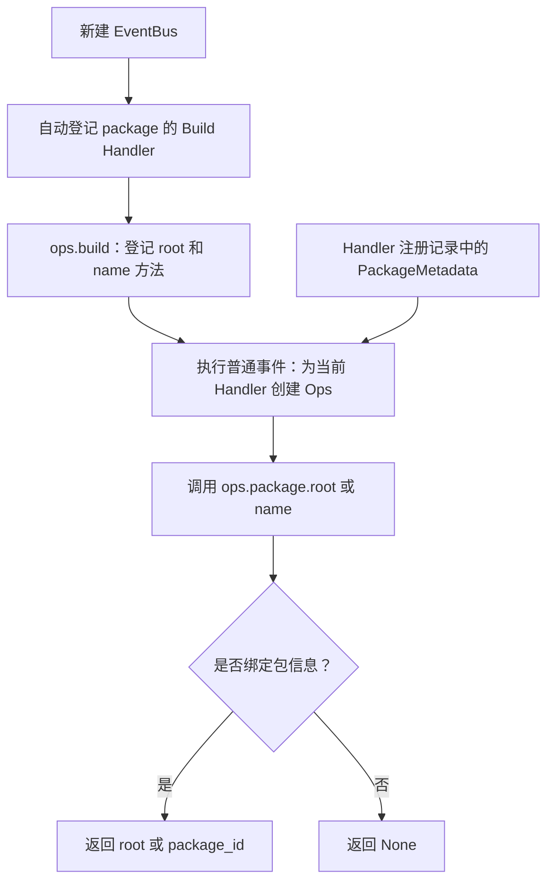

# ops.package 包信息读取能力设计方案

## 1. 元信息

| 项 | 值 |
| --- | --- |
| 类型、编号 | feature，`F_06 / ops-package` |
| 建档日期 | 2026-10-30 |
| 范围 | Core Events 的 `ops.package.root()`、`ops.package.name()` 及扩展加载验证 |
| 方案成熟度 | 已确认；返回规则采用本次需求指定的设计 |
| 计划条目 | [Events 开发计划 EV-06](../designs/events-development-plan.md#ev-06-handler-读取所属包信息)；当前进度在计划第 4 节维护 |
| 设计依据 | [S_01 Events 公共契约](../specs/S_01_events-contract.md#461-package-包信息能力) |
| 关联 feature | [F_03 Builder/Ops](F_03_ev03-builder-ops.md)、[F_04 Build 与业务调用](F_04_ev04-event-bus-integration.md) |
| 验证摘要 | 两个仓库的相关回归均为 573 passed、1 skipped；包信息专项和文档示例已验证，见第 7 节 |
| 需求来源 | 本次 ops.package 检查与迁移需求；未关联 Issue 或 PR |

## 2. 背景、目标与范围

扩展 Handler 有时需要读取自己所属包的 ID，或根据包根目录找到随包提供的文件。
本特性让 Handler 在执行时通过 `await ops.package.name()` 和 `await ops.package.root()` 取得这些信息，
不必从事件输入、会话数据或当前工作目录中猜测。

`name()` 返回包 ID，不是 manifest 中用于界面展示的 `displayName`。
没有绑定包信息时，两个方法都返回 Python 的 `None`，这是允许的正常结果。
平台预置的 BUILTIN Handler 和 CORE Handler 都可以得到 `None`。
扩展包也可以登记 BUILTIN Handler；这类 Handler 绑定了包信息，仍返回实际包 ID 和包根目录。

本次完成能力实现、预置登记、使用说明和测试。两个方法只读取信息，不触发新的业务事件，
也不读写包内文件。业务 Handler 是否使用这些信息，由各自的调用代码决定；本次不增加业务触发入口。

## 3. 设计约束与已核实前提

- 每个 Handler 使用框架为本次执行创建的 `EventHandlerOps`。包信息来自该 Handler 的注册记录，
  CORE 的包信息为 `None`；会话不决定包归属。
- 使用现有 `ops.build` 构建流程。新建 EventBus 只登记 Build Handler，完成 Build 后才可触发普通事件。
  `Registry.init(bus)` 已经负责 Build，使用它时不再手工重复 Build。
- 扩展作者通过受限的 `ExtensionRegistrar` 登记 Handler，不传入 `package_metadata`。
  Runtime 发布 Handler 时填入 Plan 中的包信息，相关契约见
  [Extension S_02](../../../extension/docs/specs/S_02_registry-and-bus.md#4-bus-发布)。
- Events 不导入 Extension 的包管理实现。新能力只依赖已有 `PackageMetadata`。

没有影响本次实现的待决问题。

## 4. 总体方案与设计取舍

### 4.1 方案概览

构建时只把两个异步函数登记到 Builder。执行普通事件时，框架才为当前 Handler 绑定包信息；
方法每次从这个 Ops 对象读取字段，因此同一能力目录可以服务不同的包。



图中的注册、构建和调用是三个步骤。Build 不读取某个包的信息，两个方法也不会推进当前事件链。

### 4.2 关键决策

| 决策 | 选择与原因 |
| --- | --- |
| 直接读取现有包信息 | 数据已绑定在当前 Ops 上，无需新增查询事件或依赖包管理器 |
| 缺少包信息时返回 `None` | 内置 Handler 没有扩展包归属是正常情况；调用方可据此跳过包内文件处理 |
| `name()` 使用 `package_id` | 包 ID 是登记时保存的身份，展示名称不能替代包 ID |
| 按包信息判断返回值 | USER 和 BUILTIN 都可以属于扩展包，不能仅凭 Handler 层级判定是否有包 |

### 4.3 替代方案与排除理由

不从事件输入、Session 或进程工作目录推断包信息：这些数据表示本次业务请求或执行环境，
不能说明当前 Handler 的包归属。不新增包查询事件：当前操作只是读取两个已有字段，额外的事件链没有必要。
不在 `root()` 内补齐或重新解析路径：安装后的绝对包根已经由 Extension 提供，方法应保留登记值。

## 5. 使用方式与实现

### 5.1 方法、上下文和返回值

完整方法契约见 [S_01 第 4.6.1 节](../specs/S_01_events-contract.md#461-package-包信息能力)。
调用者不传参数，也不手工传入 Ops。两个方法没有文件操作、包加载或事件触发等副作用。
它们不要求存在 Session；返回的包信息与本次 Session 的 ID、目录和 metadata 无关。

复用的构建事件是 `ops.build`：输入为 `None`，匹配模式为 `{}`，输出为 `EventHandlerOpsBuilder`。
输入、输出 Validator 和匹配规则沿用现有定义，本次不新增事件类型、Matcher 或 Validator。
CORE 创建 Builder，新增的 BUILTIN 先调用 `await event_next(event)`，再向同一个 Builder 添加 `package` 能力。

没有包信息时返回 `None`；有包 ID 但没有 `root` 时，`name()` 返回包 ID，`root()` 返回 `None`。
Runtime 安装发布的包根目录是绝对路径；直接使用 EventBus 注册接口的调用者自行提供包信息，
两个方法不校验包来源，也不把返回值作为文件访问授权。

### 5.2 Handler 与登记示例

#### 5.2.1 读取包信息并继续当前事件链

下面是扩展入口文件的可用写法。它读取自己的包信息，然后继续当前事件链，保留下游返回值。
`tool.call` 是本例选择的已登记业务事件；实际扩展应使用宿主已经提供的事件及其合法匹配字段。

```python
from openjiuwen.core.events import Event, EventHandlerOps, EventNext
from openjiuwen.core.extension import ExtensionRegistrar


async def handle_tool_call(
    event: Event,
    ops: EventHandlerOps | None,
    event_next: EventNext,
) -> object:
    assert ops is not None  # 普通事件执行前，宿主已经完成 ops.build。
    root = await ops.package.root()
    name = await ops.package.name()
    if root is not None and name is not None:
        # 此处可以根据包信息选择处理方式；本例只展示读取，不访问文件。
        assert root.is_absolute()
    return await event_next(event)


class Extension:
    def register(self, registrar: ExtensionRegistrar) -> None:
        registrar.register_event_handler("tool.call", handle_tool_call, {})


def create_extension() -> Extension:
    return Extension()
```

`root()` 和 `name()` 本身不改变事件输入或下游输出。Handler 如需加工或短路，仍须返回原业务事件允许的类型；
不能为了返回包信息而任意改变业务输出结构。完整 Handler 控制方式见
[开发指南第 4 节](../designs/events-extension-development-guide.md#4-新增-handler)。

#### 5.2.2 在教学事件中返回包信息

下面的 Handler 继续下游，并用一个固定的示例输出类型展示包信息。
本例只适用于输出约定为此字典结构的教学事件，不能直接替换业务事件的输出类型。

```python
from openjiuwen.core.events import Event, EventHandlerOps, EventNext
from openjiuwen.core.extension import ExtensionRegistrar


async def package_info(
    event: Event,
    ops: EventHandlerOps | None,
    event_next: EventNext,
) -> object:
    assert ops is not None  # 普通事件执行前已完成 ops.build。
    root = await ops.package.root()
    name = await ops.package.name()
    result = await event_next(event)
    return {"root": None if root is None else str(root), "name": name, "result": result}


class Extension:
    def register(self, registrar: ExtensionRegistrar) -> None:
        # 宿主需预先定义这个教学事件；空模式匹配该事件的所有输入。
        registrar.register_event_handler("example.package_info", package_info, {})


def create_extension() -> Extension:
    return Extension()
```

`package_info` 调用两个方法后仍需显式调用 `event_next(event)`，能力方法不会代为推进事件链。
注意保留 `None`：不要直接使用 `str(root)`，否则无根目录时会变成字符串 `"None"`。

### 5.3 执行函数与生产登记

新增文件为 [builtins/handler_ops/package.py](../../builtins/handler_ops/package.py)：

| 函数签名 | 职责 |
| --- | --- |
| `async def package_root(ops: EventHandlerOps) -> Path \| None` | 读取 `ops.package_metadata.root`；无包信息返回 `None` |
| `async def package_name(ops: EventHandlerOps) -> str \| None` | 读取 `ops.package_metadata.package_id`；无包信息返回 `None` |
| `async def build_package_ops(event: Event, ops: EventHandlerOps \| None, event_next: EventNext) -> EventHandlerOpsBuilder` | 在下游返回的 Builder 中登记两个方法 |
| `def register(bus: ExtensionEventBus) -> None` | 将上述 Build Handler 登记为 `ops.build` 的 BUILTIN，模式为 `{}` |

`bootstrap.register_builtins()` 按现有顺序扫描 `event_types`、`handler_ops`、`event_handlers`，
因此新文件自动进入 EventBus 初始化流程，不需要宿主另行登记。
以上可用性以预置 Build Handler 被实际执行为前提；宿主若短路 Build 并返回自己的 Builder，
需要自行保留所需能力，框架不会事后补齐。
`ops.build` 的 CORE、普通 Handler 故障隔离和取消传播均沿用现有契约。
两个读取方法没有内部等待点，也不添加重试或异常转成功值的处理。

## 6. 影响面与实施安排

| 位置 | 本次内容 |
| --- | --- |
| `builtins/handler_ops/package.py` | 能力函数、Build Handler 和自动发现入口 |
| `tests/unit_tests/core/events/test_ops_package.py` | 从真实 Bus 构建并调用，覆盖返回值、身份和会话隔离、失败与取消 |
| `tests/unit_tests/core/events/test_event_bus_registration.py` | 注册及注销断言保留初始化时已存在的预置 Handler，并检查其未被意外修改 |
| `tests/unit_tests/core/extension/test_registry_ops_package.py` | 用 Registry 安装真实临时扩展包，验证 Runtime 自动绑定包信息及卸载 |
| S_01、开发指南、开发计划 | 同步方法契约、开发入口和验收关联；详细示例集中在本特性文档 |

保留已有 `PackageMetadata` 和注册接口；新增 `package` 命名空间由平台预置，宿主无需自行创建同名能力。
扩展包加载和业务调用方式沿用原流程，本次不修改业务调用方。
迁移到目标仓库时按实际文档和历史最大编号使用 `F_06`，不覆盖已有特性文档。

## 7. 验证设计、记录与结论

### 7.1 验证设计

| 验证 ID | 前提与操作 | 预期结果及证明方式 |
| --- | --- | --- |
| EV-06-V-01 | 新建 Bus 并执行正常 Build，再从普通 Handler 调用两个方法 | 无需手工补登记；构建不执行读取方法，已有自定义能力可同时使用 |
| EV-06-V-02 | USER、BUILTIN 分别使用包信息、无包信息和缺少 root 的包信息；CORE 也读取方法 | 返回对应字段或合法的 `None`；CORE 不继承前面 Handler 的包信息 |
| EV-06-V-03 | 在同链、嵌套事件及并发 Session 中调用；事件和会话含有其他包信息 | 每个 Handler 只看到自己的登记信息，会话也保持各自的值 |
| EV-06-V-04 | Build 前调用普通事件、使用非法调用参数、CORE 失败，并在读取后取消等待下游的任务 | 按现有错误及取消契约处理；不伪造包信息、不重复执行下游 |
| EV-06-V-05 | Registry 初始化并安装临时扩展包，由其 USER/BUILTIN Handler 调用两个方法，最后卸载 | 自动取得实际安装目录和 manifest 包 ID，区别于展示名称；卸载后只执行业务 CORE |
| EV-06-V-06 | 运行 Events、Extension 与 callback 回归及改动文件的静态检查 | 保留原有行为；检查改动和文档引用，不迁移排除文件 |

### 7.2 实际执行与证据

| 日期、范围 | 环境与命令 | 实际结果 |
| --- | --- | --- |
| 2026-10-30，原实现初步验证 | 开发仓 `.venv`，`python -m pytest -q -o addopts= tests/unit_tests/core/events/test_ops_package.py tests/unit_tests/core/events/test_event_bus_registration.py` | 23 passed；只有既有 Pydantic 弃用提示 |
| 2026-10-30，开发仓补充验证 | 开发仓 `.venv`，执行下列命令 | 包信息专项 19 passed；Events、Extension、callback 回归 573 passed、1 skipped |
| 2026-10-30，开发仓静态检查 | 本次 4 个 Python 改动文件 | Ruff、格式和 codespell 通过；生产文件 Pylint 10.00/10；限定改动文件的 mypy 通过 |
| 2026-10-30，首次验收时的文档检查 | 4 份改动文档，检查相对链接、锚点及 Python 语法；将两个新增示例分别作为扩展包安装并调用 | 26 个本地链接有效，两个示例均经 Registry 安装调用通过 |
| 2026-10-30，目标仓迁移后复核 | 目标仓自己的源码和 `.venv`，执行相同回归及改动文件检查；两个文档示例也分别安装调用 | 573 passed、1 skipped；Ruff、格式、codespell、限定改动文件的 mypy 通过，生产文件 Pylint 10.00/10；两个示例通过 |

在对应仓库根目录、使用该仓库 Python 环境运行：

```text
python -m pytest -q -o addopts= tests/unit_tests/core/events/test_ops_package.py tests/unit_tests/core/extension/test_registry_ops_package.py
python -m pytest -q -o addopts= tests/unit_tests/core/events/ tests/unit_tests/core/extension/ tests/unit_tests/core/runner/callback/
git diff --check
git diff --cached --check
```

静态检查逐项针对下面四个文件执行；PowerShell 中可用数组准确限定范围：

```powershell
$changedPython = @(
    'openjiuwen/core/events/builtins/handler_ops/package.py',
    'tests/unit_tests/core/events/test_ops_package.py',
    'tests/unit_tests/core/events/test_event_bus_registration.py',
    'tests/unit_tests/core/extension/test_registry_ops_package.py'
)
python -m ruff check @changedPython
python -m ruff format --check @changedPython
python -m codespell @changedPython
python -m pylint openjiuwen/core/events/builtins/handler_ops/package.py
python -m mypy --follow-imports=skip @changedPython
```

项目环境缺少 codespell，本次将 2.4.3 安装到仓库外的独立检查目录，加载该工具后运行，
没有修改项目依赖或锁文件。上述复现命令假定所用环境已安装检查工具。
mypy 只检查改动文件，不递归检查依赖模块；未将全仓类型检查记为通过。
回归跳过的 1 项是既有符号链接测试，原因是 Windows 当前环境不允许创建符号链接。
测试中的 2 条 Pydantic 弃用提示来自既有公共客户端模型。

### 7.3 验证结论

V-01～V-05 已通过真实 Bus 和临时扩展包验证，覆盖正常结果、合法 `None`、
构建登记、会话与包身份隔离、嵌套调用、失败和取消。V-06 的开发仓回归及改动文件检查已通过，
目标仓迁移后的相同复核也已通过。两个仓库迁移的 8 个文件内容一致；锁文件、排除的示例目录和目标仓原有
`main.py` 均经哈希对比确认未改动。验收支持“定义、登记与能力调用通过验证”，不代表原业务入口新增了调用。

## 8. 已知遗留

本次承诺范围内未发现未解决的功能缺陷。
两个方法提供的是注册时的包信息，不证明任意文件仍然存在或当前调用具有访问权限。
真实业务 Handler 对包信息的使用不在本次接入范围，测试中的业务事件用于验证定义、登记与能力调用。

## 9. 参考资料

- [Events 开发指南](../designs/events-extension-development-guide.md#54-内置-package-能力)：通用开发步骤与预置能力入口。
- [Extension S_02](../../../extension/docs/specs/S_02_registry-and-bus.md)：Runtime 发布包信息的契约。
- [Extension F_04](../../../extension/docs/features/F_04_bus-wiring.md)：扩展 Handler 发布与卸载的实现方案。

## 10. 文档修订记录

### 2026-10-30 文档职责调整

- 开发计划的开头只保留范围和维护规则；具体负责人、状态和验收证据统一在进度表维护。EV-06 负责人确认为李志远。
- 开发指南只保留包信息能力的简要介绍和链接；原指南中的详细示例移入本特性第 5.2.2 节。
- S_01 保留方法签名、返回值和调用边界；通用 Build 规则归入 Builder 章节，扩展加载的包信息规则引用 Extension S_02。
- 本次未修改实现和测试。4 份文档的 27 个本地链接、章节锚点、Python 示例语法及差异检查通过；第 7.2 节保留首次验收的测试记录，未重复运行业务测试。
