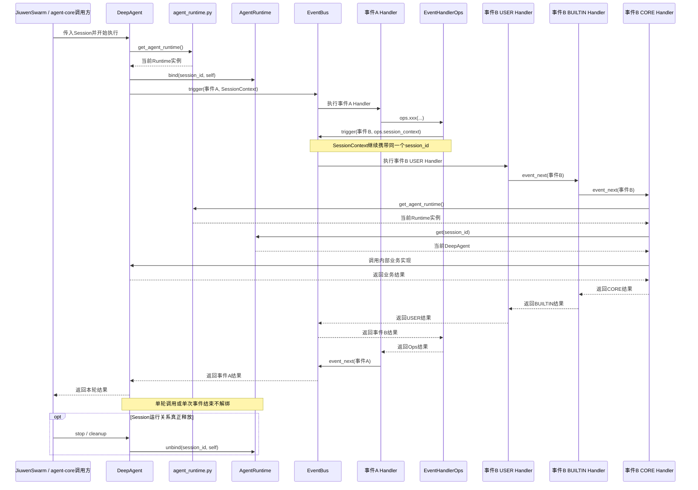

# EV-07 业务事件、嵌套触发与 AgentRuntime 集成设计方案

> 建档日期：2026-10-31
>
> 方案状态：待实现（`AgentRuntime` 与 DeepAgent bind/unbind 已部分落地；业务 EventType、CORE 经 Runtime 执行业务、Ops 嵌套触发待实现）
>
> 计划条目：[Events 特性开发计划 EV-07](../designs/events-development-plan.md#ev-07-业务-eventtype-与-agentruntime-集成)
>
> 前置特性：[F_04 Build 与业务调用集成](F_04_ev04-event-bus-integration.md)、[F_05 Handler 容错](F_05_ev05-handler-fault-tolerance.md)
>
> 设计依据：[S_01](../specs/S_01_events-contract.md)、[设计概览](../designs/events-overview.md)、[扩展开发指南](../designs/events-extension-development-guide.md)
>
> 协作实现：`openjiuwen/core/single_agent/agent_runtime.py`、`openjiuwen/harness`

本文说明如何在静态注册的 CORE Handler 中执行真实 Agent 业务、如何通过 Ops 嵌套触发完整事件链，以及 `SessionContext.session_id` 与进程级 `AgentRuntime` 的分工。示意代码与伪代码不代表已实现的最终 API。

## 1. 目标

### 1.1 支持事件嵌套

事件 A 的 Handler 可以通过 Ops 触发事件 B：

```text
事件A Handler
  → ops.xxx()
  → 触发事件B
  → B执行完整USER → BUILTIN → CORE
  → B返回结果
  → A Handler继续执行
```

### 1.2 CORE Handler 执行真实业务

CORE Handler 在 EventBus 初始化阶段静态注册，此时 DeepAgent 尚未创建。

事件执行时，CORE Handler 需要根据当前 `SessionContext.session_id` 找到真实 DeepAgent：

```text
CORE Handler
  → 获取session_id
  → get_agent_runtime()
  → runtime.get(session_id)
  → 获取当前DeepAgent
  → 执行真实业务逻辑
```

### 1.3 支持不同 Agent 创建方式

无论 DeepAgent 由 agent-core 还是 JiuwenSwarm 创建，只要进入 agent-core 的 Session 执行链，就使用同一套注册和事件机制：

```text
DeepAgent获得Session
  → 自动绑定AgentRuntime
  → 事件机制可用
```

JiuwenSwarm 不单独维护 AgentRuntime。

## 2. 核心设计

### 2.1 方案总结

- agent-core 中新增进程唯一的 `AgentRuntime`，并通过 `get_agent_runtime()` 提供统一获取入口。
- DeepAgent 在获得 Session 后绑定当前运行实例；
- SessionContext 在根事件和嵌套事件之间传递 `session_id`；
- 静态 CORE Handler 执行时先获取 AgentRuntime，再根据 `session_id` 找到真实 DeepAgent 并调用内部业务实现。

```text
get_agent_runtime()统一获取AgentRuntime
+ DeepAgent执行期间bind/unbind
+ SessionContext在事件之间传递session_id
+ CORE Handler执行时查询真实DeepAgent
+ Ops触发新的完整事件链
```

### 2.2 整体模块流程

模块关系：

```text
openjiuwen/core/single_agent/agent_runtime.py
├── AgentRuntime
└── get_agent_runtime()

DeepAgent（harness）
└── 执行期间bind/unbind

CORE Handler（events/builtins 或业务登记）
└── 执行时get(session_id)

SessionContext
└── 在嵌套事件之间传递session_id
```

完整执行流程：



### 2.3 AgentRuntime 设计

#### 2.3.1 职责

`AgentRuntime` 是 agent-core 进程内的全局运行实例注册表，只维护当前 Session 与运行实例的对应关系：

```text
AgentRuntime
└── session_id → BaseAgent
```

同一个 `session_id` 同一时刻只对应一个运行实例；同一个运行实例可以服务多个 Session。

当前实现使用弱引用持有 `BaseAgent`，实例被回收后 `get` 自然返回 `None`，无需 CORE Handler 参与清理。

#### 2.3.2 覆盖场景

| 场景 | 注册对象 | bind 时机 | unbind 时机 |
| --- | --- | --- | --- |
| JiuwenSwarm 创建 DeepAgent | `DeepAgent` | `start(session)` 后、首个事件前 | Session Adapter cleanup / `stop()` |
| JiuwenSwarm 创建 Team | `TeamAgent`（`BaseAgent`） | `TeamAgent.invoke/stream` 获得 Team Session 后 | Team Session Runtime 释放 / Team cleanup |
| agent-core 直接调用 | `BaseAgent` | `invoke/stream` 获得 Session 后 | Agent 或 Session 运行关系真正释放 |
| 临时/常驻 SubAgent | 子 `DeepAgent` | 子 Agent 获得子 Session 后 | SubAgent `close/remove` |
| Agent 重建 | 新实例 | 新实例接管 Session 时直接 bind | 旧实例 unbind 时做身份校验 |
| Session 已销毁 | 无 | 不 bind | `get` 返回 `None` |

无论实例由哪个模块创建，只要获得真实 Session，就通过同一个 `AgentRuntime` 建立 `session_id` 与运行实例的对应关系。

#### 2.3.3 整体运行流程

```text
BaseAgent构造
  → 此时没有Session，不绑定

DeepAgent.start / BaseAgent.invoke/stream
  → 获得Session
  → bind(session_id, runtime)
  → 事件和嵌套事件通过session_id查找BaseAgent

单次调用结束
  → 不代表Session运行关系释放，不解绑

长期运行时stop/cleanup
  → unbind(session_id, runtime)

运行实例真正销毁
  → 弱引用注册关系自动清理
```

创建运行实例的一方负责绑定，Session 运行关系的生命周期所有者负责解绑。CORE Handler 只通过 `session_id` 查询，不持有具体运行实例。

#### 2.3.4 接口设计

```python
class AgentRuntime:
    def bind(
        self,
        session_id: str,
        runtime: BaseAgent,
    ) -> None:
        ...

    def get(
        self,
        session_id: str,
    ) -> BaseAgent | None:
        ...

    def unbind(
        self,
        session_id: str,
        runtime: BaseAgent,
    ) -> None:
        ...


_agent_runtime = AgentRuntime()


def get_agent_runtime() -> AgentRuntime:
    return _agent_runtime
```

- `bind`：在运行实例获得 Session 后、第一个事件触发前调用；`session_id` 已有绑定时直接替换。
- `get`：返回当前绑定的 `BaseAgent`；未绑定或已释放时返回 `None`，由 CORE Handler 根据事件语义决定如何处理。
- `unbind`：在 Session 与运行实例的关系真正释放时调用；只有当前绑定仍是传入实例时才删除，避免旧实例清理时误删新绑定。
- `get_agent_runtime`：返回当前进程使用的 `AgentRuntime`。DeepAgent、Runner 和 CORE Handler 都通过该函数获取注册表，不直接引用模块内实例。

### 2.4 CORE Handler 获取 AgentRuntime

CORE Handler 在 EventBus 初始化阶段静态注册，此时不获取 DeepAgent。事件真正执行时，CORE Handler 从 SessionContext 取得 `session_id`，通过 `get_agent_runtime()` 获取 Runtime，再查询当前 DeepAgent：

```text
core_handler(event, ops, next):
    session_id = ops.session_context.session_id
    runtime = get_agent_runtime()
    agent = runtime.get(session_id)

    return agent.xxx_internal(event.input)
```

完整获取链路：

```text
SessionContext.session_id
  → get_agent_runtime()
  → runtime.get(session_id)
  → 当前DeepAgent
  → 执行真实业务实现
```

OpsMethod 继续使用当前 Handler 的 SessionContext 触发嵌套事件，因此事件 B 会获得相同的 `session_id` 并独立执行完整的 USER → BUILTIN → CORE 链。CORE Handler 必须调用不会再次触发同名事件的内部业务方法，避免无限递归。

## 3. 最简示例

以下为结构伪代码，只表达职责和调用链。

### 3.1 `tool.register`

#### CORE Handler

```text
tool_register_core(event, ops, next):
    session_id = ops.session_context.session_id
    runtime = get_agent_runtime()
    agent = runtime.get(session_id)

    request = event.input
    return agent.ability_manager.register(request.tool)
```

#### 注册事件类型

```text
bus.register_event_type(
    "tool.register",
    matcher,
    tool_register_core
)
```

#### 注册普通 Handler

```text
tool_register_handler(event, ops, next):
    validate(event.input)
    return next(event)

bus.register_event_handler(
    "tool.register",
    tool_register_handler,
    match_pattern,
    BUILTIN
)
```

#### 业务入口直接触发

```text
bus.trigger(
    Event("tool.register", ToolRegisterInput(tool)),
    SessionContext(session_id)
)
```

#### 对应 Ops 方法

```text
ops_tool_register(ops, tool):
    return bus.trigger(
        Event("tool.register", ToolRegisterInput(tool)),
        ops.session_context
    )
```

执行链：

```text
tool.register USER
  → tool.register BUILTIN
  → tool.register CORE
  → get_agent_runtime()
  → runtime.get(session_id)
  → AbilityManager注册工具
```

### 3.2 `tool.call`

#### CORE Handler

```text
tool_call_core(event, ops, next):
    session_id = ops.session_context.session_id
    runtime = get_agent_runtime()
    agent = runtime.get(session_id)

    request = event.input
    return agent.execute_tool_internal(
        request.tool_name,
        request.arguments
    )
```

`execute_tool_internal()` 表示不会再次触发 `tool.call` 的内部实现。

#### 注册事件类型

```text
bus.register_event_type(
    "tool.call",
    matcher,
    tool_call_core
)
```

#### 注册普通 Handler

```text
tool_call_handler(event, ops, next):
    check_permission(event.input)
    return next(event)

bus.register_event_handler(
    "tool.call",
    tool_call_handler,
    match_pattern,
    BUILTIN
)
```

#### 业务入口直接触发

```text
bus.trigger(
    Event(
        "tool.call",
        ToolCallInput(tool_name, arguments)
    ),
    SessionContext(session_id)
)
```

#### 对应 Ops 方法

```text
ops_tool_call(ops, tool_name, arguments):
    return bus.trigger(
        Event(
            "tool.call",
            ToolCallInput(tool_name, arguments)
        ),
        ops.session_context
    )
```

#### 在事件 A Handler 中嵌套触发

```text
event_a_handler(event, ops, next):
    tool_result = ops.tool.call(
        "search",
        {"query": "OpenJiuwen"}
    )

    event_a_result = next(event)
    return tool_result, event_a_result
```

完整链路：

```text
事件A USER Handler
  → ops.tool.call()
  → trigger(tool.call, ops.session_context)

tool.call
  → USER
  → BUILTIN
  → CORE
  → get_agent_runtime()
  → runtime.get(session_id)
  → 执行真实工具

返回事件A Handler
  → next(event)
  → 继续事件A原事件链
```
